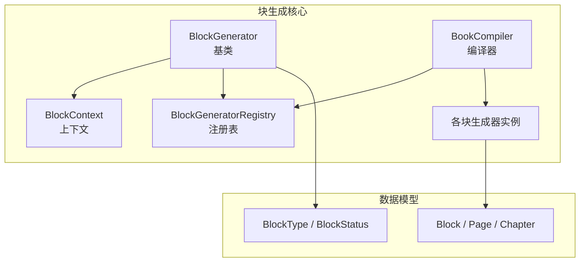
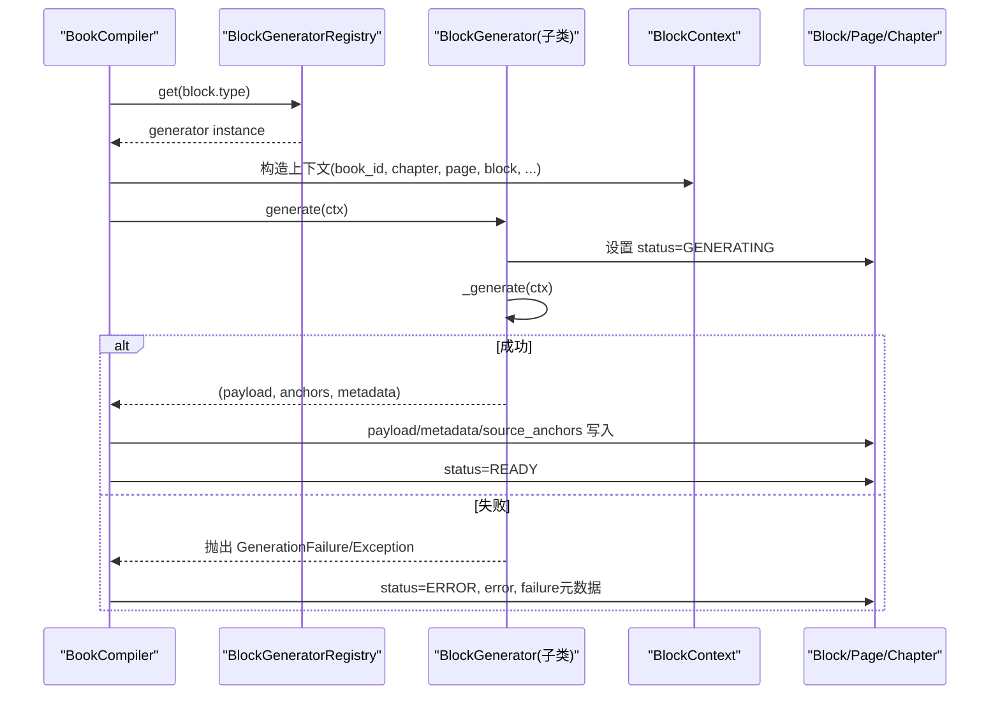
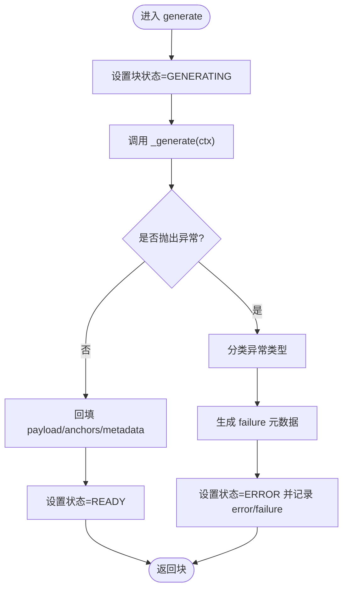
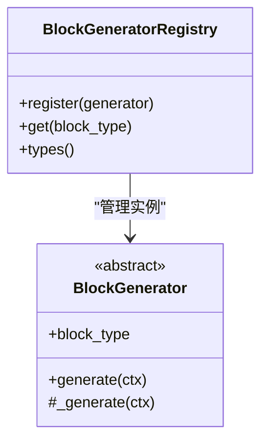
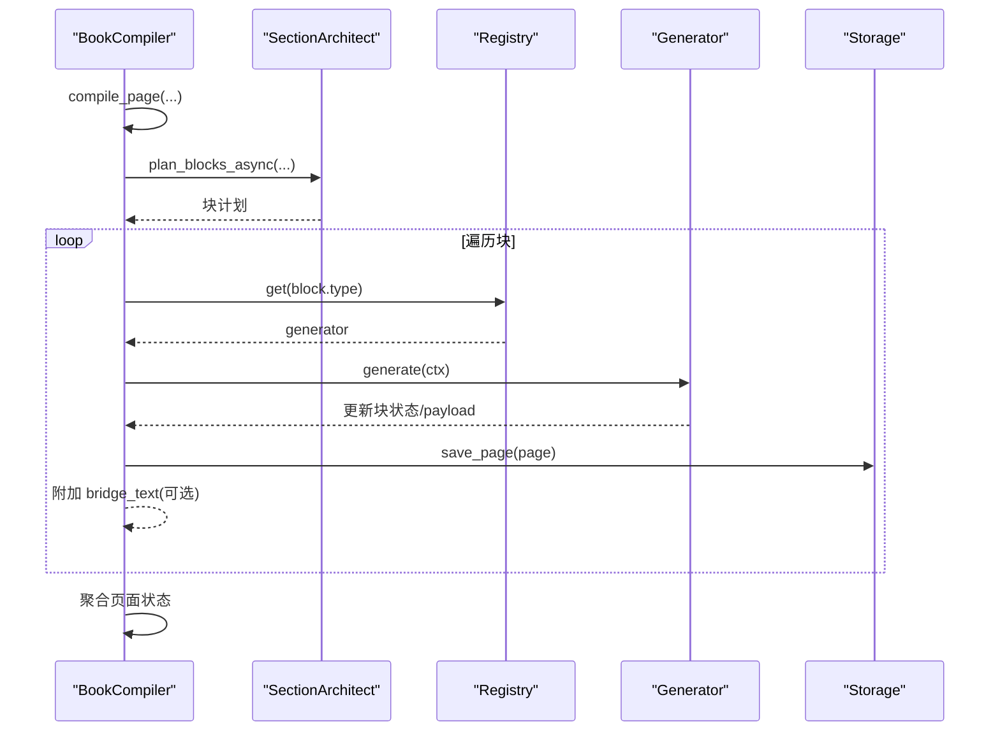
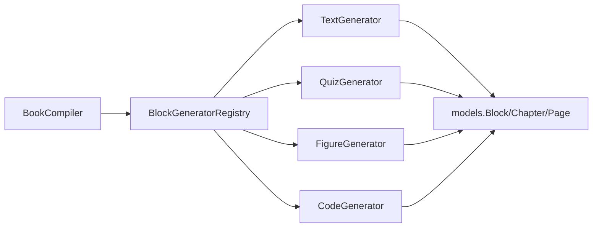

# 块基类与生成器架构

<cite>
**本文引用的文件**
- [base.py](file://deeptutor/book/blocks/base.py)
- [models.py](file://deeptutor/book/models.py)
- [compiler.py](file://deeptutor/book/compiler.py)
- [text.py](file://deeptutor/book/blocks/text.py)
- [quiz.py](file://deeptutor/book/blocks/quiz.py)
- [figure.py](file://deeptutor/book/blocks/figure.py)
- [code.py](file://deeptutor/book/blocks/code.py)
</cite>

## 目录
1. [简介](#简介)
2. [项目结构](#项目结构)
3. [核心组件](#核心组件)
4. [架构总览](#架构总览)
5. [详细组件分析](#详细组件分析)
6. [依赖关系分析](#依赖关系分析)
7. [性能考量](#性能考量)
8. [故障排查指南](#故障排查指南)
9. [结论](#结论)
10. [附录：自定义块生成器开发指南](#附录自定义块生成器开发指南)

## 简介
本文件系统性梳理 DeepTutor 的“块基类与生成器架构”，聚焦以下目标：
- BlockGenerator 抽象基类的设计模式与职责分离（generate() 与 _generate()）
- BlockContext 上下文对象的作用与属性使用（book_id、chapter、page、knowledge_bases 等）
- BlockGeneratorRegistry 注册表机制，如何动态发现并加载块生成器
- 错误处理机制：GenerationFailure 异常分类与失败元数据记录
- 块的生成状态管理与生命周期（GENERATING、READY、ERROR）
- 自定义块生成器的开发指南（继承 BaseBlock、实现渲染逻辑、注册新块类型）

## 项目结构
围绕块生成体系的核心代码集中在 book 模块下：
- 基类与注册表：blocks/base.py
- 数据模型与枚举：models.py
- 页面编译编排：compiler.py
- 具体块生成器示例：blocks/text.py、blocks/quiz.py、blocks/figure.py、blocks/code.py

图表来源
- [base.py:116-223](file://deeptutor/book/blocks/base.py#L116-L223)
- [compiler.py:69-190](file://deeptutor/book/compiler.py#L69-L190)
- [models.py:47-80](file://deeptutor/book/models.py#L47-L80)

章节来源
- [base.py:1-233](file://deeptutor/book/blocks/base.py#L1-L233)
- [compiler.py:1-369](file://deeptutor/book/compiler.py#L1-L369)
- [models.py:1-475](file://deeptutor/book/models.py#L1-L475)

## 核心组件
- BlockGenerator（抽象基类）
  - 定义 generate() 公共入口与 _generate() 抽象方法，负责状态切换、异常捕获与结果回填。
- BlockContext（上下文）
  - 为生成器提供 book_id、chapter、page、block、language、knowledge_bases、rag_enabled、exploration 等运行期信息。
- BlockGeneratorRegistry（注册表）
  - 维护 BlockType → Generator 实例映射，支持按类型查找；默认注册表在首次访问时懒加载所有内置生成器。
- BookCompiler（编译器）
  - 编排页面规划与块生成流程，构造 BlockContext，调用对应生成器，附加桥接文本，持久化并广播事件。
- 数据模型
  - Block、Page、Chapter、BlockType、BlockStatus 等描述块与页面的结构与状态。

章节来源
- [base.py:74-161](file://deeptutor/book/blocks/base.py#L74-L161)
- [base.py:164-223](file://deeptutor/book/blocks/base.py#L164-L223)
- [compiler.py:69-190](file://deeptutor/book/compiler.py#L69-L190)
- [models.py:326-381](file://deeptutor/book/models.py#L326-L381)

## 架构总览
下图展示了从编译器到具体生成器的调用链，以及上下文与模型的交互。

图表来源
- [compiler.py:194-249](file://deeptutor/book/compiler.py#L194-L249)
- [base.py:121-155](file://deeptutor/book/blocks/base.py#L121-L155)
- [base.py:164-177](file://deeptutor/book/blocks/base.py#L164-L177)

## 详细组件分析

### BlockGenerator 抽象基类
- 设计要点
  - generate() 是对外统一入口，负责：
    - 将块状态置为 GENERATING
    - 调用 _generate() 获取 payload、source_anchors、metadata
    - 捕获 GenerationFailure 与普通异常，统一转为 ERROR 状态并记录失败元数据
    - 成功后回填 payload、anchors、metadata，并将状态置为 READY
  - _generate() 由子类实现，返回三元组：(payload, source_anchors, metadata)
- 错误分类与元数据
  - 通过 _classify_failure 对异常消息进行关键词匹配，归类为 json_parse、empty_response、timeout、rate_limit、prompt_leak、provider_error、generator_error
  - _failure_metadata 生成包含 kind、message、retryable、source 的失败元数据，便于前端或运维侧诊断与重试策略

图表来源
- [base.py:121-155](file://deeptutor/book/blocks/base.py#L121-L155)
- [base.py:34-71](file://deeptutor/book/blocks/base.py#L34-L71)

章节来源
- [base.py:116-161](file://deeptutor/book/blocks/base.py#L116-L161)
- [base.py:34-71](file://deeptutor/book/blocks/base.py#L34-L71)

### BlockContext 上下文对象
- 作用
  - 为生成器提供跨块共享的运行期上下文，避免重复查询与耦合
- 关键属性
  - book_id：所属书籍标识
  - chapter：当前章节对象（标题、摘要、学习目标等）
  - page：当前页面对象（用于读取已有块、链接等）
  - block：当前待生成的块（含 params）
  - language：语言（en/zh），影响提示词与输出风格
  - knowledge_bases：知识图谱/知识库列表，primary_kb 取第一个
  - rag_enabled：是否允许 RAG 检索
  - exploration：探索报告（SourceExplorer 产出），供生成器复用检索结果，减少重复 LLM/RAG 调用
  - relevant_chunks(query, limit)：基于简单关键词重叠的轻量相关片段筛选
- 使用方式
  - 编译器在 compile_page 中为每个块构造 BlockContext，并传入 exploration 以复用探索阶段的结果

章节来源
- [base.py:74-114](file://deeptutor/book/blocks/base.py#L74-L114)
- [compiler.py:122-131](file://deeptutor/book/compiler.py#L122-L131)
- [models.py:280-318](file://deeptutor/book/models.py#L280-L318)

### BlockGeneratorRegistry 注册表机制
- 职责
  - 维护 BlockType → Generator 实例的映射，支持按类型查找
- 动态发现与加载
  - 默认注册表通过 _build_default_registry 懒加载，避免循环导入
  - 集中注册 Text、Callout、Quiz、UserNote、Figure、Interactive、Animation、Code、Timeline、FlashCards、DeepDive、ConceptGraph、Section 等生成器
- 扩展点
  - 新增块类型时，需在注册表中注册对应生成器实例

图表来源
- [base.py:164-223](file://deeptutor/book/blocks/base.py#L164-L223)

章节来源
- [base.py:164-223](file://deeptutor/book/blocks/base.py#L164-L223)

### 编译器 BookCompiler 与块生命周期
- 页面级流程
  - 若页面无块则先规划（SectionArchitect），生成块计划
  - 设置页面状态为 GENERATING，逐个块执行生成
  - 根据块并发度选择顺序或并行执行
  - 成功后附加 bridge_text（过渡段落），持久化并广播事件
  - 最终聚合页面状态：全部 READY→READY；全错→ERROR；部分错→PARTIAL
- 块级流程
  - 通过 registry.get(block.type) 获取生成器
  - 调用 generator.generate(ctx)，记录耗时与事件
  - 若 READY，尝试附加 bridge_text；否则记录错误

图表来源
- [compiler.py:88-190](file://deeptutor/book/compiler.py#L88-L190)
- [compiler.py:194-249](file://deeptutor/book/compiler.py#L194-L249)
- [compiler.py:305-365](file://deeptutor/book/compiler.py#L305-L365)

章节来源
- [compiler.py:69-190](file://deeptutor/book/compiler.py#L69-L190)
- [compiler.py:194-249](file://deeptutor/book/compiler.py#L194-L249)
- [compiler.py:305-365](file://deeptutor/book/compiler.py#L305-L365)

### 具体生成器示例
- TextGenerator
  - 使用提示词模板与 LLM 服务生成 Markdown 正文
  - 可结合 RAG 检索增强内容质量
  - 返回 payload 包含 format/body/role，附带 used_rag/kb 元数据
- QuizGenerator
  - 委托问题生成协调器，抽取题目并校验数量
  - 失败时抛出 GenerationFailure，便于上层重试
- FigureGenerator
  - 调用可视化管线生成静态图（svg/mermaid/chartjs）
  - 本地验证失败会触发修复流程，仍失败则抛 GenerationFailure
- CodeGenerator
  - 严格 JSON 响应，校验代码非空且不含 prompt leak
  - 失败时抛出 GenerationFailure

章节来源
- [text.py:30-80](file://deeptutor/book/blocks/text.py#L30-L80)
- [quiz.py:14-66](file://deeptutor/book/blocks/quiz.py#L14-L66)
- [figure.py:25-118](file://deeptutor/book/blocks/figure.py#L25-L118)
- [code.py:21-65](file://deeptutor/book/blocks/code.py#L21-L65)

## 依赖关系分析
- 低耦合高内聚
  - 生成器仅依赖 BlockContext 与 models，不直接感知编译器细节
  - 编译器通过注册表解耦具体生成器实现
- 外部依赖
  - 部分生成器依赖 LLM 服务、RAG、可视化管线等，均通过内部服务封装
- 潜在循环依赖
  - 通过懒加载 import 避免循环依赖（如默认注册表构建时再导入各生成器）

图表来源
- [base.py:164-223](file://deeptutor/book/blocks/base.py#L164-L223)
- [compiler.py:69-190](file://deeptutor/book/compiler.py#L69-L190)
- [models.py:326-381](file://deeptutor/book/models.py#L326-L381)

章节来源
- [base.py:164-223](file://deeptutor/book/blocks/base.py#L164-L223)
- [compiler.py:69-190](file://deeptutor/book/compiler.py#L69-L190)
- [models.py:326-381](file://deeptutor/book/models.py#L326-L381)

## 性能考量
- 并发控制
  - CompilerOptions.block_concurrency 控制单页内块生成的最大并发数，Phase 1 默认串行以保证流式顺序，后续阶段可提高并发提升吞吐
- 复用探索结果
  - BlockContext.exploration 携带 SourceExplorer 的多查询检索结果，生成器可通过 relevant_chunks 快速定位相关片段，避免重复 RAG 调用
- 增量持久化
  - persist_after_each_block=True 保证每次块完成后立即落盘，提高容错与恢复能力
- 桥接文本优化
  - 仅在块 READY 后附加 bridge_text，失败路径跳过，减少不必要 LLM 调用

[本节为通用指导，不直接分析具体文件]

## 故障排查指南
- 常见错误分类
  - json_parse：JSON 解析失败
  - empty_response：LLM 未返回有效内容
  - timeout：超时或停滞
  - rate_limit：速率限制（429）
  - prompt_leak：检测到 prompt 泄漏（如 <think>）
  - provider_error：LLM/Provider 错误
  - generator_error：其他生成器内部错误
- 失败元数据
  - 每个失败块会在 metadata.failure 中记录 kind、message、retryable、source，便于前端展示与后端重试
- 排查步骤
  - 检查块状态是否为 ERROR，查看 error 字段与 metadata.failure
  - 确认对应 BlockType 已在注册表中注册
  - 对于 LLM/Provider 错误，检查配置与限流策略
  - 对于 prompt leak，调整提示词或过滤逻辑

章节来源
- [base.py:34-71](file://deeptutor/book/blocks/base.py#L34-L71)
- [compiler.py:216-249](file://deeptutor/book/compiler.py#L216-L249)

## 结论
该架构通过清晰的职责分离（generate/_generate）、统一的上下文传递（BlockContext）、可扩展的注册表机制（BlockGeneratorRegistry）以及健壮的错误处理与状态管理，实现了模块化、可维护、易扩展的块生成系统。编译器作为编排中心，确保页面级流程可控、可观测、可恢复。

[本节为总结性内容，不直接分析具体文件]

## 附录：自定义块生成器开发指南
- 步骤概览
  1. 新建块类型
     - 在 models.py 的 BlockType 中添加新类型（如 MY_BLOCK）
  2. 创建生成器类
     - 继承 BlockGenerator，覆盖 block_type 与 _generate(ctx)
     - 在 _generate 中读取 ctx.block.params、ctx.chapter、ctx.page 等信息
     - 可选择使用 ctx.knowledge_bases、ctx.rag_enabled、ctx.exploration.relevant_chunks 增强内容
     - 返回 (payload, source_anchors, metadata)
     - 遇到不可恢复错误时抛出 GenerationFailure
  3. 注册新生成器
     - 在 base.py 的 _build_default_registry 中导入并注册你的生成器实例
  4. 测试与调试
     - 使用 BookCompiler.compile_page 驱动页面编译，观察块状态与事件
     - 检查 metadata.failure 与 error 字段定位问题
- 参考实现
  - TextGenerator：文本生成与 RAG 集成
  - QuizGenerator：委托协调器生成题目
  - FigureGenerator：可视化管线与本地验证
  - CodeGenerator：严格 JSON 响应与安全检查

章节来源
- [models.py:55-80](file://deeptutor/book/models.py#L55-L80)
- [base.py:116-161](file://deeptutor/book/blocks/base.py#L116-L161)
- [base.py:190-223](file://deeptutor/book/blocks/base.py#L190-L223)
- [text.py:30-80](file://deeptutor/book/blocks/text.py#L30-L80)
- [quiz.py:14-66](file://deeptutor/book/blocks/quiz.py#L14-L66)
- [figure.py:25-118](file://deeptutor/book/blocks/figure.py#L25-L118)
- [code.py:21-65](file://deeptutor/book/blocks/code.py#L21-L65)