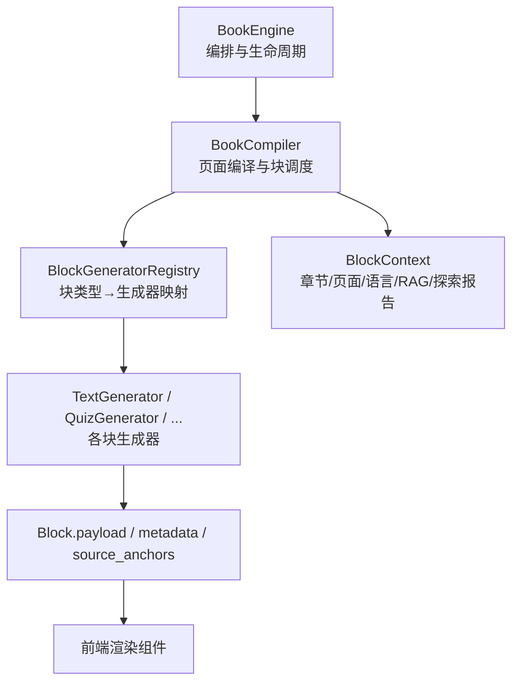
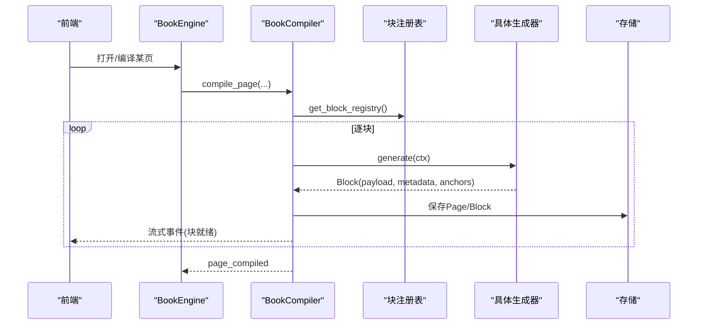
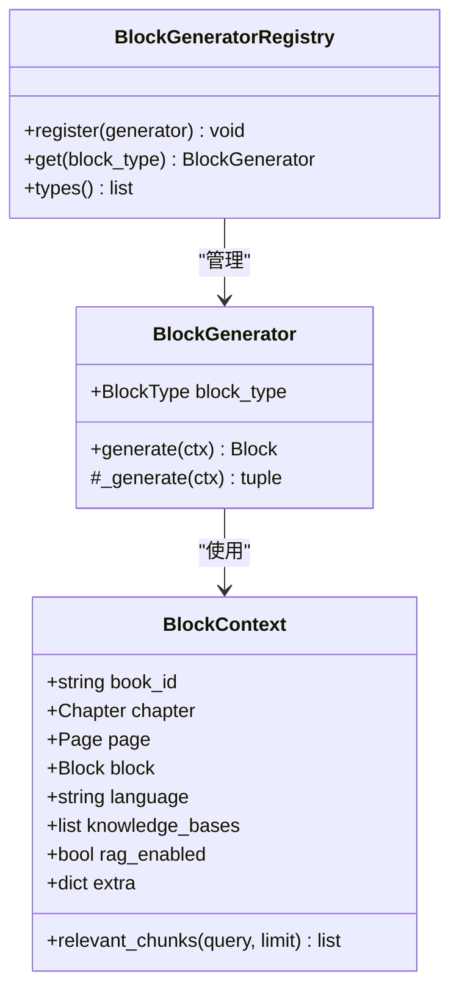
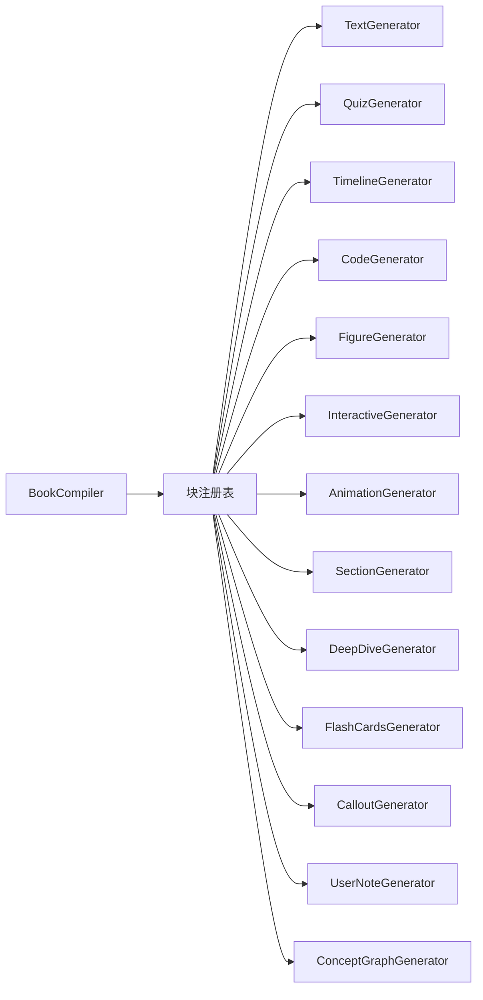

# 块类型系统

<cite>
**本文引用的文件**
- [base.py](file://deeptutor/book/blocks/base.py)
- [__init__.py](file://deeptutor/book/blocks/__init__.py)
- [models.py](file://deeptutor/book/models.py)
- [engine.py](file://deeptutor/book/engine.py)
- [compiler.py](file://deeptutor/book/compiler.py)
- [text.py](file://deeptutor/book/blocks/text.py)
- [quiz.py](file://deeptutor/book/blocks/quiz.py)
- [timeline.py](file://deeptutor/book/blocks/timeline.py)
- [code.py](file://deeptutor/book/blocks/code.py)
- [figure.py](file://deeptutor/book/blocks/figure.py)
- [concept_graph.py](file://deeptutor/book/blocks/concept_graph.py)
- [deep_dive.py](file://deeptutor/book/blocks/deep_dive.py)
- [flash_cards.py](file://deeptutor/book/blocks/flash_cards.py)
- [interactive.py](file://deeptutor/book/blocks/interactive.py)
- [callout.py](file://deeptutor/book/blocks/callout.py)
- [user_note.py](file://deeptutor/book/blocks/user_note.py)
- [animation.py](file://deeptutor/book/blocks/animation.py)
- [section.py](file://deeptutor/book/blocks/section.py)
</cite>

## 目录
1. [简介](#简介)
2. [项目结构](#项目结构)
3. [核心组件](#核心组件)
4. [架构总览](#架构总览)
5. [详细组件分析](#详细组件分析)
6. [依赖关系分析](#依赖关系分析)
7. [性能考量](#性能考量)
8. [故障排查指南](#故障排查指南)
9. [结论](#结论)
10. [附录](#附录)

## 简介
本文件系统性说明 DeepTutor 的“块类型系统”，覆盖 Block 基类与扩展机制、内置块类型的参数定义、渲染逻辑与交互行为，以及块的序列化/反序列化、版本兼容、状态管理与元数据。同时提供自定义块类型的开发指南（继承 BaseBlock、实现渲染方法、注册新块类型），并给出使用示例与最佳实践。

## 项目结构
块类型系统位于 book 模块中，围绕以下关键层次组织：
- 数据模型层：统一描述 Book/Page/Chapter/Block 等实体及其枚举（如 BlockType、BlockStatus）。
- 生成器层：每个块类型对应一个 Generator，负责将 Block.params 与上下文转换为 Block.payload。
- 编排层：BookEngine 驱动阶段流程；BookCompiler 负责单页块的计划与生成。
- 注册表：集中管理所有块类型到生成器的映射，支持懒加载避免循环依赖。

图表来源
- [engine.py:100-116](file://deeptutor/book/engine.py#L100-L116)
- [compiler.py:69-84](file://deeptutor/book/compiler.py#L69-L84)
- [base.py:164-223](file://deeptutor/book/blocks/base.py#L164-L223)

章节来源
- [models.py:29-80](file://deeptutor/book/models.py#L29-L80)
- [base.py:116-162](file://deeptutor/book/blocks/base.py#L116-L162)
- [compiler.py:69-190](file://deeptutor/book/compiler.py#L69-L190)

## 核心组件
- Block 与 BlockType/BlockStatus：定义原子内容单元、类型枚举与状态机。
- BlockContext：为生成器提供书/章/页/语言/RAG开关/探索报告等上下文。
- BlockGenerator：抽象基类，封装 generate() 生命周期与错误分类，子类仅实现 _generate()。
- BlockGeneratorRegistry：内存注册表，集中注册所有块类型生成器，支持 types() 查询。
- BookCompiler：按顺序或并发执行块生成，维护流式事件与持久化。
- BookEngine：顶层编排，驱动 ideation/spine/compilation 等阶段，注入 Overview 章节与概念图。

章节来源
- [models.py:326-346](file://deeptutor/book/models.py#L326-L346)
- [base.py:74-162](file://deeptutor/book/blocks/base.py#L74-L162)
- [base.py:164-223](file://deeptutor/book/blocks/base.py#L164-L223)
- [compiler.py:69-190](file://deeptutor/book/compiler.py#L69-L190)
- [engine.py:100-116](file://deeptutor/book/engine.py#L100-L116)

## 架构总览
块生成流水线从 BookEngine 触发，经 BookCompiler 规划页面与调度块，通过注册表查找对应 BlockGenerator，结合 BlockContext 调用 LLM/外部管线生成 payload，最终落盘并推送前端。

图表来源
- [engine.py:699-769](file://deeptutor/book/engine.py#L699-L769)
- [compiler.py:88-190](file://deeptutor/book/compiler.py#L88-L190)
- [base.py:121-155](file://deeptutor/book/blocks/base.py#L121-L155)

## 详细组件分析

### 基类与扩展机制
- BlockContext：携带 book_id/chapter/page/block/language/knowledge_bases/rag_enabled/exploration，并提供 relevant_chunks(query, limit) 快速筛选相关片段。
- BlockGenerator：
  - generate(ctx)：设置状态为 GENERATING，捕获异常并写入 failure 元数据，成功后置 READY。
  - _generate(ctx)：子类必须实现，返回 (payload, source_anchors, metadata)。
- 注册表：_build_default_registry() 懒导入并注册所有内置生成器，新增块只需在列表中添加类即可。

图表来源
- [base.py:74-162](file://deeptutor/book/blocks/base.py#L74-L162)
- [base.py:164-223](file://deeptutor/book/blocks/base.py#L164-L223)

章节来源
- [base.py:74-162](file://deeptutor/book/blocks/base.py#L74-L162)
- [base.py:164-223](file://deeptutor/book/blocks/base.py#L164-L223)

### 文本块（Text）
- 参数：chapter_title、chapter_summary、objectives、role、previous_block_summary 等。
- 渲染逻辑：基于提示词模板与可选 RAG 检索，生成 Markdown body；可附加 bridge_text 作为过渡段落。
- 交互行为：前端以 Markdown 渲染；role 控制写作视角（如 explanation、overview_intro、chapter_index）。
- 元数据：used_rag、kb。

章节来源
- [text.py:30-80](file://deeptutor/book/blocks/text.py#L30-L80)
- [text.py:83-110](file://deeptutor/book/blocks/text.py#L83-L110)

### 测验块（Quiz）
- 参数：num_questions、difficulty、question_type 等。
- 渲染逻辑：委托 Question AgentCoordinator 生成题目集合，提取 qa_pair 列表。
- 交互行为：前端 Quiz 组件展示题目与选项，记录作答与反馈。
- 元数据：completed、failed、kb。

章节来源
- [quiz.py:14-92](file://deeptutor/book/blocks/quiz.py#L14-L92)

### 时间线块（Timeline）
- 参数：chapter_title、chapter_summary。
- 渲染逻辑：LLM 输出 events 数组（date/title/description），限制条目数量与字段长度。
- 交互行为：前端垂直时间轴展示。
- 元数据：可能包含 _metadata。

章节来源
- [timeline.py:19-62](file://deeptutor/book/blocks/timeline.py#L19-L62)

### 代码块（Code）
- 参数：language、intent、chapter_title、chapter_summary、objectives。
- 渲染逻辑：LLM 输出 code/explanation/intent，严格校验无 prompt 泄漏。
- 交互行为：前端并排显示代码与解释；可扩展执行沙箱。
- 元数据：可能包含 _metadata。

章节来源
- [code.py:21-65](file://deeptutor/book/blocks/code.py#L21-L65)

### 图表块（Figure）
- 参数：variant、focus、chapter_title、chapter_summary、objectives。
- 渲染逻辑：调用 VisualizePipeline（render_mode="figure"），本地 validate_visualization 校验，失败则一次修复重试。
- 交互行为：前端根据 render_type（svg/mermaid/chartjs）渲染静态图。
- 元数据：review_changed、review_notes。

章节来源
- [figure.py:25-118](file://deeptutor/book/blocks/figure.py#L25-L118)

### 概念图块（Concept Graph）
- 参数：concept_graph（来自引擎注入或 params）、chapter_index。
- 渲染逻辑：纯确定性渲染，将 ConceptGraph 转为 Mermaid graph TD 源码与结构化 index。
- 交互行为：前端渲染概念图与侧边导航（节点→章节映射）。
- 元数据：node_count、edge_count。

章节来源
- [concept_graph.py:20-82](file://deeptutor/book/blocks/concept_graph.py#L20-L82)
- [concept_graph.py:84-130](file://deeptutor/book/blocks/concept_graph.py#L84-L130)

### 深入探索块（Deep Dive）
- 参数：chapter_title、chapter_summary。
- 渲染逻辑：LLM 输出 suggestions（topic/rationale），用于“进一步探索”卡片。
- 交互行为：点击后由引擎按需创建子页面。
- 元数据：可能包含 _metadata。

章节来源
- [deep_dive.py:21-66](file://deeptutor/book/blocks/deep_dive.py#L21-L66)

### 闪卡块（Flash Cards）
- 参数：count、chapter_title、chapter_summary、objectives。
- 渲染逻辑：LLM 输出 cards（front/back/hint），裁剪长度并过滤无效项。
- 交互行为：前端闪卡翻转学习。
- 元数据：可能包含 _metadata。

章节来源
- [flash_cards.py:19-70](file://deeptutor/book/blocks/flash_cards.py#L19-L70)

### 交互块（Interactive）
- 参数：focus、interaction、chapter_title、chapter_summary、objectives。
- 渲染逻辑：VisualizePipeline（render_mode="html"）生成完整 HTML，本地校验通过后返回。
- 交互行为：前端在隔离 iframe 中运行。
- 元数据：review_changed、review_notes。

章节来源
- [interactive.py:25-97](file://deeptutor/book/blocks/interactive.py#L25-L97)

### 提示块（Callout）
- 参数：variant（key_idea/common_pitfall/summary/tip）、chapter_title、chapter_summary、objectives。
- 渲染逻辑：LLM 生成简短高亮内容，按语言选择标签。
- 交互行为：前端以不同样式突出显示。
- 元数据：无。

章节来源
- [callout.py:23-58](file://deeptutor/book/blocks/callout.py#L23-L58)

### 用户笔记块（User Note）
- 参数：body。
- 渲染逻辑：透传用户输入，标记 author=user。
- 交互行为：前端直接渲染用户笔记。
- 元数据：无。

章节来源
- [user_note.py:11-23](file://deeptutor/book/blocks/user_note.py#L11-L23)

### 动画块（Animation）
- 参数：focus、quality、style_hint、chapter_title、chapter_summary、objectives。
- 渲染逻辑：调用 MathAnimatorPipeline 生成视频片段与摘要，需安装 math-animator 依赖。
- 交互行为：前端播放视频并展示要点。
- 元数据：retry_attempts、quality。

章节来源
- [animation.py:24-120](file://deeptutor/book/blocks/animation.py#L24-L120)

### 长文节块（Section）
- 参数：focus、role、target_words、chapter_title、chapter_summary、objectives。
- 渲染逻辑：两阶段生成
  - Outline pass：LLM 输出 intro/subsections/key_takeaway。
  - Fill pass：并行填充各 subsection，结合局部证据片段。
- 交互行为：前端分节渲染，支持导航与阅读进度。
- 元数据：subsection_count、outline_target_words、used_rag、kb。

章节来源
- [section.py:56-155](file://deeptutor/book/blocks/section.py#L56-L155)
- [section.py:161-302](file://deeptutor/book/blocks/section.py#L161-L302)
- [section.py:310-347](file://deeptutor/book/blocks/section.py#L310-L347)

### 概览页与概念图注入（Engine 侧）
- 自动注入 Overview 章节（order=0），预构建三个块：介绍文本、概念图、章节索引。
- 概念图块使用 render_mermaid 确定性生成，附带 node_to_chapter 映射。

章节来源
- [engine.py:398-565](file://deeptutor/book/engine.py#L398-L565)
- [concept_graph.py:41-82](file://deeptutor/book/blocks/concept_graph.py#L41-L82)

## 依赖关系分析
- 模块耦合：
  - compiler 依赖 blocks.base 获取注册表与上下文构造。
  - 各生成器依赖统一的提示词加载与 LLM 工具（llm_text/llm_json），部分依赖 visualize/math_animator 管线。
  - engine 与 compiler 协作，engine 负责阶段编排与 Overview 注入，compiler 负责块级执行。
- 外部依赖：
  - VisualizePipeline（figure/interactive）
  - MathAnimatorPipeline（animation）
  - Question AgentCoordinator（quiz）
- 潜在循环：注册表采用懒导入避免循环依赖。

图表来源
- [base.py:190-223](file://deeptutor/book/blocks/base.py#L190-L223)
- [compiler.py:69-84](file://deeptutor/book/compiler.py#L69-L84)

章节来源
- [base.py:190-223](file://deeptutor/book/blocks/base.py#L190-L223)
- [compiler.py:69-84](file://deeptutor/book/compiler.py#L69-L84)

## 性能考量
- 并发控制：CompilerOptions.block_concurrency 控制同页块并发度；默认顺序以保证流式顺序。
- RAG 复用：BlockContext.exploration 缓存多查询检索结果，生成器可用 relevant_chunks 快速定位相关片段，减少重复调用。
- 确定性渲染：概念图块不依赖 LLM，保证稳定输出。
- 失败重试：GenerationFailure 被 classify 为可重试类别（json_parse、empty_response、timeout、rate_limit、provider_error、generator_error），便于上层重试策略。
- 资源敏感：动画块需要额外依赖，缺失时快速失败并提示安装。

章节来源
- [compiler.py:45-66](file://deeptutor/book/compiler.py#L45-L66)
- [base.py:38-71](file://deeptutor/book/blocks/base.py#L38-L71)
- [base.py:94-113](file://deeptutor/book/blocks/base.py#L94-L113)
- [animation.py:30-35](file://deeptutor/book/blocks/animation.py#L30-L35)

## 故障排查指南
- 常见错误分类与处理：
  - JSON 解析失败/空响应/超时/限流/提供者错误/生成器错误：均会被归类并写入 block.metadata.failure，支持重试。
  - 特定生成器失败：如 quiz/code/timeline/flash_cards/deep_dive/figure/interactive/animation 等会在内部捕获异常并抛出 GenerationFailure，以便编译器重试或降级。
- 调试建议：
  - 检查 block.status 与 block.error 字段。
  - 查看 block.metadata.failure 中的 kind/message/retryable/source。
  - 对于 figure/interactive，关注 validate_visualization 的错误信息。
  - 对于 animation，确认 math-animator 依赖已安装。
  - 对于 section，若 outline 失败会回退到固定大纲，检查 fallback 是否合理。

章节来源
- [base.py:34-71](file://deeptutor/book/blocks/base.py#L34-L71)
- [quiz.py:50-56](file://deeptutor/book/blocks/quiz.py#L50-L56)
- [code.py:51-55](file://deeptutor/book/blocks/code.py#L51-L55)
- [timeline.py:56-57](file://deeptutor/book/blocks/timeline.py#L56-L57)
- [flash_cards.py:64-65](file://deeptutor/book/blocks/flash_cards.py#L64-L65)
- [deep_dive.py:60-61](file://deeptutor/book/blocks/deep_dive.py#L60-L61)
- [figure.py:91-99](file://deeptutor/book/blocks/figure.py#L91-L99)
- [interactive.py:77-83](file://deeptutor/book/blocks/interactive.py#L77-L83)
- [animation.py:30-35](file://deeptutor/book/blocks/animation.py#L30-L35)
- [section.py:188-206](file://deeptutor/book/blocks/section.py#L188-L206)

## 结论
DeepTutor 的块类型系统以 BlockGenerator 为核心抽象，配合 BlockContext 与注册表实现了高度可扩展的内容生成框架。内置块覆盖了文本、测验、时间线、代码、图表、概念图、深入探索、闪卡、交互、提示、用户笔记与动画等多种教学场景。通过统一的状态机、元数据与失败分类，系统在可靠性与可观测性方面表现良好。推荐在扩展新块时遵循现有模式：定义参数、实现 _generate、必要时接入 RAG/可视化管线，并在注册表中登记。

## 附录

### 块的序列化、反序列化与版本兼容性
- 序列化：Block/Page/Spine/Book 等均为 Pydantic 模型，支持 model_dump()/model_validate() 进行序列化与反序列化。
- 版本兼容：
  - Block/Page/Book 等模型允许 extra fields（extra="allow"/"ignore"），向前/向后兼容新增字段。
  - BlockType 枚举扩展新类型不影响旧客户端（未知类型可忽略或保留）。
  - 概念图等复杂结构通过模型验证确保一致性。
- 建议：新增字段优先使用可选字段与默认值；对破坏性变更考虑迁移脚本或版本号。

章节来源
- [models.py:111-157](file://deeptutor/book/models.py#L111-L157)
- [models.py:165-176](file://deeptutor/book/models.py#L165-L176)
- [models.py:193-267](file://deeptutor/book/models.py#L193-L267)
- [models.py:280-319](file://deeptutor/book/models.py#L280-L319)
- [models.py:326-447](file://deeptutor/book/models.py#L326-L447)

### 块的状态管理与元数据系统
- 状态机：BlockStatus（pending/generating/ready/error/hidden），PageStatus（pending/planning/generating/ready/partial/error）。
- 元数据：block.metadata 用于记录 timing/model/retries/failure 等；failure 子对象包含 kind/message/retryable/source。
- 来源锚点：source_anchors 指向原始来源（KB/notebook/chat/web/manual），便于溯源与引用。

章节来源
- [models.py:47-53](file://deeptutor/book/models.py#L47-L53)
- [models.py:183-191](file://deeptutor/book/models.py#L183-L191)
- [models.py:326-346](file://deeptutor/book/models.py#L326-L346)
- [base.py:121-155](file://deeptutor/book/blocks/base.py#L121-L155)

### 自定义块类型开发指南
步骤：
1. 新建生成器类，继承 BlockGenerator，设置 block_type 为新 BlockType。
2. 实现 async def _generate(self, ctx): 返回 (payload, source_anchors, metadata)。
3. 如需 RAG，使用 optional_rag_lookup 与 ctx.relevant_chunks。
4. 如需可视化/动画，调用相应管线（VisualizePipeline/MathAnimatorPipeline）。
5. 在 base._build_default_registry 中将生成器类加入注册列表。
6. 在前端添加对应渲染组件，读取 payload 与 metadata。

最佳实践：
- 参数最小化且具默认值，保持向后兼容。
- 对 LLM 输出做严格校验与裁剪，避免过长或非法内容。
- 使用 GenerationFailure 表达可重试错误，便于上层重试。
- 记录必要的 metadata（如 used_rag、kb、review_*），便于分析与监控。

章节来源
- [base.py:116-162](file://deeptutor/book/blocks/base.py#L116-L162)
- [base.py:190-223](file://deeptutor/book/blocks/base.py#L190-L223)
- [text.py:43-46](file://deeptutor/book/blocks/text.py#L43-L46)
- [section.py:70-75](file://deeptutor/book/blocks/section.py#L70-L75)
- [figure.py:54-99](file://deeptutor/book/blocks/figure.py#L54-L99)
- [animation.py:61-90](file://deeptutor/book/blocks/animation.py#L61-L90)

### 使用示例与参考路径
- 文本块：[text.py:30-80](file://deeptutor/book/blocks/text.py#L30-L80)
- 测验块：[quiz.py:14-92](file://deeptutor/book/blocks/quiz.py#L14-L92)
- 时间线块：[timeline.py:19-62](file://deeptutor/book/blocks/timeline.py#L19-L62)
- 代码块：[code.py:21-65](file://deeptutor/book/blocks/code.py#L21-L65)
- 图表块：[figure.py:25-118](file://deeptutor/book/blocks/figure.py#L25-L118)
- 概念图块：[concept_graph.py:84-130](file://deeptutor/book/blocks/concept_graph.py#L84-L130)
- 深入探索块：[deep_dive.py:21-66](file://deeptutor/book/blocks/deep_dive.py#L21-L66)
- 闪卡块：[flash_cards.py:19-70](file://deeptutor/book/blocks/flash_cards.py#L19-L70)
- 交互块：[interactive.py:25-97](file://deeptutor/book/blocks/interactive.py#L25-L97)
- 提示块：[callout.py:23-58](file://deeptutor/book/blocks/callout.py#L23-L58)
- 用户笔记块：[user_note.py:11-23](file://deeptutor/book/blocks/user_note.py#L11-L23)
- 动画块：[animation.py:24-120](file://deeptutor/book/blocks/animation.py#L24-L120)
- 长文节块：[section.py:56-155](file://deeptutor/book/blocks/section.py#L56-L155)