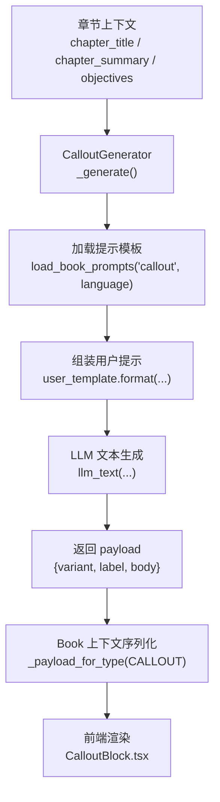
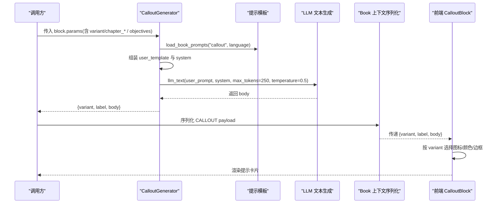
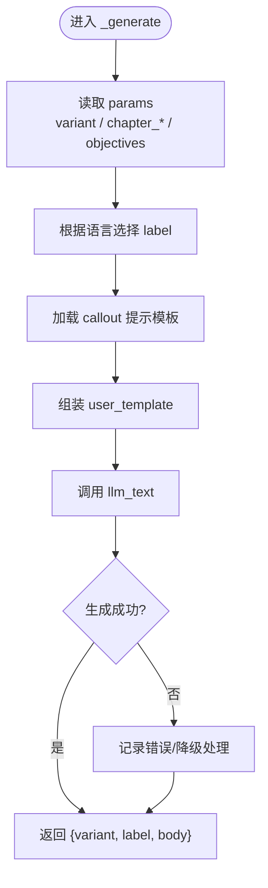
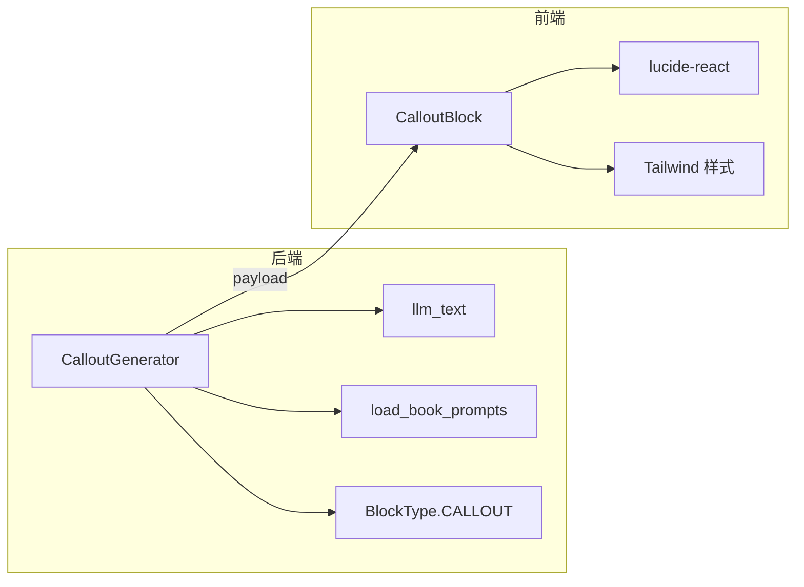

# 提示块

<cite>
**本文引用的文件**
- [callout.py](file://deeptutor/book/blocks/callout.py)
- [CalloutBlock.tsx](file://web/app/(workspace)/book/components/blocks/CalloutBlock.tsx)
- [en/callout.yaml](file://deeptutor/book/prompts/en/callout.yaml)
- [zh/callout.yaml](file://deeptutor/book/prompts/zh/callout.yaml)
- [models.py](file://deeptutor/book/models.py)
- [context.py](file://deeptutor/book/context.py)
- [_llm_writer.py](file://deeptutor/book/blocks/_llm_writer.py)
- [_prompts.py](file://deeptutor/book/blocks/_prompts.py)
- [notifications.ts](file://web/lib/notifications.ts)
</cite>

## 目录
1. [简介](#简介)
2. [项目结构](#项目结构)
3. [核心组件](#核心组件)
4. [架构总览](#架构总览)
5. [详细组件分析](#详细组件分析)
6. [依赖关系分析](#依赖关系分析)
7. [性能与可用性考虑](#性能与可用性考虑)
8. [故障排查指南](#故障排查指南)
9. [结论](#结论)
10. [附录：使用示例与最佳实践](#附录使用示例与最佳实践)

## 简介
本文件面向 DeepTutor 的“提示块（Callout）”能力，系统性说明后端生成器 CalloutGenerator 的实现机制、前端渲染样式与主题适配、消息分类与图标映射、参数配置项、以及自动消失与手动关闭等交互行为。同时提供实际应用场景与最佳实践，帮助读者快速上手并安全扩展。

## 项目结构
提示块由“后端生成 + 前端渲染”两部分组成：
- 后端：BookEngine 的 Block 生成管线负责根据章节上下文与变体类型，调用 LLM 生成提示正文，并输出结构化 payload（variant、label、body）。
- 前端：Next.js 组件根据 variant 选择图标、边框色、背景 tint 与强调色，渲染为带左侧高亮条的可读卡片。



图表来源
- [callout.py:23-58](file://deeptutor/book/blocks/callout.py#L23-L58)
- [en/callout.yaml:1-13](file://deeptutor/book/prompts/en/callout.yaml#L1-L13)
- [zh/callout.yaml:1-13](file://deeptutor/book/prompts/zh/callout.yaml#L1-L13)
- [context.py:214-245](file://deeptutor/book/context.py#L214-L245)
- [CalloutBlock.tsx:11-66](file://web/app/(workspace)/book/components/blocks/CalloutBlock.tsx#L11-L66)

章节来源
- [callout.py:23-58](file://deeptutor/book/blocks/callout.py#L23-L58)
- [CalloutBlock.tsx:11-66](file://web/app/(workspace)/book/components/blocks/CalloutBlock.tsx#L11-L66)
- [context.py:214-245](file://deeptutor/book/context.py#L214-L245)

## 核心组件
- CalloutGenerator：解析 block.params，确定变体与标签，加载多语言提示模板，构造 user/system prompt，调用 llm_text 生成正文，返回 {variant, label, body}。
- Book 上下文序列化：将 CALLOUT 类型的 payload 中的 label 与 body 拼接为主显示文本，便于导出或预览。
- CalloutBlock 前端组件：依据 variant 映射到图标、边框色、背景 tint 与强调色，渲染为带左侧高亮条的卡片。

章节来源
- [callout.py:23-58](file://deeptutor/book/blocks/callout.py#L23-L58)
- [context.py:214-245](file://deeptutor/book/context.py#L214-L245)
- [CalloutBlock.tsx:11-66](file://web/app/(workspace)/book/components/blocks/CalloutBlock.tsx#L11-L66)

## 架构总览
提示块从“数据输入 → 提示组装 → LLM 生成 → 结果序列化 → 前端渲染”的完整链路如下：



图表来源
- [callout.py:23-58](file://deeptutor/book/blocks/callout.py#L23-L58)
- [en/callout.yaml:1-13](file://deeptutor/book/prompts/en/callout.yaml#L1-L13)
- [zh/callout.yaml:1-13](file://deeptutor/book/prompts/zh/callout.yaml#L1-L13)
- [context.py:214-245](file://deeptutor/book/context.py#L214-L245)
- [CalloutBlock.tsx:11-66](file://web/app/(workspace)/book/components/blocks/CalloutBlock.tsx#L11-L66)

## 详细组件分析

### CalloutGenerator 实现机制
- 变体与标签
  - 支持 key_idea、common_pitfall、summary、tip 四种变体；未指定时默认 key_idea。
  - 标签根据当前语言在英文与中文之间切换。
- 提示组装
  - 从 context 读取 chapter_title、chapter_summary、objectives，结合 variant 与 label 填充 user_template。
  - system 提示约束输出风格（简短、无 JSON、无标题、无列表）。
- LLM 生成
  - 通过 llm_text 调用模型，限制 token 数与温度以稳定输出。
- 返回值
  - 返回 {variant, label, body}，供后续序列化和前端渲染使用。



图表来源
- [callout.py:23-58](file://deeptutor/book/blocks/callout.py#L23-L58)
- [en/callout.yaml:1-13](file://deeptutor/book/prompts/en/callout.yaml#L1-L13)
- [zh/callout.yaml:1-13](file://deeptutor/book/prompts/zh/callout.yaml#L1-L13)

章节来源
- [callout.py:23-58](file://deeptutor/book/blocks/callout.py#L23-L58)

### 前端渲染与主题适配
- 视觉区分
  - key_idea：灯泡图标，琥珀色系边框与背景 tint。
  - common_pitfall：警告三角图标，玫红色系。
  - summary：书签对勾图标，天蓝色系。
  - tip：闪光图标，翡翠绿色系。
- 主题适配
  - 使用 Tailwind 的 dark 前缀，确保明暗主题下均有可读对比度。
  - 边框透明度与背景 tint 在不同主题下保持统一感知。
- 渲染流程
  - 读取 block.payload.variant 决定样式；若缺失则回退到 key_idea。
  - 将 label 作为小标题，body 作为正文内容展示。

```mermaid
classDiagram
class CalloutBlockProps {
+block : Block
}
class VARIANT_STYLES {
+key_idea : {icon, rule, tint, accent}
+common_pitfall : {icon, rule, tint, accent}
+summary : {icon, rule, tint, accent}
+tip : {icon, rule, tint, accent}
}
class CalloutBlock {
+variant : string
+label : string
+body : string
+render()
}
CalloutBlock --> VARIANT_STYLES : "按 variant 选择样式"
CalloutBlock --> CalloutBlockProps : "接收 block"
```

图表来源
- [CalloutBlock.tsx:11-66](file://web/app/(workspace)/book/components/blocks/CalloutBlock.tsx#L11-L66)

章节来源
- [CalloutBlock.tsx:11-66](file://web/app/(workspace)/book/components/blocks/CalloutBlock.tsx#L11-L66)

### 数据模型与序列化
- BlockType.CALLOUT：定义在 Book 引擎的数据模型中，标识提示块类型。
- 序列化：当类型为 CALLOUT 时，将 label 与 body 拼接为主显示文本，便于导出、预览或调试。

章节来源
- [models.py:55-80](file://deeptutor/book/models.py#L55-L80)
- [context.py:214-245](file://deeptutor/book/context.py#L214-L245)

### 提示模板与多语言
- 系统提示：约束输出风格（简短、记忆点强、无多余格式）。
- 用户模板：注入章节标题、摘要、学习目标与变体标签，指导 LLM 生成贴合语境的提示正文。
- 多语言：根据 ctx.language 选择 en 或 zh 模板，保证本地化体验。

章节来源
- [en/callout.yaml:1-13](file://deeptutor/book/prompts/en/callout.yaml#L1-L13)
- [zh/callout.yaml:1-13](file://deeptutor/book/prompts/zh/callout.yaml#L1-L13)

## 依赖关系分析
- 后端依赖
  - BlockContext、BlockGenerator：基类与上下文。
  - llm_text：封装 LLM 文本生成。
  - get_book_prompt/load_book_prompts：加载多语言提示模板。
  - models.BlockType：枚举类型标识。
- 前端依赖
  - lucide-react：图标库。
  - Tailwind CSS：样式与主题适配。
  - book-types：Block 类型定义。



图表来源
- [callout.py:23-58](file://deeptutor/book/blocks/callout.py#L23-L58)
- [CalloutBlock.tsx:11-66](file://web/app/(workspace)/book/components/blocks/CalloutBlock.tsx#L11-L66)

章节来源
- [callout.py:23-58](file://deeptutor/book/blocks/callout.py#L23-L58)
- [CalloutBlock.tsx:11-66](file://web/app/(workspace)/book/components/blocks/CalloutBlock.tsx#L11-L66)

## 性能与可用性考虑
- 生成参数
  - max_tokens 与 temperature 控制输出长度与创造性，避免过长或发散。
- 缓存与复用
  - 可将生成的 body 与 metadata 缓存至页面状态，减少重复生成。
- 可访问性
  - 图标与颜色组合需满足对比度要求；建议在 dark 模式下验证可读性。
- 可扩展性
  - 新增变体只需在前端 VARIANT_STYLES 添加样式映射，并在后端 _VARIANT_LABELS 增加标签即可。

[本节为通用建议，不直接分析具体文件]

## 故障排查指南
- 问题：提示内容为空或异常
  - 检查 user_template 是否成功注入 chapter_* 与 objectives。
  - 确认 llm_text 调用是否返回有效 body。
- 问题：前端未显示图标或颜色异常
  - 确认 block.payload.variant 值是否在 VARIANT_STYLES 中存在；不存在会回退到 key_idea。
- 问题：多语言标签不正确
  - 检查 ctx.language 是否正确传入，并确保对应语言的 callout.yaml 存在。

章节来源
- [callout.py:23-58](file://deeptutor/book/blocks/callout.py#L23-L58)
- [CalloutBlock.tsx:11-66](file://web/app/(workspace)/book/components/blocks/CalloutBlock.tsx#L11-L66)
- [en/callout.yaml:1-13](file://deeptutor/book/prompts/en/callout.yaml#L1-L13)
- [zh/callout.yaml:1-13](file://deeptutor/book/prompts/zh/callout.yaml#L1-L13)

## 结论
DeepTutor 的提示块通过“后端生成 + 前端渲染”的解耦设计，实现了灵活的消息分类与一致的视觉表达。CalloutGenerator 基于多语言提示模板与可控的 LLM 参数，稳定产出高质量正文；前端组件通过变体映射提供清晰的视觉区分与主题适配。该方案易于扩展与维护，适用于学习场景中的要点提示、误区提醒、小结与技巧分享。

[本节为总结性内容，不直接分析具体文件]

## 附录：使用示例与最佳实践

### 参数配置
- type：固定为 callout（由 BlockType.CALLOUT 标识）。
- message：由后端自动生成，通常不需要前端传入；如需自定义，可在上游拼装时覆盖 body。
- icon：由 variant 决定，无需显式传入；新增变体需在前后端同步注册。
- variant：可选值 key_idea、common_pitfall、summary、tip；默认 key_idea。
- 其他上下文参数：chapter_title、chapter_summary、objectives 可由 BlockContext 注入。

章节来源
- [callout.py:23-58](file://deeptutor/book/blocks/callout.py#L23-L58)
- [models.py:55-80](file://deeptutor/book/models.py#L55-L80)

### 视觉区分与主题适配
- 信息提示（key_idea）：温和的琥珀色调，适合核心要点。
- 警告（common_pitfall）：醒目的玫红色调，用于常见误区。
- 小结（summary）：清爽的天蓝色调，用于章节总结。
- 技巧（tip）：柔和的翡翠绿色调，用于小贴士。
- 主题适配：使用 Tailwind 的 dark 前缀，确保明暗模式一致可读。

章节来源
- [CalloutBlock.tsx:11-66](file://web/app/(workspace)/book/components/blocks/CalloutBlock.tsx#L11-L66)

### 自动消失与手动关闭
- 提示块本身为静态卡片，不包含自动消失或手动关闭逻辑。
- 若需要全局通知（如操作反馈、系统通知），可使用前端通知模块 notify，支持 tone 与 durationMs，并具备自动消失能力。

章节来源
- [notifications.ts:1-56](file://web/lib/notifications.ts#L1-L56)

### 实际应用场景
- 用户反馈：在对话或任务完成后，以 key_idea 或 tip 形式给出下一步建议。
- 操作指导：在复杂步骤中使用 common_pitfall 提醒易错点，提升成功率。
- 系统通知：对于非阻塞的系统事件，使用 notify 弹出 info/success/error 通知，自动消失。

[本节为概念性示例，不直接分析具体文件]