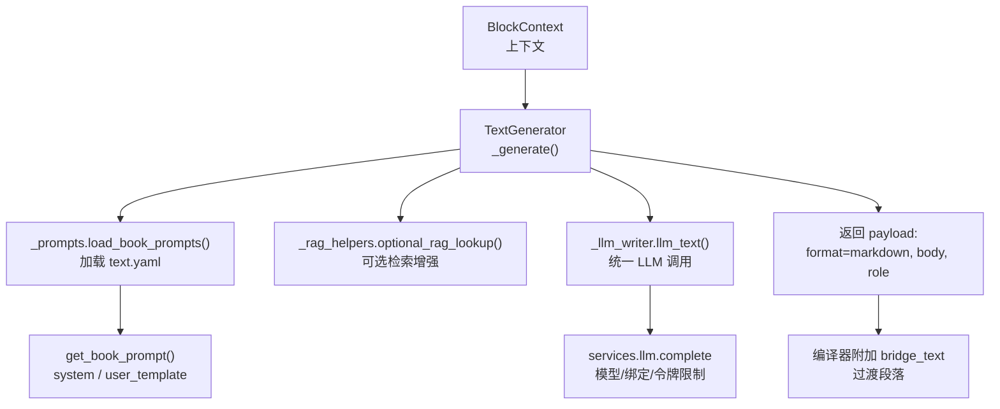
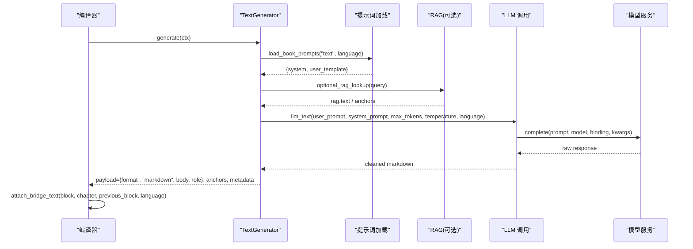
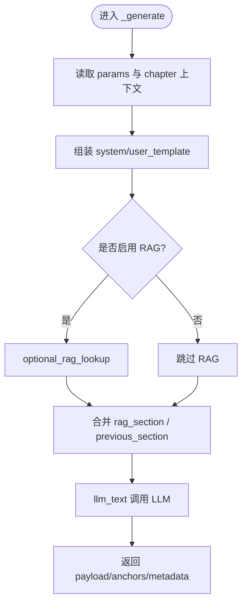
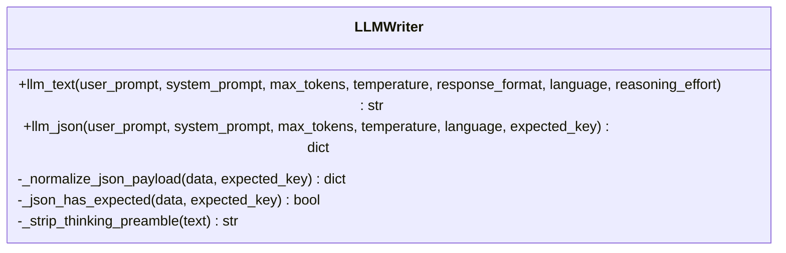
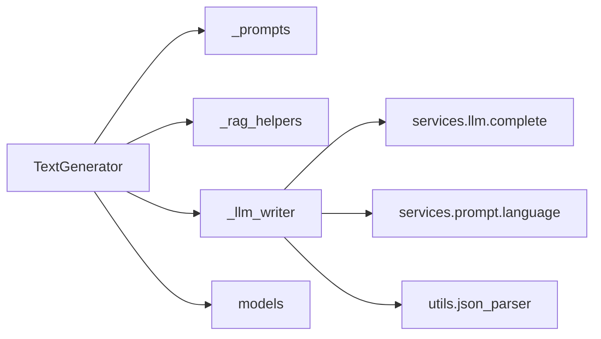

# 文本块

<cite>
**本文引用的文件**
- [text.py](file://deeptutor/book/blocks/text.py)
- [_llm_writer.py](file://deeptutor/book/blocks/_llm_writer.py)
- [_prompts.py](file://deeptutor/book/blocks/_prompts.py)
- [base.py](file://deeptutor/book/blocks/base.py)
- [models.py](file://deeptutor/book/models.py)
- [compiler.py](file://deeptutor/book/compiler.py)
- [text.yaml（英文）](file://deeptutor/book/prompts/en/text.yaml)
- [text.yaml（中文）](file://deeptutor/book/prompts/zh/text.yaml)
</cite>

## 目录
1. [简介](#简介)
2. [项目结构](#项目结构)
3. [核心组件](#核心组件)
4. [架构总览](#架构总览)
5. [详细组件分析](#详细组件分析)
6. [依赖关系分析](#依赖关系分析)
7. [性能考量](#性能考量)
8. [故障排查指南](#故障排查指南)
9. [结论](#结论)
10. [附录：使用示例与配置](#附录使用示例与配置)

## 简介
本章节面向 DeepTutor BookEngine 中的“文本块”能力，系统性说明 TextGenerator 的实现原理、文本生成与渲染流程、参数定义、LLM 集成机制（通过 _llm_writer）、版本兼容与向后支持策略，以及与其他块类型的组合方式。文档同时提供基础文本、富文本格式和多语言支持的配置方法，帮助读者快速上手并深入理解内部实现。

## 项目结构
文本块位于 book/blocks 模块中，围绕 BlockGenerator 抽象基类构建，配合统一的提示词加载器与 LLM 调用封装，形成“参数→提示→LLM→Markdown→前端渲染”的闭环。

图表来源
- [text.py:30-80](file://deeptutor/book/blocks/text.py#L30-L80)
- [_prompts.py:29-64](file://deeptutor/book/blocks/_prompts.py#L29-L64)
- [_llm_writer.py:25-65](file://deeptutor/book/blocks/_llm_writer.py#L25-L65)
- [compiler.py:250-301](file://deeptutor/book/compiler.py#L250-L301)

章节来源
- [text.py:1-114](file://deeptutor/book/blocks/text.py#L1-L114)
- [_prompts.py:1-68](file://deeptutor/book/blocks/_prompts.py#L1-L68)
- [_llm_writer.py:1-190](file://deeptutor/book/blocks/_llm_writer.py#L1-L190)
- [base.py:74-155](file://deeptutor/book/blocks/base.py#L74-L155)
- [compiler.py:216-301](file://deeptutor/book/compiler.py#L216-L301)

## 核心组件
- TextGenerator：文本块的生成器，负责组装提示、调用 RAG（可选）、调用 LLM 生成 Markdown 正文，并输出标准 payload。
- BlockGenerator 基类：统一生命周期管理（状态设置、异常分类、元数据记录）。
- _llm_writer.llm_text：统一 LLM 调用入口，注入语言指令、令牌限制、清理思考标签等。
- _prompts：按语言加载 YAML 提示词，提供 system/user_template/bridge_* 模板。
- models.Block/Page/Chapter：描述书、页、章、块的数据结构，支撑上下文与持久化。
- compiler：编排页面规划、块生成与桥接文本附加。

章节来源
- [base.py:116-155](file://deeptutor/book/blocks/base.py#L116-L155)
- [text.py:30-80](file://deeptutor/book/blocks/text.py#L30-L80)
- [_llm_writer.py:25-65](file://deeptutor/book/blocks/_llm_writer.py#L25-L65)
- [_prompts.py:29-64](file://deeptutor/book/blocks/_prompts.py#L29-L64)
- [models.py:326-345](file://deeptutor/book/models.py#L326-L345)

## 架构总览
文本块从“参数 + 上下文”出发，经提示词模板与可选 RAG 增强后，交由 LLM 生成 Markdown 内容；随后由编译器在需要时附加“过渡段落”，最终由前端以 Markdown 形式渲染。

图表来源
- [text.py:33-80](file://deeptutor/book/blocks/text.py#L33-L80)
- [_llm_writer.py:25-65](file://deeptutor/book/blocks/_llm_writer.py#L25-L65)
- [compiler.py:250-301](file://deeptutor/book/compiler.py#L250-L301)

## 详细组件分析

### TextGenerator：文本生成与格式化
- 输入来源
  - 来自 ctx.block.params 的覆盖字段：chapter_title、chapter_summary、objectives、role、previous_block_summary。
  - 来自 ctx.chapter 的默认值：title、summary、learning_objectives。
- 提示词组装
  - 通过 load_book_prompts 获取 text.yaml 的 system 与 user_template。
  - 将 objectives 格式化为目标列表字符串；根据 language 选择“无”的本地化占位符。
  - 若启用 RAG，则拼接 rag_section；若有上一段摘要，则拼接 previous_section。
- LLM 调用
  - 使用 llm_text 传入 system_prompt、user_prompt、max_tokens、temperature、language。
  - 语言指令通过 append_language_directive 注入系统提示，避免多语漂移。
- 输出
  - payload：{format: "markdown", body: <生成的Markdown>, role: <角色>}。
  - source_anchors：RAG 返回的来源锚点。
  - metadata：used_rag、kb 等。

图表来源
- [text.py:33-80](file://deeptutor/book/blocks/text.py#L33-L80)
- [_llm_writer.py:25-65](file://deeptutor/book/blocks/_llm_writer.py#L25-L65)

章节来源
- [text.py:22-80](file://deeptutor/book/blocks/text.py#L22-L80)

### _llm_writer：LLM 集成与优化
- 语言一致性：当提供 language 时，自动追加语言指令到 system prompt，防止模型在多语言环境中漂移。
- 令牌限制：基于模型与 max_tokens 动态计算合理限制，避免截断或溢出。
- 响应清理：移除“思考/推理”前导文本，确保返回纯净 Markdown。
- JSON 模式（扩展）：提供 llm_json 用于结构化输出，具备重试与健壮解析逻辑（文本块未直接使用，但为其他块复用）。

图表来源
- [_llm_writer.py:25-186](file://deeptutor/book/blocks/_llm_writer.py#L25-L186)

章节来源
- [_llm_writer.py:1-190](file://deeptutor/book/blocks/_llm_writer.py#L1-L190)

### 提示词与多语言
- 英文与中文两套 text.yaml，分别定义 system、user_template、bridge_system、bridge_user_template。
- 变量插值使用 str.format，如 {chapter_title}、{objectives_block}、{role}、{previous_section}、{rag_section}。
- 过渡段落（bridge）用于块间衔接，不单独成块，直接附加到目标块的 payload.bridge_text。

章节来源
- [text.yaml（英文）:1-30](file://deeptutor/book/prompts/en/text.yaml#L1-L30)
- [text.yaml（中文）:1-27](file://deeptutor/book/prompts/zh/text.yaml#L1-L27)
- [_prompts.py:29-64](file://deeptutor/book/blocks/_prompts.py#L29-L64)

### 错误处理与状态管理
- BlockGenerator.generate 统一捕获异常，设置 BlockStatus.ERROR，并写入 failure 元数据（包含错误类型、可重试标记、来源）。
- 错误分类涵盖 JSON 解析失败、空响应、超时、速率限制、提示泄漏、提供者错误等。
- 成功路径下清除 failure 元数据，并将 status 置为 READY。

章节来源
- [base.py:34-71](file://deeptutor/book/blocks/base.py#L34-L71)
- [base.py:121-155](file://deeptutor/book/blocks/base.py#L121-L155)

### 版本兼容性与向后支持
- Block 模型允许额外字段（extra="allow"），便于新增参数在不破坏旧版的情况下被忽略或透传。
- 文本块优先读取 params 中的显式覆盖项，否则回退到 chapter 默认值，保证历史配置继续生效。
- 过渡段落通过 metadata.transition_in 控制，未提供时不会强制插入，保持向后兼容。

章节来源
- [models.py:326-345](file://deeptutor/book/models.py#L326-L345)
- [text.py:36-41](file://deeptutor/book/blocks/text.py#L36-L41)
- [compiler.py:250-301](file://deeptutor/book/compiler.py#L250-L301)

### 与其他块类型的组合
- 编译器在每块生成完成后，尝试附加 bridge_text，使任意块（包括文本块）都能与前一块自然衔接。
- 文本块可与 callout、quiz、figure、code、timeline、flash_cards、deep_dive、section 等组合，形成“讲解+要点+练习+可视化”的学习页面。
- 页面规划阶段会产出多种块序列，文本块常作为理论讲解的核心载体。

章节来源
- [compiler.py:216-301](file://deeptutor/book/compiler.py#L216-L301)
- [base.py:190-223](file://deeptutor/book/blocks/base.py#L190-L223)

## 依赖关系分析
- TextGenerator 依赖：
  - BlockContext（上下文）
  - _prompts（提示词加载）
  - _rag_helpers（可选 RAG）
  - _llm_writer（LLM 调用）
  - models（BlockType、SourceAnchor）
- 运行时依赖：
  - services.llm.complete（实际模型调用）
  - services.prompt.language（语言指令注入）
  - utils.json_parser（JSON 解析与修复）

图表来源
- [text.py:13-17](file://deeptutor/book/blocks/text.py#L13-L17)
- [_llm_writer.py:13-22](file://deeptutor/book/blocks/_llm_writer.py#L13-L22)

章节来源
- [text.py:1-114](file://deeptutor/book/blocks/text.py#L1-L114)
- [_llm_writer.py:1-190](file://deeptutor/book/blocks/_llm_writer.py#L1-L190)

## 性能考量
- 温度与最大令牌：文本块使用较低温度（约 0.45）与适中 max_tokens（约 1400），兼顾稳定性与成本。
- 可选 RAG：仅在必要时检索相关片段，减少无关信息干扰；若禁用或无结果，仍可按章节信息生成。
- 语言指令：集中注入语言约束，降低多语漂移导致的无效重试。
- 桥接文本：短小（1-2句），低开销，提升阅读连贯性。

[本节为通用指导，无需特定文件引用]

## 故障排查指南
- 常见错误类型与定位
  - JSON 解析失败：检查结构化输出块（非文本块）的提示与重试逻辑。
  - 空响应：确认 LLM 可用性与令牌限制是否过小。
  - 超时/卡顿：检查网络与后端负载。
  - 速率限制：考虑退避重试或降低并发。
  - 提示泄漏：清理模型输出的思考前缀。
  - 提供者错误：核对 API Key、Base URL、Binding、API Version。
- 诊断建议
  - 查看 block.metadata.failure 中的 kind、message、retryable、source。
  - 检查 payload 是否包含预期的 format/body/role。
  - 确认提示词 bundle 是否存在且 key 完整。

章节来源
- [base.py:34-71](file://deeptutor/book/blocks/base.py#L34-L71)
- [base.py:121-155](file://deeptutor/book/blocks/base.py#L121-L155)
- [_llm_writer.py:93-131](file://deeptutor/book/blocks/_llm_writer.py#L93-L131)

## 结论
文本块以简洁的参数驱动，结合多语言提示词与可选 RAG，通过统一的 LLM 调用封装生成高质量 Markdown 内容；编译器在块间自动附加过渡段落，提升阅读体验。其设计强调稳定、可维护与向后兼容，适合与多种块类型组合，构建丰富的学习页面。

[本节为总结，无需特定文件引用]

## 附录：使用示例与配置

- 基础文本块
  - 最小参数：type=text，其余可从上下文推导。
  - 典型场景：理论讲解、概念介绍。
  - 参考路径：[text.py:33-80](file://deeptutor/book/blocks/text.py#L33-L80)

- 富文本格式
  - 支持 Markdown：标题、列表、行内代码、数学公式（$...$）。
  - 提示词约束：不重复章节标题、不输出 JSON 或代码块包裹。
  - 参考路径：[text.yaml（英文）:1-14](file://deeptutor/book/prompts/en/text.yaml#L1-L14)、[text.yaml（中文）:1-13](file://deeptutor/book/prompts/zh/text.yaml#L1-L13)

- 多语言支持
  - 通过 language 参数注入语言指令，确保输出语言一致。
  - 提示词按 en/zh 分离，便于本地化维护。
  - 参考路径：[_llm_writer.py:25-45](file://deeptutor/book/blocks/_llm_writer.py#L25-L45)、[_prompts.py:29-47](file://deeptutor/book/blocks/_prompts.py#L29-L47)

- 高级参数
  - chapter_title / chapter_summary：覆盖章节信息。
  - objectives：学习目标列表，影响生成聚焦度。
  - role：本段定位（如 explanation），引导语气与深度。
  - previous_block_summary：上一段摘要，辅助衔接。
  - 参考路径：[text.py:36-41](file://deeptutor/book/blocks/text.py#L36-L41)

- 过渡段落（bridge_text）
  - 在 metadata.transition_in 提供下一段提示，编译器自动生成 1-2 句衔接文本并写入 payload.bridge_text。
  - 参考路径：[compiler.py:250-301](file://deeptutor/book/compiler.py#L250-L301)、[text.py:83-110](file://deeptutor/book/blocks/text.py#L83-L110)

- 与其他块组合
  - 文本块 + 要点框（callout）：讲解 + 关键洞察。
  - 文本块 + 测验（quiz）：讲解 + 自测。
  - 文本块 + 图示（figure/code/timeline）：讲解 + 可视化。
  - 参考路径：[base.py:190-223](file://deeptutor/book/blocks/base.py#L190-L223)