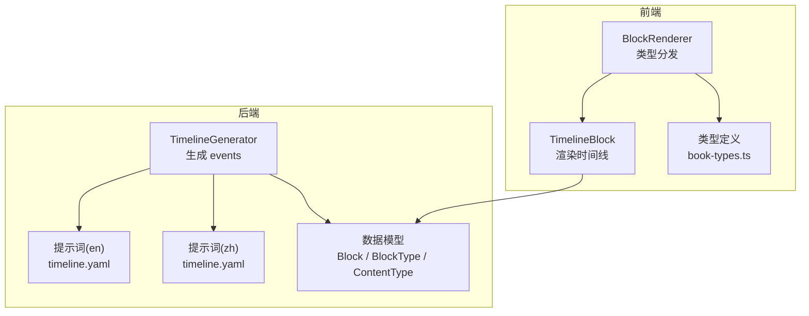
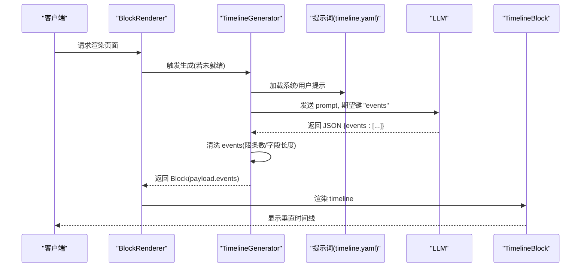
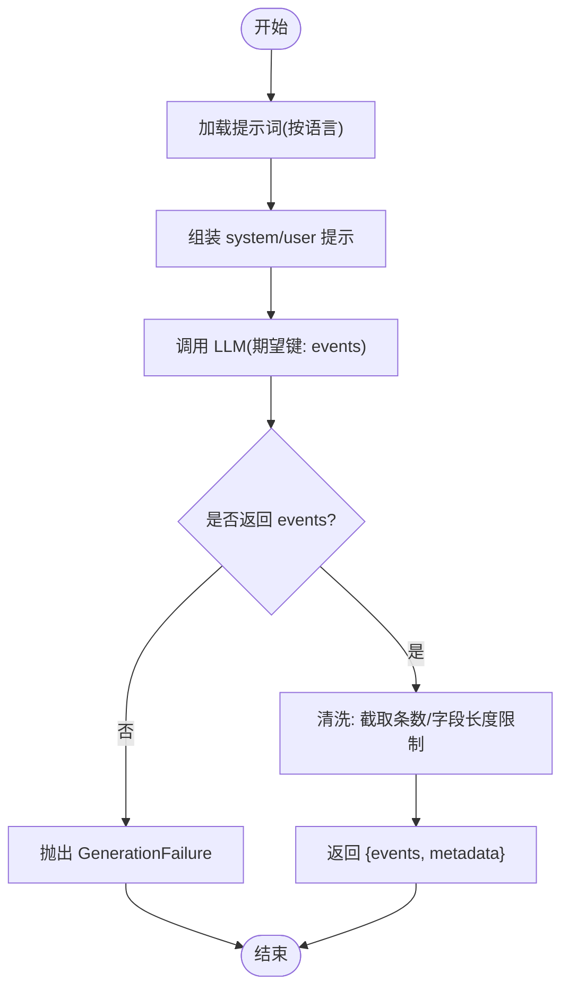
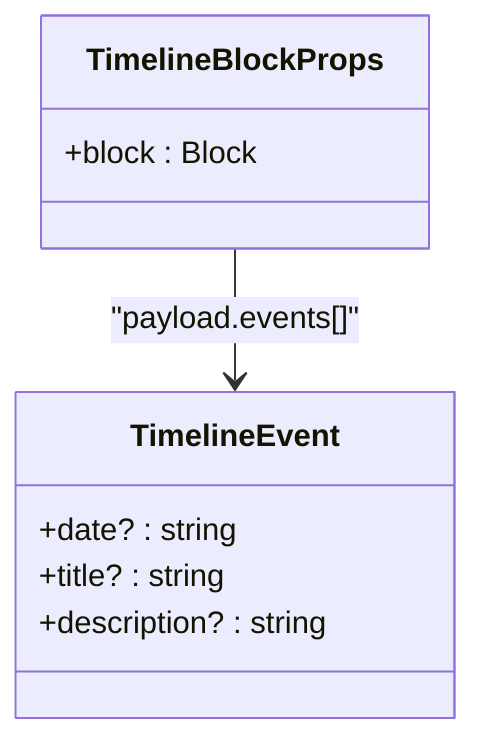
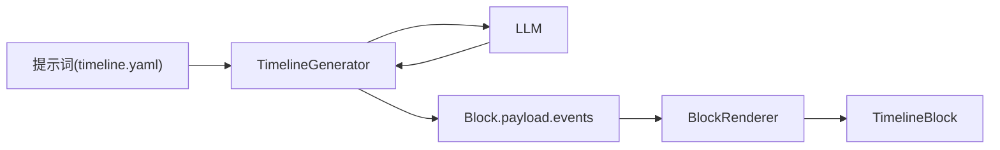

# 时间线块

<cite>
**本文引用的文件**
- [deeptutor/book/blocks/timeline.py](file://deeptutor/book/blocks/timeline.py)
- [deeptutor/book/prompts/en/timeline.yaml](file://deeptutor/book/prompts/en/timeline.yaml)
- [deeptutor/book/prompts/zh/timeline.yaml](file://deeptutor/book/prompts/zh/timeline.yaml)
- [deeptutor/book/models.py](file://deeptutor/book/models.py)
- [web/app/(workspace)/book/components/blocks/TimelineBlock.tsx](file://web/app/(workspace)/book/components/blocks/TimelineBlock.tsx)
- [web/app/(workspace)/book/components/blocks/BlockRenderer.tsx](file://web/app/(workspace)/book/components/blocks/BlockRenderer.tsx)
- [web/lib/book-types.ts](file://web/lib/book-types.ts)
</cite>

## 目录
1. [简介](#简介)
2. [项目结构](#项目结构)
3. [核心组件](#核心组件)
4. [架构总览](#架构总览)
5. [详细组件分析](#详细组件分析)
6. [依赖关系分析](#依赖关系分析)
7. [性能考虑](#性能考虑)
8. [故障排查指南](#故障排查指南)
9. [结论](#结论)
10. [附录：配置与使用场景](#附录：配置与使用场景)

## 简介
本章节面向 DeepTutor 的“时间线块”（Timeline Block），系统性说明其生成原理、数据结构、前端渲染、交互能力、与知识库的集成方式，以及响应式设计与移动端适配。时间线块用于在书籍页面中以垂直时间轴形式展示按时间排序的关键事件，适用于历史事件回顾、项目里程碑展示与时间轴分析等场景。

## 项目结构
时间线块由后端生成器与前端的渲染组件共同构成：
- 后端：TimelineGenerator 负责基于章节标题与摘要调用 LLM，产出结构化事件列表并封装为 Block payload。
- 前端：TimelineBlock 读取 Block.payload.events 并以垂直时间轴样式渲染；BlockRenderer 根据 block.type 路由到对应渲染组件。

图表来源
- [deeptutor/book/blocks/timeline.py:19-62](file://deeptutor/book/blocks/timeline.py#L19-L62)
- [deeptutor/book/prompts/en/timeline.yaml:1-11](file://deeptutor/book/prompts/en/timeline.yaml#L1-L11)
- [deeptutor/book/prompts/zh/timeline.yaml:1-11](file://deeptutor/book/prompts/zh/timeline.yaml#L1-L11)
- [deeptutor/book/models.py:55-90](file://deeptutor/book/models.py#L55-L90)
- [web/app/(workspace)/book/components/blocks/BlockRenderer.tsx:118-149](file://web/app/(workspace)/book/components/blocks/BlockRenderer.tsx#L118-L149)
- [web/app/(workspace)/book/components/blocks/TimelineBlock.tsx:15-40](file://web/app/(workspace)/book/components/blocks/TimelineBlock.tsx#L15-L40)
- [web/lib/book-types.ts:28-41](file://web/lib/book-types.ts#L28-L41)

章节来源
- [deeptutor/book/blocks/timeline.py:19-62](file://deeptutor/book/blocks/timeline.py#L19-L62)
- [web/app/(workspace)/book/components/blocks/BlockRenderer.tsx:118-149](file://web/app/(workspace)/book/components/blocks/BlockRenderer.tsx#L118-L149)
- [web/app/(workspace)/book/components/blocks/TimelineBlock.tsx:15-40](file://web/app/(workspace)/book/components/blocks/TimelineBlock.tsx#L15-L40)
- [web/lib/book-types.ts:28-41](file://web/lib/book-types.ts#L28-L41)

## 核心组件
- TimelineGenerator（后端）
  - 职责：从上下文获取章节标题与摘要，加载多语言提示词，调用 LLM 输出 JSON，提取并清洗 events，返回 Block payload。
  - 关键行为：限制事件数量、字段长度截断、失败时抛出 GenerationFailure。
- TimelineBlock（前端）
  - 职责：接收 Block 对象，读取 payload.events，以有序列表 + 左侧竖线的方式渲染时间线。
  - 交互：当前实现为静态展示，无缩放、筛选或导航控制。
- BlockRenderer（前端）
  - 职责：根据 block.type 将渲染委托给具体组件，包含 timeline 分支。
- 数据模型（后端/前端）
  - Block、BlockType、ContentType 等在后端 models.py 中定义；前端 book-types.ts 提供对应类型声明。

章节来源
- [deeptutor/book/blocks/timeline.py:19-62](file://deeptutor/book/blocks/timeline.py#L19-L62)
- [web/app/(workspace)/book/components/blocks/TimelineBlock.tsx:15-40](file://web/app/(workspace)/book/components/blocks/TimelineBlock.tsx#L15-L40)
- [web/app/(workspace)/book/components/blocks/BlockRenderer.tsx:118-149](file://web/app/(workspace)/book/components/blocks/BlockRenderer.tsx#L118-L149)
- [deeptutor/book/models.py:55-90](file://deeptutor/book/models.py#L55-L90)
- [web/lib/book-types.ts:28-41](file://web/lib/book-types.ts#L28-L41)

## 架构总览
时间线块的端到端流程如下：
- 生成阶段：TimelineGenerator 读取章节信息，组装用户提示，调用 LLM 得到 events，进行清洗与校验后写入 Block.payload.events。
- 渲染阶段：BlockRenderer 识别类型为 timeline，交由 TimelineBlock 渲染；TimelineBlock 读取 events 并按顺序绘制节点。

图表来源
- [deeptutor/book/blocks/timeline.py:22-62](file://deeptutor/book/blocks/timeline.py#L22-L62)
- [deeptutor/book/prompts/en/timeline.yaml:1-11](file://deeptutor/book/prompts/en/timeline.yaml#L1-L11)
- [deeptutor/book/prompts/zh/timeline.yaml:1-11](file://deeptutor/book/prompts/zh/timeline.yaml#L1-L11)
- [web/app/(workspace)/book/components/blocks/BlockRenderer.tsx:118-149](file://web/app/(workspace)/book/components/blocks/BlockRenderer.tsx#L118-L149)
- [web/app/(workspace)/book/components/blocks/TimelineBlock.tsx:15-40](file://web/app/(workspace)/book/components/blocks/TimelineBlock.tsx#L15-L40)

## 详细组件分析

### TimelineGenerator（后端生成器）
- 输入
  - chapter_title、chapter_summary：来自 BlockContext 与 Block.params。
  - language：决定提示词语言。
- 处理逻辑
  - 加载对应语言的 timeline 提示词。
  - 构造 user_template 与 system_prompt。
  - 调用 llm_json，指定 expected_key="events"。
  - 对返回的 events 做安全裁剪：最多取前若干条，并对 date/title/description 做字符串化与长度限制。
  - 若无有效事件，抛出 GenerationFailure。
- 输出
  - payload.events：数组，每项含 date、title、description。
  - metadata：可选 _metadata。

图表来源
- [deeptutor/book/blocks/timeline.py:22-62](file://deeptutor/book/blocks/timeline.py#L22-L62)
- [deeptutor/book/prompts/en/timeline.yaml:1-11](file://deeptutor/book/prompts/en/timeline.yaml#L1-L11)
- [deeptutor/book/prompts/zh/timeline.yaml:1-11](file://deeptutor/book/prompts/zh/timeline.yaml#L1-L11)

章节来源
- [deeptutor/book/blocks/timeline.py:19-62](file://deeptutor/book/blocks/timeline.py#L19-L62)

### TimelineBlock（前端渲染）
- 数据契约
  - 读取 block.payload.events，类型为数组，元素包含 date、title、description。
- 渲染策略
  - 使用有序列表与左侧边框构建垂直时间线。
  - 每个事件项显示日期、标题与可选描述。
  - 空事件时不渲染任何内容。
- 交互能力
  - 当前版本为静态展示，不包含缩放、筛选或导航控件。

图表来源
- [web/app/(workspace)/book/components/blocks/TimelineBlock.tsx:5-40](file://web/app/(workspace)/book/components/blocks/TimelineBlock.tsx#L5-L40)
- [web/lib/book-types.ts:77-89](file://web/lib/book-types.ts#L77-L89)

章节来源
- [web/app/(workspace)/book/components/blocks/TimelineBlock.tsx:15-40](file://web/app/(workspace)/book/components/blocks/TimelineBlock.tsx#L15-L40)

### BlockRenderer（类型分发）
- 作用：根据 block.type 选择对应的渲染组件，其中包含 timeline 分支，将渲染委托给 TimelineBlock。
- 错误与状态：当 block.status 为 pending/generating/error 时，分别显示加载中、错误信息与重试按钮（若支持）。

章节来源
- [web/app/(workspace)/book/components/blocks/BlockRenderer.tsx:118-149](file://web/app/(workspace)/book/components/blocks/BlockRenderer.tsx#L118-L149)
- [web/app/(workspace)/book/components/blocks/BlockRenderer.tsx:79-116](file://web/app/(workspace)/book/components/blocks/BlockRenderer.tsx#L79-L116)

### 数据模型与类型
- 后端模型（models.py）
  - BlockType.TIMELINE：标识时间线块类型。
  - ContentType.HISTORY：历史类内容推荐搭配 timeline。
  - Block：通用块结构，包含 type、payload、params、status 等。
- 前端类型（book-types.ts）
  - BlockType 枚举包含 "timeline"。
  - Block 接口定义 id、type、payload、params、status 等字段。

章节来源
- [deeptutor/book/models.py:55-90](file://deeptutor/book/models.py#L55-L90)
- [web/lib/book-types.ts:28-41](file://web/lib/book-types.ts#L28-L41)
- [web/lib/book-types.ts:77-89](file://web/lib/book-types.ts#L77-L89)

## 依赖关系分析
- 生成期依赖
  - TimelineGenerator 依赖提示词文件（en/zh）与 LLM 服务。
  - 通过 llm_json 约定 expected_key="events"，确保返回结构一致。
- 渲染期依赖
  - BlockRenderer 依赖 Block 类型系统与各子组件。
  - TimelineBlock 依赖 Tailwind CSS 样式变量与基础 UI 组件。
- 数据流
  - 后端生成 events → 序列化至 Block.payload.events → 前端读取并渲染。

图表来源
- [deeptutor/book/blocks/timeline.py:22-62](file://deeptutor/book/blocks/timeline.py#L22-L62)
- [web/app/(workspace)/book/components/blocks/BlockRenderer.tsx:118-149](file://web/app/(workspace)/book/components/blocks/BlockRenderer.tsx#L118-L149)
- [web/app/(workspace)/book/components/blocks/TimelineBlock.tsx:15-40](file://web/app/(workspace)/book/components/blocks/TimelineBlock.tsx#L15-L40)

章节来源
- [deeptutor/book/blocks/timeline.py:22-62](file://deeptutor/book/blocks/timeline.py#L22-L62)
- [web/app/(workspace)/book/components/blocks/BlockRenderer.tsx:118-149](file://web/app/(workspace)/book/components/blocks/BlockRenderer.tsx#L118-L149)

## 性能考虑
- 事件数量限制：生成器仅保留前若干条事件，避免过长列表影响渲染与网络传输。
- 字段长度限制：对 date/title/description 进行字符串化与长度上限，降低存储与渲染开销。
- 渲染复杂度：前端采用简单列表渲染，时间复杂度 O(n)，适合中等规模事件集。
- 可扩展优化点
  - 虚拟滚动：当事件数量较大时，可引入虚拟滚动减少 DOM 节点。
  - 分页/懒加载：按需加载后续事件，提升首屏性能。
  - 缓存：对稳定事件集进行本地缓存，减少重复生成。

[本节为通用性能建议，无需特定文件引用]

## 故障排查指南
- 常见问题
  - 无事件：若 LLM 未返回 events，生成器会抛出 GenerationFailure，前端将显示错误状态并提供重试入口（若启用）。
  - 事件为空：前端在 events 为空时不渲染任何内容，需检查后端生成结果。
  - 字段缺失：前端对 date/title/description 做了容错处理，缺失时会显示空值或隐藏描述。
- 定位步骤
  - 检查 Block.status 与 Block.error 字段。
  - 查看 Block.metadata.failure 中的 kind 与 message。
  - 确认提示词是否正确加载（语言匹配）。
  - 验证 LLM 返回是否符合预期结构（包含 events 键）。

章节来源
- [deeptutor/book/blocks/timeline.py:56-62](file://deeptutor/book/blocks/timeline.py#L56-L62)
- [web/app/(workspace)/book/components/blocks/BlockRenderer.tsx:79-116](file://web/app/(workspace)/book/components/blocks/BlockRenderer.tsx#L79-L116)
- [web/app/(workspace)/book/components/blocks/TimelineBlock.tsx:15-40](file://web/app/(workspace)/book/components/blocks/TimelineBlock.tsx#L15-L40)

## 结论
时间线块通过后端 TimelineGenerator 与前端 TimelineBlock 的协作，实现了基于章节内容的自动时间线生成与可视化展示。其数据结构简洁、渲染轻量，适合历史事件、项目里程碑与时间轴分析等场景。当前版本聚焦于基本展示，未来可在交互（缩放、筛选、导航）、性能（虚拟滚动、分页）与数据源集成方面进一步增强。

[本节为总结性内容，无需特定文件引用]

## 附录：配置与使用场景
- 数据字段说明
  - events：事件数组，每项包含
    - date：事件日期（字符串）
    - title：事件标题（字符串）
    - description：事件描述（字符串，可选）
  - start_date/end_date：当前实现未强制要求；若需要，可在外部数据源中映射到 date 字段，或在扩展时增加起止时间支持。
- 交互功能现状
  - 缩放：未实现。
  - 导航：未实现。
  - 事件筛选：未实现。
- 与知识库集成
  - 生成依据：章节标题与摘要（可能来源于知识库检索结果），通过提示词引导 LLM 抽取关键事件。
  - 外部数据源：可通过上游编排将知识库文档片段注入章节摘要，从而间接影响时间线内容。
- 响应式与移动端适配
  - 使用 Tailwind CSS 与 CSS 变量，具备基础响应式布局能力。
  - 移动端建议：在小屏幕下适当缩小字号与间距，保证可读性。
- 使用场景示例
  - 历史事件展示：用于历史类章节，按时间顺序呈现关键事件。
  - 项目里程碑：展示项目重要节点与交付物。
  - 时间轴分析：配合其他模块（如概念图）进行跨时间维度的知识梳理。

章节来源
- [deeptutor/book/blocks/timeline.py:22-62](file://deeptutor/book/blocks/timeline.py#L22-L62)
- [web/app/(workspace)/book/components/blocks/TimelineBlock.tsx:15-40](file://web/app/(workspace)/book/components/blocks/TimelineBlock.tsx#L15-L40)
- [deeptutor/book/models.py:55-90](file://deeptutor/book/models.py#L55-L90)