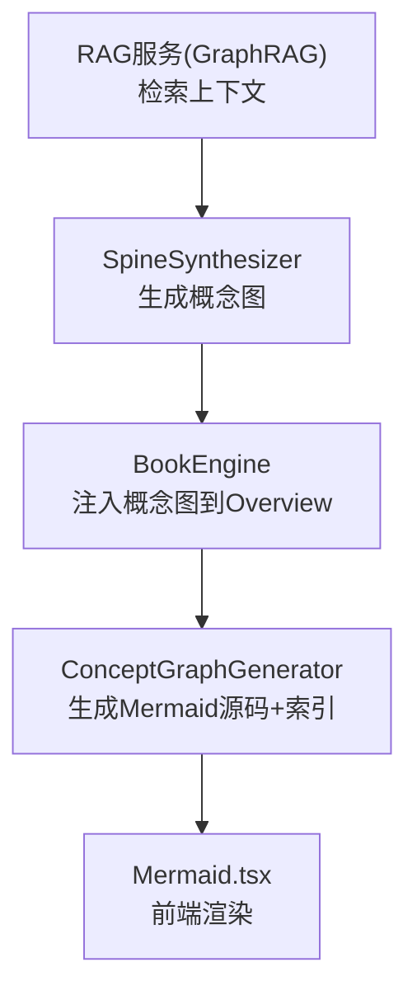
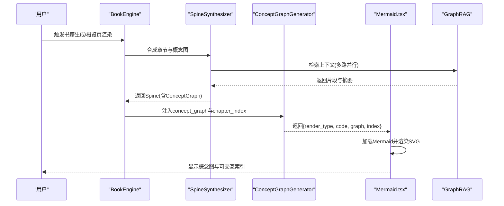
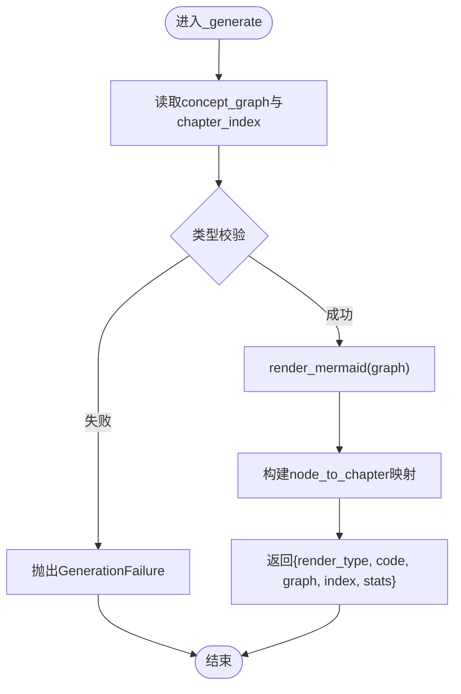
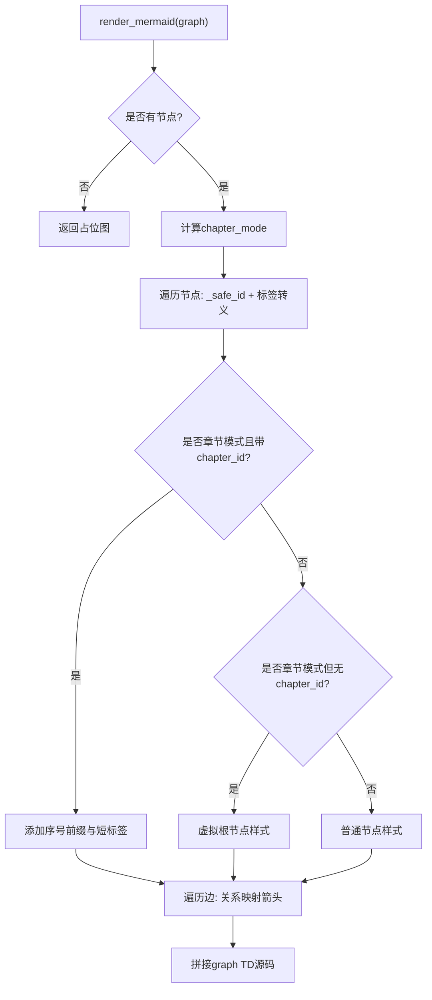
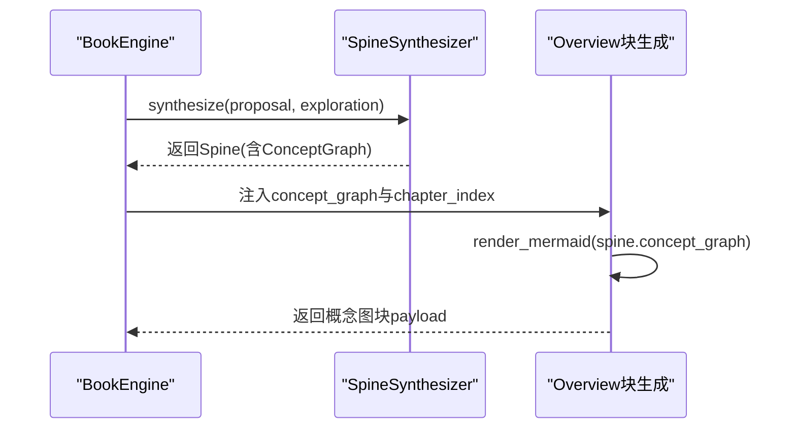
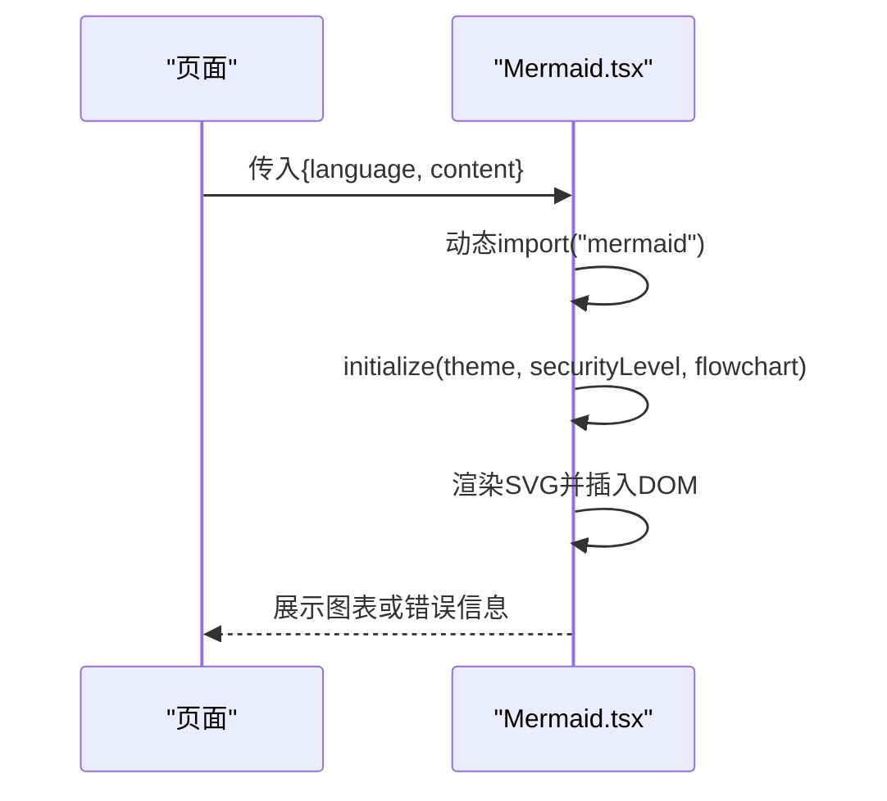
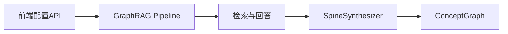
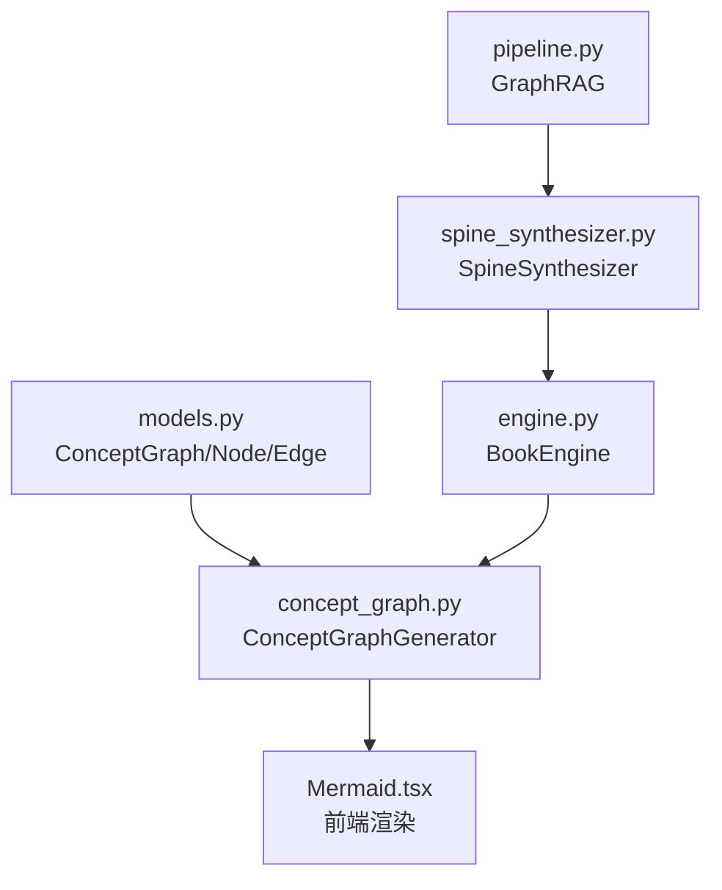

# 概念图块

<cite>
**本文引用的文件**
- [concept_graph.py](file://deeptutor/book/blocks/concept_graph.py)
- [models.py](file://deeptutor/book/models.py)
- [spine_synthesizer.py](file://deeptutor/book/agents/spine_synthesizer.py)
- [engine.py](file://deeptutor/book/engine.py)
- [Mermaid.tsx](file://web/components/Mermaid.tsx)
- [knowledge-api.ts](file://web/lib/knowledge-api.ts)
- [pipeline.py](file://deeptutor/services/rag/pipelines/graphrag/pipeline.py)
</cite>

## 目录
1. [简介](#简介)
2. [项目结构](#项目结构)
3. [核心组件](#核心组件)
4. [架构总览](#架构总览)
5. [详细组件分析](#详细组件分析)
6. [依赖关系分析](#依赖关系分析)
7. [性能与可视化优化](#性能与可视化优化)
8. [故障排查指南](#故障排查指南)
9. [结论](#结论)
10. [附录：使用示例](#附录使用示例)

## 简介
本文件面向DeepTutor中的“概念图块”，系统性说明其数据模型、生成机制、渲染流程以及与知识库（RAG）的集成方式。重点包括：
- ConceptGraphGenerator的实现机制：如何从结构化概念图中生成Mermaid源码，并输出前端可用的索引数据。
- 概念图数据结构：nodes、edges、以及可选的chapter_id等配置项。
- 交互式能力：节点与章节映射、侧边栏导航、知识图谱探索。
- RAG集成：从RAG检索结果到概念图生成的端到端链路。
- 布局与可视化：Mermaid渲染策略、标签安全化、虚拟根节点、可读性优化。
- 使用示例：知识结构展示、思维导图生成、学习路径规划的实施方法。

## 项目结构
概念图块位于书籍引擎的“块”体系中，由SpineSynthesizer产出概念图，再由ConceptGraphGenerator在Overview页中渲染为Mermaid图表，并提供章节索引用于交互。

**图示来源**
- [spine_synthesizer.py:367-604](file://deeptutor/book/agents/spine_synthesizer.py#L367-L604)
- [engine.py:343-394](file://deeptutor/book/engine.py#L343-L394)
- [concept_graph.py:84-130](file://deeptutor/book/blocks/concept_graph.py#L84-L130)
- [Mermaid.tsx:41-64](file://web/components/Mermaid.tsx#L41-L64)
- [pipeline.py:137-173](file://deeptutor/services/rag/pipelines/graphrag/pipeline.py#L137-L173)

**章节来源**
- [spine_synthesizer.py:367-604](file://deeptutor/book/agents/spine_synthesizer.py#L367-L604)
- [engine.py:343-394](file://deeptutor/book/engine.py#L343-L394)
- [concept_graph.py:84-130](file://deeptutor/book/blocks/concept_graph.py#L84-L130)
- [Mermaid.tsx:41-64](file://web/components/Mermaid.tsx#L41-L64)
- [pipeline.py:137-173](file://deeptutor/services/rag/pipelines/graphrag/pipeline.py#L137-L173)

## 核心组件
- 概念图数据模型：ConceptNode、ConceptEdge、ConceptGraph，定义节点、边和图的容器及基础查询方法。
- 概念图生成器：ConceptGraphGenerator，负责读取上下文中的概念图，校验并渲染为Mermaid源码，同时构建章节索引。
- 渲染组件：Mermaid.tsx，负责加载Mermaid库、应用主题、渲染SVG并处理错误。
- 书籍引擎集成：BookEngine在合成阶段调用SpineSynthesizer生成概念图，并在Overview页中注入概念图块。
- RAG集成：GraphRAG提供检索能力，支撑上游概念抽取与关系推断。

**章节来源**
- [models.py:214-253](file://deeptutor/book/models.py#L214-L253)
- [concept_graph.py:84-130](file://deeptutor/book/blocks/concept_graph.py#L84-L130)
- [Mermaid.tsx:41-64](file://web/components/Mermaid.tsx#L41-L64)
- [engine.py:343-394](file://deeptutor/book/engine.py#L343-L394)
- [pipeline.py:137-173](file://deeptutor/services/rag/pipelines/graphrag/pipeline.py#L137-L173)

## 架构总览
概念图块的端到端流程如下：
1. RAG检索：根据主题或问题检索相关片段，形成探索报告。
2. 骨架合成：SpineSynthesizer基于探索报告生成章节结构与概念图，包含节点、边、权重、章节覆盖关系。
3. 引擎注入：BookEngine将概念图注入Overview页的概念图块参数中。
4. 块生成：ConceptGraphGenerator读取概念图，生成Mermaid源码与索引数据。
5. 前端渲染：Mermaid.tsx动态加载Mermaid，渲染SVG，支持主题切换与错误回退。

**图示来源**
- [engine.py:343-394](file://deeptutor/book/engine.py#L343-L394)
- [spine_synthesizer.py:367-604](file://deeptutor/book/agents/spine_synthesizer.py#L367-L604)
- [concept_graph.py:84-130](file://deeptutor/book/blocks/concept_graph.py#L84-L130)
- [Mermaid.tsx:41-64](file://web/components/Mermaid.tsx#L41-L64)
- [pipeline.py:137-173](file://deeptutor/services/rag/pipelines/graphrag/pipeline.py#L137-L173)

## 详细组件分析

### 概念图数据模型
- ConceptNode：表示一个概念，包含id、label、chapter_id、description、weight。
- ConceptEdge：表示有向边，包含src、dst、relation（depends_on/extends/related）、rationale。
- ConceptGraph：包含nodes与edges列表，并提供node_by_id与has_edge辅助方法。

这些模型是概念图块的数据契约，确保前后端一致性与可扩展性。

**章节来源**
- [models.py:214-253](file://deeptutor/book/models.py#L214-L253)

### ConceptGraphGenerator实现机制
- 输入来源：优先从BlockContext.extra中读取concept_graph，其次回退到block.params。
- 类型校验：接受ConceptGraph实例或字典；字典会进行模型验证，失败则抛出GenerationFailure。
- Mermaid渲染：调用render_mermaid生成graph TD源码，处理节点ID安全化、标签转义、章节模式下的编号前缀与虚拟根节点样式。
- 索引构建：遍历节点，收集chapter_id建立node_to_chapter映射；结合chapter_index供前端侧边栏导航。
- 输出结构：包含render_type、code(language/content)、graph(model_dump)、index(chapters/node_to_chapter)，以及统计信息(node_count/edge_count)。

**图示来源**
- [concept_graph.py:84-130](file://deeptutor/book/blocks/concept_graph.py#L84-L130)

**章节来源**
- [concept_graph.py:84-130](file://deeptutor/book/blocks/concept_graph.py#L84-L130)

### Mermaid渲染与可视化优化
- 节点ID安全化：_safe_id将非字母数字字符替换为下划线，限制长度并去重，避免Mermaid冲突。
- 标签转义：_escape_label折叠空白、转引号、截断过长文本，保证可读性与安全性。
- 章节模式：当节点携带chapter_id时，按顺序添加“序号·标题”前缀；无chapter_id的虚拟根节点使用圆角矩形突出显示。
- 边样式映射：depends_on使用实线箭头，extends使用双线箭头，related使用虚线箭头，增强语义区分。
- 空图处理：无节点时输出占位提示，避免空白渲染。

**图示来源**
- [concept_graph.py:41-81](file://deeptutor/book/blocks/concept_graph.py#L41-L81)

**章节来源**
- [concept_graph.py:41-81](file://deeptutor/book/blocks/concept_graph.py#L41-L81)

### 书籍引擎集成与Overview注入
- SpineSynthesizer负责从探索报告中合成章节与概念图，并进行拓扑排序、环移除、虚拟根节点连接等处理。
- BookEngine在合成阶段调用SpineSynthesizer，并将生成的Spine保存；随后在Overview页中注入概念图块，参数包含concept_graph与chapter_index。
- Overview页的块生成逻辑直接复用render_mermaid，确保一致性。

**图示来源**
- [engine.py:343-394](file://deeptutor/book/engine.py#L343-L394)
- [engine.py:453-539](file://deeptutor/book/engine.py#L453-L539)
- [spine_synthesizer.py:516-604](file://deeptutor/book/agents/spine_synthesizer.py#L516-L604)

**章节来源**
- [engine.py:343-394](file://deeptutor/book/engine.py#L343-L394)
- [engine.py:453-539](file://deeptutor/book/engine.py#L453-L539)
- [spine_synthesizer.py:516-604](file://deeptutor/book/agents/spine_synthesizer.py#L516-L604)

### 前端渲染与交互
- Mermaid.tsx动态导入Mermaid库，初始化主题与安全级别，设置流式曲线与字体。
- 每次渲染前清理旧DOM元素，避免重复挂载；支持主题切换后重新渲染。
- 错误处理：捕获渲染异常，展示错误信息与原始源码，便于调试。
- 交互扩展：通过index中的node_to_chapter映射，前端可实现节点点击跳转至对应章节、侧边栏高亮当前节点所属章节等。

**图示来源**
- [Mermaid.tsx:41-64](file://web/components/Mermaid.tsx#L41-L64)
- [Mermaid.tsx:79-179](file://web/components/Mermaid.tsx#L79-L179)

**章节来源**
- [Mermaid.tsx:41-64](file://web/components/Mermaid.tsx#L41-L64)
- [Mermaid.tsx:79-179](file://web/components/Mermaid.tsx#L79-L179)

### 与RAG系统的集成
- GraphRAG服务提供search接口，返回答案、内容与来源；若未建索引，返回needs_reindex提示。
- 前端可通过knowledge-api.ts获取GraphRag配置，支持更新引擎配置。
- 在书籍生成流程中，SpineSynthesizer依赖探索报告（来自RAG）来推断概念与关系，从而生成高质量的概念图。

**图示来源**
- [knowledge-api.ts:311-359](file://web/lib/knowledge-api.ts#L311-L359)
- [pipeline.py:137-173](file://deeptutor/services/rag/pipelines/graphrag/pipeline.py#L137-L173)
- [spine_synthesizer.py:367-604](file://deeptutor/book/agents/spine_synthesizer.py#L367-L604)

**章节来源**
- [knowledge-api.ts:311-359](file://web/lib/knowledge-api.ts#L311-L359)
- [pipeline.py:137-173](file://deeptutor/services/rag/pipelines/graphrag/pipeline.py#L137-L173)
- [spine_synthesizer.py:367-604](file://deeptutor/book/agents/spine_synthesizer.py#L367-L604)

## 依赖关系分析
- ConceptGraphGenerator依赖models中的ConceptGraph、ConceptNode、ConceptEdge。
- BookEngine依赖SpineSynthesizer生成概念图，并在Overview中注入。
- 前端Mermaid.tsx依赖后端返回的Mermaid源码与索引数据。
- RAG服务为概念图生成提供上下文依据。

**图示来源**
- [models.py:214-253](file://deeptutor/book/models.py#L214-L253)
- [concept_graph.py:84-130](file://deeptutor/book/blocks/concept_graph.py#L84-L130)
- [spine_synthesizer.py:367-604](file://deeptutor/book/agents/spine_synthesizer.py#L367-L604)
- [engine.py:343-394](file://deeptutor/book/engine.py#L343-L394)
- [Mermaid.tsx:41-64](file://web/components/Mermaid.tsx#L41-L64)
- [pipeline.py:137-173](file://deeptutor/services/rag/pipelines/graphrag/pipeline.py#L137-L173)

**章节来源**
- [models.py:214-253](file://deeptutor/book/models.py#L214-L253)
- [concept_graph.py:84-130](file://deeptutor/book/blocks/concept_graph.py#L84-L130)
- [spine_synthesizer.py:367-604](file://deeptutor/book/agents/spine_synthesizer.py#L367-L604)
- [engine.py:343-394](file://deeptutor/book/engine.py#L343-L394)
- [Mermaid.tsx:41-64](file://web/components/Mermaid.tsx#L41-L64)
- [pipeline.py:137-173](file://deeptutor/services/rag/pipelines/graphrag/pipeline.py#L137-L173)

## 性能与可视化优化
- 节点ID安全化与标签截断：避免Mermaid解析失败与视觉拥挤。
- 章节模式下的编号前缀：提升可读性，帮助快速定位章节。
- 虚拟根节点：对不连通图增加根节点，形成清晰的思维导图形状。
- 边样式映射：不同关系使用不同箭头，增强语义表达。
- 前端懒加载与主题适配：Mermaid动态导入，减少初始负载；主题变量随CSS变化自动更新。
- 错误回退：渲染失败时展示源码，便于定位问题。

[本节为通用指导，无需特定文件引用]

## 故障排查指南
- 概念图缺失：检查BlockContext.extra或block.params是否包含concept_graph；若无则抛出GenerationFailure。
- 模型验证失败：确认传入的字典符合ConceptGraph结构；否则抛出GenerationFailure。
- Mermaid渲染错误：查看Mermaid.tsx的错误展示区域，检查源码内容；必要时调整节点ID或标签格式。
- RAG未建索引：GraphRAG返回needs_reindex，需先添加文档并重建索引。
- 章节映射为空：确认节点是否携带chapter_id；若无，则无法建立node_to_chapter映射。

**章节来源**
- [concept_graph.py:84-130](file://deeptutor/book/blocks/concept_graph.py#L84-L130)
- [Mermaid.tsx:139-179](file://web/components/Mermaid.tsx#L139-L179)
- [pipeline.py:137-173](file://deeptutor/services/rag/pipelines/graphrag/pipeline.py#L137-L173)

## 结论
概念图块通过标准化的数据模型与确定性渲染流程，实现了从RAG上下文到可视化图谱的完整链路。ConceptGraphGenerator确保图的可读性与交互性，BookEngine将其无缝集成到书籍结构中，前端Mermaid组件提供稳定高效的渲染体验。该设计既支持知识结构展示，也便于扩展思维导图与学习路径规划等高级功能。

[本节为总结性内容，无需特定文件引用]

## 附录：使用示例

### 知识结构展示
- 在Overview页中，概念图块以Mermaid形式展示全书核心概念及其依赖关系。
- 通过node_to_chapter映射，前端可实现节点点击跳转到对应章节，或在侧边栏高亮当前节点所属章节。

**章节来源**
- [engine.py:453-539](file://deeptutor/book/engine.py#L453-L539)
- [concept_graph.py:107-130](file://deeptutor/book/blocks/concept_graph.py#L107-L130)

### 思维导图生成
- SpineSynthesizer在无根节点时自动创建虚拟根节点，使图呈现清晰的思维导图形态。
- 章节模式下，节点带有“序号·标题”前缀，便于快速浏览与定位。

**章节来源**
- [spine_synthesizer.py:587-604](file://deeptutor/book/agents/spine_synthesizer.py#L587-L604)
- [concept_graph.py:53-73](file://deeptutor/book/blocks/concept_graph.py#L53-L73)

### 学习路径规划
- 利用边的relation字段（depends_on/extends/related）与拓扑排序，可推导推荐阅读顺序。
- 前端可基于node_to_chapter与章节顺序，生成个性化学习路径，支持按兴趣切入。

**章节来源**
- [spine_synthesizer.py:367-604](file://deeptutor/book/agents/spine_synthesizer.py#L367-L604)
- [engine.py:473-539](file://deeptutor/book/engine.py#L473-L539)