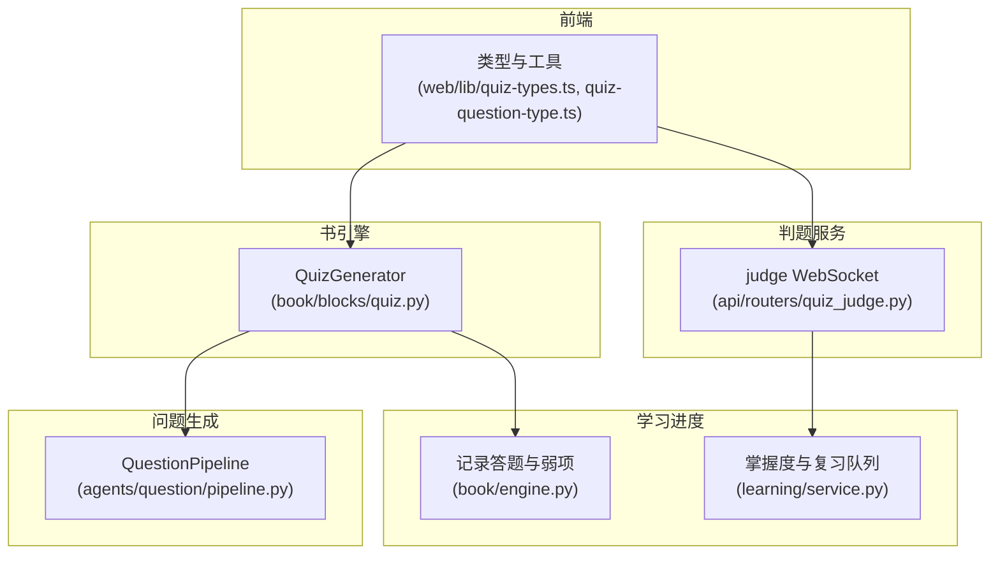
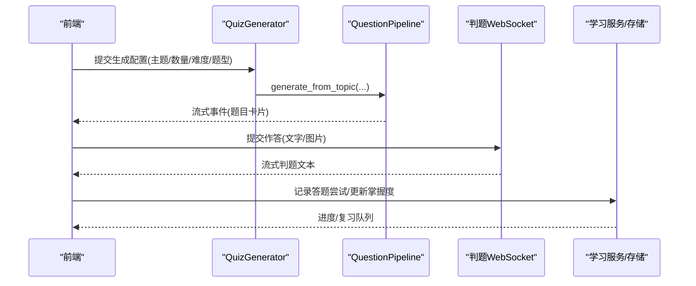
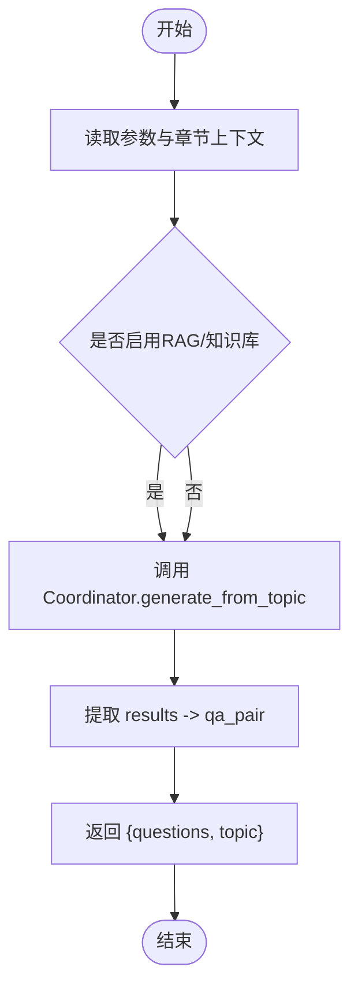
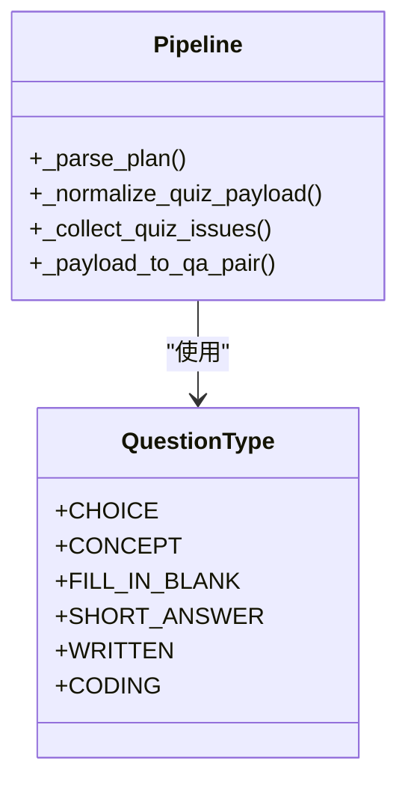
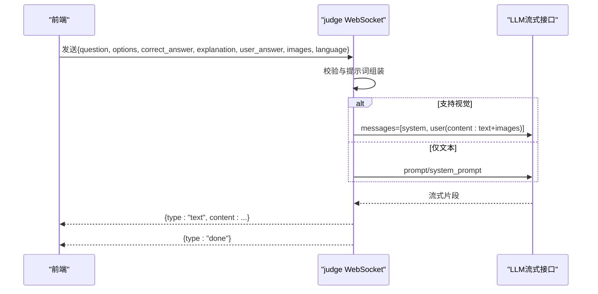
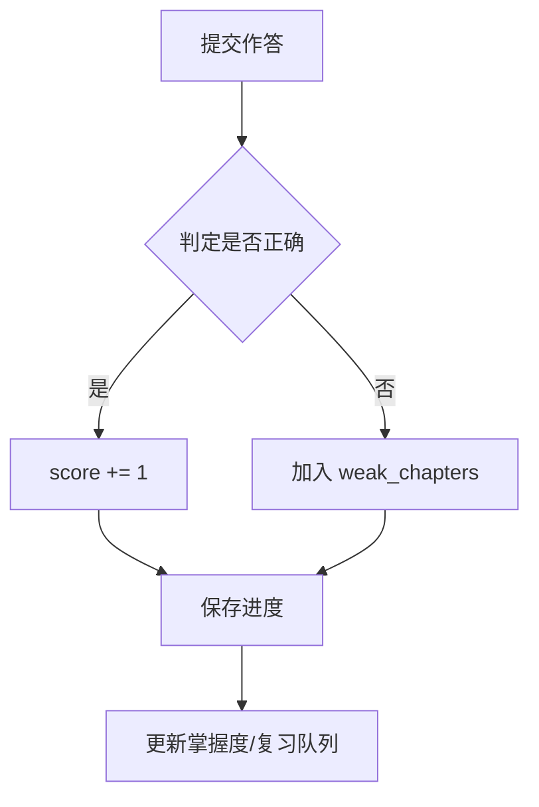
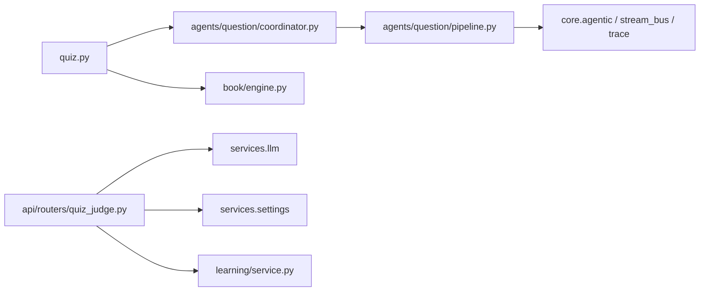

# 测验块

<cite>
**本文引用的文件**
- [quiz.py](file://deeptutor/book/blocks/quiz.py)
- [pipeline.py](file://deeptutor/agents/question/pipeline.py)
- [quiz_judge.py](file://deeptutor/api/routers/quiz_judge.py)
- [quiz-types.ts](file://web/lib/quiz-types.ts)
- [quiz-question-type.ts](file://web/lib/quiz-question-type.ts)
- [engine.py](file://deeptutor/book/engine.py)
- [service.py](file://deeptutor/learning/service.py)
- [test_notebook_router.py](file://tests/api/test_notebook_router.py)
</cite>

## 目录
1. [简介](#简介)
2. [项目结构](#项目结构)
3. [核心组件](#核心组件)
4. [架构总览](#架构总览)
5. [详细组件分析](#详细组件分析)
6. [依赖关系分析](#依赖关系分析)
7. [性能考量](#性能考量)
8. [故障排查指南](#故障排查指南)
9. [结论](#结论)
10. [附录：配置示例与使用场景](#附录：配置示例与使用场景)

## 简介
本文件面向 DeepTutor 的“测验块”能力，系统性说明题目生成、答案验证与评分、状态管理与进度跟踪、结果数据结构与存储方式，以及前端配置与使用方式。重点覆盖 QuizGenerator 的实现机制、支持的题型（选择题、填空题、判断题等）、自适应难度与个性化测试方案。

## 项目结构
测验块由后端“书引擎块”、“问题生成管线”、“AI 判题 WebSocket”和前端类型定义共同组成：
- 书引擎块：QuizGenerator 负责将章节上下文与用户参数转换为题目生成请求，并提取结构化题目。
- 问题生成管线：QuestionPipeline 实现三阶段流程（探索-计划-出题），对 LLM 输出进行解析、校验与规范化。
- AI 判题：WebSocket 接口接收学习者作答（支持图片），调用大模型给出逐题反馈。
- 前端类型：统一题型归一化、流式事件抽取、会话跟随上下文构建等。

图表来源
- [quiz.py:14-66](file://deeptutor/book/blocks/quiz.py#L14-L66)
- [pipeline.py:144-161](file://deeptutor/agents/question/pipeline.py#L144-L161)
- [quiz_judge.py:196-428](file://deeptutor/api/routers/quiz_judge.py#L196-L428)
- [quiz-types.ts:44-54](file://web/lib/quiz-types.ts#L44-L54)
- [engine.py:1219-1246](file://deeptutor/book/engine.py#L1219-L1246)
- [service.py:129-159](file://deeptutor/learning/service.py#L129-L159)

章节来源
- [quiz.py:14-96](file://deeptutor/book/blocks/quiz.py#L14-L96)
- [pipeline.py:144-200](file://deeptutor/agents/question/pipeline.py#L144-L200)
- [quiz_judge.py:196-428](file://deeptutor/api/routers/quiz_judge.py#L196-L428)
- [quiz-types.ts:44-54](file://web/lib/quiz-types.ts#L44-L54)
- [engine.py:1219-1246](file://deeptutor/book/engine.py#L1219-L1246)
- [service.py:129-159](file://deeptutor/learning/service.py#L129-L159)

## 核心组件
- QuizGenerator：从 BlockContext 读取章节标题、摘要、学习目标与用户参数，构造 topic 并调用 AgentCoordinator.generate_from_topic，最终提取 qa_pair 列表作为题目集合。
- QuestionPipeline：三阶段（Explore/Plan/Quiz）+ 修复轮次；维护题型白名单、难度枚举、选项键集、概念题答案集等；对 LLM 输出做 JSON 解析、规范化、校验与错误收集。
- 判题 WebSocket：接收题目、参考答案、解析、学习者作答与可选图片，按语言组装提示词，流式返回判定文本；若模型支持视觉则附带图片内容。
- 前端类型与工具：统一题型别名映射、流式事件抽取、会话跟随上下文构建、WS 配置封装。

章节来源
- [quiz.py:14-96](file://deeptutor/book/blocks/quiz.py#L14-L96)
- [pipeline.py:144-200](file://deeptutor/agents/question/pipeline.py#L144-L200)
- [quiz_judge.py:28-129](file://deeptutor/api/routers/quiz_judge.py#L28-L129)
- [quiz-types.ts:44-54](file://web/lib/quiz-types.ts#L44-L54)
- [quiz-question-type.ts:1-57](file://web/lib/quiz-question-type.ts#L1-L57)

## 架构总览
测验块的整体数据流如下：
- 前端通过 WS 发送生成配置（模式、数量、难度、题型白名单、各题型数量分配）。
- 后端 QuizGenerator 聚合章节上下文，调用问题生成管线。
- Pipeline 分阶段产出题目模板与具体题目，实时以事件形式向前端推送。
- 学习者作答后，前端可调用判题 WebSocket 获取 AI 判读与讲解。
- 系统记录答题尝试，更新掌握度与复习队列，持久化到学习进度。

图表来源
- [quiz.py:17-66](file://deeptutor/book/blocks/quiz.py#L17-L66)
- [pipeline.py:144-200](file://deeptutor/agents/question/pipeline.py#L144-L200)
- [quiz_judge.py:196-428](file://deeptutor/api/routers/quiz_judge.py#L196-L428)
- [service.py:176-210](file://deeptutor/learning/service.py#L176-L210)

## 详细组件分析

### QuizGenerator（题目生成入口）
- 参数处理：从 block.params 读取 chapter_title、chapter_summary、objectives、num_questions、difficulty、question_type。
- 上下文融合：将章节摘要与学习目标拼接到 topic，便于规划器定位知识点。
- 调用生成：构造 AgentCoordinator 并调用 generate_from_topic，传入 num_questions、difficulty、question_types。
- 结果提取：从 summary.results 中筛选成功条目，提取 qa_pair 字段为题目对象。

图表来源
- [quiz.py:17-66](file://deeptutor/book/blocks/quiz.py#L17-L66)

章节来源
- [quiz.py:17-96](file://deeptutor/book/blocks/quiz.py#L17-L96)

### QuestionPipeline（题目生成、校验与规范化）
- 题型体系：choice、concept、fill_in_blank、short_answer、written、coding。
- 约束与默认值：难度枚举 easy/medium/hard；选择题选项键 A/B/C/D；概念题答案 true/false。
- 三阶段流程：
  - Explore：基于工具检索与思考，形成探索轨迹。
  - Plan：输出每道题的模板（question_id、topic、question_type、difficulty）。
  - Quiz：逐题生成 JSON payload，解析、修复、规范化，并发出 quiz_question_emitted 事件。
- 负载解析与校验：
  - 解析 JSON（支持 fenced code block）。
  - 规范化字段（question/correct_answer/explanation 去空白；概念题答案标准化）。
  - 收集缺失问题（missing_question、missing_correct_answer、missing_explanation）。
  - 将 payload 转为 QuizPair，携带 metadata 中的 issues。

图表来源
- [pipeline.py:144-161](file://deeptutor/agents/question/pipeline.py#L144-L161)
- [pipeline.py:1287-1414](file://deeptutor/agents/question/pipeline.py#L1287-L1414)

章节来源
- [pipeline.py:144-200](file://deeptutor/agents/question/pipeline.py#L144-L200)
- [pipeline.py:1287-1414](file://deeptutor/agents/question/pipeline.py#L1287-L1414)

### 判题 WebSocket（答案验证与评分）
- 输入：question、question_type、options、correct_answer、explanation、user_answer、user_answer_images（或兼容的单图字段）、language。
- 处理：
  - 校验必填字段与作答内容。
  - 根据语言选择系统提示词。
  - 组装用户提示词（含选项、参考答案、解析、学习者作答与图片信息）。
  - 若模型支持视觉，将本地附件解析为 base64 或透传 URL，构建多模态消息。
- 输出：流式返回 started、text 片段、done 或 error。

图表来源
- [quiz_judge.py:28-129](file://deeptutor/api/routers/quiz_judge.py#L28-L129)
- [quiz_judge.py:196-428](file://deeptutor/api/routers/quiz_judge.py#L196-L428)

章节来源
- [quiz_judge.py:196-428](file://deeptutor/api/routers/quiz_judge.py#L196-L428)

### 前端类型与工具（题型归一化与配置）
- 题型归一化：将多种别名映射为标准类型（如 multiple_choice/mcq -> choice；true_false/tf -> concept；fill-in-the-blank/cloze -> fill_in_blank 等）。
- 流式事件抽取：从 unified-WS 事件中按 call_kind="quiz_question_emitted" 抽取题目，按 question_index 排序去重。
- 会话跟随：构建 followup_question_context，包含题目、选项、正确答案、解析、难度、知识上下文、用户作答、是否正确、图片文件名、上次 AI 判读等。
- WS 配置封装：自定义模式下支持 num_questions、difficulty、question_types、per_type_counts；模仿模式支持 paper_path 与 max_questions。

章节来源
- [quiz-question-type.ts:1-57](file://web/lib/quiz-question-type.ts#L1-L57)
- [quiz-types.ts:44-54](file://web/lib/quiz-types.ts#L44-L54)
- [quiz-types.ts:95-130](file://web/lib/quiz-types.ts#L95-L130)
- [quiz-types.ts:206-235](file://web/lib/quiz-types.ts#L206-L235)
- [quiz-types.ts:289-314](file://web/lib/quiz-types.ts#L289-L314)

### 测验状态管理与进度跟踪
- 书引擎记录：record_quiz_attempt 将每次答题写入 Progress.quiz_attempts，错误时标记弱章节，正确时累加分数。
- 学习服务：grade_and_record 基于期望答案判定正误，记录尝试、更新掌握度、调度间隔重复复习队列并持久化。
- 测试用例：演示 quiz-results 接口将答题记录入笔记本，支持重试覆盖。

图表来源
- [engine.py:1219-1246](file://deeptutor/book/engine.py#L1219-L1246)
- [service.py:176-210](file://deeptutor/learning/service.py#L176-L210)
- [test_notebook_router.py:72-108](file://tests/api/test_notebook_router.py#L72-L108)

章节来源
- [engine.py:1219-1246](file://deeptutor/book/engine.py#L1219-L1246)
- [service.py:129-159](file://deeptutor/learning/service.py#L129-L159)
- [service.py:176-210](file://deeptutor/learning/service.py#L176-L210)
- [test_notebook_router.py:72-108](file://tests/api/test_notebook_router.py#L72-L108)

## 依赖关系分析
- QuizGenerator 依赖 book/models（BlockType、SourceAnchor）、base（BlockContext、BlockGenerator、GenerationFailure）与 agents.question.coordinator。
- QuestionPipeline 依赖 core.agentic、services.prompt、services.llm、core.stream_bus、core.trace 等，构成完整的智能体循环与事件总线。
- 判题 WebSocket 依赖 services.llm、services.settings、multi_user.context 与 storage 附件解析。
- 前端类型与后端协议通过统一的题型枚举与事件结构对齐。

图表来源
- [quiz.py:14-66](file://deeptutor/book/blocks/quiz.py#L14-L66)
- [pipeline.py:1-76](file://deeptutor/agents/question/pipeline.py#L1-L76)
- [quiz_judge.py:17-23](file://deeptutor/api/routers/quiz_judge.py#L17-L23)
- [engine.py:1219-1246](file://deeptutor/book/engine.py#L1219-L1246)
- [service.py:176-210](file://deeptutor/learning/service.py#L176-L210)

章节来源
- [quiz.py:14-66](file://deeptutor/book/blocks/quiz.py#L14-L66)
- [pipeline.py:1-76](file://deeptutor/agents/question/pipeline.py#L1-L76)
- [quiz_judge.py:17-23](file://deeptutor/api/routers/quiz_judge.py#L17-L23)

## 性能考量
- 流式渲染：Pipeline 在 Quiz 阶段逐题发出事件，前端可即时渲染，减少等待时间。
- 并行工具调用：Pipeline 使用 MAX_PARALLEL_TOOL_CALLS 控制工具并行度，平衡吞吐与稳定性。
- 视觉降级：判题服务在模型不支持视觉时自动回退到纯文本判读，保证可用性。
- 资源回收：WebSocket 处理中捕获断连异常并关闭连接，避免资源泄漏。

[本节为通用性能讨论，不直接引用具体代码行]

## 故障排查指南
- 生成失败：
  - 现象：无题目或空结果。
  - 排查：检查章节上下文与参数；查看 GenerationFailure 日志；确认 Coordinator 调用是否成功。
  - 参考路径：[quiz.py:50-56](file://deeptutor/book/blocks/quiz.py#L50-L56)
- 题目校验失败：
  - 现象：缺少题干/答案/解析或题型不合法。
  - 排查：查看 _collect_quiz_issues 收集的 issues；确认 LLM 输出 JSON 是否被正确解析与修复。
  - 参考路径：[pipeline.py:1357-1393](file://deeptutor/agents/question/pipeline.py#L1357-L1393)
- 判题报错：
  - 现象：无作答或模型不支持视觉。
  - 排查：确认 user_answer 或图片存在；检查模型视觉能力；查看流式错误消息。
  - 参考路径：[quiz_judge.py:351-417](file://deeptutor/api/routers/quiz_judge.py#L351-L417)
- 进度未更新：
  - 现象：分数或弱章节未变化。
  - 排查：确认 record_quiz_attempt 是否被调用；检查 is_correct 判定逻辑；查看学习服务是否更新掌握度与复习队列。
  - 参考路径：[engine.py:1219-1246](file://deeptutor/book/engine.py#L1219-L1246), [service.py:176-210](file://deeptutor/learning/service.py#L176-L210)

章节来源
- [quiz.py:50-56](file://deeptutor/book/blocks/quiz.py#L50-L56)
- [pipeline.py:1357-1393](file://deeptutor/agents/question/pipeline.py#L1357-L1393)
- [quiz_judge.py:351-417](file://deeptutor/api/routers/quiz_judge.py#L351-L417)
- [engine.py:1219-1246](file://deeptutor/book/engine.py#L1219-L1246)
- [service.py:176-210](file://deeptutor/learning/service.py#L176-L210)

## 结论
DeepTutor 测验块通过“书引擎块 + 问题生成管线 + AI 判题 + 学习进度”的闭环，实现了从题目生成、交互作答、智能判读到掌握度提升的全链路能力。其设计强调：
- 灵活配置：支持多种题型、难度与数量分配。
- 稳健解析：对 LLM 输出进行严格解析、规范化与错误收集。
- 实时体验：流式事件驱动前端即时渲染。
- 可观测性：完善的日志与错误处理，便于定位问题。
- 可扩展性：易于接入新的题型与判题策略。

[本节为总结性内容，不直接引用具体代码行]

## 附录：配置示例与使用场景

### 测验块参数配置
- 基础参数（来自 BlockContext.params）：
  - chapter_title：章节标题（用于 topic 拼接）
  - chapter_summary：章节摘要（用于 topic 拼接）
  - objectives：学习目标列表（用于 topic 拼接）
  - num_questions：题目数量（1-8，默认 3）
  - difficulty：难度（easy/medium/hard，默认 medium）
  - question_type：限定题型（为空则允许任意）
- 前端 WS 配置（buildQuizWSConfig）：
  - mode：custom（自定义）或 mimic（模仿试卷）
  - num_questions、difficulty、question_types、per_type_counts（当≥2 题型且总和等于 num_questions 时生效）
  - mimic 模式：paper_path、max_questions

章节来源
- [quiz.py:17-35](file://deeptutor/book/blocks/quiz.py#L17-L35)
- [quiz-types.ts:289-314](file://web/lib/quiz-types.ts#L289-L314)

### 多种题型支持
- 选择题（choice）：四选一，选项键 A/B/C/D。
- 判断题（concept）：true/false，答案标准化。
- 填空题（fill_in_blank）：单空填空。
- 简答题（short_answer）：概念性简答。
- 论述题（written）：较长解答。
- 编程题（coding）：写代码/伪代码/算法。

章节来源
- [pipeline.py:144-161](file://deeptutor/agents/question/pipeline.py#L144-L161)
- [quiz-question-type.ts:1-57](file://web/lib/quiz-question-type.ts#L1-L57)

### 自适应难度与个性化测试实施方案
- 自适应难度：
  - 前端 difficulty 设为 auto 时，由 Planner 根据题目与知识点选择难度。
  - 若指定难度，所有模板使用该难度。
- 个性化测试：
  - 通过 question_types 白名单限制题型范围。
  - 通过 per_type_counts 精确控制各题型数量分布。
  - 结合章节上下文与学习目标，使题目更贴合当前学习阶段。

章节来源
- [pipeline.py:752-786](file://deeptutor/agents/question/pipeline.py#L752-L786)
- [quiz-types.ts:289-314](file://web/lib/quiz-types.ts#L289-L314)

### 测验结果的数据结构与存储方式
- 题目对象（QuizQuestion）：
  - question_id、question、question_type、options、correct_answer、explanation、difficulty、concentration、knowledge_context
- 答题尝试（QuizAttempt）：
  - block_id/page_id/question_id/user_answer/is_correct
- 存储位置：
  - 书引擎 Progress.quiz_attempts 与 score/weak_chapters
  - 学习服务 LearningProgress.mastery_levels/review_queue/quiz_attempts

章节来源
- [quiz-types.ts:44-54](file://web/lib/quiz-types.ts#L44-L54)
- [engine.py:1219-1246](file://deeptutor/book/engine.py#L1219-L1246)
- [service.py:129-159](file://deeptutor/learning/service.py#L129-L159)