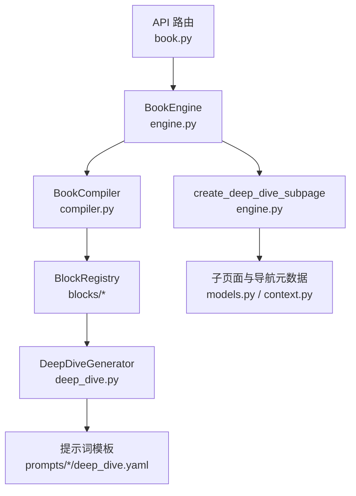
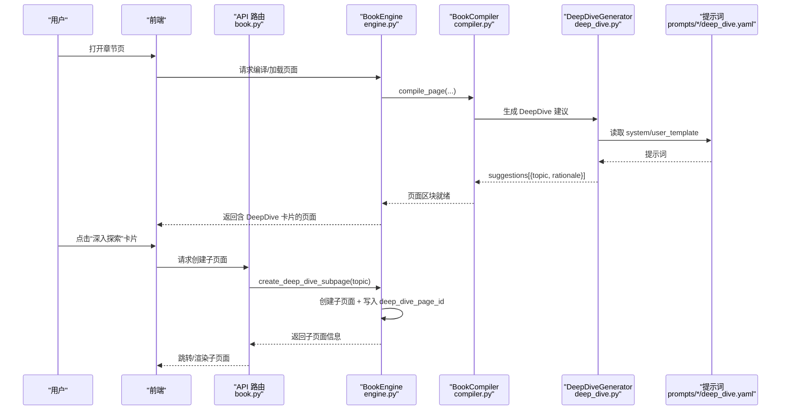
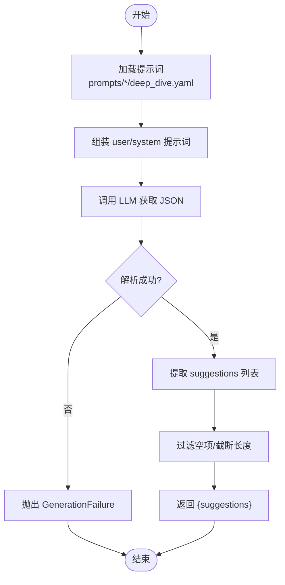
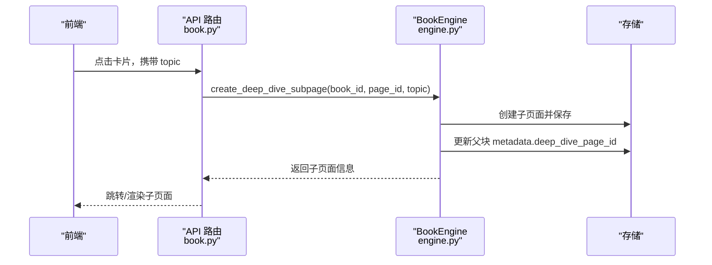
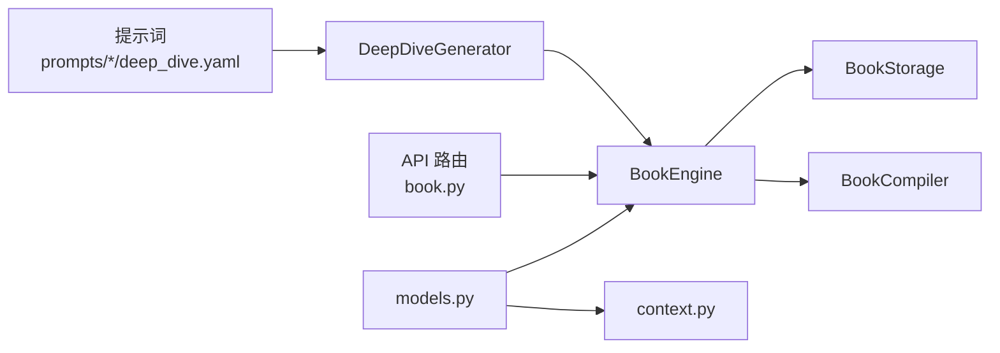

# 深入探索块

<cite>
**本文引用的文件**
- [deep_dive.py](file://deeptutor/book/blocks/deep_dive.py)
- [engine.py](file://deeptutor/book/engine.py)
- [compiler.py](file://deeptutor/book/compiler.py)
- [models.py](file://deeptutor/book/models.py)
- [book.py](file://deeptutor/api/routers/book.py)
- [context.py](file://deeptutor/book/context.py)
- [deep_dive.yaml (en)](file://deeptutor/book/prompts/en/deep_dive.yaml)
- [deep_dive.yaml (zh)](file://deeptutor/book/prompts/zh/deep_dive.yaml)
</cite>

## 目录
1. [简介](#简介)
2. [项目结构](#项目结构)
3. [核心组件](#核心组件)
4. [架构总览](#架构总览)
5. [详细组件分析](#详细组件分析)
6. [依赖关系分析](#依赖关系分析)
7. [性能考量](#性能考量)
8. [故障排查指南](#故障排查指南)
9. [结论](#结论)
10. [附录：使用示例与最佳实践](#附录使用示例与最佳实践)

## 简介
深入探索块（Deep Dive）是 DeepTutor BookEngine 的“Go deeper”能力，用于在章节页中提供可点击的“深入探索”卡片。用户点击后，系统会基于当前章节主题自动生成一个子页面，展示从概览到细节的层次化内容，支持结构化分析与渐进式展开。其核心由 DeepDiveGenerator 负责生成“建议的子话题”，BookEngine.create_deep_dive_subpage 负责按需创建子页面并建立导航关联，前端通过可折叠/展开交互呈现多层级内容。

## 项目结构
围绕深入探索块的关键代码分布在以下位置：
- 区块生成器：deeptutor/book/blocks/deep_dive.py
- 引擎编排与子页面创建：deeptutor/book/engine.py
- 编译器与区块流水线：deeptutor/book/compiler.py
- 数据模型与类型定义：deeptutor/book/models.py
- API 路由入口：deeptutor/api/routers/book.py
- 上下文与渲染分支：deeptutor/book/context.py
- 提示词模板（中英双语）：deeptutor/book/prompts/{en,zh}/deep_dive.yaml

图表来源
- [book.py:380-395](file://deeptutor/api/routers/book.py#L380-L395)
- [engine.py:1158-1210](file://deeptutor/book/engine.py#L1158-L1210)
- [compiler.py:88-190](file://deeptutor/book/compiler.py#L88-L190)
- [deep_dive.py:21-66](file://deeptutor/book/blocks/deep_dive.py#L21-L66)
- [models.py:60-75](file://deeptutor/book/models.py#L60-L75)
- [context.py:220-240](file://deeptutor/book/context.py#L220-L240)

章节来源
- [deep_dive.py:21-66](file://deeptutor/book/blocks/deep_dive.py#L21-L66)
- [engine.py:1158-1210](file://deeptutor/book/engine.py#L1158-L1210)
- [compiler.py:88-190](file://deeptutor/book/compiler.py#L88-L190)
- [models.py:60-75](file://deeptutor/book/models.py#L60-L75)
- [book.py:380-395](file://deeptutor/api/routers/book.py#L380-L395)
- [context.py:220-240](file://deeptutor/book/context.py#L220-L240)
- [deep_dive.yaml (en):1-11](file://deeptutor/book/prompts/en/deep_dive.yaml#L1-L11)
- [deep_dive.yaml (zh):1-11](file://deeptutor/book/prompts/zh/deep_dive.yaml#L1-L11)

## 核心组件
- DeepDiveGenerator：根据章节标题与摘要调用 LLM，输出若干“值得深入”的子话题建议（topic、rationale），供前端渲染“深入探索”卡片。
- BookEngine.create_deep_dive_subpage：当用户点击卡片时，基于建议的主题创建子页面，并在父页面块的元数据中记录 deep_dive_page_id，实现双向导航。
- BookCompiler：按页驱动区块生成流水线；对非概览页执行通用编译流程，为后续扩展（如将 DeepDive 作为普通区块参与编译）提供基础。
- models：定义 BlockType.DEEP_DIVE 等类型常量，支撑区块识别与处理。
- prompts：中英双语提示词，约束 LLM 输出 JSON 结构，确保稳定性与可解析性。

章节来源
- [deep_dive.py:21-66](file://deeptutor/book/blocks/deep_dive.py#L21-L66)
- [engine.py:1158-1210](file://deeptutor/book/engine.py#L1158-L1210)
- [compiler.py:88-190](file://deeptutor/book/compiler.py#L88-L190)
- [models.py:60-75](file://deeptutor/book/models.py#L60-L75)
- [deep_dive.yaml (en):1-11](file://deeptutor/book/prompts/en/deep_dive.yaml#L1-L11)
- [deep_dive.yaml (zh):1-11](file://deeptutor/book/prompts/zh/deep_dive.yaml#L1-L11)

## 架构总览
深入探索块的工作流分为两条主线：
- 生成阶段：章节页渲染时，DeepDiveGenerator 调用 LLM 生成“子话题建议”，前端据此渲染“深入探索”卡片。
- 触发阶段：用户点击卡片后，API 路由调用 BookEngine.create_deep_dive_subpage，创建子页面并回填导航元数据，形成“父页→子页”的双向链接。

图表来源
- [book.py:380-395](file://deeptutor/api/routers/book.py#L380-L395)
- [engine.py:1158-1210](file://deeptutor/book/engine.py#L1158-L1210)
- [compiler.py:88-190](file://deeptutor/book/compiler.py#L88-L190)
- [deep_dive.py:21-66](file://deeptutor/book/blocks/deep_dive.py#L21-L66)
- [deep_dive.yaml (en):1-11](file://deeptutor/book/prompts/en/deep_dive.yaml#L1-L11)
- [deep_dive.yaml (zh):1-11](file://deeptutor/book/prompts/zh/deep_dive.yaml#L1-L11)

## 详细组件分析

### DeepDiveGenerator：深度内容生成
- 输入：章节标题与摘要（来自 BlockContext）。
- 处理：加载对应语言的提示词，构造 user/system prompt，调用 llm_json 获取 JSON 结果，提取 suggestions 列表（最多 5 条），每条包含 topic 与 rationale。
- 输出：{"suggestions": [...]}，若无有效建议则抛出 GenerationFailure。
- 复杂度：单次 LLM 调用，时间复杂度取决于 LLM 响应长度；空间复杂度与 suggestions 数量线性相关。
- 错误处理：LLM 未返回有效 suggestions 时明确失败，便于上层重试或降级。

图表来源
- [deep_dive.py:21-66](file://deeptutor/book/blocks/deep_dive.py#L21-L66)
- [deep_dive.yaml (en):1-11](file://deeptutor/book/prompts/en/deep_dive.yaml#L1-L11)
- [deep_dive.yaml (zh):1-11](file://deeptutor/book/prompts/zh/deep_dive.yaml#L1-L11)

章节来源
- [deep_dive.py:21-66](file://deeptutor/book/blocks/deep_dive.py#L21-L66)

### BookEngine.create_deep_dive_subpage：子页面创建与导航绑定
- 功能：根据传入的 topic 创建子页面，并将子页面 ID 写回父页面块的 metadata.deep_dive_page_id，形成“父页→子页”的导航锚点。
- 集成点：被 API 路由 book.py 调用，作为“Go deeper”动作的后端实现。
- 数据结构：依赖 models 中的 BlockType.DEEP_DIVE 与 Page/Block 模型。

图表来源
- [book.py:380-395](file://deeptutor/api/routers/book.py#L380-L395)
- [engine.py:1158-1210](file://deeptutor/book/engine.py#L1158-L1210)
- [models.py:60-75](file://deeptutor/book/models.py#L60-L75)

章节来源
- [engine.py:1158-1210](file://deeptutor/book/engine.py#L1158-L1210)
- [book.py:380-395](file://deeptutor/api/routers/book.py#L380-L395)
- [models.py:60-75](file://deeptutor/book/models.py#L60-L75)

### 编译器与区块流水线：可扩展的生成框架
- BookCompiler.compile_page 负责按顺序或并发地生成页面内各区块；对于 DeepDive 这类特殊区块，可在未来接入统一流水线，复用 RAG、探索报告等资源。
- CompilerOptions 控制 phase、rag_enabled、block_concurrency 等关键参数，影响生成策略与性能。

章节来源
- [compiler.py:45-84](file://deeptutor/book/compiler.py#L45-L84)
- [compiler.py:88-190](file://deeptutor/book/compiler.py#L88-L190)

### 上下文与渲染分支：识别与处理 DeepDive 区块
- context.py 中对 BlockType.DEEP_DIVE 进行分支处理，以便在渲染层正确显示“深入探索”卡片与交互状态。
- 该分支与 engine 的 deep_dive_page_id 配合，实现“父页→子页”的导航与“子页→父页”的回退。

章节来源
- [context.py:220-240](file://deeptutor/book/context.py#L220-L240)
- [models.py:60-75](file://deeptutor/book/models.py#L60-L75)

## 依赖关系分析
- DeepDiveGenerator 依赖提示词模板与 LLM 服务，输出稳定的 JSON 结构。
- BookEngine 依赖 BookStorage 与 BookCompiler，协调页面生命周期与后台队列。
- API 路由暴露 create_deep_dive_subpage 的 HTTP 接口，连接前端与后端。
- models 提供统一的类型定义，保证前后端与多模块间的数据契约一致。

图表来源
- [deep_dive.py:21-66](file://deeptutor/book/blocks/deep_dive.py#L21-L66)
- [engine.py:1158-1210](file://deeptutor/book/engine.py#L1158-L1210)
- [compiler.py:88-190](file://deeptutor/book/compiler.py#L88-L190)
- [book.py:380-395](file://deeptutor/api/routers/book.py#L380-L395)
- [models.py:60-75](file://deeptutor/book/models.py#L60-L75)
- [context.py:220-240](file://deeptutor/book/context.py#L220-L240)

章节来源
- [deep_dive.py:21-66](file://deeptutor/book/blocks/deep_dive.py#L21-L66)
- [engine.py:1158-1210](file://deeptutor/book/engine.py#L1158-L1210)
- [compiler.py:88-190](file://deeptutor/book/compiler.py#L88-L190)
- [book.py:380-395](file://deeptutor/api/routers/book.py#L380-L395)
- [models.py:60-75](file://deeptutor/book/models.py#L60-L75)
- [context.py:220-240](file://deeptutor/book/context.py#L220-L240)

## 性能考量
- 生成阶段：DeepDiveGenerator 仅一次 LLM 调用，且限制 suggestions 数量与字段长度，降低延迟与成本。
- 编译阶段：BookCompiler 支持 block_concurrency 控制并行度；Phase 1 默认串行以保证稳定流式顺序，后期可提升并发加速。
- 子页面创建：按需触发，避免预生成开销；通过 deep_dive_page_id 建立轻量级导航引用。
- 缓存与幂等：概览页采用确定性构建，避免重复 LLM 调用；DeepDive 子页面按需创建，减少冗余。

[本节为通用指导，不直接分析具体文件]

## 故障排查指南
- 无建议返回：若 LLM 未返回有效 suggestions，DeepDiveGenerator 会抛出 GenerationFailure。检查提示词配置与语言设置，确认 chapter_title/summary 是否有效。
- 子页面未创建：确认 API 路由是否正确调用 create_deep_dive_subpage，以及父块 metadata 是否写入 deep_dive_page_id。
- 渲染异常：检查 context 分支是否正确识别 BlockType.DEEP_DIVE，并确保前端能读取 deep_dive_page_id 以渲染可折叠/展开交互。

章节来源
- [deep_dive.py:21-66](file://deeptutor/book/blocks/deep_dive.py#L21-L66)
- [engine.py:1158-1210](file://deeptutor/book/engine.py#L1158-L1210)
- [context.py:220-240](file://deeptutor/book/context.py#L220-L240)

## 结论
深入探索块通过“建议→子页面→导航绑定”的闭环，实现了从章节概览到专题细节的渐进式学习路径。DeepDiveGenerator 保证建议质量与稳定性，BookEngine.create_deep_dive_subpage 提供按需创建的子页面能力，结合编译器与上下文处理，形成可扩展、高性能的内容组织机制。

[本节为总结，不直接分析具体文件]

## 附录：使用示例与最佳实践

- 复杂主题研究
  - 步骤：在章节页生成 DeepDive 建议 → 选择最相关的子话题 → 点击卡片进入子页面 → 在子页面中继续生成新的 DeepDive 建议，形成树状知识图谱。
  - 要点：保持 topic 聚焦，避免过宽泛；利用 rationale 辅助判断相关性。

- 技术文档生成
  - 步骤：为每个技术点生成 DeepDive 子页面，逐步展开原理、实现与案例；通过 deep_dive_page_id 维护父子关系，便于读者回溯。
  - 要点：在子页面中结合 RAG 与知识库检索，增强权威性与时效性。

- 学习材料构建
  - 步骤：先产出章节概览与概念图，再为关键概念生成 DeepDive 子页面；通过可折叠/展开交互控制信息密度，提升阅读体验。
  - 要点：合理设置 depth（通过多次 DeepDive 迭代）与 sources（结合知识库），平衡广度与深度。

- 参数配置建议
  - topic：尽量具体、可操作，避免歧义；可从章节摘要中提取关键词。
  - depth：通过多次 DeepDive 迭代控制层级；每层聚焦一个子主题。
  - sources：优先使用已索引的知识库与权威来源，提高准确性。
  - 语言：确保 prompts 与语言设置一致，以获得更自然的输出。

- 交互设计
  - 可折叠/展开：在父页中以卡片形式展示建议，点击后展开子页面；子页面提供“返回父页”按钮，提升导航效率。
  - 渐进式展开：首屏仅展示概览与少量建议，随用户兴趣逐步展开细节，避免信息过载。

[本节为概念性指导，不直接分析具体文件]