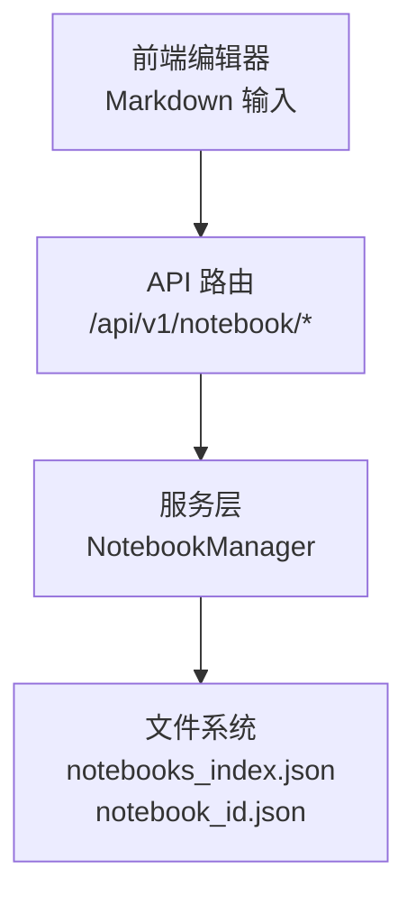
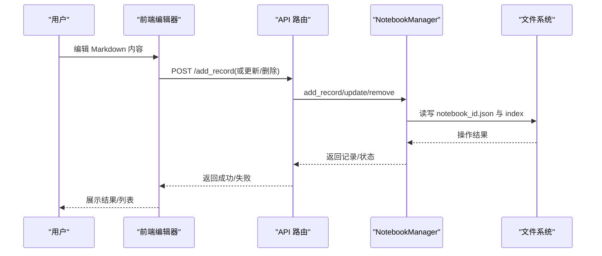
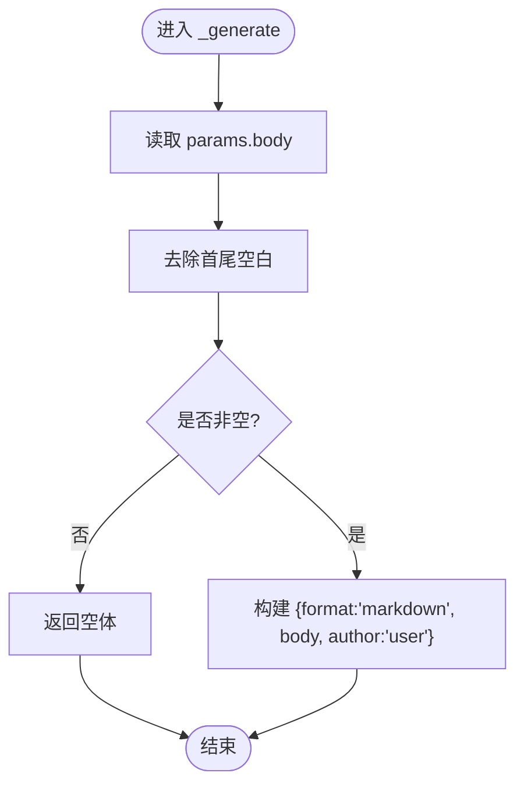
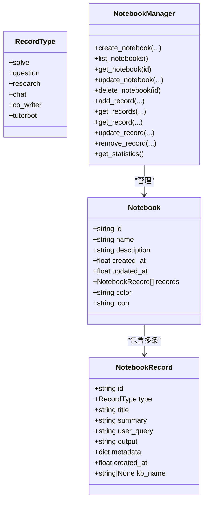
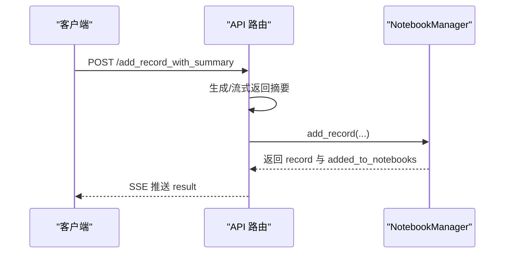
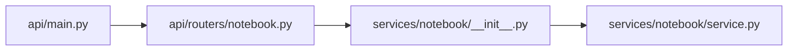

# 用户笔记块

<cite>
**本文引用的文件**
- [user_note.py](file://deeptutor/book/blocks/user_note.py)
- [service.py](file://deeptutor/services/notebook/service.py)
- [__init__.py](file://deeptutor/services/notebook/__init__.py)
- [notebook.py](file://deeptutor/api/routers/notebook.py)
- [main.py](file://deeptutor/api/main.py)
</cite>

## 目录
1. [简介](#简介)
2. [项目结构](#项目结构)
3. [核心组件](#核心组件)
4. [架构总览](#架构总览)
5. [详细组件分析](#详细组件分析)
6. [依赖关系分析](#依赖关系分析)
7. [性能考虑](#性能考虑)
8. [故障排查指南](#故障排查指南)
9. [结论](#结论)
10. [附录：使用示例与个性化配置](#附录使用示例与个性化配置)

## 简介
本章节面向“DeepTutor 用户笔记块”，聚焦 UserNoteGenerator 的实现原理，以及笔记的编辑、保存、检索机制。文档同时说明笔记的数据结构（如 content、tags、created_at 等字段在系统中的对应关系）、富文本/Markdown 支持、搜索与过滤能力、同步与备份策略，并提供学习笔记、会议记录、想法收集等场景的使用建议。

## 项目结构
用户笔记功能由三层构成：
- 前端/编辑器层：以 Markdown 形式编辑并渲染用户笔记内容。
- API 路由层：提供笔记本创建、记录增删改查、统计等接口。
- 服务层：基于本地 JSON 文件的 NotebookManager，负责持久化与索引维护。

图表来源
- [main.py:413-413](file://deeptutor/api/main.py#L413-L413)
- [notebook.py:140-359](file://deeptutor/api/routers/notebook.py#L140-L359)
- [service.py:68-447](file://deeptutor/services/notebook/service.py#L68-L447)

章节来源
- [main.py:413-413](file://deeptutor/api/main.py#L413-L413)
- [notebook.py:140-359](file://deeptutor/api/routers/notebook.py#L140-L359)
- [service.py:68-447](file://deeptutor/services/notebook/service.py#L68-L447)

## 核心组件
- UserNoteGenerator：将用户输入的 body 作为 Markdown 内容输出，标记 author 为 user，format 为 markdown。
- NotebookManager：管理笔记本与记录的 CRUD，维护 notebooks_index.json 索引与每个笔记本的 JSON 文件。
- API 路由：暴露笔记本与记录的增删改查、统计、健康检查等端点。

章节来源
- [user_note.py:11-23](file://deeptutor/book/blocks/user_note.py#L11-L23)
- [service.py:22-58](file://deeptutor/services/notebook/service.py#L22-L58)
- [service.py:68-447](file://deeptutor/services/notebook/service.py#L68-L447)
- [notebook.py:23-70](file://deeptutor/api/routers/notebook.py#L23-L70)
- [notebook.py:140-359](file://deeptutor/api/routers/notebook.py#L140-L359)

## 架构总览
下图展示了从编辑器到存储的完整数据流：用户在编辑器中编写 Markdown，通过 API 路由调用服务层写入本地 JSON；读取时同样经由路由返回结构化数据。

图表来源
- [notebook.py:266-359](file://deeptutor/api/routers/notebook.py#L266-L359)
- [service.py:254-400](file://deeptutor/services/notebook/service.py#L254-L400)

## 详细组件分析

### UserNoteGenerator：用户笔记生成器
- 作用：将用户提供的 body 原样作为 Markdown 内容输出，author 固定为用户，format 固定为 markdown。
- 输入：BlockContext 中的 params.body。
- 输出：包含 format、body、author 的结构化字典，无 LLM 参与。

图表来源
- [user_note.py:14-23](file://deeptutor/book/blocks/user_note.py#L14-L23)

章节来源
- [user_note.py:11-23](file://deeptutor/book/blocks/user_note.py#L11-L23)

### NotebookManager：笔记本与记录管理
- 数据结构
  - NotebookRecord：id、type、title、summary、user_query、output、metadata、created_at、kb_name。
  - Notebook：id、name、description、created_at、updated_at、records、color、icon。
- 关键能力
  - 创建/更新/删除笔记本。
  - 添加/更新/删除记录，支持多笔记本关联。
  - 按引用解析记录（get_records_by_references）。
  - 统计信息（总数、类型分布、最近笔记本）。
- 持久化
  - 索引文件：notebooks_index.json。
  - 笔记本文件：{notebook_id}.json。
  - 加载时清理 summary 中的私有思考标签，保证安全。

图表来源
- [service.py:22-58](file://deeptutor/services/notebook/service.py#L22-L58)
- [service.py:68-447](file://deeptutor/services/notebook/service.py#L68-L447)

章节来源
- [service.py:22-58](file://deeptutor/services/notebook/service.py#L22-L58)
- [service.py:68-447](file://deeptutor/services/notebook/service.py#L68-L447)

### API 路由：笔记本与记录接口
- 主要端点
  - GET /list：列出所有笔记本（含摘要信息）。
  - GET /statistics：获取统计信息。
  - POST /create：创建笔记本。
  - GET /{notebook_id}：获取笔记本详情（含全部记录）。
  - PUT /{notebook_id}：更新笔记本元信息。
  - DELETE /{notebook_id}：删除笔记本。
  - POST /add_record：添加记录（可带自动摘要）。
  - POST /add_record_with_summary：流式生成摘要后落库。
  - DELETE /{notebook_id}/records/{record_id}：删除记录。
  - PUT /{notebook_id}/records/{record_id}：更新记录。
  - GET /health：健康检查。
- 错误处理：统一捕获异常并返回 HTTP 状态码与细节。

图表来源
- [notebook.py:89-137](file://deeptutor/api/routers/notebook.py#L89-L137)
- [notebook.py:299-306](file://deeptutor/api/routers/notebook.py#L299-L306)
- [service.py:254-295](file://deeptutor/services/notebook/service.py#L254-L295)

章节来源
- [notebook.py:140-359](file://deeptutor/api/routers/notebook.py#L140-L359)

## 依赖关系分析
- 路由注册：API main 将 notebook router 挂载到 /api/v1/notebook。
- 服务单例：通过 get_notebook_manager 获取 NotebookManager 实例，路径由 path_service 决定。
- 模块导出：services/notebook/__init__.py 统一导出 Notebook、NotebookManager、NotebookRecord、RecordType 及管理器工厂。

图表来源
- [main.py:413-413](file://deeptutor/api/main.py#L413-L413)
- [__init__.py:1-20](file://deeptutor/services/notebook/__init__.py#L1-L20)
- [service.py:430-447](file://deeptutor/services/notebook/service.py#L430-L447)

章节来源
- [main.py:413-413](file://deeptutor/api/main.py#L413-L413)
- [__init__.py:1-20](file://deeptutor/services/notebook/__init__.py#L1-L20)
- [service.py:430-447](file://deeptutor/services/notebook/service.py#L430-L447)

## 性能考虑
- 本地 JSON 文件读写：适合中小规模数据；大量记录时建议分页查询与按需加载。
- 索引文件 notebooks_index.json：每次变更都会更新，避免频繁写盘可合并批量更新。
- 流式摘要：add_record_with_summary 通过 SSE 逐步返回摘要，提升交互体验。
- 记录清理：加载时清理 summary 中的私有思考标签，减少不必要的数据膨胀。

[本节为通用性能建议，不直接分析具体代码]

## 故障排查指南
- 常见错误
  - 404：笔记本或记录不存在。
  - 500：服务内部异常（如文件读写失败）。
- 定位方法
  - 查看 API 响应 detail 字段。
  - 检查 notebooks_index.json 与对应笔记本 JSON 是否损坏。
  - 确认 path_service 指向的 data/user/workspace/notebook 目录权限正确。
- 恢复步骤
  - 重建索引：删除 notebooks_index.json 后重启服务重新生成。
  - 校验 JSON 格式：确保文件合法且编码为 UTF-8。

章节来源
- [notebook.py:140-359](file://deeptutor/api/routers/notebook.py#L140-L359)
- [service.py:83-116](file://deeptutor/services/notebook/service.py#L83-L116)

## 结论
UserNoteGenerator 提供了轻量、无 LLM 介入的用户笔记块，便于在前端以 Markdown 编辑并直接落地。服务层 NotebookManager 以 JSON 文件实现笔记本与记录的持久化，配合 API 路由提供完整的 CRUD 与统计能力。对于搜索与过滤，当前系统通过类型与引用进行组织；如需关键词全文检索，可在上层引入搜索引擎或扩展服务层。数据安全方面，建议在部署侧做好目录备份与权限控制。

[本节为总结性内容，不直接分析具体代码]

## 附录：使用示例与个性化配置

- 学习笔记
  - 使用方式：在编辑器中以 Markdown 记录知识点、公式与链接；通过 add_record 将内容加入指定笔记本。
  - 个性化：利用 metadata 字段附加课程名、难度等级、复习周期等自定义标签。
  - 检索建议：结合 type=question/solve/research 等分类快速筛选。

- 会议记录
  - 使用方式：以 Markdown 表格记录议题、决策与待办；通过 update_record 补充后续进展。
  - 个性化：在 metadata 中标注参会人、优先级、下次跟进时间。
  - 检索建议：通过标题与摘要关键字在前端进行过滤。

- 想法收集
  - 使用方式：快速粘贴灵感片段，使用 tags 思想在 metadata 中打标签（如 idea、todo、review）。
  - 个性化：通过颜色与图标区分不同主题笔记本。
  - 检索建议：按更新时间排序，优先回顾近期想法。

- 富文本与 Markdown 支持
  - 编辑器：建议使用支持 Markdown 的富文本编辑器，以便书写标题、列表、代码块、数学公式等。
  - 渲染：UserNoteGenerator 输出 format=markdown，前端可按 Markdown 渲染。

- 搜索与过滤
  - 当前能力：按笔记本维度组织，按类型（solve/question/research/chat/co_writer/tutorbot）与引用进行筛选。
  - 扩展建议：若需关键词全文检索，可在上层增加搜索引擎（如内置向量检索或外部 ES），并在 API 层新增搜索端点。

- 同步与备份
  - 本地存储：数据位于 data/user/workspace/notebook 下的 JSON 文件与索引。
  - 备份策略：定期备份该目录；或在 CI/CD 中定时打包归档。
  - 多机同步：可将共享目录挂载至容器或服务器，确保唯一写入源以避免冲突。

[本节为概念性指导，不直接分析具体代码]