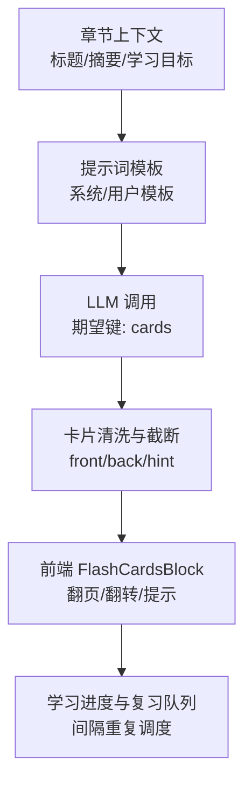
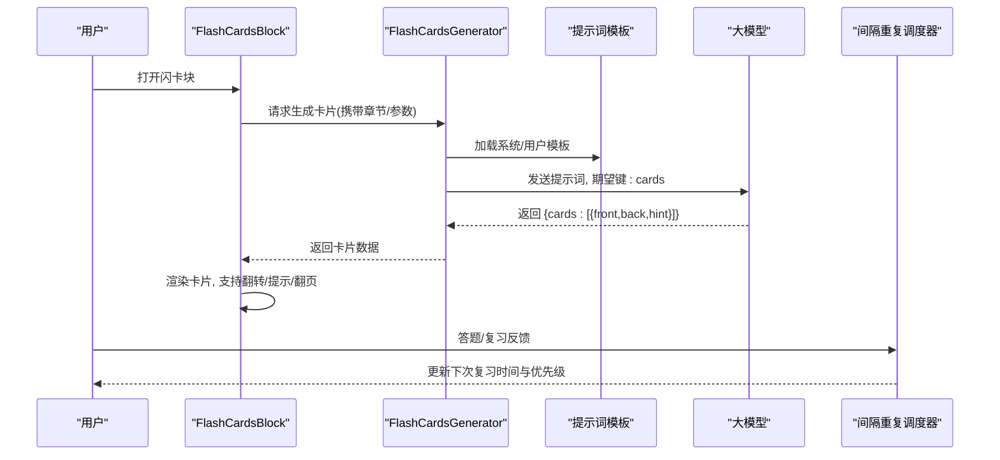
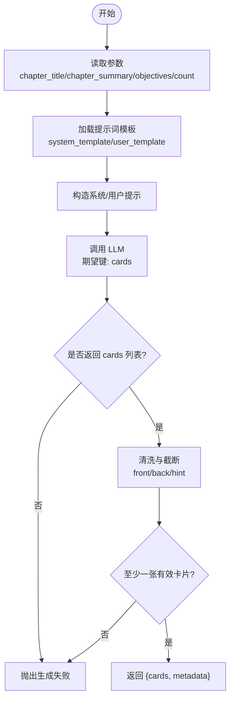
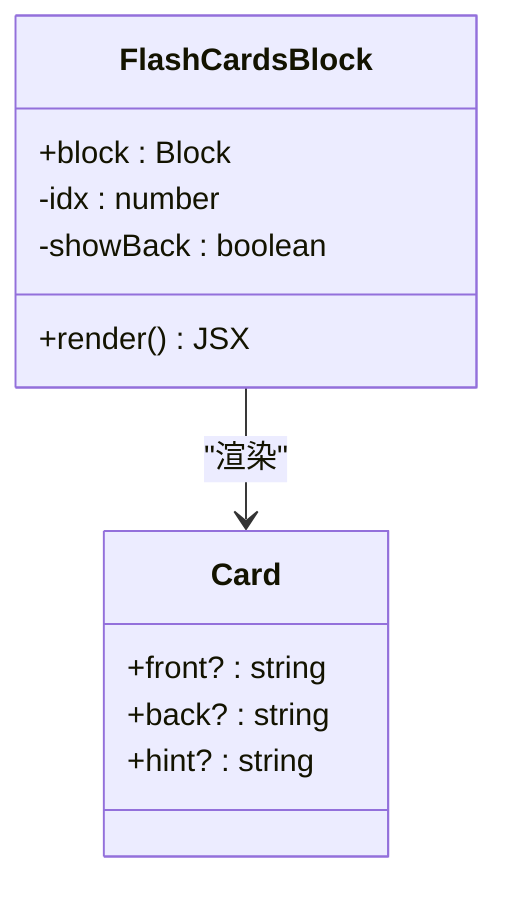
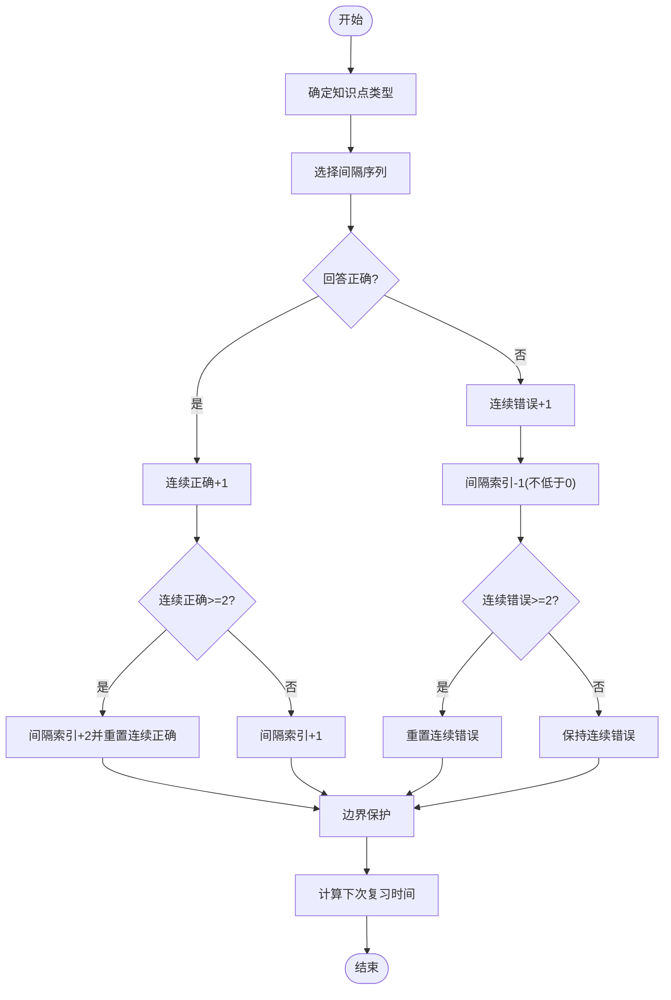
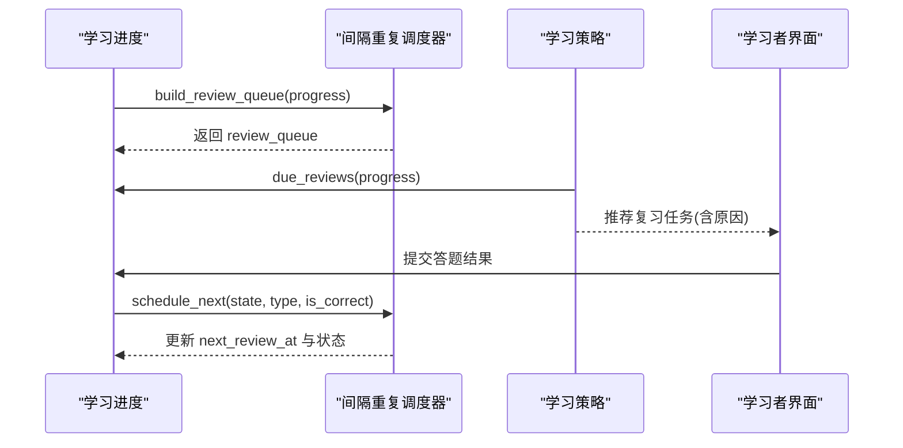
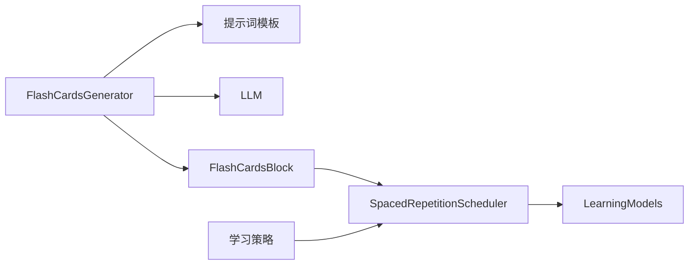

# 闪卡块

<cite>
**本文引用的文件**
- [flash_cards.py](file://deeptutor/book/blocks/flash_cards.py)
- [flash_cards.yaml（中文）](file://deeptutor/book/prompts/zh/flash_cards.yaml)
- [flash_cards.yaml（英文）](file://deeptutor/book/prompts/en/flash_cards.yaml)
- [context.py](file://deeptutor/book/context.py)
- [FlashCardsBlock.tsx](file://web/app/(workspace)/book/components/blocks/FlashCardsBlock.tsx)
- [scheduler.py](file://deeptutor/learning/scheduler.py)
- [models.py](file://deeptutor/learning/models.py)
- [policy.py](file://deeptutor/learning/policy.py)
</cite>

## 目录
1. [简介](#简介)
2. [项目结构](#项目结构)
3. [核心组件](#核心组件)
4. [架构总览](#架构总览)
5. [详细组件分析](#详细组件分析)
6. [依赖关系分析](#依赖关系分析)
7. [性能与体验考量](#性能与体验考量)
8. [故障排查指南](#故障排查指南)
9. [结论](#结论)
10. [附录：使用示例与个性化配置](#附录使用示例与个性化配置)

## 简介
本文件面向 DeepTutor 的“闪卡块”功能，系统性说明其生成机制、前端交互、间隔重复复习算法与进度跟踪。重点包括：
- FlashCardsGenerator 如何基于章节上下文与提示词模板生成高质量记忆卡片
- 前端 FlashCardsBlock 的翻转交互与导航
- 间隔重复调度器 SpacedRepetitionScheduler 的学习策略与复习计划生成
- 学习进度模型与策略如何驱动复习任务
- 多媒体支持现状与扩展建议

## 项目结构
闪卡块由后端生成器、提示词模板、前端展示组件以及学习调度模块共同组成：
- 后端生成器：负责从章节信息和学习目标构造提示词，调用 LLM 输出结构化卡片数据
- 提示词模板：中英文两套模板，控制卡片数量与字段约束
- 前端组件：提供卡片翻页、翻转、提示显示等交互
- 学习调度：维护每个知识点的间隔重复状态，构建复习队列并参与学习策略决策

图表来源
- [flash_cards.py:22-70](file://deeptutor/book/blocks/flash_cards.py#L22-L70)
- [flash_cards.yaml（中文）:1-11](file://deeptutor/book/prompts/zh/flash_cards.yaml#L1-L11)
- [flash_cards.yaml（英文）:1-12](file://deeptutor/book/prompts/en/flash_cards.yaml#L1-L12)
- [FlashCardsBlock.tsx:18-80](file://web/app/(workspace)/book/components/blocks/FlashCardsBlock.tsx#L18-L80)
- [scheduler.py:13-101](file://deeptutor/learning/scheduler.py#L13-L101)

章节来源
- [flash_cards.py:22-70](file://deeptutor/book/blocks/flash_cards.py#L22-L70)
- [flash_cards.yaml（中文）:1-11](file://deeptutor/book/prompts/zh/flash_cards.yaml#L1-L11)
- [flash_cards.yaml（英文）:1-12](file://deeptutor/book/prompts/en/flash_cards.yaml#L1-L12)
- [FlashCardsBlock.tsx:18-80](file://web/app/(workspace)/book/components/blocks/FlashCardsBlock.tsx#L18-L80)
- [scheduler.py:13-101](file://deeptutor/learning/scheduler.py#L13-L101)

## 核心组件
- FlashCardsGenerator：根据章节上下文与参数生成卡片列表，返回统一数据结构
- FlashCardsBlock：前端渲染卡片，支持问题/答案切换、提示、前后翻页
- SpacedRepetitionScheduler：按知识点类型维护间隔序列，计算下次复习时间并构建复习队列
- LearningProgress/ReviewTask/RepetitionState：学习进度与复习任务的数据模型

章节来源
- [flash_cards.py:19-70](file://deeptutor/book/blocks/flash_cards.py#L19-L70)
- [FlashCardsBlock.tsx:18-80](file://web/app/(workspace)/book/components/blocks/FlashCardsBlock.tsx#L18-L80)
- [scheduler.py:28-101](file://deeptutor/learning/scheduler.py#L28-L101)
- [models.py:144-213](file://deeptutor/learning/models.py#L144-L213)

## 架构总览
闪卡块的端到端流程如下：
- 后端读取章节信息与参数，加载对应语言提示词模板
- 构造系统提示与用户提示，调用 LLM 获取 JSON 结构的卡片数组
- 对卡片进行清洗、长度限制与校验，最终输出给前端
- 前端以卡片形式呈现，支持翻转查看答案与提示
- 学习调度器依据知识点类型与答题结果更新间隔重复状态，生成复习任务

图表来源
- [flash_cards.py:22-70](file://deeptutor/book/blocks/flash_cards.py#L22-L70)
- [flash_cards.yaml（中文）:1-11](file://deeptutor/book/prompts/zh/flash_cards.yaml#L1-L11)
- [flash_cards.yaml（英文）:1-12](file://deeptutor/book/prompts/en/flash_cards.yaml#L1-L12)
- [FlashCardsBlock.tsx:18-80](file://web/app/(workspace)/book/components/blocks/FlashCardsBlock.tsx#L18-L80)
- [scheduler.py:36-101](file://deeptutor/learning/scheduler.py#L36-L101)

## 详细组件分析

### FlashCardsGenerator：卡片生成机制
- 输入参数
  - chapter_title：章节标题（可从上下文或参数覆盖）
  - chapter_summary：章节摘要（可为空时回退为本地化占位）
  - objectives：学习目标（来自章节或参数覆盖）
  - count：卡片数量（默认值经上下限裁剪）
- 处理逻辑
  - 加载对应语言的 flash_cards 提示词模板
  - 构造系统提示（包含期望输出的 JSON 结构与卡片数量）
  - 构造用户提示（章节标题、摘要、目标）
  - 调用 llm_json，指定期望键为 cards
  - 清洗与截断：front/back/hint 去除空白并限制最大长度
  - 若未生成有效卡片，抛出生成失败异常
- 输出
  - cards：[{front, back, hint}]
  - _metadata：可选元数据透传

图表来源
- [flash_cards.py:22-70](file://deeptutor/book/blocks/flash_cards.py#L22-L70)
- [flash_cards.yaml（中文）:1-11](file://deeptutor/book/prompts/zh/flash_cards.yaml#L1-L11)
- [flash_cards.yaml（英文）:1-12](file://deeptutor/book/prompts/en/flash_cards.yaml#L1-L12)

章节来源
- [flash_cards.py:22-70](file://deeptutor/book/blocks/flash_cards.py#L22-L70)

### FlashCardsBlock：前端交互与动画
- 交互能力
  - 显示当前卡片序号与总数
  - 点击卡片区域在“问题/答案”之间切换
  - 未翻面时显示提示（hint）
  - 支持上一张/下一张与翻转按钮
- 动画与样式
  - 通过 CSS 类实现淡入、弹出等过渡效果
  - 翻转通过状态切换实现内容替换（无 3D 翻转动画）
- 数据来源
  - block.payload.cards 作为卡片数组

图表来源
- [FlashCardsBlock.tsx:8-80](file://web/app/(workspace)/book/components/blocks/FlashCardsBlock.tsx#L8-L80)

章节来源
- [FlashCardsBlock.tsx:18-80](file://web/app/(workspace)/book/components/blocks/FlashCardsBlock.tsx#L18-L80)

### 间隔重复算法与复习计划
- 知识点类型与间隔序列
  - MEMORY：[0, 1, 3, 7, 14, 30, 60]
  - CONCEPT：[3, 7, 14, 30]
  - PROCEDURE：[3, 7, 14]
  - DESIGN：[14, 28]
- 状态管理
  - interval_index：当前间隔索引
  - consecutive_correct/consecutive_wrong：连续正确/错误计数
  - next_review_at：下次复习时间戳
- 调度策略
  - 正确：推进间隔；连续两次正确则跳过下一个间隔
  - 错误：回退一个间隔；连续错误重置计数器
  - 边界保护：索引不越界
- 复习队列构建
  - 将每个知识点的 RepetitionState 转换为 ReviewTask
  - 错误记录中的知识点优先度更高
  - 可筛选到期任务并按优先级排序

图表来源
- [scheduler.py:13-70](file://deeptutor/learning/scheduler.py#L13-L70)
- [models.py:144-161](file://deeptutor/learning/models.py#L144-L161)

章节来源
- [scheduler.py:13-101](file://deeptutor/learning/scheduler.py#L13-L101)
- [models.py:144-213](file://deeptutor/learning/models.py#L144-L213)

### 进度跟踪与复习计划生成
- 学习进度模型
  - repetition_states：每个知识点的间隔重复状态
  - review_queue：待复习任务列表
  - knowledge_types：知识点类型映射
  - error_records：错误记录（影响优先级）
- 策略集成
  - 当存在到期复习任务时，学习策略优先安排复习
  - 复习任务优先级受错误记录与知识点类型影响

图表来源
- [scheduler.py:72-101](file://deeptutor/learning/scheduler.py#L72-L101)
- [policy.py:185-201](file://deeptutor/learning/policy.py#L185-L201)
- [models.py:185-213](file://deeptutor/learning/models.py#L185-L213)

章节来源
- [scheduler.py:72-101](file://deeptutor/learning/scheduler.py#L72-L101)
- [policy.py:185-201](file://deeptutor/learning/policy.py#L185-L201)
- [models.py:185-213](file://deeptutor/learning/models.py#L185-L213)

## 依赖关系分析
- 后端生成器依赖提示词模板与 LLM 服务
- 前端组件依赖后端返回的卡片数据
- 学习调度依赖学习进度模型与错误记录
- 学习策略依赖调度器的到期任务与优先级

图表来源
- [flash_cards.py:22-70](file://deeptutor/book/blocks/flash_cards.py#L22-L70)
- [FlashCardsBlock.tsx:18-80](file://web/app/(workspace)/book/components/blocks/FlashCardsBlock.tsx#L18-L80)
- [scheduler.py:28-101](file://deeptutor/learning/scheduler.py#L28-L101)
- [models.py:144-213](file://deeptutor/learning/models.py#L144-L213)
- [policy.py:185-201](file://deeptutor/learning/policy.py#L185-L201)

章节来源
- [flash_cards.py:22-70](file://deeptutor/book/blocks/flash_cards.py#L22-L70)
- [FlashCardsBlock.tsx:18-80](file://web/app/(workspace)/book/components/blocks/FlashCardsBlock.tsx#L18-L80)
- [scheduler.py:28-101](file://deeptutor/learning/scheduler.py#L28-L101)
- [models.py:144-213](file://deeptutor/learning/models.py#L144-L213)
- [policy.py:185-201](file://deeptutor/learning/policy.py#L185-L201)

## 性能与体验考量
- 生成阶段
  - 限制卡片数量与字段长度，避免过大响应与渲染压力
  - 使用较低温度与固定 token 上限，提升稳定性
- 前端阶段
  - 简单状态切换实现翻转，减少复杂动画开销
  - 使用轻量级图标与内联样式，降低资源体积
- 复习阶段
  - 间隔序列按知识点类型差异化，平衡记忆与理解
  - 错误记录提高优先级，聚焦薄弱点

## 故障排查指南
- 未生成任何卡片
  - 检查 LLM 返回是否包含 cards 列表
  - 确认 front/back 非空且经过清洗
  - 参考生成失败抛出的异常路径
- 卡片内容过长
  - 检查 front/back/hint 的长度限制是否生效
- 复习任务不出现
  - 确认间隔重复状态已创建且 next_review_at 已设置
  - 检查 review_queue 是否按到期时间与优先级正确构建
- 提示词相关问题
  - 核对中英文模板是否正确加载
  - 确认 system_template 与 user_template 的占位符填充完整

章节来源
- [flash_cards.py:47-70](file://deeptutor/book/blocks/flash_cards.py#L47-L70)
- [scheduler.py:72-101](file://deeptutor/learning/scheduler.py#L72-L101)
- [flash_cards.yaml（中文）:1-11](file://deeptutor/book/prompts/zh/flash_cards.yaml#L1-L11)
- [flash_cards.yaml（英文）:1-12](file://deeptutor/book/prompts/en/flash_cards.yaml#L1-L12)

## 结论
DeepTutor 的闪卡块通过“提示词模板 + LLM 生成 + 前端交互 + 间隔重复调度”的闭环，实现了从内容生成到记忆强化的完整学习路径。其设计简洁稳定，易于扩展多媒体内容与更精细的复习策略。

## 附录：使用示例与个性化配置
- 基础用法
  - 在章节中插入闪卡块，设置 count 为 3-8 之间的整数
  - 系统将基于章节标题、摘要与学习目标自动生成卡片
- 词汇记忆
  - 设置 objectives 为词汇清单或短语搭配
  - 使用较短的 back 与 hint，便于快速回忆
- 概念学习
  - 结合 concept 类型的间隔序列，强化理解与迁移
  - 在 hint 中加入类比或反例，帮助区分易混概念
- 技能训练
  - 针对 procedure 类型，使用步骤式 front/back，配合多次复习
  - 利用错误记录提升薄弱步骤的复习频率
- 多媒体支持现状与建议
  - 当前卡片以文本为主，支持 front/back/hint 字符串
  - 可在提示词模板中引导 LLM 输出图片/音频链接，并在前端扩展渲染
  - 建议在 models 中增加 media 字段，并在 FlashCardsBlock 中按需渲染

章节来源
- [flash_cards.py:22-70](file://deeptutor/book/blocks/flash_cards.py#L22-L70)
- [flash_cards.yaml（中文）:1-11](file://deeptutor/book/prompts/zh/flash_cards.yaml#L1-L11)
- [flash_cards.yaml（英文）:1-12](file://deeptutor/book/prompts/en/flash_cards.yaml#L1-L12)
- [FlashCardsBlock.tsx:18-80](file://web/app/(workspace)/book/components/blocks/FlashCardsBlock.tsx#L18-L80)
- [scheduler.py:13-101](file://deeptutor/learning/scheduler.py#L13-L101)
- [models.py:144-213](file://deeptutor/learning/models.py#L144-L213)