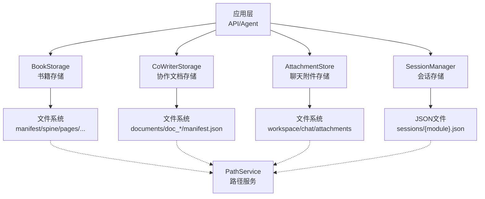
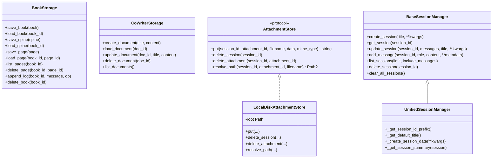
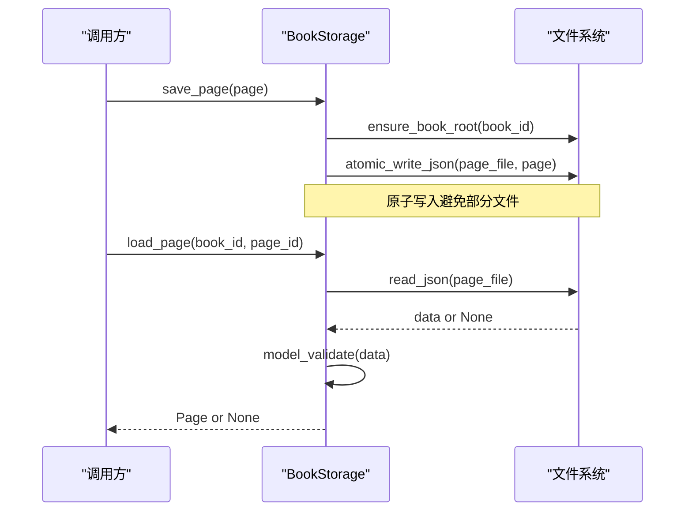
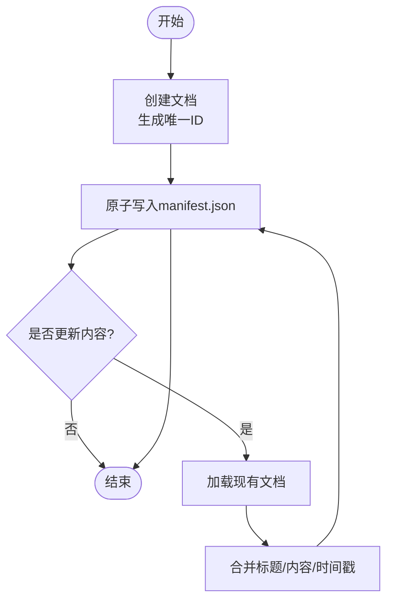
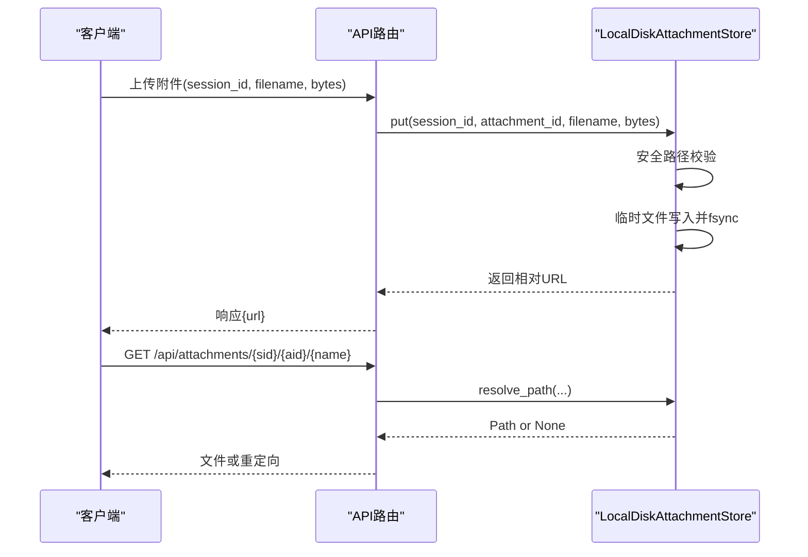
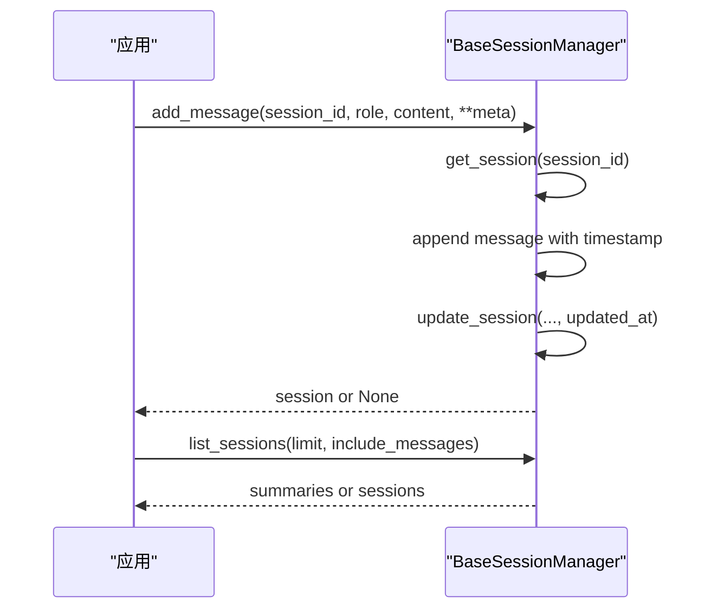
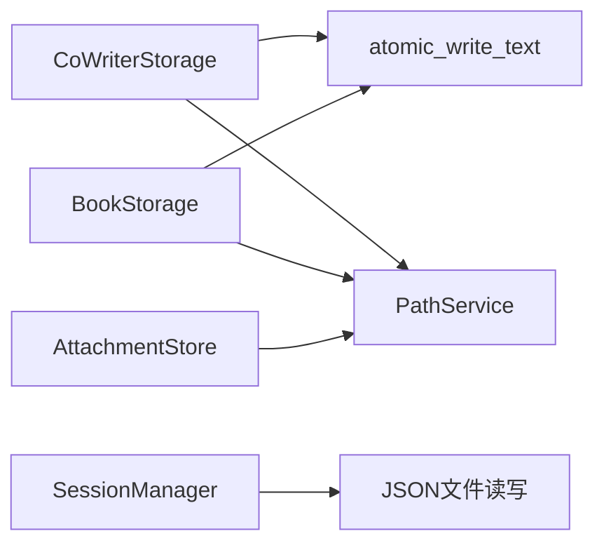

# 存储与持久化

<cite>
**本文引用的文件**
- [book/storage.py](file://deeptutor/book/storage.py)
- [book/models.py](file://deeptutor/book/models.py)
- [co_writer/storage.py](file://deeptutor/co_writer/storage.py)
- [services/storage/attachment_store.py](file://deeptutor/services/storage/attachment_store.py)
- [services/session/base_session_manager.py](file://deeptutor/services/session/base_session_manager.py)
- [services/session/unified_session_manager.py](file://deeptutor/services/session/unified_session_manager.py)
- [services/file_io.py](file://deeptutor/services/file_io.py)
</cite>

## 目录
1. [简介](#简介)
2. [项目结构](#项目结构)
3. [核心组件](#核心组件)
4. [架构总览](#架构总览)
5. [详细组件分析](#详细组件分析)
6. [依赖关系分析](#依赖关系分析)
7. [性能考虑](#性能考虑)
8. [故障排查指南](#故障排查指南)
9. [结论](#结论)
10. [附录](#附录)

## 简介
本文件面向DeepTutor的“存储与持久化”子系统，聚焦书籍（Book）及其章节、页面、块的存储设计；同时覆盖协作写作文档、聊天附件、会话上下文等关键数据类型的持久化方案。文档将解释：
- BookStorage接口设计与实现
- 书籍、章节、页面、块的数据结构与存储布局
- 数据存储格式、索引策略与查询优化
- 会话上下文管理与状态恢复机制
- 数据迁移与版本兼容性处理
- 备份、恢复与导入导出实践
- 存储性能优化与内存管理策略
- 存储配置与扩展指南
- 数据完整性检查与故障恢复最佳实践

## 项目结构
DeepTutor在存储层采用“按资源分目录 + 原子写入”的统一模式：每个主资源（书、协作文档、会话、附件）拥有独立目录或文件，并通过原子写保证一致性。路径解析由统一的PathService提供，便于多用户隔离与部署环境适配。

图表来源
- [book/storage.py:65-251](file://deeptutor/book/storage.py#L65-L251)
- [co_writer/storage.py:96-232](file://deeptutor/co_writer/storage.py#L96-L232)
- [services/storage/attachment_store.py:103-228](file://deeptutor/services/storage/attachment_store.py#L103-L228)
- [services/session/base_session_manager.py:46-109](file://deeptutor/services/session/base_session_manager.py#L46-L109)

章节来源
- [book/storage.py:1-265](file://deeptutor/book/storage.py#L1-L265)
- [co_writer/storage.py:1-251](file://deeptutor/co_writer/storage.py#L1-L251)
- [services/storage/attachment_store.py:1-257](file://deeptutor/services/storage/attachment_store.py#L1-L257)
- [services/session/base_session_manager.py:1-257](file://deeptutor/services/session/base_session_manager.py#L1-L257)

## 核心组件
- BookStorage：以“每本书一个目录 + 每页一个JSON文件”的方式持久化书籍元数据、骨架（Spine）、进度、输入快照、探索报告、页面与日志。所有写操作通过原子写入避免部分写入。
- CoWriterStorage：为协作写作提供轻量文档CRUD，文档以“doc_{id}/manifest.json”形式持久化。
- AttachmentStore：聊天附件的本地磁盘后端，提供安全的路径校验、原子写入与URL生成，支持按会话清理。
- SessionManager：统一会话管理器基类，提供跨模块一致的会话JSON存储、消息追加、列表与删除能力；UnifiedSessionManager用于统一会话模式。

章节来源
- [book/storage.py:65-251](file://deeptutor/book/storage.py#L65-L251)
- [co_writer/storage.py:96-232](file://deeptutor/co_writer/storage.py#L96-L232)
- [services/storage/attachment_store.py:63-228](file://deeptutor/services/storage/attachment_store.py#L63-L228)
- [services/session/base_session_manager.py:23-257](file://deeptutor/services/session/base_session_manager.py#L23-L257)
- [services/session/unified_session_manager.py:16-66](file://deeptutor/services/session/unified_session_manager.py#L16-L66)

## 架构总览
存储层围绕“模型定义 + 存储实现 + 原子写入 + 路径服务”展开。模型使用Pydantic进行结构化描述与校验；存储实现负责读写与目录组织；原子写入确保崩溃恢复后数据一致；路径服务抽象物理位置，便于多用户与容器化部署。

图表来源
- [book/storage.py:65-251](file://deeptutor/book/storage.py#L65-L251)
- [co_writer/storage.py:96-232](file://deeptutor/co_writer/storage.py#L96-L232)
- [services/storage/attachment_store.py:63-228](file://deeptutor/services/storage/attachment_store.py#L63-L228)
- [services/session/base_session_manager.py:23-257](file://deeptutor/services/session/base_session_manager.py#L23-L257)
- [services/session/unified_session_manager.py:16-66](file://deeptutor/services/session/unified_session_manager.py#L16-L66)

## 详细组件分析

### BookStorage：书籍存储接口与实现
- 设计要点
  - 每本书一个目录，包含manifest.json（书籍元数据）、spine.json（章节树）、progress.json（学习进度）、inputs.json（创建时输入快照）、log.md（追加式操作日志）、pages/{page_id}.json（每页内容）。
  - 所有写操作通过原子写入，避免并发或崩溃导致的部分写入。
  - 读操作对异常进行宽容处理，返回None并记录警告，提升鲁棒性。
- 数据结构
  - Book、Spine、Chapter、Page、Block、Progress等模型定义于models.py，使用Pydantic进行校验与序列化。
  - Page包含blocks序列、links关系、状态与顺序；Block包含类型、参数、载荷、源锚点与元数据。
- 索引与查询
  - 页面列表通过扫描pages目录并按order与created_at排序，适合中小规模书籍。
  - 可通过Spine.chapter_by_id快速定位章节；Page.block_by_id定位块。
- 错误处理
  - JSON读取失败或模型验证失败时记录警告并返回None，调用方可据此降级或重试。
- 典型流程（保存与加载页面）

图表来源
- [book/storage.py:192-225](file://deeptutor/book/storage.py#L192-L225)
- [book/models.py:363-387](file://deeptutor/book/models.py#L363-L387)

章节来源
- [book/storage.py:65-251](file://deeptutor/book/storage.py#L65-L251)
- [book/models.py:29-80](file://deeptutor/book/models.py#L29-L80)
- [book/models.py:193-267](file://deeptutor/book/models.py#L193-L267)
- [book/models.py:326-387](file://deeptutor/book/models.py#L326-L387)
- [book/models.py:406-447](file://deeptutor/book/models.py#L406-L447)

### 协作文档存储（CoWriterStorage）
- 设计要点
  - 每篇文档一个目录，manifest.json包含标题、内容与时间戳。
  - 自动从首行标题推导标题，并提供预览文本。
  - 列表按更新时间倒序，便于最近编辑优先展示。
- 典型流程（创建与更新）

图表来源
- [co_writer/storage.py:162-232](file://deeptutor/co_writer/storage.py#L162-L232)

章节来源
- [co_writer/storage.py:34-94](file://deeptutor/co_writer/storage.py#L34-L94)
- [co_writer/storage.py:96-232](file://deeptutor/co_writer/storage.py#L96-L232)

### 聊天附件存储（AttachmentStore）
- 设计要点
  - 默认本地磁盘后端，路径位于workspace/chat/attachments下，按session_id划分目录。
  - 文件名安全化处理，防止路径穿越；写入采用临时文件+重命名的原子替换。
  - 提供公共URL前缀供前端直接获取附件。
- 典型流程（上传与访问）

图表来源
- [services/storage/attachment_store.py:141-166](file://deeptutor/services/storage/attachment_store.py#L141-L166)
- [services/storage/attachment_store.py:223-228](file://deeptutor/services/storage/attachment_store.py#L223-L228)

章节来源
- [services/storage/attachment_store.py:1-257](file://deeptutor/services/storage/attachment_store.py#L1-L257)

### 会话上下文管理（BaseSessionManager & UnifiedSessionManager）
- 设计要点
  - 统一JSON文件格式，包含version与sessions数组；新增会话插入到头部，保持最新在前。
  - 支持限制最大会话数，自动裁剪旧会话。
  - UnifiedSessionManager为不同模式（chat/deep_solve等）提供统一入口，通过mode字段区分。
- 典型流程（添加消息与列表）

图表来源
- [services/session/base_session_manager.py:185-225](file://deeptutor/services/session/base_session_manager.py#L185-L225)
- [services/session/unified_session_manager.py:44-66](file://deeptutor/services/session/unified_session_manager.py#L44-L66)

章节来源
- [services/session/base_session_manager.py:23-257](file://deeptutor/services/session/base_session_manager.py#L23-L257)
- [services/session/unified_session_manager.py:16-66](file://deeptutor/services/session/unified_session_manager.py#L16-L66)

## 依赖关系分析
- 原子写入依赖
  - BookStorage与CoWriterStorage均复用atomic_write_text进行原子落盘，确保崩溃恢复后文件完整。
- 路径服务依赖
  - 各存储通过PathService解析工作区与子目录，支持多用户隔离与容器化部署。
- 模型校验依赖
  - 所有持久化对象使用Pydantic模型进行校验，提升数据一致性与可维护性。

图表来源
- [book/storage.py:44-57](file://deeptutor/book/storage.py#L44-L57)
- [co_writer/storage.py:54-67](file://deeptutor/co_writer/storage.py#L54-L67)
- [services/file_io.py:38-60](file://deeptutor/services/file_io.py#L38-L60)
- [services/storage/attachment_store.py:111-125](file://deeptutor/services/storage/attachment_store.py#L111-L125)

章节来源
- [book/storage.py:44-57](file://deeptutor/book/storage.py#L44-L57)
- [co_writer/storage.py:54-67](file://deeptutor/co_writer/storage.py#L54-L67)
- [services/file_io.py:1-64](file://deeptutor/services/file_io.py#L1-L64)
- [services/storage/attachment_store.py:111-125](file://deeptutor/services/storage/attachment_store.py#L111-L125)

## 性能考虑
- 原子写入与fsync
  - 使用临时文件+replace与fsync减少崩溃风险，但会带来一定I/O开销。在高并发场景建议评估批量写入与异步化。
- 页面列表扫描
  - list_pages通过遍历pages目录并按order排序，适用于中小规模书籍。对于大型书籍可考虑引入轻量索引（如SQLite或键值索引）以提升查询性能。
- 附件I/O
  - 附件写入通过run_in_executor避免阻塞事件循环；大文件上传建议分片与断点续传。
- 会话文件
  - 会话文件为单JSON，频繁追加消息会导致全量重写。可考虑增量追加或分片存储（如按时间窗口切分）。

[本节为通用性能指导，不直接分析具体文件]

## 故障排查指南
- JSON读取失败
  - 现象：无法解析或模型验证失败，返回None并记录警告。
  - 处理：检查文件完整性与编码；必要时回滚到上一个已知良好版本。
- 附件路径越界
  - 现象：resolve_path返回None或抛出异常。
  - 处理：确认文件名安全化逻辑；检查符号链接与路径穿越防护。
- 会话文件损坏
  - 现象：加载会话失败或为空。
  - 处理：重建初始结构（version/sessions），保留历史备份。

章节来源
- [book/storage.py:49-57](file://deeptutor/book/storage.py#L49-L57)
- [services/storage/attachment_store.py:127-139](file://deeptutor/services/storage/attachment_store.py#L127-L139)
- [services/session/base_session_manager.py:89-100](file://deeptutor/services/session/base_session_manager.py#L89-L100)

## 结论
DeepTutor的存储与持久化系统以“原子写入 + Pydantic模型 + 路径服务”为核心，提供了稳定、可扩展且易于维护的底层能力。BookStorage、CoWriterStorage、AttachmentStore与SessionManager分别覆盖了书籍、协作文档、附件与会话的关键场景。通过合理的索引策略、错误处理与性能优化，系统在可靠性与可用性方面具备良好基础。未来可结合索引与分片进一步提升大规模数据下的查询与写入性能。

[本节为总结性内容，不直接分析具体文件]

## 附录

### 数据存储格式与布局
- 书籍目录布局
  - book_{book_id}/manifest.json、spine.json、progress.json、inputs.json、log.md、pages/{page_id}.json、assets/...
- 协作文档布局
  - documents/doc_{doc_id}/manifest.json
- 附件布局
  - workspace/chat/attachments/{session_id}/{attachment_id}_{filename}
- 会话布局
  - sessions/{module}.json（包含version与sessions数组）

章节来源
- [book/storage.py:7-18](file://deeptutor/book/storage.py#L7-L18)
- [co_writer/storage.py:7-13](file://deeptutor/co_writer/storage.py#L7-L13)
- [services/storage/attachment_store.py:21-26](file://deeptutor/services/storage/attachment_store.py#L21-L26)
- [services/session/base_session_manager.py:56-63](file://deeptutor/services/session/base_session_manager.py#L56-L63)

### 索引策略与查询优化
- 书籍页面
  - 当前基于目录扫描与排序；可引入轻量索引（如按chapter_id与order构建映射）加速分页与导航。
- 协作文档
  - 列表按updated_at排序；可按需增加标题或内容全文索引。
- 附件
  - 通过session_id与attachment_id前缀避免冲突；可按会话维度建立索引以便快速清理。
- 会话
  - 列表限制数量；可按时间窗口分片存储以减少单文件体积。

[本节为概念性指导，不直接分析具体文件]

### 会话上下文管理与状态恢复
- 会话创建与更新
  - 新会话插入到头部，保持最新优先；更新时刷新updated_at。
- 状态恢复
  - 启动时加载sessions文件，若损坏则重建初始结构；结合日志（log.md）进行审计与回溯。

章节来源
- [services/session/base_session_manager.py:115-146](file://deeptutor/services/session/base_session_manager.py#L115-L146)
- [services/session/base_session_manager.py:155-183](file://deeptutor/services/session/base_session_manager.py#L155-L183)
- [book/storage.py:236-242](file://deeptutor/book/storage.py#L236-L242)

### 数据迁移与版本兼容性
- 版本字段
  - 会话文件包含version字段，便于后续升级兼容。
- 向后兼容
  - 模型允许extra="ignore"或"allow"，以容忍未知字段；读取失败时记录警告并返回None，调用方可降级处理。

章节来源
- [services/session/base_session_manager.py:56-63](file://deeptutor/services/session/base_session_manager.py#L56-L63)
- [book/models.py:111-157](file://deeptutor/book/models.py#L111-L157)
- [book/models.py:165-176](file://deeptutor/book/models.py#L165-L176)

### 备份、恢复与导入导出
- 备份
  - 直接复制book_{book_id}、documents、attachments与sessions目录即可实现离线备份。
- 恢复
  - 将备份目录放回对应工作区路径；启动后系统会自动加载。
- 导入导出
  - 书籍与文档均为JSON结构，可编写脚本进行批量转换或与其他系统对接。

[本节为通用实践指导，不直接分析具体文件]

### 存储配置与扩展指南
- 附件存储根路径
  - 可通过系统设置chat_attachment_dir覆盖默认路径。
- 多后端扩展
  - AttachmentStore为协议接口，可替换为S3/MinIO/GCS等后端，只需实现put/delete/resolve_path。
- 路径服务
  - 通过PathService统一管理工作区与子目录，便于多用户隔离与容器化部署。

章节来源
- [services/storage/attachment_store.py:247-251](file://deeptutor/services/storage/attachment_store.py#L247-L251)
- [services/storage/attachment_store.py:63-101](file://deeptutor/services/storage/attachment_store.py#L63-L101)

### 数据完整性检查与故障恢复最佳实践
- 完整性检查
  - 启动时校验关键文件（manifest.json、spine.json、progress.json）是否存在且可解析；对损坏文件进行告警与回滚。
- 故障恢复
  - 利用log.md进行审计与回溯；结合原子写入与备份，最小化数据丢失。
- 并发安全
  - 使用原子写入与锁（如asyncio.Lock）保护共享资源；避免并发写导致的竞争条件。

章节来源
- [book/storage.py:44-57](file://deeptutor/book/storage.py#L44-L57)
- [book/storage.py:236-242](file://deeptutor/book/storage.py#L236-L242)
- [services/file_io.py:38-60](file://deeptutor/services/file_io.py#L38-L60)