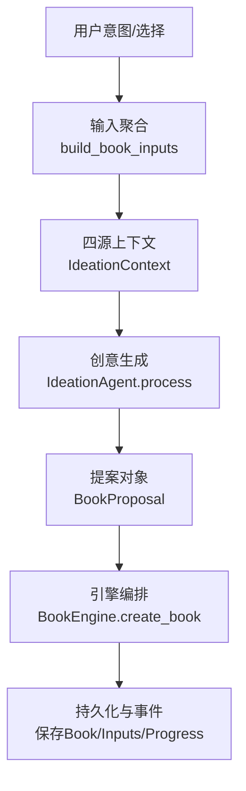
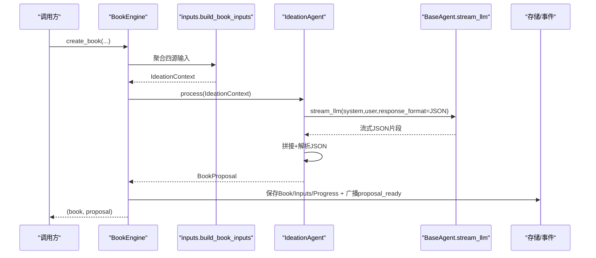
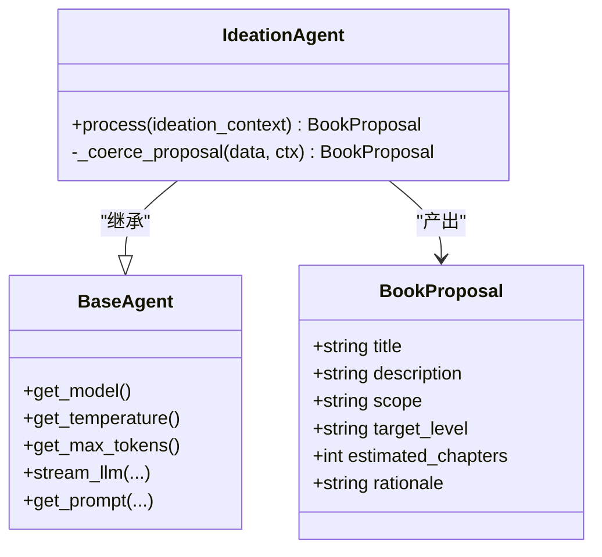
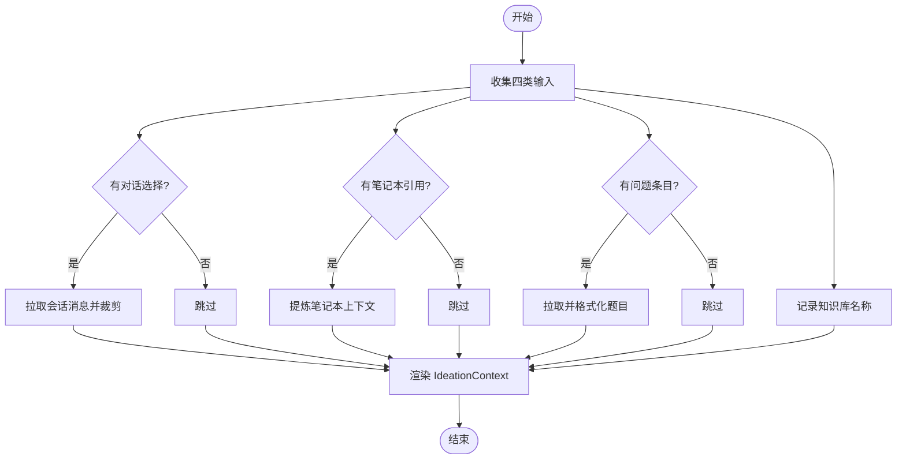
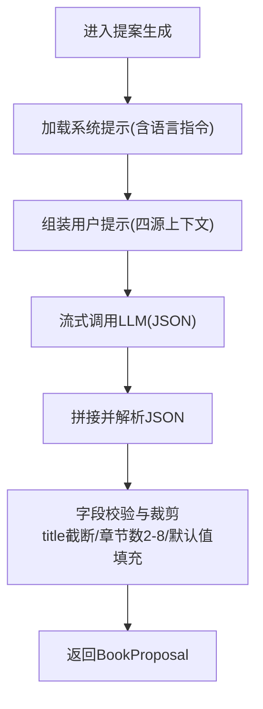
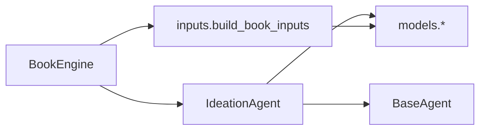

# 创意生成智能体

<cite>
**本文引用的文件**
- [ideation_agent.py](file://deeptutor/book/agents/ideation_agent.py)
- [engine.py](file://deeptutor/book/engine.py)
- [inputs.py](file://deeptutor/book/inputs.py)
- [models.py](file://deeptutor/book/models.py)
- [base_agent.py](file://deeptutor/agents/base_agent.py)
- [ideation_agent.yaml (en)](file://deeptutor/book/prompts/en/ideation_agent.yaml)
- [ideation_agent.yaml (zh)](file://deeptutor/book/prompts/zh/ideation_agent.yaml)
- [_language.py](file://deeptutor/book/blocks/_language.py)
</cite>

## 目录
1. [简介](#简介)
2. [项目结构](#项目结构)
3. [核心组件](#核心组件)
4. [架构总览](#架构总览)
5. [详细组件分析](#详细组件分析)
6. [依赖关系分析](#依赖关系分析)
7. [性能与配置调优](#性能与配置调优)
8. [故障排查指南](#故障排查指南)
9. [结论](#结论)
10. [附录：示例与调试技巧](#附录示例与调试技巧)

## 简介
本文件面向 DeepTutor BookEngine 的“创意生成”阶段，聚焦 IdeationAgent 的核心功能与实现机制。内容涵盖：
- 用户意图分析与多源上下文融合（对话历史、笔记本要点、问题条目、知识库）
- 目标受众与学习目标推断
- 提案生成算法流程（主题识别、范围界定、章节估算）
- 多轮对话与上下文理解策略
- 提示词模板设计与使用方式
- 配置参数调优与性能优化建议
- 完整创意生成示例与调试技巧

## 项目结构
BookEngine 将“创意生成”作为 Stage 1，由引擎编排输入收集、调用 IdeationAgent 生成提案，并持久化到存储中。关键路径如下：
- 输入聚合：build_book_inputs 将四类输入合并为 IdeationContext
- 提案生成：IdeationAgent.process 调用 LLM，输出结构化 BookProposal
- 引擎编排：BookEngine.create_book 负责流式进度、状态更新与事件广播

图表来源
- [engine.py:200-273](file://deeptutor/book/engine.py#L200-L273)
- [inputs.py:308-359](file://deeptutor/book/inputs.py#L308-L359)
- [ideation_agent.py:41-67](file://deeptutor/book/agents/ideation_agent.py#L41-L67)
- [models.py:165-176](file://deeptutor/book/models.py#L165-L176)

章节来源
- [engine.py:200-273](file://deeptutor/book/engine.py#L200-L273)
- [inputs.py:308-359](file://deeptutor/book/inputs.py#L308-L359)
- [ideation_agent.py:41-67](file://deeptutor/book/agents/ideation_agent.py#L41-L67)
- [models.py:165-176](file://deeptutor/book/models.py#L165-L176)

## 核心组件
- IdeationAgent：基于 BaseAgent 的统一 LLM 调用封装，加载语言相关提示词，流式获取 JSON 提案并规范化为 BookProposal。
- BookEngine：编排 Stage 1（创意生成），负责输入聚合、调用 Agent、持久化与事件广播。
- inputs 模块：将四类输入（用户意图、对话历史、笔记本、问题条目、知识库）聚合成 IdeationContext 文本块。
- models 模块：定义 BookProposal 等数据结构，确保提案字段类型与取值约束。
- base_agent：提供模型选择、温度/最大令牌、重试、追踪统计、提示词加载与流式调用能力。

章节来源
- [ideation_agent.py:20-67](file://deeptutor/book/agents/ideation_agent.py#L20-L67)
- [engine.py:200-273](file://deeptutor/book/engine.py#L200-L273)
- [inputs.py:36-77](file://deeptutor/book/inputs.py#L36-L77)
- [models.py:165-176](file://deeptutor/book/models.py#L165-L176)
- [base_agent.py:32-146](file://deeptutor/agents/base_agent.py#L32-L146)

## 架构总览
创意生成的端到端流程如下：
- 引擎接收用户意图与可选上下文（会话、笔记、问题、知识库）
- 构建 IdeationContext 文本块，附加语言指令
- 通过 BaseAgent.stream_llm 流式调用 LLM，要求返回 JSON 对象
- 解析响应并强制转换为 BookProposal（含章节数安全裁剪）
- 保存 Book、Inputs、Progress，并通过 StreamBus 广播 proposal_ready 事件

图表来源
- [engine.py:200-273](file://deeptutor/book/engine.py#L200-L273)
- [inputs.py:308-359](file://deeptutor/book/inputs.py#L308-L359)
- [ideation_agent.py:41-67](file://deeptutor/book/agents/ideation_agent.py#L41-L67)
- [base_agent.py:511-670](file://deeptutor/agents/base_agent.py#L511-L670)

## 详细组件分析

### IdeationAgent 分析
- 职责：根据 IdeationContext 生成一本连贯的“活的书”提案，输出严格 JSON。
- 提示词：从 PromptManager 按语言加载 system/user_template；若未命中则回退内置默认提示。
- 语言指令：追加 language_directive 保证输出语言一致。
- 流式处理：stream_llm 以 response_format={"type":"json_object"} 请求结构化输出，逐片拼接后解析。
- 数据规整：_coerce_proposal 对 estimated_chapters 做安全裁剪（2-8），title 截断至合理长度，缺失字段赋默认值。

图表来源
- [ideation_agent.py:20-85](file://deeptutor/book/agents/ideation_agent.py#L20-L85)
- [base_agent.py:32-146](file://deeptutor/agents/base_agent.py#L32-L146)
- [models.py:165-176](file://deeptutor/book/models.py#L165-L176)

章节来源
- [ideation_agent.py:20-85](file://deeptutor/book/agents/ideation_agent.py#L20-L85)
- [base_agent.py:32-146](file://deeptutor/agents/base_agent.py#L32-L146)
- [models.py:165-176](file://deeptutor/book/models.py#L165-L176)

### 输入聚合与上下文理解（多轮对话与多源融合）
- 四源输入：
  - 用户意图：直接来自用户
  - 对话历史：从会话存储拉取最近消息，支持按消息ID过滤，角色过滤与内容裁剪
  - 笔记本要点：通过 NotebookAnalysisAgent 提炼摘要，失败时回退为标题/摘要列表
  - 问题条目：按分类或ID拉取题目与答案，去重后格式化
  - 知识库：列出名称，供后续阶段作为素材来源
- 渲染：IdeationContext.render 将各段拼接为带分节的提示块，便于 LLM 理解结构与边界。

图表来源
- [inputs.py:91-159](file://deeptutor/book/inputs.py#L91-L159)
- [inputs.py:176-214](file://deeptutor/book/inputs.py#L176-L214)
- [inputs.py:225-282](file://deeptutor/book/inputs.py#L225-L282)
- [inputs.py:308-359](file://deeptutor/book/inputs.py#L308-L359)

章节来源
- [inputs.py:36-77](file://deeptutor/book/inputs.py#L36-L77)
- [inputs.py:91-159](file://deeptutor/book/inputs.py#L91-L159)
- [inputs.py:176-214](file://deeptutor/book/inputs.py#L176-L214)
- [inputs.py:225-282](file://deeptutor/book/inputs.py#L225-L282)
- [inputs.py:308-359](file://deeptutor/book/inputs.py#L308-L359)

### 提案生成算法流程（主题识别、范围界定、章节估算）
- 主题识别：系统提示引导 LLM 紧扣学习者意图，避免范围膨胀；结合知识库清单进行“落地”约束。
- 范围界定：scope 字段明确包含/不包含的内容，帮助后续阶段聚焦。
- 章节估算：estimated_chapters 经 _coerce_proposal 安全裁剪至 2-8 之间，默认 4，兼顾深度与可执行性。
- 目标层级：target_level 限定 intro/intermediate/advanced/mixed，指导后续内容与练习难度。
- 依据说明：rationale 解释结构选择的理由，便于人工审阅与迭代。

图表来源
- [ideation_agent.py:41-85](file://deeptutor/book/agents/ideation_agent.py#L41-L85)
- [base_agent.py:511-670](file://deeptutor/agents/base_agent.py#L511-L670)
- [models.py:165-176](file://deeptutor/book/models.py#L165-L176)

章节来源
- [ideation_agent.py:41-85](file://deeptutor/book/agents/ideation_agent.py#L41-L85)
- [models.py:165-176](file://deeptutor/book/models.py#L165-L176)

### 多轮对话与上下文理解
- 对话历史：仅保留 role 为 user/assistant/system 且非空的消息，按时间排序，单条内容裁剪至固定长度，避免提示过长。
- 笔记本要点：优先使用 NotebookAnalysisAgent 提炼摘要；失败时回退为“标题+摘要”列表，确保仍有可用上下文。
- 问题条目：按分类或ID拉取，去重后格式化，突出正确答案与用户作答对比，辅助定位薄弱点。
- 知识库：仅列出名称，不在此阶段检索，保持创意阶段的聚焦与低成本。

章节来源
- [inputs.py:91-159](file://deeptutor/book/inputs.py#L91-L159)
- [inputs.py:176-214](file://deeptutor/book/inputs.py#L176-L214)
- [inputs.py:225-282](file://deeptutor/book/inputs.py#L225-L282)

### 提示词模板设计与使用
- 模板位置：prompts/en/ideation_agent.yaml 与 prompts/zh/ideation_agent.yaml
- 系统提示：规定输出 JSON 结构、原则（紧扣意图、少而精、使用相同语言、不重复选择知识库）。
- 用户模板：注入四源上下文，并要求仅返回 JSON。
- 语言指令：通过 language_directive 在运行时追加，确保与用户意图语言一致。
- 回退机制：若未加载到模板，使用内置 fallback 保证可用性。

章节来源
- [ideation_agent.yaml (en):1-31](file://deeptutor/book/prompts/en/ideation_agent.yaml#L1-L31)
- [ideation_agent.yaml (zh):1-28](file://deeptutor/book/prompts/zh/ideation_agent.yaml#L1-L28)
- [_language.py:1-16](file://deeptutor/book/blocks/_language.py#L1-L16)
- [ideation_agent.py:41-52](file://deeptutor/book/agents/ideation_agent.py#L41-L52)

## 依赖关系分析
- 组件耦合：
  - BookEngine 依赖 inputs 聚合上下文，再调用 IdeationAgent；完成后写入 storage 并广播事件。
  - IdeationAgent 依赖 BaseAgent 的流式 LLM 接口与 PromptManager。
  - 数据模型集中在 models.py，确保跨阶段一致性。
- 外部依赖：
  - 会话存储、笔记本服务、RAG/知识库等在 inputs 层按需加载，异常时降级处理。
- 循环依赖：无显式循环；模块间通过函数与数据类解耦。

图表来源
- [engine.py:200-273](file://deeptutor/book/engine.py#L200-L273)
- [inputs.py:308-359](file://deeptutor/book/inputs.py#L308-L359)
- [ideation_agent.py:41-67](file://deeptutor/book/agents/ideation_agent.py#L41-L67)
- [base_agent.py:511-670](file://deeptutor/agents/base_agent.py#L511-L670)
- [models.py:165-176](file://deeptutor/book/models.py#L165-L176)

章节来源
- [engine.py:200-273](file://deeptutor/book/engine.py#L200-L273)
- [inputs.py:308-359](file://deeptutor/book/inputs.py#L308-L359)
- [ideation_agent.py:41-67](file://deeptutor/book/agents/ideation_agent.py#L41-L67)
- [base_agent.py:511-670](file://deeptutor/agents/base_agent.py#L511-L670)
- [models.py:165-176](file://deeptutor/book/models.py#L165-L176)

## 性能与配置调优
- 模型与参数
  - 模型选择优先级：agent_config > llm_config > 实例 model > 环境变量
  - temperature/max_tokens 来自统一配置（agents.yaml），可通过 BaseAgent.get_* 获取
  - 最大重试次数：agent_config.max_retries 或全局 settings.retry.max_retries
- 流式与结构化输出
  - 使用 response_format={"type":"json_object"} 提高稳定性；不支持时自动降级
  - 流式拼接响应，降低首字节延迟，提升交互体验
- 上下文控制
  - 对话消息与笔记本摘要均做了长度裁剪，避免提示过长导致成本与延迟上升
  - 知识库仅在创意阶段列出名称，减少不必要检索
- 建议
  - 针对复杂主题适当提高 max_tokens，但需评估成本
  - 对稳定性要求高的场景可降低 temperature
  - 监控 LLMStats 与日志，关注错误率与耗时分布

章节来源
- [base_agent.py:151-206](file://deeptutor/agents/base_agent.py#L151-L206)
- [base_agent.py:348-412](file://deeptutor/agents/base_agent.py#L348-L412)
- [base_agent.py:511-670](file://deeptutor/agents/base_agent.py#L511-L670)
- [inputs.py:91-159](file://deeptutor/book/inputs.py#L91-L159)
- [inputs.py:176-214](file://deeptutor/book/inputs.py#L176-L214)

## 故障排查指南
- 常见错误与定位
  - 会话存储不可用：检查 get_sqlite_session_store 初始化与权限
  - 笔记本记录解析失败：查看 NotebookAnalysisAgent 异常日志，确认记录格式
  - 问题条目拉取失败：确认分类ID/条目ID有效，检查 limit 设置
  - LLM 调用失败：检查模型配置、绑定、网络与重试策略
- 日志与追踪
  - BaseAgent 会记录输入/输出字符数、耗时、事件追踪（trace events）
  - 使用 LLMStats 汇总调用统计，定位瓶颈
- 快速恢复
  - 输入聚合失败时，仍可使用最小上下文（仅用户意图）继续生成提案
  - 模板未命中时使用内置 fallback，保障基本可用

章节来源
- [inputs.py:91-159](file://deeptutor/book/inputs.py#L91-L159)
- [inputs.py:176-214](file://deeptutor/book/inputs.py#L176-L214)
- [inputs.py:225-282](file://deeptutor/book/inputs.py#L225-L282)
- [base_agent.py:348-412](file://deeptutor/agents/base_agent.py#L348-L412)
- [base_agent.py:511-670](file://deeptutor/agents/base_agent.py#L511-L670)

## 结论
IdeationAgent 通过统一的 BaseAgent 抽象，结合多源上下文聚合与严格的 JSON 输出约束，实现了稳定、可控的“创意生成”。BookEngine 在编排层面保证了流程的可观测性与可恢复性。配合合理的提示词模板与参数调优，可在不同主题与受众下高效产出高质量书籍提案。

## 附录：示例与调试技巧
- 典型调用流程
  - 准备用户意图与可选上下文（会话、笔记、问题、知识库）
  - 调用 BookEngine.create_book，等待 proposal_ready 事件
  - 审阅 BookProposal，必要时编辑后再进入下一阶段
- 调试技巧
  - 启用 verbose 日志，观察 LLM 输入/输出与耗时
  - 检查 IdeationContext.render 输出，确认四源上下文是否按预期注入
  - 若 JSON 解析失败，查看原始响应片段，调整提示词或模型参数
  - 使用 LLMStats 统计多次调用的 token 与错误率，定位不稳定因素
- 示例（概念性）
  - 输入：用户意图“学习机器学习中的线性回归”，附带一次相关对话与若干知识点
  - 过程：聚合上下文 → 流式生成 JSON → 解析并裁剪 → 保存提案
  - 输出：包含标题、描述、范围、目标层级、章节估算与依据的 BookProposal

[本节为概念性示例与操作指引，不直接分析具体代码文件]