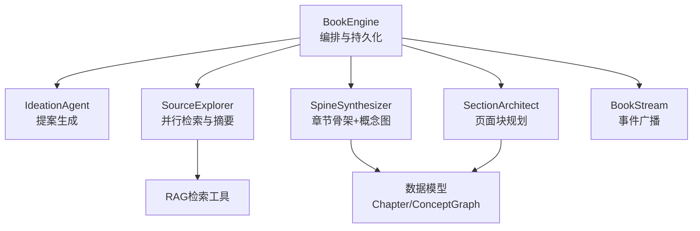
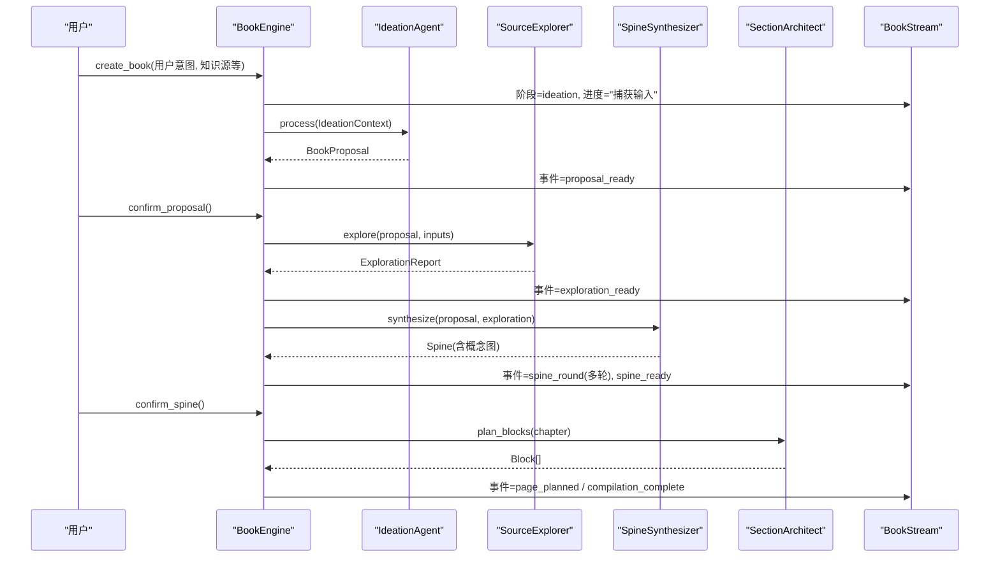
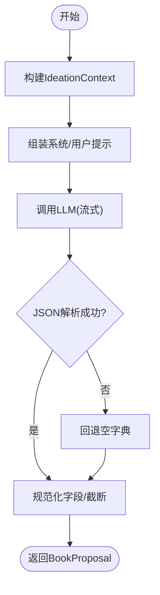
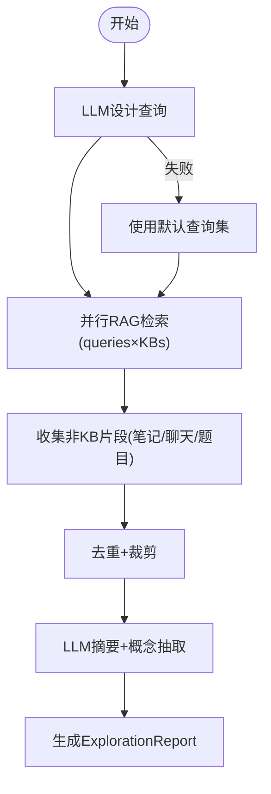
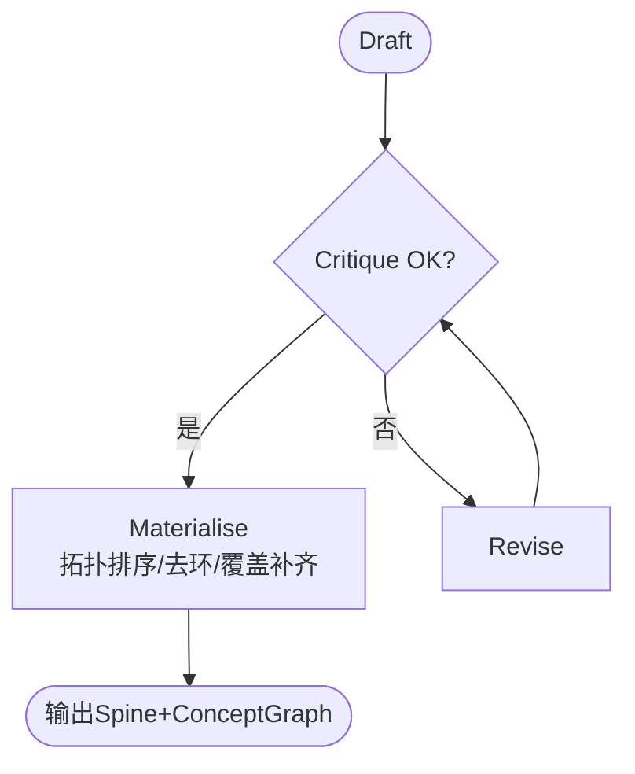
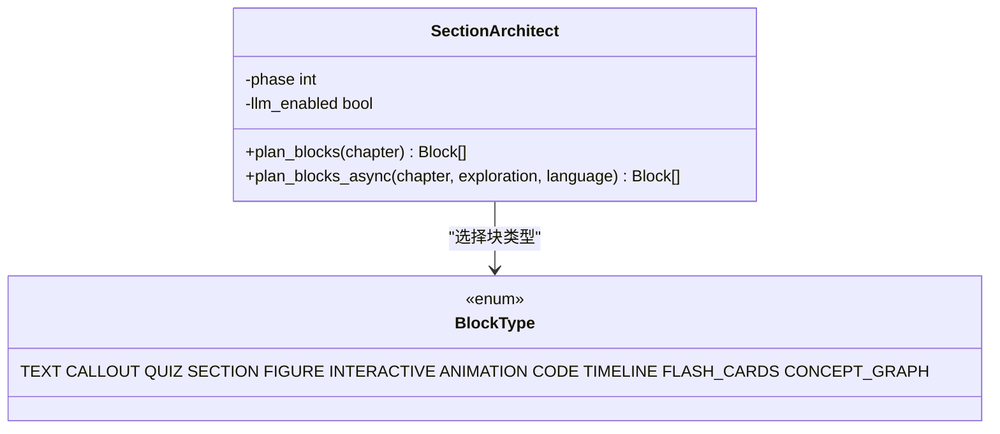
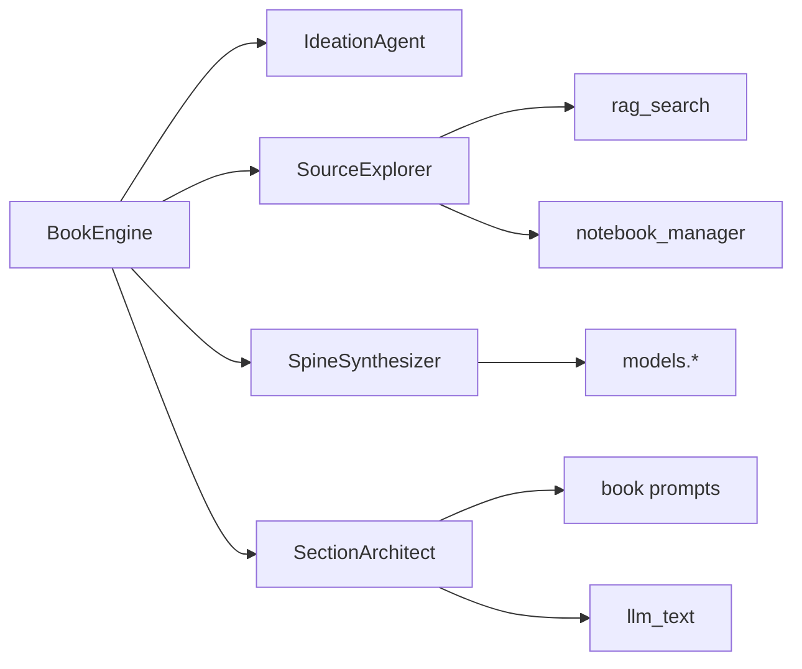

# 智能体协作

<cite>
**本文引用的文件**
- [engine.py](file://deeptutor/book/engine.py)
- [ideation_agent.py](file://deeptutor/book/agents/ideation_agent.py)
- [source_explorer.py](file://deeptutor/book/agents/source_explorer.py)
- [spine_synthesizer.py](file://deeptutor/book/agents/spine_synthesizer.py)
- [page_planner.py](file://deeptutor/book/agents/page_planner.py)
- [models.py](file://deeptutor/book/models.py)
- [inputs.py](file://deeptutor/book/inputs.py)
- [streaming.py](file://deeptutor/book/streaming.py)
- [base_agent.py](file://deeptutor/agents/base_agent.py)
</cite>

## 目录
1. [简介](#简介)
2. [项目结构](#项目结构)
3. [核心组件](#核心组件)
4. [架构总览](#架构总览)
5. [详细组件分析](#详细组件分析)
6. [依赖关系分析](#依赖关系分析)
7. [性能与配置调优](#性能与配置调优)
8. [故障排查指南](#故障排查指南)
9. [结论](#结论)
10. [附录：协作流程示例与调试技巧](#附录协作流程示例与调试技巧)

## 简介
本文件面向DeepTutor的“智能体协作”子系统，聚焦书籍生成管线中的多智能体架构与协作模式。内容覆盖创意生成智能体（IdeationAgent）、来源探索智能体（SourceExplorer）、脊柱合成智能体（SpineSynthesizer）与页面规划智能体（SectionArchitect/PagePlanner）的职责、数据流、通信协议、重试与降级策略，以及配置调优与调试实践。读者可据此理解从用户意图到章节大纲、再到页面块编排的端到端流程。

## 项目结构
- 编排入口：BookEngine负责阶段编排、状态持久化、后台队列与事件广播。
- 智能体层：
  - IdeationAgent：基于四源输入生成书籍提案。
  - SourceExplorer：并行检索知识库与非KB来源，产出探索报告。
  - SpineSynthesizer：多轮“草稿-评审-修订”生成章节骨架与概念图。
  - SectionArchitect（PagePlanner别名）：将章节转换为块序列（LLM优先+静态模板兜底）。
- 数据模型：统一的Pydantic模型贯穿各阶段。
- 流式事件：BookStream封装StreamBus，统一进度与阶段事件。

图表来源
- [engine.py:100-116](file://deeptutor/book/engine.py#L100-L116)
- [streaming.py:20-31](file://deeptutor/book/streaming.py#L20-L31)

章节来源
- [engine.py:100-116](file://deeptutor/book/engine.py#L100-L116)
- [streaming.py:20-31](file://deeptutor/book/streaming.py#L20-L31)

## 核心组件
- BookEngine：生命周期管理（创建书籍、确认提案、确认骨架、编译页面），维护每本书的后台编译队列与进度事件。
- IdeationAgent：接收IdeationContext，调用LLM输出JSON格式的BookProposal。
- SourceExplorer：设计查询→并行RAG检索→汇总摘要与候选概念，产出ExplorationReport。
- SpineSynthesizer：多轮Draft/Critique/Revise，输出Spine（含章节顺序与概念图），并进行拓扑排序、去环与覆盖补齐。
- SectionArchitect：按章节类型选择块模板或调用LLM生成块序列，保证至少包含SECTION等关键块。

章节来源
- [engine.py:198-394](file://deeptutor/book/engine.py#L198-L394)
- [ideation_agent.py:20-67](file://deeptutor/book/agents/ideation_agent.py#L20-L67)
- [source_explorer.py:97-175](file://deeptutor/book/agents/source_explorer.py#L97-L175)
- [spine_synthesizer.py:82-174](file://deeptutor/book/agents/spine_synthesizer.py#L82-L174)
- [page_planner.py:256-348](file://deeptutor/book/agents/page_planner.py#L256-L348)

## 架构总览
下图展示从用户意图到页面块规划的完整协作流程，包括阶段划分、数据流转与事件广播。

图表来源
- [engine.py:200-394](file://deeptutor/book/engine.py#L200-L394)
- [streaming.py:94-118](file://deeptutor/book/streaming.py#L94-L118)

## 详细组件分析

### 创意生成智能体（IdeationAgent）
- 职责：将四源输入（用户意图、聊天历史、笔记本记录、问题条目、知识库）融合为结构化上下文，驱动LLM输出书籍提案（标题、描述、范围、目标水平、估计章节数、理由）。
- 输入：IdeationContext（由inputs.py构建并渲染为提示块）。
- 输出：BookProposal（经严格约束与裁剪）。
- 关键点：
  - 使用语言指令确保输出语言一致。
  - JSON响应解析失败时回退为空字典，再强制构造最小有效提案。
  - 估计章节数被限制在[2,8]区间，标题长度受限。

图表来源
- [ideation_agent.py:41-85](file://deeptutor/book/agents/ideation_agent.py#L41-L85)
- [inputs.py:36-76](file://deeptutor/book/inputs.py#L36-L76)

章节来源
- [ideation_agent.py:20-97](file://deeptutor/book/agents/ideation_agent.py#L20-L97)
- [inputs.py:36-76](file://deeptutor/book/inputs.py#L36-L76)

### 来源探索智能体（SourceExplorer）
- 职责：基于提案与输入快照，设计多样化查询，并行检索知识库与非KB来源（笔记、聊天、题目），去重裁剪后，汇总摘要、候选概念与来源覆盖度。
- 两阶段LLM调用：
  - 查询设计：将提案转化为4-8个搜索查询。
  - 摘要综合：对检索到的片段进行总结与概念抽取。
- 并行检索：通过并发调用RAG工具，聚合结果；若RAG无可用片段但有答案，则合成片段以支撑后续步骤。
- 覆盖度评估：统计每个来源的命中数量，用于后续质量判断。

图表来源
- [source_explorer.py:131-175](file://deeptutor/book/agents/source_explorer.py#L131-L175)
- [source_explorer.py:181-261](file://deeptutor/book/agents/source_explorer.py#L181-L261)
- [source_explorer.py:267-343](file://deeptutor/book/agents/source_explorer.py#L267-L343)
- [source_explorer.py:349-420](file://deeptutor/book/agents/source_explorer.py#L349-L420)
- [source_explorer.py:426-482](file://deeptutor/book/agents/source_explorer.py#L426-L482)

章节来源
- [source_explorer.py:97-505](file://deeptutor/book/agents/source_explorer.py#L97-L505)

### 脊柱合成智能体（SpineSynthesizer）
- 职责：基于提案与探索报告，生成章节骨架与概念图，并通过“草稿-评审-修订”多轮迭代提升质量。
- 算法要点：
  - 多轮循环：最多max_rounds轮，若评审判定OK或无问题则提前终止。
  - 拓扑排序：依据“covers”与概念图依赖重新排序章节。
  - 去环：检测并移除最弱边（rationale最短）以打破环。
  - 覆盖补齐：未覆盖的概念节点通过Jaccard相似度匹配到最相关章节。
  - 概念图映射：最终输出“章节级”概念图，便于概览页渲染。
- 错误处理：任一LLM调用失败返回上一轮有效草稿或最小回退，避免阻塞流水线。

图表来源
- [spine_synthesizer.py:114-174](file://deeptutor/book/agents/spine_synthesizer.py#L114-L174)
- [spine_synthesizer.py:280-329](file://deeptutor/book/agents/spine_synthesizer.py#L280-L329)
- [spine_synthesizer.py:502-604](file://deeptutor/book/agents/spine_synthesizer.py#L502-L604)
- [spine_synthesizer.py:607-766](file://deeptutor/book/agents/spine_synthesizer.py#L607-L766)

章节来源
- [spine_synthesizer.py:82-791](file://deeptutor/book/agents/spine_synthesizer.py#L82-L791)

### 页面规划智能体（SectionArchitect / PagePlanner）
- 职责：将Chapter转换为有序的Block列表，供编译器填充具体内容。
- 双轨策略：
  - LLM优先：根据章节类型与探索摘要生成块序列（支持多种块类型）。
  - 静态模板兜底：当LLM不可用或失败时，按ContentType选择预定义模板，保证至少包含SECTION等必要块。
- 保障机制：确保至少一个SECTION块存在，防止丢失章节正文。

图表来源
- [page_planner.py:256-348](file://deeptutor/book/agents/page_planner.py#L256-L348)
- [models.py:55-80](file://deeptutor/book/models.py#L55-L80)

章节来源
- [page_planner.py:1-365](file://deeptutor/book/agents/page_planner.py#L1-L365)
- [models.py:55-90](file://deeptutor/book/models.py#L55-L90)

## 依赖关系分析
- BookEngine依赖：
  - 智能体：IdeationAgent、SourceExplorer、SpineSynthesizer、SectionArchitect。
  - 存储：BookStorage（持久化书籍、骨架、页面、输入、进度）。
  - 流：BookStream（封装StreamBus，广播阶段与进度事件）。
- SourceExplorer依赖：
  - RAG工具：rag_search（按查询与知识库检索片段）。
  - Notebook服务：获取笔记记录。
- SpineSynthesizer依赖：
  - 数据模型：Chapter、ConceptGraph、ContentType等。
  - 工具函数：拓扑排序、去环、覆盖补齐。
- SectionArchitect依赖：
  - 提示加载：book prompts（en/zh）。
  - LLM文本生成：llm_text（带响应格式约束）。

图表来源
- [engine.py:41-74](file://deeptutor/book/engine.py#L41-L74)
- [source_explorer.py:267-343](file://deeptutor/book/agents/source_explorer.py#L267-L343)
- [spine_synthesizer.py:40-50](file://deeptutor/book/agents/spine_synthesizer.py#L40-L50)
- [page_planner.py:38-47](file://deeptutor/book/agents/page_planner.py#L38-L47)

章节来源
- [engine.py:41-74](file://deeptutor/book/engine.py#L41-L74)
- [source_explorer.py:267-343](file://deeptutor/book/agents/source_explorer.py#L267-L343)
- [spine_synthesizer.py:40-50](file://deeptutor/book/agents/spine_synthesizer.py#L40-L50)
- [page_planner.py:38-47](file://deeptutor/book/agents/page_planner.py#L38-L47)

## 性能与配置调优
- 并行检索：SourceExplorer对queries×KBs执行并发检索，显著降低端到端延迟。建议合理设置max_queries与chunks_per_query以平衡召回与成本。
- 多轮优化：SpineSynthesizer的max_rounds控制迭代次数，通常2轮即可收敛；过多会增加LLM调用成本。
- 块规划降级：SectionArchitect在LLM失败时自动回退到静态模板，保证可用性。可通过phase参数控制是否启用更丰富的块类型。
- 流式事件：BookStream统一事件通道，前端可按stage与kind过滤显示，有助于实时反馈与性能监控。
- 基础重试：BaseAgent提供最大重试次数读取逻辑，可在上层调用处结合业务重试策略（如指数退避）增强鲁棒性。

章节来源
- [source_explorer.py:100-121](file://deeptutor/book/agents/source_explorer.py#L100-L121)
- [spine_synthesizer.py:85-104](file://deeptutor/book/agents/spine_synthesizer.py#L85-L104)
- [page_planner.py:259-269](file://deeptutor/book/agents/page_planner.py#L259-L269)
- [streaming.py:20-31](file://deeptutor/book/streaming.py#L20-L31)
- [base_agent.py:200-205](file://deeptutor/agents/base_agent.py#L200-L205)

## 故障排查指南
- 来源探索失败：
  - 现象：exploration阶段异常，引擎记录警告并降级为仅基于提案生成骨架。
  - 处理：检查RAG服务可用性、知识库名称与权限；必要时调整查询数量或放宽检索条件。
- 骨架合成失败：
  - 现象：任一LLM调用失败会记录警告并返回上一轮有效草稿或最小回退。
  - 处理：查看spine_round事件中的verdict与issues；适当增加max_rounds或调整提示词。
- 页面规划失败：
  - 现象：LLM不可用时自动回退静态模板；若仍失败，检查允许的块类型与模板覆盖。
  - 处理：确认phase与llm_enabled配置；必要时扩展允许块类型集合。
- 事件与进度：
  - 使用BookStream.stage与book_event追踪阶段边界与关键事件（proposal_ready、exploration_ready、spine_round、spine_ready、compilation_complete等）。
  - 前端可根据stage与kind过滤显示，辅助定位瓶颈。

章节来源
- [engine.py:308-394](file://deeptutor/book/engine.py#L308-L394)
- [spine_synthesizer.py:249-274](file://deeptutor/book/agents/spine_synthesizer.py#L249-L274)
- [page_planner.py:277-348](file://deeptutor/book/agents/page_planner.py#L277-L348)
- [streaming.py:94-118](file://deeptutor/book/streaming.py#L94-L118)

## 结论
DeepTutor的智能体协作系统通过清晰的阶段划分与强韧的降级策略，实现了从用户意图到高质量章节骨架与页面块的自动化生成。SourceExplorer的并行检索与覆盖评估、SpineSynthesizer的多轮迭代与图论后处理、SectionArchitect的双轨规划共同保障了系统的稳定性与可扩展性。配合BookEngine的统一编排与BookStream的事件广播，开发者可高效地监控与调优整个流程。

## 附录：协作流程示例与调试技巧
- 典型流程：
  - 创建书籍：调用create_book，等待proposal_ready事件。
  - 确认提案：调用confirm_proposal，观察exploration_ready与spine_round事件，直至spine_ready。
  - 确认骨架：调用confirm_spine，触发页面块规划与后台编译，关注compilation_complete。
- 调试技巧：
  - 打印/订阅BookStream事件，按stage过滤查看各阶段耗时与错误。
  - 在SourceExplorer中检查queries与coverage，确认检索有效性。
  - 在SpineSynthesizer中关注critique的issues与verdict，必要时调整max_rounds。
  - 在SectionArchitect中切换phase与llm_enabled，对比LLM与静态模板的输出差异。

章节来源
- [engine.py:200-394](file://deeptutor/book/engine.py#L200-L394)
- [streaming.py:20-31](file://deeptutor/book/streaming.py#L20-L31)
- [source_explorer.py:131-175](file://deeptutor/book/agents/source_explorer.py#L131-L175)
- [spine_synthesizer.py:114-174](file://deeptutor/book/agents/spine_synthesizer.py#L114-L174)
- [page_planner.py:256-348](file://deeptutor/book/agents/page_planner.py#L256-L348)