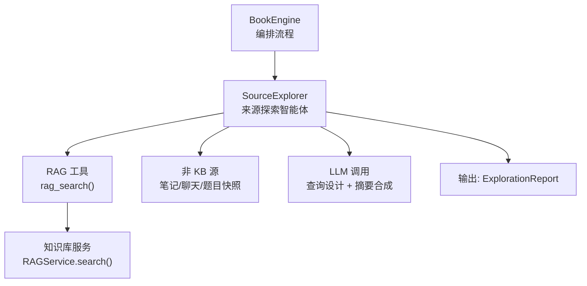
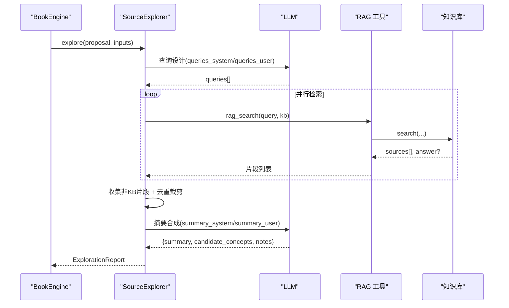
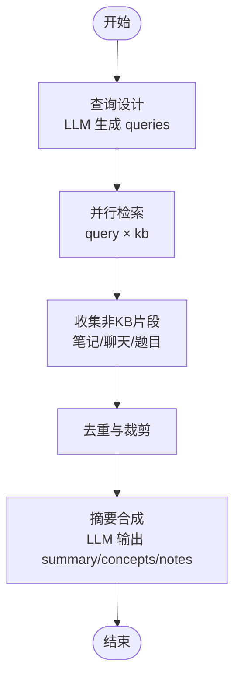
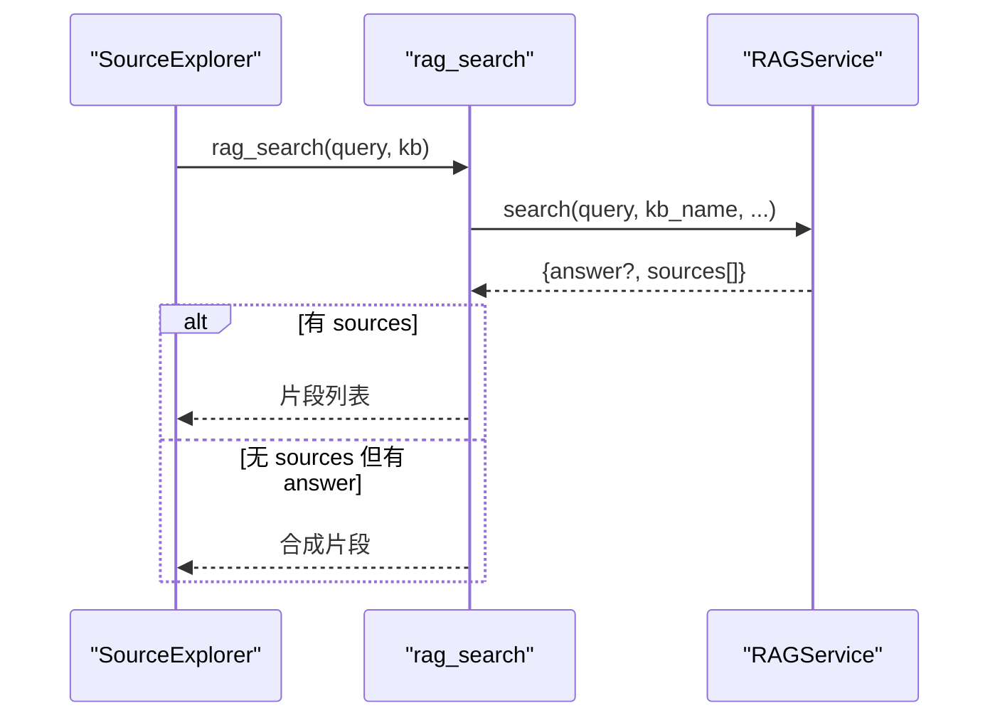
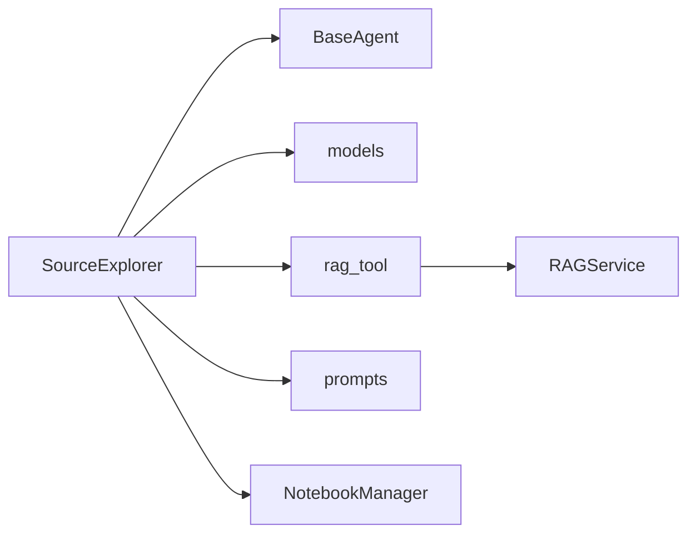

# 来源探索智能体

<cite>
**本文引用的文件**
- [source_explorer.py](file://deeptutor/book/agents/source_explorer.py)
- [models.py](file://deeptutor/book/models.py)
- [engine.py](file://deeptutor/book/engine.py)
- [rag_tool.py](file://deeptutor/tools/rag_tool.py)
- [source_explorer.yaml（英文提示）](file://deeptutor/book/prompts/en/source_explorer.yaml)
- [source_explorer.yaml（中文提示）](file://deeptutor/book/prompts/zh/source_explorer.yaml)
</cite>

## 目录
1. [简介](#简介)
2. [项目结构](#项目结构)
3. [核心组件](#核心组件)
4. [架构总览](#架构总览)
5. [详细组件分析](#详细组件分析)
6. [依赖关系分析](#依赖关系分析)
7. [性能考量](#性能考量)
8. [故障排查指南](#故障排查指南)
9. [结论](#结论)
10. [附录](#附录)

## 简介
来源探索智能体（SourceExplorer）是 DeepTutor BookEngine 的“第二阶段前置”模块，负责在用户确认书籍提案后，围绕用户意图与已选知识源进行并行多查询检索、内容聚合与覆盖度评估，最终生成一份结构化“探索报告”。该报告为后续章节骨架设计、概念图构建以及页面块生成提供证据基础，避免重复检索，提升整体生成效率与可追溯性。

## 项目结构
来源探索智能体位于 book 子系统中，与模型定义、引擎编排、RAG 工具及提示词共同协作：
- 智能体实现：deeptutor/book/agents/source_explorer.py
- 数据模型：deeptutor/book/models.py
- 引擎编排入口：deeptutor/book/engine.py
- RAG 检索封装：deeptutor/tools/rag_tool.py
- 提示词模板：deeptutor/book/prompts/{en,zh}/source_explorer.yaml

图表来源
- [engine.py:100-115](file://deeptutor/book/engine.py#L100-L115)
- [source_explorer.py:97-175](file://deeptutor/book/agents/source_explorer.py#L97-L175)
- [rag_tool.py:15-51](file://deeptutor/tools/rag_tool.py#L15-L51)

章节来源
- [engine.py:100-115](file://deeptutor/book/engine.py#L100-L115)
- [source_explorer.py:97-175](file://deeptutor/book/agents/source_explorer.py#L97-L175)
- [rag_tool.py:15-51](file://deeptutor/tools/rag_tool.py#L15-L51)

## 核心组件
- SourceExplorer：两阶段 LLM 调用（查询设计、摘要合成），并行执行 RAG 检索，收集并去重片段，统计覆盖度，产出 ExplorationReport。
- 数据模型：BookInputs（四源快照）、SourceChunk（片段）、ExplorationReport（探索报告）。
- RAG 工具：统一封装知识库检索，返回 sources 列表与可选 answer。
- 提示词：中英文两套模板，约束查询多样性与摘要结构。

章节来源
- [source_explorer.py:97-175](file://deeptutor/book/agents/source_explorer.py#L97-L175)
- [models.py:143-158](file://deeptutor/book/models.py#L143-L158)
- [models.py:280-318](file://deeptutor/book/models.py#L280-L318)
- [rag_tool.py:15-51](file://deeptutor/tools/rag_tool.py#L15-L51)
- [source_explorer.yaml（英文提示）:1-75](file://deeptutor/book/prompts/en/source_explorer.yaml#L1-L75)
- [source_explorer.yaml（中文提示）:1-68](file://deeptutor/book/prompts/zh/source_explorer.yaml#L1-L68)

## 架构总览
SourceExplorer 的工作流分为五步：
1) 查询设计：基于提案与用户意图，生成 4-8 个多样检索 query。
2) 并行检索：对每个 query × 每个知识库发起 rag_search，收集 top-N 片段；若仅有答案无片段，则构造合成片段。
3) 非 KB 源采集：从笔记本记录、最近聊天消息、题目条目中抽取片段。
4) 去重与裁剪：按 source/ref/text 前缀去重，限制最大片段数。
5) 摘要合成：将高分数片段与覆盖度信息送入 LLM，输出 summary、候选概念与备注。

图表来源
- [source_explorer.py:131-175](file://deeptutor/book/agents/source_explorer.py#L131-L175)
- [source_explorer.py:181-261](file://deeptutor/book/agents/source_explorer.py#L181-L261)
- [source_explorer.py:267-343](file://deeptutor/book/agents/source_explorer.py#L267-L343)
- [source_explorer.py:349-420](file://deeptutor/book/agents/source_explorer.py#L349-L420)
- [source_explorer.py:426-482](file://deeptutor/book/agents/source_explorer.py#L426-L482)
- [rag_tool.py:15-51](file://deeptutor/tools/rag_tool.py#L15-L51)

## 详细组件分析

### SourceExplorer 工作原理
- 输入：book_id、BookProposal、BookInputs（含 knowledge_bases、notebook_refs、chat_history、question_categories/entries 等）。
- 关键参数：max_queries（默认 8）、chunks_per_query（默认 4）。
- 处理步骤：
  - 查询设计：通过 get_prompt("queries_system"/"queries_user") 或内置 fallback，结合语言指令，生成 JSON 形式的 queries。
  - 并行检索：使用 asyncio.gather 并发执行 _one_query(kb, q)，每个结果取 top chunks_per_query 片段；若无可用片段但有 answer，则构造合成片段。
  - 非 KB 源：读取 notebook 记录、最近聊天消息，构造 SourceChunk。
  - 去重裁剪：以 source::ref::text[:200] 为键去重，最多保留 96 条片段。
  - 摘要合成：选取分数最高的最多 24 条片段，连同 coverage 统计，调用 LLM 输出 summary、candidate_concepts、notes。
- 输出：ExplorationReport（包含 queries、chunks、summary、coverage、candidate_concepts、notes）。

图表来源
- [source_explorer.py:131-175](file://deeptutor/book/agents/source_explorer.py#L131-L175)
- [source_explorer.py:181-261](file://deeptutor/book/agents/source_explorer.py#L181-L261)
- [source_explorer.py:267-343](file://deeptutor/book/agents/source_explorer.py#L267-L343)
- [source_explorer.py:349-420](file://deeptutor/book/agents/source_explorer.py#L349-L420)
- [source_explorer.py:426-482](file://deeptutor/book/agents/source_explorer.py#L426-L482)

章节来源
- [source_explorer.py:97-175](file://deeptutor/book/agents/source_explorer.py#L97-L175)
- [source_explorer.py:181-261](file://deeptutor/book/agents/source_explorer.py#L181-L261)
- [source_explorer.py:267-343](file://deeptutor/book/agents/source_explorer.py#L267-L343)
- [source_explorer.py:349-420](file://deeptutor/book/agents/source_explorer.py#L349-L420)
- [source_explorer.py:426-482](file://deeptutor/book/agents/source_explorer.py#L426-L482)

### 知识检索机制
- 检索入口：_retrieve_kb_chunks 调用 rag_search(query, kb_name)。
- 结果解析：优先取 sources 列表中的 text/snippet/content，score/similarity 转为浮点分数；若无可用片段但存在 answer，则构造合成片段（metadata.synthesised=True）。
- 并发策略：对每个 (kb, query) 组合创建协程，使用 asyncio.gather 并发执行，最大化吞吐。
- 错误处理：单个检索异常被捕获并记录日志，不影响其他检索。

图表来源
- [source_explorer.py:267-343](file://deeptutor/book/agents/source_explorer.py#L267-L343)
- [rag_tool.py:15-51](file://deeptutor/tools/rag_tool.py#L15-L51)

章节来源
- [source_explorer.py:267-343](file://deeptutor/book/agents/source_explorer.py#L267-L343)
- [rag_tool.py:15-51](file://deeptutor/tools/rag_tool.py#L15-L51)

### 内容分析与覆盖度评估
- 覆盖度统计：遍历所有片段，按 source 计数，形成 coverage 字典，用于衡量各来源贡献。
- 片段裁剪：文本长度限制（如 1200/320/2400 字符），避免超出上下文窗口。
- 去重策略：以 source::ref::text[:200] 作为唯一键，防止重复片段进入摘要。
- 片段排序：摘要阶段仅选择分数最高的最多 24 条片段，聚焦高质量证据。

章节来源
- [source_explorer.py:156-159](file://deeptutor/book/agents/source_explorer.py#L156-L159)
- [source_explorer.py:410-420](file://deeptutor/book/agents/source_explorer.py#L410-L420)
- [source_explorer.py:443-449](file://deeptutor/book/agents/source_explorer.py#L443-L449)

### 候选概念提取算法与评分机制
- 概念提取：由 LLM 在摘要阶段输出 candidate_concepts，要求原子化、可复用术语，数量 8-20 项。
- 评分机制：片段 score 来自 RAG 返回的相似度/相关性分数；摘要阶段按分数降序选取片段，间接影响概念质量。
- 概念清洗：对 LLM 输出的概念列表进行去重与长度限制，确保稳定输出。

章节来源
- [source_explorer.py:426-482](file://deeptutor/book/agents/source_explorer.py#L426-L482)
- [source_explorer.py:485-501](file://deeptutor/book/agents/source_explorer.py#L485-L501)
- [source_explorer.yaml（英文提示）:37-59](file://deeptutor/book/prompts/en/source_explorer.yaml#L37-L59)
- [source_explorer.yaml（中文提示）:34-52](file://deeptutor/book/prompts/zh/source_explorer.yaml#L34-L52)

### 多源信息融合与冲突解决
- 多源融合：同时整合 KB 片段、笔记本记录、聊天快照与题目条目，统一为 SourceChunk 结构。
- 冲突处理：不直接合并语义冲突，而是通过覆盖度统计与摘要 LLM 归纳主题与矛盾点（notes），供后续阶段决策。
- 证据锚定：每个片段携带 source、ref、query、metadata，便于回溯与审计。

章节来源
- [source_explorer.py:349-404](file://deeptutor/book/agents/source_explorer.py#L349-L404)
- [models.py:280-296](file://deeptutor/book/models.py#L280-L296)
- [source_explorer.yaml（英文提示）:37-59](file://deeptutor/book/prompts/en/source_explorer.yaml#L37-L59)
- [source_explorer.yaml（中文提示）:34-52](file://deeptutor/book/prompts/zh/source_explorer.yaml#L34-L52)

### 探索报告生成格式与内容结构
- ExplorationReport 字段：
  - book_id：书籍标识
  - queries：生成的检索查询列表
  - chunks：片段列表（SourceChunk）
  - summary：主题归纳与证据强弱
  - coverage：各来源片段计数
  - candidate_concepts：候选概念标签
  - notes：注意事项/矛盾/待跟进问题
  - created_at：生成时间戳
- 下游消费：SpineSynthesizer 与编译器读取 summary、candidate_concepts、chunks，避免重复检索。

章节来源
- [models.py:299-318](file://deeptutor/book/models.py#L299-L318)
- [source_explorer.py:167-175](file://deeptutor/book/agents/source_explorer.py#L167-L175)

## 依赖关系分析
- SourceExplorer 依赖：
  - BaseAgent：提供 LLM 流式调用与提示词加载能力。
  - models：定义输入、片段与报告的数据结构。
  - rag_tool：封装知识库检索。
  - prompts：中英文提示词模板。
- 外部依赖：
  - RAGService：实际检索实现（由 rag_tool 初始化）。
  - NotebookManager：读取笔记本记录（可选）。
  - StreamBus/BookStream：引擎级进度与事件广播（由 engine 编排）。

图表来源
- [source_explorer.py:36-44](file://deeptutor/book/agents/source_explorer.py#L36-L44)
- [rag_tool.py:12-13](file://deeptutor/tools/rag_tool.py#L12-L13)
- [source_explorer.py:353-359](file://deeptutor/book/agents/source_explorer.py#L353-L359)

章节来源
- [source_explorer.py:36-44](file://deeptutor/book/agents/source_explorer.py#L36-L44)
- [rag_tool.py:12-13](file://deeptutor/tools/rag_tool.py#L12-L13)
- [source_explorer.py:353-359](file://deeptutor/book/agents/source_explorer.py#L353-L359)

## 性能考量
- 并行检索：使用 asyncio.gather 并发执行 query × kb 的检索，显著降低端到端延迟。
- 片段裁剪与去重：限制文本长度与去重，减少 LLM 上下文压力与冗余计算。
- 选择性切片：摘要阶段仅选取高分片段（最多 24 条），控制 token 消耗。
- 失败隔离：单条检索异常不影响整体流程，保证鲁棒性。
- 可调参数：max_queries、chunks_per_query 可根据知识库规模与响应时延调优。

[本节为通用性能指导，无需特定文件引用]

## 故障排查指南
- 查询设计失败：
  - 现象：未生成 queries，回退到默认查询。
  - 排查：检查 LLM 流式调用与 JSON 解析；查看日志警告。
  - 参考路径：[source_explorer.py:227-261](file://deeptutor/book/agents/source_explorer.py#L227-L261)
- RAG 检索失败：
  - 现象：某 kb/query 检索异常或返回空 sources。
  - 排查：确认 kb_name 可访问、RAGService 可用；查看调试日志。
  - 参考路径：[source_explorer.py:278-334](file://deeptutor/book/agents/source_explorer.py#L278-L334)、[rag_tool.py:15-51](file://deeptutor/tools/rag_tool.py#L15-L51)
- 非 KB 源采集失败：
  - 现象：笔记本或聊天片段缺失。
  - 排查：检查 inputs 结构与权限；查看异常日志。
  - 参考路径：[source_explorer.py:349-404](file://deeptutor/book/agents/source_explorer.py#L349-L404)
- 摘要合成失败：
  - 现象：summary/concepts/notes 为空。
  - 排查：检查 LLM 响应格式与 JSON 解析；确认片段不为空。
  - 参考路径：[source_explorer.py:426-482](file://deeptutor/book/agents/source_explorer.py#L426-L482)

章节来源
- [source_explorer.py:227-261](file://deeptutor/book/agents/source_explorer.py#L227-L261)
- [source_explorer.py:278-334](file://deeptutor/book/agents/source_explorer.py#L278-L334)
- [source_explorer.py:349-404](file://deeptutor/book/agents/source_explorer.py#L349-L404)
- [source_explorer.py:426-482](file://deeptutor/book/agents/source_explorer.py#L426-L482)
- [rag_tool.py:15-51](file://deeptutor/tools/rag_tool.py#L15-L51)

## 结论
SourceExplorer 通过“查询设计 → 并行检索 → 多源融合 → 覆盖度评估 → 摘要合成”的流水线，为 BookEngine 提供高质量、可追溯的证据基础。其并行化设计与严格的片段治理确保了可扩展性与稳定性；通过提示词约束与结构化输出，保证了下游阶段的确定性生成。合理配置知识库与调整 max_queries/chunks_per_query，可在效果与成本之间取得平衡。

[本节为总结性内容，无需特定文件引用]

## 附录

### 知识库配置与优化建议
- 知识库准备：
  - 确保 kb_name 正确且当前用户可访问；必要时通过 multi-user 路由解析资源。
  - 文档需具备良好分段与元数据，以提升检索质量。
- 检索优化：
  - 调整 max_queries：增加覆盖面，但会提高 LLM 与检索开销。
  - 调整 chunks_per_query：提升片段密度，注意上下文窗口限制。
  - 关注 RAG provider 配置与嵌入模型选择，影响相似度计算质量。
- 监控与诊断：
  - 观察 coverage 分布，识别薄弱来源。
  - 检查 notes 中的矛盾与待跟进问题，指导内容补充。

[本节为通用配置指导，无需特定文件引用]

### 完整探索流程示例与结果分析方法
- 流程示例：
  1) 调用 BookEngine.create_book 生成提案，确认后进入 Stage 2。
  2) 调用 SourceExplorer.explore，传入 proposal 与 inputs。
  3) 获取 ExplorationReport，审阅 queries、coverage、summary、candidate_concepts、notes。
  4) 将 report 传递给 SpineSynthesizer 与编译器，生成章节骨架与页面块。
- 结果分析：
  - 覆盖度：关注 coverage 中占比低的来源，考虑补充材料。
  - 片段质量：依据 score 与 snippet 判断证据强度。
  - 概念图：基于 candidate_concepts 构建概念节点与边，指导学习路径。
  - 备注：根据 notes 调整后续生成策略或人工干预。

章节来源
- [engine.py:100-115](file://deeptutor/book/engine.py#L100-L115)
- [source_explorer.py:131-175](file://deeptutor/book/agents/source_explorer.py#L131-L175)
- [models.py:299-318](file://deeptutor/book/models.py#L299-L318)