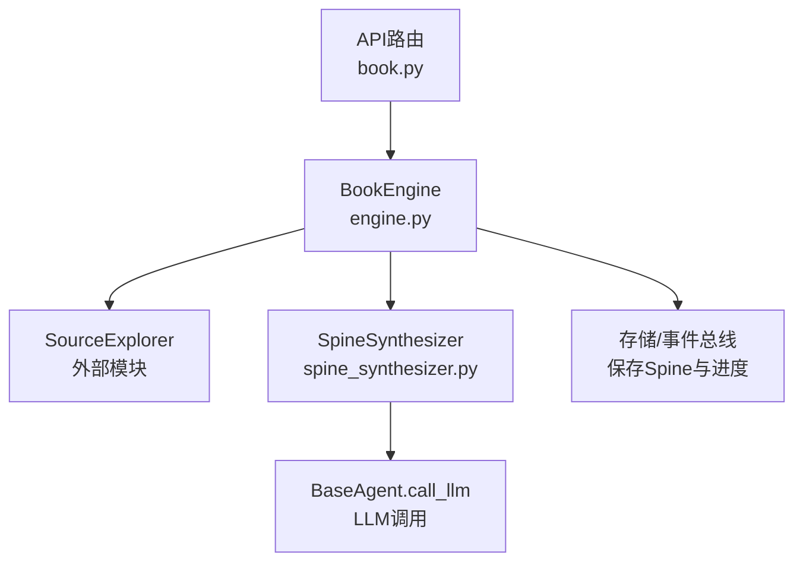
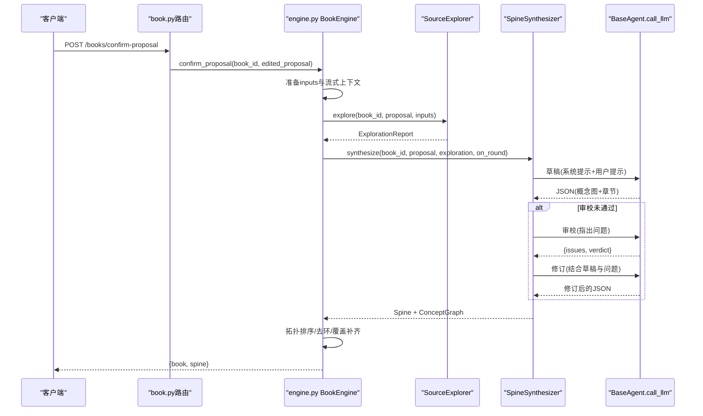
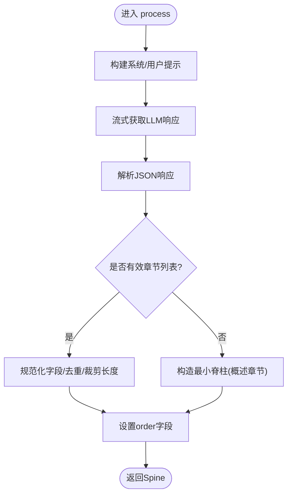
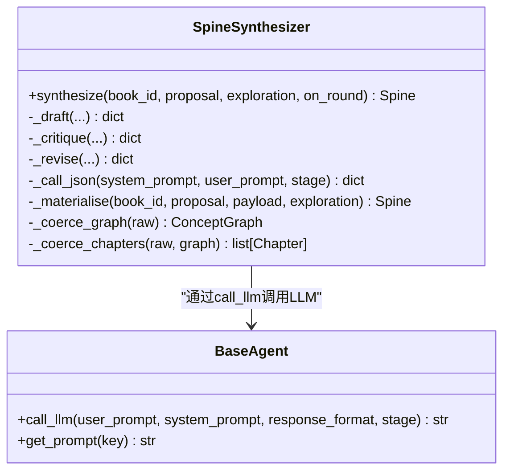
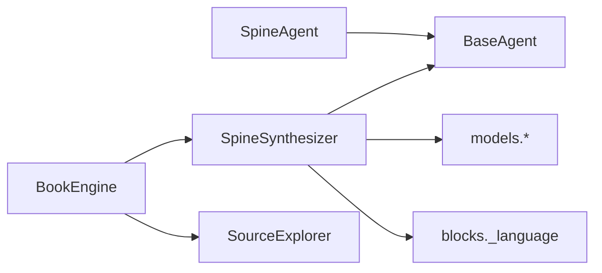

# 脊柱代理

<cite>
**本文引用的文件**
- [deeptutor/book/agents/spine_agent.py](file://deeptutor/book/agents/spine_agent.py)
- [deeptutor/book/agents/spine_synthesizer.py](file://deeptutor/book/agents/spine_synthesizer.py)
- [deeptutor/book/engine.py](file://deeptutor/book/engine.py)
- [deeptutor/api/routers/book.py](file://deeptutor/api/routers/book.py)
- [tests/book/test_spine_synthesizer_llm_call.py](file://tests/book/test_spine_synthesizer_llm_call.py)
</cite>

## 目录
1. [简介](#简介)
2. [项目结构](#项目结构)
3. [核心组件](#核心组件)
4. [架构总览](#架构总览)
5. [详细组件分析](#详细组件分析)
6. [依赖关系分析](#依赖关系分析)
7. [性能考量](#性能考量)
8. [故障排查指南](#故障排查指南)
9. [结论](#结论)
10. [附录：迁移与兼容性清单](#附录：迁移与兼容性清单)

## 简介
本文件面向DeepTutor的“书引擎”阶段2（Spine生成）中的两个关键组件：遗留组件 SpineAgent 与当前实现 SpineSynthesizer。文档说明两者的职责、历史作用、当前状态、向后兼容性与迁移路径，并提供升级指导与验证方法，帮助读者从旧版本平滑过渡到新版本。

## 项目结构
- SpineAgent：位于 deeptutor/book/agents/spine_agent.py，是早期用于根据已批准的书提案生成章节树（Spine）的遗留实现。
- SpineSynthesizer：位于 deeptutor/book/agents/spine_synthesizer.py，是当前实现，采用“草稿→审校→修订”的多轮推理循环，并同步输出概念图（ConceptGraph）。
- BookEngine：位于 deeptutor/book/engine.py，编排阶段2流程，调用 SourceExplorer 进行源探索，再调用 SpineSynthesizer 合成脊柱与概念图。
- API路由：位于 deeptutor/api/routers/book.py，对外暴露确认提案等接口，内部委托给 BookEngine。
- 测试：位于 tests/book/test_spine_synthesizer_llm_call.py，验证 SpineSynthesizer 通过 BaseAgent.call_llm 走追踪与语言指令等关键行为。

图表来源
- [deeptutor/api/routers/book.py:224-244](file://deeptutor/api/routers/book.py#L224-L244)
- [deeptutor/book/engine.py:281-394](file://deeptutor/book/engine.py#L281-L394)
- [deeptutor/book/agents/spine_synthesizer.py:114-174](file://deeptutor/book/agents/spine_synthesizer.py#L114-L174)

章节来源
- [deeptutor/api/routers/book.py:224-244](file://deeptutor/api/routers/book.py#L224-L244)
- [deeptutor/book/engine.py:281-394](file://deeptutor/book/engine.py#L281-L394)

## 核心组件
- SpineAgent（遗留）
  - 职责：接收已批准的 BookProposal 与可选源材料，调用 LLM 生成章节树（Spine），包含章节标题、学习目标、内容类型、前置知识、摘要等。
  - 特点：单轮 LLM 调用；若解析失败会回退为最小可用脊柱，保证流水线不阻塞。
  - 现状：仍保留在代码库中作为兼容层，但当前 BookEngine 不再直接调用它来生成脊柱。

- SpineSynthesizer（当前）
  - 职责：基于 SourceExplorer 产出的 ExplorationReport，执行多轮“草稿→审校→修订”，最终输出 Spine 与 ConceptGraph，并进行拓扑排序、环消除、覆盖补齐等后处理。
  - 特点：可配置最大轮数；对 LLM 失败有健壮回退；通过 BaseAgent 统一追踪与语言指令；支持回调 on_round 推送中间状态。
  - 现状：被 BookEngine 在阶段2使用，替代了 SpineAgent。

章节来源
- [deeptutor/book/agents/spine_agent.py:27-104](file://deeptutor/book/agents/spine_agent.py#L27-L104)
- [deeptutor/book/agents/spine_synthesizer.py:82-174](file://deeptutor/book/agents/spine_synthesizer.py#L82-L174)

## 架构总览
阶段2的整体流程如下：
1. 用户确认（并可编辑）提案后，BookEngine.confirm_proposal 启动阶段2。
2. 先运行 SourceExplorer 并行探索知识库/笔记本/聊天等源，产出 ExplorationReport。
3. 将 ExplorationReport 传入 SpineSynthesizer.synthesize，执行多轮推理，得到 Spine 与 ConceptGraph。
4. 写入存储并发布事件，更新书籍状态为 SPINE_READY。

图表来源
- [deeptutor/api/routers/book.py:224-244](file://deeptutor/api/routers/book.py#L224-L244)
- [deeptutor/book/engine.py:281-394](file://deeptutor/book/engine.py#L281-L394)
- [deeptutor/book/agents/spine_synthesizer.py:114-174](file://deeptutor/book/agents/spine_synthesizer.py#L114-L174)

## 详细组件分析

### SpineAgent（遗留）
- 输入：book_id、BookProposal、可选 source_material。
- 处理：
  - 组装系统提示与用户模板（含提案块与源材料）。
  - 流式获取 LLM 响应，拼接后解析为 JSON。
  - 将 JSON 转换为 Chapter 列表，确保 order 字段确定。
  - 若解析失败或无章节，回退为最小可用脊柱（概述章节）。
- 输出：Spine（仅章节树，不含概念图）。
- 错误处理：解析失败时返回空字典并构造最小脊柱，避免阻塞后续流程。

图表来源
- [deeptutor/book/agents/spine_agent.py:48-104](file://deeptutor/book/agents/spine_agent.py#L48-L104)
- [deeptutor/book/agents/spine_agent.py:110-170](file://deeptutor/book/agents/spine_agent.py#L110-L170)

章节来源
- [deeptutor/book/agents/spine_agent.py:27-185](file://deeptutor/book/agents/spine_agent.py#L27-L185)

### SpineSynthesizer（当前）
- 输入：book_id、BookProposal、ExplorationReport（可选）、on_round回调。
- 处理：
  - 渲染提案块与探索报告摘要/候选概念/片段。
  - 第1轮：草稿（Draft）——请求 LLM 同时输出概念图与章节。
  - 第2+N轮：审校（Critique）——检查覆盖、顺序、环等问题；若未通过则修订（Revise）。
  - 后处理：拓扑排序、环消除、覆盖补齐，构建章节级概念图。
  - 错误处理：任何 LLM 调用失败均记录日志并返回空负载，由上层回退到上一轮有效草稿或最小脊柱。
- 输出：Spine（含章节与概念图）以及探索摘要。

图表来源
- [deeptutor/book/agents/spine_synthesizer.py:82-174](file://deeptutor/book/agents/spine_synthesizer.py#L82-L174)
- [deeptutor/book/agents/spine_synthesizer.py:180-274](file://deeptutor/book/agents/spine_synthesizer.py#L180-L274)
- [deeptutor/book/agents/spine_synthesizer.py:280-468](file://deeptutor/book/agents/spine_synthesizer.py#L280-L468)

章节来源
- [deeptutor/book/agents/spine_synthesizer.py:82-791](file://deeptutor/book/agents/spine_synthesizer.py#L82-L791)

### BookEngine 集成（阶段2）
- 确认提案后，先运行 SourceExplorer 产出 ExplorationReport。
- 创建 SpineSynthesizer(language=book.language)，注册 on_round 回调以推送中间状态。
- 调用 synthesize 得到 Spine，持久化并更新书籍状态。
- 注入 Overview 章节（如需要），并生成页面。

章节来源
- [deeptutor/book/engine.py:281-394](file://deeptutor/book/engine.py#L281-L394)

## 依赖关系分析
- SpineAgent 依赖：
  - BaseAgent（LLM调用与提示管理）
  - models.BookProposal、Chapter、ContentType、SourceAnchor、Spine
  - utils.json_parser.parse_json_response
- SpineSynthesizer 依赖：
  - BaseAgent（统一LLM调用与追踪）
  - models.BookProposal、Chapter、ContentType、SourceAnchor、Spine、ConceptNode、ConceptEdge、ConceptGraph、ExplorationReport
  - utils.json_parser.parse_json_response
  - blocks._language.language_directive（附加语言指令）
- BookEngine 依赖：
  - agents.spine_synthesizer.Sp ineSynthesizer
  - agents.source_explorer.SourceExplorer
  - storage、streaming（事件与进度）

图表来源
- [deeptutor/book/agents/spine_agent.py:14-18](file://deeptutor/book/agents/spine_agent.py#L14-L18)
- [deeptutor/book/agents/spine_synthesizer.py:37-50](file://deeptutor/book/agents/spine_synthesizer.py#L37-L50)
- [deeptutor/book/engine.py:43-43](file://deeptutor/book/engine.py#L43-L43)

章节来源
- [deeptutor/book/agents/spine_agent.py:14-18](file://deeptutor/book/agents/spine_agent.py#L14-L18)
- [deeptutor/book/agents/spine_synthesizer.py:37-50](file://deeptutor/book/agents/spine_synthesizer.py#L37-L50)
- [deeptutor/book/engine.py:43-43](file://deeptutor/book/engine.py#L43-L43)

## 性能考量
- SpineSynthesizer 默认最多2轮（可配置），每轮一次 LLM 调用；审校未通过时会触发修订，增加额外调用。
- 草稿阶段为阻塞调用，避免部分JSON被下游消费导致脊柱坍塌（参考测试注释）。
- 后处理包括拓扑排序、环消除与覆盖补齐，时间复杂度与章节/概念数量线性相关，整体开销可控。
- 源探索（SourceExplorer）并行检索，减少重复RAG调用，提升确定性并降低成本。

[本节提供一般性指导，无需特定文件引用]

## 故障排查指南
- LLM调用失败：
  - SpineSynthesizer 捕获异常并记录警告，返回空负载；上层会使用上一轮有效草稿或最小脊柱，确保流水线不阻塞。
  - 可通过 on_round 回调观察各轮次状态（草稿、审校、修订）与章节数量、问题数量、判定结果。
- 语言指令：
  - 非英文/中文书籍会在系统提示附加语言指令，确保模型按目标语言输出。测试覆盖了该行为。
- 数据一致性：
  - 若章节或概念图出现环或不一致，后处理会尝试修复（删除最弱边、拓扑排序、覆盖补齐）。
- 建议验证：
  - 使用现有测试用例验证 _call_json 走 BaseAgent.call_llm 并携带 stage、response_format 与语言指令。
  - 在本地环境模拟 LLM 失败，确认回退逻辑与日志输出。

章节来源
- [tests/book/test_spine_synthesizer_llm_call.py:21-63](file://tests/book/test_spine_synthesizer_llm_call.py#L21-L63)
- [deeptutor/book/agents/spine_synthesizer.py:249-274](file://deeptutor/book/agents/spine_synthesizer.py#L249-L274)

## 结论
- SpineAgent 是遗留实现，负责单轮 LLM 生成章节树；当前 BookEngine 已迁移至 SpineSynthesizer，后者具备多轮推理、概念图同步与更强的鲁棒性。
- 向后兼容方面，SpineAgent 仍存在于代码库中，便于旧版集成或逐步替换；推荐优先迁移到 SpineSynthesizer。
- 升级路径清晰：保持 API 路由不变，由 BookEngine 内部调用 SpineSynthesizer；通过 on_round 回调获得更丰富的过程信息；利用现有测试保障关键行为。

[本节总结性内容，无需特定文件引用]

## 附录：迁移与兼容性清单
- 迁移步骤
  - 确认 BookEngine 已调用 SpineSynthesizer（当前默认），无需修改 API 路由。
  - 如需自定义轮数，可在实例化时设置 max_rounds。
  - 接入 on_round 回调以获取草稿、审校、修订的中间状态，便于前端展示与调试。
- 兼容性考虑
  - SpineAgent 仍保留导出，供旧版集成使用；新代码应优先使用 SpineSynthesizer。
  - SpineSynthesizer 通过 BaseAgent 统一追踪与语言指令，确保与现有活动面板和 per-agent 路由一致。
- 升级验证
  - 运行 tests/book/test_spine_synthesizer_llm_call.py，确保 _call_json 正确走 BaseAgent.call_llm，并携带 stage、response_format 与语言指令。
  - 在本地模拟 LLM 失败，验证回退逻辑与日志输出。
  - 端到端验证：调用 /books/confirm-proposal，确认返回 book 与 spine，且状态更新为 SPINE_READY。

章节来源
- [deeptutor/api/routers/book.py:224-244](file://deeptutor/api/routers/book.py#L224-L244)
- [deeptutor/book/engine.py:281-394](file://deeptutor/book/engine.py#L281-L394)
- [tests/book/test_spine_synthesizer_llm_call.py:21-63](file://tests/book/test_spine_synthesizer_llm_call.py#L21-L63)