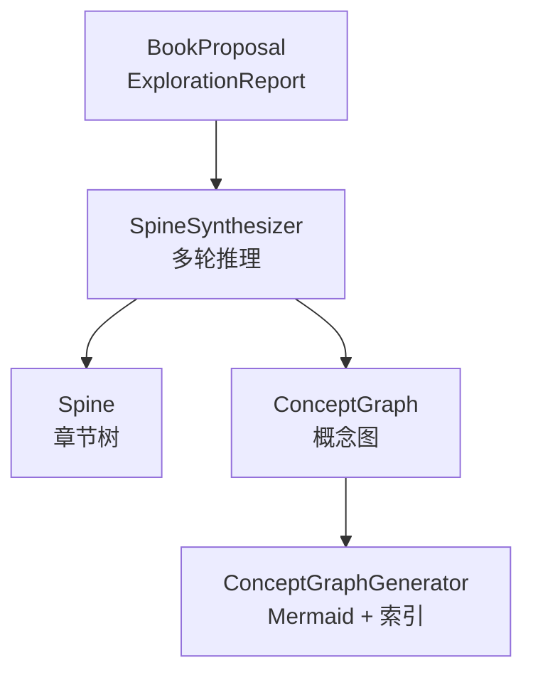
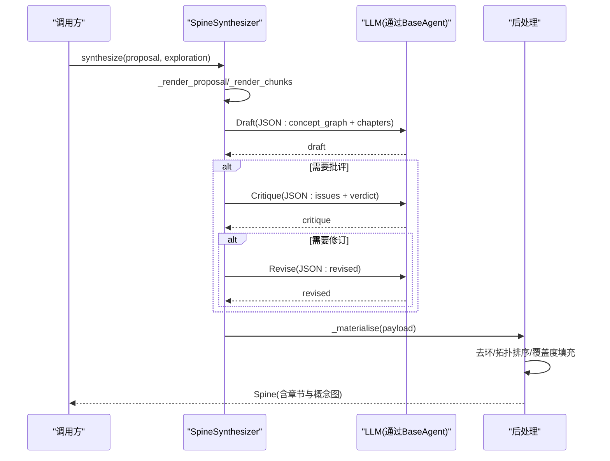
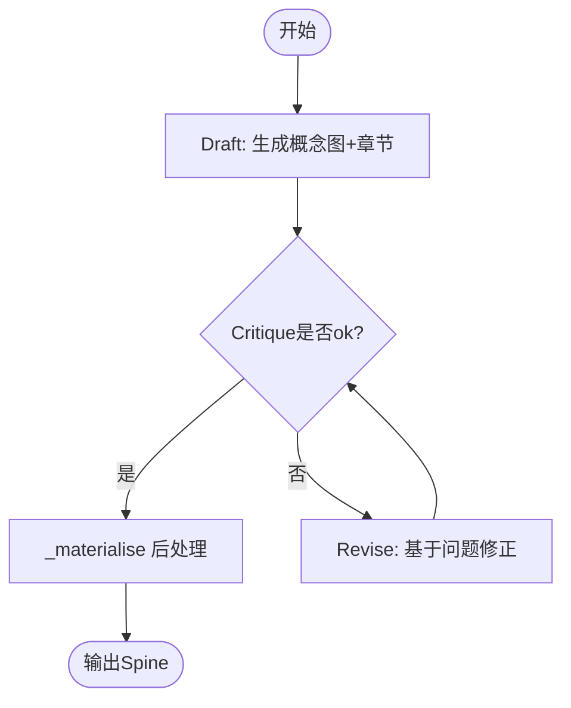
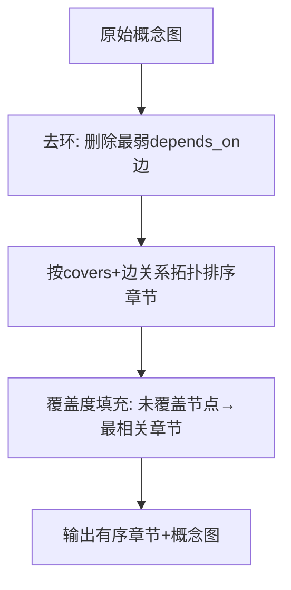
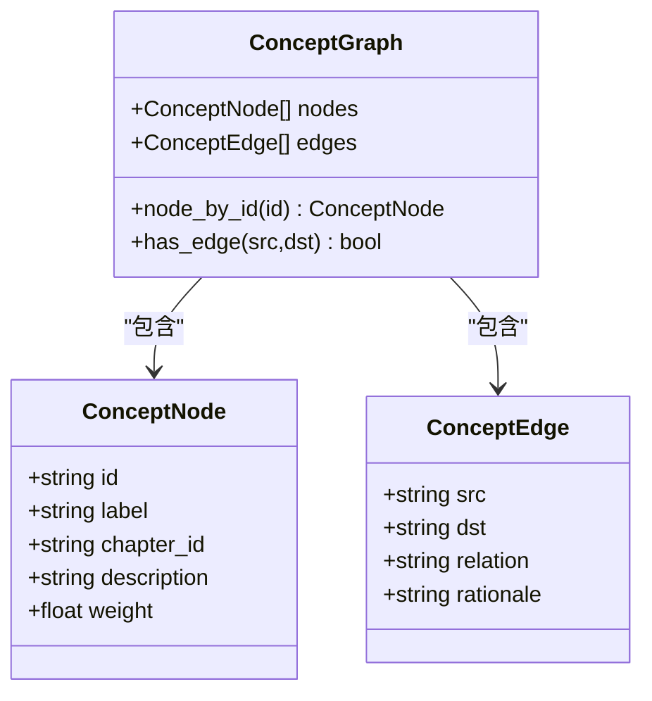
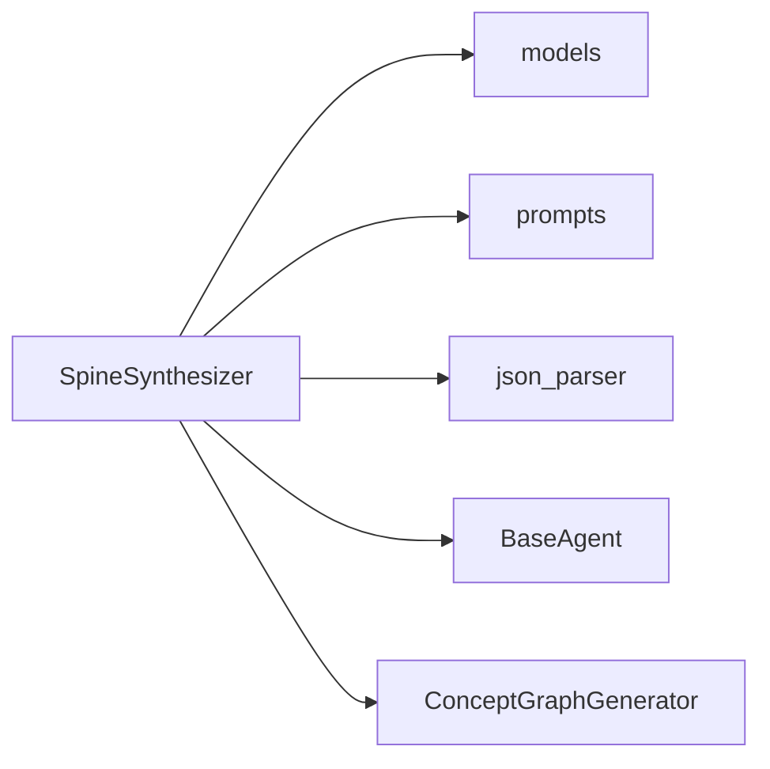

# 脊柱合成智能体

<cite>
**本文引用的文件**
- [spine_synthesizer.py](file://deeptutor/book/agents/spine_synthesizer.py)
- [spine_agent.py](file://deeptutor/book/agents/spine_agent.py)
- [page_planner.py](file://deeptutor/book/agents/page_planner.py)
- [concept_graph.py](file://deeptutor/book/blocks/concept_graph.py)
- [models.py](file://deeptutor/book/models.py)
- [spine_synthesizer.yaml](file://deeptutor/book/prompts/en/spine_synthesizer.yaml)
- [test_spine_synthesizer_llm_call.py](file://tests/book/test_spine_synthesizer_llm_call.py)
</cite>

## 目录
1. [简介](#简介)
2. [项目结构](#项目结构)
3. [核心组件](#核心组件)
4. [架构总览](#架构总览)
5. [详细组件分析](#详细组件分析)
6. [依赖关系分析](#依赖关系分析)
7. [性能与重试配置](#性能与重试配置)
8. [故障排查指南](#故障排查指南)
9. [结论](#结论)
10. [附录：完整示例与调试技巧](#附录完整示例与调试技巧)

## 简介
本文件面向DeepTutor的“脊柱合成智能体”，聚焦SpineSynthesizer的多轮推理循环（草稿→批评→修订）、章节规划算法（拓扑排序、循环检测、覆盖度填充）、概念图构建与关系映射、LLM调用失败与降级策略、验证后处理步骤，以及重试机制与性能调优。文档以代码级为依据，提供可视化图示与可操作的排障建议。

## 项目结构
- 脊柱合成位于BookEngine的Stage 2，输入为已批准的BookProposal与可选的ExplorationReport，输出为Spine（章节树）与ConceptGraph（概念图）。
- 相关模块：
  - 智能体层：SpineSynthesizer（多轮推理）、SpineAgent（旧版单轮生成）
  - 数据模型：Chapter、ConceptNode/Edge/Graph、Spine等
  - 提示词：draft/critique/revise三段式Prompt
  - 渲染层：ConceptGraphGenerator将最终概念图渲染为Mermaid并产出前端索引
  - 测试：验证LLM调用路径与失败降级

图表来源
- [spine_synthesizer.py:114-174](file://deeptutor/book/agents/spine_synthesizer.py#L114-L174)
- [concept_graph.py:84-130](file://deeptutor/book/blocks/concept_graph.py#L84-L130)

章节来源
- [spine_synthesizer.py:1-791](file://deeptutor/book/agents/spine_synthesizer.py#L1-L791)
- [models.py:165-267](file://deeptutor/book/models.py#L165-L267)

## 核心组件
- SpineSynthesizer：实现Draft→Critique→Revise多轮循环，统一产出Spine与ConceptGraph，并在最后执行确定性后处理（拓扑排序、去环、覆盖度填充）。
- SpineAgent：旧版单轮生成器，作为对比参考。
- SectionArchitect/PagePlanner：Stage 3，负责章节到Block序列的规划（与脊柱合成解耦，但共享模型与上下文）。
- ConceptGraphGenerator：将Spine中的概念图渲染为Mermaid，并提供节点到章节的映射索引。

章节来源
- [spine_synthesizer.py:82-174](file://deeptutor/book/agents/spine_synthesizer.py#L82-L174)
- [spine_agent.py:27-104](file://deeptutor/book/agents/spine_agent.py#L27-L104)
- [page_planner.py:256-348](file://deeptutor/book/agents/page_planner.py#L256-L348)
- [concept_graph.py:84-130](file://deeptutor/book/blocks/concept_graph.py#L84-L130)

## 架构总览
SpineSynthesizer的核心流程如下：
- 准备阶段：渲染Proposal与Exploration摘要、候选概念与证据片段。
- 第一轮：Draft，要求LLM同时输出ConceptGraph与Chapters。
- 第二轮起：Critique检查覆盖度、顺序、循环等问题；若存在问题则进入Revise修正；最多max_rounds轮。
- 后处理：对概念图进行去环、按covers+边关系做章节拓扑排序、对未覆盖的概念节点进行Jaccard相似度匹配填充到最相关章节。
- 构建章节级概念图：将原始概念图映射为“章节→章节”的关系图，便于Overview页面展示。

图表来源
- [spine_synthesizer.py:114-174](file://deeptutor/book/agents/spine_synthesizer.py#L114-L174)
- [spine_synthesizer.py:249-274](file://deeptutor/book/agents/spine_synthesizer.py#L249-L274)
- [spine_synthesizer.py:280-329](file://deeptutor/book/agents/spine_synthesizer.py#L280-L329)

## 详细组件分析

### SpineSynthesizer：多轮推理循环
- 入口方法synthesize负责组装提示、驱动三轮（或更多）循环，并通过on_round回调上报每轮中间结果。
- _call_json使用BaseAgent.call_llm并以json_object响应格式请求，确保阻塞式解析，避免流式推理前缀污染JSON。
- 失败保护：任何一轮LLM调用异常返回空字典，后续逻辑依靠后处理保证最小可用输出。

图表来源
- [spine_synthesizer.py:114-174](file://deeptutor/book/agents/spine_synthesizer.py#L114-L174)
- [spine_synthesizer.py:249-274](file://deeptutor/book/agents/spine_synthesizer.py#L249-L274)

章节来源
- [spine_synthesizer.py:114-174](file://deeptutor/book/agents/spine_synthesizer.py#L114-L174)
- [spine_synthesizer.py:249-274](file://deeptutor/book/agents/spine_synthesizer.py#L249-L274)
- [spine_synthesizer.yaml:1-127](file://deeptutor/book/prompts/en/spine_synthesizer.yaml#L1-L127)

### 章节规划算法：拓扑排序、循环检测、覆盖度填充
- 循环检测与移除：在概念图上检测depends_on边的环，删除“最弱”边（rationale最短），直至无环。
- 拓扑排序：根据chapters.covers与概念图的depends_on边，构建章节依赖图，使用Kahn算法排序，保持作者意图（原序优先）。
- 覆盖度填充：对未被任何章节覆盖的概念节点，计算其与各章节标题/摘要/目标的Jaccard相似度，将其归属到最相关章节，并回填node.chapter_id。

图表来源
- [spine_synthesizer.py:607-766](file://deeptutor/book/agents/spine_synthesizer.py#L607-L766)

章节来源
- [spine_synthesizer.py:607-766](file://deeptutor/book/agents/spine_synthesizer.py#L607-L766)

### 概念图构建与关系映射
- 从LLM输出的raw graph中规范化节点与边：slug化id、裁剪长度、限制权重范围、过滤无效边与重复边。
- 构建章节级概念图：将概念图depends_on边提升为“章节→章节”边，并结合显式prerequisites（按标题匹配）合并去重；若存在多个根章节且提供了书名，则插入虚拟根节点形成有根树，便于Overview思维导图展示。

图表来源
- [models.py:214-253](file://deeptutor/book/models.py#L214-L253)
- [spine_synthesizer.py:335-394](file://deeptutor/book/agents/spine_synthesizer.py#L335-L394)
- [spine_synthesizer.py:502-604](file://deeptutor/book/agents/spine_synthesizer.py#L502-L604)

章节来源
- [spine_synthesizer.py:335-394](file://deeptutor/book/agents/spine_synthesizer.py#L335-L394)
- [spine_synthesizer.py:502-604](file://deeptutor/book/agents/spine_synthesizer.py#L502-L604)
- [models.py:214-253](file://deeptutor/book/models.py#L214-L253)

### LLM调用失败与降级策略
- 单轮失败：_call_json捕获异常并记录警告，返回空字典；外层循环继续，最终由后处理保证最小可用Spine。
- 无提示词回退：若缺失critique/revise提示词，直接视为无问题或空修订，避免阻塞。
- 测试覆盖：单元测试验证_call_json走BaseAgent.call_llm并携带stage与response_format；当底层抛出异常时返回空负载。

章节来源
- [spine_synthesizer.py:249-274](file://deeptutor/book/agents/spine_synthesizer.py#L249-L274)
- [test_spine_synthesizer_llm_call.py:21-63](file://tests/book/test_spine_synthesizer_llm_call.py#L21-L63)

### 验证后处理步骤
- 去环：迭代检测并删除最弱边，安全上限防止死循环。
- 拓扑排序：基于covers与depends_on边构建章节依赖图，使用Kahn算法排序；若出现不一致（无法全部入队），回退到原顺序。
- 覆盖度填充：对未覆盖节点按Jaccard相似度匹配到最相关章节，并回填chapter_id，保证每个概念至少被一个章节覆盖。

章节来源
- [spine_synthesizer.py:607-766](file://deeptutor/book/agents/spine_synthesizer.py#L607-L766)

## 依赖关系分析
- SpineSynthesizer依赖：
  - BaseAgent：统一LLM调用、追踪与语言指令注入
  - models：Chapter、ConceptGraph、Spine等数据结构
  - prompts：draft/critique/revise三段式提示词
  - utils.json_parser：解析LLM返回的JSON
- 渲染层：
  - ConceptGraphGenerator读取Spine中的概念图，渲染Mermaid并生成前端索引（章节列表与节点→章节映射）

图表来源
- [spine_synthesizer.py:37-52](file://deeptutor/book/agents/spine_synthesizer.py#L37-L52)
- [concept_graph.py:84-130](file://deeptutor/book/blocks/concept_graph.py#L84-L130)

章节来源
- [spine_synthesizer.py:37-52](file://deeptutor/book/agents/spine_synthesizer.py#L37-L52)
- [concept_graph.py:84-130](file://deeptutor/book/blocks/concept_graph.py#L84-L130)

## 性能与重试配置
- 多轮控制：
  - max_rounds：默认2轮（1次Draft + 至多1次Critique/Revise循环），可通过构造函数调整。增大可增加质量但增加延迟与成本。
- LLM调用方式：
  - 使用阻塞式call_llm而非流式，避免推理前缀污染JSON解析，减少错误分支。
- 降级与回退：
  - 任一阶段失败返回空负载，后处理保证最小可用输出；缺失提示词时自动跳过该阶段。
- 提示词与内容裁剪：
  - 对长文本进行截断（如draft_block、critique_block），降低Token消耗与超时风险。
- 并发与缓存：
  - ExplorationReport复用检索结果，避免重复RAG调用；建议在外部编排层对并行调用做限流与重试。
- 建议配置：
  - 生产环境建议max_rounds=2，开启重试（在调用层封装指数退避与熔断），设置合理的timeout与max_tokens。
  - 对Critique/Revise阶段启用更严格的温度与最大token限制，提高稳定性。

章节来源
- [spine_synthesizer.py:85-104](file://deeptutor/book/agents/spine_synthesizer.py#L85-L104)
- [spine_synthesizer.py:249-274](file://deeptutor/book/agents/spine_synthesizer.py#L249-L274)
- [spine_synthesizer.py:202-247](file://deeptutor/book/agents/spine_synthesizer.py#L202-L247)

## 故障排查指南
- 现象：Spine为空或仅有一个概述章节
  - 可能原因：LLM调用失败或返回非JSON；提示词缺失导致跳过Critique/Revise
  - 排查要点：检查_call_json日志与异常；确认提示词加载；查看后端trace事件
- 现象：章节顺序不合理或存在循环
  - 可能原因：概念图edges不合法或covers映射不完整
  - 排查要点：检查去环与拓扑排序逻辑；打印中间图结构；必要时手动修正covers
- 现象：某些概念未被任何章节覆盖
  - 可能原因：LLM未正确填写covers或节点slug不匹配
  - 排查要点：检查覆盖度填充是否生效；核对节点slug与covers一致性
- 现象：Overview概念图显示异常
  - 可能原因：概念图节点过多或标签过长
  - 排查要点：检查render_mermaid的标签裁剪与ID唯一性；减少节点数量或缩短标签

章节来源
- [spine_synthesizer.py:249-274](file://deeptutor/book/agents/spine_synthesizer.py#L249-L274)
- [spine_synthesizer.py:607-766](file://deeptutor/book/agents/spine_synthesizer.py#L607-L766)
- [concept_graph.py:41-81](file://deeptutor/book/blocks/concept_graph.py#L41-L81)

## 结论
SpineSynthesizer通过“草稿→批评→修订”的多轮推理循环，结合确定性的后处理（去环、拓扑排序、覆盖度填充），在保证鲁棒性的同时提升了脊柱与概念图的质量。其设计强调失败降级与最小可用输出，适合在生产环境中稳定运行。配合SectionArchitect与ConceptGraphGenerator，可实现从章节规划到可视化的端到端流水线。

## 附录：完整示例与调试技巧
- 端到端示例（概念说明）：
  - 输入：BookProposal（主题、范围、目标层级、估计章节数、理由）+ ExplorationReport（检索摘要、候选概念、证据片段）
  - 过程：Draft生成概念图与章节；Critique评估覆盖度、顺序、循环；Revise修正问题；后处理确保无环、有序、全覆盖
  - 输出：Spine（章节树）+ ConceptGraph（概念图），后者可渲染为Mermaid并用于Overview交互
- 调试技巧：
  - 启用on_round回调，记录每轮的draft/critique/revise中间结果，便于定位问题
  - 打印中间图结构（nodes/edges/chapters.covers），验证slug一致性与依赖关系
  - 针对Critique/Revise阶段，检查提示词是否正确加载，必要时回退到默认提示词
  - 在调用层添加重试与熔断，避免单次LLM失败影响整体流程

[本节为概念性说明，不直接分析具体文件]