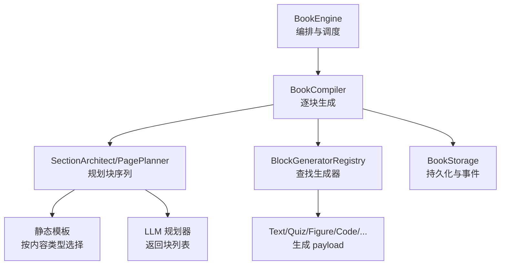
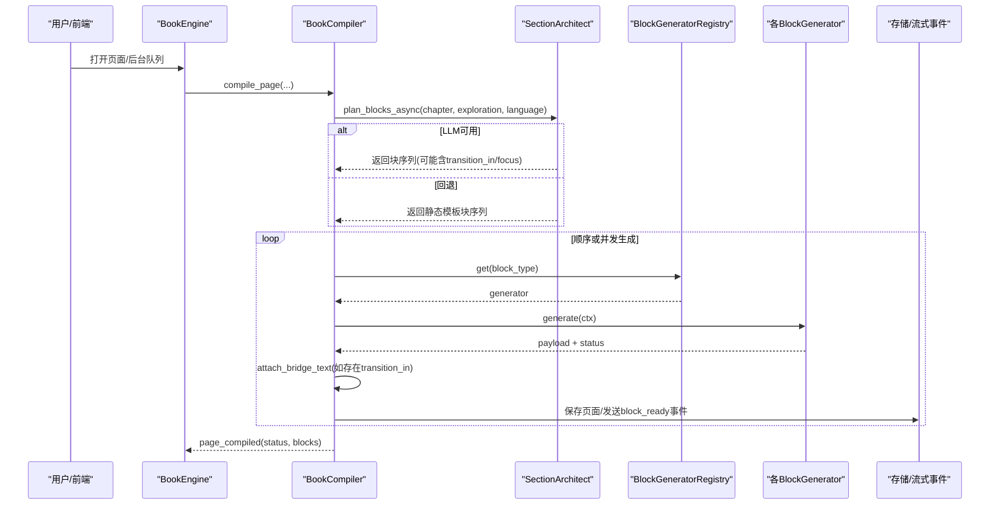
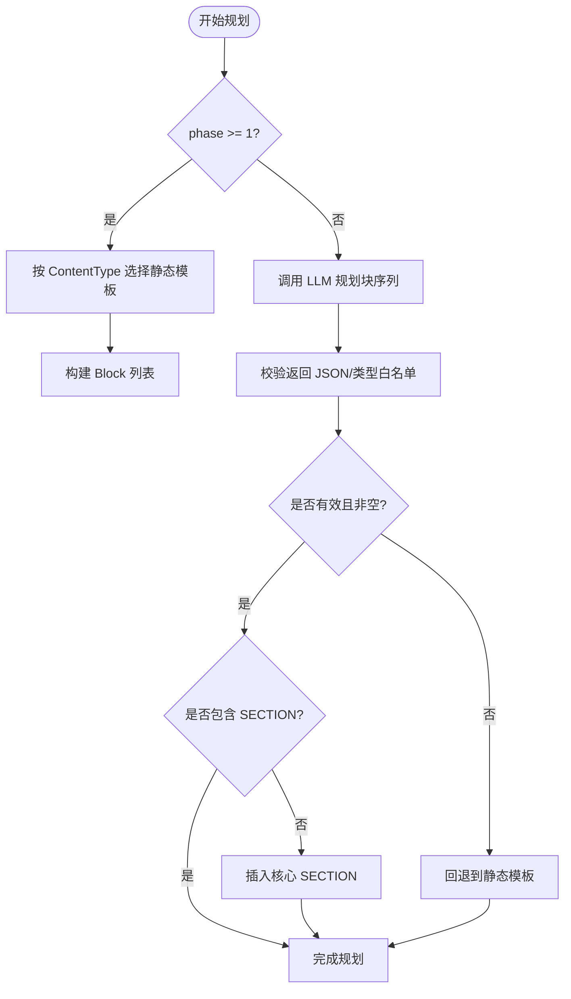
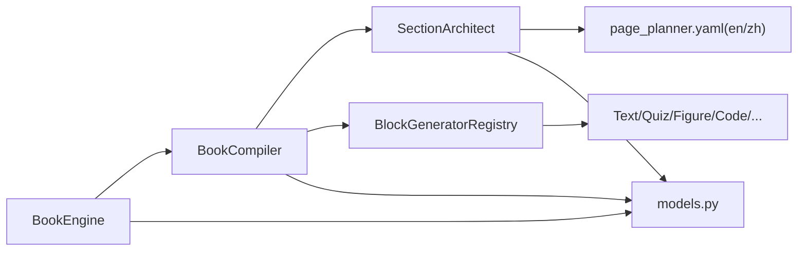

# 页面规划智能体

<cite>
**本文引用的文件**
- [page_planner.py](file://deeptutor/book/agents/page_planner.py)
- [models.py](file://deeptutor/book/models.py)
- [engine.py](file://deeptutor/book/engine.py)
- [compiler.py](file://deeptutor/book/compiler.py)
- [context.py](file://deeptutor/book/context.py)
- [base.py](file://deeptutor/book/blocks/base.py)
- [page_planner.yaml（英文）](file://deeptutor/book/prompts/en/page_planner.yaml)
- [page_planner.yaml（中文）](file://deeptutor/book/prompts/zh/page_planner.yaml)
</cite>

## 目录
1. [简介](#简介)
2. [项目结构](#项目结构)
3. [核心组件](#核心组件)
4. [架构总览](#架构总览)
5. [详细组件分析](#详细组件分析)
6. [依赖关系分析](#依赖关系分析)
7. [性能与并发特性](#性能与并发特性)
8. [故障排查指南](#故障排查指南)
9. [结论](#结论)
10. [附录：配置与示例](#附录配置与示例)

## 简介
本文件面向 DeepTutor 的“页面规划智能体”，即 BookEngine v2 中的 SectionArchitect（兼容别名 PagePlanner）。它负责将章节内容分解为可管理的页面单元，并基于内容类型选择模板或调用 LLM 生成块序列；随后由编译器驱动各块生成器产出具体 payload，最终形成前端可直接渲染的页面。本文重点解释：
- 内容组织策略与页面布局算法
- 章节到页面的分解方法
- 页面类型选择与内容分配机制
- 多媒体与交互元素的处理方式
- 页面间导航与链接生成
- 配置项与自定义选项
- 完整示例与布局优化建议

## 项目结构
页面规划智能体位于 book 子系统中，围绕“编排—规划—编译—渲染”的主线展开：
- 编排层：BookEngine 负责生命周期、阶段推进、队列调度与事件广播
- 规划层：SectionArchitect/PagePlanner 根据章节信息生成块序列（静态模板或 LLM 动态规划）
- 编译层：BookCompiler 按序触发各 BlockGenerator 生成 payload，并附加过渡段落
- 数据模型：models.py 定义 Chapter/Page/Block 等核心实体与状态机
- 上下文与提示：prompts 提供多语言 block 目录与设计原则；context.py 用于将页面内容序列化给聊天上下文使用

图表来源
- [engine.py:100-116](file://deeptutor/book/engine.py#L100-L116)
- [compiler.py:69-84](file://deeptutor/book/compiler.py#L69-L84)
- [page_planner.py:256-348](file://deeptutor/book/agents/page_planner.py#L256-L348)
- [base.py:164-223](file://deeptutor/book/blocks/base.py#L164-L223)

章节来源
- [engine.py:1-120](file://deeptutor/book/engine.py#L1-L120)
- [compiler.py:1-84](file://deeptutor/book/compiler.py#L1-L84)
- [page_planner.py:1-60](file://deeptutor/book/agents/page_planner.py#L1-L60)

## 核心组件
- SectionArchitect/PagePlanner：负责为每个章节生成有序的 Block 序列。支持两种模式：
  - 静态模板：按 ContentType 选择预置模板，保证确定性输出
  - LLM 优先：尝试调用 LLM 生成更灵活的块序列，失败时回退到静态模板
- BookCompiler：驱动页面编译流程，先规划（若尚无块），再逐个生成块，并在成功时附加 bridge_text 过渡段
- models：定义 BlockType、ContentType、Page、Chapter、Block 等数据结构与状态
- blocks/base：注册表与生成器基类，统一错误分类与重试元数据
- prompts：多语言的 block 目录与设计原则，指导 LLM 规划

章节来源
- [page_planner.py:256-348](file://deeptutor/book/agents/page_planner.py#L256-L348)
- [compiler.py:88-190](file://deeptutor/book/compiler.py#L88-L190)
- [models.py:55-91](file://deeptutor/book/models.py#L55-L91)
- [base.py:116-178](file://deeptutor/book/blocks/base.py#L116-L178)
- [page_planner.yaml（英文）:1-58](file://deeptutor/book/prompts/en/page_planner.yaml#L1-L58)
- [page_planner.yaml（中文）:1-53](file://deeptutor/book/prompts/zh/page_planner.yaml#L1-L53)

## 架构总览
页面规划智能体在 BookEngine 的 Stage 3 中运行，作为“章节→页面”的桥梁。其关键路径如下：
- 用户确认 Spine 后，Engine 为每个 Chapter 创建 Page shell（PENDING）
- 当打开某页或后台队列处理时，Compiler 调用 Architect 进行规划
- Architect 优先尝试 LLM 规划，否则使用静态模板
- 规划完成后，Compiler 依次调用对应 BlockGenerator 生成 payload
- 成功后附加 bridge_text，更新状态并持久化

图表来源
- [engine.py:699-769](file://deeptutor/book/engine.py#L699-L769)
- [compiler.py:88-190](file://deeptutor/book/compiler.py#L88-L190)
- [page_planner.py:277-348](file://deeptutor/book/agents/page_planner.py#L277-L348)
- [base.py:164-223](file://deeptutor/book/blocks/base.py#L164-L223)

## 详细组件分析

### 内容组织策略与页面布局算法
- 内容类型驱动模板选择：ContentType.THEORY/DERIVATION/HISTORY/PRACTICE/CONCEPT/OVERVIEW 分别映射到不同的块序列模板，确保不同学科/体裁的最佳阅读节奏
- 静态模板包含 SECTION、FIGURE、CALLOUT、CODE、QUIZ、FLASH_CARDS、TIMELINE、ANIMATION、INTERACTIVE 等块，并通过 transition_in 标注块间过渡语义
- LLM 规划遵循多语言提示中的设计原则：5-10 个块、多样化穿插、至少一个 SECTION、根据内容性质匹配块类型、避免 deep_dive/user_note/concept_graph
- 覆盖率保障：若 LLM 未返回任何 SECTION，则自动在开头注入一个核心 SECTION，防止丢失章节正文

图表来源
- [page_planner.py:74-156](file://deeptutor/book/agents/page_planner.py#L74-L156)
- [page_planner.py:219-248](file://deeptutor/book/agents/page_planner.py#L219-L248)
- [page_planner.py:277-348](file://deeptutor/book/agents/page_planner.py#L277-L348)
- [page_planner.yaml（英文）:26-44](file://deeptutor/book/prompts/en/page_planner.yaml#L26-L44)
- [page_planner.yaml（中文）:25-40](file://deeptutor/book/prompts/zh/page_planner.yaml#L25-L40)

章节来源
- [page_planner.py:74-156](file://deeptutor/book/agents/page_planner.py#L74-L156)
- [page_planner.py:219-248](file://deeptutor/book/agents/page_planner.py#L219-L248)
- [page_planner.py:277-348](file://deeptutor/book/agents/page_planner.py#L277-L348)

### 章节内容分解为可管理页面单元
- 每个 Chapter 对应一个 Page，Page 内维护有序 Block 列表
- 规划阶段为 Page 填充 Block 壳（type + params + metadata），后续由编译器生成 payload
- 对于 OVERVIEW 类型页面，Engine 直接以确定性逻辑构建 intro、概念图与章节索引，不经过通用 LLM 编译，避免覆盖权威内容

章节来源
- [models.py:193-207](file://deeptutor/book/models.py#L193-L207)
- [models.py:363-387](file://deeptutor/book/models.py#L363-L387)
- [engine.py:597-645](file://deeptutor/book/engine.py#L597-L645)
- [engine.py:716-728](file://deeptutor/book/engine.py#L716-L728)

### 页面类型选择与内容分配机制
- ContentType 作为“提示”，决定静态模板选择；LLM 规划时可自由组合块类型，但仍受白名单限制
- 允许的类型集合包括 TEXT/CALLOUT/QUIZ/SECTION/FIGURE/INTERACTIVE/ANIMATION/CODE/TIMELINE/FLASH_CARDS 等
- 参数约束：例如 quiz 的 num_questions/difficulty、figure 的 variant/focus、code 的 language/intent、animation 的 focus/quality 等

章节来源
- [page_planner.py:60-71](file://deeptutor/book/agents/page_planner.py#L60-L71)
- [page_planner.py:205-216](file://deeptutor/book/agents/page_planner.py#L205-L216)
- [page_planner.yaml（英文）:1-24](file://deeptutor/book/prompts/en/page_planner.yaml#L1-L24)
- [page_planner.yaml（中文）:1-23](file://deeptutor/book/prompts/zh/page_planner.yaml#L1-L23)

### 多媒体内容与交互元素处理
- 多媒体块类型：FIGURE（SVG/Chart.js/Mermaid）、ANIMATION（Manim 视频）、INTERACTIVE（HTML 小部件）
- 生成器通过 BlockGeneratorRegistry 查找对应实现，统一封装错误分类与元数据
- 过渡段落：若块携带 transition_in，编译器会在成功后生成 bridge_text 附加到 payload，提升阅读连贯性

章节来源
- [base.py:190-223](file://deeptutor/book/blocks/base.py#L190-L223)
- [compiler.py:251-301](file://deeptutor/book/compiler.py#L251-L301)
- [page_planner.py:277-348](file://deeptutor/book/agents/page_planner.py#L277-L348)

### 页面间导航关系与链接生成
- PageLink 表示跨页关系（deepens/prereq/references），用于构建页面间的导航图谱
- 当前规划阶段主要关注单页内的块序列；跨页链接通常在更高层（如 Spine/ConceptGraph）或后续步骤中建立
- 概览页（OVERVIEW）会展示概念图与章节索引，辅助读者在不同页面间跳转

章节来源
- [models.py:353-387](file://deeptutor/book/models.py#L353-L387)
- [engine.py:453-578](file://deeptutor/book/engine.py#L453-L578)

### 配置与自定义选项
- CompilerOptions：控制 phase、rag_enabled、block_concurrency、persist_after_each_block、architect_llm_enabled
- SectionArchitect：phase 控制仅文本/全量模板；llm_enabled 控制是否启用 LLM 规划
- 多语言提示：en/zh 下的 page_planner.yaml 提供 block 目录与设计原则，便于在不改代码的情况下迭代规划策略

章节来源
- [compiler.py:45-84](file://deeptutor/book/compiler.py#L45-L84)
- [page_planner.py:256-274](file://deeptutor/book/agents/page_planner.py#L256-L274)
- [page_planner.yaml（英文）:26-58](file://deeptutor/book/prompts/en/page_planner.yaml#L26-L58)
- [page_planner.yaml（中文）:25-53](file://deeptutor/book/prompts/zh/page_planner.yaml#L25-L53)

## 依赖关系分析
- BookEngine 依赖 BookCompiler 与存储、流式事件总线
- BookCompiler 依赖 SectionArchitect 与 BlockGeneratorRegistry
- SectionArchitect 依赖多语言提示与 LLM 文本生成能力
- BlockGeneratorRegistry 懒加载各块生成器，避免循环依赖
- 数据模型集中定义，贯穿编排、规划、编译全流程

图表来源
- [engine.py:100-116](file://deeptutor/book/engine.py#L100-L116)
- [compiler.py:69-84](file://deeptutor/book/compiler.py#L69-L84)
- [page_planner.py:256-348](file://deeptutor/book/agents/page_planner.py#L256-L348)
- [base.py:164-223](file://deeptutor/book/blocks/base.py#L164-L223)

章节来源
- [engine.py:100-116](file://deeptutor/book/engine.py#L100-L116)
- [compiler.py:69-84](file://deeptutor/book/compiler.py#L69-L84)
- [page_planner.py:256-348](file://deeptutor/book/agents/page_planner.py#L256-L348)
- [base.py:164-223](file://deeptutor/book/blocks/base.py#L164-L223)

## 性能与并发特性
- 规划阶段：LLM 调用具有温度与 token 上限控制，失败时快速回退到静态模板，保证可用性
- 编译阶段：支持 block_concurrency 并行生成，默认串行以保证流式顺序；可通过配置提高吞吐
- 持久化：每块完成后可选立即落盘，便于中断恢复与前端增量渲染
- 概览页：完全确定性构建，避免 LLM 开销与幻觉风险

章节来源
- [page_planner.py:277-348](file://deeptutor/book/agents/page_planner.py#L277-L348)
- [compiler.py:133-166](file://deeptutor/book/compiler.py#L133-L166)
- [compiler.py:233-234](file://deeptutor/book/compiler.py#L233-L234)
- [engine.py:716-728](file://deeptutor/book/engine.py#L716-L728)

## 故障排查指南
- 规划失败：检查 architect_llm_enabled 与 LLM 可用性；查看日志中的回退提示
- 块生成失败：查看 block.metadata.failure 的分类（json_parse/empty_response/timeout/rate_limit/provider_error/generator_error）
- 过渡段落缺失：确认块 metadata.transition_in 是否存在且 previous_block 不为空
- 概览页异常：确认 content_type 为 OVERVIEW，避免误走通用编译路径

章节来源
- [compiler.py:251-301](file://deeptutor/book/compiler.py#L251-L301)
- [base.py:34-71](file://deeptutor/book/blocks/base.py#L34-L71)
- [page_planner.py:277-348](file://deeptutor/book/agents/page_planner.py#L277-L348)

## 结论
页面规划智能体通过“静态模板 + LLM 动态规划”的双层架构，在保证稳定性的同时提供了高度的灵活性。它以内容类型为驱动，结合多语言提示工程，自动生成丰富的块序列；编译器负责将抽象块转化为可渲染的 payload，并通过过渡段落增强阅读体验。配合概览页与概念图，系统实现了从章节到页面的高质量分解与导航。

## 附录：配置与示例

### 配置项速查
- CompilerOptions
  - phase：1 → 仅文本/问答/注释；更高阶段启用更多可视化块
  - rag_enabled：是否允许块生成器调用 RAG
  - block_concurrency：单页块生成的最大并发数
  - persist_after_each_block：每块完成后是否落盘
  - architect_llm_enabled：是否启用 LLM 规划
- SectionArchitect
  - phase：控制模板范围
  - llm_enabled：是否尝试 LLM 规划

章节来源
- [compiler.py:45-84](file://deeptutor/book/compiler.py#L45-L84)
- [page_planner.py:256-274](file://deeptutor/book/agents/page_planner.py#L256-L274)

### 典型页面规划示例（理论型章节）
- 推荐块序列：SECTION（引言）→ FIGURE（图示）→ SECTION（深入讲解）→ CALLOUT（要点）→ CODE（示例）→ SECTION（综合）→ QUIZ（自测）→ FLASH_CARDS（记忆钩子）
- 依据：静态模板对 THEORY 类型的预设；LLM 提示鼓励多样化穿插

章节来源
- [page_planner.py:74-94](file://deeptutor/book/agents/page_planner.py#L74-L94)
- [page_planner.yaml（英文）:26-44](file://deeptutor/book/prompts/en/page_planner.yaml#L26-L44)
- [page_planner.yaml（中文）:25-40](file://deeptutor/book/prompts/zh/page_planner.yaml#L25-L40)

### 布局优化建议
- 控制块数量：5-10 个为宜，避免过长导致认知负荷
- 多样化穿插：讲解→示例→练习→洞见→另一视角，保持节奏
- 合理使用多媒体：推导类优先动画/代码，概念类优先图示/思维导图
- 过渡段落：为关键块设置 transition_in，提升连贯性
- 概览页优先：利用 OVERVIEW 的概念图与章节索引引导学习路径

章节来源
- [page_planner.yaml（英文）:26-44](file://deeptutor/book/prompts/en/page_planner.yaml#L26-L44)
- [page_planner.yaml（中文）:25-40](file://deeptutor/book/prompts/zh/page_planner.yaml#L25-L40)
- [engine.py:453-578](file://deeptutor/book/engine.py#L453-L578)