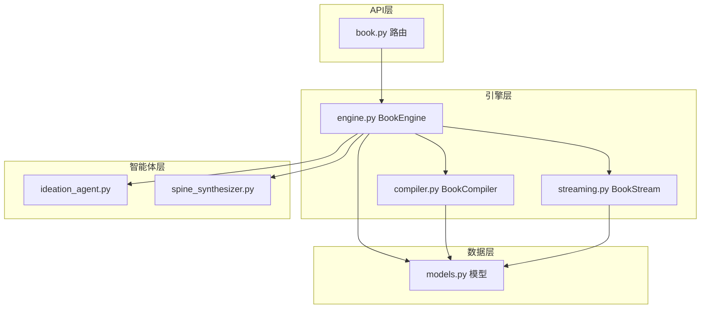
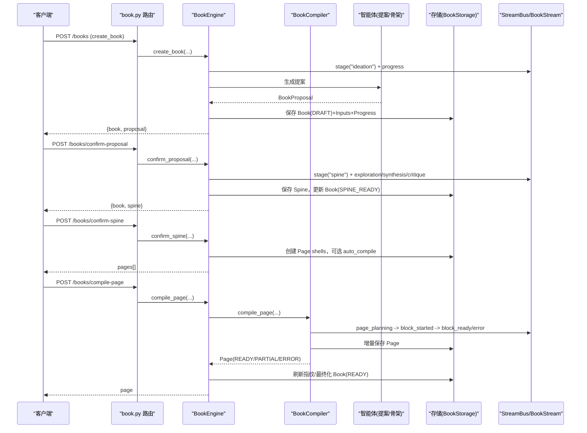
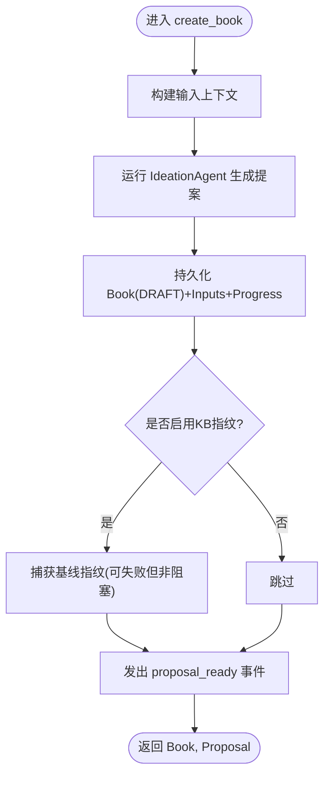
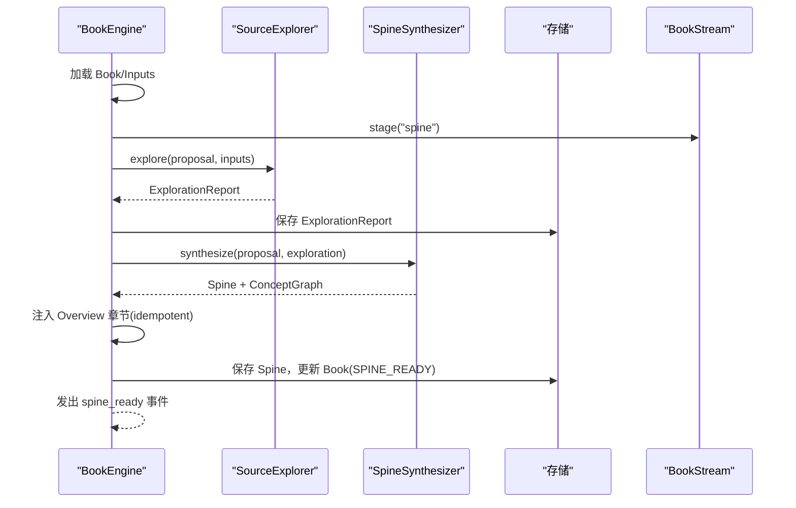
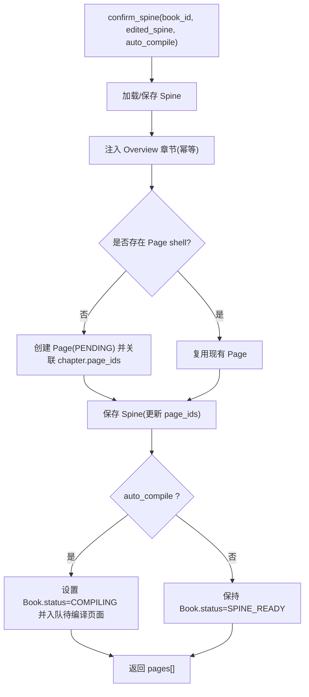
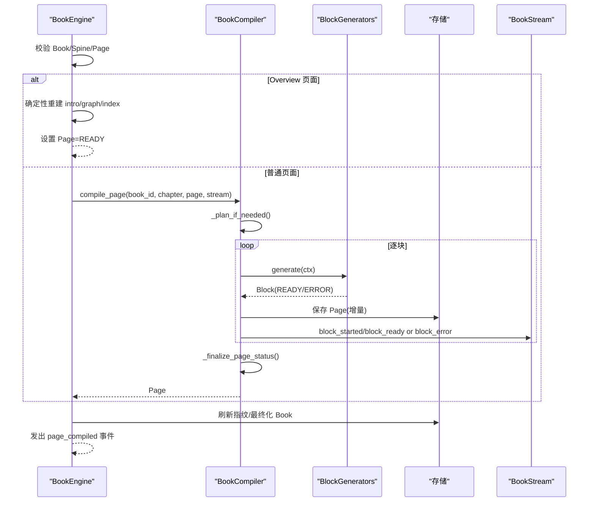
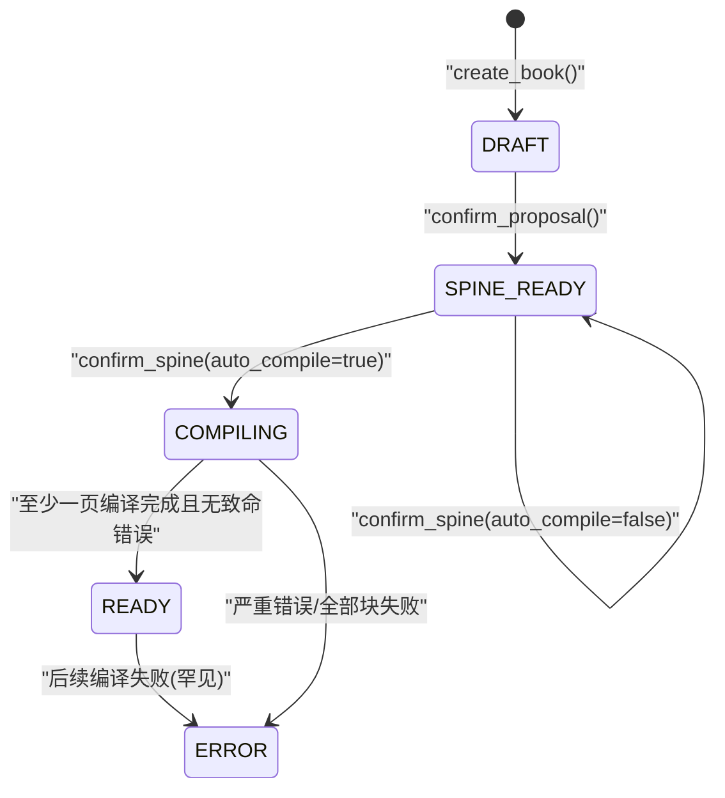
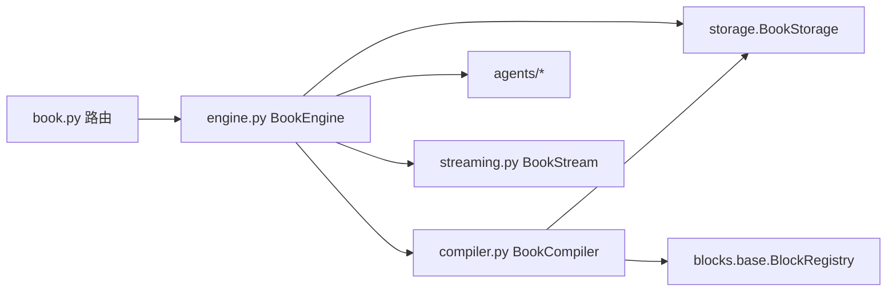

# 书籍生命周期管理

<cite>
**本文引用的文件**
- [engine.py](file://deeptutor/book/engine.py)
- [models.py](file://deeptutor/book/models.py)
- [compiler.py](file://deeptutor/book/compiler.py)
- [book.py](file://deeptutor/api/routers/book.py)
- [streaming.py](file://deeptutor/book/streaming.py)
- [ideation_agent.py](file://deeptutor/book/agents/ideation_agent.py)
- [spine_synthesizer.py](file://deeptutor/book/agents/spine_synthesizer.py)
</cite>

## 目录
1. [简介](#简介)
2. [项目结构](#项目结构)
3. [核心组件](#核心组件)
4. [架构总览](#架构总览)
5. [详细组件分析](#详细组件分析)
6. [依赖关系分析](#依赖关系分析)
7. [性能考量](#性能考量)
8. [故障排查指南](#故障排查指南)
9. [结论](#结论)
10. [附录：API调用示例与最佳实践](#附录api调用示例与最佳实践)

## 简介
本文件系统性说明 DeepTutor 书籍引擎的生命周期，围绕 BookEngine 的四个关键阶段展开：
- create_book()：创建书籍提案（Stage 1）
- confirm_proposal()：确认提案并生成章节大纲（Stage 2）
- confirm_spine()：确认章节结构并创建页面模板（Stage 3）
- compile_page()：编译单个页面的各个阶段（Stage 3-4）

文档同时覆盖书籍状态转换（DRAFT → SPINE_READY → COMPILING → READY）、错误处理机制、流式事件输出、以及完整的 API 调用示例与最佳实践。

## 项目结构
书籍引擎位于 deeptutor/book 模块，核心由以下文件组成：
- engine.py：BookEngine 编排器，负责生命周期调度、队列与后台编译
- models.py：数据模型（Book、Spine、Page、Block、状态枚举等）
- compiler.py：BookCompiler，驱动单页块级生成与聚合状态
- streaming.py：BookStream 封装，统一事件来源与阶段标记
- agents/ideation_agent.py：Stage 1 提案生成
- agents/spine_synthesizer.py：Stage 2 章节骨架与概念图合成
- api/routers/book.py：REST + WebSocket 接口，暴露生命周期操作

图表来源
- [engine.py:100-116](file://deeptutor/book/engine.py#L100-L116)
- [compiler.py:69-84](file://deeptutor/book/compiler.py#L69-L84)
- [streaming.py:33-42](file://deeptutor/book/streaming.py#L33-L42)
- [ideation_agent.py:20-45](file://deeptutor/book/agents/ideation_agent.py#L20-L45)
- [spine_synthesizer.py:82-121](file://deeptutor/book/agents/spine_synthesizer.py#L82-L121)
- [models.py:29-45](file://deeptutor/book/models.py#L29-L45)

章节来源
- [engine.py:1-116](file://deeptutor/book/engine.py#L1-L116)
- [compiler.py:1-84](file://deeptutor/book/compiler.py#L1-L84)
- [streaming.py:1-42](file://deeptutor/book/streaming.py#L1-L42)
- [models.py:1-45](file://deeptutor/book/models.py#L1-L45)

## 核心组件
- BookEngine：进程级编排器，维护每本书的运行态（队列、任务、锁），协调各阶段执行与持久化
- BookCompiler：按页驱动的块生成流水线，支持顺序或并发生成、增量持久化、桥接文本附加、状态聚合
- BookStream：基于 StreamBus 的流式事件包装，固定 source="book_engine"，提供 stage 上下文与 book_event
- 数据模型：BookStatus/PageStatus/BlockStatus 等状态机；Book/Spine/Page/Block 等实体
- 智能体：IdeationAgent（提案）、SpineSynthesizer（章节骨架+概念图）

章节来源
- [engine.py:100-116](file://deeptutor/book/engine.py#L100-L116)
- [compiler.py:69-84](file://deeptutor/book/compiler.py#L69-L84)
- [streaming.py:33-42](file://deeptutor/book/streaming.py#L33-L42)
- [models.py:29-45](file://deeptutor/book/models.py#L29-L45)

## 架构总览
下图展示从 API 到引擎再到存储与智能体的端到端流程，包括流式事件通道。

图表来源
- [book.py:198-282](file://deeptutor/api/routers/book.py#L198-L282)
- [engine.py:200-273](file://deeptutor/book/engine.py#L200-L273)
- [engine.py:281-394](file://deeptutor/book/engine.py#L281-L394)
- [engine.py:582-645](file://deeptutor/book/engine.py#L582-L645)
- [engine.py:699-769](file://deeptutor/book/engine.py#L699-L769)
- [compiler.py:88-190](file://deeptutor/book/compiler.py#L88-L190)
- [streaming.py:33-118](file://deeptutor/book/streaming.py#L33-L118)

## 详细组件分析

### 阶段一：create_book() 创建书籍提案
- 输入参数
  - user_intent：用户意图描述
  - chat_session_id/chat_selections/notebook_refs/knowledge_bases/question_categories/question_entries/language：多源输入快照
  - stream：可选的 StreamBus 用于实时进度
- 处理逻辑
  - 构建 IdeationContext 并运行 IdeationAgent 生成 BookProposal
  - 创建 Book（status=DRAFT），保存 Inputs、Progress，记录日志
  - 捕获知识库基线指纹（用于后续漂移检测）
  - 通过 BookStream 发出 proposal_ready 事件
- 输出结果
  - 返回 (Book, BookProposal)，Book.status = DRAFT
- 错误处理
  - 若 LLM 或输入构建失败，抛出异常并由上层路由转为 HTTP 500
  - 基线指纹捕获失败会被静默记录调试日志，不影响主流程

图表来源
- [engine.py:200-273](file://deeptutor/book/engine.py#L200-L273)
- [ideation_agent.py:41-85](file://deeptutor/book/agents/ideation_agent.py#L41-L85)
- [models.py:143-176](file://deeptutor/book/models.py#L143-L176)

章节来源
- [engine.py:200-273](file://deeptutor/book/engine.py#L200-L273)
- [ideation_agent.py:20-97](file://deeptutor/book/agents/ideation_agent.py#L20-L97)
- [models.py:143-176](file://deeptutor/book/models.py#L143-L176)

### 阶段二：confirm_proposal() 确认提案并生成章节大纲
- 输入参数
  - book_id：目标书籍ID
  - edited_proposal：可选的用户编辑后的提案
  - stream：可选的 StreamBus
- 处理逻辑
  - 加载 Book，必要时合并 edited_proposal
  - 子阶段1：SourceExplorer 并行探索多源（KB/笔记/问答等），产出 ExplorationReport 并持久化
  - 子阶段2：SpineSynthesizer 进行 Draft→Critique→Revise 多轮推理，生成 Spine 与 ConceptGraph
  - 注入 Overview 章节（idempotent），更新 Book.chapter_count，设置 Book.status=SPINE_READY
  - 发出 spine_round、exploration_ready、spine_ready 等事件
- 输出结果
  - 返回 (Book, Spine)，Book.status = SPINE_READY
- 错误处理
  - SourceExplorer 失败会降级为仅基于提案生成骨架，不阻断流程
  - LLM 调用失败时，返回最近一次有效草稿或最小回退

图表来源
- [engine.py:281-394](file://deeptutor/book/engine.py#L281-L394)
- [spine_synthesizer.py:114-174](file://deeptutor/book/agents/spine_synthesizer.py#L114-L174)
- [streaming.py:20-31](file://deeptutor/book/streaming.py#L20-L31)

章节来源
- [engine.py:281-394](file://deeptutor/book/engine.py#L281-L394)
- [spine_synthesizer.py:82-329](file://deeptutor/book/agents/spine_synthesizer.py#L82-L329)
- [models.py:193-273](file://deeptutor/book/models.py#L193-L273)

### 阶段三：confirm_spine() 确认章节结构并创建页面模板
- 输入参数
  - book_id：目标书籍ID
  - edited_spine：可选的用户编辑后的 Spine
  - auto_compile：是否自动开始后台编译
  - stream：可选的 StreamBus
- 处理逻辑
  - 加载/校验 Spine，必要时保存编辑后的版本
  - 注入 Overview 章节（idempotent），确保其 page 已存在且内容确定性渲染
  - 遍历 Spine.chapters，为每个 chapter 创建 Page shell（status=PENDING），建立 page_ids 映射
  - 根据 auto_compile 决定 Book.status：COMPILING 或保持 SPINE_READY
  - 将未完成页面入队，启动后台 worker 串行处理
- 输出结果
  - 返回 pages[]（所有页面壳）
- 错误处理
  - 缺失 Book/Spine 抛 ValueError，路由层转为 404

图表来源
- [engine.py:582-645](file://deeptutor/book/engine.py#L582-L645)
- [engine.py:773-800](file://deeptutor/book/engine.py#L773-L800)

章节来源
- [engine.py:582-645](file://deeptutor/book/engine.py#L582-L645)
- [engine.py:773-800](file://deeptutor/book/engine.py#L773-L800)

### 阶段四：compile_page() 编译单个页面
- 输入参数
  - book_id/page_id：目标书籍与页面
  - force：是否强制重置并重编译
  - stream：可选的 StreamBus
- 处理逻辑
  - 校验 Book/Spine/Page 存在性
  - 若 Page 已是 READY 且非 force，直接返回
  - 针对 Overview 类型页面：以确定性方式重建 intro/graph/index 块，不走通用 LLM 编译器
  - 对于普通页面：
    - 若 force=True，重置块输出（保留用户笔记与特定元数据）
    - 调用 BookCompiler.compile_page：
      - 规划阶段：SectionArchitect 生成 blocks（若无）
      - 生成阶段：逐个块调用对应 BlockGenerator，支持顺序或并发
      - 增量持久化：每块完成后保存 Page
      - 桥接文本：为相邻块生成过渡段落
      - 状态聚合：根据块就绪情况汇总 Page.status（READY/PARTIAL/ERROR）
  - 成功后刷新 KB 指纹（首次 READY 页面触发）
  - 最终化 Book（可能变为 READY）
- 输出结果
  - 返回 Page（含 blocks 与 status）
- 错误处理
  - 缺失资源抛 ValueError（路由层 404）
  - 编译异常：标记 Page 为 ERROR，保留错误信息，继续向上抛出

图表来源
- [engine.py:699-769](file://deeptutor/book/engine.py#L699-L769)
- [compiler.py:88-190](file://deeptutor/book/compiler.py#L88-L190)
- [compiler.py:194-249](file://deeptutor/book/compiler.py#L194-L249)
- [compiler.py:305-344](file://deeptutor/book/compiler.py#L305-L344)
- [compiler.py:348-365](file://deeptutor/book/compiler.py#L348-L365)

章节来源
- [engine.py:699-769](file://deeptutor/book/engine.py#L699-L769)
- [compiler.py:88-190](file://deeptutor/book/compiler.py#L88-L190)
- [compiler.py:194-249](file://deeptutor/book/compiler.py#L194-L249)
- [compiler.py:305-365](file://deeptutor/book/compiler.py#L305-L365)

### 书籍状态转换与错误处理机制
- 状态定义
  - BookStatus：DRAFT → SPINE_READY → COMPILING → READY（也可进入 ERROR/ARCHIVED）
  - PageStatus：PENDING → PLANNING → GENERATING → READY/PARTIAL/ERROR
  - BlockStatus：PENDING → GENERATING → READY/ERROR/HIDDEN
- 转换规则
  - create_book：Book → DRAFT
  - confirm_proposal：Book → SPINE_READY
  - confirm_spine：若 auto_compile=True，Book → COMPILING；否则保持 SPINE_READY
  - compile_page：Page 逐步推进，最终聚合为 READY/PARTIAL/ERROR；成功时可能使 Book → READY
- 错误处理
  - 缺失资源：ValueError → 路由层 404
  - 外部服务异常：捕获并记录日志，尽量降级（如探索不可用则回退）
  - 页面错误：_mark_page_error 将 Page 置为 ERROR 并持久化，避免中断后台工作流

图表来源
- [models.py:29-45](file://deeptutor/book/models.py#L29-L45)
- [engine.py:236-273](file://deeptutor/book/engine.py#L236-L273)
- [engine.py:372-394](file://deeptutor/book/engine.py#L372-L394)
- [engine.py:634-645](file://deeptutor/book/engine.py#L634-L645)
- [compiler.py:348-365](file://deeptutor/book/compiler.py#L348-L365)

章节来源
- [models.py:29-45](file://deeptutor/book/models.py#L29-L45)
- [engine.py:236-273](file://deeptutor/book/engine.py#L236-L273)
- [engine.py:372-394](file://deeptutor/book/engine.py#L372-L394)
- [engine.py:634-645](file://deeptutor/book/engine.py#L634-L645)
- [compiler.py:348-365](file://deeptutor/book/compiler.py#L348-L365)

## 依赖关系分析
- BookEngine 依赖：
  - storage：BookStorage 持久化 Book/Spine/Page/Progress/Inputs
  - compiler：BookCompiler 驱动块生成
  - agents：IdeationAgent、SpineSynthesizer
  - streaming：BookStream 统一事件
- BookCompiler 依赖：
  - SectionArchitect（page planner）
  - BlockRegistry（块生成器注册表）
  - storage：增量保存 Page
  - streaming：细粒度事件
- API 路由依赖：
  - 解析请求体，调用 BookEngine，捕获异常并转换为 HTTP 响应
  - WebSocket 订阅 StreamBus，转发 book_engine 事件

图表来源
- [book.py:198-282](file://deeptutor/api/routers/book.py#L198-L282)
- [engine.py:100-116](file://deeptutor/book/engine.py#L100-L116)
- [compiler.py:69-84](file://deeptutor/book/compiler.py#L69-L84)

章节来源
- [book.py:198-282](file://deeptutor/api/routers/book.py#L198-L282)
- [engine.py:100-116](file://deeptutor/book/engine.py#L100-L116)
- [compiler.py:69-84](file://deeptutor/book/compiler.py#L69-L84)

## 性能考量
- 后台队列与优先级
  - 每本书一个 asyncio.Queue，优先处理当前打开页面，其余后台串行 worker 处理
- 并发控制
  - BookCompiler 支持 block_concurrency > 1 的并发生成，Phase 1 默认顺序以保证流式顺序
- 增量持久化
  - persist_after_each_block=True，每块完成后立即落盘，提高容错与恢复能力
- 确定性 Overview 页面
  - 无需 LLM，快速渲染概念图与索引，减少首屏等待
- 指纹刷新
  - 首次 READY 页面后刷新 KB 指纹，降低误报漂移告警

[本节为通用指导，不直接分析具体文件]

## 故障排查指南
- 常见错误定位
  - 404：Book/Spine/Page 不存在，检查 book_id/page_id 是否正确
  - 500：LLM/外部服务异常，查看日志中 confirm_proposal/compile_page 的错误堆栈
  - Page 状态为 PARTIAL/ERROR：检查对应块的 error 字段与 payload_keys，定位失败块
- 恢复策略
  - force=True 重编译：重置块输出（保留用户笔记），重新走生成流程
  - rebuild_book：清空页面并基于确认的 Spine 重建，适合大规模重构
- 诊断工具
  - /books/{book_id}/health：返回 KB 漂移报告与日志健康信息
  - /books/{book_id}/refresh-fingerprints：手动刷新指纹，解决误报问题

章节来源
- [book.py:415-429](file://deeptutor/api/routers/book.py#L415-L429)
- [engine.py:177-196](file://deeptutor/book/engine.py#L177-L196)
- [engine.py:647-695](file://deeptutor/book/engine.py#L647-L695)
- [compiler.py:348-365](file://deeptutor/book/compiler.py#L348-L365)

## 结论
DeepTutor 书籍引擎通过清晰的分阶段生命周期设计，实现了从创意到成品的自动化生产管线。BookEngine 作为编排中枢，结合 BookCompiler 的细粒度块生成与 BookStream 的实时事件输出，提供了高内聚、低耦合、可扩展的书籍构建体验。配合健壮的状态机与错误处理机制，系统能够在复杂外部依赖下保持稳定与可恢复。

[本节为总结，不直接分析具体文件]

## 附录：API调用示例与最佳实践

### REST 接口概览
- POST /books：创建书籍提案（Stage 1）
- POST /books/confirm-proposal：确认提案并生成章节（Stage 2）
- POST /books/confirm-spine：确认章节并创建页面壳（Stage 3）
- POST /books/compile-page：编译指定页面（Stage 3-4）
- GET /books/{book_id}：获取书籍、骨架、页面、进度
- DELETE /books/{book_id}：删除书籍
- GET /books/{book_id}/health：健康检查（KB 漂移、日志健康）
- POST /books/{book_id}/refresh-fingerprints：刷新指纹

章节来源
- [book.py:143-195](file://deeptutor/api/routers/book.py#L143-L195)
- [book.py:198-282](file://deeptutor/api/routers/book.py#L198-L282)
- [book.py:415-429](file://deeptutor/api/routers/book.py#L415-L429)

### WebSocket 流式协议
- 连接 /ws，发送消息类型：
  - create：创建书籍（同 REST 参数）
  - confirm_proposal：确认提案
  - confirm_spine：确认章节
  - compile_page：编译页面
  - regenerate_block：重生成块
- 服务端推送事件包含 type/source/stage/content/metadata，前端据此更新 UI

章节来源
- [book.py:490-670](file://deeptutor/api/routers/book.py#L490-L670)
- [streaming.py:33-118](file://deeptutor/book/streaming.py#L33-L118)

### 最佳实践
- 分阶段确认：先确认提案再确认章节，便于人工干预与调整
- 使用 auto_compile=false 预览章节结构，再按需开启后台编译
- 对 Overview 页面无需强制重编译，系统会确定性重建
- 利用 health 与 refresh-fingerprints 监控知识库漂移
- 遇到部分失败时，优先定位错误块并针对性重生成

[本节为通用指导，不直接分析具体文件]