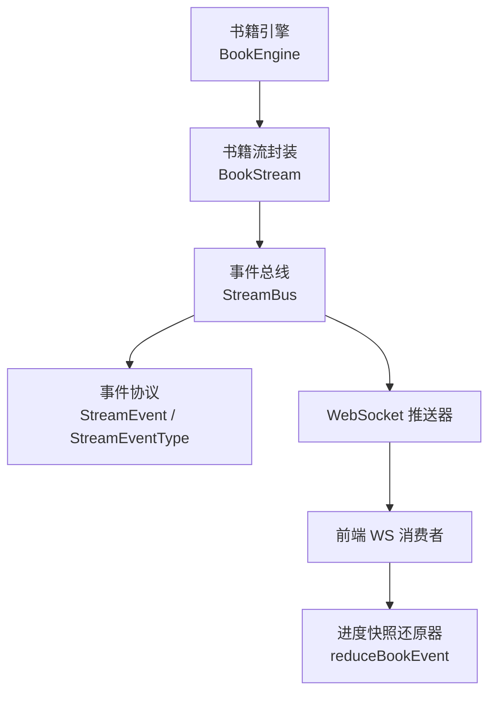
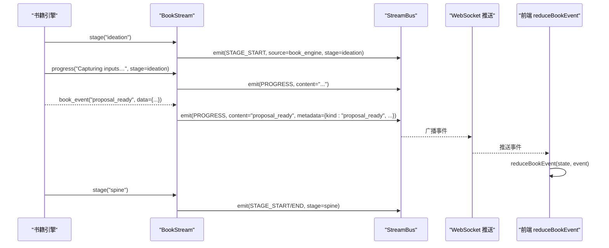
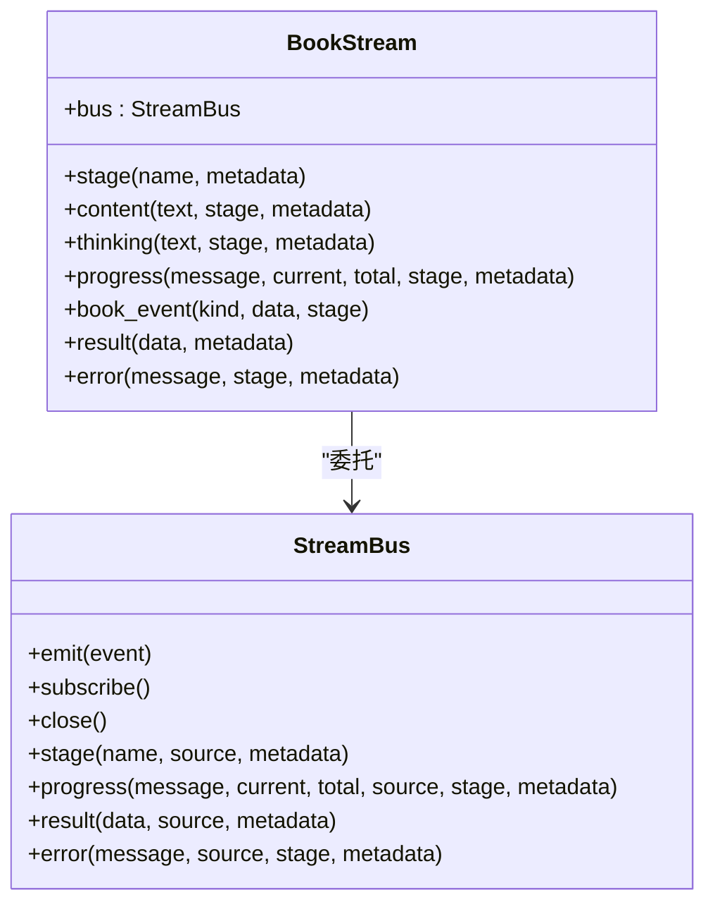
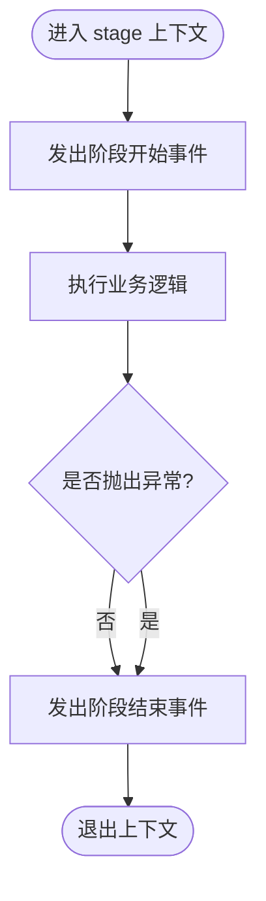
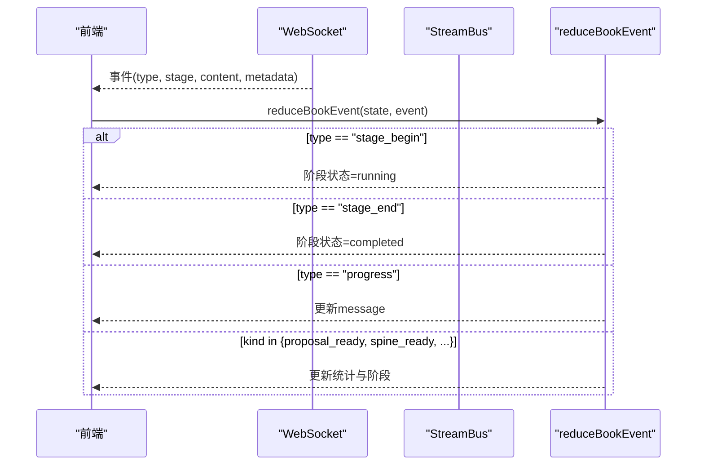
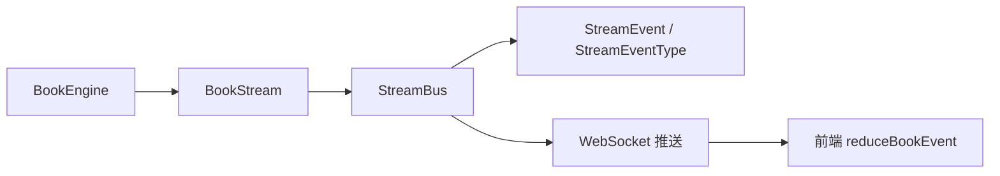

# 流式进度更新

<cite>
**本文引用的文件**
- [deeptutor/core/stream.py](file://deeptutor/core/stream.py)
- [deeptutor/core/stream_bus.py](file://deeptutor/core/stream_bus.py)
- [deeptutor/book/streaming.py](file://deeptutor/book/streaming.py)
- [deeptutor/book/engine.py](file://deeptutor/book/engine.py)
- [web/lib/book-progress.ts](file://web/lib/book-progress.ts)
</cite>

## 目录
1. [简介](#简介)
2. [项目结构](#项目结构)
3. [核心组件](#核心组件)
4. [架构总览](#架构总览)
5. [详细组件分析](#详细组件分析)
6. [依赖关系分析](#依赖关系分析)
7. [性能考虑](#性能考虑)
8. [故障排查指南](#故障排查指南)
9. [结论](#结论)
10. [附录](#附录)

## 简介
本文件面向DeepTutor的“流式进度更新系统”，聚焦BookStream如何封装底层StreamBus，为书籍生成管线提供统一的进度报告接口。文档解释各编译阶段常量（如STAGE_IDEATION、STAGE_SPINE、STAGE_COMPILATION等）的使用场景，说明progress()与book_event()的推送语义，以及stage上下文管理器如何自动处理阶段的开始与结束事件。同时给出WebSocket集成方式与前端接收处理的实现要点，帮助读者从后端到前端完整理解进度上报链路。

## 项目结构
- 后端核心：
  - 统一事件协议定义在stream模块中，包含事件类型枚举和事件数据结构。
  - StreamBus提供异步事件总线能力，支持订阅/发布、回放历史、阶段上下文管理、进度与结果推送等。
  - BookStream是面向“书籍引擎”的高层封装，固定source为book_engine，并暴露book_event用于发送特定业务事件。
  - BookEngine在关键流程中使用BookStream.stage包裹各个阶段，并通过progress与book_event推进状态。
- 前端消费：
  - 前端通过统一WS通道接收事件，使用book-progress中的reducer将原始事件转换为可渲染的进度快照，驱动UI展示。

图表来源
- [deeptutor/book/engine.py:200-320](file://deeptutor/book/engine.py#L200-L320)
- [deeptutor/book/streaming.py:33-118](file://deeptutor/book/streaming.py#L33-L118)
- [deeptutor/core/stream_bus.py:31-104](file://deeptutor/core/stream_bus.py#L31-L104)
- [deeptutor/core/stream.py:17-35](file://deeptutor/core/stream.py#L17-L35)
- [web/lib/book-progress.ts:191-421](file://web/lib/book-progress.ts#L191-L421)

章节来源
- [deeptutor/core/stream.py:17-73](file://deeptutor/core/stream.py#L17-L73)
- [deeptutor/core/stream_bus.py:31-104](file://deeptutor/core/stream_bus.py#L31-L104)
- [deeptutor/book/streaming.py:20-135](file://deeptutor/book/streaming.py#L20-L135)
- [deeptutor/book/engine.py:200-320](file://deeptutor/book/engine.py#L200-L320)
- [web/lib/book-progress.ts:17-421](file://web/lib/book-progress.ts#L17-L421)

## 核心组件
- 事件协议（StreamEvent / StreamEventType）
  - 定义了所有流式事件的类型，包括阶段开始/结束、思考、观察、内容、工具调用/结果、进度、来源、结果、错误、会话、完成、等待输入等。
  - 每个事件携带source、stage、content、metadata、时间戳等字段，便于前后端一致解析。
- 事件总线（StreamBus）
  - 提供emit、subscribe、close等基础能力，维护历史事件以便新订阅者回放。
  - 提供便捷方法：content、thinking、observation、tool_call、tool_result、progress、sources、result、error、wait_for_input等。
  - 提供stage上下文管理器，自动在块前后发出阶段开始/结束事件。
- 书籍流封装（BookStream）
  - 固定source为book_engine，简化上层调用。
  - 暴露book_event用于发送“书籍领域”的特定事件，前端通过metadata.kind区分不同业务节点。
  - 复用stage上下文管理器，确保阶段边界清晰。
- 书籍引擎（BookEngine）
  - 在创建提案、大纲合成、页面规划与编译等阶段，使用BookStream.stage包裹执行逻辑，并通过progress与book_event推送进度。
  - 使用阶段常量标识当前子任务，便于前端按阶段组织UI。

章节来源
- [deeptutor/core/stream.py:17-73](file://deeptutor/core/stream.py#L17-L73)
- [deeptutor/core/stream_bus.py:31-104](file://deeptutor/core/stream_bus.py#L31-L104)
- [deeptutor/book/streaming.py:33-118](file://deeptutor/book/streaming.py#L33-L118)
- [deeptutor/book/engine.py:200-320](file://deeptutor/book/engine.py#L200-L320)

## 架构总览
下图展示了从书籍引擎到前端的端到端数据流：引擎通过BookStream.stage标记阶段边界，通过progress与book_event推送进度；后端通过StreamBus广播事件；前端WS接收后由reducer转换为进度快照，驱动UI。

图表来源
- [deeptutor/book/engine.py:200-320](file://deeptutor/book/engine.py#L200-L320)
- [deeptutor/book/streaming.py:33-118](file://deeptutor/book/streaming.py#L33-L118)
- [deeptutor/core/stream_bus.py:31-104](file://deeptutor/core/stream_bus.py#L31-L104)
- [web/lib/book-progress.ts:191-421](file://web/lib/book-progress.ts#L191-L421)

## 详细组件分析

### BookStream：统一进度报告接口
- 作用
  - 固定source为book_engine，屏蔽底层细节，使上层代码只需关注业务语义。
  - 提供stage上下文管理器，自动在块前后发出阶段开始/结束事件。
  - 提供progress与book_event两种主要进度上报方式：
    - progress：通用进度消息，适合“正在做什么”的提示。
    - book_event：书籍领域专用事件，通过metadata.kind区分具体业务节点（如proposal_ready、spine_ready、page_planned、block_ready、compilation_complete等）。
- 关键点
  - 所有方法均透传到StreamBus，保持单一职责与可扩展性。
  - 对stage上下文的管理，保证阶段边界严格成对出现，避免前端状态不一致。

图表来源
- [deeptutor/core/stream_bus.py:31-104](file://deeptutor/core/stream_bus.py#L31-L104)
- [deeptutor/book/streaming.py:33-118](file://deeptutor/book/streaming.py#L33-L118)

章节来源
- [deeptutor/book/streaming.py:33-118](file://deeptutor/book/streaming.py#L33-L118)
- [deeptutor/core/stream_bus.py:31-104](file://deeptutor/core/stream_bus.py#L31-L104)

### 阶段常量与使用场景
- 阶段常量定义于书籍流模块，涵盖从创意到编译的全流程：
  - STAGE_IDEATION：创意阶段，生成书籍提案。
  - STAGE_EXPLORATION：资料探索阶段，并行检索知识库。
  - STAGE_SYNTHESIS：综合阶段，构建大纲与概念图（草稿→修订）。
  - STAGE_CRITIQUE：审校阶段，多轮自我审查以收紧大纲。
  - STAGE_OVERVIEW：概览章节，自动生成目录与概念图。
  - STAGE_SPINE：大纲阶段的外层包装，聚合synthesis与critique。
  - STAGE_PAGE_PLAN：页面规划阶段。
  - STAGE_COMPILATION：编译阶段，逐页生成内容块。
  - STAGE_BLOCK：块级粒度。
  - STAGE_INTERACTION：交互阶段。
- 使用方式
  - 在BookEngine的关键步骤中，使用BookStream.stage包裹对应逻辑，并在阶段内调用progress或book_event进行细粒度汇报。
  - 前端根据stage_begin/stage_end与book_event的kind来驱动阶段状态机。

章节来源
- [deeptutor/book/streaming.py:20-31](file://deeptutor/book/streaming.py#L20-L31)
- [deeptutor/book/engine.py:200-320](file://deeptutor/book/engine.py#L200-L320)

### progress()：推送进度消息
- 语义
  - 用于推送人类可读的进度提示，例如“正在捕获输入…”、“正在生成第X页”。
  - 支持current/total用于百分比显示，stage用于归属阶段，metadata可附加结构化信息。
- 典型用法
  - 在阶段内部循环或长耗时操作时周期性调用，保持前端“正在工作”的反馈。
- 前端处理
  - 前端将最新progress.content作为单行实时字幕更新，不影响阶段状态机。

章节来源
- [deeptutor/core/stream_bus.py:193-213](file://deeptutor/core/stream_bus.py#L193-L213)
- [deeptutor/book/streaming.py:60-75](file://deeptutor/book/streaming.py#L60-L75)
- [web/lib/book-progress.ts:222-225](file://web/lib/book-progress.ts#L222-L225)

### book_event()：发送特定事件通知
- 语义
  - 通过PROGRESS通道发送书籍领域专用事件，content为事件kind，metadata包含具体数据。
  - 常见kind包括：proposal_ready、spine_ready、page_planned、block_ready、block_error、page_ready、compilation_complete等。
- 前端处理
  - 前端根据kind分支更新阶段状态与统计信息，如启动/完成某个阶段、累计查询次数、章节数、概念节点/边数、页面/块计数等。
- 示例路径
  - 前端reducer中对各类kind的处理逻辑位于进度快照还原器中。

章节来源
- [deeptutor/book/streaming.py:94-118](file://deeptutor/book/streaming.py#L94-L118)
- [web/lib/book-progress.ts:227-401](file://web/lib/book-progress.ts#L227-L401)

### stage上下文管理器：自动处理阶段开始与结束
- 行为
  - 进入上下文时发出阶段开始事件，退出时发出阶段结束事件，无论是否发生异常都会确保结束事件被发送。
  - 支持传入source与metadata，BookStream已固定source为book_engine。
- 优势
  - 避免遗漏阶段边界事件，保证前端状态机一致性。
  - 简化调用方代码，无需手动管理begin/end。

图表来源
- [deeptutor/core/stream_bus.py:78-104](file://deeptutor/core/stream_bus.py#L78-L104)
- [deeptutor/book/streaming.py:39-42](file://deeptutor/book/streaming.py#L39-L42)

章节来源
- [deeptutor/core/stream_bus.py:78-104](file://deeptutor/core/stream_bus.py#L78-L104)
- [deeptutor/book/streaming.py:39-42](file://deeptutor/book/streaming.py#L39-L42)

### WebSocket集成与前端接收处理
- 后端侧
  - 所有事件通过StreamBus.emit广播，由WebSocket路由转发给客户端。
  - 事件包含type、source、stage、content、metadata等字段，便于前端统一解析。
- 前端侧
  - 通过统一WS通道接收事件，调用reduceBookEvent将事件转换为BookProgress快照。
  - 阶段状态机：
    - stage_begin → 启动阶段（running），若之前阶段仍pending/running则补齐为completed。
    - stage_end → 完成阶段（completed）。
    - error → 将当前运行阶段标记为error。
  - 业务事件：
    - proposal_ready、spine_ready、page_planned、block_ready、page_ready、compilation_complete等会更新相应统计与消息。
- 可视化
  - 前端将阶段顺序、标签、描述与状态渲染为时间线，并提供单行实时消息。

图表来源
- [web/lib/book-progress.ts:191-421](file://web/lib/book-progress.ts#L191-L421)
- [deeptutor/core/stream_bus.py:31-104](file://deeptutor/core/stream_bus.py#L31-L104)

章节来源
- [web/lib/book-progress.ts:17-421](file://web/lib/book-progress.ts#L17-L421)
- [deeptutor/core/stream_bus.py:31-104](file://deeptutor/core/stream_bus.py#L31-L104)

## 依赖关系分析
- 耦合与内聚
  - BookStream仅依赖StreamBus与事件协议，职责单一，内聚度高。
  - BookEngine通过BookStream与外部WS解耦，便于测试与替换传输层。
- 直接依赖
  - BookStream → StreamBus、StreamEvent/StreamEventType
  - BookEngine → BookStream、阶段常量
  - 前端 → reduceBookEvent、事件协议约定
- 间接依赖
  - 事件经由WS路由分发至前端，形成跨进程通信链。

图表来源
- [deeptutor/book/engine.py:200-320](file://deeptutor/book/engine.py#L200-L320)
- [deeptutor/book/streaming.py:33-118](file://deeptutor/book/streaming.py#L33-L118)
- [deeptutor/core/stream_bus.py:31-104](file://deeptutor/core/stream_bus.py#L31-L104)
- [web/lib/book-progress.ts:191-421](file://web/lib/book-progress.ts#L191-L421)

章节来源
- [deeptutor/book/engine.py:200-320](file://deeptutor/book/engine.py#L200-L320)
- [deeptutor/book/streaming.py:33-118](file://deeptutor/book/streaming.py#L33-L118)
- [deeptutor/core/stream_bus.py:31-104](file://deeptutor/core/stream_bus.py#L31-L104)
- [web/lib/book-progress.ts:191-421](file://web/lib/book-progress.ts#L191-L421)

## 性能考虑
- 事件回放
  - StreamBus维护历史事件，新订阅者可快速回放，减少重放成本。
- 批量与节流
  - 建议在高频率进度更新时在前端做节流合并，避免UI频繁重绘。
- 阶段边界
  - 使用stage上下文确保阶段成对出现，降低前端状态修复成本。
- 元数据大小
  - metadata应尽量精简，避免过大负载影响WS吞吐。

[本节为通用指导，不直接分析具体文件]

## 故障排查指南
- 阶段未闭合
  - 现象：前端某阶段始终处于running。
  - 排查：确认是否使用了stage上下文，或在异常路径补发阶段结束事件。
- 进度不更新
  - 现象：前端message不变化。
  - 排查：检查是否调用了progress，且content非空；确认WS通道正常。
- 业务事件缺失
  - 现象：如spine_ready未触发。
  - 排查：确认book_event的kind是否正确，前端reducer分支是否匹配。
- 错误处理
  - 现象：阶段被标记为error。
  - 排查：查看error事件的content与metadata，定位上游错误源。

章节来源
- [deeptutor/core/stream_bus.py:245-260](file://deeptutor/core/stream_bus.py#L245-L260)
- [web/lib/book-progress.ts:407-418](file://web/lib/book-progress.ts#L407-L418)

## 结论
BookStream以简洁的API封装了StreamBus，为书籍引擎提供了稳定的进度上报能力。通过stage上下文、progress与book_event的配合，后端能够清晰表达阶段边界与业务节点，前端通过reducer将事件转化为直观的进度快照。该设计具备良好的扩展性与可维护性，适用于复杂的多阶段生成任务。

## 附录
- 阶段常量速查
  - ideation：创意阶段
  - exploration：资料探索
  - synthesis：综合阶段
  - critique：审校阶段
  - overview：概览章节
  - spine：大纲外层包装
  - page_plan：页面规划
  - compilation：编译阶段
  - block：块级粒度
  - interaction：交互阶段
- 常用book_event的kind
  - proposal_ready、spine_ready、page_planned、block_ready、block_error、page_ready、compilation_complete等

[本节为概念性汇总，不直接分析具体文件]