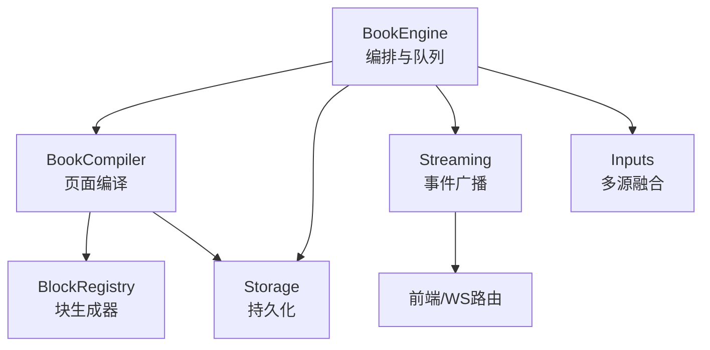
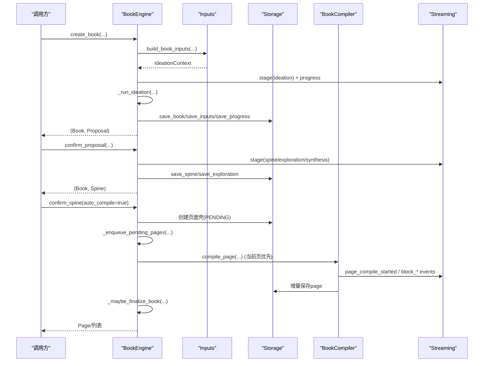
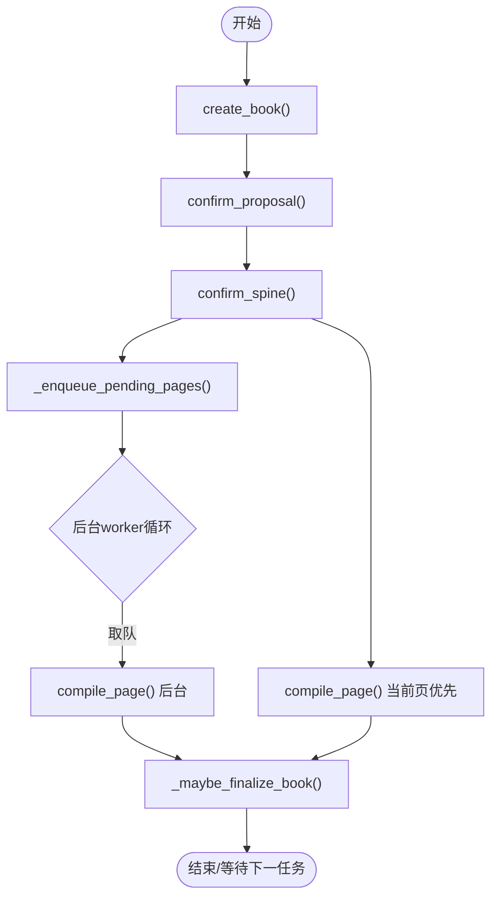
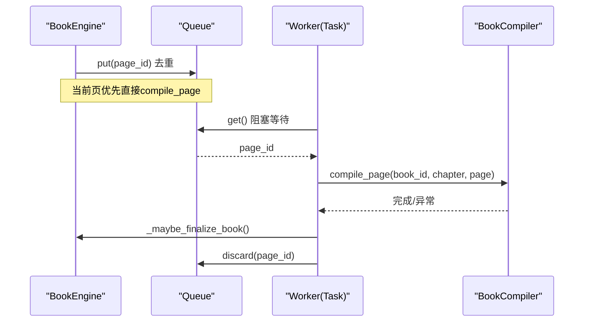
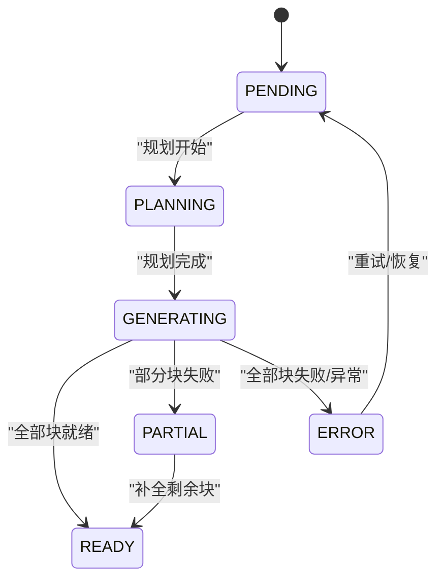
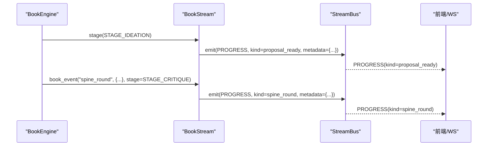
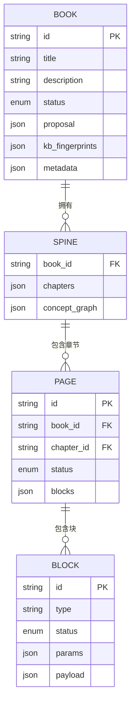
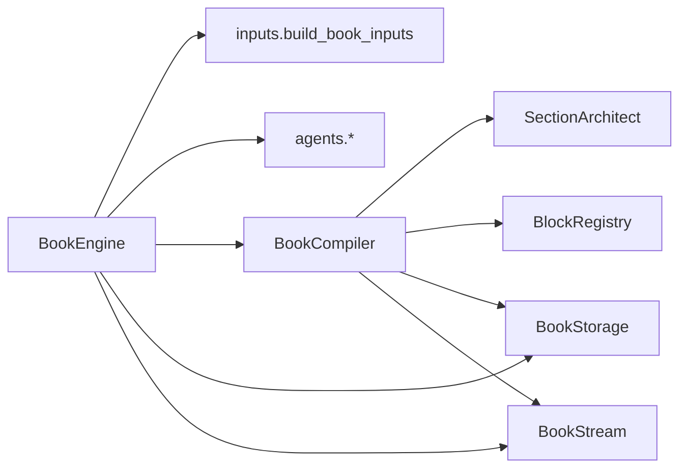

# 编译系统

<cite>
**本文引用的文件**
- [engine.py](file://deeptutor/book/engine.py)
- [compiler.py](file://deeptutor/book/compiler.py)
- [models.py](file://deeptutor/book/models.py)
- [inputs.py](file://deeptutor/book/inputs.py)
- [streaming.py](file://deeptutor/book/streaming.py)
- [storage.py](file://deeptutor/book/storage.py)
</cite>

## 目录
1. [简介](#简介)
2. [项目结构](#项目结构)
3. [核心组件](#核心组件)
4. [架构总览](#架构总览)
5. [详细组件分析](#详细组件分析)
6. [依赖关系分析](#依赖关系分析)
7. [性能与资源管理](#性能与资源管理)
8. [故障排查指南](#故障排查指南)
9. [结论](#结论)
10. [附录：API使用示例与最佳实践](#附录api使用示例与最佳实践)

## 简介
本文件面向DeepTutor书籍编译系统的后端实现，系统性说明BookEngine的完整生命周期、编译队列机制（优先级调度、后台工作进程与并发控制）、CompilerOptions配置项与阶段控制、页面状态管理与错误处理、流式进度更新与事件通知、以及性能优化策略与资源管理。文档同时提供端到端API使用示例与最佳实践，帮助读者快速上手并安全扩展。

## 项目结构
本书编译系统位于 deeptutor/book 目录下，核心由以下模块组成：
- engine.py：书籍编排器，负责创建书籍、确认提案、生成章节大纲、页面编译与后台队列调度。
- compiler.py：页面编译器，驱动“规划—生成—持久化”的块级流水线，支持并发与增量保存。
- models.py：数据模型定义（Book、Spine、Chapter、Page、Block、状态枚举等）。
- inputs.py：多源输入融合（用户意图、聊天记录、笔记本、知识基），产出IdeationContext供第一阶段使用。
- streaming.py：基于StreamBus的流式事件封装，统一source与阶段标记，对外广播进度与事件。
- storage.py：基于磁盘的原子写入存储层，按book_id组织目录与JSON文件。

图表来源
- [engine.py:100-116](file://deeptutor/book/engine.py#L100-L116)
- [compiler.py:69-84](file://deeptutor/book/compiler.py#L69-L84)
- [streaming.py:33-118](file://deeptutor/book/streaming.py#L33-L118)
- [storage.py:65-265](file://deeptutor/book/storage.py#L65-L265)

章节来源
- [engine.py:1-1298](file://deeptutor/book/engine.py#L1-L1298)
- [compiler.py:1-369](file://deeptutor/book/compiler.py#L1-L369)
- [models.py:1-475](file://deeptutor/book/models.py#L1-L475)
- [inputs.py:1-363](file://deeptutor/book/inputs.py#L1-L363)
- [streaming.py:1-135](file://deeptutor/book/streaming.py#L1-L135)
- [storage.py:1-265](file://deeptutor/book/storage.py#L1-L265)

## 核心组件
- BookEngine：进程内编排器，维护每本书的运行态（队列、任务、锁、默认流），暴露创建书籍、确认提案、确认大纲、编译页面、重建书籍、块CRUD、健康检查等接口。
- BookCompiler：页面级编译器，负责按需规划（SectionArchitect）与逐块生成（BlockGenerator），支持并发度控制、增量持久化、桥接文本附加与最终状态聚合。
- Storage：以book_id为根目录的JSON持久化，提供原子写入、增删改查、日志追加能力。
- Streaming：基于StreamBus的Book专用事件通道，统一stage/source，输出progress/result/error及自定义book_event。
- Models：定义书籍、章节、页面、块、探索报告、进度等数据结构与状态枚举。
- Inputs：将四类输入源合并为IdeationContext，支撑第一阶段创意生成。

章节来源
- [engine.py:100-116](file://deeptutor/book/engine.py#L100-L116)
- [compiler.py:45-84](file://deeptutor/book/compiler.py#L45-L84)
- [storage.py:65-265](file://deeptutor/book/storage.py#L65-L265)
- [streaming.py:33-118](file://deeptutor/book/streaming.py#L33-L118)
- [models.py:29-80](file://deeptutor/book/models.py#L29-L80)
- [inputs.py:36-77](file://deeptutor/book/inputs.py#L36-L77)

## 架构总览
BookEngine作为顶层入口，串联“创意—探索—综合—大纲—页面规划—块生成—持久化—事件广播”全链路；BookCompiler专注单页或批量页面的块级流水线；Storage保证数据一致性；Streaming提供实时反馈。

图表来源
- [engine.py:200-273](file://deeptutor/book/engine.py#L200-L273)
- [engine.py:281-394](file://deeptutor/book/engine.py#L281-L394)
- [engine.py:582-645](file://deeptutor/book/engine.py#L582-L645)
- [compiler.py:88-190](file://deeptutor/book/compiler.py#L88-L190)
- [streaming.py:33-118](file://deeptutor/book/streaming.py#L33-L118)

## 详细组件分析

### BookEngine 生命周期管理
- 创建书籍（Stage 1 创意）：收集四源输入，运行创意代理，持久化DRAFT书籍与提案，广播proposal_ready。
- 确认提案（Stage 2 大纲）：并行探索来源（SourceExplorer），合成Spine与概念图，分阶段广播spine_round/spine_ready。
- 确认大纲（Stage 2.5/3）：自动注入Overview章节（含概念图与章节索引），为每个章节创建PENDING页面壳；若auto_compile为真，则入队后台编译。
- 编译页面（Stage 3-4）：打开某页时立即编译该页（优先），Overview页走确定性渲染路径；非Overview页委托BookCompiler执行规划与块生成。
- 后台队列与工作进程：每本书一个asyncio.Queue与单worker任务；空闲时回收内存；失败时记录错误并允许重试。
- 维护与健康：KB漂移检测、指纹刷新、日志健康扫描、块级CRUD、深度子页生成、测验尝试记录与薄弱点补充。

图表来源
- [engine.py:200-273](file://deeptutor/book/engine.py#L200-L273)
- [engine.py:281-394](file://deeptutor/book/engine.py#L281-L394)
- [engine.py:582-645](file://deeptutor/book/engine.py#L582-L645)
- [engine.py:773-905](file://deeptutor/book/engine.py#L773-L905)

章节来源
- [engine.py:100-1298](file://deeptutor/book/engine.py#L100-L1298)

### 编译队列机制：优先级、后台工作进程与并发控制
- 优先级：当前打开的页面通过compile_page直接执行（最高优先级）；其余未完成页面进入per-book队列，由单一worker顺序消费。
- 队列与去重：运行时维护queued集合避免重复入队；worker每次从队列取一项，完成后清理。
- 工作进程生命周期：首次有任务时启动worker；当队列空且超时后释放资源并触发内存回收。
- 并发控制：单个页面内的块生成可通过CompilerOptions.block_concurrency控制；默认顺序以保证流式顺序稳定，后续阶段可提升并发。

图表来源
- [engine.py:773-905](file://deeptutor/book/engine.py#L773-L905)
- [compiler.py:133-166](file://deeptutor/book/compiler.py#L133-L166)

章节来源
- [engine.py:773-905](file://deeptutor/book/engine.py#L773-L905)
- [compiler.py:133-166](file://deeptutor/book/compiler.py#L133-L166)

### CompilerOptions 配置与阶段控制
- phase：控制生成范围（如Phase 1仅text/callout/quiz），影响SectionArchitect行为。
- rag_enabled：是否允许块生成器调用RAG工具。
- block_concurrency：单页内块生成的最大并发数；<=1时顺序执行，>1时使用Semaphore并发。
- persist_after_each_block：是否在每块完成后立即持久化，保障中断恢复与前端增量展示。
- architect_llm_enabled：是否允许SectionArchitect使用LLM进行规划。

章节来源
- [compiler.py:45-84](file://deeptutor/book/compiler.py#L45-L84)

### 页面状态管理与错误处理
- 页面状态：PENDING → PLANNING → GENERATING → READY/PARTIAL/ERROR；Overview页采用确定性渲染，不经过通用LLM编译。
- 块状态：PENDING → GENERATING → READY/ERROR/HIDDEN。
- 错误处理：
  - 编译异常时，将页面状态回退至ERROR并记录错误信息，便于重试与UI提示。
  - 后台worker捕获异常，记录日志并重置页面状态以便下次resume。
  - 强制重新编译会重置块输出但保留用户笔记与特定元数据。
- 最终状态聚合：根据块就绪/失败数量决定页面READY/PARTIAL/ERROR。

图表来源
- [models.py:29-52](file://deeptutor/book/models.py#L29-L52)
- [engine.py:177-196](file://deeptutor/book/engine.py#L177-L196)
- [engine.py:803-824](file://deeptutor/book/engine.py#L803-L824)
- [compiler.py:348-365](file://deeptutor/book/compiler.py#L348-L365)

章节来源
- [models.py:29-52](file://deeptutor/book/models.py#L29-L52)
- [engine.py:177-196](file://deeptutor/book/engine.py#L177-L196)
- [engine.py:803-824](file://deeptutor/book/engine.py#L803-L824)
- [compiler.py:348-365](file://deeptutor/book/compiler.py#L348-L365)

### 流式进度更新与事件通知系统
- 统一source="book_engine"，通过BookStream包装StreamBus，所有事件携带stage与metadata。
- 关键事件：
  - 阶段事件：ideation、exploration、synthesis、critique、overview、spine、page_plan、compilation、block。
  - 业务事件：proposal_ready、exploration_ready、spine_round、spine_ready、page_planned、block_ready/block_error、page_compiled等。
- 前端通过WebSocket订阅PROGRESS通道，按kind区分事件类型，实现实时进度条与步骤指示。

图表来源
- [streaming.py:33-118](file://deeptutor/book/streaming.py#L33-L118)
- [engine.py:263-271](file://deeptutor/book/engine.py#L263-L271)
- [engine.py:346-361](file://deeptutor/book/engine.py#L346-L361)

章节来源
- [streaming.py:33-118](file://deeptutor/book/streaming.py#L33-L118)
- [engine.py:263-271](file://deeptutor/book/engine.py#L263-L271)
- [engine.py:346-361](file://deeptutor/book/engine.py#L346-L361)

### 数据模型与存储布局
- 模型：Book、BookProposal、Spine、Chapter、ConceptGraph、ExplorationReport、Page、Block、Progress等。
- 存储：按book_id组织目录，包含manifest.json、spine.json、progress.json、inputs.json、log.md、pages/{page_id}.json与assets。
- 原子写入：所有JSON写操作通过原子写入确保崩溃一致性；读取失败时记录警告并返回None。

图表来源
- [models.py:165-447](file://deeptutor/book/models.py#L165-L447)
- [storage.py:7-18](file://deeptutor/book/storage.py#L7-L18)

章节来源
- [models.py:165-447](file://deeptutor/book/models.py#L165-L447)
- [storage.py:7-18](file://deeptutor/book/storage.py#L7-L18)

## 依赖关系分析
- BookEngine依赖：
  - inputs.build_book_inputs：多源输入融合。
  - agents.*：创意、来源探索、大纲合成。
  - compiler.BookCompiler：页面编译。
  - storage.BookStorage：持久化。
  - streaming.BookStream：事件广播。
- BookCompiler依赖：
  - agents.page_planner.SectionArchitect：页面规划。
  - blocks.base.BlockContext与BlockRegistry：块上下文与生成器注册表。
  - storage.BookStorage：增量持久化。
  - streaming.BookStream：细粒度事件。

图表来源
- [engine.py:41-74](file://deeptutor/book/engine.py#L41-L74)
- [compiler.py:28-40](file://deeptutor/book/compiler.py#L28-L40)

章节来源
- [engine.py:41-74](file://deeptutor/book/engine.py#L41-L74)
- [compiler.py:28-40](file://deeptutor/book/compiler.py#L28-L40)

## 性能与资源管理
- 并发控制：
  - 页面内块生成：通过block_concurrency调整；Phase 1建议顺序以保证流式顺序，后续阶段可提升并发。
  - 来源探索：在确认提案阶段并行探索多个来源，缩短总体时间。
- 增量持久化：persist_after_each_block开启后，每块完成后即落盘，降低中断损失并支持前端增量渲染。
- 内存回收：后台worker空闲时触发内存回收，避免长驻进程占用过多内存。
- 确定性渲染：Overview页跳过LLM，直接生成概念图与章节索引，减少不确定性与时延。
- RAG开关：rag_enabled可关闭块生成器的检索调用，降低外部依赖开销。
- 指纹与漂移：成功编译页面后刷新KB指纹，检测知识库漂移并标记陈旧页面，必要时触发重建。

[本节为通用性能讨论，不直接分析具体代码行]

## 故障排查指南
- 页面卡在PLANNING/GENERATING：
  - 检查是否有未捕获异常导致状态未回退；查看后台worker日志与错误记录。
  - 使用force重新编译或调用rebuild_book重置页面。
- 块生成失败：
  - 查看block_error事件的error字段与payload_keys，定位缺失参数或外部依赖问题。
  - 对特定块调用regenerate_block或change_block_type重试。
- 后台编译失败：
  - 检查background compile failed日志；确认页面状态已置为ERROR并可重试。
- 事件未到达前端：
  - 确认StreamBus与WebSocket路由正确连接；核对stage与kind是否正确。
- 存储异常：
  - 检查磁盘权限与路径服务；关注读写JSON时的警告日志。

章节来源
- [engine.py:803-824](file://deeptutor/book/engine.py#L803-L824)
- [engine.py:879-905](file://deeptutor/book/engine.py#L879-L905)
- [compiler.py:216-249](file://deeptutor/book/compiler.py#L216-L249)
- [storage.py:44-57](file://deeptutor/book/storage.py#L44-L57)

## 结论
DeepTutor书籍编译系统通过BookEngine实现了从创意到页面成稿的全流程编排，结合后台队列与并发控制，兼顾了响应性与吞吐；BookCompiler提供细粒度的块级流水线与增量持久化；Streaming与Storage分别保障了实时反馈与数据一致性。通过合理的配置选项与健壮的错误处理，系统可在不同阶段灵活权衡速度与稳定性，并为前端提供丰富的流式事件用于构建交互式阅读体验。

[本节为总结性内容，不直接分析具体代码行]

## 附录：API使用示例与最佳实践

### 典型使用流程
- 创建书籍并提交用户意图、聊天选择、笔记本引用与知识基，获取提案。
- 确认或编辑提案，触发来源探索与大纲合成，获得Spine。
- 确认大纲，自动生成Overview与页面壳；可选择自动编译。
- 打开某页触发即时编译；后台worker继续处理其他页面。
- 监听流式事件，实时更新进度与块状态。

参考路径
- [engine.py:200-273](file://deeptutor/book/engine.py#L200-L273)
- [engine.py:281-394](file://deeptutor/book/engine.py#L281-L394)
- [engine.py:582-645](file://deeptutor/book/engine.py#L582-L645)
- [engine.py:699-769](file://deeptutor/book/engine.py#L699-L769)

### 配置建议
- Phase 1（快速预览）：phase=1，block_concurrency=1，rag_enabled=True，architect_llM_enabled=True。
- 高吞吐阶段：提高block_concurrency，保持persist_after_each_block=True。
- 离线/受限环境：关闭rag_enabled，降低外部依赖。

参考路径
- [compiler.py:45-84](file://deeptutor/book/compiler.py#L45-L84)

### 错误与重试
- 遇到块失败：查看block_error事件，修正params后调用regenerate_block。
- 页面异常：调用compile_page(force=True)重置块输出并重试。
- 整体重建：调用rebuild_book保留Spine并重建所有页面。

参考路径
- [engine.py:177-196](file://deeptutor/book/engine.py#L177-L196)
- [engine.py:647-695](file://deeptutor/book/engine.py#L647-L695)
- [compiler.py:216-249](file://deeptutor/book/compiler.py#L216-L249)

### 流式事件订阅要点
- 订阅PROGRESS通道，按metadata.kind区分事件。
- 关注stage字段以区分创意、探索、大纲、规划、编译等阶段。
- 前端可根据block_ready/block_error更新块状态与错误提示。

参考路径
- [streaming.py:33-118](file://deeptutor/book/streaming.py#L33-L118)
- [engine.py:263-271](file://deeptutor/book/engine.py#L263-L271)
- [engine.py:346-361](file://deeptutor/book/engine.py#L346-L361)