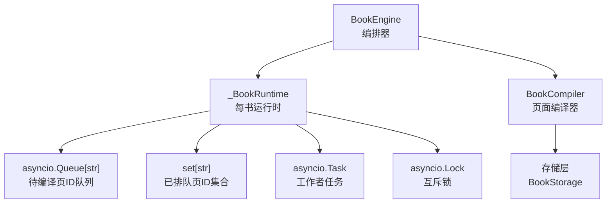
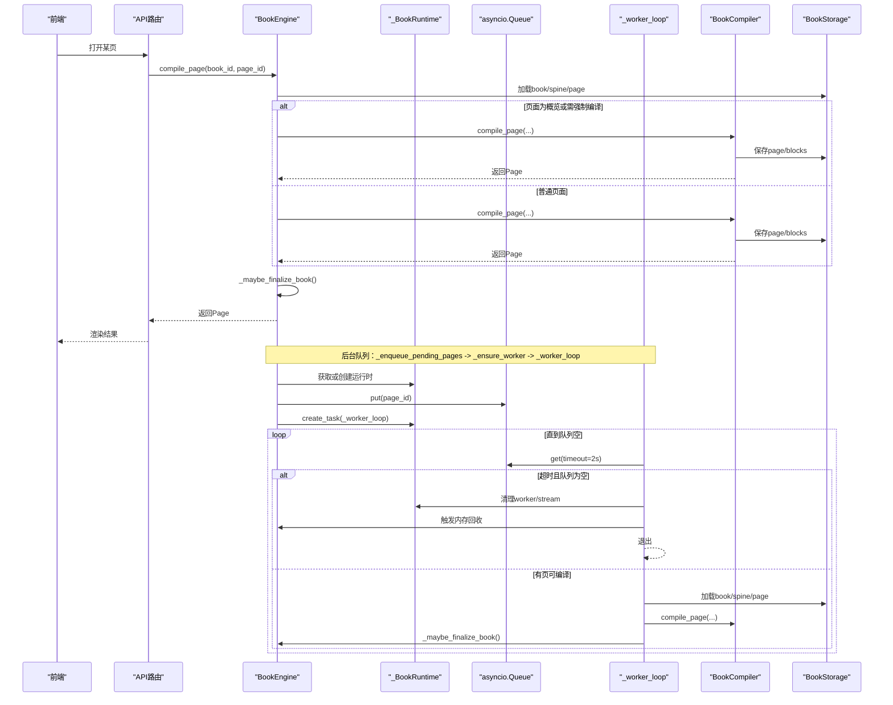
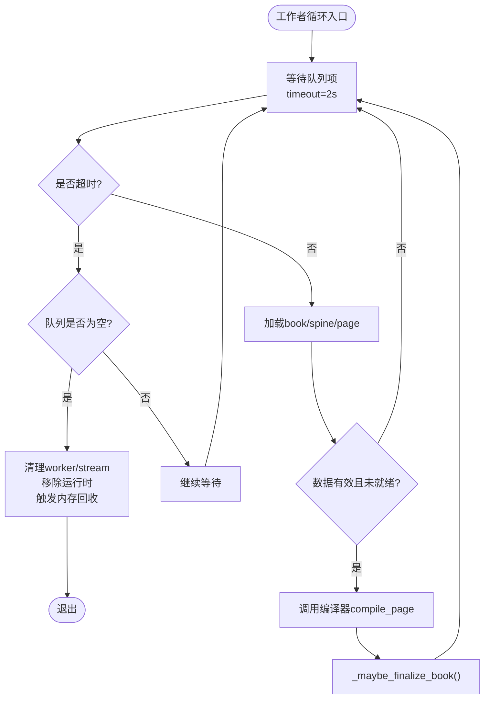
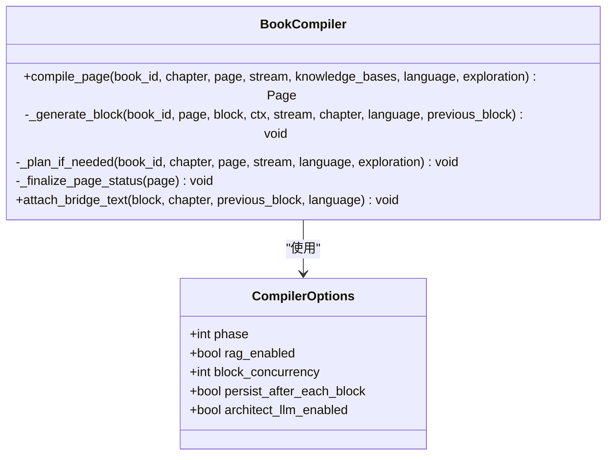
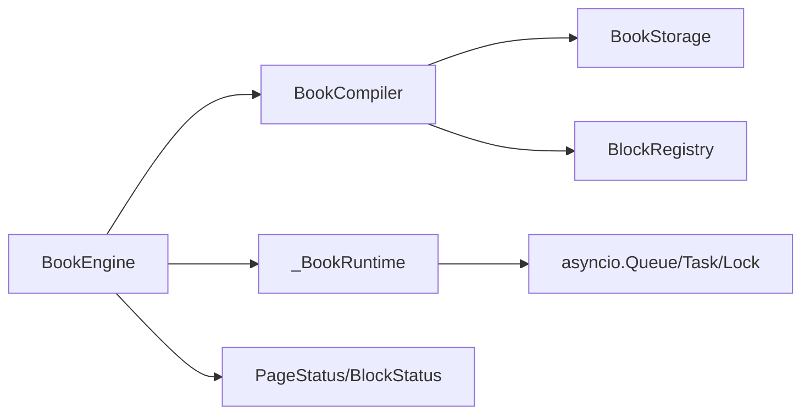

# 编译队列系统

<cite>
**本文引用的文件**
- [engine.py](file://deeptutor/book/engine.py)
- [compiler.py](file://deeptutor/book/compiler.py)
- [models.py](file://deeptutor/book/models.py)
- [test_runtime_reclaim.py](file://tests/book/test_runtime_reclaim.py)
</cite>

## 目录
1. [简介](#简介)
2. [项目结构](#项目结构)
3. [核心组件](#核心组件)
4. [架构总览](#架构总览)
5. [详细组件分析](#详细组件分析)
6. [依赖关系分析](#依赖关系分析)
7. [性能考量](#性能考量)
8. [故障排查指南](#故障排查指南)
9. [结论](#结论)
10. [附录](#附录)

## 简介
本文件面向DeepTutor的“编译队列系统”，聚焦于基于asyncio.Queue的优先级调度机制与后台工作进程的单线程串行执行模型。系统为每本书维护独立的运行时状态，确保：
- 用户打开页面的最高优先级处理（同步/内联编译）
- 其余未完成页面进入后台队列，由单个工作者串行处理
- 并发控制与资源管理（锁、任务生命周期、内存回收）
- _BookRuntime的运行时状态管理（队列、已排队集合、任务、锁）
- _enqueue_pending_pages()的智能入队策略
- _worker()的启动与管理（实际实现为_worker_loop）
- 队列性能优化与故障恢复机制

## 项目结构
编译队列系统位于book模块中，核心文件包括：
- engine.py：编排器与队列调度（BookEngine、_BookRuntime、_enqueue_pending_pages、_ensure_worker、_worker_loop）
- compiler.py：页面级编译器（BookCompiler），负责按块生成与状态聚合
- models.py：数据模型（PageStatus、BlockStatus等）
- tests/book/test_runtime_reclaim.py：验证空闲运行时的释放行为

**图表来源**
- [engine.py:84-92](file://deeptutor/book/engine.py#L84-L92)
- [engine.py:773-804](file://deeptutor/book/engine.py#L773-L804)
- [engine.py:825-905](file://deeptutor/book/engine.py#L825-L905)
- [compiler.py:69-190](file://deeptutor/book/compiler.py#L69-L190)

**章节来源**
- [engine.py:1-30](file://deeptutor/book/engine.py#L1-L30)
- [engine.py:84-92](file://deeptutor/book/engine.py#L84-L92)
- [compiler.py:1-19](file://deeptutor/book/compiler.py#L1-L19)

## 核心组件
- BookEngine：进程级编排器，维护每本书的运行时字典，提供创建书籍、确认大纲、编译页面、重建书籍等方法；内部通过全局锁保护运行时创建与访问。
- _BookRuntime：每书运行时，包含队列、已排队集合、工作者任务、锁和流对象；用于隔离并发与资源。
- BookCompiler：页面级编译器，负责规划（必要时）、逐块生成、持久化、事件广播与状态聚合。
- 数据模型：PageStatus、BlockStatus等枚举定义页面与块的完整生命周期。

关键职责边界：
- 编排器负责调度与生命周期管理
- 编译器专注单页端到端编译
- 存储层负责持久化与日志
- 流总线负责向客户端推送进度

**章节来源**
- [engine.py:100-116](file://deeptutor/book/engine.py#L100-L116)
- [engine.py:84-92](file://deeptutor/book/engine.py#L84-L92)
- [compiler.py:69-85](file://deeptutor/book/compiler.py#L69-L85)
- [models.py:29-52](file://deeptutor/book/models.py#L29-L52)

## 架构总览
下图展示从用户打开页面到后台队列调度的整体流程，以及单线程工作者的循环处理。

**图表来源**
- [engine.py:699-769](file://deeptutor/book/engine.py#L699-L769)
- [engine.py:773-804](file://deeptutor/book/engine.py#L773-L804)
- [engine.py:825-905](file://deeptutor/book/engine.py#L825-L905)
- [compiler.py:88-190](file://deeptutor/book/compiler.py#L88-L190)

## 详细组件分析

### _BookRuntime：运行时状态管理
- 队列：asyncio.Queue[str]，存放待编译的页ID
- 已排队集合：set[str]，防止重复入队
- 工作者任务：asyncio.Task[None] | None，持有后台工作者协程引用
- 锁：asyncio.Lock，保护入队与运行时访问
- 流：BookStream | None，默认流用于后台工作

设计要点：
- 每书独立运行时，避免跨书竞争
- 使用锁保证入队与任务创建的原子性
- 空闲时自动释放资源并触发内存回收

**章节来源**
- [engine.py:84-92](file://deeptutor/book/engine.py#L84-L92)

### _enqueue_pending_pages()：智能入队策略
- 获取或创建运行时（带全局锁）
- 遍历待入队页面，跳过READY状态与已在queued集合中的页
- 将页ID加入队列，并记录在queued集合
- 确保工作者存在（若不存在则创建）

该方法的“智能”体现在：
- 去重：避免重复入队
- 过滤：跳过已完成页面
- 懒启动：首次需要时才创建工作线程

**章节来源**
- [engine.py:773-804](file://deeptutor/book/engine.py#L773-L804)

### _ensure_worker()与_worker_loop()：工作者启动与管理
- _ensure_worker：若当前无工作者或工作者已结束，则创建新任务
- _worker_loop：无限循环，每次等待队列项（超时2秒）
  - 超时且队列为空：清理worker/stream，移除运行时，触发内存回收
  - 正常取到页：加载book/spine/page，调用编译器编译
  - 异常处理：标记错误、追加日志、清理queued集合
  - 完成后尝试最终化书籍状态

**图表来源**
- [engine.py:825-905](file://deeptutor/book/engine.py#L825-L905)

**章节来源**
- [engine.py:825-905](file://deeptutor/book/engine.py#L825-L905)

### BookCompiler：页面级编译与并发控制
- compile_page：规划（必要时）、逐块生成、持久化、事件广播、状态聚合
- 块并发控制：通过Semaphore限制同一页面内的块并发度
- 顺序与并行：Phase 1使用顺序以保证流式输出顺序；后续阶段可提升并发度
- 桥接文本：根据前一块与下一块提示生成过渡段落
- 状态聚合：根据块状态汇总页面状态（READY/PARTIAL/ERROR）

**图表来源**
- [compiler.py:45-85](file://deeptutor/book/compiler.py#L45-L85)
- [compiler.py:88-190](file://deeptutor/book/compiler.py#L88-L190)

**章节来源**
- [compiler.py:69-190](file://deeptutor/book/compiler.py#L69-L190)

### 优先级调度机制
- 用户打开页面：通过compile_page直接调用编译器，属于最高优先级（同步/内联）
- 后台队列：其余未完成页面通过_enqueue_pending_pages入队，由单线程工作者串行处理
- 优先级体现：前台请求不阻塞后台队列，后台队列也不影响前台响应

注意：当前实现中并未使用priority queue，而是通过“前台立即编译+后台串行队列”的方式实现隐式优先级。

**章节来源**
- [engine.py:699-769](file://deeptutor/book/engine.py#L699-L769)
- [engine.py:773-804](file://deeptutor/book/engine.py#L773-L804)

## 依赖关系分析
- BookEngine依赖BookCompiler进行页面编译
- BookCompiler依赖BlockRegistry与存储层进行块生成与持久化
- _BookRuntime依赖asyncio原语（Queue、Task、Lock）实现并发控制
- 数据模型（PageStatus、BlockStatus）贯穿整个流程

**图表来源**
- [engine.py:100-116](file://deeptutor/book/engine.py#L100-L116)
- [compiler.py:69-85](file://deeptutor/book/compiler.py#L69-L85)
- [models.py:29-52](file://deeptutor/book/models.py#L29-L52)

**章节来源**
- [engine.py:100-116](file://deeptutor/book/engine.py#L100-L116)
- [compiler.py:69-85](file://deeptutor/book/compiler.py#L69-L85)
- [models.py:29-52](file://deeptutor/book/models.py#L29-L52)

## 性能考量
- 单线程工作者：避免多进程竞争，简化状态一致性，降低上下文切换开销
- 队列超时与空闲回收：2秒超时检测空闲，及时释放资源并触发内存回收
- 块并发控制：通过block_concurrency参数控制单页面内块生成的并发度，平衡吞吐与顺序
- 持久化策略：persist_after_each_block确保增量保存，提高容错能力
- 去重机制：queued集合避免重复入队，减少冗余计算

优化建议：
- 对于高吞吐场景，可适当提升block_concurrency
- 监控队列长度与工作者优先级，必要时引入优先级队列
- 定期评估内存回收时机，避免长时间占用

**章节来源**
- [compiler.py:45-67](file://deeptutor/book/compiler.py#L45-L67)
- [engine.py:833-853](file://deeptutor/book/engine.py#L833-L853)

## 故障排查指南
常见问题与处理：
- 页面卡在PLANNING或GENERATING：检查_mark_page_error是否正确标记为ERROR
- 工作者意外退出：查看日志中是否有异常，确认队列是否为空
- 内存泄漏：确认空闲运行时是否被正确清理，检查schedule_memory_reclaim调用
- 重复编译：检查queued集合是否正常工作，避免重复入队

调试技巧：
- 启用详细日志，观察编译事件与错误信息
- 使用测试用例验证运行时释放行为
- 模拟超时场景，验证工作者清理逻辑

**章节来源**
- [engine.py:803-824](file://deeptutor/book/engine.py#L803-L824)
- [engine.py:833-853](file://deeptutor/book/engine.py#L833-L853)
- [test_runtime_reclaim.py:9-26](file://tests/book/test_runtime_reclaim.py#L9-L26)

## 结论
DeepTutor的编译队列系统通过“前台高优先级+后台串行队列”的模式，实现了高效、可靠的页面编译调度。_BookRuntime提供了清晰的运行时隔离，_enqueue_pending_pages确保了智能入队，_worker_loop保证了稳定的单线程执行。结合块级并发控制与持久化策略，系统在性能与可靠性之间取得了良好平衡。未来可考虑引入优先级队列以支持更复杂的调度需求。

## 附录
- 相关术语：
  - 页面（Page）：一本书中的一个内容单元，包含多个块
  - 块（Block）：页面中的最小内容单元，如文本、测验、图表等
  - 工作者（Worker）：后台任务，负责串行处理队列中的页面
  - 运行时（Runtime）：每书的独立调度上下文

- 扩展阅读：
  - asyncio.Queue文档
  - 异步编程最佳实践
  - 内存管理与垃圾回收