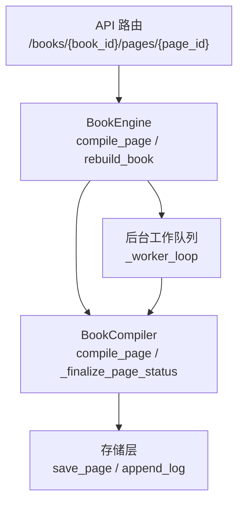
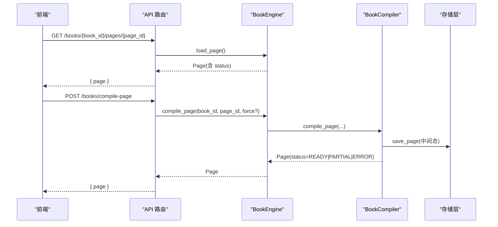
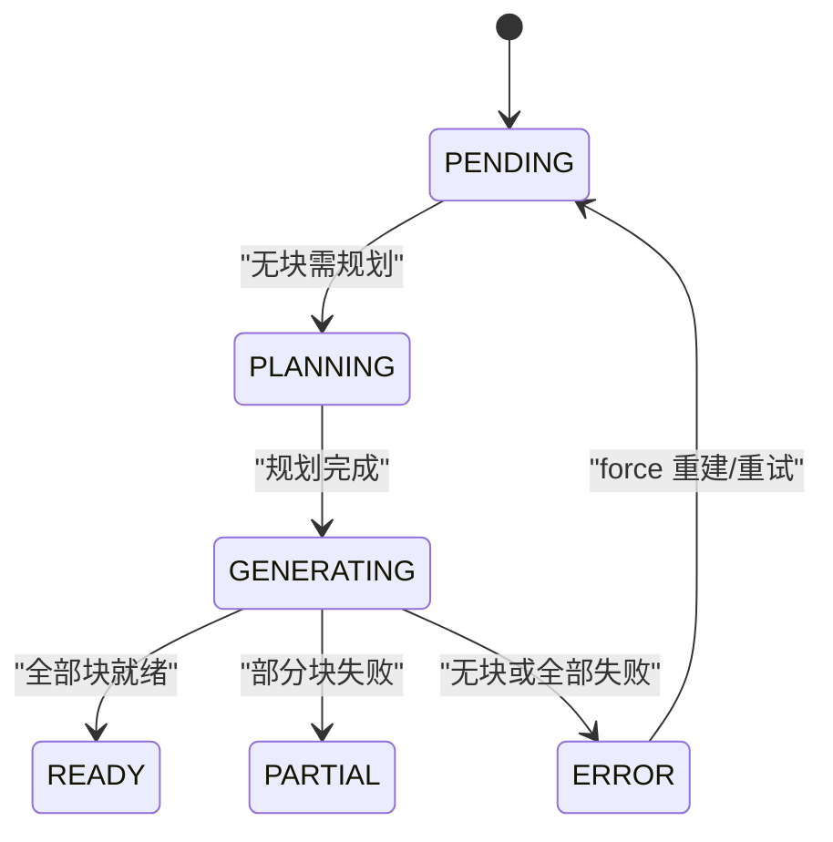
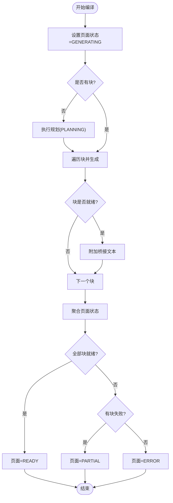
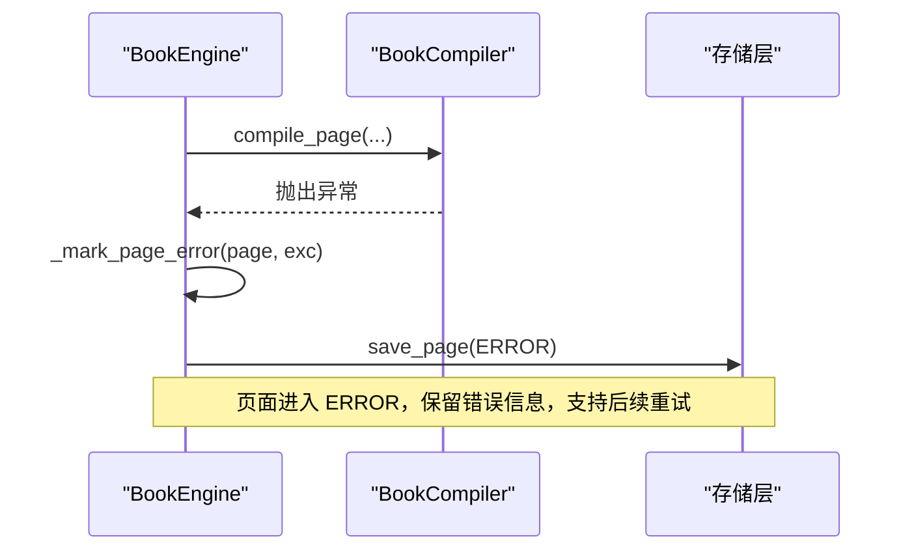
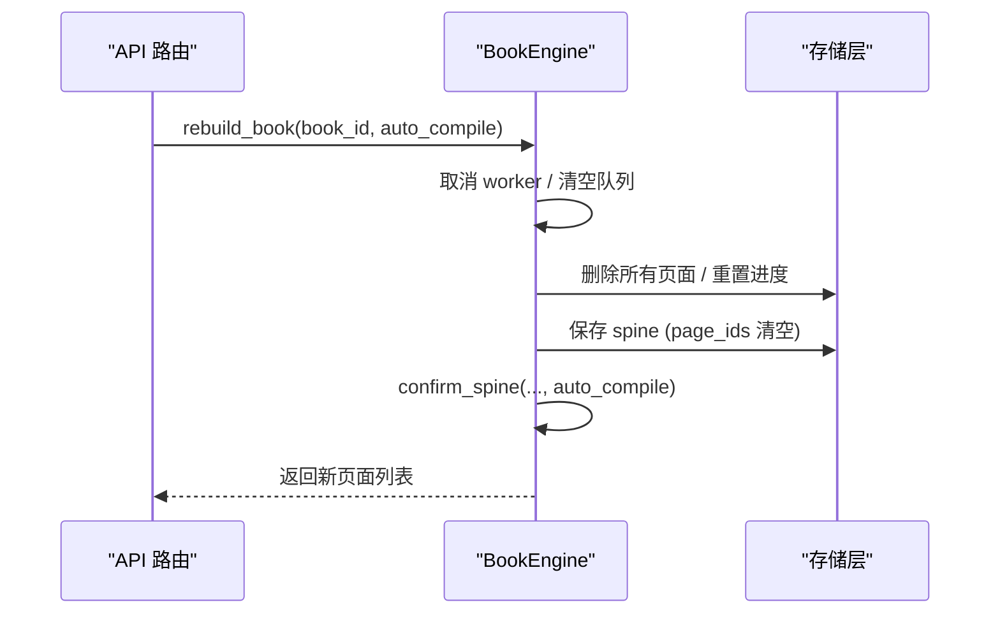
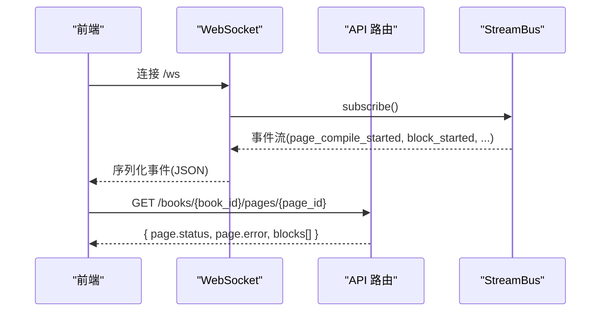
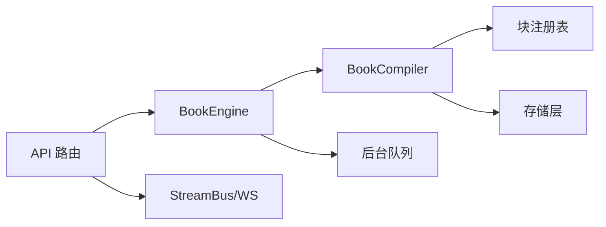

# 页面状态管理

<cite>
**本文引用的文件**
- [models.py](file://deeptutor/book/models.py)
- [compiler.py](file://deeptutor/book/compiler.py)
- [engine.py](file://deeptutor/book/engine.py)
- [book.py](file://deeptutor/api/routers/book.py)
</cite>

## 目录
1. [简介](#简介)
2. [项目结构](#项目结构)
3. [核心组件](#核心组件)
4. [架构总览](#架构总览)
5. [详细组件分析](#详细组件分析)
6. [依赖关系分析](#依赖关系分析)
7. [性能考虑](#性能考虑)
8. [故障排查指南](#故障排查指南)
9. [结论](#结论)
10. [附录](#附录)

## 简介
本文件聚焦 DeepTutor 的“页面状态管理”，围绕 PageStatus 枚举及其在编译过程中的转换规则展开，解释：
- 页面从 PENDING 开始，成功完成后变为 READY，发生错误时进入 ERROR 状态。
- 块级错误标记与页面级错误恢复机制。
- 页面重建功能如何重置所有页面状态并重新编译。
- 状态查询接口与状态同步机制的实现细节。

## 项目结构
与页面状态管理直接相关的代码主要分布在以下模块：
- 数据模型与枚举定义：PageStatus、BlockStatus、Page、Block 等位于 models.py。
- 编译器：BookCompiler 负责逐块生成、状态聚合与持久化，位于 compiler.py。
- 引擎编排：BookEngine 负责页面生命周期、后台队列、错误恢复与重建，位于 engine.py。
- API 路由：对外暴露的状态查询与操作接口，位于 api/routers/book.py。

图表来源
- [book.py:180-186](file://deeptutor/api/routers/book.py#L180-L186)
- [engine.py:697-769](file://deeptutor/book/engine.py#L697-L769)
- [compiler.py:88-190](file://deeptutor/book/compiler.py#L88-L190)
- [engine.py:833-905](file://deeptutor/book/engine.py#L833-L905)

章节来源
- [models.py:38-52](file://deeptutor/book/models.py#L38-L52)
- [compiler.py:88-190](file://deeptutor/book/compiler.py#L88-L190)
- [engine.py:697-769](file://deeptutor/book/engine.py#L697-L769)
- [book.py:180-186](file://deeptutor/api/routers/book.py#L180-L186)

## 核心组件
- PageStatus 枚举：定义页面状态（PENDING、PLANNING、GENERATING、READY、PARTIAL、ERROR）。
- BlockStatus 枚举：定义块状态（PENDING、GENERATING、READY、ERROR、HIDDEN）。
- BookCompiler：驱动单页编译，按块执行生成器，并在结束时聚合页面状态。
- BookEngine：编排页面编译流程、后台队列、错误恢复与重建。
- API 路由：提供页面状态查询、编译触发、重建等操作接口。

章节来源
- [models.py:38-52](file://deeptutor/book/models.py#L38-L52)
- [compiler.py:88-190](file://deeptutor/book/compiler.py#L88-L190)
- [engine.py:697-769](file://deeptutor/book/engine.py#L697-L769)
- [book.py:180-186](file://deeptutor/api/routers/book.py#L180-L186)

## 架构总览
页面状态管理的整体流程如下：
- 前端通过 REST/WS 调用 API 路由，触发页面编译或查询。
- BookEngine 根据请求加载 Book、Spine、Page，必要时重置或入队。
- BookCompiler 执行规划（如需要）与逐块生成，期间持续持久化中间结果。
- 编译结束后聚合页面状态（READY/PARTIAL/ERROR），并通过事件流推送给前端。
- 后台工作线程处理未完成的页面，异常时将页面置为 ERROR 以便重试。

图表来源
- [book.py:180-186](file://deeptutor/api/routers/book.py#L180-L186)
- [book.py:271-282](file://deeptutor/api/routers/book.py#L271-L282)
- [engine.py:697-769](file://deeptutor/book/engine.py#L697-L769)
- [compiler.py:88-190](file://deeptutor/book/compiler.py#L88-L190)

## 详细组件分析

### PageStatus 枚举与状态转换规则
- 初始状态：页面创建时为 PENDING。
- 规划阶段：若页面尚无块，编译器会先进行规划，状态切换至 PLANNING。
- 生成阶段：规划完成后进入 GENERATING，逐块生成。
- 结束状态：
  - 全部块 READY → 页面 READY。
  - 部分块失败 → 页面 PARTIAL。
  - 无块或全部失败 → 页面 ERROR。

图表来源
- [models.py:38-45](file://deeptutor/book/models.py#L38-L45)
- [compiler.py:305-344](file://deeptutor/book/compiler.py#L305-L344)
- [compiler.py:348-366](file://deeptutor/book/compiler.py#L348-L366)
- [engine.py:730-732](file://deeptutor/book/engine.py#L730-L732)

章节来源
- [models.py:38-45](file://deeptutor/book/models.py#L38-L45)
- [compiler.py:305-344](file://deeptutor/book/compiler.py#L305-L344)
- [compiler.py:348-366](file://deeptutor/book/compiler.py#L348-L366)
- [engine.py:730-732](file://deeptutor/book/engine.py#L730-L732)

### 编译过程中的状态变化
- 启动编译：设置页面状态为 GENERATING，并持久化。
- 逐块生成：每个块完成后立即持久化，并发送块级事件（block_ready/block_error）。
- 桥接文本：对已就绪的块附加过渡段落（bridge_text），不影响状态。
- 最终聚合：根据块状态计算页面状态（READY/PARTIAL/ERROR），并记录日志。

图表来源
- [compiler.py:118-120](file://deeptutor/book/compiler.py#L118-L120)
- [compiler.py:194-249](file://deeptutor/book/compiler.py#L194-L249)
- [compiler.py:253-301](file://deeptutor/book/compiler.py#L253-L301)
- [compiler.py:348-366](file://deeptutor/book/compiler.py#L348-L366)

章节来源
- [compiler.py:118-120](file://deeptutor/book/compiler.py#L118-L120)
- [compiler.py:194-249](file://deeptutor/book/compiler.py#L194-L249)
- [compiler.py:253-301](file://deeptutor/book/compiler.py#L253-L301)
- [compiler.py:348-366](file://deeptutor/book/compiler.py#L348-L366)

### 块级错误标记与页面级错误恢复
- 块级错误：当块生成失败或未找到对应生成器时，块状态设为 ERROR，并记录错误信息。
- 页面级错误恢复：
  - 若页面处于 PLANNING 或 GENERATING 且抛出异常，引擎将其置为 ERROR，并写入错误消息，便于后续重试或强制重建。
  - 后台工作循环捕获异常后同样调用错误恢复逻辑，确保页面可被再次调度。

图表来源
- [compiler.py:216-224](file://deeptutor/book/compiler.py#L216-L224)
- [engine.py:803-824](file://deeptutor/book/engine.py#L803-L824)
- [engine.py:833-905](file://deeptutor/book/engine.py#L833-L905)

章节来源
- [compiler.py:216-224](file://deeptutor/book/compiler.py#L216-L224)
- [engine.py:803-824](file://deeptutor/book/engine.py#L803-L824)
- [engine.py:833-905](file://deeptutor/book/engine.py#L833-L905)

### 页面重建功能 _rebuild_book
- 作用：删除现有页面，清空进度，保持已确认的大纲（spine），然后重新创建页面壳并自动编译。
- 行为：
  - 取消当前运行中的后台任务并清空队列。
  - 删除所有页面，重置章节的 page_ids。
  - 重置进度，将书状态回退到 SPINE_READY。
  - 调用 confirm_spine 重新生成页面并自动编译。

图表来源
- [engine.py:647-695](file://deeptutor/book/engine.py#L647-L695)
- [engine.py:582-645](file://deeptutor/book/engine.py#L582-L645)
- [book.py:462-472](file://deeptutor/api/routers/book.py#L462-L472)

章节来源
- [engine.py:647-695](file://deeptutor/book/engine.py#L647-L695)
- [engine.py:582-645](file://deeptutor/book/engine.py#L582-L645)
- [book.py:462-472](file://deeptutor/api/routers/book.py#L462-L472)

### 状态查询接口与状态同步机制
- 状态查询：
  - GET /books/{book_id}/pages/{page_id} 返回页面对象，包含 status、error、blocks 等字段。
  - GET /books/{book_id} 返回书、大纲、所有页面与进度。
- 状态同步：
  - WebSocket /ws 订阅 Book 事件流，实时接收 page_compile_started、page_planning、page_planned、block_started、block_ready/block_error、page_compiled 等事件。
  - 事件携带 stage 与 content，用于前端渲染进度条与块级状态更新。

图表来源
- [book.py:490-670](file://deeptutor/api/routers/book.py#L490-L670)
- [book.py:148-186](file://deeptutor/api/routers/book.py#L148-L186)
- [compiler.py:100-104](file://deeptutor/book/compiler.py#L100-L104)
- [compiler.py:177-189](file://deeptutor/book/compiler.py#L177-L189)

章节来源
- [book.py:148-186](file://deeptutor/api/routers/book.py#L148-L186)
- [book.py:490-670](file://deeptutor/api/routers/book.py#L490-L670)
- [compiler.py:100-104](file://deeptutor/book/compiler.py#L100-L104)
- [compiler.py:177-189](file://deeptutor/book/compiler.py#L177-L189)

## 依赖关系分析
- BookEngine 依赖 BookCompiler 执行具体编译逻辑，并依赖存储层进行持久化。
- BookCompiler 依赖块注册表获取对应生成器，并通过 BookStream 发出事件。
- API 路由依赖 BookEngine 暴露能力，同时通过 StreamBus 转发事件到 WebSocket。

图表来源
- [book.py:18-28](file://deeptutor/api/routers/book.py#L18-L28)
- [engine.py:100-115](file://deeptutor/book/engine.py#L100-L115)
- [compiler.py:69-84](file://deeptutor/book/compiler.py#L69-L84)
- [engine.py:773-801](file://deeptutor/book/engine.py#L773-L801)

章节来源
- [book.py:18-28](file://deeptutor/api/routers/book.py#L18-L28)
- [engine.py:100-115](file://deeptutor/book/engine.py#L100-L115)
- [compiler.py:69-84](file://deeptutor/book/compiler.py#L69-L84)
- [engine.py:773-801](file://deeptutor/book/engine.py#L773-L801)

## 性能考虑
- 并发控制：编译器支持按页内块的并发生成（block_concurrency），Phase 1 默认顺序以保证流式顺序，后续阶段可提高并发以提升编译速度。
- 增量持久化：每完成一个块即持久化页面，降低中断恢复成本。
- 后台队列：每本书维护独立队列与工作线程，空闲时释放内存回收资源。
- 概览页：Overview 页面采用确定性构建，避免 LLM 开销与幻觉风险。

[本节为通用指导，不直接分析具体文件]

## 故障排查指南
- 页面卡在 PLANNING/GENERATING：检查是否在规划或生成阶段抛出异常；引擎会将页面置为 ERROR 并记录错误信息。
- 块生成失败：查看块 error 字段与 block_error 事件；确认块类型对应的生成器是否存在。
- 页面重建无效：确认 rebuild_book 是否成功清理队列与页面；检查 confirm_spine 是否重新创建了页面壳。
- 状态不同步：确认 WebSocket 是否正确订阅并转发事件；检查事件 source 是否为 BOOK_SOURCE。

章节来源
- [engine.py:803-824](file://deeptutor/book/engine.py#L803-L824)
- [compiler.py:216-224](file://deeptutor/book/compiler.py#L216-L224)
- [engine.py:647-695](file://deeptutor/book/engine.py#L647-L695)
- [book.py:490-670](file://deeptutor/api/routers/book.py#L490-L670)

## 结论
DeepTutor 的页面状态管理以 PageStatus 为核心，结合 BookCompiler 的逐块生成与状态聚合、BookEngine 的错误恢复与重建机制，以及 API 路由提供的查询与同步接口，形成了稳定可靠的编译与展示闭环。通过后台队列与事件流，系统能够在保证一致性的前提下实现高效的页面生成与前端实时更新。

## 附录
- 关键枚举与模型：PageStatus、BlockStatus、Page、Block 的定义与字段说明。
- 关键方法路径：
  - 页面编译：engine.compile_page、compiler.compile_page
  - 状态聚合：compiler._finalize_page_status
  - 错误恢复：engine._mark_page_error
  - 页面重建：engine.rebuild_book
  - 状态查询：api/routers/book.py 中 /books/{book_id}/pages/{page_id}
  - 事件流：api/routers/book.py 中 /ws

章节来源
- [models.py:38-52](file://deeptutor/book/models.py#L38-L52)
- [compiler.py:88-190](file://deeptutor/book/compiler.py#L88-L190)
- [compiler.py:348-366](file://deeptutor/book/compiler.py#L348-L366)
- [engine.py:697-769](file://deeptutor/book/engine.py#L697-L769)
- [engine.py:803-824](file://deeptutor/book/engine.py#L803-L824)
- [engine.py:647-695](file://deeptutor/book/engine.py#L647-L695)
- [book.py:180-186](file://deeptutor/api/routers/book.py#L180-L186)
- [book.py:490-670](file://deeptutor/api/routers/book.py#L490-L670)