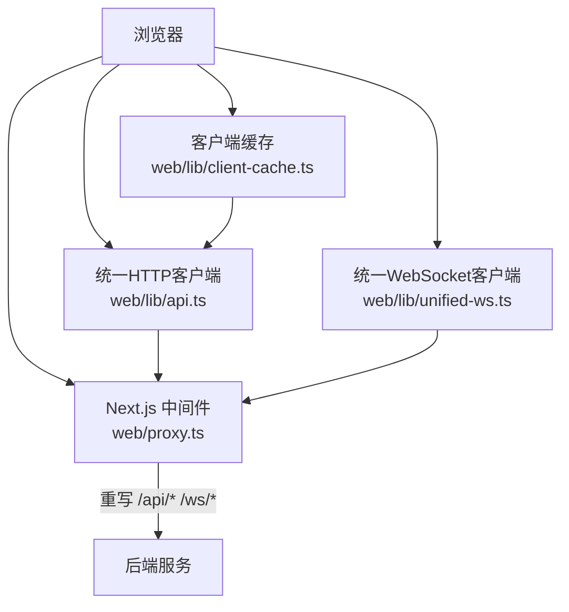
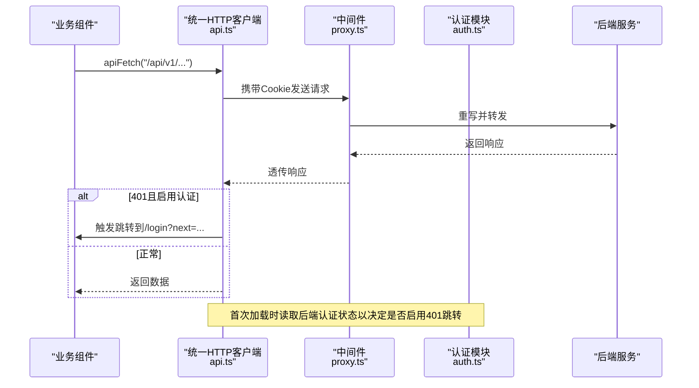
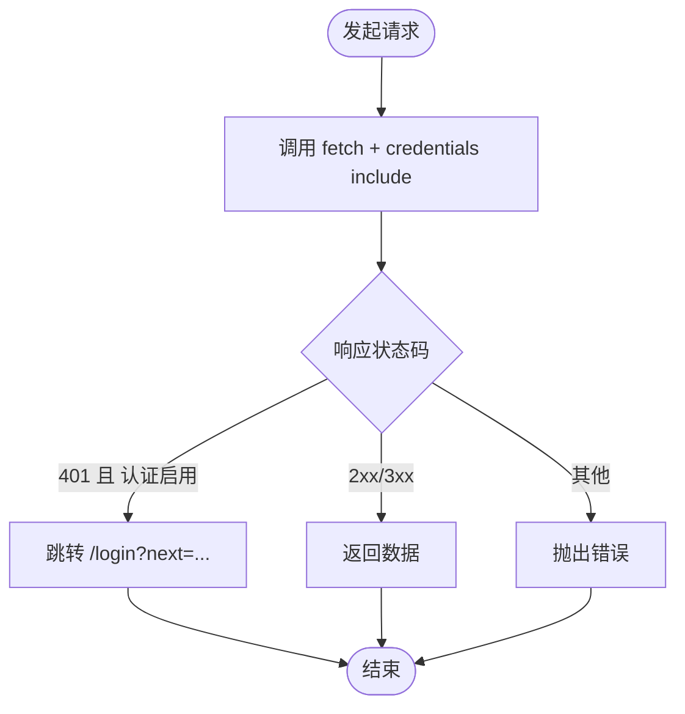
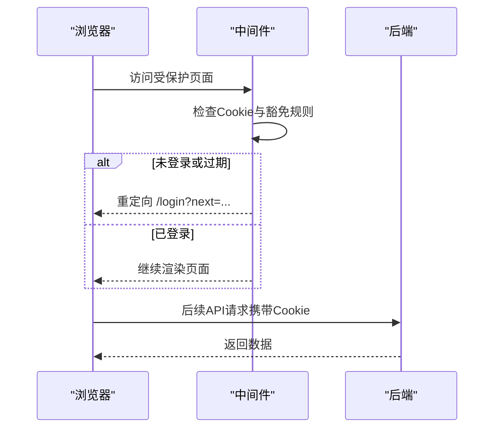
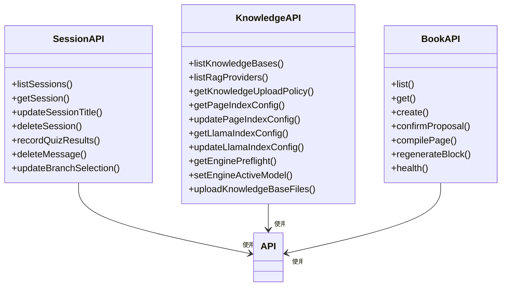
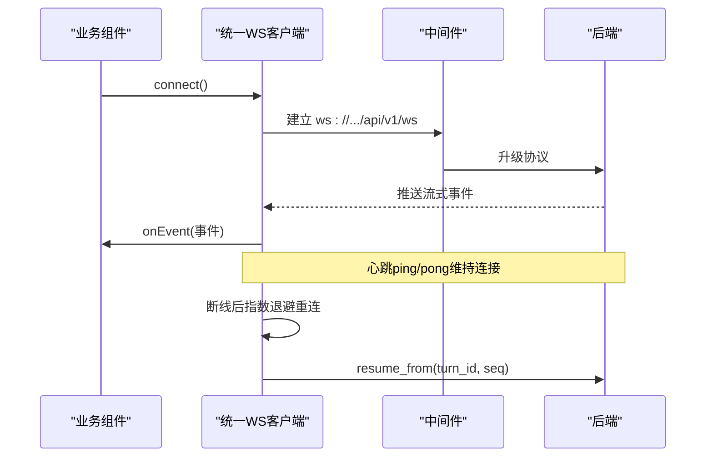
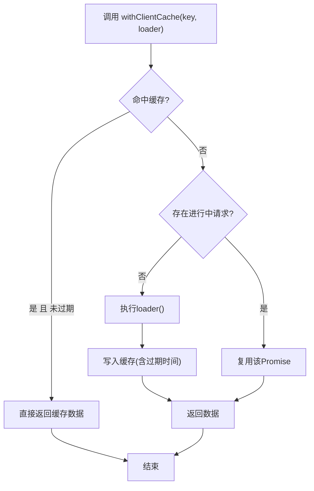
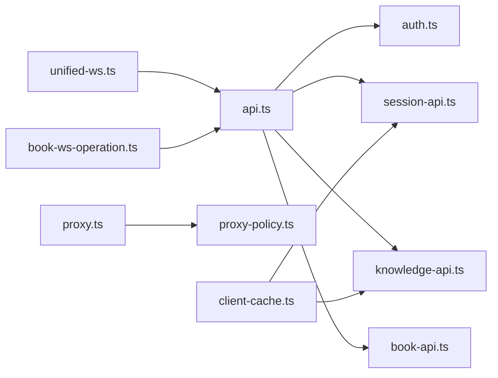

# API集成

<cite>
**本文引用的文件**
- [web/lib/api.ts](file://web/lib/api.ts)
- [web/lib/auth.ts](file://web/lib/auth.ts)
- [web/proxy.ts](file://web/proxy.ts)
- [web/lib/proxy-policy.ts](file://web/lib/proxy-policy.ts)
- [web/lib/unified-ws.ts](file://web/lib/unified-ws.ts)
- [web/lib/book-ws-operation.ts](file://web/lib/book-ws-operation.ts)
- [web/lib/client-cache.ts](file://web/lib/client-cache.ts)
- [web/lib/session-api.ts](file://web/lib/session-api.ts)
- [web/lib/knowledge-api.ts](file://web/lib/knowledge-api.ts)
- [web/lib/book-api.ts](file://web/lib/book-api.ts)
- [web/hooks/useAuthStatus.ts](file://web/hooks/useAuthStatus.ts)
</cite>

## 目录
1. [简介](#简介)
2. [项目结构](#项目结构)
3. [核心组件](#核心组件)
4. [架构总览](#架构总览)
5. [详细组件分析](#详细组件分析)
6. [依赖关系分析](#依赖关系分析)
7. [性能考虑](#性能考虑)
8. [故障排查指南](#故障排查指南)
9. [结论](#结论)
10. [附录](#附录)

## 简介
本文件面向DeepTutor前端API集成，系统性说明统一的HTTP客户端、请求拦截与错误处理、RESTful封装与类型安全、WebSocket实时通信、认证授权与会话保持、缓存策略与请求去重、重试机制、开发规范与本地调试方法，并提供调用示例与性能优化建议。目标是帮助开发者快速理解并高效扩展前端的网络层能力。

## 项目结构
前端通过Next.js中间件将浏览器对`/api/*`和`/ws/*`的请求重写至后端服务，实现前后端同源访问；所有业务API均通过统一封装的HTTP客户端发起，确保鉴权、错误处理、URL构造的一致性。

**图表来源**
- [web/proxy.ts:1-82](file://web/proxy.ts#L1-L82)
- [web/lib/api.ts:1-97](file://web/lib/api.ts#L1-L97)
- [web/lib/unified-ws.ts:1-315](file://web/lib/unified-ws.ts#L1-L315)
- [web/lib/client-cache.ts:1-64](file://web/lib/client-cache.ts#L1-L64)

**章节来源**
- [web/proxy.ts:1-82](file://web/proxy.ts#L1-L82)
- [web/lib/api.ts:1-97](file://web/lib/api.ts#L1-L97)

## 核心组件
- 统一HTTP客户端：提供URL构造、认证状态感知、401自动跳转登录等能力。
- 认证模块：获取认证状态、登录/注册/登出、首次用户检测。
- 中间件代理：路由到后端、鉴权门控、静态资源豁免。
- 统一WebSocket客户端：心跳保活、断线重连、流式事件解析、续传恢复。
- 客户端缓存：基于内存的TTL缓存、并发请求合并、按前缀失效。
- 领域API封装：会话、知识库、书籍等业务的类型安全接口。

**章节来源**
- [web/lib/api.ts:1-97](file://web/lib/api.ts#L1-L97)
- [web/lib/auth.ts:1-137](file://web/lib/auth.ts#L1-L137)
- [web/proxy.ts:1-82](file://web/proxy.ts#L1-L82)
- [web/lib/unified-ws.ts:1-315](file://web/lib/unified-ws.ts#L1-L315)
- [web/lib/client-cache.ts:1-64](file://web/lib/client-cache.ts#L1-L64)
- [web/lib/session-api.ts:1-233](file://web/lib/session-api.ts#L1-L233)
- [web/lib/knowledge-api.ts:1-859](file://web/lib/knowledge-api.ts#L1-L859)
- [web/lib/book-api.ts:1-271](file://web/lib/book-api.ts#L1-L271)

## 架构总览
前端通过中间件将API与WS路径透明转发到后端，业务模块仅依赖统一的HTTP/WS客户端与领域API封装，屏蔽了URL拼接、鉴权、错误处理细节。

**图表来源**
- [web/lib/api.ts:68-97](file://web/lib/api.ts#L68-L97)
- [web/proxy.ts:42-72](file://web/proxy.ts#L42-L72)
- [web/lib/auth.ts:21-37](file://web/lib/auth.ts#L21-L37)

## 详细组件分析

### 统一HTTP客户端与请求拦截
- URL构造：`apiUrl`与`wsUrl`为透传函数，真实后端地址由中间件在运行时决定，避免构建期硬编码。
- 认证状态：通过`fetchAuthStatus`从后端获取是否启用认证，驱动客户端的401跳转逻辑。
- 401处理：当后端返回401且认证已启用时，自动跳转到登录页并保留原路径；可通过`skipAuthRedirect`跳过（如登录/注册接口）。
- 凭据传递：默认使用`credentials: "include"`，配合中间件的Cookie校验完成会话保持。

**图表来源**
- [web/lib/api.ts:68-97](file://web/lib/api.ts#L68-L97)
- [web/lib/auth.ts:21-37](file://web/lib/auth.ts#L21-L37)

**章节来源**
- [web/lib/api.ts:1-97](file://web/lib/api.ts#L1-L97)
- [web/lib/auth.ts:1-137](file://web/lib/auth.ts#L1-L137)

### 认证授权与会话保持
- 中间件鉴权：根据环境变量控制是否开启认证；对非豁免路径进行Cookie校验，无效则重定向登录。
- Cookie策略：使用固定Cookie名存储Token；静态资源与Next内部路径豁免鉴权。
- Token分类：轻量级JWT格式检查与过期判断，作为前置门控；真正的签名验证在后端完成。
- 前端状态：`useAuthStatus`钩子聚合认证状态，避免重复请求，支持页面渲染登录态相关UI。

**图表来源**
- [web/proxy.ts:42-72](file://web/proxy.ts#L42-L72)
- [web/lib/proxy-policy.ts:18-46](file://web/lib/proxy-policy.ts#L18-L46)
- [web/lib/proxy-policy.ts:54-74](file://web/lib/proxy-policy.ts#L54-L74)

**章节来源**
- [web/proxy.ts:1-82](file://web/proxy.ts#L1-L82)
- [web/lib/proxy-policy.ts:1-75](file://web/lib/proxy-policy.ts#L1-L75)
- [web/hooks/useAuthStatus.ts:1-71](file://web/hooks/useAuthStatus.ts#L1-L71)

### RESTful API封装与类型安全
- 会话API：提供列表、详情、标题更新、删除、测验结果记录、消息删除、分支选择等接口，返回强类型数据结构。
- 知识库API：涵盖知识库列表、RAG提供者、上传策略、引擎配置读写、模型选项切换、文件管理、外部服务探测与连接等。
- 书籍API：提供书籍CRUD、大纲/页面操作、编译与再生成、健康检查、指纹刷新等，部分操作通过专用WebSocket通道完成。
- 参数校验：前端通过TypeScript类型约束入参与返回值；错误信息统一提取后端detail字段并转换为可读提示。

**图表来源**
- [web/lib/session-api.ts:1-233](file://web/lib/session-api.ts#L1-L233)
- [web/lib/knowledge-api.ts:1-859](file://web/lib/knowledge-api.ts#L1-L859)
- [web/lib/book-api.ts:1-271](file://web/lib/book-api.ts#L1-L271)
- [web/lib/api.ts:1-97](file://web/lib/api.ts#L1-L97)

**章节来源**
- [web/lib/session-api.ts:1-233](file://web/lib/session-api.ts#L1-L233)
- [web/lib/knowledge-api.ts:1-859](file://web/lib/knowledge-api.ts#L1-L859)
- [web/lib/book-api.ts:1-271](file://web/lib/book-api.ts#L1-L271)

### WebSocket API集成与实时数据流
- 统一聊天流：`UnifiedWSClient`连接单一WS端点，提供心跳保活、指数退避重连、断线续传（resume_from）、事件过滤（忽略ping/pong）等。
- 书籍工作流：通过`runBookSocketOperation`封装单次WS操作的生命周期，等待特定结果类型或错误事件后决议Promise。
- 事件处理：流式事件包含阶段、内容、元数据等，前端可据此增量渲染思考过程、工具调用与最终答案。

**图表来源**
- [web/lib/unified-ws.ts:157-315](file://web/lib/unified-ws.ts#L157-L315)
- [web/lib/book-ws-operation.ts:25-99](file://web/lib/book-ws-operation.ts#L25-L99)

**章节来源**
- [web/lib/unified-ws.ts:1-315](file://web/lib/unified-ws.ts#L1-L315)
- [web/lib/book-ws-operation.ts:1-99](file://web/lib/book-ws-operation.ts#L1-L99)

### 缓存策略、请求去重与重试机制
- 客户端缓存：`withClientCache`基于内存Map实现TTL缓存，支持强制刷新；同一key并发请求会合并Promise，避免重复网络开销。
- 失效策略：写操作后按前缀失效（如`sessions:`、`knowledge:`），保证列表一致性。
- 重试机制：当前HTTP层未内置通用重试；WS层具备指数退避重连与最大尝试次数限制。

**图表来源**
- [web/lib/client-cache.ts:14-55](file://web/lib/client-cache.ts#L14-L55)

**章节来源**
- [web/lib/client-cache.ts:1-64](file://web/lib/client-cache.ts#L1-L64)
- [web/lib/session-api.ts:131-157](file://web/lib/session-api.ts#L131-L157)
- [web/lib/knowledge-api.ts:166-226](file://web/lib/knowledge-api.ts#L166-L226)

### 错误处理与调试
- 统一错误提取：优先读取后端`detail`字段，回退到状态文本，便于前端展示友好提示。
- 401处理：在HTTP客户端与部分领域API中统一处理，必要时跳过全局跳转以便表单内错误提示。
- 调试建议：
  - 使用浏览器Network面板观察请求路径与响应体。
  - 确认中间件环境变量`DEEPTUTOR_API_BASE_URL`与`DEEPTUTOR_AUTH_ENABLED`设置正确。
  - 对于WS问题，关注心跳超时与重连日志。

**章节来源**
- [web/lib/knowledge-api.ts:511-522](file://web/lib/knowledge-api.ts#L511-L522)
- [web/lib/api.ts:68-97](file://web/lib/api.ts#L68-L97)
- [web/proxy.ts:13-25](file://web/proxy.ts#L13-L25)

## 依赖关系分析
- `api.ts`被认证模块、会话API、知识库API、书籍API广泛引用，是HTTP层的唯一入口。
- `proxy.ts`依赖`proxy-policy.ts`定义的路由与鉴权策略，集中处理跨域与认证门控。
- `unified-ws.ts`与`book-ws-operation.ts`分别负责长连接聊天流与短生命周期书籍WS操作。
- `client-cache.ts`被会话与知识库API用于读多写少的数据缓存。

**图表来源**
- [web/lib/api.ts:1-97](file://web/lib/api.ts#L1-L97)
- [web/lib/auth.ts:1-137](file://web/lib/auth.ts#L1-L137)
- [web/lib/session-api.ts:1-233](file://web/lib/session-api.ts#L1-L233)
- [web/lib/knowledge-api.ts:1-859](file://web/lib/knowledge-api.ts#L1-L859)
- [web/lib/book-api.ts:1-271](file://web/lib/book-api.ts#L1-L271)
- [web/lib/unified-ws.ts:1-315](file://web/lib/unified-ws.ts#L1-L315)
- [web/lib/book-ws-operation.ts:1-99](file://web/lib/book-ws-operation.ts#L1-L99)
- [web/lib/client-cache.ts:1-64](file://web/lib/client-cache.ts#L1-L64)
- [web/proxy.ts:1-82](file://web/proxy.ts#L1-L82)
- [web/lib/proxy-policy.ts:1-75](file://web/lib/proxy-policy.ts#L1-L75)

**章节来源**
- [web/lib/api.ts:1-97](file://web/lib/api.ts#L1-L97)
- [web/proxy.ts:1-82](file://web/proxy.ts#L1-L82)

## 性能考虑
- 减少重复请求：利用`withClientCache`对高频读接口进行TTL缓存，并在写操作后按前缀失效。
- 合并并发请求：缓存层自动合并相同key的并发请求，降低服务器压力。
- 流式渲染：通过WS事件增量更新界面，避免整段内容一次性拉取。
- 最小化重定向：仅在认证启用且确认为401时跳转登录，避免不必要的页面刷新。
- 静态资源豁免：中间件对静态资源放行，避免鉴权带来的额外开销。

[本节为通用性能建议，不直接分析具体文件]

## 故障排查指南
- 无法访问后端：检查`DEEPTUTOR_API_BASE_URL`是否正确指向后端；确认中间件匹配器未误拦截。
- 登录后仍被重定向：确认Cookie名称与有效期；检查`classifyToken`分类结果是否为valid。
- 401频繁出现：确认后端是否启用认证；必要时在登录/注册接口传入`skipAuthRedirect`。
- WS连接不稳定：关注心跳超时与重连次数；必要时调整重连间隔与最大尝试次数。
- 缓存不一致：在写操作后调用对应失效函数（如`invalidateClientCache("sessions:")`）。

**章节来源**
- [web/proxy.ts:13-25](file://web/proxy.ts#L13-L25)
- [web/lib/proxy-policy.ts:54-74](file://web/lib/proxy-policy.ts#L54-L74)
- [web/lib/api.ts:68-97](file://web/lib/api.ts#L68-L97)
- [web/lib/unified-ws.ts:257-315](file://web/lib/unified-ws.ts#L257-L315)
- [web/lib/client-cache.ts:57-64](file://web/lib/client-cache.ts#L57-L64)

## 结论
DeepTutor前端采用“统一客户端+中间件代理+领域API封装”的分层设计，实现了类型安全、可维护性强的API集成方案。通过认证状态驱动的401处理、客户端缓存与WS重连机制，兼顾了用户体验与系统稳定性。建议在新增功能时遵循现有模式：使用统一HTTP/WS客户端、明确类型契约、合理应用缓存与失效策略，并确保错误信息可观测、可定位。

[本节为总结性内容，不直接分析具体文件]

## 附录
- 典型调用示例（路径引用）
  - 获取会话列表并缓存：[web/lib/session-api.ts:131-157](file://web/lib/session-api.ts#L131-L157)
  - 创建知识库并上传文件：[web/lib/knowledge-api.ts:534-555](file://web/lib/knowledge-api.ts#L534-L555)
  - 启动书籍生成流程（WS）：[web/lib/book-api.ts:73-81](file://web/lib/book-api.ts#L73-L81)
  - 统一WS连接与心跳：[web/lib/unified-ws.ts:183-234](file://web/lib/unified-ws.ts#L183-L234)
  - 认证状态获取与401跳转：[web/lib/auth.ts:21-37](file://web/lib/auth.ts#L21-L37), [web/lib/api.ts:68-97](file://web/lib/api.ts#L68-L97)

- 本地调试要点
  - 修改`DEEPTUTOR_API_BASE_URL`指向本地后端端口。
  - 关闭认证开关以简化调试：`DEEPTUTOR_AUTH_ENABLED=false`。
  - 使用浏览器控制台查看WS事件与缓存命中情况。

[本节为补充信息，不直接分析具体文件]