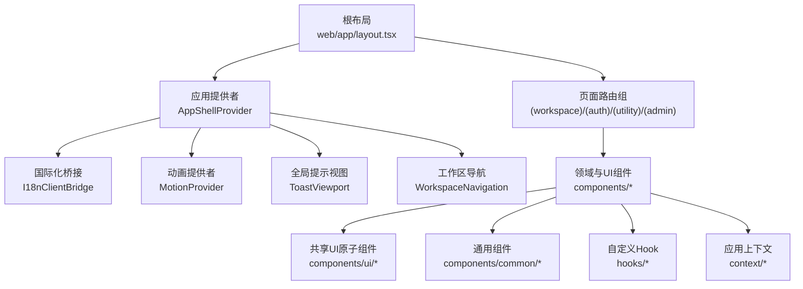
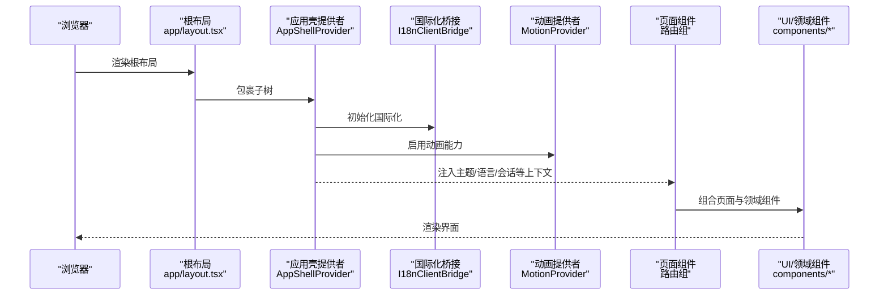
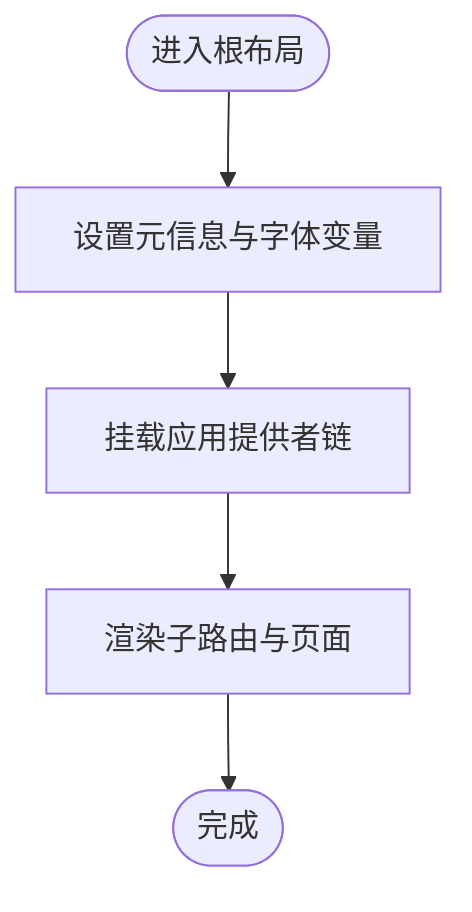
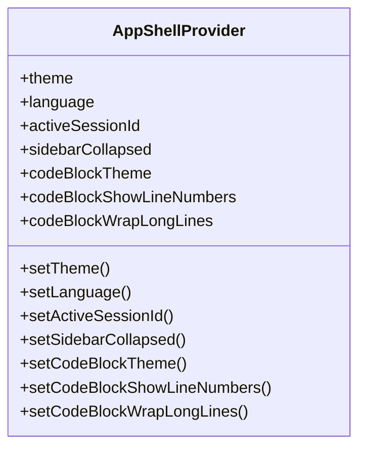
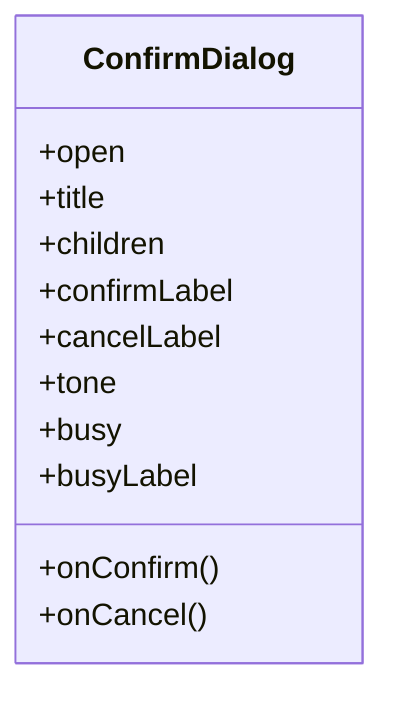
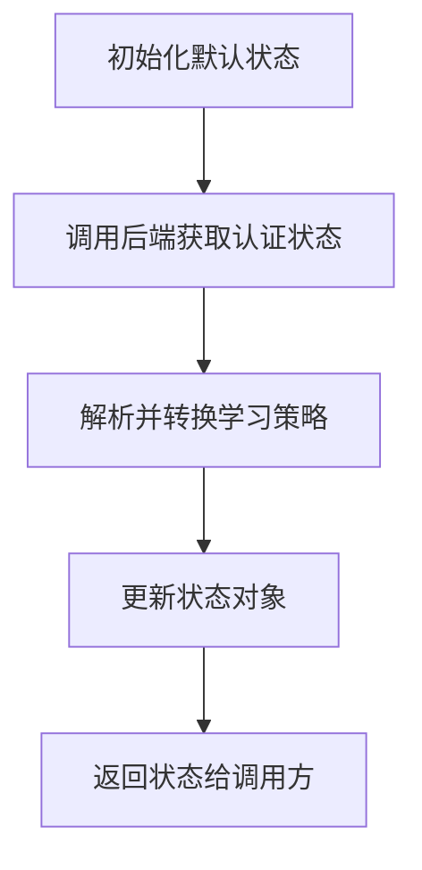
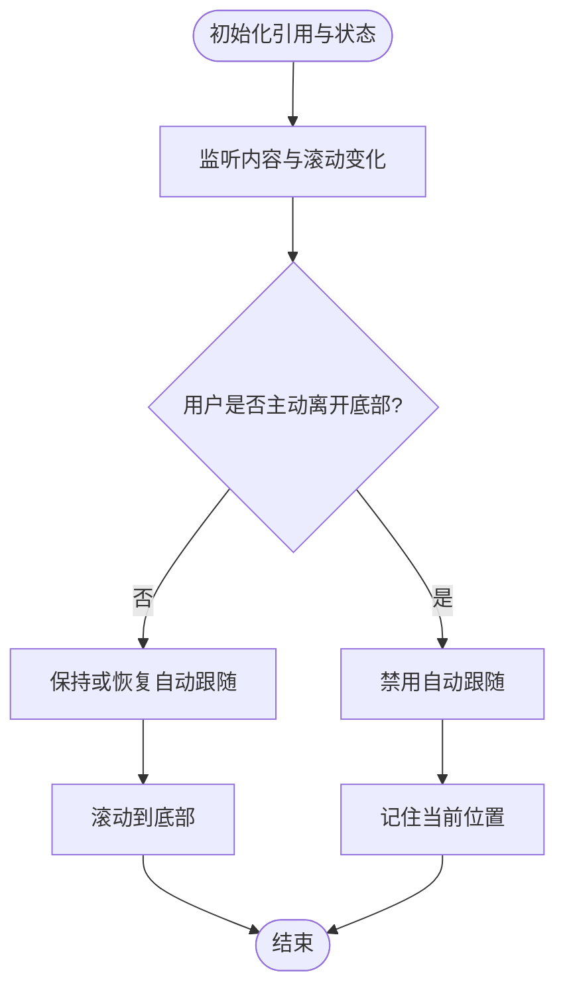
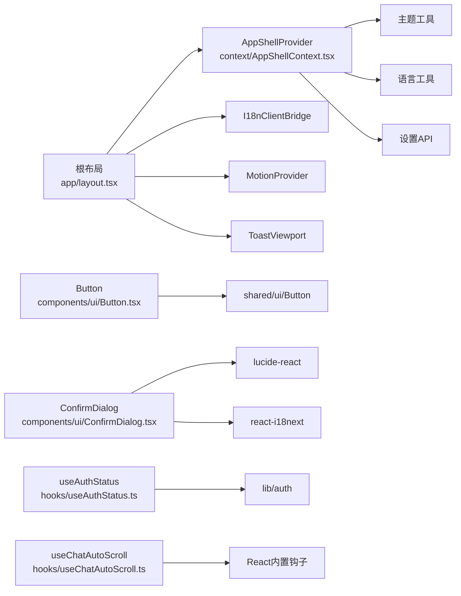

# React 组件架构

<cite>
**本文引用的文件**   
- [web/app/layout.tsx](file://web/app/layout.tsx)
- [web/context/AppShellContext.tsx](file://web/context/AppShellContext.tsx)
- [web/components/ui/Button.tsx](file://web/components/ui/Button.tsx)
- [web/components/ui/ConfirmDialog.tsx](file://web/components/ui/ConfirmDialog.tsx)
- [web/hooks/useAuthStatus.ts](file://web/hooks/useAuthStatus.ts)
- [web/hooks/useChatAutoScroll.ts](file://web/hooks/useChatAutoScroll.ts)
- [web/package.json](file://web/package.json)
</cite>

## 目录
1. [简介](#简介)
2. [项目结构](#项目结构)
3. [核心组件](#核心组件)
4. [架构总览](#架构总览)
5. [详细组件分析](#详细组件分析)
6. [依赖关系分析](#依赖关系分析)
7. [性能考虑](#性能考虑)
8. [故障排查指南](#故障排查指南)
9. [结论](#结论)
10. [附录：开发规范与最佳实践](#附录开发规范与最佳实践)

## 简介
本文件面向 DeepTutor Web 前端的 React 组件架构，聚焦基于 Next.js App Router 的页面组织、组件分层、通信模式、复用策略与设计系统实现。文档从“展示层组件（Presentational）—容器组件（Container）—业务逻辑组件”的分层视角出发，结合项目的实际代码，说明上下文状态管理、自定义 Hook 的使用、事件回调与 props 传递方式，并给出测试与性能优化建议。

## 项目结构
DeepTutor Web 前端采用 Next.js App Router 的典型布局：
- app 目录按路由分组，使用括号分组如 (workspace)、(auth)、(utility)、(admin) 等，提供不同布局与权限边界。
- components 目录按功能域划分，包含 UI 原子组件、通用组件、领域组件。
- context 目录集中应用级上下文（主题、语言、侧边栏折叠、活跃会话等）。
- hooks 目录存放可复用的自定义 Hook。
- lib 目录存放工具函数、API 封装、类型定义等。

图表来源
- [web/app/layout.tsx:1-73](file://web/app/layout.tsx#L1-L73)

章节来源
- [web/app/layout.tsx:1-73](file://web/app/layout.tsx#L1-L73)
- [web/package.json:1-98](file://web/package.json#L1-L98)

## 核心组件
本节梳理项目中关键的 React 组件与上下文，明确其职责与交互方式。

- 根布局与全局提供者
  - 根布局负责字体、元信息、全局样式、主题脚本、国际化桥接、动画提供者、全局提示视图与应用壳提供者。
  - AppShellProvider 集中管理主题、语言、活跃会话、侧边栏折叠、代码块显示设置等跨页面状态，并通过 localStorage 与窗口事件进行持久化与跨标签同步。

- 共享 UI 组件
  - Button 是原子按钮组件的导出入口，统一来自 shared/ui/Button，保证设计系统一致性。
  - ConfirmDialog 是确认对话框组件，处理键盘事件、禁用态、忙态与危险操作语义。

- 自定义 Hook
  - useAuthStatus 负责拉取后端认证状态，暴露是否启用认证、是否已登录、是否管理员、用户 ID、可用性与学习策略等。
  - useChatAutoScroll 为聊天列表提供智能自动滚动，支持流式输出、手势与键盘交互，避免在用户主动浏览时强制滚到底部。

章节来源
- [web/app/layout.tsx:1-73](file://web/app/layout.tsx#L1-L73)
- [web/context/AppShellContext.tsx:1-451](file://web/context/AppShellContext.tsx#L1-L451)
- [web/components/ui/Button.tsx:1-7](file://web/components/ui/Button.tsx#L1-L7)
- [web/components/ui/ConfirmDialog.tsx:1-117](file://web/components/ui/ConfirmDialog.tsx#L1-L117)
- [web/hooks/useAuthStatus.ts:1-93](file://web/hooks/useAuthStatus.ts#L1-L93)
- [web/hooks/useChatAutoScroll.ts:1-143](file://web/hooks/useChatAutoScroll.ts#L1-L143)

## 架构总览
下图展示了根布局到应用提供者、国际化与动画提供者、以及页面与组件之间的调用关系。

图表来源
- [web/app/layout.tsx:42-70](file://web/app/layout.tsx#L42-L70)
- [web/context/AppShellContext.tsx:90-110](file://web/context/AppShellContext.tsx#L90-L110)

## 详细组件分析

### 根布局与全局提供者
- 职责
  - 配置全局字体变量、视口与元数据。
  - 引入主题脚本、全局样式与 Tailwind 类名。
  - 通过 AppShellProvider 提供主题、语言、活跃会话、侧边栏折叠、代码块设置等全局状态。
  - 挂载 MotionProvider、I18nClientBridge、ToastViewport 与 WorkspaceNavigation。

- 关键实现要点
  - 使用 CSS 变量与 Tailwind 类名驱动主题与排版。
  - 将 AppShellProvider 作为最外层 Provider，确保所有页面与组件都能访问全局状态。
  - 通过 ThemeScript 在 SSR 阶段尽早绘制主题，减少闪烁。

图表来源
- [web/app/layout.tsx:14-40](file://web/app/layout.tsx#L14-L40)
- [web/app/layout.tsx:42-70](file://web/app/layout.tsx#L42-L70)

章节来源
- [web/app/layout.tsx:1-73](file://web/app/layout.tsx#L1-L73)

### 应用壳上下文 AppShellProvider
- 职责
  - 维护主题、语言、活跃会话、侧边栏折叠、代码块主题与换行等全局偏好。
  - 从后端加载 UI 设置与学习显示偏好，并与本地存储保持一致。
  - 监听 storage 事件与自定义事件，实现多标签页与跨组件的状态同步。
  - 暴露 setTheme、setLanguage、setActiveSessionId、setSidebarCollapsed、setCodeBlock* 等方法。

- 关键实现要点
  - 初始值优先匹配 SSR，客户端再 hydrate 本地存储。
  - 使用 AbortController 与超时兜底，避免语言初始化阻塞。
  - 通过 useMemo 稳定 value 引用，减少不必要的重渲染。
  - 对 theme/language/sidebar/code block 等设置分别提供 normalize 与 writeStored 方法，保证数据一致性与持久化。

图表来源
- [web/context/AppShellContext.tsx:70-86](file://web/context/AppShellContext.tsx#L70-L86)
- [web/context/AppShellContext.tsx:400-441](file://web/context/AppShellContext.tsx#L400-L441)

章节来源
- [web/context/AppShellContext.tsx:1-451](file://web/context/AppShellContext.tsx#L1-L451)

### 共享 UI 组件：Button 与 ConfirmDialog
- Button
  - 作为设计系统的原子按钮导出入口，统一样式与行为，便于后续扩展尺寸、变体与无障碍属性。

- ConfirmDialog
  - 提供标题、正文、确认/取消文案、忙态与危险色调。
  - 处理 Escape 键关闭、遮罩点击关闭、禁用态与焦点管理。
  - 通过 props 暴露 onConfirm 与 onCancel 回调，遵循“受控组件”模式。

图表来源
- [web/components/ui/ConfirmDialog.tsx:7-21](file://web/components/ui/ConfirmDialog.tsx#L7-L21)
- [web/components/ui/ConfirmDialog.tsx:29-51](file://web/components/ui/ConfirmDialog.tsx#L29-L51)
- [web/components/ui/ConfirmDialog.tsx:55-114](file://web/components/ui/ConfirmDialog.tsx#L55-L114)

章节来源
- [web/components/ui/Button.tsx:1-7](file://web/components/ui/Button.tsx#L1-L7)
- [web/components/ui/ConfirmDialog.tsx:1-117](file://web/components/ui/ConfirmDialog.tsx#L1-L117)

### 自定义 Hook：useAuthStatus
- 职责
  - 从后端 /api/auth/status 获取认证状态，包括是否启用认证、是否已登录、是否管理员、用户 ID、可用性标志与学习策略。
  - 将 learning_policy.allowed_surfaces 转换为 allowedSurfaces，供 UI 隐藏不可用功能面。

- 关键实现要点
  - 首次渲染后异步加载状态，避免阻塞首屏。
  - 使用 alive 标记防止组件卸载后更新状态。
  - 对外暴露 loading 状态，便于上层组件显示骨架或占位。

图表来源
- [web/hooks/useAuthStatus.ts:32-51](file://web/hooks/useAuthStatus.ts#L32-L51)
- [web/hooks/useAuthStatus.ts:63-76](file://web/hooks/useAuthStatus.ts#L63-L76)
- [web/hooks/useAuthStatus.ts:78-92](file://web/hooks/useAuthStatus.ts#L78-L92)

章节来源
- [web/hooks/useAuthStatus.ts:1-93](file://web/hooks/useAuthStatus.ts#L1-L93)

### 自定义 Hook：useChatAutoScroll
- 职责
  - 为聊天消息列表提供智能自动滚动，支持流式输出、内容变化、手势与键盘交互。
  - 当用户主动向上滚动或离开底部时，暂停自动跟随；当用户回到接近底部时恢复跟随。

- 关键实现要点
  - 使用 useLayoutEffect 在布局变更后立即定位到底部。
  - 使用 ResizeObserver 与 MutationObserver 监听内容尺寸与 DOM 变化。
  - 使用 requestAnimationFrame 调度滚动，避免频繁重排。
  - 监听 wheel/touch/key/pointer 事件，判断用户意图，切换 shouldAutoScrollRef。

图表来源
- [web/hooks/useChatAutoScroll.ts:19-46](file://web/hooks/useChatAutoScroll.ts#L19-L46)
- [web/hooks/useChatAutoScroll.ts:48-65](file://web/hooks/useChatAutoScroll.ts#L48-L65)
- [web/hooks/useChatAutoScroll.ts:67-134](file://web/hooks/useChatAutoScroll.ts#L67-L134)

章节来源
- [web/hooks/useChatAutoScroll.ts:1-143](file://web/hooks/useChatAutoScroll.ts#L1-L143)

## 依赖关系分析
- 根布局依赖 AppShellProvider、I18nClientBridge、MotionProvider、ToastViewport 与 WorkspaceNavigation。
- AppShellProvider 依赖主题工具、语言工具、设置 API、恢复主体与学习显示常量。
- UI 组件（Button、ConfirmDialog）依赖 lucide-react 图标库与 react-i18next 国际化。
- useAuthStatus 依赖 lib/auth 提供的 fetchAuthStatus。
- useChatAutoScroll 仅依赖 React 内置钩子与原生 DOM API。

图表来源
- [web/app/layout.tsx:1-73](file://web/app/layout.tsx#L1-L73)
- [web/context/AppShellContext.tsx:1-70](file://web/context/AppShellContext.tsx#L1-L70)
- [web/components/ui/Button.tsx:1-7](file://web/components/ui/Button.tsx#L1-L7)
- [web/components/ui/ConfirmDialog.tsx:1-10](file://web/components/ui/ConfirmDialog.tsx#L1-L10)
- [web/hooks/useAuthStatus.ts:1-10](file://web/hooks/useAuthStatus.ts#L1-L10)
- [web/hooks/useChatAutoScroll.ts:1-10](file://web/hooks/useChatAutoScroll.ts#L1-L10)

章节来源
- [web/app/layout.tsx:1-73](file://web/app/layout.tsx#L1-L73)
- [web/context/AppShellContext.tsx:1-70](file://web/context/AppShellContext.tsx#L1-L70)
- [web/components/ui/Button.tsx:1-7](file://web/components/ui/Button.tsx#L1-L7)
- [web/components/ui/ConfirmDialog.tsx:1-10](file://web/components/ui/ConfirmDialog.tsx#L1-L10)
- [web/hooks/useAuthStatus.ts:1-10](file://web/hooks/useAuthStatus.ts#L1-L10)
- [web/hooks/useChatAutoScroll.ts:1-10](file://web/hooks/useChatAutoScroll.ts#L1-L10)

## 性能考虑
- 首屏渲染
  - 根布局通过 ThemeScript 在 SSR 阶段尽早绘制主题，减少闪烁。
  - AppShellProvider 的语言初始化使用 AbortController 与超时兜底，避免阻塞。

- 状态更新与重渲染
  - AppShellProvider 使用 useMemo 稳定 value 引用，降低子组件重渲染频率。
  - 对 theme/language/sidebar/code block 等设置分别提供 setter，避免整体 state 变更导致的无关更新。

- 滚动与布局
  - useChatAutoScroll 使用 requestAnimationFrame 与 ResizeObserver/MutationObserver，避免频繁重排。
  - 通过 shouldAutoScrollRef 控制自动跟随，减少无效滚动计算。

- 构建与依赖
  - package.json 中定义了 lint、typecheck、test、i18n 检查与架构检查脚本，有助于在 CI 中提前发现性能与结构问题。

[本节为通用性能指导，不直接分析具体文件]

## 故障排查指南
- 国际化未生效
  - 检查 AppShellProvider 的语言初始化流程，确认 hasStoredLanguage 与 response_language 分支是否正确写入本地存储。
  - 观察 window 上的 LANGUAGE_EVENT 与 storage 事件是否正常触发。

- 主题闪烁或错乱
  - 确认 ThemeScript 是否在 head 中正确执行。
  - 检查 initializeTheme 与 subscribeToThemeChanges 是否正确订阅系统主题变化。

- 认证状态异常
  - 检查 useAuthStatus 的 loadAuthStatus 是否成功调用 /api/auth/status。
  - 确认 learningPolicyFromStatus 是否正确解析 allowed_surfaces。

- 聊天滚动异常
  - 检查 useChatAutoScroll 的事件监听是否被正确移除，避免内存泄漏。
  - 确认 shouldAutoScrollRef 在用户交互（wheel/touch/key/pointer）时是否正确切换。

章节来源
- [web/context/AppShellContext.tsx:190-265](file://web/context/AppShellContext.tsx#L190-L265)
- [web/context/AppShellContext.tsx:267-361](file://web/context/AppShellContext.tsx#L267-L361)
- [web/hooks/useAuthStatus.ts:63-92](file://web/hooks/useAuthStatus.ts#L63-L92)
- [web/hooks/useChatAutoScroll.ts:67-134](file://web/hooks/useChatAutoScroll.ts#L67-L134)

## 结论
DeepTutor Web 的 React 组件架构以 Next.js App Router 为基础，通过根布局与 AppShellProvider 建立稳定的全局状态与提供者链；UI 组件遵循设计系统，使用 props 与事件回调进行通信；自定义 Hook 封装认证状态与滚动行为等复杂逻辑。该架构具备良好的可扩展性、可测试性与可维护性，适合持续迭代与团队协作。

[本节为总结性内容，不直接分析具体文件]

## 附录：开发规范与最佳实践
- 组件分层
  - 展示层组件（Presentational）：只接收 props 与事件回调，不包含业务逻辑。
  - 容器组件（Container）：负责数据获取、状态管理与副作用，组合展示层组件。
  - 业务逻辑组件：封装领域规则，通常以 Hook 或工具函数形式存在。

- 命名约定
  - 组件文件使用 PascalCase，如 ConfirmDialog.tsx。
  - Hook 文件使用 camelCase，如 useAuthStatus.ts。
  - 公共 UI 组件放在 components/ui，通用组件放在 components/common，领域组件按功能域分目录。

- 代码风格
  - 使用 TypeScript 与严格类型定义。
  - 使用 Tailwind 类名进行样式管理，避免内联样式。
  - 使用 react-i18next 进行国际化，避免硬编码文本。

- 组件通信
  - 优先使用 props 与事件回调。
  - 全局状态通过 AppShellProvider 与 useAppShell 访问。
  - 跨组件事件可通过 window 自定义事件或事件总线。

- 测试策略
  - 单元测试：使用 Vitest 与 @testing-library/react 测试组件行为与 Hook 逻辑。
  - E2E 测试：使用 Playwright 覆盖关键用户流程。
  - 契约测试：使用 contracts 生成与校验前后端接口一致性。

- 性能优化
  - 使用 useMemo 与 useCallback 稳定引用，减少不必要重渲染。
  - 使用 React.lazy 与 Suspense 按需加载大组件。
  - 避免在高频事件中执行昂贵计算，使用节流与防抖。

[本节为通用指导，不直接分析具体文件]