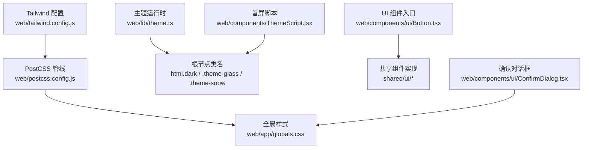
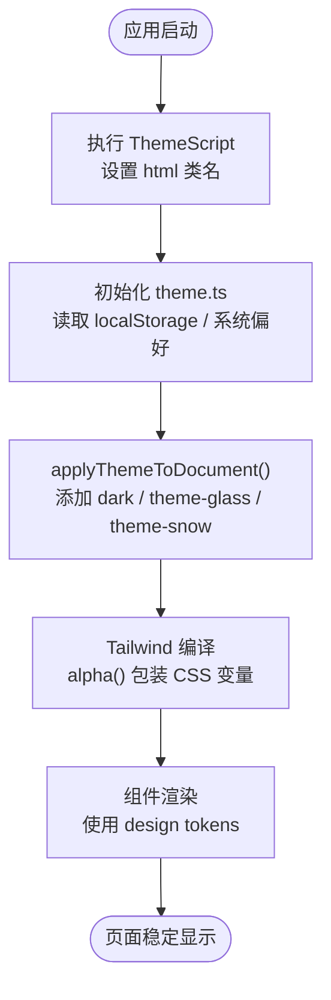
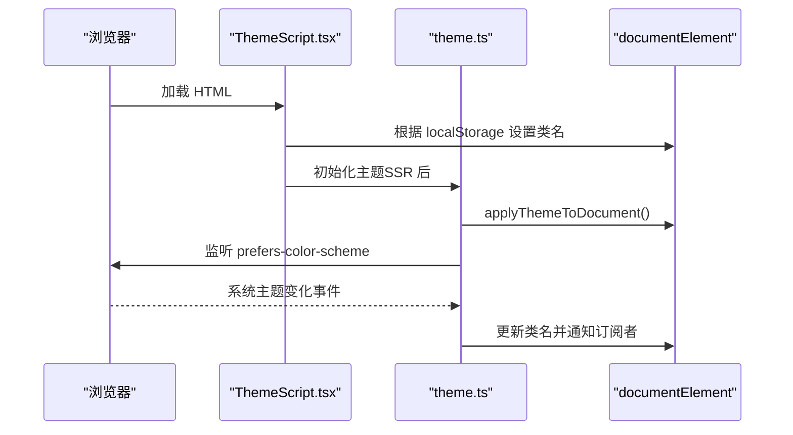
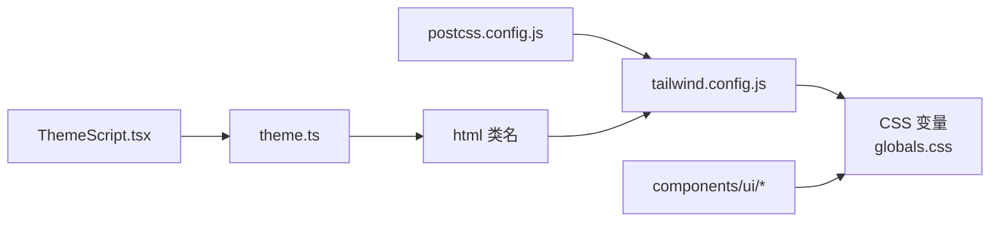

# UI 设计系统

<cite>
**本文引用的文件**   
- [tailwind.config.js](file://web/tailwind.config.js)
- [postcss.config.js](file://web/postcss.config.js)
- [globals.css](file://web/app/globals.css)
- [theme.ts](file://web/lib/theme.ts)
- [ThemeScript.tsx](file://web/components/ThemeScript.tsx)
- [Button.tsx](file://web/components/ui/Button.tsx)
- [ConfirmDialog.tsx](file://web/components/ui/ConfirmDialog.tsx)
</cite>

## 目录
1. [引言](#引言)
2. [项目结构](#项目结构)
3. [核心组件](#核心组件)
4. [架构总览](#架构总览)
5. [详细组件分析](#详细组件分析)
6. [依赖关系分析](#依赖关系分析)
7. [性能与可访问性](#性能与可访问性)
8. [故障排查指南](#故障排查指南)
9. [结论](#结论)
10. [附录：样式开发规范与使用指南](#附录样式开发规范与使用指南)

## 引言
本文件面向 DeepTutor Web 前端的设计系统与样式工程，聚焦基于 Tailwind CSS 的样式架构、设计令牌、颜色系统、字体与间距标准、组件库原则（可访问性、响应式、主题定制）、样式组织与隔离策略、图标与动画统一实现、暗色模式与多设备适配、浏览器兼容性处理，以及样式开发规范与设计工具建议。目标是帮助开发者理解设计语言并正确使用 UI 组件库。

## 项目结构
Web 端的样式体系由以下关键文件构成：
- Tailwind 配置：集中定义主题扩展、字体族、颜色映射、背景图与插件。
- PostCSS 配置：串联 Tailwind 与 Autoprefixer。
- 全局样式：通过 CSS 变量提供主题调色板、基础排版、滚动条、动画与通用组件类。
- 主题运行时：负责读取/写入本地存储、跟随系统偏好、应用主题类名到根节点。
- 首屏脚本：在 React 水合前注入主题与布局属性，避免闪烁。
- 组件入口：UI 组件以薄封装形式暴露，样式主要由共享层与全局样式承担。



**图表来源**
- [tailwind.config.js:1-114](file://web/tailwind.config.js#L1-L114)
- [postcss.config.js:1-7](file://web/postcss.config.js#L1-L7)
- [globals.css:1-397](file://web/app/globals.css#L1-L397)
- [theme.ts:1-190](file://web/lib/theme.ts#L1-L190)
- [ThemeScript.tsx:1-64](file://web/components/ThemeScript.tsx#L1-L64)
- [Button.tsx:1-7](file://web/components/ui/Button.tsx#L1-L7)
- [ConfirmDialog.tsx:1-117](file://web/components/ui/ConfirmDialog.tsx#L1-L117)

**章节来源**
- [tailwind.config.js:1-114](file://web/tailwind.config.js#L1-L114)
- [postcss.config.js:1-7](file://web/postcss.config.js#L1-L7)
- [globals.css:1-397](file://web/app/globals.css#L1-L397)
- [theme.ts:1-190](file://web/lib/theme.ts#L1-L190)
- [ThemeScript.tsx:1-64](file://web/components/ThemeScript.tsx#L1-L64)
- [Button.tsx:1-7](file://web/components/ui/Button.tsx#L1-L7)
- [ConfirmDialog.tsx:1-117](file://web/components/ui/ConfirmDialog.tsx#L1-L117)

## 核心组件
- 按钮 Button：作为 UI 层的薄封装，实际样式与行为来自共享组件实现；对外暴露类型与默认导出，便于统一升级。
- 确认对话框 ConfirmDialog：提供无障碍语义、键盘交互（Esc 关闭）、焦点管理与危险操作提示，遵循应用统一的卡片与遮罩风格。

**章节来源**
- [Button.tsx:1-7](file://web/components/ui/Button.tsx#L1-L7)
- [ConfirmDialog.tsx:1-117](file://web/components/ui/ConfirmDialog.tsx#L1-L117)

## 架构总览
DeepTutor 的样式架构采用“CSS 变量 + Tailwind 扩展”的双层模型：
- 设计令牌层：通过 CSS 变量定义颜色、阴影、表面层级等，支持多主题（浅色奶油、深色暖调、Snow 纯白、Glass 玻璃）。
- 构建层：Tailwind 通过自定义 alpha 函数将透明度修饰符安全地应用到 CSS 变量上，解决透明通道无法折叠的问题。
- 运行时层：主题脚本与运行时逻辑负责在 SSR 后正确挂载主题类名，并监听系统明暗切换。



**图表来源**
- [ThemeScript.tsx:17-54](file://web/components/ThemeScript.tsx#L17-L54)
- [theme.ts:115-129](file://web/lib/theme.ts#L115-L129)
- [tailwind.config.js:15-109](file://web/tailwind.config.js#L15-L109)

**章节来源**
- [ThemeScript.tsx:1-64](file://web/components/ThemeScript.tsx#L1-L64)
- [theme.ts:1-190](file://web/lib/theme.ts#L1-L190)
- [tailwind.config.js:1-114](file://web/tailwind.config.js#L1-L114)

## 详细组件分析

### 设计令牌与颜色系统
- 令牌范围：background、foreground、card/popover、primary/secondary/muted/accent/destructive、border/input/ring、overlay、success/warning/info 及其 foreground/surface 变体。
- 主题家族：
  - Cream（默认）：暖色调背景与赤陶主色。
  - Dark：同家族的近黑底色与高对比文本。
  - Snow：纯白中性画布，蓝色强调。
  - Glass：半透明面板与紫色强调，配合径向渐变背景与毛玻璃效果。
- Tailwind 集成：通过 alpha(name) 将透明度修饰符映射为 color-mix，确保对含 alpha 的 CSS 变量也能生成有效规则。

```mermaid
classDiagram
class 设计令牌 {
"背景/前景"
"卡片/弹出层"
"主色/辅色/强调/破坏"
"边框/输入/环"
"覆盖层"
"成功/警告/信息"
}
class 主题 {
"Cream"
"Dark"
"Snow"
"Glass"
}
class Tailwind扩展 {
"alpha()"
"colors.*"
"fontFamily.sans/serif"
"backgroundImage"
}
设计令牌 --> 主题 : "由 CSS 变量定义"
Tailwind扩展 --> 设计令牌 : "通过 alpha() 绑定"
```

**图表来源**
- [globals.css:98-243](file://web/app/globals.css#L98-L243)
- [tailwind.config.js:15-109](file://web/tailwind.config.js#L15-L109)

**章节来源**
- [globals.css:98-243](file://web/app/globals.css#L98-L243)
- [tailwind.config.js:15-109](file://web/tailwind.config.js#L15-L109)

### 字体规范与中文字体链
- 无衬线字体：优先 CSS 变量，其次 PingFang SC、Hiragino Sans GB、Microsoft YaHei、Noto Sans SC、system-ui。
- 衬线字体：优先 CSS 变量，其次 Songti SC、STSong、Noto Serif SC、Source Han Serif SC、SimSun、Georgia。
- 目的：保证中英文混排时字形一致，避免不同 OS 回退差异导致标题与正文不一致。

**章节来源**
- [tailwind.config.js:29-55](file://web/tailwind.config.js#L29-L55)

### 间距与布局约定
- 页面容器：dt-page-container 启用容器查询，dt-page-grid 提供 2/3/4/5 列栅格，按宽度断点自动调整。
- 动作按钮：dt-page-action 统一最小高度与字号，保证触控可达性与视觉一致性。
- 栅格断点：520px、640px、800px、1040px 逐步增加列数，保持内容密度合理。

**章节来源**
- [globals.css:5-77](file://web/app/globals.css#L5-L77)

### 组件库设计原则
- 可访问性：
  - 焦点可见：:focus-visible 使用 --ring 描边。
  - 语义化：对话框使用 role="alertdialog"、aria-modal、aria-label。
  - 键盘交互：Esc 关闭、Enter 不触发破坏性操作（取消按钮 autoFocus）。
- 响应式：
  - 容器查询驱动页面网格与标题尺寸变化。
  - 媒体查询控制毛玻璃强度与滚动行为。
- 主题定制：
  - 所有颜色通过 CSS 变量暴露，Tailwind 通过 alpha() 安全叠加透明度。
  - 主题切换通过 html 类名切换，无需重新计算样式。

**章节来源**
- [globals.css:344-358](file://web/app/globals.css#L344-L358)
- [ConfirmDialog.tsx:55-113](file://web/components/ui/ConfirmDialog.tsx#L55-L113)
- [tailwind.config.js:15-109](file://web/tailwind.config.js#L15-L109)

### 样式组织模式与模块化
- 分层：@layer base / components / utilities 明确职责边界。
- 模块化：
  - base：主题调色板、基础元素、滚动条、动画变量。
  - components：surface-card、muted-chip、dt-select 等通用组件样式。
  - utilities：hide-scrollbar 等原子类。
- 隔离策略：
  - 组件样式尽量使用 CSS 变量与 Tailwind 原子类，避免硬编码颜色。
  - Markdown 渲染器样式限定在 .md-renderer 作用域内，避免污染全局。

**章节来源**
- [globals.css:79-397](file://web/app/globals.css#L79-L397)

### 图标系统与交互反馈
- 图标：使用 lucide-react 提供的矢量图标，如 X 关闭图标，保证缩放与主题一致性。
- 交互反馈：
  - 过渡：按钮与状态切换使用 transition-colors。
  - 动画：fade-in、overlay-in、pop-in 等关键帧统一在 globals.css 中定义，并通过 animate-* 类复用。
  - 减少动效：prefers-reduced-motion 下禁用动画与平滑滚动。

**章节来源**
- [ConfirmDialog.tsx:4-80](file://web/components/ui/ConfirmDialog.tsx#L4-L80)
- [globals.css:759-800](file://web/app/globals.css#L759-L800)
- [globals.css:349-358](file://web/app/globals.css#L349-L358)

### 暗色模式与多主题
- 主题类名：dark、theme-glass、theme-snow 分别对应不同配色方案。
- 系统跟随：当用户选择 system 或未设置时，监听 prefers-color-scheme 动态切换。
- 持久化：localStorage 键 deeptutor-theme 保存用户选择或 system。



**图表来源**
- [ThemeScript.tsx:17-54](file://web/components/ThemeScript.tsx#L17-L54)
- [theme.ts:115-190](file://web/lib/theme.ts#L115-L190)

**章节来源**
- [theme.ts:1-190](file://web/lib/theme.ts#L1-L190)
- [ThemeScript.tsx:1-64](file://web/components/ThemeScript.tsx#L1-L64)

### 多设备适配与浏览器兼容
- 容器查询：用于页面网格与标题在不同可用宽度下的自适应。
- 媒体查询：控制毛玻璃模糊强度与滚动行为。
- 滚动锚定：[data-chat-scroll-root="true"] 禁用 overflow-anchor 与 smooth 滚动，避免流式内容抖动。
- Autoprefixer：在 PostCSS 中启用，补齐浏览器前缀。

**章节来源**
- [globals.css:43-77](file://web/app/globals.css#L43-L77)
- [globals.css:257-262](file://web/app/globals.css#L257-L262)
- [globals.css:436-439](file://web/app/globals.css#L436-L439)
- [postcss.config.js:1-7](file://web/postcss.config.js#L1-L7)

## 依赖关系分析
- Tailwind 配置依赖 CSS 变量，通过 alpha() 将透明度修饰符转换为 color-mix。
- PostCSS 串联 Tailwind 与 Autoprefixer。
- 主题运行时依赖 localStorage 与 matchMedia，向 DOM 注入主题类名。
- 组件通过 CSS 变量与 Tailwind 原子类消费设计令牌，避免直接耦合具体颜色值。



**图表来源**
- [tailwind.config.js:1-114](file://web/tailwind.config.js#L1-L114)
- [postcss.config.js:1-7](file://web/postcss.config.js#L1-L7)
- [globals.css:98-243](file://web/app/globals.css#L98-L243)
- [ThemeScript.tsx:17-54](file://web/components/ThemeScript.tsx#L17-L54)
- [theme.ts:115-190](file://web/lib/theme.ts#L115-L190)

**章节来源**
- [tailwind.config.js:1-114](file://web/tailwind.config.js#L1-L114)
- [postcss.config.js:1-7](file://web/postcss.config.js#L1-L7)
- [globals.css:98-243](file://web/app/globals.css#L98-L243)
- [ThemeScript.tsx:17-54](file://web/components/ThemeScript.tsx#L17-L54)
- [theme.ts:115-190](file://web/lib/theme.ts#L115-L190)

## 性能与可访问性
- 性能：
  - 首屏无闪烁：ThemeScript 在水合前设置主题类名。
  - 流式滚动优化：禁用自动滚动锚定与平滑滚动，避免抖动。
  - 减少重绘：动画与过渡使用 transform/opacity，避免布局抖动。
- 可访问性：
  - 焦点可见：:focus-visible 使用 --ring。
  - 语义标签：对话框使用 alertdialog、aria-modal、aria-label。
  - 键盘导航：Esc 关闭、Cancel 按钮 autoFocus。
  - 减少动效：prefers-reduced-motion 下禁用动画。

**章节来源**
- [ThemeScript.tsx:17-54](file://web/components/ThemeScript.tsx#L17-L54)
- [globals.css:344-358](file://web/app/globals.css#L344-L358)
- [globals.css:436-439](file://web/app/globals.css#L436-L439)
- [ConfirmDialog.tsx:44-113](file://web/components/ui/ConfirmDialog.tsx#L44-L113)

## 故障排查指南
- 侧边栏悬停态缺失：
  - 现象：bg-muted/70 未生效。
  - 原因：Tailwind 无法将透明度修饰符折叠到带 alpha 的 CSS 变量。
  - 解决：使用 alpha() 包装变量，使透明度落在 color-mix 上。
- 主题闪烁：
  - 现象：页面首次加载出现错误主题。
  - 原因：React 水合后才设置主题类名。
  - 解决：确保 ThemeScript 在 SSR 阶段注入并先于水合执行。
- 流式内容抖动：
  - 现象：聊天流式输出时页面跳动。
  - 原因：浏览器自动滚动锚定与平滑滚动冲突。
  - 解决：为滚动容器添加 data-chat-scroll-root="true"，禁用自动锚定与平滑滚动。
- 中文字体不一致：
  - 现象：中文回退到系统 serif/sans，与英文字体不一致。
  - 原因：未显式声明 CJK 字体。
  - 解决：在 fontFamily.sans/serif 中追加 PingFang SC、Songti SC 等字体。

**章节来源**
- [tailwind.config.js:2-15](file://web/tailwind.config.js#L2-L15)
- [ThemeScript.tsx:17-54](file://web/components/ThemeScript.tsx#L17-L54)
- [globals.css:436-439](file://web/app/globals.css#L436-L439)
- [tailwind.config.js:29-55](file://web/tailwind.config.js#L29-L55)

## 结论
DeepTutor 的 UI 设计系统以 CSS 变量为核心，结合 Tailwind 的扩展能力，实现了跨主题、跨设备的统一样式表达。通过 ThemeScript 与 theme.ts 的协作，保证了主题切换的性能与体验；通过 @layer 与原子类组合，实现了清晰的样式组织与隔离。组件层面强调可访问性与一致的交互反馈，为业务功能提供了稳定的视觉与行为基座。

## 附录：样式开发规范与使用指南
- 设计令牌使用：
  - 颜色：一律使用 Tailwind 的颜色别名（如 bg-primary、text-muted-foreground），不要硬编码十六进制。
  - 阴影与表面：使用 surface-raised 与 shadow-raised 变量，保持层级一致。
- 字体与排版：
  - 标题与正文：使用 prose 系列样式，确保层次清晰。
  - 代码块：使用 md-code-block 相关样式，避免覆盖主题。
- 组件开发：
  - 按钮与表单：遵循 dt-page-action 与 dt-select 的交互与尺寸规范。
  - 对话框与弹窗：使用 ConfirmDialog 或共享 Dialog，确保无障碍与键盘交互。
- 主题定制：
  - 新增主题：在 globals.css 中定义新的主题类，补充全部必需变量。
  - 修改现有主题：仅调整 CSS 变量值，避免改动组件样式。
- 动画与交互：
  - 使用 animate-fade-in、animate-overlay-in 等统一动画类。
  - 尊重 prefers-reduced-motion，避免强制动画。
- 响应式与容器查询：
  - 使用 dt-page-grid-* 与 @container feature-page 进行布局适配。
- 构建与工具：
  - 使用 Tailwind 与 PostCSS 管线，确保 Autoprefixer 生效。
  - 在组件中使用 lucide-react 图标，保持矢量与主题一致性。

**章节来源**
- [globals.css:361-397](file://web/app/globals.css#L361-L397)
- [globals.css:441-753](file://web/app/globals.css#L441-L753)
- [tailwind.config.js:27-109](file://web/tailwind.config.js#L27-L109)
- [postcss.config.js:1-7](file://web/postcss.config.js#L1-L7)