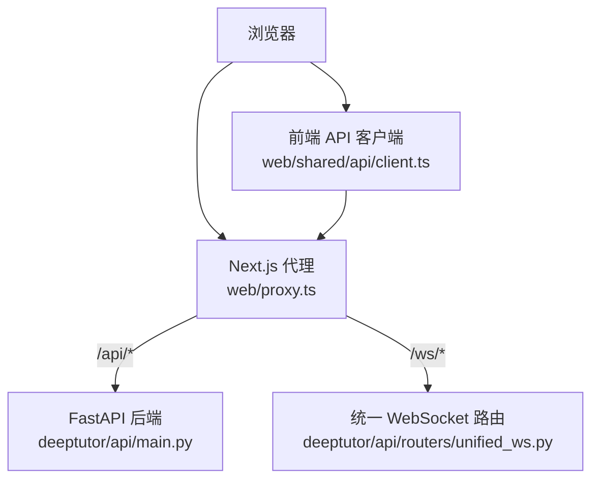
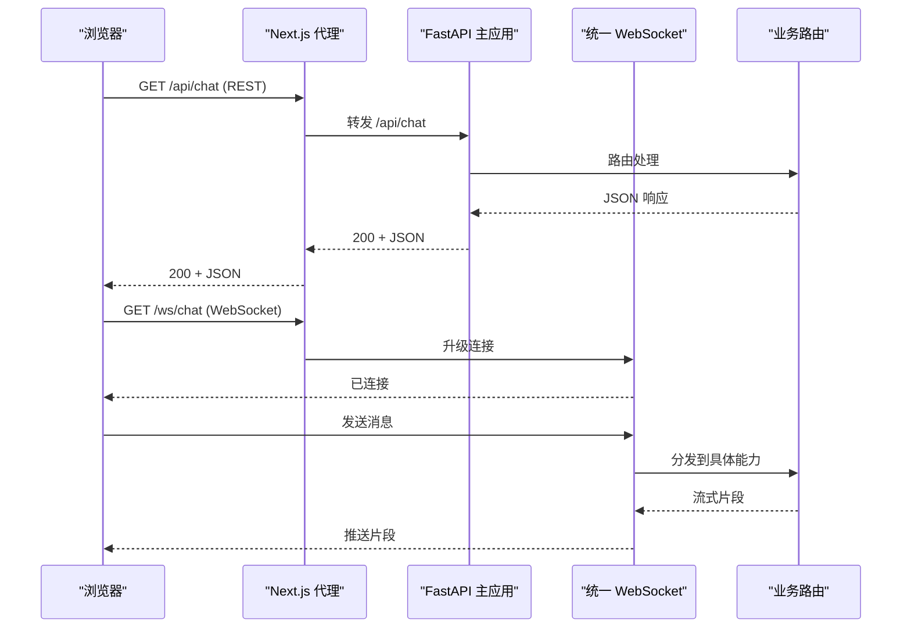
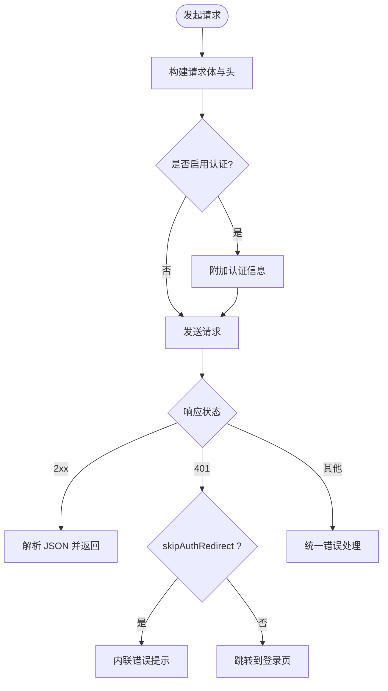
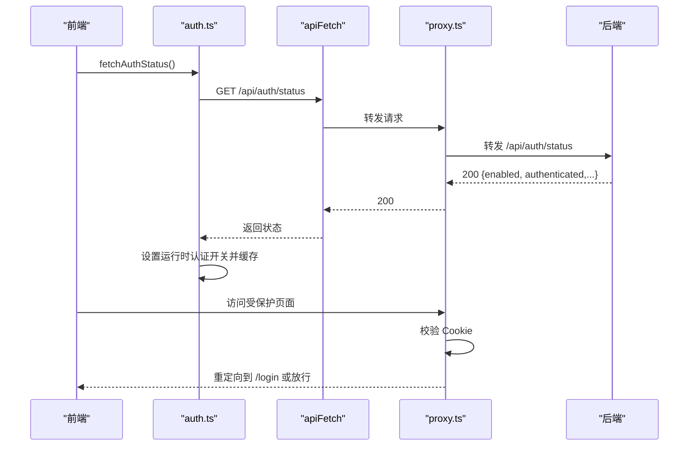
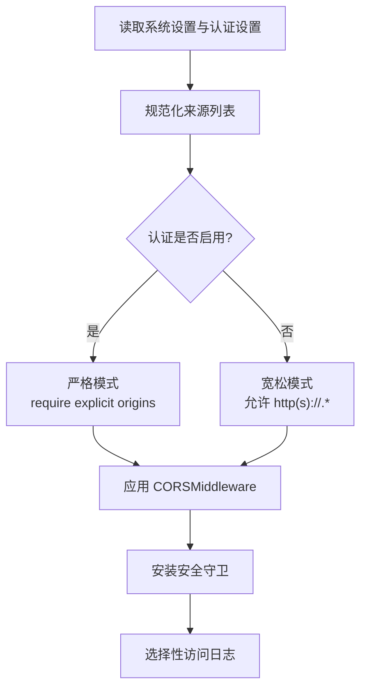
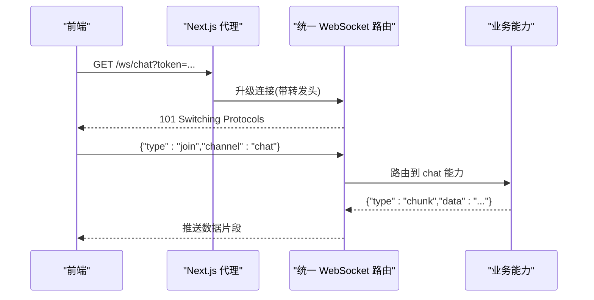
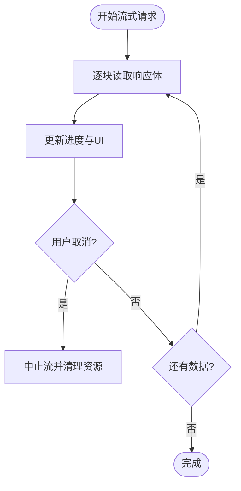
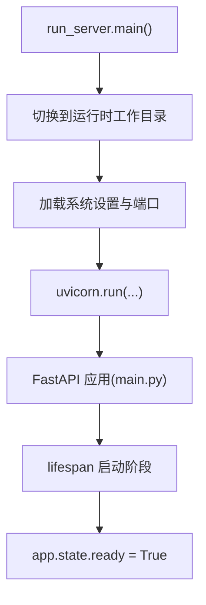
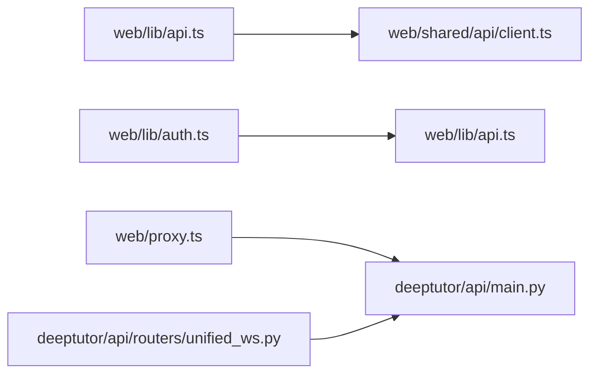

# 前后端通信

<cite>
**本文引用的文件**   
- [web/lib/api.ts](file://web/lib/api.ts)
- [web/shared/api/client.ts](file://web/shared/api/client.ts)
- [web/lib/auth.ts](file://web/lib/auth.ts)
- [web/proxy.ts](file://web/proxy.ts)
- [deeptutor/api/main.py](file://deeptutor/api/main.py)
- [deeptutor/api/run_server.py](file://deeptutor/api/run_server.py)
- [deeptutor/api/routers/unified_ws.py](file://deeptutor/api/routers/unified_ws.py)
- [web/lib/stream.ts](file://web/lib/stream.ts)
</cite>

## 目录
1. [简介](#简介)
2. [项目结构](#项目结构)
3. [核心组件](#核心组件)
4. [架构总览](#架构总览)
5. [详细组件分析](#详细组件分析)
6. [依赖关系分析](#依赖关系分析)
7. [性能与可靠性](#性能与可靠性)
8. [故障排查指南](#故障排查指南)
9. [结论](#结论)

## 简介
本文件系统性梳理 DeepTutor 的前后端通信方案，覆盖 RESTful API 调用封装、WebSocket 实时通信、流式数据传输、认证与安全、CORS 配置、网络监控与调试。目标是帮助开发者从基础 HTTP 请求到高级实时通信，建立一致、可维护且安全的网络层实现。

## 项目结构
DeepTutor 采用前后端分离：
- 前端 Next.js 应用通过代理将 /api/* 和 /ws/* 转发至后端 FastAPI 服务。
- 后端 FastAPI 提供 REST 接口、统一 WebSocket 路由、CORS、健康检查、中间件和安全防护。
- 前端通过共享 API 客户端发起请求，并处理认证状态、错误与重定向。

**图示来源**
- [web/proxy.ts:51-91](file://web/proxy.ts#L51-L91)
- [deeptutor/api/main.py:364-373](file://deeptutor/api/main.py#L364-L373)
- [deeptutor/api/routers/unified_ws.py](file://deeptutor/api/routers/unified_ws.py)

**章节来源**
- [web/proxy.ts:1-110](file://web/proxy.ts#L1-L110)
- [deeptutor/api/main.py:364-373](file://deeptutor/api/main.py#L364-L373)

## 核心组件
- 前端 API 客户端：集中管理请求构建、拦截器、响应处理器、认证状态同步与错误处理。
- 认证模块：负责登录、注册、登出、会话状态缓存与跨标签页同步。
- Next.js 代理：统一转发 /api/* 与 /ws/*，附加鉴权策略与后端转发头。
- 后端 FastAPI：生命周期管理、CORS、安全守卫、访问日志、健康检查、路由加载。
- 统一 WebSocket：为聊天、协作编辑等场景提供实时通道。
- 流式数据处理：前端对 SSE/流式响应进行进度跟踪、取消与分块渲染。

**章节来源**
- [web/lib/api.ts:1-7](file://web/lib/api.ts#L1-L7)
- [web/shared/api/client.ts](file://web/shared/api/client.ts)
- [web/lib/auth.ts:1-227](file://web/lib/auth.ts#L1-L227)
- [web/proxy.ts:1-110](file://web/proxy.ts#L1-L110)
- [deeptutor/api/main.py:1-548](file://deeptutor/api/main.py#L1-L548)
- [deeptutor/api/routers/unified_ws.py](file://deeptutor/api/routers/unified_ws.py)
- [web/lib/stream.ts](file://web/lib/stream.ts)

## 架构总览
整体通信流程如下：
- 浏览器发起 /api/* 或 /ws/* 请求。
- Next.js 代理根据路径重写并转发到后端；对 WebSocket 请求附加升级头。
- FastAPI 在启动时初始化容器、事件总线、LLM 客户端、CORS 与安全守卫。
- 认证状态由前端周期性拉取并缓存，影响全局 401 重定向行为。
- 流式数据在前端按块消费，支持进度回调与取消。

**图示来源**
- [web/proxy.ts:51-91](file://web/proxy.ts#L51-L91)
- [deeptutor/api/main.py:364-373](file://deeptutor/api/main.py#L364-L373)
- [deeptutor/api/routers/unified_ws.py](file://deeptutor/api/routers/unified_ws.py)

## 详细组件分析

### 前端 API 客户端设计
- 入口导出：web/lib/api.ts 仅做兼容性导出，实际实现位于 web/shared/api/client.ts。
- 请求拦截器：
  - 自动附加认证相关头（如 Cookie）。
  - 根据运行时认证开关决定是否触发 401 → /login 重定向。
  - 支持 skipAuthRedirect 以区分“凭据错误”和“会话过期”。
- 响应处理器：
  - 统一解析 JSON，提取 detail 字段用于用户提示。
  - 对 422 校验错误数组进行扁平化处理。
- 错误重试与超时控制：
  - 建议在 client.ts 中实现指数退避重试与超时 AbortController。
  - 对幂等 GET 请求启用有限重试；POST/PUT 默认不重试。
- 取消操作：
  - 使用 AbortSignal 支持用户主动取消长耗时请求。

**图示来源**
- [web/lib/auth.ts:76-113](file://web/lib/auth.ts#L76-L113)
- [web/lib/auth.ts:118-146](file://web/lib/auth.ts#L118-L146)
- [web/lib/auth.ts:153-161](file://web/lib/auth.ts#L153-L161)

**章节来源**
- [web/lib/api.ts:1-7](file://web/lib/api.ts#L1-L7)
- [web/shared/api/client.ts](file://web/shared/api/client.ts)
- [web/lib/auth.ts:76-113](file://web/lib/auth.ts#L76-L113)
- [web/lib/auth.ts:118-146](file://web/lib/auth.ts#L118-L146)
- [web/lib/auth.ts:153-161](file://web/lib/auth.ts#L153-L161)

### 认证机制与会话管理
- 前端认证状态：
  - fetchAuthStatus 定期拉取 /api/auth/status，缓存结果并在多标签页间广播边界事件。
  - setRuntimeAuthEnabled 驱动 apiFetch 的重定向逻辑。
- 登录/注册/登出：
  - login/register 使用 apiFetch，失败时跳过全局重定向以便表单内展示错误。
  - logout 清除服务端会话并刷新本地状态。
- 代理鉴权：
  - proxy.ts 在非公开路径下校验 Cookie，无效则重定向到登录页。

**图示来源**
- [web/lib/auth.ts:76-113](file://web/lib/auth.ts#L76-L113)
- [web/lib/auth.ts:118-146](file://web/lib/auth.ts#L118-L146)
- [web/lib/auth.ts:214-227](file://web/lib/auth.ts#L214-L227)
- [web/proxy.ts:51-91](file://web/proxy.ts#L51-L91)

**章节来源**
- [web/lib/auth.ts:1-227](file://web/lib/auth.ts#L1-L227)
- [web/proxy.ts:51-91](file://web/proxy.ts#L51-L91)

### CORS 配置与安全策略
- 后端 CORS：
  - 根据系统设置与认证开关动态构建 allow_origins、allow_origin_regex 与 mode。
  - 允许 credentials，方法头通配，便于前端携带 Cookie。
- 安全守卫：
  - install_security_guard 在请求进入前进行速率限制与基础防护。
- 访问日志：
  - selective_access_log 仅记录非 200 响应，避免高频轮询污染日志。
- 健康检查：
  - /health/live 与 /health/ready 分别检测进程存活与服务就绪。

**图示来源**
- [deeptutor/api/main.py:77-105](file://deeptutor/api/main.py#L77-L105)
- [deeptutor/api/main.py:423-427](file://deeptutor/api/main.py#L423-L427)
- [deeptutor/api/main.py:452-475](file://deeptutor/api/main.py#L452-L475)
- [deeptutor/api/main.py:478-492](file://deeptutor/api/main.py#L478-L492)
- [deeptutor/api/main.py:525-541](file://deeptutor/api/main.py#L525-L541)

**章节来源**
- [deeptutor/api/main.py:77-105](file://deeptutor/api/main.py#L77-L105)
- [deeptutor/api/main.py:423-427](file://deeptutor/api/main.py#L423-L427)
- [deeptutor/api/main.py:452-475](file://deeptutor/api/main.py#L452-L475)
- [deeptutor/api/main.py:478-492](file://deeptutor/api/main.py#L478-L492)
- [deeptutor/api/main.py:525-541](file://deeptutor/api/main.py#L525-L541)

### WebSocket 实时通信
- 统一路由：
  - deeptutor/api/routers/unified_ws.py 提供统一的 WebSocket 接入点，按通道分发到不同业务能力。
- 代理转发：
  - proxy.ts 对 /ws/* 请求附加 allowWebSocketUpgrade 头，确保连接升级成功。
- 连接管理与断线重连：
  - 建议前端实现指数退避重连、心跳保活与最大重连次数限制。
  - 在 onclose/onerror 中触发重连，onmessage 中按协议解析消息类型。

**图示来源**
- [web/proxy.ts:67-75](file://web/proxy.ts#L67-L75)
- [deeptutor/api/routers/unified_ws.py](file://deeptutor/api/routers/unified_ws.py)

**章节来源**
- [web/proxy.ts:67-75](file://web/proxy.ts#L67-L75)
- [deeptutor/api/routers/unified_ws.py](file://deeptutor/api/routers/unified_ws.py)

### 流式数据传输与进度跟踪
- 前端流式处理：
  - web/lib/stream.ts 提供流式读取工具，支持进度回调、取消与分块渲染。
- 后端流式输出：
  - FastAPI 可使用 StreamingResponse 或异步生成器逐步产出数据。
- 进度与取消：
  - 前端在每次收到 chunk 时更新进度条，并提供取消按钮中止流。

**图示来源**
- [web/lib/stream.ts](file://web/lib/stream.ts)

**章节来源**
- [web/lib/stream.ts](file://web/lib/stream.ts)

### 服务器启动与运行参数
- run_server.py：
  - 设置工作目录、端口、workers、reload_excludes、ws_max_size、keep-alive 超时等。
  - Windows 平台切换 ProactorEventLoop 以支持子进程 API。
- main.py：
  - 生命周期管理、中间件挂载、路由加载与健康检查。

**图示来源**
- [deeptutor/api/run_server.py:30-95](file://deeptutor/api/run_server.py#L30-L95)
- [deeptutor/api/main.py:108-301](file://deeptutor/api/main.py#L108-L301)

**章节来源**
- [deeptutor/api/run_server.py:30-95](file://deeptutor/api/run_server.py#L30-L95)
- [deeptutor/api/main.py:108-301](file://deeptutor/api/main.py#L108-L301)

## 依赖关系分析
- 前端依赖：
  - web/lib/api.ts 依赖 web/shared/api/client.ts 的 API 客户端实现。
  - web/lib/auth.ts 依赖 apiFetch 与运行时认证开关。
  - web/proxy.ts 依赖代理策略与后端基地址解析。
- 后端依赖：
  - deeptutor/api/main.py 依赖中间件、安全守卫、CORS、路由加载器。
  - deeptutor/api/routers/unified_ws.py 作为 WebSocket 的统一入口。

**图示来源**
- [web/lib/api.ts:1-7](file://web/lib/api.ts#L1-L7)
- [web/lib/auth.ts:1-227](file://web/lib/auth.ts#L1-L227)
- [web/proxy.ts:1-110](file://web/proxy.ts#L1-L110)
- [deeptutor/api/main.py:364-373](file://deeptutor/api/main.py#L364-L373)
- [deeptutor/api/routers/unified_ws.py](file://deeptutor/api/routers/unified_ws.py)

**章节来源**
- [web/lib/api.ts:1-7](file://web/lib/api.ts#L1-L7)
- [web/lib/auth.ts:1-227](file://web/lib/auth.ts#L1-L227)
- [web/proxy.ts:1-110](file://web/proxy.ts#L1-L110)
- [deeptutor/api/main.py:364-373](file://deeptutor/api/main.py#L364-L373)
- [deeptutor/api/routers/unified_ws.py](file://deeptutor/api/routers/unified_ws.py)

## 性能与可靠性
- 连接与超时：
  - uvicorn 的 timeout_keep_alive 与 ws_max_size 控制连接复用与 WebSocket 帧大小。
- 并发与扩展：
  - backend_workers 控制后端进程数；开发环境 reload 与 workers > 1 互斥。
- 流式优化：
  - 前端按需渲染增量内容，减少首屏阻塞；后端使用异步生成器降低内存峰值。
- 重试与降级：
  - 对幂等请求实施指数退避重试；网络不可达时快速回退到离线态或缓存数据。

[本节为通用指导，无需特定文件引用]

## 故障排查指南
- 常见问题定位：
  - 401 未授权：检查前端认证状态缓存与代理 Cookie 校验逻辑。
  - CORS 错误：确认后端 allow_origins 与 allow_credentials 配置。
  - WebSocket 连接失败：检查代理是否允许升级头，后端 ws_max_size 是否足够。
  - 流式中断：确认前端是否主动取消，后端是否抛出异常。
- 日志与监控：
  - 后端 selective_access_log 仅记录非 200 响应，便于聚焦错误。
  - 健康检查 /health/ready 可用于探针与负载均衡器。

**章节来源**
- [web/lib/auth.ts:76-113](file://web/lib/auth.ts#L76-L113)
- [web/proxy.ts:51-91](file://web/proxy.ts#L51-L91)
- [deeptutor/api/main.py:452-475](file://deeptutor/api/main.py#L452-L475)
- [deeptutor/api/main.py:525-541](file://deeptutor/api/main.py#L525-L541)

## 结论
DeepTutor 的前后端通信以 Next.js 代理为中心，结合 FastAPI 的生命周期与中间件体系，构建了稳定、可扩展的网络层。前端通过统一的 API 客户端与认证模块，实现了请求拦截、错误处理与状态同步；后端通过 CORS、安全守卫与访问日志保障安全与可观测性。WebSocket 与流式传输为实时交互提供了坚实基础。建议在生产环境中完善重试、超时、心跳与监控指标，进一步提升系统的鲁棒性与可维护性。