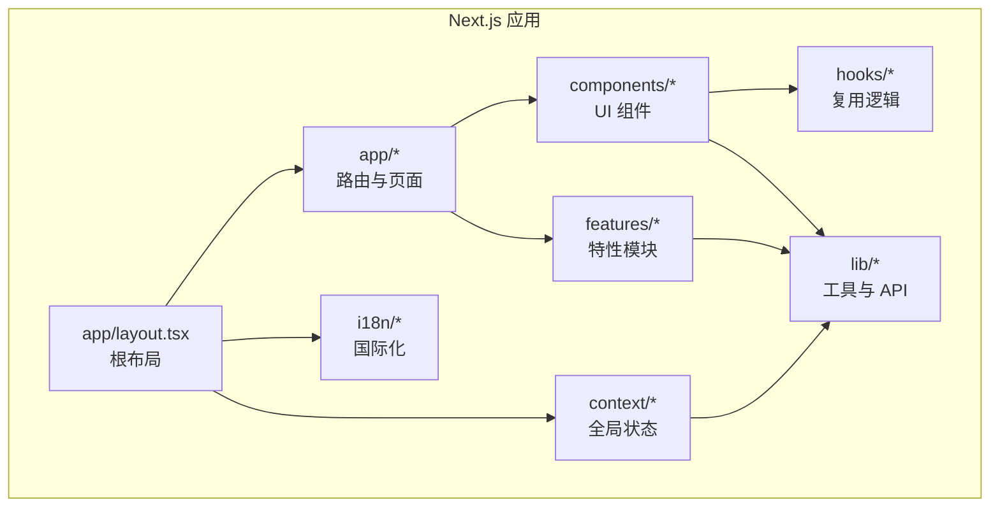
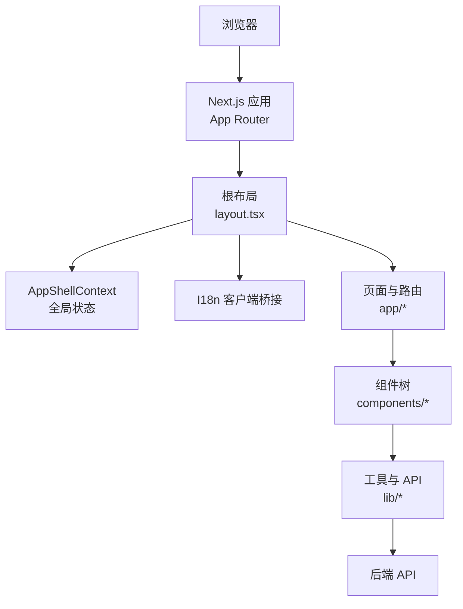
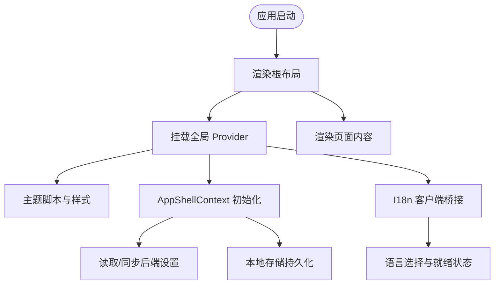
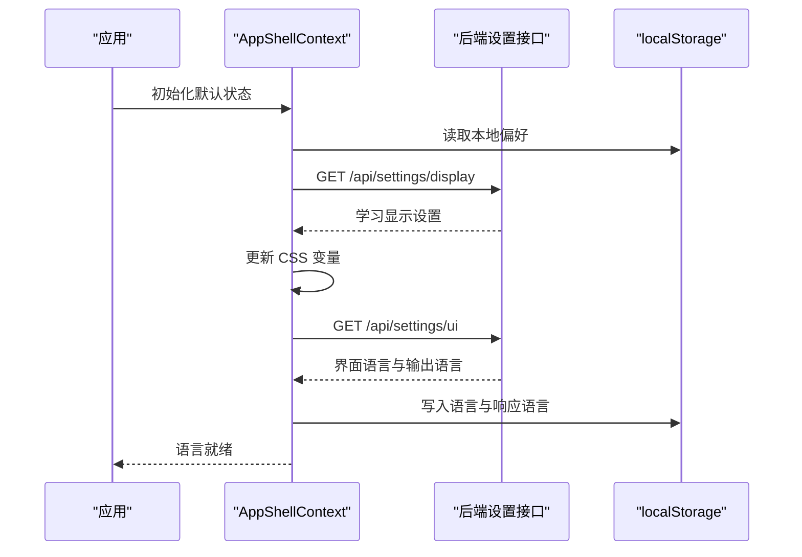
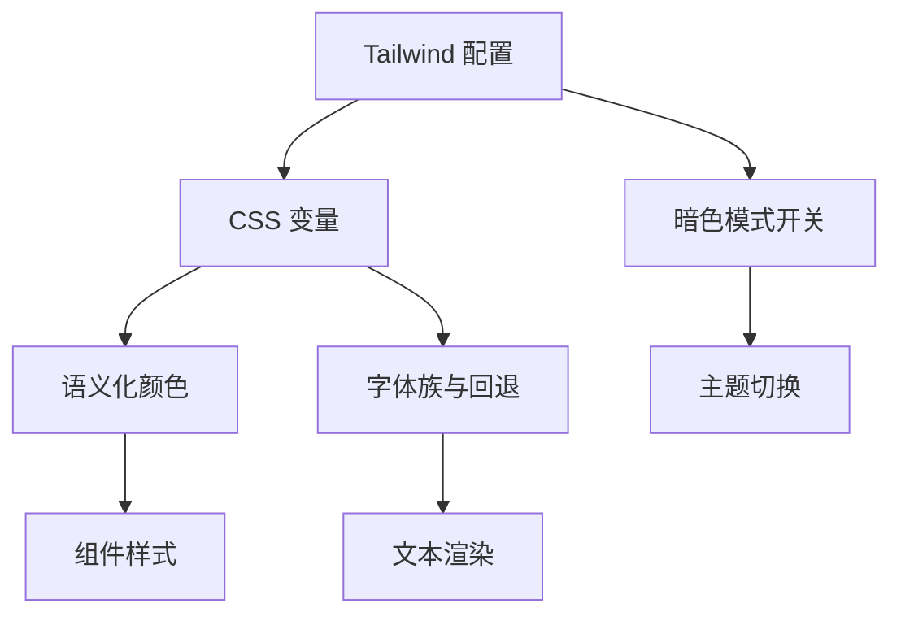
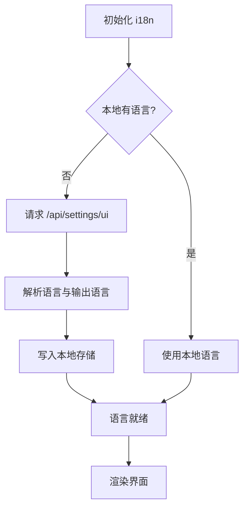
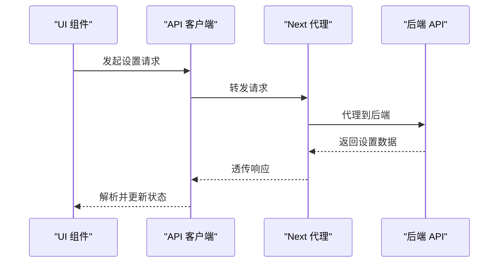
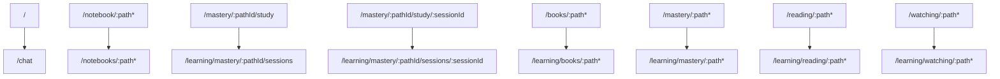
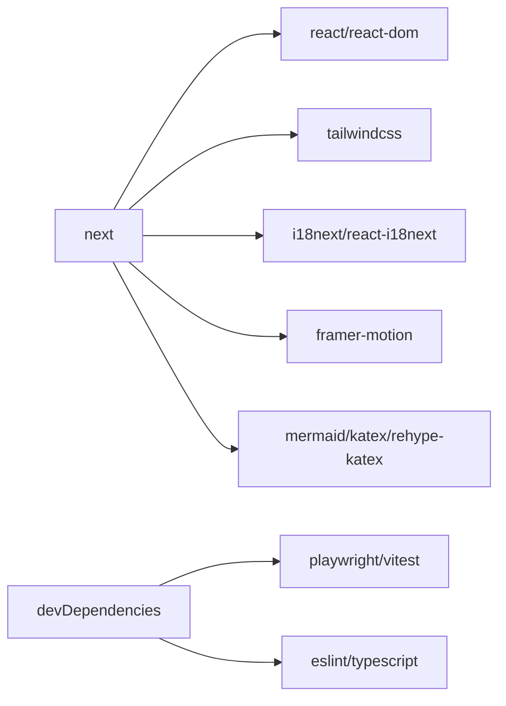

# 前端架构

<cite>
**本文引用的文件**   
- [web/package.json](file://web/package.json)
- [web/next.config.js](file://web/next.config.js)
- [web/app/layout.tsx](file://web/app/layout.tsx)
- [web/tailwind.config.js](file://web/tailwind.config.js)
- [web/context/AppShellContext.tsx](file://web/context/AppShellContext.tsx)
- [web/lib/api.ts](file://web/lib/api.ts)
- [web/i18n/index.ts](file://web/i18n/index.ts)
</cite>

## 目录
1. [简介](#简介)
2. [项目结构](#项目结构)
3. [核心组件](#核心组件)
4. [架构总览](#架构总览)
5. [详细组件分析](#详细组件分析)
6. [依赖分析](#依赖分析)
7. [性能考虑](#性能考虑)
8. [故障排查指南](#故障排查指南)
9. [结论](#结论)
10. [附录](#附录)

## 简介
本文件面向 DeepTutor 的前端开发者，系统化梳理基于 Next.js 与 React 的前端架构、组件组织、状态管理、路由设计、样式系统、国际化、前后端通信、错误处理、测试与构建部署等关键主题。文档在保持可读性的同时提供足够的技术细节，帮助读者快速理解并高效扩展应用。

## 项目结构
DeepTutor 前端位于 web 目录，采用 Next.js App Router 的组织方式：
- app 目录：页面布局、全局样式、路由分组（如 (workspace)、(auth)、(admin)、(utility) 等）
- components：按功能域划分的 UI 组件（chat、knowledge、settings、sidebar、space 等）
- context：跨组件共享状态（AppShellContext 等）
- hooks：可复用的业务逻辑 Hook
- lib：工具库、API 封装、类型定义、领域逻辑
- i18n：国际化初始化与客户端桥接
- features：按特性组织的子模块（chat、co-writer、knowledge、multi-user、settings 等）
- tests：单元测试与 E2E 测试
- scripts：构建、开发、审计脚本

图表来源
- [web/app/layout.tsx:1-73](file://web/app/layout.tsx#L1-L73)
- [web/next.config.js:144-162](file://web/next.config.js#L144-L162)

章节来源
- [web/package.json:5-34](file://web/package.json#L5-L34)
- [web/next.config.js:93-112](file://web/next.config.js#L93-L112)

## 核心组件
- 根布局与全局上下文
  - 根布局负责字体注入、元数据、主题脚本、全局 Provider（AppShellProvider）、工作区导航、动画 Provider、国际化桥接与 Toast 容器挂载。
  - AppShellContext 集中管理主题、语言、活跃会话、侧边栏折叠状态、代码块显示设置等，并与后端设置同步。
- 国际化
  - i18n 模块导出 Provider 与客户端桥接，配合 AppShellContext 的语言选择与持久化。
- 样式系统
  - Tailwind 通过 CSS 变量驱动主题色板，支持暗色模式与透明度组合；字体族包含多语言回退。
- API 访问
  - lib/api.ts 作为兼容层，统一转发到 shared/api/client 与 errors，便于后续迁移与统一错误处理。

章节来源
- [web/app/layout.tsx:1-73](file://web/app/layout.tsx#L1-L73)
- [web/context/AppShellContext.tsx:70-86](file://web/context/AppShellContext.tsx#L70-L86)
- [web/i18n/index.ts:1-5](file://web/i18n/index.ts#L1-L5)
- [web/tailwind.config.js:17-113](file://web/tailwind.config.js#L17-L113)
- [web/lib/api.ts:1-7](file://web/lib/api.ts#L1-L7)

## 架构总览
前端以 Next.js 为运行时，React 为视图层，Tailwind 为样式方案，i18next/react-i18next 实现国际化，通过 Next.js 的 redirects 与 App Router 进行路由治理，使用 AppShellContext 作为全局状态中枢，并通过统一的 API 客户端访问后端服务。

图表来源
- [web/app/layout.tsx:42-70](file://web/app/layout.tsx#L42-L70)
- [web/context/AppShellContext.tsx:90-113](file://web/context/AppShellContext.tsx#L90-L113)
- [web/lib/api.ts:1-7](file://web/lib/api.ts#L1-L7)

## 详细组件分析

### 根布局与全局上下文
- 职责
  - 注入 Google Fonts（Geist、Lora），设置 viewport 与 metadata。
  - 挂载 ThemeScript、ToastViewport、MotionProvider、SettingsReturnTracker、WorkspaceNavigation。
  - 通过 AppShellProvider 包裹应用，提供主题、语言、会话等全局状态。
  - 通过 I18nClientBridge 接入国际化。
- 关键点
  - 使用 CSS 变量控制主题与字体，确保 SSR 与客户端一致性。
  - 将工作区导航与设置返回追踪置于全局，保证跨页面行为一致。

图表来源
- [web/app/layout.tsx:42-70](file://web/app/layout.tsx#L42-L70)
- [web/context/AppShellContext.tsx:115-179](file://web/context/AppShellContext.tsx#L115-L179)
- [web/context/AppShellContext.tsx:189-265](file://web/context/AppShellContext.tsx#L189-L265)

章节来源
- [web/app/layout.tsx:1-73](file://web/app/layout.tsx#L1-L73)
- [web/context/AppShellContext.tsx:90-113](file://web/context/AppShellContext.tsx#L90-L113)
- [web/context/AppShellContext.tsx:115-179](file://web/context/AppShellContext.tsx#L115-L179)
- [web/context/AppShellContext.tsx:189-265](file://web/context/AppShellContext.tsx#L189-L265)

### 状态管理与主题/语言
- AppShellContext 管理的状态
  - theme：当前主题（从系统或用户偏好初始化）。
  - language/languageReady：界面语言与就绪标志。
  - activeSessionId：当前活跃会话 ID。
  - sidebarCollapsed：侧边栏折叠状态。
  - codeBlockTheme/codeBlockShowLineNumbers/codeBlockWrapLongLines：代码块展示设置。
- 数据流
  - 首次渲染使用默认值，随后从 localStorage 水合。
  - 监听 storage 事件与自定义事件，实现多标签页同步。
  - 从后端 /api/settings/display 与 /api/settings/ui 拉取用户设置，并在离线或无权限时回退到默认值。
  - 主题变化订阅系统级 prefers-color-scheme 变更。

图表来源
- [web/context/AppShellContext.tsx:115-179](file://web/context/AppShellContext.tsx#L115-L179)
- [web/context/AppShellContext.tsx:189-265](file://web/context/AppShellContext.tsx#L189-L265)
- [web/context/AppShellContext.tsx:267-361](file://web/context/AppShellContext.tsx#L267-L361)

章节来源
- [web/context/AppShellContext.tsx:70-86](file://web/context/AppShellContext.tsx#L70-L86)
- [web/context/AppShellContext.tsx:90-113](file://web/context/AppShellContext.tsx#L90-L113)
- [web/context/AppShellContext.tsx:115-179](file://web/context/AppShellContext.tsx#L115-L179)
- [web/context/AppShellContext.tsx:189-265](file://web/context/AppShellContext.tsx#L189-L265)
- [web/context/AppShellContext.tsx:267-361](file://web/context/AppShellContext.tsx#L267-L361)
- [web/context/AppShellContext.tsx:363-451](file://web/context/AppShellContext.tsx#L363-L451)

### 样式系统与主题定制
- Tailwind 配置
  - 使用 darkMode: class 切换暗色模式。
  - 通过 CSS 变量 + color-mix 实现带透明度的颜色组合，解决 Tailwind 无法对变量直接叠加透明度的问题。
  - 字体族明确列出中文字体回退，保证中英文混排一致性。
  - 扩展语义化颜色（primary、secondary、success、warning、info 等），并提供 surface 变体。
- 主题变量
  - 由 ThemeScript 与 AppShellContext 共同维护，支持系统主题监听与用户偏好覆盖。

图表来源
- [web/tailwind.config.js:17-113](file://web/tailwind.config.js#L17-L113)
- [web/app/layout.tsx:14-26](file://web/app/layout.tsx#L14-L26)

章节来源
- [web/tailwind.config.js:1-114](file://web/tailwind.config.js#L1-L114)
- [web/app/layout.tsx:14-26](file://web/app/layout.tsx#L14-L26)

### 国际化支持
- 能力
  - 导出 I18nProvider 与 I18nClientBridge，供根布局与页面使用。
  - 提供 initI18n 与 normalizeLanguage，用于初始化与规范化语言。
  - 与 AppShellContext 联动，优先使用本地已选语言，否则从后端设置同步。
- 流程
  - 启动时尝试读取本地语言；若无，则请求 /api/settings/ui 获取语言与输出语言，并写入本地存储。
  - 语言就绪后渲染界面，避免闪烁。

图表来源
- [web/i18n/index.ts:1-5](file://web/i18n/index.ts#L1-L5)
- [web/context/AppShellContext.tsx:189-265](file://web/context/AppShellContext.tsx#L189-L265)

章节来源
- [web/i18n/index.ts:1-5](file://web/i18n/index.ts#L1-L5)
- [web/context/AppShellContext.tsx:189-265](file://web/context/AppShellContext.tsx#L189-L265)

### 前后端通信机制与错误处理
- API 客户端
  - lib/api.ts 作为兼容性导出，统一转发至 shared/api/client 与 errors，便于后续迁移与统一错误处理策略。
- 设置同步
  - AppShellContext 通过 apiFetch 调用 /api/settings/display 与 /api/settings/ui，失败时保留默认值，避免阻塞渲染。
- 代理与超时
  - next.config.js 配置了代理最大 body 大小与超时时间，适配长耗时任务（如 Agentic 读取与编辑）。

图表来源
- [web/lib/api.ts:1-7](file://web/lib/api.ts#L1-L7)
- [web/context/AppShellContext.tsx:115-179](file://web/context/AppShellContext.tsx#L115-L179)
- [web/next.config.js:124-133](file://web/next.config.js#L124-L133)

章节来源
- [web/lib/api.ts:1-7](file://web/lib/api.ts#L1-L7)
- [web/context/AppShellContext.tsx:115-179](file://web/context/AppShellContext.tsx#L115-L179)
- [web/next.config.js:124-133](file://web/next.config.js#L124-L133)

### 路由设计与重定向
- 根路径重定向
  - 根路径 / 重定向到 /chat，避免空页面。
- 历史路径兼容
  - /notebook/:path* 重定向到 /notebooks/:path*。
  - /mastery/:pathId/study 与 /mastery/:pathId/study/:sessionId 重定向到新的学习路径。
  - books/mastery/reading/watching 等旧表面统一重定向到 /learning/*。
- 原因
  - 避免在页面组件内执行 redirect 导致的渲染异常与性能问题。

图表来源
- [web/next.config.js:144-162](file://web/next.config.js#L144-L162)

章节来源
- [web/next.config.js:144-162](file://web/next.config.js#L144-L162)

## 依赖分析
- 运行时依赖
  - next、react、react-dom 为核心框架。
  - framer-motion 提供动画能力。
  - i18next 与 react-i18next 提供国际化。
  - mermaid、katex、rehype-katex、remark-math 等用于数学与图表渲染。
  - tailwindcss 与 tailwind-merge 用于样式与类名合并。
- 开发依赖
  - playwright、vitest、eslint、typescript、postcss、autoprefixer 等。
- 构建与打包
  - output: standalone 生成自包含产物，便于 Docker 部署。
  - transpilePackages 与 webpack resolve.alias 解决第三方包 ESM/CJS 兼容问题。

图表来源
- [web/package.json:36-96](file://web/package.json#L36-L96)
- [web/next.config.js:114-141](file://web/next.config.js#L114-L141)

章节来源
- [web/package.json:36-96](file://web/package.json#L36-L96)
- [web/next.config.js:114-141](file://web/next.config.js#L114-L141)

## 性能考虑
- 构建与运行
  - 使用 standalone 输出减少生产镜像体积。
  - 分离 .next 与 .next-deeptutor 缓存目录，避免 dev/build 相互干扰。
  - 调整 proxyTimeout 与 proxyClientMaxBodySize，适配长耗时与大请求体场景。
- 资源加载
  - 字体使用 display: swap 提升首屏体验。
  - 按需引入 mermaid 等重型库，并通过 transpilePackages 与 alias 优化打包。
- 路由与渲染
  - 使用 redirects 而非页面内跳转，避免渲染异常与负时间戳问题。
  - 允许特定开发主机访问 _next 静态资源，保障 LAN 调试与移动端预览。

章节来源
- [web/next.config.js:93-112](file://web/next.config.js#L93-L112)
- [web/next.config.js:124-133](file://web/next.config.js#L124-L133)
- [web/next.config.js:144-162](file://web/next.config.js#L144-L162)
- [web/next.config.js:164-176](file://web/next.config.js#L164-L176)
- [web/app/layout.tsx:14-26](file://web/app/layout.tsx#L14-L26)

## 故障排查指南
- 主题不生效或透明度丢失
  - 检查 Tailwind 是否启用 darkMode: class，确认 CSS 变量是否正确注入。
  - 确认 color-mix 的使用与浏览器兼容性。
- 国际化闪烁或语言未就绪
  - 查看 AppShellContext 的语言初始化与 fallback 计时器逻辑，确认 /api/settings/ui 是否可达。
  - 检查本地存储键是否存在且格式正确。
- 代理超时或大请求失败
  - 调整 next.config.js 中的 proxyTimeout 与 proxyClientMaxBodySize。
  - 确认后端是否返回完整响应，必要时拆分请求或使用专用流式接口。
- 开发环境跨域或 HMR 失效
  - 检查 allowedDevOrigins 是否包含本机局域网地址。
  - 确认 _next 静态资源未被浏览器跨域策略拦截。

章节来源
- [web/tailwind.config.js:17-113](file://web/tailwind.config.js#L17-L113)
- [web/context/AppShellContext.tsx:189-265](file://web/context/AppShellContext.tsx#L189-L265)
- [web/next.config.js:124-133](file://web/next.config.js#L124-L133)
- [web/next.config.js:164-176](file://web/next.config.js#L164-L176)

## 结论
DeepTutor 前端以 Next.js 与 React 为基础，结合 Tailwind 与 i18next 构建了可扩展、可维护的前端架构。AppShellContext 作为全局状态中枢，统一管理主题、语言、会话与展示设置；Tailwind 通过 CSS 变量实现主题化与多语言字体回退；路由重定向保证历史链接兼容与用户体验；API 客户端与代理配置支撑长耗时与大请求体场景。整体架构清晰、职责分明，适合持续演进与团队协作。

## 附录
- 构建与脚本
  - dev/dev:turbo：开发与 Turbopack 开发模式。
  - build：生产构建。
  - test:unit/test:node：单元与 Node 测试。
  - contracts:generate/contracts:check：契约生成与校验。
  - i18n:parity/i18n:audit：国际化一致性检查。
- 部署
  - standalone 输出可直接被后端启动器托管，无需复制完整 node_modules。

章节来源
- [web/package.json:5-34](file://web/package.json#L5-L34)
- [web/next.config.js:114-122](file://web/next.config.js#L114-L122)