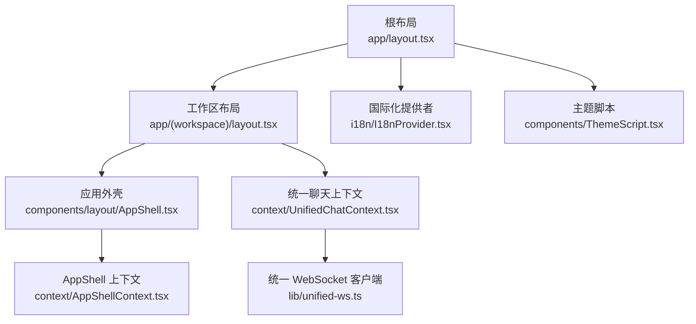
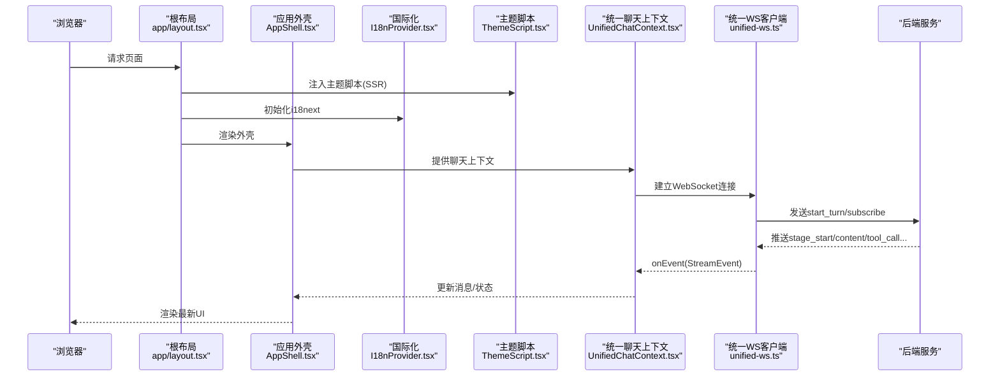
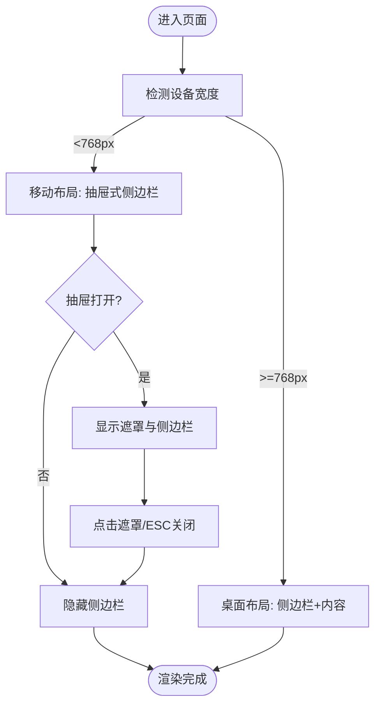
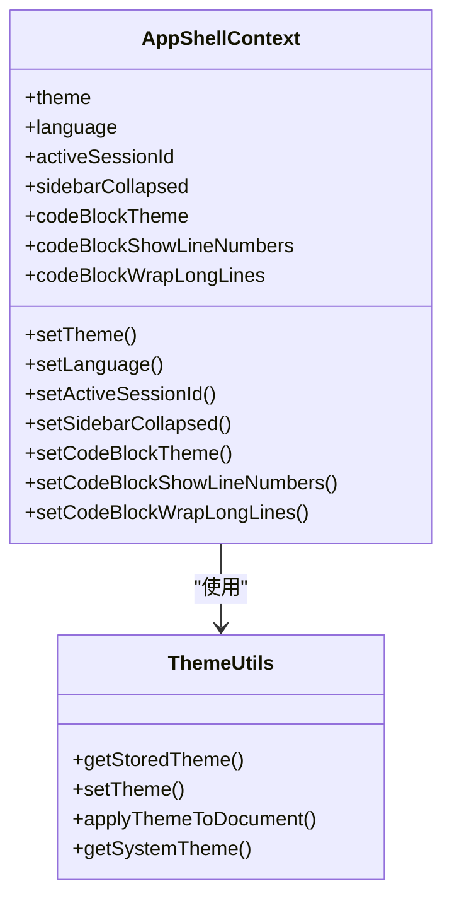
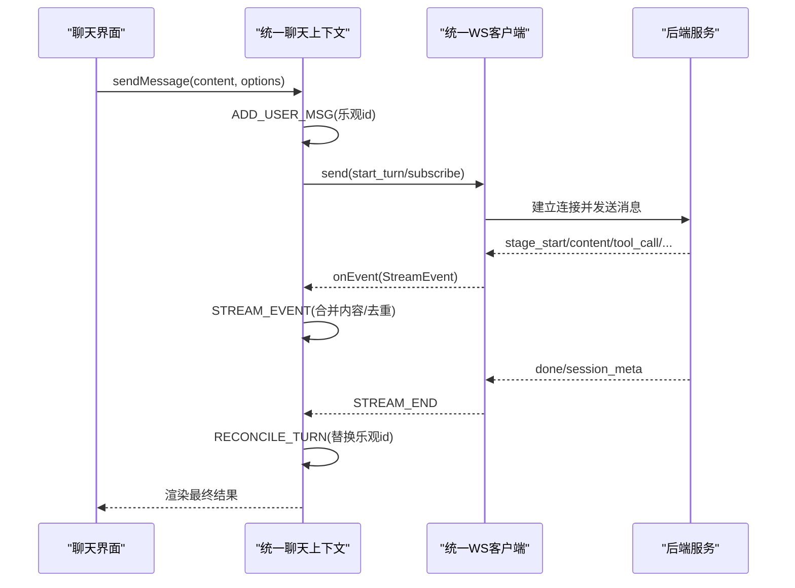
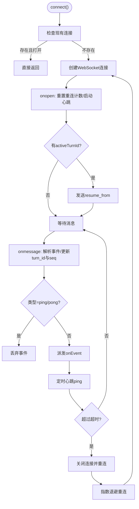
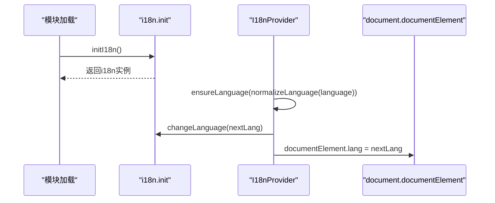
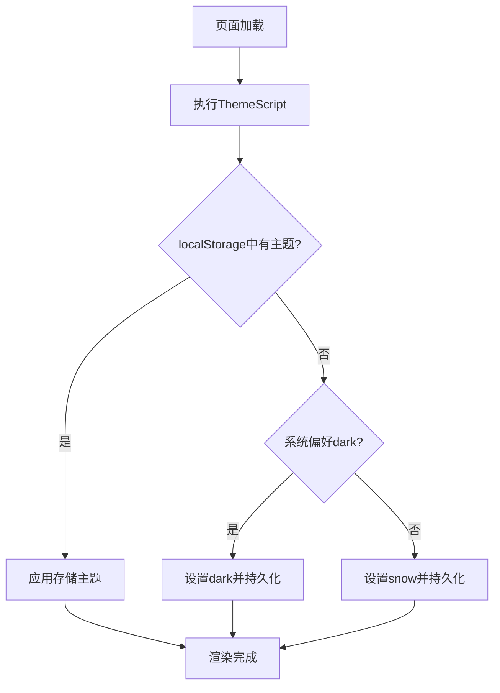
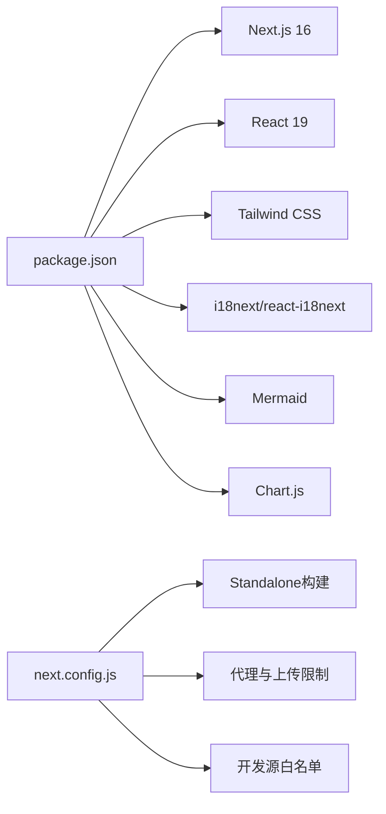

# 前端架构

<cite>
**本文引用的文件**
- [web/package.json](file://web/package.json)
- [web/next.config.js](file://web/next.config.js)
- [web/app/layout.tsx](file://web/app/layout.tsx)
- [web/app/(workspace)/layout.tsx](file://web/app/(workspace)/layout.tsx)
- [web/components/layout/AppShell.tsx](file://web/components/layout/AppShell.tsx)
- [web/context/AppShellContext.tsx](file://web/context/AppShellContext.tsx)
- [web/context/UnifiedChatContext.tsx](file://web/context/UnifiedChatContext.tsx)
- [web/lib/unified-ws.ts](file://web/lib/unified-ws.ts)
- [web/i18n/I18nProvider.tsx](file://web/i18n/I18nProvider.tsx)
- [web/i18n/init.ts](file://web/i18n/init.ts)
- [web/lib/theme.ts](file://web/lib/theme.ts)
- [web/components/ThemeScript.tsx](file://web/components/ThemeScript.tsx)
</cite>

## 目录
1. [简介](#简介)
2. [项目结构](#项目结构)
3. [核心组件](#核心组件)
4. [架构总览](#架构总览)
5. [详细组件分析](#详细组件分析)
6. [依赖关系分析](#依赖关系分析)
7. [性能考量](#性能考量)
8. [故障排查指南](#故障排查指南)
9. [结论](#结论)
10. [附录](#附录)

## 简介
本文件系统性梳理 DeepTutor 前端架构，基于 Next.js 16 与 React 19，覆盖组件架构、状态管理与数据流、国际化与本地化、实时通信（WebSocket）与流式响应、UI 组件库与主题系统、路由与导航结构，以及开发、测试与部署实践和性能优化建议。文档以仓库实际代码为依据，提供可追溯的源码定位与图示说明。

## 项目结构
- 技术栈与构建
  - Next.js 16 + React 19，使用 Tailwind CSS 进行样式编排，i18next/react-i18next 实现多语言。
  - 构建产物采用 standalone 输出，便于容器化部署；通过 next.config.js 暴露 API Base、认证开关与版本等环境变量。
- 应用外壳与布局
  - 根布局负责字体注入、元信息、全局脚本与 Provider 装配。
  - 工作区布局组合 AppShell、侧边栏、能力访问控制与统一聊天上下文。
- 上下文与状态
  - AppShellContext 管理主题、语言、活跃会话、侧边栏折叠与代码块显示设置，并持久化到 localStorage。
  - UnifiedChatContext 集中管理会话消息、流式事件、分支选择与重连恢复。
- 实时通信
  - unified-ws 封装 WebSocket 客户端，提供心跳、自动重连、断线续传与统一的流式事件模型。
- 国际化
  - i18n 模块在模块加载时初始化，按需加载中文资源，保持 SSR/CSR 一致的语言行为。
- 主题系统
  - ThemeScript 在 SSR HTML 中尽早执行以避免闪烁；theme.ts 提供主题切换、持久化与系统偏好检测。

**图表来源**
- [web/app/layout.tsx:1-62](file://web/app/layout.tsx#L1-L62)
- [web/app/(workspace)/layout.tsx:1-22](file://web/app/(workspace)/layout.tsx#L1-L22)
- [web/components/layout/AppShell.tsx:1-137](file://web/components/layout/AppShell.tsx#L1-L137)
- [web/context/AppShellContext.tsx:1-321](file://web/context/AppShellContext.tsx#L1-L321)
- [web/context/UnifiedChatContext.tsx:1-800](file://web/context/UnifiedChatContext.tsx#L1-L800)
- [web/lib/unified-ws.ts:1-315](file://web/lib/unified-ws.ts#L1-L315)
- [web/i18n/I18nProvider.tsx:1-47](file://web/i18n/I18nProvider.tsx#L1-L47)
- [web/components/ThemeScript.tsx:1-50](file://web/components/ThemeScript.tsx#L1-L50)

**章节来源**
- [web/package.json:1-63](file://web/package.json#L1-L63)
- [web/next.config.js:1-167](file://web/next.config.js#L1-L167)
- [web/app/layout.tsx:1-62](file://web/app/layout.tsx#L1-L62)
- [web/app/(workspace)/layout.tsx:1-22](file://web/app/(workspace)/layout.tsx#L1-L22)

## 核心组件
- 根布局与元信息
  - 注入字体变量、站点标题与图标，挂载主题脚本与应用外壳上下文、国际化桥接与 Toast 视口。
- 应用外壳
  - 提供桌面端侧边栏+内容双栏布局与移动端抽屉式侧边栏；处理键盘关闭、路径变化时收起抽屉。
- 应用壳上下文
  - 统一管理主题、语言、活跃会话、侧边栏折叠与代码块显示设置；首次渲染后从存储水合，监听跨标签页 storage 事件同步状态。
- 统一聊天上下文
  - 维护多会话消息、流式事件合并、乐观更新、分支编辑、会话绑定与重校验；驱动 UI 展示与交互。
- 统一 WebSocket 客户端
  - 连接 /api/v1/ws，发送开始/订阅/恢复/取消/重生成/提交用户回复等消息；实现心跳、超时检测、指数退避重连与断点续传。
- 国际化提供者
  - 模块加载即初始化 i18next，按需提供语言包，确保渲染阶段不触发副作用；同步 <html lang> 提升无障碍体验。
- 主题脚本与主题工具
  - 在 SSR HTML 中尽早应用主题，避免闪烁；支持 light/dark/glass/snow 主题与系统偏好检测，持久化到 localStorage。

**章节来源**
- [web/app/layout.tsx:1-62](file://web/app/layout.tsx#L1-L62)
- [web/components/layout/AppShell.tsx:1-137](file://web/components/layout/AppShell.tsx#L1-L137)
- [web/context/AppShellContext.tsx:1-321](file://web/context/AppShellContext.tsx#L1-L321)
- [web/context/UnifiedChatContext.tsx:1-800](file://web/context/UnifiedChatContext.tsx#L1-L800)
- [web/lib/unified-ws.ts:1-315](file://web/lib/unified-ws.ts#L1-L315)
- [web/i18n/I18nProvider.tsx:1-47](file://web/i18n/I18nProvider.tsx#L1-L47)
- [web/i18n/init.ts:1-51](file://web/i18n/init.ts#L1-L51)
- [web/lib/theme.ts:1-127](file://web/lib/theme.ts#L1-L127)
- [web/components/ThemeScript.tsx:1-50](file://web/components/ThemeScript.tsx#L1-L50)

## 架构总览
下图展示了从页面渲染到状态管理、再到后端实时通信的整体数据流：

**图表来源**
- [web/app/layout.tsx:1-62](file://web/app/layout.tsx#L1-L62)
- [web/components/layout/AppShell.tsx:1-137](file://web/components/layout/AppShell.tsx#L1-L137)
- [web/i18n/I18nProvider.tsx:1-47](file://web/i18n/I18nProvider.tsx#L1-L47)
- [web/components/ThemeScript.tsx:1-50](file://web/components/ThemeScript.tsx#L1-L50)
- [web/context/UnifiedChatContext.tsx:1-800](file://web/context/UnifiedChatContext.tsx#L1-L800)
- [web/lib/unified-ws.ts:1-315](file://web/lib/unified-ws.ts#L1-L315)

## 详细组件分析

### 应用外壳与布局
- 职责
  - 提供响应式布局：桌面端侧边栏与内容并列；移动端侧边栏以抽屉形式呈现，点击遮罩或 ESC 关闭。
  - 在路由变化时自动收起抽屉，保证焦点与可访问性。
- 关键点
  - 使用 CSS 媒体查询控制布局切换，JS 仅管理抽屉开合状态。
  - 顶部导航区域包含品牌标识与菜单按钮，适配移动端。

**图表来源**
- [web/components/layout/AppShell.tsx:1-137](file://web/components/layout/AppShell.tsx#L1-L137)

**章节来源**
- [web/components/layout/AppShell.tsx:1-137](file://web/components/layout/AppShell.tsx#L1-L137)
- [web/app/(workspace)/layout.tsx:1-22](file://web/app/(workspace)/layout.tsx#L1-L22)

### 应用壳上下文（主题、语言、会话与代码块设置）
- 职责
  - 管理主题、语言、活跃会话 ID、侧边栏折叠状态与代码块显示设置。
  - 首次渲染后从 localStorage 水合，并在跨标签页变更时同步状态。
  - 若本地无语言选择，则从后端 UI 设置拉取并写入本地存储。
- 关键点
  - 主题变更通过主题工具函数应用到文档类名并持久化。
  - 语言变更同时写入本地存储并触发 i18n 切换。
  - 活跃会话 ID 与侧边栏折叠状态通过自定义事件与 storage 事件跨组件同步。

**图表来源**
- [web/context/AppShellContext.tsx:1-321](file://web/context/AppShellContext.tsx#L1-L321)
- [web/lib/theme.ts:1-127](file://web/lib/theme.ts#L1-L127)

**章节来源**
- [web/context/AppShellContext.tsx:1-321](file://web/context/AppShellContext.tsx#L1-L321)
- [web/lib/theme.ts:1-127](file://web/lib/theme.ts#L1-L127)

### 统一聊天上下文（会话、消息与流式事件）
- 职责
  - 维护多会话的消息列表、流式事件、当前阶段、语言与分支选择。
  - 处理用户消息添加、助手占位消息、流式事件合并、会话绑定与重校验。
  - 管理乐观更新与最终一致性（turn id 对齐）。
- 关键点
  - STREAM_START 插入占位助手消息，STREAM_EVENT 增量追加内容并去重。
  - STREAM_END 结束流式状态，必要时延迟断开以保持 session_meta 等后续事件落地。
  - RECONCILE_TURN 将乐观 id 替换为服务端稳定 id，避免全量刷新导致的卡顿。

**图表来源**
- [web/context/UnifiedChatContext.tsx:1-800](file://web/context/UnifiedChatContext.tsx#L1-L800)
- [web/lib/unified-ws.ts:1-315](file://web/lib/unified-ws.ts#L1-L315)

**章节来源**
- [web/context/UnifiedChatContext.tsx:1-800](file://web/context/UnifiedChatContext.tsx#L1-L800)
- [web/lib/unified-ws.ts:1-315](file://web/lib/unified-ws.ts#L1-L315)

### 统一 WebSocket 客户端（心跳、重连与续传）
- 职责
  - 连接 /api/v1/ws，发送 start_turn、subscribe_turn、resume_from、cancel_turn、regenerate、submit_user_reply 等消息。
  - 实现心跳检测（ping/pong）、超时关闭与指数退避重连，最多尝试次数后回调关闭。
  - 记录 activeTurnId 与 lastSeq，重连后通过 resume_from 继续流式传输。
- 关键点
  - 过滤 ping/pong 帧，避免误渲染为未知类型事件。
  - 心跳间隔与超时时间合理配置，保障长连接稳定性。

**图表来源**
- [web/lib/unified-ws.ts:1-315](file://web/lib/unified-ws.ts#L1-L315)

**章节来源**
- [web/lib/unified-ws.ts:1-315](file://web/lib/unified-ws.ts#L1-L315)

### 国际化与本地化
- 初始化策略
  - 模块加载即调用 initI18n，避免在渲染阶段触发副作用。
  - 默认命名空间为 app，禁用 keySeparator 简化键查找。
- 语言切换
  - I18nProvider 根据传入语言确保资源包已加载（中文按需动态导入），并同步 <html lang>。
- 语言归一化
  - normalizeLanguage 将多种输入归一化为 en 或 zh，保证兼容性。

**图表来源**
- [web/i18n/init.ts:1-51](file://web/i18n/init.ts#L1-L51)
- [web/i18n/I18nProvider.tsx:1-47](file://web/i18n/I18nProvider.tsx#L1-L47)

**章节来源**
- [web/i18n/init.ts:1-51](file://web/i18n/init.ts#L1-L51)
- [web/i18n/I18nProvider.tsx:1-47](file://web/i18n/I18nProvider.tsx#L1-L47)

### 主题系统与样式管理
- 主题脚本
  - 在 SSR HTML 中尽早执行，读取 localStorage 或系统偏好，设置 html 类名，避免闪烁。
- 主题工具
  - 支持 light/dark/glass/snow 主题；优先使用本地存储，否则回退到系统偏好；变更时通知所有订阅者。
- 样式框架
  - 使用 Tailwind CSS 与 CSS 变量（如 --background、--foreground）实现主题化样式。

**图表来源**
- [web/components/ThemeScript.tsx:1-50](file://web/components/ThemeScript.tsx#L1-L50)
- [web/lib/theme.ts:1-127](file://web/lib/theme.ts#L1-L127)

**章节来源**
- [web/components/ThemeScript.tsx:1-50](file://web/components/ThemeScript.tsx#L1-L50)
- [web/lib/theme.ts:1-127](file://web/lib/theme.ts#L1-L127)

## 依赖关系分析
- 运行时依赖
  - Next.js 16、React 19、Tailwind CSS、i18next/react-i18next、Mermaid、Chart.js 等。
- 构建与部署
  - next.config.js 暴露 NEXT_PUBLIC_API_BASE、NEXT_PUBLIC_AUTH_ENABLED、NEXT_PUBLIC_APP_VERSION。
  - 启用 standalone 输出，减少生产镜像体积；调整代理最大请求体大小以匹配后端上传限制。
- 开发体验
  - allowedDevOrigins 允许局域网地址访问开发服务器，避免 HMR 与资源跨域问题。
  - transpilePackages 与 webpack alias 解决 mermaid/cytoscape 的 ESM/CJS 兼容性问题。

**图表来源**
- [web/package.json:1-63](file://web/package.json#L1-L63)
- [web/next.config.js:1-167](file://web/next.config.js#L1-L167)

**章节来源**
- [web/package.json:1-63](file://web/package.json#L1-L63)
- [web/next.config.js:1-167](file://web/next.config.js#L1-L167)

## 性能考量
- 首屏与主题闪烁
  - 使用 ThemeScript 在 SSR HTML 中尽早应用主题，避免 hydration 阶段的闪烁。
- 流式渲染与状态更新
  - 统一聊天上下文对流式事件进行增量合并与去重，避免重复渲染；使用乐观更新减少阻塞。
- 连接稳定性
  - WebSocket 心跳与超时检测防止僵尸连接；指数退避重连降低网络抖动影响。
- 构建优化
  - standalone 输出减少生产镜像体积；transpilePackages 与 alias 解决第三方库兼容性问题。
- 开发体验
  - allowedDevOrigins 允许局域网访问，避免 HMR 与资源跨域导致的水合失败。

[本节为通用指导，不直接分析具体文件]

## 故障排查指南
- 主题闪烁
  - 确认 ThemeScript 已在 head 中注入并正确设置 html 类名；检查 localStorage 是否可用。
- 语言未生效
  - 检查 I18nProvider 是否正确调用 ensureLanguage 与 changeLanguage；确认 <html lang> 已同步。
- WebSocket 连接失败
  - 检查 wsUrl 生成的 URL 是否正确；确认后端 /api/v1/ws 可达；查看心跳与超时日志。
- 流式内容丢失或重复
  - 检查 StreamEvent 的 seq 与 turn_id 是否正确；确认去重逻辑与内容追加逻辑。
- 构建或代理问题
  - 检查 next.config.js 中的 proxyClientMaxBodySize 与 allowedDevOrigins；确认 NEXT_PUBLIC_API_BASE 指向正确的后端。

**章节来源**
- [web/components/ThemeScript.tsx:1-50](file://web/components/ThemeScript.tsx#L1-L50)
- [web/i18n/I18nProvider.tsx:1-47](file://web/i18n/I18nProvider.tsx#L1-L47)
- [web/lib/unified-ws.ts:1-315](file://web/lib/unified-ws.ts#L1-L315)
- [web/next.config.js:1-167](file://web/next.config.js#L1-L167)

## 结论
DeepTutor 前端采用 Next.js 16 与 React 19 的现代架构，通过 AppShell 与上下文管理实现主题、语言与会话状态的统一治理；统一聊天上下文与 WebSocket 客户端提供稳定的流式通信与乐观更新；i18n 与主题系统在 SSR/CSR 两端保持一致行为。整体设计兼顾可扩展性、可维护性与用户体验，适合持续迭代与规模化部署。

[本节为总结，不直接分析具体文件]

## 附录
- 开发指南
  - 新增组件：遵循功能目录组织，复用 AppShell 与上下文；避免在渲染阶段执行副作用。
  - 测试：使用 Playwright 进行 UI 审计与端到端测试；Node 测试用于工具函数与逻辑验证。
  - 部署：使用 npm run build 生成 standalone 产物；通过 Docker 或托管平台部署；配置环境变量以对接后端。
- 最佳实践
  - 使用上下文管理共享状态，避免 prop drilling。
  - 流式数据采用增量更新与去重，减少重渲染。
  - 主题与语言变更需考虑 SSR/CSR 一致性，避免闪烁与不一致。
  - 网络请求与 WebSocket 连接需具备重试与错误处理机制。

[本节为通用指导，不直接分析具体文件]