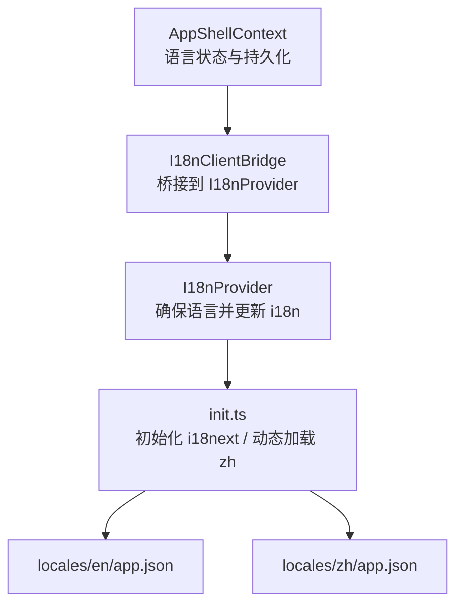
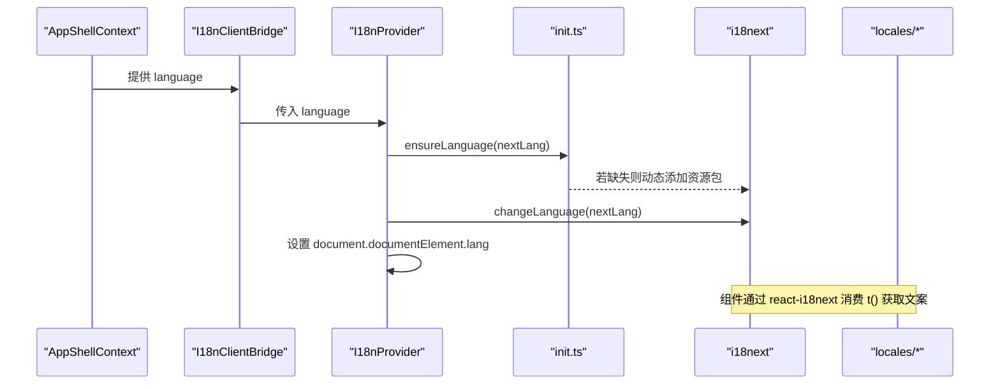
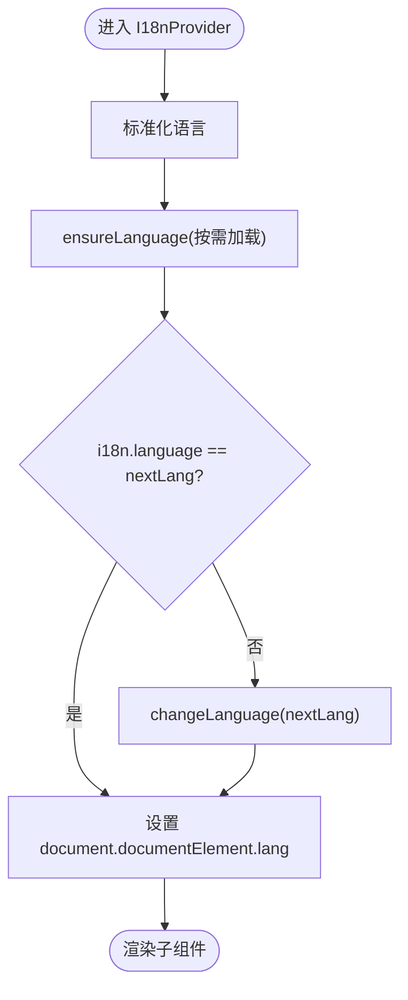
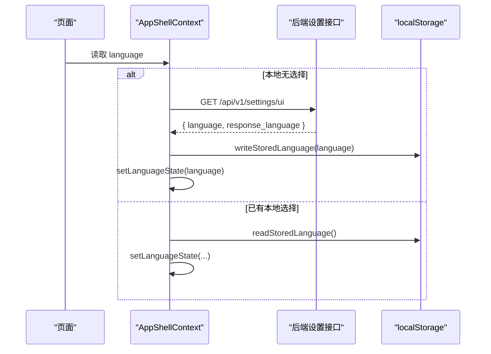
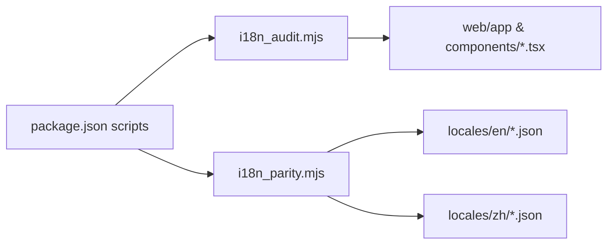

# 国际化支持

<cite>
**本文引用的文件**
- [web/i18n/I18nProvider.tsx](file://web/i18n/I18nProvider.tsx)
- [web/i18n/I18nClientBridge.tsx](file://web/i18n/I18nClientBridge.tsx)
- [web/i18n/init.ts](file://web/i18n/init.ts)
- [web/i18n/index.ts](file://web/i18n/index.ts)
- [web/context/AppShellContext.tsx](file://web/context/AppShellContext.tsx)
- [web/locales/en/app.json](file://web/locales/en/app.json)
- [web/locales/zh/app.json](file://web/locales/zh/app.json)
- [web/scripts/i18n_audit.mjs](file://web/scripts/i18n_audit.mjs)
- [web/scripts/i18n_parity.mjs](file://web/scripts/i18n_parity.mjs)
- [web/package.json](file://web/package.json)
- [web/tests/language-preferences.test.ts](file://web/tests/language-preferences.test.ts)
- [web/tests/app-shell-language-bootstrap.test.ts](file://web/tests/app-shell-language-bootstrap.test.ts)
</cite>

## 目录
1. [简介](#简介)
2. [项目结构](#项目结构)
3. [核心组件](#核心组件)
4. [架构总览](#架构总览)
5. [详细组件分析](#详细组件分析)
6. [依赖关系分析](#依赖关系分析)
7. [性能考虑](#性能考虑)
8. [故障排查指南](#故障排查指南)
9. [结论](#结论)
10. [附录](#附录)

## 简介
本文件面向 DeepTutor 前端的多语言（i18n）实现，围绕 i18next + react-i18next 的集成方式，系统说明语言包组织、动态加载、I18nProvider 工作原理、语言切换流程与上下文传递、客户端桥接器职责、用户偏好保存机制、翻译工具链与一致性检查，以及多语言开发指南、最佳实践和本地化测试方法。文档同时提供扩展新语言的步骤和配置要点，帮助开发者快速上手与维护。

## 项目结构
DeepTutor 前端的国际化相关代码集中在 web 目录下：
- i18n 初始化与提供者：web/i18n
- 应用壳层与语言状态：web/context/AppShellContext.tsx
- 语言资源包：web/locales/{en,zh}/*.json
- 翻译工具脚本：web/scripts/i18n_*.mjs
- 测试用例：web/tests/*language*

图表来源
- [web/context/AppShellContext.tsx:71-144](file://web/context/AppShellContext.tsx#L71-L144)
- [web/i18n/I18nClientBridge.tsx:1-11](file://web/i18n/I18nClientBridge.tsx#L1-L11)
- [web/i18n/I18nProvider.tsx:1-47](file://web/i18n/I18nProvider.tsx#L1-L47)
- [web/i18n/init.ts:1-51](file://web/i18n/init.ts#L1-L51)
- [web/locales/en/app.json:1-800](file://web/locales/en/app.json#L1-L800)
- [web/locales/zh/app.json:1-800](file://web/locales/zh/app.json#L1-L800)

章节来源
- [web/i18n/index.ts:1-5](file://web/i18n/index.ts#L1-L5)
- [web/i18n/init.ts:1-51](file://web/i18n/init.ts#L1-L51)
- [web/i18n/I18nProvider.tsx:1-47](file://web/i18n/I18nProvider.tsx#L1-L47)
- [web/i18n/I18nClientBridge.tsx:1-11](file://web/i18n/I18nClientBridge.tsx#L1-L11)
- [web/context/AppShellContext.tsx:71-144](file://web/context/AppShellContext.tsx#L71-L144)
- [web/locales/en/app.json:1-800](file://web/locales/en/app.json#L1-L800)
- [web/locales/zh/app.json:1-800](file://web/locales/zh/app.json#L1-L800)

## 核心组件
- I18nProvider：在模块加载时完成 i18next 初始化，并在 React 渲染阶段通过 useEffect 确保当前语言已就绪，必要时调用 changeLanguage 并同步 <html lang>。
- I18nClientBridge：从 AppShellContext 读取当前语言，作为 I18nProvider 的入口，将应用级语言状态注入到 i18n 体系。
- init.ts：定义 AppLanguage 类型、normalizeLanguage、initI18n（注册默认命名空间、禁用 keySeparator、设置回退语言等）、ensureLanguage（按需动态加载中文资源）。
- AppShellContext：维护 language 状态、持久化到 localStorage、首次启动时尝试从后端 UI 设置拉取并写入本地存储，跨标签页通过 storage 事件同步。

章节来源
- [web/i18n/I18nProvider.tsx:1-47](file://web/i18n/I18nProvider.tsx#L1-L47)
- [web/i18n/I18nClientBridge.tsx:1-11](file://web/i18n/I18nClientBridge.tsx#L1-L11)
- [web/i18n/init.ts:1-51](file://web/i18n/init.ts#L1-L51)
- [web/context/AppShellContext.tsx:71-144](file://web/context/AppShellContext.tsx#L71-L144)

## 架构总览
下图展示了“应用壳层状态 → 客户端桥接 → i18n 提供者 → 资源加载”的完整链路，以及语言切换时的关键交互。

图表来源
- [web/context/AppShellContext.tsx:71-144](file://web/context/AppShellContext.tsx#L71-L144)
- [web/i18n/I18nClientBridge.tsx:1-11](file://web/i18n/I18nClientBridge.tsx#L1-L11)
- [web/i18n/I18nProvider.tsx:1-47](file://web/i18n/I18nProvider.tsx#L1-L47)
- [web/i18n/init.ts:1-51](file://web/i18n/init.ts#L1-L51)

## 详细组件分析

### I18nProvider 与 I18nClientBridge
- 职责分离：Bridge 仅负责把 AppShell 的语言状态透传给 Provider；Provider 专注保证 i18n 就绪与语言切换。
- 初始化时机：initI18n 在模块加载时执行，避免在渲染过程中触发 setState 导致的 React 警告。
- 语言同步：useEffect 中 normalizeLanguage 后 ensureLanguage，再根据 i18n.language 决定是否调用 changeLanguage，并同步 <html lang> 以增强可访问性与 Intl 行为。

图表来源
- [web/i18n/I18nProvider.tsx:1-47](file://web/i18n/I18nProvider.tsx#L1-L47)
- [web/i18n/init.ts:1-51](file://web/i18n/init.ts#L1-L51)

章节来源
- [web/i18n/I18nProvider.tsx:1-47](file://web/i18n/I18nProvider.tsx#L1-L47)
- [web/i18n/I18nClientBridge.tsx:1-11](file://web/i18n/I18nClientBridge.tsx#L1-L11)

### 初始化与动态加载（init.ts）
- 类型约束：AppLanguage 限定为 "en" | "zh"。
- 规范化：normalizeLanguage 将多种输入统一为受支持的两种语言。
- 初始化：initI18n 注册 react-i18next，设置默认命名空间 app，禁用 keySeparator，关闭插值转义，启用 returnEmptyString/returnNull=false 以便空键有明确表现。
- 动态加载：ensureLanguage 仅在缺少资源包时按需引入 zh 资源，减少首屏体积。

章节来源
- [web/i18n/init.ts:1-51](file://web/i18n/init.ts#L1-L51)

### 语言状态与持久化（AppShellContext）
- 初始值：SSR 安全地以 "en" 开始，避免水合不一致。
- 首次启动：若无本地选择，则请求后端 /api/v1/settings/ui 获取界面语言与响应语言，写入本地存储并更新状态。
- 跨标签同步：监听 storage 事件与自定义 LANGUAGE_EVENT，保持多标签一致。
- 持久化：setLanguage 会写入 localStorage，刷新后仍保持用户选择。

图表来源
- [web/context/AppShellContext.tsx:71-144](file://web/context/AppShellContext.tsx#L71-L144)

章节来源
- [web/context/AppShellContext.tsx:71-144](file://web/context/AppShellContext.tsx#L71-L144)

### 语言包组织结构
- 位置：web/locales/{en,zh}/app.json、common.json。
- 命名空间：默认使用 "app"，keySeparator 关闭，便于直接使用如 "Generating..." 这类带点号的键。
- 内容：包含界面文案、提示语、按钮文本等，中英对照保持一致的键名。

章节来源
- [web/locales/en/app.json:1-800](file://web/locales/en/app.json#L1-L800)
- [web/locales/zh/app.json:1-800](file://web/locales/zh/app.json#L1-L800)

### 客户端桥接器的作用
- 解耦：将应用壳层的语言状态与 i18n 初始化逻辑解耦，便于在不同层级复用。
- 最小化副作用：只负责传递 props，不处理复杂逻辑。

章节来源
- [web/i18n/I18nClientBridge.tsx:1-11](file://web/i18n/I18nClientBridge.tsx#L1-L11)

## 依赖关系分析
- 运行时依赖：i18next 与 react-i18next 用于多语言能力。
- 构建脚本：package.json 暴露 i18n:parity、i18n:audit、i18n:check 等命令，用于一致性检查与审计。
- 工具脚本：
  - i18n_audit.mjs：扫描 .tsx 中的 UI 字面量，提示未国际化的字符串。
  - i18n_parity.mjs：对比 en 与 zh 的资源文件结构与键一致性。

图表来源
- [web/package.json:1-63](file://web/package.json#L1-L63)
- [web/scripts/i18n_audit.mjs:1-127](file://web/scripts/i18n_audit.mjs#L1-L127)
- [web/scripts/i18n_parity.mjs:1-89](file://web/scripts/i18n_parity.mjs#L1-L89)

章节来源
- [web/package.json:1-63](file://web/package.json#L1-L63)
- [web/scripts/i18n_audit.mjs:1-127](file://web/scripts/i18n_audit.mjs#L1-L127)
- [web/scripts/i18n_parity.mjs:1-89](file://web/scripts/i18n_parity.mjs#L1-L89)

## 性能考虑
- 首屏体积优化：中文资源采用动态 import 按需加载，仅在需要时加入 i18next 资源池，降低初始包体。
- 避免重复初始化：initI18n 内部使用 _initialized 标记，防止重复初始化。
- 渲染安全：在模块加载阶段初始化 i18next，避免在组件渲染期间触发重渲染导致的状态更新警告。
- 命名空间精简：仅使用单一默认命名空间 app，简化查找路径，减少解析开销。

[本节为通用性能建议，无需特定文件引用]

## 故障排查指南
- 语言不生效
  - 确认 I18nProvider 包裹了需要国际化的组件树。
  - 检查 ensureLanguage 是否成功加载对应语言资源包。
  - 查看 i18n.language 是否与期望一致。
- 切换语言后部分文案未更新
  - 确认组件通过 react-i18next 的 t() 或 useTranslation 消费文案。
  - 检查 key 是否正确且存在于目标语言资源中。
- 本地存储不同步
  - 检查是否有多个地方修改了语言状态，确保通过 setLanguage 写入 localStorage。
  - 验证 storage 事件监听是否被正确移除与恢复。
- 一致性检查失败
  - 运行 npm run i18n:check，修复缺失或缺少键的问题。
  - 使用 i18n:audit 定位未国际化的字面量。

章节来源
- [web/scripts/i18n_audit.mjs:1-127](file://web/scripts/i18n_audit.mjs#L1-L127)
- [web/scripts/i18n_parity.mjs:1-89](file://web/scripts/i18n_parity.mjs#L1-L89)
- [web/context/AppShellContext.tsx:152-234](file://web/context/AppShellContext.tsx#L152-L234)

## 结论
DeepTutor 的前端国际化基于 i18next + react-i18next，采用“应用壳层状态 + 客户端桥接 + 提供者驱动”的分层设计，实现了安全的初始化、按需加载与实时切换。配合完善的工具链与测试用例，保障了多语言的一致性与可维护性。遵循本文的开发指南与最佳实践，可高效扩展新语言并保持质量稳定。

[本节为总结性内容，无需特定文件引用]

## 附录

### 多语言开发指南
- 新增文案
  - 在 locales/en/app.json 与 locales/zh/app.json 中添加相同键的翻译。
  - 在组件中使用 t("your.key") 或 useTranslation 获取文案。
- 避免硬编码
  - 不要直接在 JSX 中写死用户可见文本，使用 i18n 提供的 t() 函数。
  - 对 title、placeholder、alt、aria-label 等属性同样进行国际化。
- 参数化文案
  - 使用插值占位符（如 {{name}}），并确保在调用时传入对应变量。
- 命名规范
  - 键名尽量语义化、分层清晰，避免过长或过于抽象。
  - 保持 en 与 zh 的键完全一致，借助 i18n_parity 校验。

[本节为通用开发指南，无需特定文件引用]

### 翻译最佳实践
- 保持键一致：任何新增或修改必须同步 en 与 zh。
- 避免长句拼接：尽量拆分短句，便于翻译与复用。
- 注意上下文：同一英文词在不同场景可能有不同译法，应通过键名区分。
- 可读性优先：译文需自然流畅，符合目标语言习惯。
- 定期审计：使用 i18n:audit 与 i18n:parity 持续检查。

[本节为通用最佳实践，无需特定文件引用]

### 本地化测试方法
- 单元测试
  - 语言偏好与引导：参考 tests/app-shell-language-bootstrap.test.ts。
  - 响应语言独立于界面语言：参考 tests/language-preferences.test.ts。
- 端到端测试
  - 可通过 Playwright 切换语言并断言关键文案。
- 静态检查
  - 运行 npm run i18n:check 确保资源一致性与无遗漏字面量。

章节来源
- [web/tests/app-shell-language-bootstrap.test.ts:1-66](file://web/tests/app-shell-language-bootstrap.test.ts#L1-L66)
- [web/tests/language-preferences.test.ts:1-15](file://web/tests/language-preferences.test.ts#L1-L15)
- [web/package.json:1-63](file://web/package.json#L1-L63)

### 扩展新语言的步骤
- 准备资源
  - 在 locales 下新建新语言目录（例如 fr），复制 en 的 app.json 与 common.json 作为基线。
  - 逐条翻译键值，保持键名与 en 一致。
- 更新初始化
  - 在 init.ts 的 resources 中注册新语言资源，或在 ensureLanguage 中按需动态加载。
  - 如需保留首屏小体积，建议使用 ensureLanguage 的动态导入方式。
- 更新类型与归一化
  - 在 AppLanguage 类型中加入新语言标识。
  - 在 normalizeLanguage 中增加对新语言输入的识别与映射。
- 更新工具链
  - 运行 i18n:parity 确保新语言与 en 的键一致。
  - 运行 i18n:audit 确保没有遗漏字面量。
- 验证
  - 在应用中切换至新语言，检查关键页面与交互。
  - 编写或补充测试用例覆盖语言切换与持久化。

章节来源
- [web/i18n/init.ts:1-51](file://web/i18n/init.ts#L1-L51)
- [web/scripts/i18n_parity.mjs:1-89](file://web/scripts/i18n_parity.mjs#L1-L89)
- [web/scripts/i18n_audit.mjs:1-127](file://web/scripts/i18n_audit.mjs#L1-L127)

### 具体配置示例
- 初始化配置要点
  - 默认命名空间：app
  - 禁用 keySeparator：true（即关闭），使键可直接包含点号
  - 回退语言：en
  - 插值转义：关闭（escapeValue: false）
  - 空值策略：returnEmptyString 与 returnNull 均设为 false
- 动态加载中文
  - 当检测到语言为 zh 且资源包不存在时，通过动态 import 加载 zh/app.json 并 addResourceBundle

章节来源
- [web/i18n/init.ts:1-51](file://web/i18n/init.ts#L1-L51)