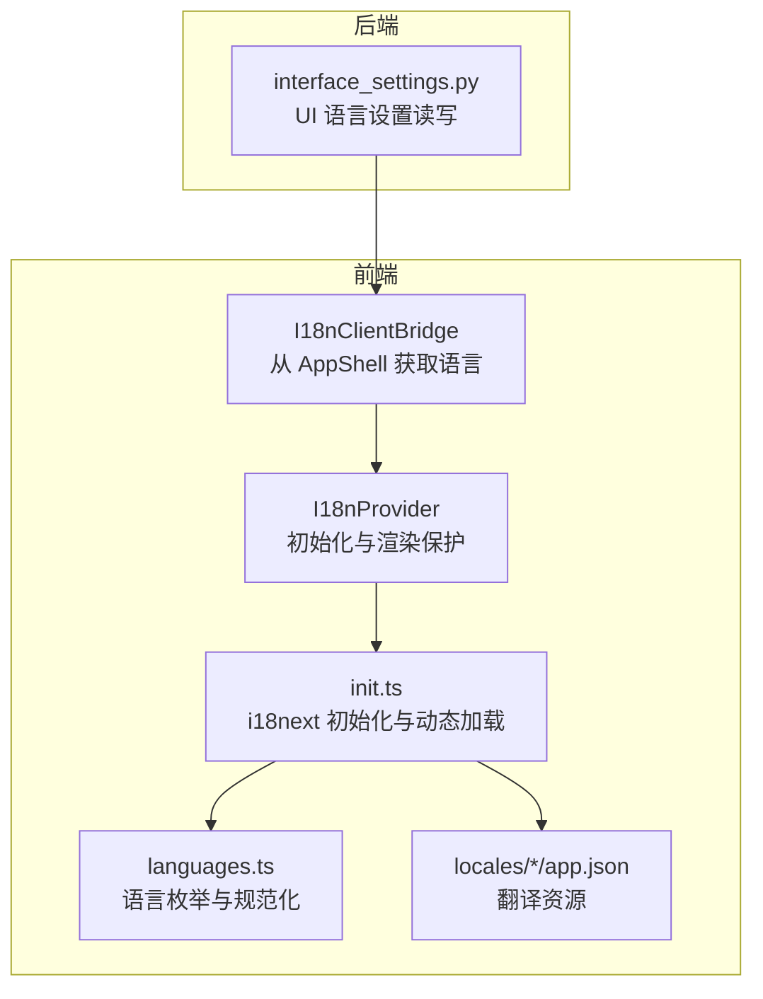
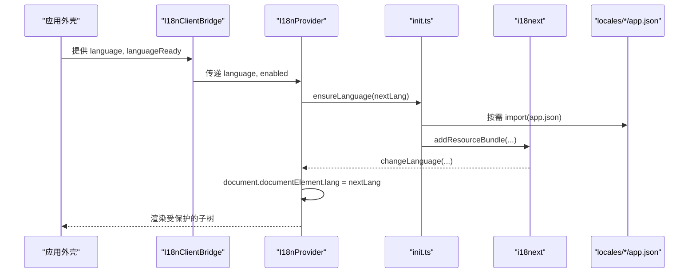
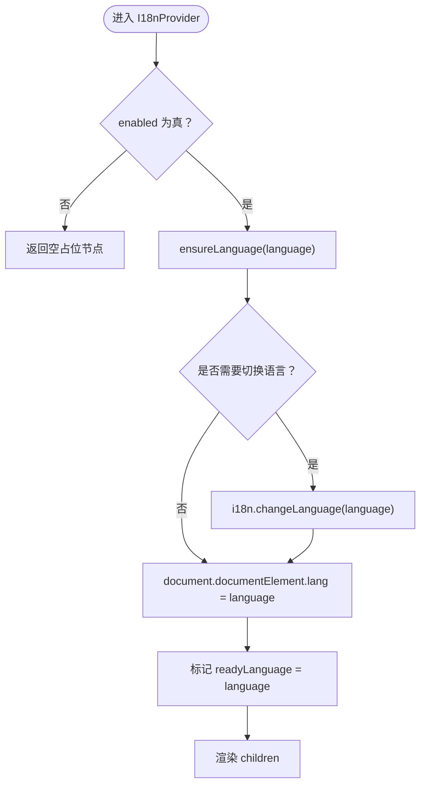
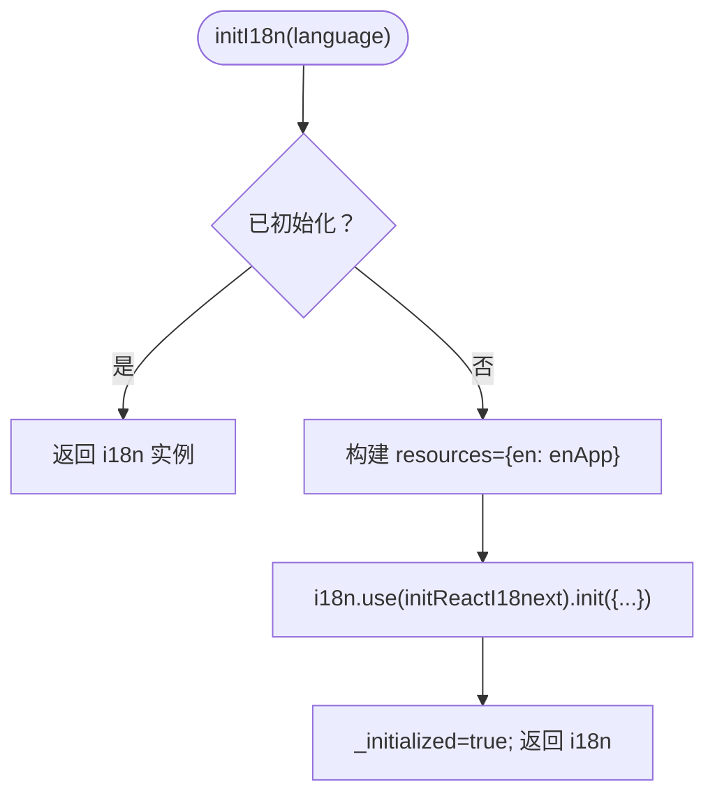
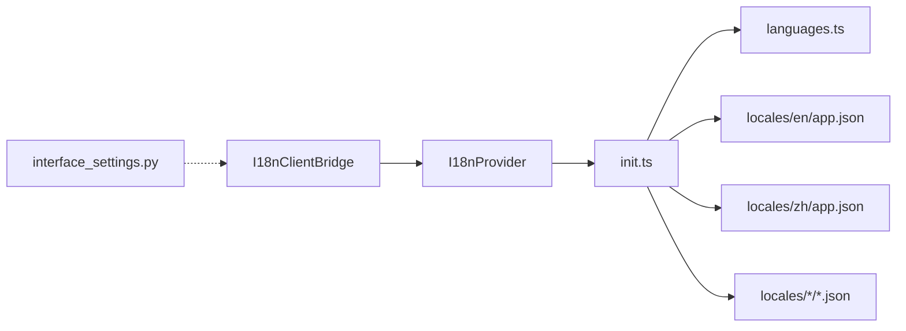
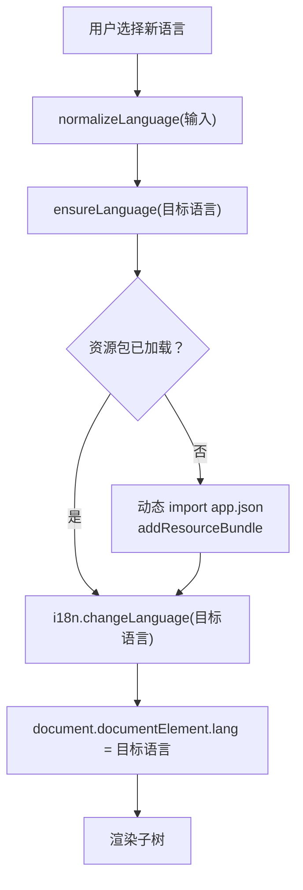
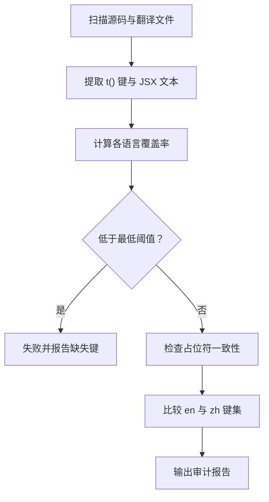

# 国际化支持

<cite>
**本文引用的文件**   
- [web/i18n/index.ts](file://web/i18n/index.ts)
- [web/i18n/init.ts](file://web/i18n/init.ts)
- [web/i18n/I18nProvider.tsx](file://web/i18n/I18nProvider.tsx)
- [web/i18n/I18nClientBridge.tsx](file://web/i18n/I18nClientBridge.tsx)
- [web/i18n/languages.ts](file://web/i18n/languages.ts)
- [web/locales/en/app.json](file://web/locales/en/app.json)
- [web/locales/zh/app.json](file://web/locales/zh/app.json)
- [web/scripts/i18n_audit.mjs](file://web/scripts/i18n_audit.mjs)
- [web/scripts/i18n_parity.mjs](file://web/scripts/i18n_parity.mjs)
- [deeptutor/services/settings/interface_settings.py](file://deeptutor/services/settings/interface_settings.py)
</cite>

## 目录
1. [简介](#简介)
2. [项目结构](#项目结构)
3. [核心组件](#核心组件)
4. [架构总览](#架构总览)
5. [详细组件分析](#详细组件分析)
6. [依赖关系分析](#依赖关系分析)
7. [性能与加载优化](#性能与加载优化)
8. [翻译键值、复数与格式化](#翻译键值复数与格式化)
9. [运行时语言切换与回退策略](#运行时语言切换与回退策略)
10. [RTL 与多字节字符处理](#rtl-与多字节字符处理)
11. [翻译工作流程与质量审计](#翻译工作流程与质量审计)
12. [贡献指南与最佳实践](#贡献指南与最佳实践)
13. [故障排查](#故障排查)
14. [结论](#结论)

## 简介
本文件系统性说明 DeepTutor 的前端国际化实现。系统基于 i18next，采用“默认英文 + 按需动态加载”的架构：应用启动时仅加载英文资源包，其他语言在首次使用时通过异步 import 加载对应 JSON 资源；界面语言由用户设置驱动，后端持久化到 `interface.json`，前端通过 React 上下文桥接并同步 `<html lang>` 属性。项目提供两类自动化脚本：i18n 审计（扫描未翻译 UI 文本与占位符一致性）和中英键集对齐校验。

## 项目结构
- 前端国际化入口与提供者位于 `web/i18n`，导出 Provider、客户端桥接、初始化函数与语言类型。
- 翻译资源位于 `web/locales/<locale>/app.json`，当前已维护英文与中文两套完整资源，其余语言按需存在。
- 自动化脚本位于 `web/scripts`，分别负责审计与键集对齐。
- 后端接口语言设置读取器位于 `deeptutor/services/settings/interface_settings.py`，定义支持的 UI 语言集合与规范化逻辑。

**图表来源**
- [web/i18n/I18nProvider.tsx:1-69](file://web/i18n/I18nProvider.tsx#L1-L69)
- [web/i18n/I18nClientBridge.tsx:1-15](file://web/i18n/I18nClientBridge.tsx#L1-L15)
- [web/i18n/init.ts:1-93](file://web/i18n/init.ts#L1-L93)
- [web/i18n/languages.ts:1-62](file://web/i18n/languages.ts#L1-L62)
- [deeptutor/services/settings/interface_settings.py:1-112](file://deeptutor/services/settings/interface_settings.py#L1-L112)

**章节来源**
- [web/i18n/index.ts:1-5](file://web/i18n/index.ts#L1-L5)
- [web/i18n/init.ts:1-93](file://web/i18n/init.ts#L1-L93)
- [web/i18n/I18nProvider.tsx:1-69](file://web/i18n/I18nProvider.tsx#L1-L69)
- [web/i18n/I18nClientBridge.tsx:1-15](file://web/i18n/I18nClientBridge.tsx#L1-L15)
- [web/i18n/languages.ts:1-62](file://web/i18n/languages.ts#L1-L62)
- [deeptutor/services/settings/interface_settings.py:1-112](file://deeptutor/services/settings/interface_settings.py#L1-L112)

## 核心组件
- I18nProvider：在模块加载阶段调用初始化，避免在渲染期间触发状态更新；根据传入语言确保资源就绪后渲染子树，并在过程中同步 `<html lang>`。
- I18nClientBridge：从应用外壳上下文读取语言与就绪状态，将语言传递给 Provider。
- init.ts：配置 i18next（单命名空间、禁用 key/ns 分隔符、禁用转义），预置英文资源，并提供 ensureLanguage 按语言异步加载资源包。
- languages.ts：声明 APP_LANGUAGES、AppLanguage 类型、isAppLanguage 校验与 normalizeLanguage 规范化逻辑，同时定义 ResponseLanguage 用于模型输出语言。
- interface_settings.py：后端 UI 语言设置读取器，定义 UiLanguage 常量、默认设置、语言别名映射与规范化函数。

**章节来源**
- [web/i18n/I18nProvider.tsx:1-69](file://web/i18n/I18nProvider.tsx#L1-L69)
- [web/i18n/I18nClientBridge.tsx:1-15](file://web/i18n/I18nClientBridge.tsx#L1-L15)
- [web/i18n/init.ts:1-93](file://web/i18n/init.ts#L1-L93)
- [web/i18n/languages.ts:1-62](file://web/i18n/languages.ts#L1-L62)
- [deeptutor/services/settings/interface_settings.py:1-112](file://deeptutor/services/settings/interface_settings.py#L1-L112)

## 架构总览
前端以 i18next 为核心，React 组件通过 useTranslation 使用 t() 进行翻译；Provider 保证语言资源加载完成后才渲染内容，避免闪烁。后端通过 interface.json 持久化用户的界面语言与响应语言，API 层与运行时共享同一份规范化逻辑，保证前后端语言一致。

**图表来源**
- [web/i18n/I18nClientBridge.tsx:1-15](file://web/i18n/I18nClientBridge.tsx#L1-L15)
- [web/i18n/I18nProvider.tsx:1-69](file://web/i18n/I18nProvider.tsx#L1-L69)
- [web/i18n/init.ts:1-93](file://web/i18n/init.ts#L1-L93)

## 详细组件分析

### I18nProvider 与 I18nClientBridge
- I18nClientBridge 从 AppShell 上下文取得语言与就绪标志，仅在 languageReady 为真时启用 Provider，避免首屏语言未就绪导致的闪烁。
- I18nProvider 在模块加载时调用 initI18n，确保 i18next 初始化事件不会在组件渲染期间触发 setState。随后在 effect 中确保目标语言资源已加载，必要时调用 changeLanguage，并同步 `<html lang>`。

**图表来源**
- [web/i18n/I18nProvider.tsx:1-69](file://web/i18n/I18nProvider.tsx#L1-L69)

**章节来源**
- [web/i18n/I18nClientBridge.tsx:1-15](file://web/i18n/I18nClientBridge.tsx#L1-L15)
- [web/i18n/I18nProvider.tsx:1-69](file://web/i18n/I18nProvider.tsx#L1-L69)

### init.ts：初始化与动态加载
- 初始化配置：
  - 默认命名空间为 app，且禁用 keySeparator 与 nsSeparator，使键名可直接包含冒号或路径式字符串。
  - interpolation.escapeValue=false，允许模板中使用 HTML 安全的内容。
  - returnEmptyString=false，returnNull=false，避免空串或 null 导致 UI 异常。
- 资源加载：
  - 启动时注入英文资源包。
  - ensureLanguage 对 zh/fr/de/uk/pl/pt/vi/ja/tr/ko 等语言执行动态 import 并 addResourceBundle。

**图表来源**
- [web/i18n/init.ts:1-39](file://web/i18n/init.ts#L1-L39)

**章节来源**
- [web/i18n/init.ts:1-93](file://web/i18n/init.ts#L1-L93)

### languages.ts：语言枚举与规范化
- APP_LANGUAGES 列出可选择的 UI 语言及其 labelKey。
- isAppLanguage 校验输入是否为受支持的 AppLanguage。
- normalizeLanguage 将多种自然语言名称与地区变体归一为标准代码（如 chinese→zh，french→fr，turkish→tr 等）。
- ResponseLanguage 扩展了模型输出语言范围，包括 zh-tw、ru、it、ar、ms 等。

**章节来源**
- [web/i18n/languages.ts:1-62](file://web/i18n/languages.ts#L1-L62)

### 后端接口语言设置
- UiLanguage 常量与 DEFAULT_UI_SETTINGS 定义了界面语言默认值为 en。
- _RESPONSE_LANGUAGE_ALIASES 提供响应语言的别名映射，便于兼容不同输入。
- _normalize_language 将常见语言名称与地区变体归一化为标准代码，未知值回退到默认值。

**章节来源**
- [deeptutor/services/settings/interface_settings.py:1-112](file://deeptutor/services/settings/interface_settings.py#L1-L112)

## 依赖关系分析
- I18nClientBridge 依赖 AppShell 上下文提供的 language 与 languageReady。
- I18nProvider 依赖 init.ts 的 initI18n、ensureLanguage、normalizeLanguage 与 AppLanguage 类型。
- init.ts 依赖 i18next 与 react-i18next，并静态导入 en/app.json，按需动态导入其他语言 app.json。
- languages.ts 被 init.ts 与 Provider 共同引用，作为语言类型与规范化入口。
- 后端 interface_settings.py 独立于前端，但通过 API 与前端设置保持一致的语言规范。

**图表来源**
- [web/i18n/I18nClientBridge.tsx:1-15](file://web/i18n/I18nClientBridge.tsx#L1-L15)
- [web/i18n/I18nProvider.tsx:1-69](file://web/i18n/I18nProvider.tsx#L1-L69)
- [web/i18n/init.ts:1-93](file://web/i18n/init.ts#L1-L93)
- [web/i18n/languages.ts:1-62](file://web/i18n/languages.ts#L1-L62)
- [deeptutor/services/settings/interface_settings.py:1-112](file://deeptutor/services/settings/interface_settings.py#L1-L112)

**章节来源**
- [web/i18n/index.ts:1-5](file://web/i18n/index.ts#L1-L5)
- [web/i18n/init.ts:1-93](file://web/i18n/init.ts#L1-L93)
- [web/i18n/I18nProvider.tsx:1-69](file://web/i18n/I18nProvider.tsx#L1-L69)
- [web/i18n/I18nClientBridge.tsx:1-15](file://web/i18n/I18nClientBridge.tsx#L1-L15)
- [web/i18n/languages.ts:1-62](file://web/i18n/languages.ts#L1-L62)
- [deeptutor/services/settings/interface_settings.py:1-112](file://deeptutor/services/settings/interface_settings.py#L1-L112)

## 性能与加载优化
- 按需加载：除英文外，其他语言资源通过动态 import 加载，减少首屏体积。
- 单命名空间：统一使用 app 命名空间，避免多命名空间带来的查找开销。
- 禁用 key/ns 分隔符：简化键解析，避免误判 URL 或特殊字符。
- 资源缓存：addResourceBundle 后 i18next 内部缓存资源包，重复切换语言无额外网络开销。
- 渲染保护：Provider 在语言就绪前显示占位节点，避免闪烁与无效渲染。

[本节为通用指导，不直接分析具体文件]

## 翻译键值、复数与格式化
- 键值管理：所有 UI 文案通过 t("key") 引用，键名保持可读性，不使用复杂分隔符。
- 复数形式：审计脚本会识别 Intl.PluralRules 的分类，并检查是否提供带后缀的复数键（如 key_zero/key_one/key_two/key_few/key_many/key_other）。
- 插值占位符：审计脚本提取 {{name}} 形式的占位符，并与英文源对比，确保各语言翻译中的占位符一致。
- 日期时间格式化：当前实现未引入专门的日期时间库；如需本地化日期时间，建议结合浏览器 Intl API 或第三方库，并确保在翻译键中保留必要占位符。

**章节来源**
- [web/scripts/i18n_audit.mjs:94-127](file://web/scripts/i18n_audit.mjs#L94-L127)
- [web/scripts/i18n_audit.mjs:168-177](file://web/scripts/i18n_audit.mjs#L168-L177)

## 运行时语言切换与回退策略
- 语言检测与规范化：
  - 前端 normalizeLanguage 将多种输入归一为标准代码。
  - 后端 _normalize_language 提供一致的规范化能力。
- 动态加载：
  - 首次切换到非英文语言时，ensureLanguage 动态加载对应 app.json 并注册到 i18next。
- 回退策略：
  - i18next 配置 fallbackLng="en"，缺失键自动回退到英文。
  - 部分语言（如法语、乌克兰语、韩语）覆盖率较低，审计脚本允许最低覆盖率阈值，未覆盖键回退英文。
- 用户偏好：
  - 后端 interface.json 持久化 language 与 response_language。
  - 前端通过 AppShell 上下文读取语言并传递给 Provider。

**图表来源**
- [web/i18n/init.ts:41-92](file://web/i18n/init.ts#L41-L92)
- [web/i18n/I18nProvider.tsx:40-56](file://web/i18n/I18nProvider.tsx#L40-L56)
- [web/i18n/languages.ts:26-41](file://web/i18n/languages.ts#L26-L41)
- [deeptutor/services/settings/interface_settings.py:100-112](file://deeptutor/services/settings/interface_settings.py#L100-L112)

**章节来源**
- [web/i18n/init.ts:1-93](file://web/i18n/init.ts#L1-L93)
- [web/i18n/I18nProvider.tsx:1-69](file://web/i18n/I18nProvider.tsx#L1-L69)
- [web/i18n/languages.ts:1-62](file://web/i18n/languages.ts#L1-L62)
- [deeptutor/services/settings/interface_settings.py:1-112](file://deeptutor/services/settings/interface_settings.py#L1-L112)

## RTL 与多字节字符处理
- 文本方向：
  - 当前实现通过 document.documentElement.lang 同步语言，但未显式设置 dir="rtl"。若新增阿拉伯语等 RTL 语言，需在 Provider 中根据语言设置 dir 属性。
- 多字节字符：
  - 审计脚本使用 Unicode 范围匹配 CJK 字符，确保能检测到中文等文本。
  - 翻译资源为 UTF-8 JSON，支持任意 Unicode 字符。

[本节为通用指导，不直接分析具体文件]

## 翻译工作流程与质量审计
- 翻译文件组织：
  - 每个语言一个目录，内含 app.json（主应用文案）与 common.json（公共文案，如有）。
  - 英文为基准语言，其他语言逐步补齐。
- 生成与一致性检查：
  - i18n_audit.mjs：
    - 扫描 app/components/features/hooks/lib/shared 下的 TS/TSX 文件，提取 t() 字面量与 JSX 文本、aria-label 等属性中的硬编码文本。
    - 计算各语言对“已使用键”的覆盖率，并对法语、乌克兰语、韩语设置最低覆盖率阈值。
    - 检查插值占位符是否与英文一致。
  - i18n_parity.mjs：
    - 比较 en 与 zh 的 JSON 文件结构与键集，报告缺失或多余的文件与键。
- 质量门禁：
  - 审计脚本在发现未翻译键、占位符不一致或覆盖率不足时会设置 process.exitCode，可用于 CI 门禁。

**图表来源**
- [web/scripts/i18n_audit.mjs:1-255](file://web/scripts/i18n_audit.mjs#L1-L255)
- [web/scripts/i18n_parity.mjs:1-89](file://web/scripts/i18n_parity.mjs#L1-L89)

**章节来源**
- [web/scripts/i18n_audit.mjs:1-255](file://web/scripts/i18n_audit.mjs#L1-L255)
- [web/scripts/i18n_parity.mjs:1-89](file://web/scripts/i18n_parity.mjs#L1-L89)

## 贡献指南与最佳实践
- 新增语言：
  - 在 web/locales 下新建语言目录，复制 en/app.json 并翻译键值。
  - 在 web/i18n/init.ts 的 ensureLanguage 中添加该语言的动态 import 分支。
  - 在 web/i18n/languages.ts 的 APP_LANGUAGES 与 normalizeLanguage 中添加语言枚举与归一规则。
  - 如需后端支持，更新 deeptutor/services/settings/interface_settings.py 的 UiLanguage 与别名映射。
- 新增键值：
  - 在英文 app.json 中添加键值，确保占位符语义清晰。
  - 在其他语言中同步添加对应翻译，保持占位符一致。
- 复数与格式化：
  - 对于数量相关文案，考虑提供复数键（zero/one/two/few/many/other）。
  - 日期时间建议使用浏览器 Intl API 或第三方库，并在翻译中保留占位符。
- 质量检查：
  - 运行 i18n_audit.mjs 与 i18n_parity.mjs，确保覆盖率与键集一致。
  - 在 CI 中集成审计脚本，防止遗漏翻译。

[本节为通用指导，不直接分析具体文件]

## 故障排查
- 语言未生效：
  - 检查 I18nClientBridge 是否正确传递 language 与 languageReady。
  - 确认 ensureLanguage 是否已为该语言添加资源包。
  - 查看 i18n.changeLanguage 是否成功执行。
- 键缺失或回退英文：
  - 检查对应语言 app.json 是否包含该键。
  - 使用 i18n_audit.mjs 查看缺失键与覆盖率。
- 占位符不一致：
  - 使用 i18n_audit.mjs 的占位符检查功能，修复缺失或多余的占位符。
- 后端语言不一致：
  - 检查 interface.json 中的 language 与 response_language 字段。
  - 确认后端 _normalize_language 与前端 normalizeLanguage 行为一致。

**章节来源**
- [web/i18n/I18nClientBridge.tsx:1-15](file://web/i18n/I18nClientBridge.tsx#L1-L15)
- [web/i18n/I18nProvider.tsx:1-69](file://web/i18n/I18nProvider.tsx#L1-L69)
- [web/i18n/init.ts:1-93](file://web/i18n/init.ts#L1-L93)
- [web/scripts/i18n_audit.mjs:1-255](file://web/scripts/i18n_audit.mjs#L1-L255)
- [deeptutor/services/settings/interface_settings.py:1-112](file://deeptutor/services/settings/interface_settings.py#L1-L112)

## 结论
DeepTutor 的国际化方案以 i18next 为核心，采用“英文默认 + 按需动态加载”的策略，在保证首屏性能的同时支持多语言扩展。前端通过 Provider 与 ClientBridge 统一管理语言生命周期，后端通过 interface_settings.py 持久化用户偏好，并通过规范化函数保证前后端一致。配合 i18n_audit.mjs 与 i18n_parity.mjs，项目实现了翻译键值、复数与占位符的质量保障。未来可在新增 RTL 语言时补充文本方向处理，并结合 Intl API 完善日期时间本地化。