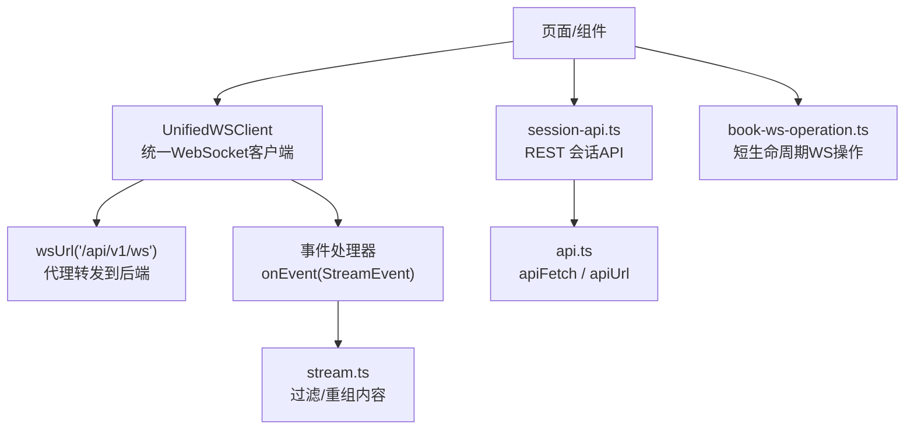
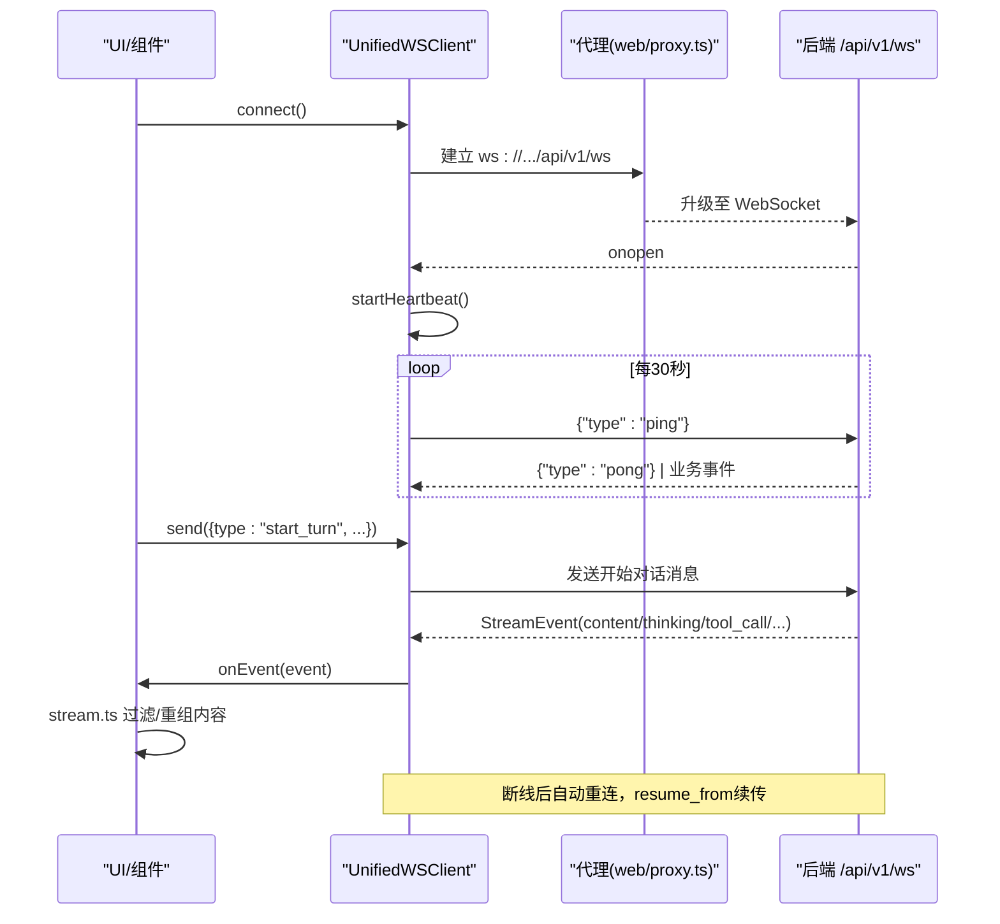
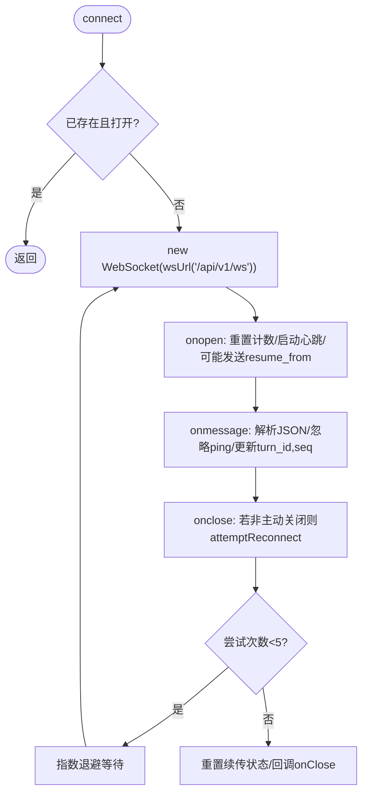
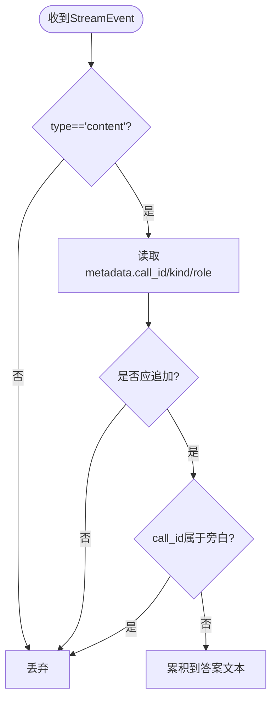
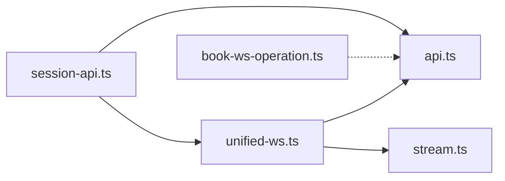

# 实时通信

<cite>
**本文引用的文件**
- [web/lib/unified-ws.ts](file://web/lib/unified-ws.ts)
- [web/lib/stream.ts](file://web/lib/stream.ts)
- [web/lib/session-api.ts](file://web/lib/session-api.ts)
- [web/lib/api.ts](file://web/lib/api.ts)
- [web/lib/book-ws-operation.ts](file://web/lib/book-ws-operation.ts)
</cite>

## 目录
1. [简介](#简介)
2. [项目结构](#项目结构)
3. [核心组件](#核心组件)
4. [架构总览](#架构总览)
5. [详细组件分析](#详细组件分析)
6. [依赖关系分析](#依赖关系分析)
7. [性能考虑](#性能考虑)
8. [故障排除指南](#故障排除指南)
9. [结论](#结论)
10. [附录：使用示例与监控](#附录使用示例与监控)

## 简介
本文件聚焦 DeepTutor 前端的实时通信能力，围绕统一 WebSocket 客户端、消息协议设计、重连机制、流式响应处理、SSE/WS 集成、会话 API 封装、事件订阅与状态同步展开。文档同时提供流式文本渲染、增量更新与性能优化建议，并给出调试与故障排除方法以及可操作的监控手段。

## 项目结构
前端实时通信相关代码集中在 web/lib 目录下，采用“单一入口 + 职责分离”的组织方式：
- unified-ws.ts：统一 WebSocket 客户端，负责连接管理、心跳、重连、事件分发与续传。
- stream.ts：流事件过滤与答案内容重组，用于剔除旁白片段、聚合最终回答。
- session-api.ts：会话相关的 REST 接口封装（列表、详情、标题更新、删除、分支选择等）。
- api.ts：统一的 fetch 包装与 URL 构造，内置 401 自动跳转登录逻辑。
- book-ws-operation.ts：面向书籍协作的短生命周期 WS 操作封装（请求-结果模式）。

图表来源
- [web/lib/unified-ws.ts:157-234](file://web/lib/unified-ws.ts#L157-L234)
- [web/lib/api.ts:22-38](file://web/lib/api.ts#L22-L38)
- [web/lib/session-api.ts:131-168](file://web/lib/session-api.ts#L131-L168)
- [web/lib/book-ws-operation.ts:25-99](file://web/lib/book-ws-operation.ts#L25-L99)

章节来源
- [web/lib/unified-ws.ts:157-315](file://web/lib/unified-ws.ts#L157-L315)
- [web/lib/stream.ts:1-76](file://web/lib/stream.ts#L1-L76)
- [web/lib/session-api.ts:1-233](file://web/lib/session-api.ts#L1-L233)
- [web/lib/api.ts:1-97](file://web/lib/api.ts#L1-L97)
- [web/lib/book-ws-operation.ts:1-99](file://web/lib/book-ws-operation.ts#L1-L99)

## 核心组件
- 统一 WebSocket 客户端（UnifiedWSClient）
  - 单端点 /api/v1/ws 接入，提供类型化的流式事件接口。
  - 心跳保活（周期性 ping），死连接检测（超时关闭触发重连）。
  - 指数退避重连（最多 5 次），支持 resume_from 续传断点。
  - 维护 activeTurnId 与 lastSeq，确保重连后从断点继续。
- 流事件处理（stream.ts）
  - 过滤非展示性 content 事件，仅保留最终回答或关键轮次。
  - 收集“旁白”标记，避免将叙述性文本混入用户可见答案。
  - 在收到旁白标记时低成本重新计算最终答案文本。
- 会话 API（session-api.ts）
  - 会话列表、详情获取、标题更新、删除、问答记录、分支选择等。
  - 结合 client-cache 进行短期缓存与失效策略。
- 通用网络层（api.ts）
  - 统一构造 API/WS 路径；封装 fetch，自动处理 401 跳转登录。
- 书籍协作 WS 操作（book-ws-operation.ts）
  - 短生命周期 WS 请求-结果模式，错误与关闭语义清晰。

章节来源
- [web/lib/unified-ws.ts:157-315](file://web/lib/unified-ws.ts#L157-L315)
- [web/lib/stream.ts:1-76](file://web/lib/stream.ts#L1-L76)
- [web/lib/session-api.ts:131-233](file://web/lib/session-api.ts#L131-L233)
- [web/lib/api.ts:22-97](file://web/lib/api.ts#L22-L97)
- [web/lib/book-ws-operation.ts:25-99](file://web/lib/book-ws-operation.ts#L25-L99)

## 架构总览
下图展示了前端与后端通过统一 WS 端点进行实时交互的整体流程，包括消息发送、事件接收、心跳与重连、以及流式内容的组装。

图表来源
- [web/lib/unified-ws.ts:183-234](file://web/lib/unified-ws.ts#L183-L234)
- [web/lib/unified-ws.ts:259-282](file://web/lib/unified-ws.ts#L259-L282)
- [web/lib/unified-ws.ts:286-307](file://web/lib/unified-ws.ts#L286-L307)
- [web/lib/stream.ts:15-75](file://web/lib/stream.ts#L15-L75)

## 详细组件分析

### 统一 WebSocket 客户端（UnifiedWSClient）
- 连接管理
  - 单例化连接，避免重复创建；onopen 重置重连计数并启动心跳。
  - 通过 wsUrl("/api/v1/ws") 构建地址，由代理完成实际后端路由。
- 心跳与保活
  - 每 30 秒发送一次 ping；若超过 45 秒未收到任何消息则主动关闭连接，触发重连。
- 重连机制
  - 指数退避：BASE_RECONNECT_DELAY_MS * 2^attempt，最大尝试次数为 5。
  - 重连成功后根据 activeTurnId 与 lastSeq 发送 resume_from 续传。
- 事件处理
  - 解析 JSON 事件，忽略 ping/pong 等系统帧。
  - 维护 turn_id 与 seq，便于后续续传与去重。
- 断开与清理
  - disconnect 设置 intentionalClose，停止心跳与重连定时器，释放资源。

图表来源
- [web/lib/unified-ws.ts:183-234](file://web/lib/unified-ws.ts#L183-L234)
- [web/lib/unified-ws.ts:259-307](file://web/lib/unified-ws.ts#L259-L307)

章节来源
- [web/lib/unified-ws.ts:157-315](file://web/lib/unified-ws.ts#L157-L315)

### 流式响应与内容重组（stream.ts）
- 过滤规则
  - 仅当 event.type === "content" 且元数据满足条件时才追加到最终答案。
  - 通过 call_kind 区分“最终回答”和“轮次中间输出”。
- 旁白剔除
  - 收集 call_role === "narration" 的 call_id 集合，在重组答案时跳过这些片段。
- 增量更新
  - 仅在收到旁白标记时调用 recomputeAnswerContent，避免每次分片都全量重组。

图表来源
- [web/lib/stream.ts:15-75](file://web/lib/stream.ts#L15-L75)

章节来源
- [web/lib/stream.ts:1-76](file://web/lib/stream.ts#L1-L76)

### 会话 API 封装（session-api.ts）
- 能力
  - 会话列表分页、会话详情获取、标题更新、删除、问答结果记录、消息删除、分支选择更新。
- 缓存与失效
  - 列表接口使用 client-cache 进行短期缓存（默认 TTL 15s），写操作后失效相关缓存键。
- 认证处理
  - 基于 apiFetch 的 401 自动跳转登录，保证会话上下文一致性。

章节来源
- [web/lib/session-api.ts:131-233](file://web/lib/session-api.ts#L131-L233)
- [web/lib/api.ts:77-97](file://web/lib/api.ts#L77-L97)

### 通用网络层（api.ts）
- 路径构造
  - apiUrl 与 wsUrl 均为透传函数，真实后端地址由 web/proxy.ts 在运行时决定。
- 认证与重定向
  - apiFetch 在启用认证时遇到 401 自动跳转到 /login?next=当前路径，避免破坏用户体验。

章节来源
- [web/lib/api.ts:22-38](file://web/lib/api.ts#L22-L38)
- [web/lib/api.ts:77-97](file://web/lib/api.ts#L77-L97)

### 书籍协作 WS 操作（book-ws-operation.ts）
- 模式
  - 短生命周期 WS：创建连接 -> 发送消息 -> 监听事件 -> 收到指定 resultType 即 resolve。
- 错误与关闭
  - error 事件直接拒绝；连接提前关闭也拒绝，并附带明确错误信息。
- 扩展性
  - 通过 BookSocketLike 抽象，可适配不同底层实现。

章节来源
- [web/lib/book-ws-operation.ts:25-99](file://web/lib/book-ws-operation.ts#L25-L99)

## 依赖关系分析
- UnifiedWSClient 依赖 api.ts 的 wsUrl 构造连接地址。
- 事件消费方依赖 stream.ts 的过滤与重组逻辑，以生成最终答案。
- 会话状态通过 session-api.ts 与后端 REST 同步，必要时与 WS 事件共同驱动 UI。
- book-ws-operation.ts 独立于统一 WS，用于特定场景的短连接操作。

图表来源
- [web/lib/unified-ws.ts:183-234](file://web/lib/unified-ws.ts#L183-L234)
- [web/lib/session-api.ts:131-168](file://web/lib/session-api.ts#L131-L168)
- [web/lib/api.ts:22-38](file://web/lib/api.ts#L22-L38)
- [web/lib/book-ws-operation.ts:25-99](file://web/lib/book-ws-operation.ts#L25-L99)

章节来源
- [web/lib/unified-ws.ts:157-315](file://web/lib/unified-ws.ts#L157-L315)
- [web/lib/session-api.ts:131-233](file://web/lib/session-api.ts#L131-L233)
- [web/lib/api.ts:22-97](file://web/lib/api.ts#L22-L97)
- [web/lib/book-ws-operation.ts:25-99](file://web/lib/book-ws-operation.ts#L25-L99)

## 性能考虑
- 心跳与超时
  - 合理的心跳间隔与超时阈值可降低假存活概率，减少无效连接占用。
- 重连策略
  - 指数退避避免雪崩；限制最大重试次数防止无限循环。
- 流式渲染
  - 仅对必要 content 事件进行追加；旁白标记到达后再批量重组答案，降低频繁 DOM 更新成本。
- 缓存与失效
  - 会话列表短期缓存减少重复请求；写操作后及时失效相关缓存键。
- 内存与事件
  - 避免在 onEvent 中执行重型计算；必要时使用节流/防抖与虚拟滚动。

[本节为通用指导，不直接分析具体文件]

## 故障排除指南
- 连接失败
  - 检查代理配置与 wsUrl 路径是否正确；确认后端 /api/v1/ws 可达。
  - 观察 onerror 日志，定位网络或证书问题。
- 频繁断线
  - 检查心跳超时阈值与后端空闲超时是否匹配；确认服务端是否回显 pong。
  - 查看重连次数是否达到上限，必要时调整策略。
- 内容缺失或错乱
  - 核对 shouldAppendEventContent 与旁白标记处理逻辑；确认 metadata.call_id 与 call_role 正确传递。
  - 在旁白标记到达后验证 recomputeAnswerContent 的结果。
- 401 跳转异常
  - 确认 apiFetch 的 skipAuthRedirect 使用场景；检查运行时认证开关设置。
- 书籍协作 WS 报错
  - 关注 error 事件与提前关闭情况；确保 resultType 与后端一致。

章节来源
- [web/lib/unified-ws.ts:231-233](file://web/lib/unified-ws.ts#L231-L233)
- [web/lib/unified-ws.ts:286-307](file://web/lib/unified-ws.ts#L286-L307)
- [web/lib/stream.ts:15-75](file://web/lib/stream.ts#L15-L75)
- [web/lib/api.ts:77-97](file://web/lib/api.ts#L77-L97)
- [web/lib/book-ws-operation.ts:72-99](file://web/lib/book-ws-operation.ts#L72-L99)

## 结论
DeepTutor 前端通过统一 WebSocket 客户端实现了健壮的实时通信：具备心跳保活、指数退避重连与续传能力；配合流式内容过滤与重组，保障最终答案的正确性与渲染性能；会话 API 与网络层封装提升了易用性与健壮性。对于书籍协作等短连接场景，提供了独立的 WS 操作封装。整体方案兼顾了可靠性、性能与可维护性。

[本节为总结性内容，不直接分析具体文件]

## 附录：使用示例与监控

### 典型用法示例
- 建立连接与发送消息
  - 创建 UnifiedWSClient 实例，传入 onEvent 回调；调用 connect 建立连接。
  - 通过 send 发送 start_turn 消息，携带 capability、tools、knowledge_bases、language、persona、llm_selection 等参数。
- 订阅与续传
  - 重连后自动发送 resume_from，携带 turn_id 与 seq，恢复流式输出。
- 会话操作
  - 使用 listSessions/getSession/updateSessionTitle/deleteSession 等接口管理会话。
  - 通过 updateBranchSelection 切换编辑分支。
- 书籍协作
  - 使用 runBookSocketOperation 发起短生命周期 WS 操作，监听 onEvent 并等待 resultType。

章节来源
- [web/lib/unified-ws.ts:172-242](file://web/lib/unified-ws.ts#L172-L242)
- [web/lib/session-api.ts:131-233](file://web/lib/session-api.ts#L131-L233)
- [web/lib/book-ws-operation.ts:25-99](file://web/lib/book-ws-operation.ts#L25-L99)

### 调试工具与建议
- 浏览器开发者工具
  - Network 面板筛选 WS 请求，查看握手与消息帧；Console 查看 onerror 与 warn 日志。
- 自定义埋点
  - 在 onEvent 中记录事件类型、turn_id、seq、timestamp，统计吞吐与延迟。
  - 在重连前后记录 attempt、delay、success/failure，评估稳定性。
- 性能监控
  - 测量首字节时间（TTFB）、端到端延迟、DOM 更新频率与耗时。
  - 针对长会话，监控内存增长与事件队列长度，必要时引入虚拟滚动与增量合并。

[本节为通用实践，不直接分析具体文件]