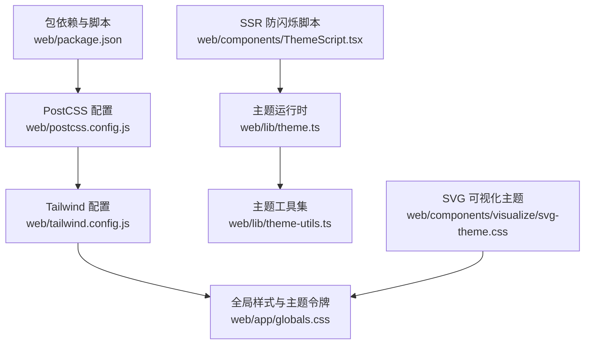
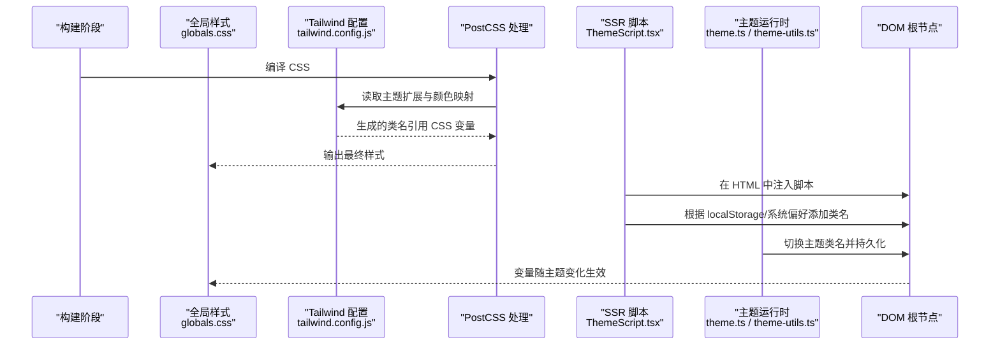
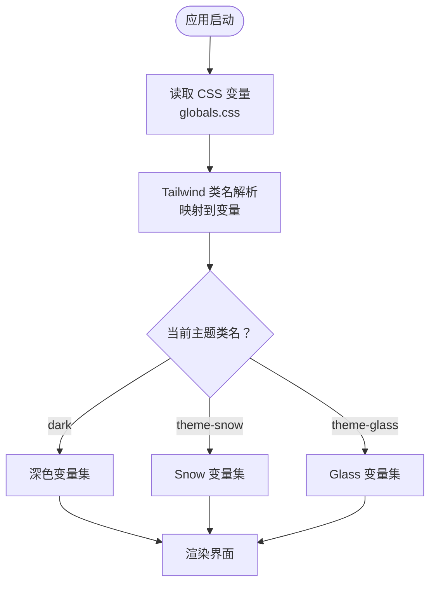
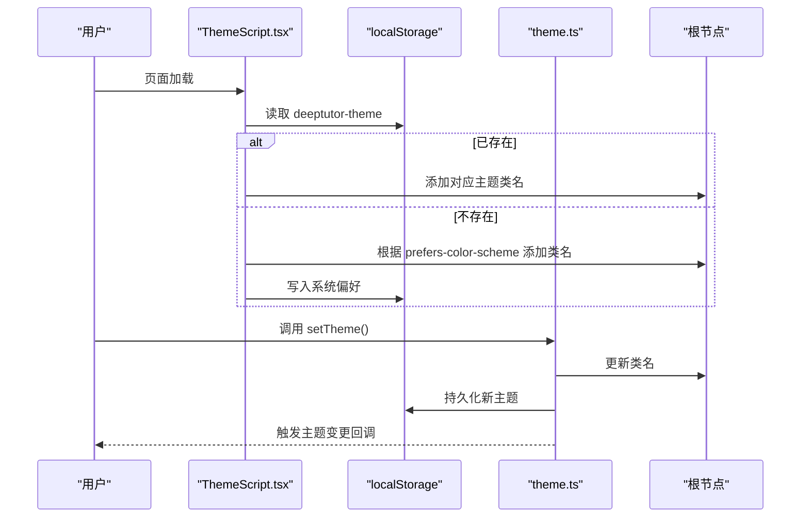
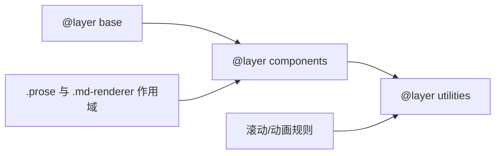
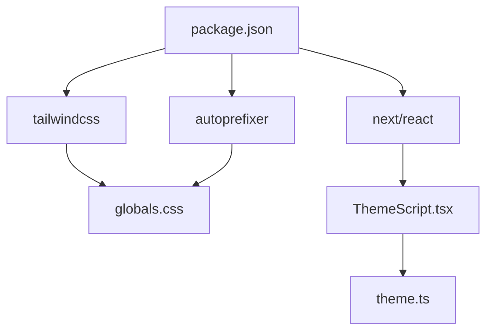

# 样式与主题

<cite>
**本文引用的文件**
- [web/tailwind.config.js](file://web/tailwind.config.js)
- [web/postcss.config.js](file://web/postcss.config.js)
- [web/app/globals.css](file://web/app/globals.css)
- [web/lib/theme.ts](file://web/lib/theme.ts)
- [web/lib/theme-utils.ts](file://web/lib/theme-utils.ts)
- [web/components/ThemeScript.tsx](file://web/components/ThemeScript.tsx)
- [web/components/visualize/svg-theme.css](file://web/components/visualize/svg-theme.css)
- [web/package.json](file://web/package.json)
- [web/tests/code-block-themes.test.ts](file://web/tests/code-block-themes.test.ts)
</cite>

## 目录
1. [简介](#简介)
2. [项目结构](#项目结构)
3. [核心组件](#核心组件)
4. [架构总览](#架构总览)
5. [详细组件分析](#详细组件分析)
6. [依赖关系分析](#依赖关系分析)
7. [性能考量](#性能考量)
8. [故障排查指南](#故障排查指南)
9. [结论](#结论)
10. [附录](#附录)

## 简介
本文件系统性梳理 DeepTutor 前端的样式与主题体系，围绕基于 Tailwind CSS 的样式系统、设计令牌（CSS 变量）管理、主题配置、颜色系统与字体管理展开。文档同时覆盖暗色模式支持、动态主题切换、组件样式组织与隔离、响应式设计、样式性能优化、CSS-in-JS 方案以及样式测试方法，并提供主题定制、品牌适配与可访问性实践建议。

## 项目结构
前端样式与主题由以下关键部分构成：
- 构建与工具链：PostCSS + Tailwind CSS + Autoprefixer
- 全局样式与主题令牌：全局 CSS 中定义多套主题变量与基础样式
- 主题运行时：客户端脚本与工具函数负责主题初始化、持久化与切换
- 可视化 SVG 主题：为内联图表与可视化提供主题感知样式
- 代码块高亮主题：通过注册表与工具函数管理多种语法高亮主题
- 测试：对代码块主题注册表与行为进行断言验证

**图示来源**
- [web/tailwind.config.js:1-59](file://web/tailwind.config.js#L1-L59)
- [web/postcss.config.js:1-7](file://web/postcss.config.js#L1-L7)
- [web/app/globals.css:1-192](file://web/app/globals.css#L1-L192)
- [web/lib/theme.ts:1-127](file://web/lib/theme.ts#L1-L127)
- [web/lib/theme-utils.ts:1-82](file://web/lib/theme-utils.ts#L1-L82)
- [web/components/ThemeScript.tsx:1-50](file://web/components/ThemeScript.tsx#L1-L50)
- [web/components/visualize/svg-theme.css:1-246](file://web/components/visualize/svg-theme.css#L1-L246)
- [web/package.json:1-63](file://web/package.json#L1-L63)

**章节来源**
- [web/tailwind.config.js:1-59](file://web/tailwind.config.js#L1-L59)
- [web/postcss.config.js:1-7](file://web/postcss.config.js#L1-L7)
- [web/app/globals.css:1-192](file://web/app/globals.css#L1-L192)
- [web/lib/theme.ts:1-127](file://web/lib/theme.ts#L1-L127)
- [web/lib/theme-utils.ts:1-82](file://web/lib/theme-utils.ts#L1-L82)
- [web/components/ThemeScript.tsx:1-50](file://web/components/ThemeScript.tsx#L1-L50)
- [web/components/visualize/svg-theme.css:1-246](file://web/components/visualize/svg-theme.css#L1-L246)
- [web/package.json:1-63](file://web/package.json#L1-L63)

## 核心组件
- 主题令牌与基线样式：在全局 CSS 中以 CSS 变量形式定义背景、前景、卡片、弹出层、主色、次色、强调、破坏、边框、输入、环、遮罩等令牌，并设置基础排版、滚动条、动画与 Markdown 渲染样式。
- Tailwind 集成：在 Tailwind 配置中将语义化颜色映射到 CSS 变量，启用 class 模式的暗色模式，扩展字体族与渐变背景。
- 主题运行时：提供获取/保存本地存储主题、读取系统偏好、应用类名到根节点、订阅主题变更、切换主题等能力。
- SSR 防闪烁脚本：在服务端渲染时内联一段脚本，在 React 水合前即应用正确的主题类名，避免闪烁。
- SVG 可视化主题：为内联 SVG 图表提供主题感知的文本、容器、连线与交互样式，并在暗色模式下自动翻转配色。
- 代码块高亮主题：通过主题注册表与工具函数管理多种 Prism 风格的高亮主题，并提供默认值与回退策略。

**章节来源**
- [web/app/globals.css:1-192](file://web/app/globals.css#L1-L192)
- [web/tailwind.config.js:1-59](file://web/tailwind.config.js#L1-L59)
- [web/lib/theme.ts:1-127](file://web/lib/theme.ts#L1-L127)
- [web/components/ThemeScript.tsx:1-50](file://web/components/ThemeScript.tsx#L1-L50)
- [web/components/visualize/svg-theme.css:1-246](file://web/components/visualize/svg-theme.css#L1-L246)
- [web/tests/code-block-themes.test.ts:1-200](file://web/tests/code-block-themes.test.ts#L1-L200)

## 架构总览
下图展示了从构建到运行时的样式与主题数据流：PostCSS 编译 Tailwind，生成使用 CSS 变量的样式；全局 CSS 定义多套主题令牌；SSR 脚本与主题运行时协作确保首屏无闪烁；组件通过 Tailwind 类名与 CSS 变量组合实现主题化。

**图示来源**
- [web/postcss.config.js:1-7](file://web/postcss.config.js#L1-L7)
- [web/tailwind.config.js:1-59](file://web/tailwind.config.js#L1-L59)
- [web/app/globals.css:1-192](file://web/app/globals.css#L1-L192)
- [web/components/ThemeScript.tsx:1-50](file://web/components/ThemeScript.tsx#L1-L50)
- [web/lib/theme.ts:1-127](file://web/lib/theme.ts#L1-L127)
- [web/lib/theme-utils.ts:1-82](file://web/lib/theme-utils.ts#L1-L82)

## 详细组件分析

### 主题令牌与颜色系统（CSS 变量）
- 令牌集合：background、foreground、card/popover 及其 foreground、primary/secondary/muted/accent/destructive 及其 foreground、border、input、ring、overlay。
- 主题家族：
  - 奶油（默认）：暖调近白背景，赤陶主色，适合日常阅读。
  - 深色：暖调近黑背景，保持同一色彩家族。
  - Snow（纯白中性）：纯白画布，蓝色主色，接近主流产品 chrome。
  - Glass（玻璃态）：半透明面板叠加径向渐变背景，紫色主色。
- 颜色映射：Tailwind 的颜色键直接绑定到 CSS 变量，使组件无需关心具体色值，仅通过语义化类名即可适配主题。
- 字体管理：通过 Tailwind 扩展 fontFamily，将 sans/serif 映射到 CSS 变量 --font-sans/--font-serif，保证跨主题一致的字族。

**图示来源**
- [web/app/globals.css:20-123](file://web/app/globals.css#L20-L123)
- [web/tailwind.config.js:9-55](file://web/tailwind.config.js#L9-L55)

**章节来源**
- [web/app/globals.css:20-123](file://web/app/globals.css#L20-L123)
- [web/tailwind.config.js:9-55](file://web/tailwind.config.js#L9-L55)

### 暗色模式与主题切换
- 暗色模式：采用 class 模式，通过在根元素添加 dark 类切换暗色主题。
- 主题枚举：light、dark、glass、snow。其中 glass 同时包含 dark 与 theme-glass 类。
- 持久化：localStorage 存储主题键，优先读取用户选择，否则回退到系统偏好。
- 订阅机制：提供主题变更订阅器，便于组件监听主题变化并更新 UI。
- SSR 防闪烁：在服务端渲染时内联脚本，在水合前即应用正确类名，避免闪烁。

**图示来源**
- [web/components/ThemeScript.tsx:1-50](file://web/components/ThemeScript.tsx#L1-L50)
- [web/lib/theme.ts:30-127](file://web/lib/theme.ts#L30-L127)
- [web/lib/theme-utils.ts:1-82](file://web/lib/theme-utils.ts#L1-L82)

**章节来源**
- [web/components/ThemeScript.tsx:1-50](file://web/components/ThemeScript.tsx#L1-L50)
- [web/lib/theme.ts:30-127](file://web/lib/theme.ts#L30-L127)
- [web/lib/theme-utils.ts:1-82](file://web/lib/theme-utils.ts#L1-L82)

### 组件样式组织与隔离
- 分层样式：@layer base/components/utilities 组织基础、组件与工具类，避免冲突。
- 组件级样式：如 surface-card、muted-chip 等复用类，统一视觉语言。
- Markdown 渲染：.prose 与 .md-renderer 下的规则限定作用域，避免污染全局。
- 滚动与动画：针对聊天流式滚动的特殊容器使用 data 属性选择器，禁用浏览器自动锚定与平滑滚动，配合自定义动画提升体验。
- 弹窗与遮罩：使用 overlay 变量控制模态遮罩色，统一视觉层级。

**图示来源**
- [web/app/globals.css:1-213](file://web/app/globals.css#L1-L213)

**章节来源**
- [web/app/globals.css:1-213](file://web/app/globals.css#L1-L213)

### 响应式设计
- 媒体查询：在主题与组件样式中使用 @media 控制不同断点下的表现，例如玻璃态卡片模糊强度、预览抽屉挤压宽度等。
- 布局收缩：聊天壳在打开预览或查看器时通过 padding-right 动态收缩，适配宽屏布局。
- 可访问性：尊重 prefers-reduced-motion，降低动画强度或禁用。

**章节来源**
- [web/app/globals.css:137-142](file://web/app/globals.css#L137-L142)
- [web/app/globals.css:764-786](file://web/app/globals.css#L764-L786)
- [web/app/globals.css:679-684](file://web/app/globals.css#L679-L684)

### 可视化 SVG 主题
- 主题感知：通过 .dt-svg-root 下类名与 CSS 变量控制文本、容器、连线与交互状态。
- 色板：提供灰、蓝、青、珊瑚、粉、紫、绿、琥珀、红等多色阶，暗色模式下自动翻转填充/描边/文本色。
- 全屏展示：限制高度与宽度，适配视口并保持比例。

**章节来源**
- [web/components/visualize/svg-theme.css:1-246](file://web/components/visualize/svg-theme.css#L1-L246)

### 代码块高亮主题
- 主题注册表：集中管理多种 Prism 风格的主题选项，提供默认主题 ID 与查找函数。
- 回退策略：无效 ID 回退到默认主题，确保健壮性。
- 背景提取：工具函数可从主题样式中提取背景色，用于进一步渲染。
- 测试保障：通过单元测试校验注册表数量、唯一性、标签完整性与查找逻辑。

**章节来源**
- [web/tests/code-block-themes.test.ts:1-200](file://web/tests/code-block-themes.test.ts#L1-L200)

## 依赖关系分析
- 构建依赖：Tailwind CSS、Autoprefixer、PostCSS 在 package.json 中声明，postcss.config.js 启用插件。
- 运行时依赖：React、Next.js 用于组件与服务端渲染；framer-motion 等用于动效（可选）。
- 样式依赖：Tailwind 类名与 CSS 变量共同驱动主题，避免硬编码颜色。

**图示来源**
- [web/package.json:1-63](file://web/package.json#L1-L63)
- [web/postcss.config.js:1-7](file://web/postcss.config.js#L1-L7)
- [web/app/globals.css:1-192](file://web/app/globals.css#L1-L192)
- [web/components/ThemeScript.tsx:1-50](file://web/components/ThemeScript.tsx#L1-L50)
- [web/lib/theme.ts:1-127](file://web/lib/theme.ts#L1-L127)

**章节来源**
- [web/package.json:1-63](file://web/package.json#L1-L63)
- [web/postcss.config.js:1-7](file://web/postcss.config.js#L1-L7)

## 性能考量
- 构建期裁剪：Tailwind 的 content 配置仅扫描必要路径，减少无用类生成。
- 变量驱动：通过 CSS 变量切换主题，避免重新计算大量样式，提升切换性能。
- 滚动优化：对流式内容容器禁用自动锚定与平滑滚动，减少重排与抖动。
- 动画控制：在弹窗打开时暂停背景动画，减少合成开销；尊重 reduced motion 设置。
- 首屏优化：SSR 脚本提前应用主题类名，避免水合闪烁与二次渲染。

[本节为通用指导，不直接分析具体文件]

## 故障排查指南
- 主题未生效：检查根节点是否包含正确的主题类名（dark、theme-snow、theme-glass），确认 localStorage 中的主题键有效。
- 闪烁问题：确认 ThemeScript 已正确注入并在 SSR 阶段执行；检查浏览器控制台是否有 localStorage 访问异常。
- 颜色不一致：确认 Tailwind 配置中的颜色键是否正确映射到 CSS 变量；检查组件是否使用了语义化类而非硬编码色值。
- 代码块主题异常：核对主题 ID 是否在注册表中存在；若无效将回退到默认主题。
- 动画卡顿：检查是否存在过多动画或 backdrop-filter 导致的合成压力；必要时在弹窗场景暂停动画。

**章节来源**
- [web/components/ThemeScript.tsx:1-50](file://web/components/ThemeScript.tsx#L1-L50)
- [web/lib/theme.ts:30-127](file://web/lib/theme.ts#L30-L127)
- [web/tests/code-block-themes.test.ts:1-200](file://web/tests/code-block-themes.test.ts#L1-L200)

## 结论
DeepTutor 前端采用“CSS 变量 + Tailwind 语义化类”的主题方案，结合 SSR 防闪烁脚本与完善的运行时工具，实现了稳定、可扩展且高性能的多主题体系。通过分层样式与作用域控制，保证了组件样式的可维护性与一致性；通过测试与工具函数，提升了代码块高亮主题的可靠性。该体系易于品牌定制与可访问性增强，适合复杂应用的长期演进。

[本节为总结性内容，不直接分析具体文件]

## 附录

### 主题定制指南
- 新增主题：在全局 CSS 中定义新的主题类与变量集合，并在 Tailwind 配置中确保颜色键映射到变量。
- 调整品牌色：修改 primary/secondary/accent 等变量，保持对比度与可访问性要求。
- 字体替换：通过 --font-sans/--font-serif 变量替换字族，确保在不同主题下保持一致的排版。
- 可视化主题：如需扩展 SVG 色板，可在 svg-theme.css 中添加新色阶并在暗色模式下提供对应翻转值。

**章节来源**
- [web/app/globals.css:20-123](file://web/app/globals.css#L20-L123)
- [web/tailwind.config.js:9-55](file://web/tailwind.config.js#L9-L55)
- [web/components/visualize/svg-theme.css:108-200](file://web/components/visualize/svg-theme.css#L108-L200)

### 样式最佳实践
- 使用语义化类名与 CSS 变量，避免硬编码颜色与尺寸。
- 在 @layer 中组织样式，明确基础、组件与工具的边界。
- 对长列表与流式内容使用专用容器类，禁用不必要的滚动行为。
- 遵循可访问性：提供足够的对比度，尊重 reduced motion，确保键盘导航与焦点可见。

**章节来源**
- [web/app/globals.css:1-213](file://web/app/globals.css#L1-L213)
- [web/app/globals.css:679-684](file://web/app/globals.css#L679-L684)