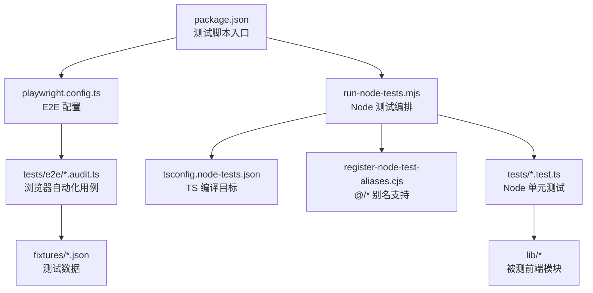
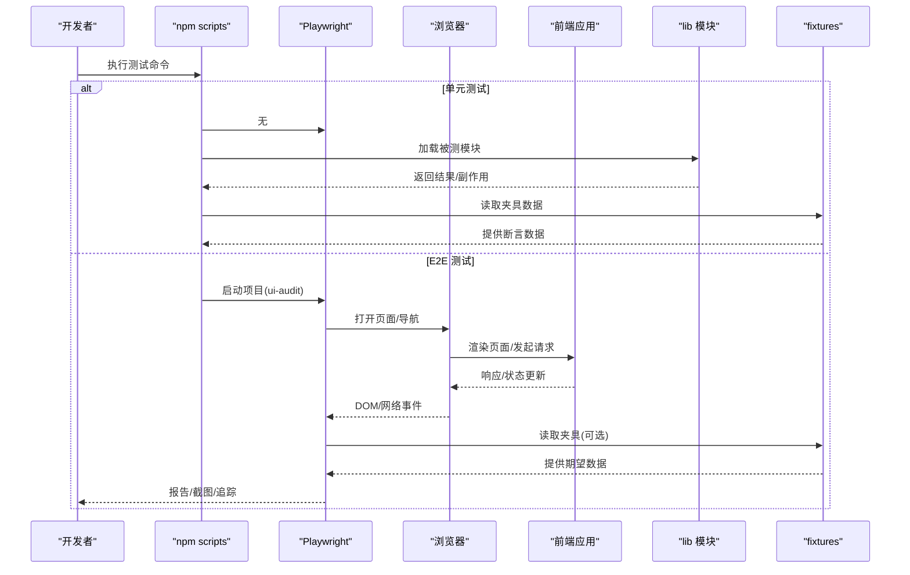
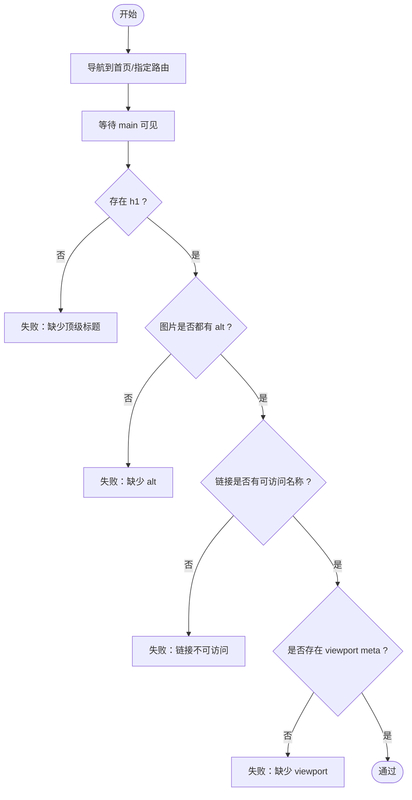
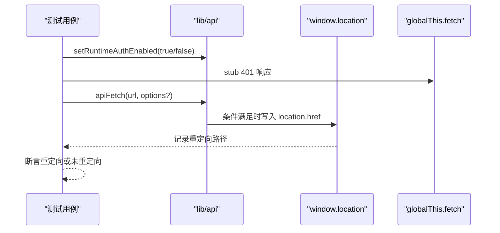
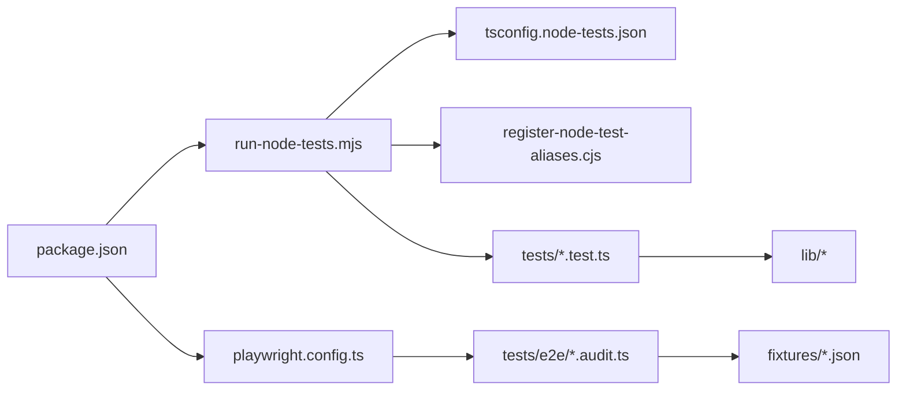

# 测试策略

<cite>
**本文引用的文件**
- [web/playwright.config.ts](file://web/playwright.config.ts)
- [web/package.json](file://web/package.json)
- [web/tests/e2e/compliance-and-ux.audit.ts](file://web/tests/e2e/compliance-and-ux.audit.ts)
- [web/scripts/run-node-tests.mjs](file://web/scripts/run-node-tests.mjs)
- [web/tsconfig.node-tests.json](file://web/tsconfig.node-tests.json)
- [web/scripts/register-node-test-aliases.cjs](file://web/scripts/register-node-test-aliases.cjs)
- [web/tests/api-auth-redirect.test.ts](file://web/tests/api-auth-redirect.test.ts)
- [web/tests/auth-enabled.test.ts](file://web/tests/auth-enabled.test.ts)
- [web/tests/fixtures/provider-trace-events.json](file://web/tests/fixtures/provider-trace-events.json)
</cite>

## 目录
1. [简介](#简介)
2. [项目结构](#项目结构)
3. [核心组件](#核心组件)
4. [架构总览](#架构总览)
5. [详细组件分析](#详细组件分析)
6. [依赖关系分析](#依赖关系分析)
7. [性能考虑](#性能考虑)
8. [故障排除指南](#故障排除指南)
9. [结论](#结论)
10. [附录](#附录)

## 简介
本文件面向 DeepTutor 前端（Next.js）的测试策略，围绕多层测试体系展开：单元测试、集成测试与端到端（E2E）测试。重点说明 Playwright E2E 框架的使用方式、浏览器自动化、组件测试思路、Mock 数据与异步操作测试、覆盖率与持续集成、性能测试、调试方法与报告生成，并给出最佳实践与常见问题排查指引。文档中的示例与流程均基于仓库中现有配置与测试用例进行提炼，便于团队统一规范与落地执行。

## 项目结构
前端测试相关的关键位置与职责如下：
- web/playwright.config.ts：Playwright 工程配置，定义测试目录、并行/串行模式、重试、追踪、报告以及“ui-audit”项目匹配规则。
- web/tests/e2e/*.audit.ts：E2E 合规性与可访问性审计用例，使用 Playwright 在真实浏览器中验证页面结构与交互信号。
- web/tests/*.test.ts：Node.js 环境下的单元测试，覆盖前端库函数与行为（如鉴权重定向、配置解析等）。
- web/scripts/run-node-tests.mjs：Node 测试运行脚本，负责编译 TypeScript 到 dist/node-tests，收集 .test.js 并执行。
- web/tsconfig.node-tests.json：Node 测试专用 TS 配置，输出到 dist/node-tests，启用路径别名映射。
- web/scripts/register-node-test-aliases.cjs：为 Node 测试运行时注册 @/* 路径别名解析。
- web/package.json：提供测试脚本入口（如 test:node、audit、audit:ui、audit:report），以及 Playwright 依赖。
- web/tests/fixtures/*.json：测试用固定数据（例如 provider trace 事件），用于断言或回放场景。

**图表来源**
- [web/package.json:5-21](file://web/package.json#L5-L21)
- [web/playwright.config.ts:1-27](file://web/playwright.config.ts#L1-L27)
- [web/scripts/run-node-tests.mjs:1-61](file://web/scripts/run-node-tests.mjs#L1-L61)
- [web/tsconfig.node-tests.json:1-17](file://web/tsconfig.node-tests.json#L1-L17)
- [web/scripts/register-node-test-aliases.cjs:1-20](file://web/scripts/register-node-test-aliases.cjs#L1-L20)

**章节来源**
- [web/playwright.config.ts:1-27](file://web/playwright.config.ts#L1-L27)
- [web/package.json:5-21](file://web/package.json#L5-L21)
- [web/scripts/run-node-tests.mjs:1-61](file://web/scripts/run-node-tests.mjs#L1-L61)
- [web/tsconfig.node-tests.json:1-17](file://web/tsconfig.node-tests.json#L1-L17)
- [web/scripts/register-node-test-aliases.cjs:1-20](file://web/scripts/register-node-test-aliases.cjs#L1-L20)

## 核心组件
- Playwright E2E 工程
  - 通过 playwright.config.ts 定义测试目录、并行策略、重试次数、追踪与报告；以 projects 形式组织“ui-audit”项目，匹配 *.audit.ts 用例。
  - 支持环境变量控制 BASE_URL、CI 重试与串行模式，便于本地与 CI 环境一致化。
- Node 单元测试运行器
  - 使用 run-node-tests.mjs 将 tests 下 TS 编译为 JS，再调用 Node --test 执行所有 .test.js。
  - 通过 register-node-test-aliases.cjs 注入 @/* 路径解析，确保测试能正确导入源码。
- 测试数据与夹具
  - fixtures 目录存放 JSON 夹具，供测试断言或模拟外部事件流。

**章节来源**
- [web/playwright.config.ts:1-27](file://web/playwright.config.ts#L1-L27)
- [web/scripts/run-node-tests.mjs:1-61](file://web/scripts/run-node-tests.mjs#L1-L61)
- [web/scripts/register-node-test-aliases.cjs:1-20](file://web/scripts/register-node-test-aliases.cjs#L1-L20)
- [web/tests/fixtures/provider-trace-events.json:1-135](file://web/tests/fixtures/provider-trace-events.json#L1-L135)

## 架构总览
下图展示前端测试的整体分层与数据流：Node 单元测试直接对 lib 模块进行断言；E2E 测试通过 Playwright 驱动浏览器访问应用，校验 UI 语义、可访问性与错误提示；测试数据由 fixtures 提供；构建与运行由 package.json 脚本串联。

**图表来源**
- [web/package.json:5-21](file://web/package.json#L5-L21)
- [web/playwright.config.ts:1-27](file://web/playwright.config.ts#L1-L27)
- [web/tests/e2e/compliance-and-ux.audit.ts:1-101](file://web/tests/e2e/compliance-and-ux.audit.ts#L1-L101)
- [web/tests/fixtures/provider-trace-events.json:1-135](file://web/tests/fixtures/provider-trace-events.json#L1-L135)

## 详细组件分析

### Playwright E2E 测试与浏览器自动化
- 工程配置要点
  - 测试目录：./tests
  - 并行与重试：非 CI 默认并行；CI 开启重试；可通过环境变量 PW_SERIAL=1 强制串行。
  - 追踪与报告：首次重试时开启追踪；HTML 报告与列表报告。
  - 项目划分：ui-audit 项目匹配 **/*.audit.ts，使用桌面 Chrome 设备。
- 用例编写范式
  - 使用 test.describe 分组，test 描述具体断言点。
  - 通过 page.goto 导航，waitForSelector 等待关键元素，结合 expect(locator).toBeVisible() 等断言。
  - 使用 route 拦截 API 并伪造响应，验证错误处理与用户反馈。
- 可访问性与合规检查
  - 断言 main 地标、h1 存在、img 具备 alt、链接具备可访问名称、viewport meta 存在。
  - 模拟后端 500 响应，断言页面呈现友好的错误提示或空态。

**图表来源**
- [web/tests/e2e/compliance-and-ux.audit.ts:23-74](file://web/tests/e2e/compliance-and-ux.audit.ts#L23-L74)

**章节来源**
- [web/playwright.config.ts:1-27](file://web/playwright.config.ts#L1-L27)
- [web/tests/e2e/compliance-and-ux.audit.ts:1-101](file://web/tests/e2e/compliance-and-ux.audit.ts#L1-L101)

### Node 单元测试：鉴权重定向与配置解析
- 鉴权重定向测试
  - 通过替换 window.location 与 globalThis.fetch，模拟 401 响应，验证 apiFetch 在启用鉴权时重定向至 /login，且带 next 参数；禁用鉴权或设置 skipAuthRedirect 时不重定向。
  - 使用 tick 让微任务执行，确保重定向逻辑生效后再断言。
- 配置解析测试
  - 验证 parseAuthEnabled 对多种真/假值字符串的解析，包括 Docker 占位符未替换时的安全降级。

**图表来源**
- [web/tests/api-auth-redirect.test.ts:18-118](file://web/tests/api-auth-redirect.test.ts#L18-L118)
- [web/tests/auth-enabled.test.ts:6-34](file://web/tests/auth-enabled.test.ts#L6-L34)

**章节来源**
- [web/tests/api-auth-redirect.test.ts:1-133](file://web/tests/api-auth-redirect.test.ts#L1-L133)
- [web/tests/auth-enabled.test.ts:1-35](file://web/tests/auth-enabled.test.ts#L1-L35)

### 组件测试与 Mock 数据
- 组件测试建议
  - 针对 React 组件，建议使用 React Testing Library + Jest/Vitest 进行隔离测试，聚焦 props、state、事件与渲染结果。
  - 对于复杂交互（如聊天、笔记、知识图谱），优先拆分小单元（hooks、工具函数、状态机）进行单测，UI 层通过 E2E 覆盖关键路径。
- Mock 数据与夹具
  - 使用 fixtures/*.json 作为稳定输入，避免外部依赖波动影响测试稳定性。
  - 在 E2E 中使用 page.route 拦截 API，构造成功/失败/边界场景，验证 UI 反馈。

**章节来源**
- [web/tests/fixtures/provider-trace-events.json:1-135](file://web/tests/fixtures/provider-trace-events.json#L1-L135)
- [web/tests/e2e/compliance-and-ux.audit.ts:76-100](file://web/tests/e2e/compliance-and-ux.audit.ts#L76-L100)

### 异步操作测试
- 微任务与定时器
  - 使用 setTimeout(resolve, 0) 推进微任务队列，确保异步分支（如重定向）完成后再断言。
- 网络与 WebSocket
  - 通过 page.route 拦截 HTTP；WebSocket 可使用浏览器控制台或自定义中间件捕获消息。
- 流式响应
  - 对长耗时或流式接口，建议在 E2E 中按阶段断言中间状态（如加载中、部分渲染），最后断言最终态。

**章节来源**
- [web/tests/api-auth-redirect.test.ts:56-77](file://web/tests/api-auth-redirect.test.ts#L56-L77)
- [web/tests/e2e/compliance-and-ux.audit.ts:76-100](file://web/tests/e2e/compliance-and-ux.audit.ts#L76-L100)

## 依赖关系分析
- 脚本与配置依赖
  - package.json 暴露 test:node、audit、audit:ui、audit:report 等命令，分别驱动 Node 测试与 Playwright。
  - run-node-tests.mjs 依赖 tsconfig.node-tests.json 编译测试代码，并通过 register-node-test-aliases.cjs 注入别名解析。
- 测试与源码依赖
  - 单元测试直接 import lib/* 模块；E2E 通过浏览器访问应用，间接依赖 lib 与页面组件。
  - 夹具 fixtures 被测试用例引用，保证数据一致性。

**图表来源**
- [web/package.json:5-21](file://web/package.json#L5-L21)
- [web/scripts/run-node-tests.mjs:1-61](file://web/scripts/run-node-tests.mjs#L1-L61)
- [web/tsconfig.node-tests.json:1-17](file://web/tsconfig.node-tests.json#L1-L17)
- [web/scripts/register-node-test-aliases.cjs:1-20](file://web/scripts/register-node-test-aliases.cjs#L1-L20)
- [web/playwright.config.ts:1-27](file://web/playwright.config.ts#L1-L27)
- [web/tests/e2e/compliance-and-ux.audit.ts:1-101](file://web/tests/e2e/compliance-and-ux.audit.ts#L1-L101)
- [web/tests/fixtures/provider-trace-events.json:1-135](file://web/tests/fixtures/provider-trace-events.json#L1-L135)

**章节来源**
- [web/package.json:5-21](file://web/package.json#L5-L21)
- [web/scripts/run-node-tests.mjs:1-61](file://web/scripts/run-node-tests.mjs#L1-L61)
- [web/playwright.config.ts:1-27](file://web/playwright.config.ts#L1-L27)

## 性能考虑
- 测试执行效率
  - 非 CI 环境默认并行执行，缩短反馈时间；CI 环境开启重试提升稳定性。
  - 通过 PW_SERIAL=1 强制串行，适用于资源敏感或需顺序执行的场景。
- 追踪与调试
  - 首次重试时自动开启追踪，便于定位失败原因；配合 HTML 报告查看步骤详情。
- 构建与体积
  - 使用 perf:check 与 build:perf 脚本评估路由预算与构建产物，减少首屏负载。
- 建议
  - 将昂贵的外部调用（LLM、搜索、MCP）在单测中 Mock，在 E2E 中仅做最小必要交互。
  - 合理拆分用例，避免跨页面大跨度流程阻塞整体执行。

[本节为通用指导，不直接分析具体文件]

## 故障排除指南
- 常见环境问题
  - 端口与基址：通过 WEB_BASE_URL 或 NEXT_PUBLIC_API_BASE 指定应用地址，避免连接失败。
  - 并行冲突：若出现资源竞争，设置 PW_SERIAL=1 串行执行。
  - 报告缺失：确认 reporter 配置与 CI 输出目录权限。
- 用例失败定位
  - 使用 Playwright UI 模式（audit:ui）交互式回放；查看 HTML 报告与追踪文件。
  - 对网络问题，使用 page.route 打印请求/响应，确认拦截与断言时机。
- Node 测试异常
  - 检查 tsconfig.node-tests.json 的 outDir 与 include 是否正确；确认 register-node-test-aliases.cjs 已加载。
  - 若找不到模块，核对 @/* 别名与路径映射。

**章节来源**
- [web/playwright.config.ts:3-19](file://web/playwright.config.ts#L3-L19)
- [web/scripts/run-node-tests.mjs:41-60](file://web/scripts/run-node-tests.mjs#L41-L60)
- [web/scripts/register-node-test-aliases.cjs:1-20](file://web/scripts/register-node-test-aliases.cjs#L1-L20)

## 结论
DeepTutor 前端测试采用“Node 单元测试 + Playwright E2E”的分层策略：单测保障核心逻辑与边界条件，E2E 保障关键用户体验与合规性。通过统一的脚本入口、清晰的配置与夹具管理，团队可在本地与 CI 环境中获得稳定、可复现的测试结果。建议持续完善组件级测试、扩大覆盖率、优化用例并行度与资源占用，并将性能预算纳入发布门禁。

[本节为总结性内容，不直接分析具体文件]

## 附录
- 常用命令
  - 运行 Node 单元测试：npm run test:node
  - 运行 E2E 审计用例：npm run audit
  - 打开 E2E UI 模式：npm run audit:ui
  - 查看 E2E 报告：npm run audit:report
- 最佳实践
  - 用例命名清晰，按功能域分组；断言明确，避免隐式等待。
  - 对外部依赖进行 Mock，保证测试确定性。
  - 在 E2E 中只断言用户可见的行为与状态，内部实现变化不影响用例。
  - 定期审查覆盖率与慢用例，优化执行时间。
- 重构保障
  - 先补充单测，再进行重构；保持用例稳定，逐步引入更细粒度的断言。
  - 对公共 API 与配置解析增加回归用例，防止破坏性变更。

[本节为通用指导，不直接分析具体文件]