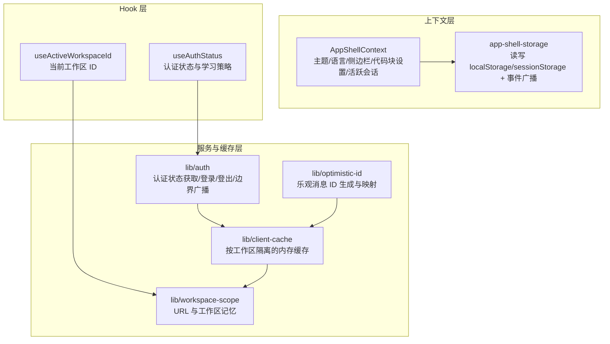
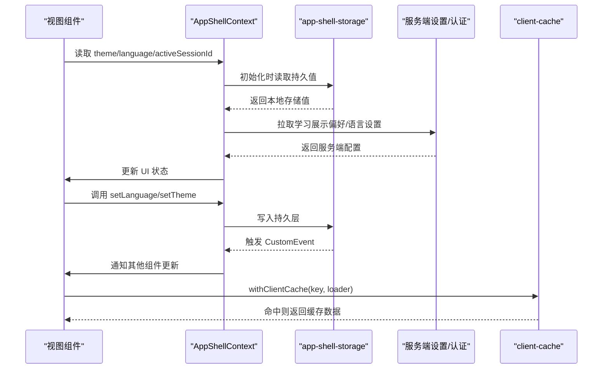
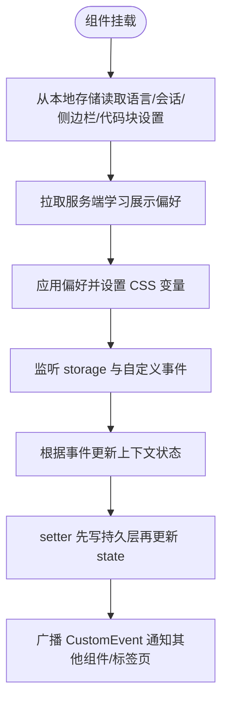
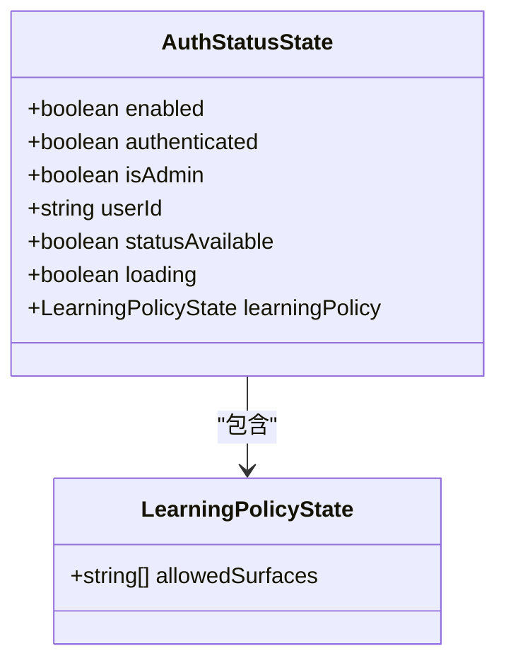
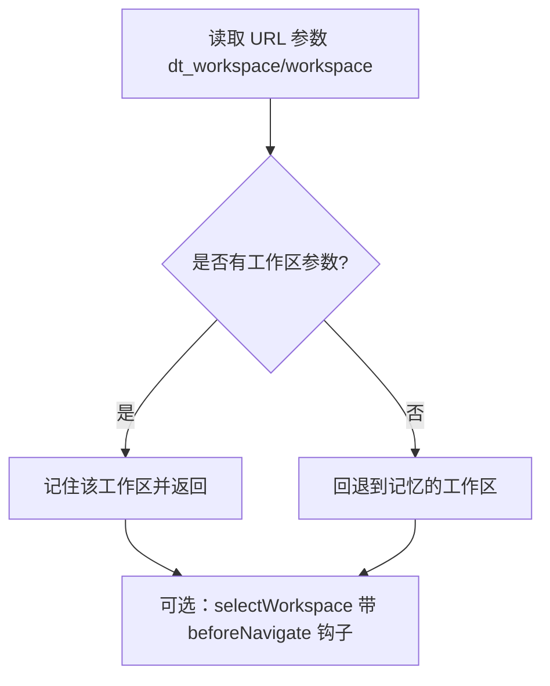
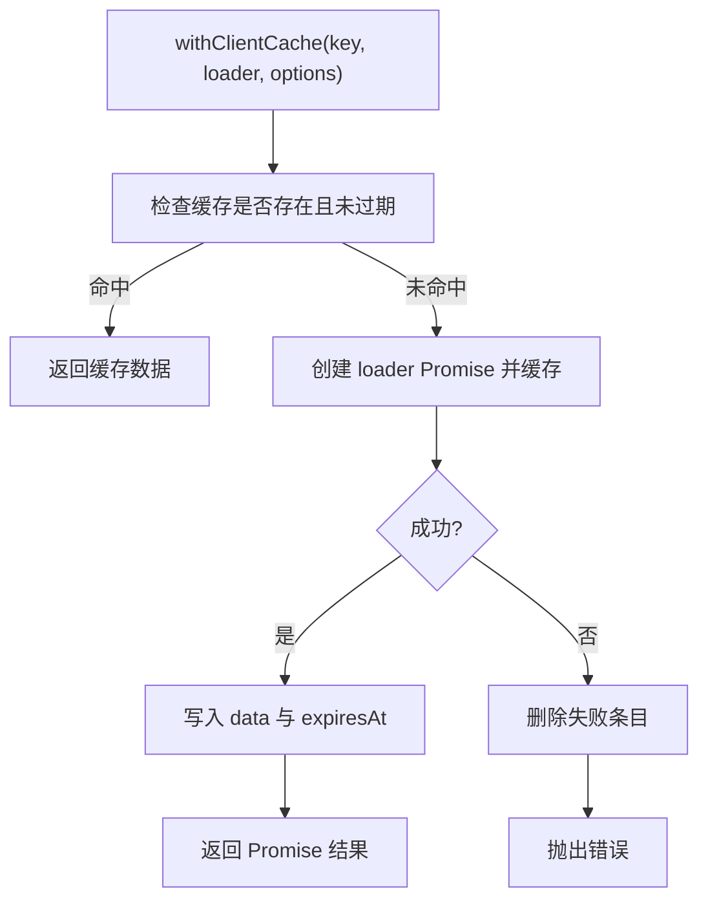
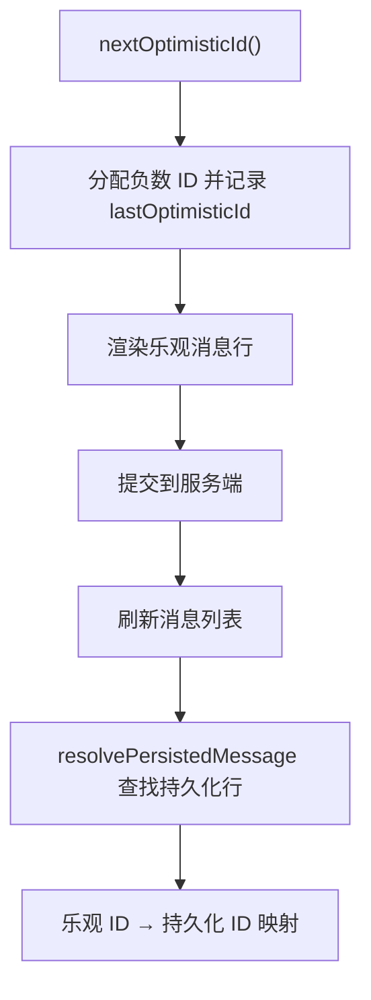
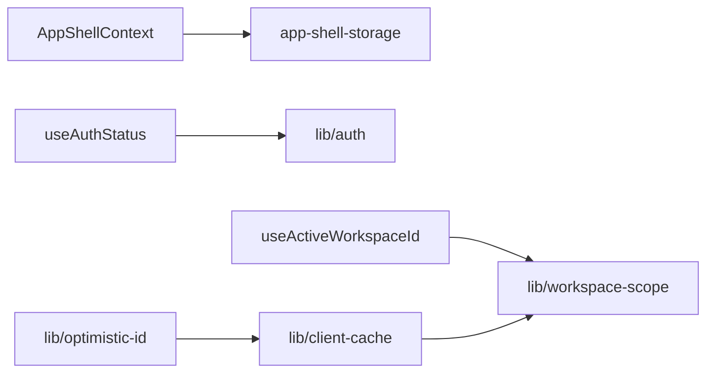

# 状态管理

<cite>
**本文引用的文件**   
- [web/context/AppShellContext.tsx](file://web/context/AppShellContext.tsx)
- [web/context/app-shell-storage.ts](file://web/context/app-shell-storage.ts)
- [web/hooks/useAuthStatus.ts](file://web/hooks/useAuthStatus.ts)
- [web/lib/auth.ts](file://web/lib/auth.ts)
- [web/hooks/useActiveWorkspaceId.ts](file://web/hooks/useActiveWorkspaceId.ts)
- [web/lib/workspace-scope.ts](file://web/lib/workspace-scope.ts)
- [web/lib/client-cache.ts](file://web/lib/client-cache.ts)
- [web/lib/optimistic-id.ts](file://web/lib/optimistic-id.ts)
</cite>

## 目录
1. [引言](#引言)
2. [项目结构](#项目结构)
3. [核心组件](#核心组件)
4. [架构总览](#架构总览)
5. [详细组件分析](#详细组件分析)
6. [依赖关系分析](#依赖关系分析)
7. [性能与内存优化](#性能与内存优化)
8. [故障排查与恢复](#故障排查与恢复)
9. [结论](#结论)
10. [附录：最佳实践清单](#附录最佳实践清单)

## 引言
本文件系统性梳理 DeepTutor 前端的状态管理策略，重点覆盖以下方面：
- 多层次 state 管理：React Context、URL 状态、本地存储与服务端状态的协调。
- 全局状态（AppShellContext）与局部状态的组织模式。
- 状态持久化策略：localStorage、sessionStorage、服务端设置与运行时配置。
- 自定义 Hook 设计：useActiveWorkspaceId、useAuthStatus 等状态管理 Hook 的实现原理。
- 客户端缓存机制、乐观更新与状态同步策略。
- 状态迁移、版本管理与错误恢复机制。
- 状态调试工具、性能监控与内存泄漏防护的最佳实践。

DeepTutor 的前端采用“以 React Context 为全局状态中心、以 URL 为可分享状态、以浏览器存储为持久层、以服务端为权威来源”的分层方案，既保证跨标签页与刷新后的体验一致性，又避免过度集中导致的渲染风暴。

## 项目结构
与状态管理直接相关的代码主要分布在以下位置：
- web/context：全局上下文与持久化桥接（AppShellContext、app-shell-storage）。
- web/hooks：领域级状态 Hook（如 useAuthStatus、useActiveWorkspaceId）。
- web/lib：通用能力库（auth、client-cache、workspace-scope、optimistic-id）。

图表来源
- [web/context/AppShellContext.tsx:70-451](file://web/context/AppShellContext.tsx#L70-L451)
- [web/context/app-shell-storage.ts:66-410](file://web/context/app-shell-storage.ts#L66-L410)
- [web/hooks/useAuthStatus.ts:1-93](file://web/hooks/useAuthStatus.ts#L1-L93)
- [web/lib/auth.ts:1-227](file://web/lib/auth.ts#L1-L227)
- [web/hooks/useActiveWorkspaceId.ts:1-10](file://web/hooks/useActiveWorkspaceId.ts#L1-L10)
- [web/lib/workspace-scope.ts:1-101](file://web/lib/workspace-scope.ts#L1-L101)
- [web/lib/client-cache.ts:1-79](file://web/lib/client-cache.ts#L1-L79)
- [web/lib/optimistic-id.ts:1-71](file://web/lib/optimistic-id.ts#L1-L71)

章节来源
- [web/context/AppShellContext.tsx:70-451](file://web/context/AppShellContext.tsx#L70-L451)
- [web/context/app-shell-storage.ts:66-410](file://web/context/app-shell-storage.ts#L66-L410)
- [web/hooks/useAuthStatus.ts:1-93](file://web/hooks/useAuthStatus.ts#L1-L93)
- [web/lib/auth.ts:1-227](file://web/lib/auth.ts#L1-L227)
- [web/hooks/useActiveWorkspaceId.ts:1-10](file://web/hooks/useActiveWorkspaceId.ts#L1-L10)
- [web/lib/workspace-scope.ts:1-101](file://web/lib/workspace-scope.ts#L1-L101)
- [web/lib/client-cache.ts:1-79](file://web/lib/client-cache.ts#L1-L79)
- [web/lib/optimistic-id.ts:1-71](file://web/lib/optimistic-id.ts#L1-L71)

## 核心组件
本节聚焦全局状态与关键 Hook 的职责划分与交互方式。

- AppShellContext
  - 职责：提供主题、语言、活跃会话、侧边栏折叠状态、代码块显示设置等全局 UI 状态；负责从本地存储初始化、监听跨标签页变更、订阅系统主题变化、拉取服务端学习展示偏好并应用。
  - 特点：所有 setter 在更新 React state 前会先写入持久层，并通过 CustomEvent 广播给其他组件或标签页。
  - 与持久层：通过 app-shell-storage 统一读写 localStorage/sessionStorage，并对键值进行归一化与校验。

- app-shell-storage
  - 职责：封装浏览器存储的读取、写入、默认值、类型归一化、范围限定（local/session），以及跨标签页事件广播。
  - 关键点：区分界面语言与模型输出语言；活跃会话按工作区隔离存储；侧边栏与代码块设置提供标准化读写接口。

- useAuthStatus
  - 职责：封装认证状态（是否启用、是否已认证、是否管理员、用户标识、状态可用性、加载态、学习策略）。
  - 行为：启动时调用后端 /api/auth/status，将结果映射为稳定结构；失败时保持可用但未认证的安全降级。

- lib/auth
  - 职责：认证状态获取、登录、注册、登出、认证边界广播、运行时认证开关控制、恢复主体更新。
  - 缓存：对认证状态做短时内存缓存，避免频繁请求；跨标签页通过 storage 事件触发重新探测。

- useActiveWorkspaceId
  - 职责：返回当前标签页的工作区 ID，优先来自 URL 参数，否则回退到记忆的工作区。

- lib/workspace-scope
  - 职责：工作区 ID 的记忆、URL 解析、导航辅助、跨工作区切换流程（含草稿保存与错误提示）。

- lib/client-cache
  - 职责：按工作区隔离的内存缓存，支持 TTL、强制刷新、并发去重、失效清理。

- lib/optimistic-id
  - 职责：为乐观消息生成严格递减的负数 ID，并提供乐观 ID 到持久化消息的映射解析。

章节来源
- [web/context/AppShellContext.tsx:70-451](file://web/context/AppShellContext.tsx#L70-L451)
- [web/context/app-shell-storage.ts:66-410](file://web/context/app-shell-storage.ts#L66-L410)
- [web/hooks/useAuthStatus.ts:1-93](file://web/hooks/useAuthStatus.ts#L1-L93)
- [web/lib/auth.ts:1-227](file://web/lib/auth.ts#L1-L227)
- [web/hooks/useActiveWorkspaceId.ts:1-10](file://web/hooks/useActiveWorkspaceId.ts#L1-L10)
- [web/lib/workspace-scope.ts:1-101](file://web/lib/workspace-scope.ts#L1-L101)
- [web/lib/client-cache.ts:1-79](file://web/lib/client-cache.ts#L1-L79)
- [web/lib/optimistic-id.ts:1-71](file://web/lib/optimistic-id.ts#L1-L71)

## 架构总览
DeepTutor 前端状态管理的分层如下：
- 视图层：React 组件消费 Context/Hook。
- 状态层：AppShellContext 提供全局 UI 状态；各业务模块使用局部 state 与领域 Hook。
- 持久层：app-shell-storage 统一访问 localStorage/sessionStorage。
- 网络层：lib/auth 与 API 调用，驱动认证状态与服务端设置。
- 缓存层：client-cache 提供内存级缓存，减少重复请求。
- URL 层：workspace-scope 将工作区选择暴露为 URL 参数，便于分享与书签。

图表来源
- [web/context/AppShellContext.tsx:115-277](file://web/context/AppShellContext.tsx#L115-L277)
- [web/context/app-shell-storage.ts:177-234](file://web/context/app-shell-storage.ts#L177-L234)
- [web/lib/client-cache.ts:24-70](file://web/lib/client-cache.ts#L24-L70)

## 详细组件分析

### AppShellContext：全局 UI 状态与持久化协调
- 初始值来源
  - 主题：优先读取本地存储，其次系统主题。
  - 语言：SSR 安全地以英文起步，挂载后尝试从本地存储或服务端设置回填；若本地已有选择则尊重本地选择。
  - 活跃会话：从 sessionStorage 中按工作区隔离读取。
  - 侧边栏与代码块设置：从 localStorage 读取默认值并在首次渲染后 hydration。
- 事件与跨标签页同步
  - 监听 window.storage 事件，当其他标签页修改了语言、活跃会话、侧边栏、代码块设置时，自动同步到当前上下文。
  - 同时监听自定义事件（LANGUAGE_EVENT、ACTIVE_SESSION_EVENT、SIDEBAR_COLLAPSED_EVENT、CODE_BLOCK_SETTINGS_EVENT），用于同页面内多组件联动。
- 服务端设置同步
  - 在 recoveryPrincipal 存在时拉取学习展示偏好，并在 Apply 成功后覆盖任何在途响应，确保最终一致。
- 主题系统
  - 初始化主题并订阅系统主题变化，动态更新 CSS 变量。

图表来源
- [web/context/AppShellContext.tsx:115-179](file://web/context/AppShellContext.tsx#L115-L179)
- [web/context/AppShellContext.tsx:181-277](file://web/context/AppShellContext.tsx#L181-L277)
- [web/context/AppShellContext.tsx:279-361](file://web/context/AppShellContext.tsx#L279-L361)
- [web/context/app-shell-storage.ts:177-234](file://web/context/app-shell-storage.ts#L177-L234)

章节来源
- [web/context/AppShellContext.tsx:70-451](file://web/context/AppShellContext.tsx#L70-L451)
- [web/context/app-shell-storage.ts:66-410](file://web/context/app-shell-storage.ts#L66-L410)

### useAuthStatus：认证状态 Hook
- 状态字段
  - enabled：后端是否启用认证。
  - authenticated：当前会话是否已认证。
  - isAdmin：是否为管理员。
  - userId：稳定的账户标识，用于账户级浏览器状态隔离。
  - statusAvailable：能否触达运行时状态接口。
  - loading：首次加载未完成时为 true。
  - learningPolicy：服务端下发的学习策略，包含允许的表面（如 chat、reading）。
- 实现要点
  - 启动时调用 fetchAuthStatus，将原始状态映射为稳定结构。
  - 失败时不抛错，保持 loading=false 且未认证的安全降级。
  - 与 lib/auth 协作，利用其缓存与边界广播机制，避免重复请求与状态不一致。

图表来源
- [web/hooks/useAuthStatus.ts:6-30](file://web/hooks/useAuthStatus.ts#L6-L30)
- [web/hooks/useAuthStatus.ts:42-51](file://web/hooks/useAuthStatus.ts#L42-L51)

章节来源
- [web/hooks/useAuthStatus.ts:1-93](file://web/hooks/useAuthStatus.ts#L1-L93)
- [web/lib/auth.ts:1-227](file://web/lib/auth.ts#L1-L227)

### useActiveWorkspaceId 与 workspace-scope：URL 与工作区状态
- useActiveWorkspaceId
  - 从 Next.js 的 searchParams 中读取 dt_workspace 或 workspace，若无则回退到 activeWorkspaceId。
- workspace-scope
  - 记忆最近使用的工作区（sessionStorage 优先，fallback 到 localStorage）。
  - 提供 scopedUrl 与 selectWorkspace，确保导航携带工作区参数，并在跨工作区切换前执行草稿保存与错误处理。
  - navigateTask 判断目标 URL 是否跨工作区，决定是否走 selectWorkspace 流程。

图表来源
- [web/hooks/useActiveWorkspaceId.ts:6-9](file://web/hooks/useActiveWorkspaceId.ts#L6-L9)
- [web/lib/workspace-scope.ts:16-44](file://web/lib/workspace-scope.ts#L16-L44)
- [web/lib/workspace-scope.ts:68-100](file://web/lib/workspace-scope.ts#L68-L100)

章节来源
- [web/hooks/useActiveWorkspaceId.ts:1-10](file://web/hooks/useActiveWorkspaceId.ts#L1-L10)
- [web/lib/workspace-scope.ts:1-101](file://web/lib/workspace-scope.ts#L1-L101)

### client-cache：客户端内存缓存
- 特性
  - 按工作区隔离（key 拼接 activeWorkspaceId）。
  - TTL 过期控制，默认 30 秒。
  - 并发去重：同一 key 的多次调用共享同一个 Promise。
  - 失效清理：invalidateClientCache 支持按前缀删除。
- 适用场景
  - 列表类数据、只读元信息、短生命周期快照。
  - SPA 导航期间快速恢复视图，避免重复请求。

图表来源
- [web/lib/client-cache.ts:17-70](file://web/lib/client-cache.ts#L17-L70)

章节来源
- [web/lib/client-cache.ts:1-79](file://web/lib/client-cache.ts#L1-L79)

### optimistic-id：乐观更新与消息映射
- 乐观 ID 生成
  - 使用严格递减的负数时间戳，避免同一毫秒内多条消息共用一个 ID。
- 乐观到持久化的映射
  - resolvePersistedMessage 根据 failedSubmissionId 或 metadata.client_submission_id 刷新消息列表并定位持久化行。
- 适用场景
  - 聊天消息流、任务提交、需要立即反馈的操作。

图表来源
- [web/lib/optimistic-id.ts:21-27](file://web/lib/optimistic-id.ts#L21-L27)
- [web/lib/optimistic-id.ts:41-70](file://web/lib/optimistic-id.ts#L41-L70)

章节来源
- [web/lib/optimistic-id.ts:1-71](file://web/lib/optimistic-id.ts#L1-L71)

## 依赖关系分析
- AppShellContext 依赖 app-shell-storage 完成持久化与事件广播。
- useAuthStatus 依赖 lib/auth 获取认证状态，并受其缓存与边界广播影响。
- useActiveWorkspaceId 依赖 workspace-scope 解析 URL 与记忆工作区。
- client-cache 依赖 workspace-scope 进行工作区隔离。
- optimistic-id 与 client-cache 配合，在乐观更新后通过刷新与映射保持一致性。

图表来源
- [web/context/AppShellContext.tsx:11-68](file://web/context/AppShellContext.tsx#L11-L68)
- [web/context/app-shell-storage.ts:1-15](file://web/context/app-shell-storage.ts#L1-L15)
- [web/hooks/useAuthStatus.ts:3-5](file://web/hooks/useAuthStatus.ts#L3-L5)
- [web/lib/auth.ts:1-5](file://web/lib/auth.ts#L1-L5)
- [web/hooks/useActiveWorkspaceId.ts:3-5](file://web/hooks/useActiveWorkspaceId.ts#L3-L5)
- [web/lib/workspace-scope.ts:1-7](file://web/lib/workspace-scope.ts#L1-L7)
- [web/lib/client-cache.ts:1-2](file://web/lib/client-cache.ts#L1-L2)

章节来源
- [web/context/AppShellContext.tsx:11-68](file://web/context/AppShellContext.tsx#L11-L68)
- [web/context/app-shell-storage.ts:1-15](file://web/context/app-shell-storage.ts#L1-L15)
- [web/hooks/useAuthStatus.ts:3-5](file://web/hooks/useAuthStatus.ts#L3-L5)
- [web/lib/auth.ts:1-5](file://web/lib/auth.ts#L1-L5)
- [web/hooks/useActiveWorkspaceId.ts:3-5](file://web/hooks/useActiveWorkspaceId.ts#L3-L5)
- [web/lib/workspace-scope.ts:1-7](file://web/lib/workspace-scope.ts#L1-L7)
- [web/lib/client-cache.ts:1-2](file://web/lib/client-cache.ts#L1-L2)

## 性能与内存优化
- 渲染隔离
  - 将高频输入与配置面板用 memo 包裹，回调使用 useCallback 稳定引用，减少不必要的重渲染。
- 状态就近原则
  - 将易变状态尽量下放到具体组件，避免全局状态膨胀导致整棵树重渲染。
- 缓存复用
  - 使用 client-cache 对短生命周期数据进行 TTL 缓存，SPA 导航时快速恢复。
- 并发去重
  - withClientCache 对同一 key 的请求合并，避免重复网络开销。
- 主题与语言初始化
  - 主题初始化与系统主题监听仅在挂载时执行一次；语言初始化有超时兜底，避免阻塞首屏。
- 内存泄漏防护
  - 所有 useEffect 均正确移除事件监听器与定时器。
  - 异步操作使用 alive/generation 标记防止卸载后更新。
  - client-cache 在失败路径删除条目，避免脏数据累积。

[本节为通用指导，不直接分析具体文件]

## 故障排查与恢复
- 认证状态不可用
  - 现象：statusAvailable=false，loading=false，authenticated=false。
  - 原因：后端 /api/auth/status 不可达或返回异常。
  - 处理：保持安全降级，不触发全局登录跳转；可重试或提示网络问题。
- 跨标签页状态不同步
  - 现象：一个标签页修改语言或活跃会话，另一个标签页未更新。
  - 原因：storage 事件未触发或键名不一致。
  - 处理：确认 app-shell-storage 的键名与事件名称一致；检查浏览器隐私模式是否禁用 storage。
- 工作区切换失败
  - 现象：selectWorkspace 报错并提示无法保存草稿。
  - 原因：浏览器存储不可用或草稿保存失败。
  - 处理：释放存储空间或取消切换；查看 notifications 错误提示。
- 乐观消息丢失
  - 现象：提交后消息行消失或 parent_message_id 指向错误。
  - 原因：乐观 ID 冲突或未正确映射到持久化消息。
  - 处理：检查 nextOptimisticId 是否严格递减；确认 resolvePersistedMessage 能根据 submissionId 找到唯一候选。

章节来源
- [web/lib/auth.ts:46-70](file://web/lib/auth.ts#L46-L70)
- [web/lib/workspace-scope.ts:68-92](file://web/lib/workspace-scope.ts#L68-L92)
- [web/lib/optimistic-id.ts:21-27](file://web/lib/optimistic-id.ts#L21-L27)
- [web/lib/optimistic-id.ts:41-70](file://web/lib/optimistic-id.ts#L41-L70)

## 结论
DeepTutor 前端的状态管理以 AppShellContext 为中心，结合 URL 与工作区记忆、浏览器存储与服务端设置，形成清晰的多层次状态体系。通过 app-shell-storage 统一持久化与事件广播，useAuthStatus 与 workspace-scope 分别处理认证与工作区状态，client-cache 与 optimistic-id 提供高性能与即时反馈。整体方案在保证用户体验的同时，兼顾了可维护性与可扩展性。

[本节为总结性内容，不直接分析具体文件]

## 附录：最佳实践清单
- 全局状态最小化
  - 仅将跨组件共享且频繁变化的状态放入 Context。
- 持久化与 UI 分离
  - 使用 app-shell-storage 统一读写，避免散落的 localStorage 调用。
- URL 作为可分享状态
  - 将工作区、路由参数等暴露为 URL，便于分享与书签。
- 乐观更新与回滚
  - 使用乐观 ID 与 refreshMessages 映射，确保一致性。
- 缓存策略
  - 短生命周期数据使用 client-cache，合理设置 TTL 与失效策略。
- 错误恢复
  - 认证失败、存储不可用、网络异常均需安全降级与提示。
- 性能监控
  - 关注重渲染热点，使用 memo 与 useCallback 稳定引用。
- 内存泄漏防护
  - 正确清理事件监听器、定时器与异步更新。

[本节为通用指导，不直接分析具体文件]