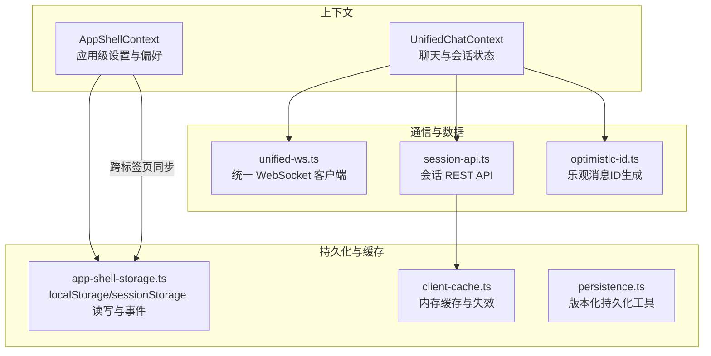
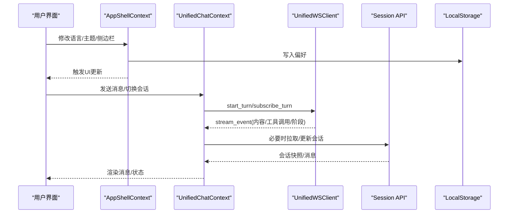
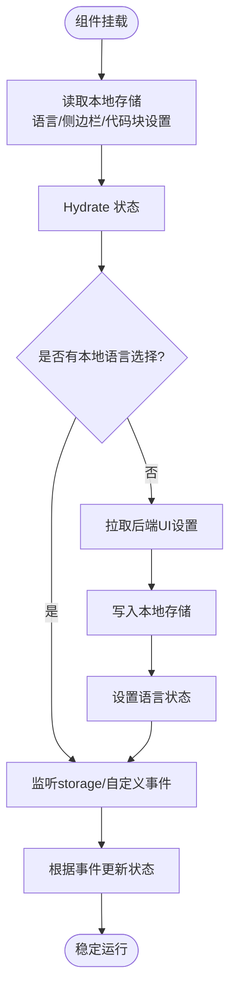
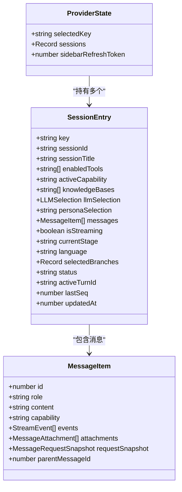
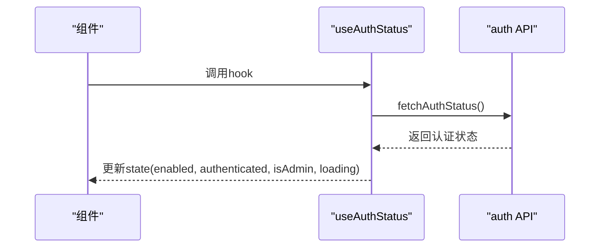
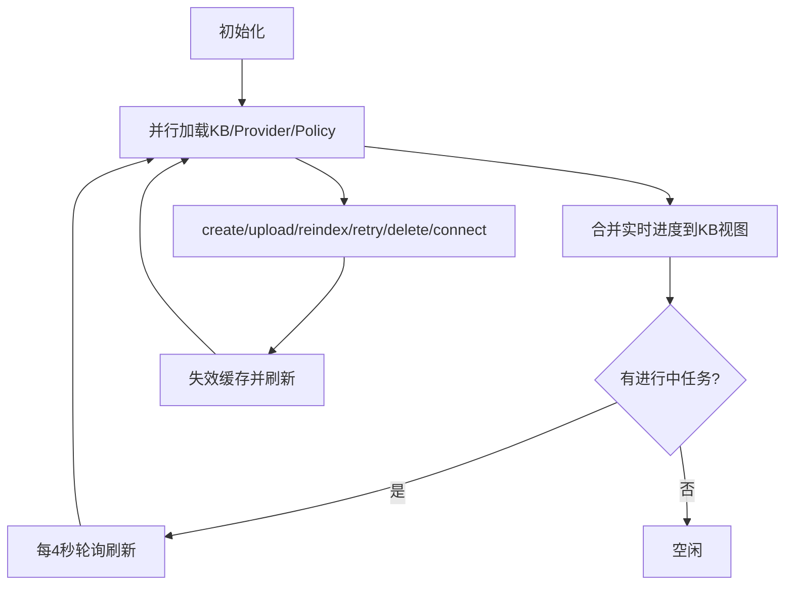
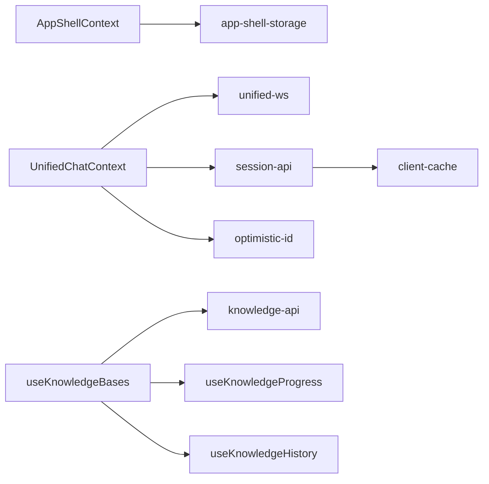

# 状态管理

<cite>
**本文引用的文件**
- [AppShellContext.tsx](file://web/context/AppShellContext.tsx)
- [UnifiedChatContext.tsx](file://web/context/UnifiedChatContext.tsx)
- [app-shell-storage.ts](file://web/context/app-shell-storage.ts)
- [useAuthStatus.ts](file://web/hooks/useAuthStatus.ts)
- [useKnowledgeBases.ts](file://web/hooks/useKnowledgeBases.ts)
- [unified-ws.ts](file://web/lib/unified-ws.ts)
- [client-cache.ts](file://web/lib/client-cache.ts)
- [persistence.ts](file://web/lib/persistence.ts)
- [session-api.ts](file://web/lib/session-api.ts)
- [optimistic-id.ts](file://web/lib/optimistic-id.ts)
</cite>

## 目录
1. [简介](#简介)
2. [项目结构](#项目结构)
3. [核心组件](#核心组件)
4. [架构总览](#架构总览)
5. [详细组件分析](#详细组件分析)
6. [依赖关系分析](#依赖关系分析)
7. [性能考量](#性能考量)
8. [故障排查指南](#故障排查指南)
9. [结论](#结论)
10. [附录：使用示例与最佳实践](#附录：使用示例与最佳实践)

## 简介
本文件系统性梳理 DeepTutor 前端的状态管理模式，重点解释基于 React Context 的全局状态管理方案，包括应用级状态（AppShellContext）与聊天状态（UnifiedChatContext）。文档涵盖本地存储持久化、客户端缓存策略、状态同步机制、事件驱动架构、状态更新流程、自定义 Hook 设计模式（如 useAuthStatus、useKnowledgeBases），并提供性能优化建议、常见问题解决方案与具体使用示例。

## 项目结构
DeepTutor 前端的状态管理集中在 web 目录下：
- context：提供全局上下文（AppShellContext、UnifiedChatContext）
- hooks：封装业务相关状态逻辑（useAuthStatus、useKnowledgeBases 等）
- lib：通用能力库（WebSocket、缓存、持久化、会话 API、乐观 ID 等）

图表来源
- [AppShellContext.tsx:71-312](file://web/context/AppShellContext.tsx#L71-L312)
- [UnifiedChatContext.tsx:1-200](file://web/context/UnifiedChatContext.tsx#L1-L200)
- [app-shell-storage.ts:1-310](file://web/context/app-shell-storage.ts#L1-L310)
- [unified-ws.ts:1-315](file://web/lib/unified-ws.ts#L1-L315)
- [client-cache.ts:1-64](file://web/lib/client-cache.ts#L1-L64)
- [persistence.ts:1-255](file://web/lib/persistence.ts#L1-L255)
- [session-api.ts:1-200](file://web/lib/session-api.ts#L1-L200)
- [optimistic-id.ts:1-65](file://web/lib/optimistic-id.ts#L1-L65)

章节来源
- [AppShellContext.tsx:71-312](file://web/context/AppShellContext.tsx#L71-L312)
- [UnifiedChatContext.tsx:1-200](file://web/context/UnifiedChatContext.tsx#L1-L200)
- [app-shell-storage.ts:1-310](file://web/context/app-shell-storage.ts#L1-L310)

## 核心组件
- AppShellContext：管理主题、语言、侧边栏折叠、代码块样式、当前活动会话 ID 等应用级偏好；通过 localStorage/sessionStorage 持久化，并通过 CustomEvent 实现跨组件/跨标签页同步。
- UnifiedChatContext：基于 useReducer 管理多会话的聊天状态，包含消息列表、流式事件、会话元信息、分支选择等；通过 WebSocket 接收后端流式事件并增量更新 UI。
- 自定义 Hook：
  - useAuthStatus：获取认证状态（是否启用、是否登录、是否管理员），并共享单次请求避免重复网络调用。
  - useKnowledgeBases：知识图谱（知识库）的加载、创建、上传、重索引、重试、删除、连接外部源等，集成进度与历史追踪。

章节来源
- [AppShellContext.tsx:52-321](file://web/context/AppShellContext.tsx#L52-L321)
- [UnifiedChatContext.tsx:89-775](file://web/context/UnifiedChatContext.tsx#L89-L775)
- [useAuthStatus.ts:1-71](file://web/hooks/useAuthStatus.ts#L1-L71)
- [useKnowledgeBases.ts:1-370](file://web/hooks/useKnowledgeBases.ts#L1-L370)

## 架构总览
整体采用“上下文 + 事件 + 持久化 + 缓存”的分层架构：
- 应用壳层（AppShellContext）负责 UI 偏好与全局配置，持久化到本地存储并通过事件广播。
- 聊天层（UnifiedChatContext）负责会话与消息，结合 WebSocket 流式事件进行增量更新，并使用乐观 ID 提升交互体验。
- 数据层（session-api、unified-ws）负责与后端通信，client-cache 提供短时效内存缓存，persistence 提供版本化持久化工具。

图表来源
- [AppShellContext.tsx:146-234](file://web/context/AppShellContext.tsx#L146-L234)
- [UnifiedChatContext.tsx:316-775](file://web/context/UnifiedChatContext.tsx#L316-L775)
- [unified-ws.ts:157-315](file://web/lib/unified-ws.ts#L157-L315)
- [session-api.ts:131-189](file://web/lib/session-api.ts#L131-L189)
- [app-shell-storage.ts:104-169](file://web/context/app-shell-storage.ts#L104-L169)

## 详细组件分析

### AppShellContext：应用级状态与本地持久化
- 职责：管理主题、语言、活动会话 ID、侧边栏折叠、代码块主题/行号/换行等偏好。
- 初始化：SSR 安全默认值，挂载后从 localStorage 读取并 hydrate。
- 持久化：所有写操作均写入对应 storage key，并在写入后派发 CustomEvent 通知其他监听者。
- 跨标签页同步：监听 window.storage 事件与自定义事件，保证多标签页间状态一致。
- 服务端语言回退：首次无本地选择时，从后端 UI 设置拉取并写入本地，作为响应语言与界面语言的初始值。

图表来源
- [AppShellContext.tsx:71-149](file://web/context/AppShellContext.tsx#L71-L149)
- [AppShellContext.tsx:146-234](file://web/context/AppShellContext.tsx#L146-L234)
- [app-shell-storage.ts:104-169](file://web/context/app-shell-storage.ts#L104-L169)

章节来源
- [AppShellContext.tsx:71-312](file://web/context/AppShellContext.tsx#L71-L312)
- [app-shell-storage.ts:1-310](file://web/context/app-shell-storage.ts#L1-L310)

### UnifiedChatContext：聊天状态与流式更新
- 状态模型：以 ProviderState 管理多个 SessionEntry，每个会话包含消息、状态、分支选择、活跃轮次等。
- 动作系统：定义丰富的 Action 类型（添加用户消息、流开始/事件/结束、绑定服务器会话、加载/校验会话、删除回合、分支选择等）。
- 流式处理：收到 StreamEvent 后合并到最新助手消息，去重同 turn_id+seq，维护 lastSeq 用于断线续传。
- 乐观更新：使用 nextOptimisticId 生成负数 ID，待 done 事件后用 reconcileTurnIds 替换为真实 ID。
- 会话生命周期：新建会话、选择会话、加载/重新验证会话、标题更新、删除回合、刷新侧边栏 token。

图表来源
- [UnifiedChatContext.tsx:163-178](file://web/context/UnifiedChatContext.tsx#L163-L178)
- [UnifiedChatContext.tsx:151-161](file://web/context/UnifiedChatContext.tsx#L151-L161)
- [UnifiedChatContext.tsx:257-281](file://web/context/UnifiedChatContext.tsx#L257-L281)

章节来源
- [UnifiedChatContext.tsx:89-775](file://web/context/UnifiedChatContext.tsx#L89-L775)
- [optimistic-id.ts:1-65](file://web/lib/optimistic-id.ts#L1-L65)

### 自定义 Hook：useAuthStatus
- 功能：从后端 /api/v1/auth/status 获取认证状态（enabled、authenticated、isAdmin、loading）。
- 并发控制：模块级 inflight Promise 确保同一时刻仅一次请求，多个组件同时挂载共享结果。
- 生命周期：组件挂载时发起请求，卸载时清理标志位，避免状态更新在已卸载组件上执行。

图表来源
- [useAuthStatus.ts:1-71](file://web/hooks/useAuthStatus.ts#L1-L71)

章节来源
- [useAuthStatus.ts:1-71](file://web/hooks/useAuthStatus.ts#L1-L71)

### 自定义 Hook：useKnowledgeBases
- 功能：加载知识库列表、提供者列表、上传策略；支持创建、上传、重索引、重试、删除、连接 Obsidian/LinkedFolder/LightRag Server。
- 进度与历史：集成 useKnowledgeProgress 与 useKnowledgeHistory，跟踪任务进度与历史记录。
- 自动刷新：当存在进行中任务时，每 4 秒轮询一次以同步服务端状态。
- 稳定性：providers 数组引用稳定比较，避免不必要的重渲染。

图表来源
- [useKnowledgeBases.ts:80-170](file://web/hooks/useKnowledgeBases.ts#L80-L170)
- [useKnowledgeBases.ts:172-341](file://web/hooks/useKnowledgeBases.ts#L172-L341)

章节来源
- [useKnowledgeBases.ts:1-370](file://web/hooks/useKnowledgeBases.ts#L1-L370)

### 本地存储持久化与跨标签页同步
- 键名规范：集中定义于 app-shell-storage.ts，如语言、响应语言、活动会话 ID、侧边栏折叠、代码块设置等。
- 读写封装：read/write 函数统一处理 SSR 环境、异常捕获与规范化。
- 事件广播：每次写入后派发 CustomEvent，AppShellContext 监听并更新状态，实现跨组件/跨标签页同步。

章节来源
- [app-shell-storage.ts:1-310](file://web/context/app-shell-storage.ts#L1-L310)
- [AppShellContext.tsx:146-234](file://web/context/AppShellContext.tsx#L146-L234)

### 客户端缓存策略
- withClientCache：对 listSessions 等接口提供 TTL 内存缓存，减少重复请求；支持 force 强制刷新。
- 失效机制：在会话标题更新或删除等操作后，调用 invalidateClientCache 清除相关缓存键前缀。

章节来源
- [client-cache.ts:1-64](file://web/lib/client-cache.ts#L1-L64)
- [session-api.ts:131-189](file://web/lib/session-api.ts#L131-L189)

### 状态同步机制
- WebSocket 流式事件：UnifiedWSClient 负责心跳、断线重连、resume_from 续传；将事件转发给 UnifiedChatContext 处理。
- 会话 API：REST 接口用于会话列表、详情、标题更新、删除等；配合 client-cache 提高性能。
- 乐观 ID 与归一化：使用 optimistic-id 生成唯一负数 ID，done 事件后通过 reconcileTurnIds 替换为真实 ID，避免长对话卡顿。

章节来源
- [unified-ws.ts:157-315](file://web/lib/unified-ws.ts#L157-L315)
- [session-api.ts:131-189](file://web/lib/session-api.ts#L131-L189)
- [optimistic-id.ts:1-65](file://web/lib/optimistic-id.ts#L1-L65)

## 依赖关系分析
- AppShellContext 依赖 app-shell-storage 进行本地持久化与事件广播。
- UnifiedChatContext 依赖 unified-ws、session-api、optimistic-id 完成流式更新与消息归一化。
- useKnowledgeBases 依赖 knowledge-api、useKnowledgeProgress、useKnowledgeHistory 完成知识库管理与进度追踪。
- client-cache 被 session-api 使用以提升列表查询性能。

图表来源
- [AppShellContext.tsx:71-312](file://web/context/AppShellContext.tsx#L71-L312)
- [UnifiedChatContext.tsx:316-775](file://web/context/UnifiedChatContext.tsx#L316-L775)
- [useKnowledgeBases.ts:1-370](file://web/hooks/useKnowledgeBases.ts#L1-L370)
- [session-api.ts:131-189](file://web/lib/session-api.ts#L131-L189)
- [client-cache.ts:1-64](file://web/lib/client-cache.ts#L1-L64)

章节来源
- [AppShellContext.tsx:71-312](file://web/context/AppShellContext.tsx#L71-L312)
- [UnifiedChatContext.tsx:316-775](file://web/context/UnifiedChatContext.tsx#L316-L775)
- [useKnowledgeBases.ts:1-370](file://web/hooks/useKnowledgeBases.ts#L1-L370)
- [session-api.ts:131-189](file://web/lib/session-api.ts#L131-L189)
- [client-cache.ts:1-64](file://web/lib/client-cache.ts#L1-L64)

## 性能考量
- 最小化重渲染：
  - AppShellContext 使用 useMemo 包裹 value，减少子组件不必要更新。
  - useKnowledgeBases 对 providers 数组进行 JSON 字符串比较以保持引用稳定。
- 流式更新优化：
  - UnifiedChatContext 对同 turn_id+seq 的事件去重，避免重复渲染。
  - 使用 lastSeq 与 resume_from 实现断线续传，减少全量拉取。
- 缓存与轮询：
  - client-cache 为会话列表提供 TTL 缓存，降低频繁请求。
  - 知识库在有进行中任务时轮询，其余时间空闲，平衡实时性与性能。
- 乐观更新：
  - 使用负数 ID 表示未持久化的消息，提升交互响应速度，done 事件后再替换为真实 ID。

[本节为通用性能讨论，不直接分析具体文件]

## 故障排查指南
- 语言不同步：
  - 检查 app-shell-storage 中 writeStoredLanguage 是否正确派发 LANGUAGE_EVENT。
  - 确认 AppShellContext 是否监听 storage 与 LANGUAGE_EVENT。
- 聊天消息丢失或错位：
  - 检查 optimistic-id 生成的 ID 是否唯一且递减，避免冲突。
  - 确认 reconcileTurnIds 是否正确替换乐观 ID 为真实 ID。
- WebSocket 断开：
  - 检查 UnifiedWSClient 的心跳与重连逻辑，确认 resume_from 参数正确。
- 知识库进度不更新：
  - 确认 useKnowledgeProgress 是否正确订阅 WS/SSE 通道。
  - 检查 hasActiveWork 与轮询间隔是否合理。

章节来源
- [app-shell-storage.ts:104-169](file://web/context/app-shell-storage.ts#L104-L169)
- [AppShellContext.tsx:146-234](file://web/context/AppShellContext.tsx#L146-L234)
- [optimistic-id.ts:1-65](file://web/lib/optimistic-id.ts#L1-L65)
- [unified-ws.ts:157-315](file://web/lib/unified-ws.ts#L157-L315)
- [useKnowledgeBases.ts:131-170](file://web/hooks/useKnowledgeBases.ts#L131-L170)

## 结论
DeepTutor 前端采用 React Context 作为状态管理的核心，结合本地存储持久化、事件驱动同步、WebSocket 流式更新与客户端缓存，构建了高效、可扩展的状态体系。AppShellContext 负责应用级偏好，UnifiedChatContext 专注聊天与会话，配合自定义 Hook 抽象复杂逻辑，提升了可维护性与用户体验。通过乐观更新、去重、缓存与轮询等策略，系统在长对话与高并发场景下仍保持良好性能。

[本节为总结性内容，不直接分析具体文件]

## 附录：使用示例与最佳实践

### 使用 AppShellContext
- 在组件内通过 useAppShell 获取 theme、language、activeSessionId 等状态与 setter。
- 修改语言或侧边栏折叠时，会自动写入本地存储并派发事件，其他组件即时响应。

章节来源
- [AppShellContext.tsx:314-321](file://web/context/AppShellContext.tsx#L314-L321)
- [app-shell-storage.ts:104-195](file://web/context/app-shell-storage.ts#L104-L195)

### 使用 UnifiedChatContext
- 通过 sendMessage 发送消息，内部会创建乐观消息并启动流式接收。
- 监听 STREAM_START/STREAM_EVENT/STREAM_END 以更新 UI。
- 使用 SELECT_SESSION/LOAD_SESSION 切换或加载会话。

章节来源
- [UnifiedChatContext.tsx:316-775](file://web/context/UnifiedChatContext.tsx#L316-L775)

### 使用 useAuthStatus
- 在需要显示登录/登出/管理员入口的组件中调用，获取 enabled、authenticated、isAdmin、loading。
- 注意共享请求避免重复网络调用。

章节来源
- [useAuthStatus.ts:1-71](file://web/hooks/useAuthStatus.ts#L1-L71)

### 使用 useKnowledgeBases
- 调用 createKb/uploadFiles/reindex/retry/delete 等方法管理知识库。
- 通过 progressByKb/tasksByKb 观察任务进度，historyByKb 查看历史记录。
- 在有进行中任务时，自动轮询刷新状态。

章节来源
- [useKnowledgeBases.ts:80-370](file://web/hooks/useKnowledgeBases.ts#L80-L370)

### 最佳实践
- 优先使用 Context 提供的 setter 更新状态，避免直接操作本地存储。
- 对于高频读取的数据（如会话列表），合理使用 client-cache 提升性能。
- 在流式场景中，利用 lastSeq 与 resume_from 实现断线续传，减少全量拉取。
- 使用 optimistic-id 提升交互响应，确保 done 事件后正确替换 ID。

[本节为通用实践指导，不直接分析具体文件]