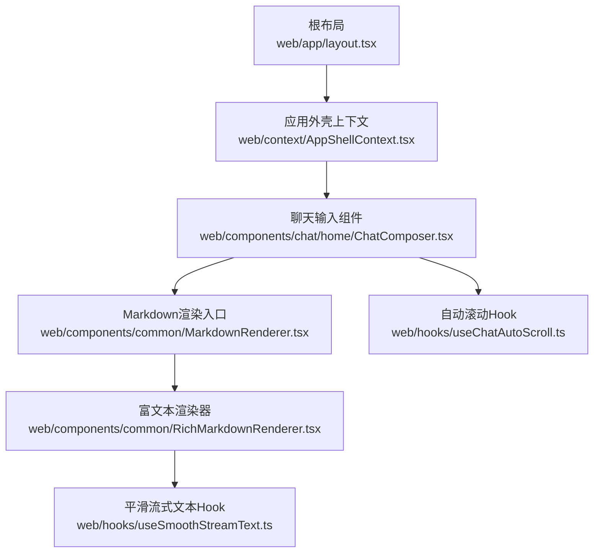
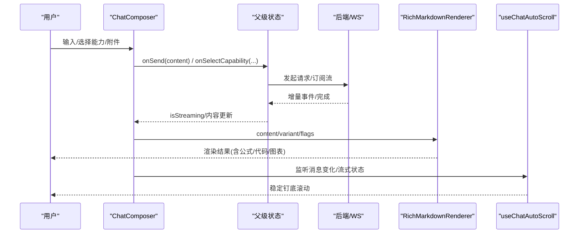
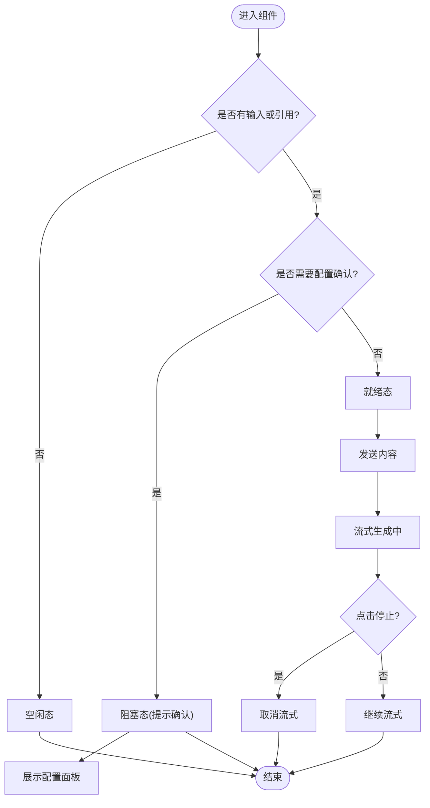
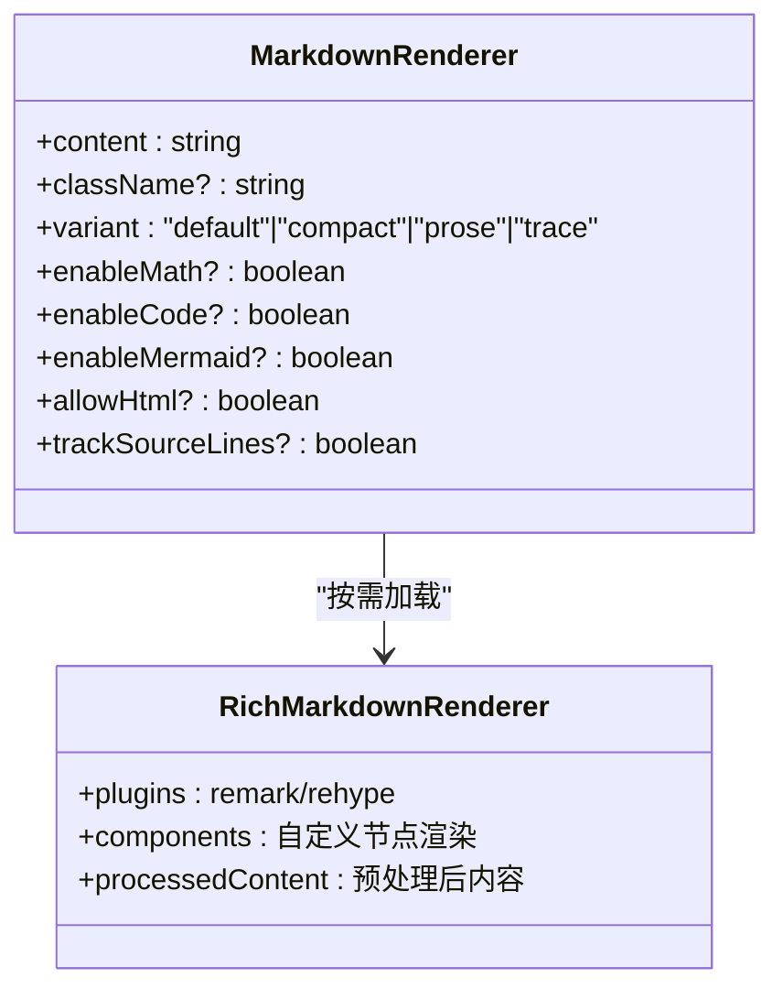
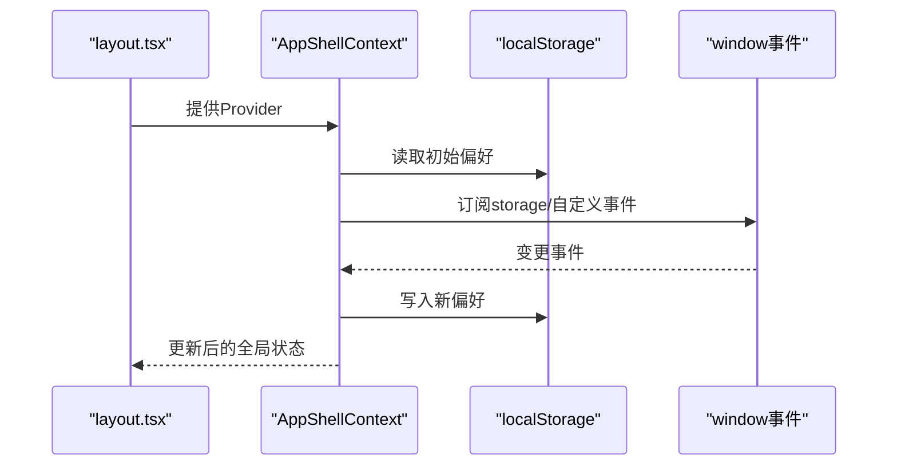
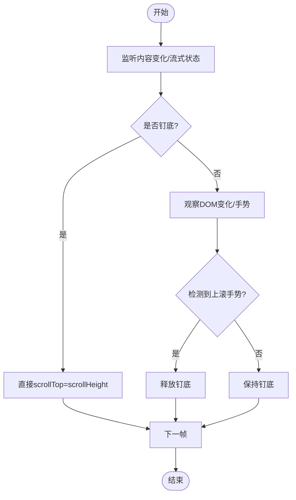
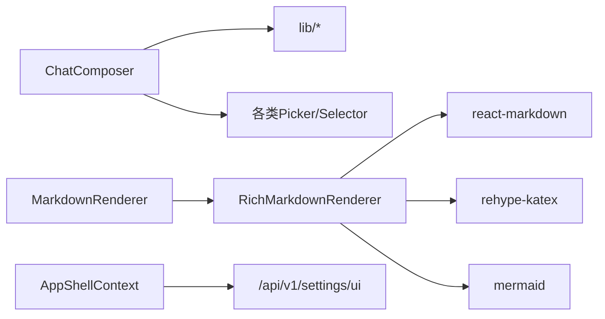

# 组件架构

<cite>
**本文引用的文件**
- [web/app/layout.tsx](file://web/app/layout.tsx)
- [web/context/AppShellContext.tsx](file://web/context/AppShellContext.tsx)
- [web/components/chat/home/ChatComposer.tsx](file://web/components/chat/home/ChatComposer.tsx)
- [web/components/common/MarkdownRenderer.tsx](file://web/components/common/MarkdownRenderer.tsx)
- [web/components/common/RichMarkdownRenderer.tsx](file://web/components/common/RichMarkdownRenderer.tsx)
- [web/hooks/useChatAutoScroll.ts](file://web/hooks/useChatAutoScroll.ts)
- [web/hooks/useSmoothStreamText.ts](file://web/hooks/useSmoothStreamText.ts)
- [web/package.json](file://web/package.json)
</cite>

## 目录
1. [简介](#简介)
2. [项目结构](#项目结构)
3. [核心组件](#核心组件)
4. [架构总览](#架构总览)
5. [详细组件分析](#详细组件分析)
6. [依赖关系分析](#依赖关系分析)
7. [性能考量](#性能考量)
8. [故障排查指南](#故障排查指南)
9. [结论](#结论)
10. [附录](#附录)

## 简介
本文件面向DeepTutor前端（基于React 19与Next.js 16）的组件架构，聚焦分层设计、通信机制、数据流向、复用策略与组合模式，并给出测试方法与性能优化建议。文档以聊天输入组件ChatComposer与内容渲染组件MarkdownRenderer/RichMarkdownRenderer为核心示例，说明页面级、业务级、通用级与UI基础级的职责边界与协作方式。

## 项目结构
- 应用壳层：根布局负责主题、国际化桥接、全局Toast容器与应用外壳上下文注入。
- 上下文与状态：AppShellContext集中管理主题、语言、活跃会话、侧边栏折叠与代码块显示设置，并通过localStorage与事件总线在多个标签页间同步。
- 业务组件：chat/home下的ChatComposer聚合能力选择、附件、知识库、历史会话、笔记本、问题库、角色、记忆等上下文引用，统一发送与流式控制。
- 通用组件：common下的MarkdownRenderer根据内容特征动态切换轻量或富文本渲染；RichMarkdownRenderer实现数学公式、Mermaid图、代码高亮、引用跳转等。
- 自定义Hook：useChatAutoScroll提供稳定的“跟随底部”滚动体验；useSmoothStreamText平滑展示流式文本。
- 技术栈：React 19、Next.js 16、Tailwind CSS、i18next、react-markdown、rehype/katex、mermaid等。

**图示来源**
- [web/app/layout.tsx:35-57](file://web/app/layout.tsx#L35-L57)
- [web/context/AppShellContext.tsx:71-150](file://web/context/AppShellContext.tsx#L71-L150)
- [web/components/chat/home/ChatComposer.tsx:174-364](file://web/components/chat/home/ChatComposer.tsx#L174-L364)
- [web/components/common/MarkdownRenderer.tsx:64-113](file://web/components/common/MarkdownRenderer.tsx#L64-L113)
- [web/components/common/RichMarkdownRenderer.tsx:154-232](file://web/components/common/RichMarkdownRenderer.tsx#L154-L232)
- [web/hooks/useChatAutoScroll.ts:50-89](file://web/hooks/useChatAutoScroll.ts#L50-L89)
- [web/hooks/useSmoothStreamText.ts:47-141](file://web/hooks/useSmoothStreamText.ts#L47-L141)

**章节来源**
- [web/app/layout.tsx:35-57](file://web/app/layout.tsx#L35-L57)
- [web/context/AppShellContext.tsx:71-150](file://web/context/AppShellContext.tsx#L71-L150)
- [web/package.json:23-46](file://web/package.json#L23-L46)

## 核心组件
- ChatComposer：聊天对话的“单一控制面”，统一管理发送/停止、能力选择、上下文引用（附件、书籍、历史会话、笔记本、问题库、角色、记忆）、模型选择、拖拽粘贴、语音转写、紧凑布局自适应等。通过大量回调将状态提升到父级，保持自身无副作用且可复用。
- MarkdownRenderer：根据内容特征（数学、代码、Mermaid、HTML）与变体（default/compact/prose/trace）决定使用轻量Simple渲染或按需加载的Rich渲染，避免首屏开销与闪烁。
- RichMarkdownRenderer：基于react-markdown生态，支持GFM、数学公式（KaTeX）、Mermaid流程图、代码高亮、内联文件卡片、引用锚点跳转、源码行号追踪等；通过动态导入与条件插件加载降低包体积。
- AppShellContext：集中应用级偏好（主题、语言、活跃会话、侧边栏折叠、代码块显示设置），持久化到localStorage，跨标签页通过storage事件与自定义事件同步。
- useChatAutoScroll：为流式消息提供稳定“钉底”滚动，结合MutationObserver与手势识别，避免浏览器默认滚动锚定干扰。
- useSmoothStreamText：将WebSocket分片与用户可见文本增长解耦，按帧平滑推进，提升长文本流式阅读体验。

**章节来源**
- [web/components/chat/home/ChatComposer.tsx:174-364](file://web/components/chat/home/ChatComposer.tsx#L174-L364)
- [web/components/common/MarkdownRenderer.tsx:64-113](file://web/components/common/MarkdownRenderer.tsx#L64-L113)
- [web/components/common/RichMarkdownRenderer.tsx:154-232](file://web/components/common/RichMarkdownRenderer.tsx#L154-L232)
- [web/context/AppShellContext.tsx:71-150](file://web/context/AppShellContext.tsx#L71-L150)
- [web/hooks/useChatAutoScroll.ts:50-89](file://web/hooks/useChatAutoScroll.ts#L50-L89)
- [web/hooks/useSmoothStreamText.ts:47-141](file://web/hooks/useSmoothStreamText.ts#L47-L141)

## 架构总览
- 分层与职责
  - 页面组件（路由级）：组织业务场景，持有会话、能力、模型等状态，调用业务组件。
  - 业务组件：如ChatComposer，封装领域交互流程，向上暴露最小接口。
  - 通用组件：如MarkdownRenderer，跨场景复用，关注渲染策略与特性开关。
  - UI基础组件：按钮、提示框、图标等原子控件（位于ui目录）。
- 通信机制
  - Props与回调：父组件提升状态，子组件仅触发事件（onSend、onSelectCapability等）。
  - Context：AppShellContext提供全局偏好，避免层层透传。
  - 事件总线：通过window事件与localStorage实现多标签页同步。
  - Hook：useChatAutoScroll、useSmoothStreamText等封装复杂行为，供上层消费。
- 数据流向
  - 用户输入 → ChatComposer → 父级状态更新 → WebSocket/HTTP → 流式事件 → 渲染更新 → 自动滚动与平滑展示。
  - 内容渲染 → MarkdownRenderer → 动态加载RichMarkdownRenderer → 按需启用数学/代码/Mermaid → 输出DOM。

**图示来源**
- [web/components/chat/home/ChatComposer.tsx:483-512](file://web/components/chat/home/ChatComposer.tsx#L483-L512)
- [web/components/common/RichMarkdownRenderer.tsx:154-232](file://web/components/common/RichMarkdownRenderer.tsx#L154-L232)
- [web/hooks/useChatAutoScroll.ts:50-89](file://web/hooks/useChatAutoScroll.ts#L50-L89)

## 详细组件分析

### ChatComposer 组件
- 职责：统一输入、能力选择、上下文引用、发送与停止、拖拽粘贴、语音转写、紧凑布局适配。
- 关键设计
  - 单按钮四态：idle/blocked/ready/streaming，通过样式与文案表达不同意图。
  - 配置门控：当能力需要配置时，阻止发送并引导用户确认。
  - 引用树：将书籍、笔记本、历史会话、问题库、角色、记忆等统一为可移除的引用条目。
  - 组合模式：通过多个Picker与Selector组合出丰富的上下文选择能力。
  - 性能：memo包裹、ResizeObserver自适应、防抖/节流（由父级或工具函数处理）。
- 数据流：所有状态上提，子组件只触发回调；内部维护本地临时状态（如是否可发送、更多能力菜单展开）。

**图示来源**
- [web/components/chat/home/ChatComposer.tsx:483-512](file://web/components/chat/home/ChatComposer.tsx#L483-L512)
- [web/components/chat/home/ChatComposer.tsx:626-645](file://web/components/chat/home/ChatComposer.tsx#L626-L645)

**章节来源**
- [web/components/chat/home/ChatComposer.tsx:174-364](file://web/components/chat/home/ChatComposer.tsx#L174-L364)
- [web/components/chat/home/ChatComposer.tsx:483-512](file://web/components/chat/home/ChatComposer.tsx#L483-L512)
- [web/components/chat/home/ChatComposer.tsx:626-645](file://web/components/chat/home/ChatComposer.tsx#L626-L645)

### MarkdownRenderer 与 RichMarkdownRenderer
- MarkdownRenderer：根据内容检测（数学、代码、Mermaid、HTML）与变体决定是否使用富渲染；采用动态导入避免SSR与首屏负担。
- RichMarkdownRenderer：
  - 插件按需加载：math、raw、katex仅在需要时import。
  - 内容预处理：normalize/escape与trackSourceLines模式保证编辑器/预览同步的行号准确性。
  - 渲染扩展：标题锚点、表格、列表、图片懒加载、引用跳转、内联文件卡片、Mermaid与代码高亮。
  - 性能：useMemo缓存组件映射与插件集合；动态组件LazyMermaid/LazyCodeBlock减少包体积。

**图示来源**
- [web/components/common/MarkdownRenderer.tsx:64-113](file://web/components/common/MarkdownRenderer.tsx#L64-L113)
- [web/components/common/RichMarkdownRenderer.tsx:154-232](file://web/components/common/RichMarkdownRenderer.tsx#L154-L232)

**章节来源**
- [web/components/common/MarkdownRenderer.tsx:64-113](file://web/components/common/MarkdownRenderer.tsx#L64-L113)
- [web/components/common/RichMarkdownRenderer.tsx:154-232](file://web/components/common/RichMarkdownRenderer.tsx#L154-L232)

### AppShellContext 与全局状态
- 职责：主题、语言、活跃会话、侧边栏折叠、代码块显示设置的全局管理与持久化。
- 同步机制：localStorage读写 + window storage事件 + 自定义事件（LANGUAGE_EVENT、ACTIVE_SESSION_EVENT等）。
- 初始化：SSR安全的首次渲染值，随后hydrate客户端偏好；必要时从后端读取UI设置。

**图示来源**
- [web/app/layout.tsx:35-57](file://web/app/layout.tsx#L35-L57)
- [web/context/AppShellContext.tsx:71-150](file://web/context/AppShellContext.tsx#L71-L150)
- [web/context/AppShellContext.tsx:152-234](file://web/context/AppShellContext.tsx#L152-L234)

**章节来源**
- [web/context/AppShellContext.tsx:71-150](file://web/context/AppShellContext.tsx#L71-L150)
- [web/context/AppShellContext.tsx:152-234](file://web/context/AppShellContext.tsx#L152-L234)

### 自定义Hook：滚动与流式文本
- useChatAutoScroll：在流式期间“钉底”，结合MutationObserver与手势识别释放/恢复；避免浏览器滚动锚定干扰。
- useSmoothStreamText：将WebSocket分片与可见文本增长解耦，按帧推进，提升阅读流畅度。

**图示来源**
- [web/hooks/useChatAutoScroll.ts:50-89](file://web/hooks/useChatAutoScroll.ts#L50-L89)
- [web/hooks/useChatAutoScroll.ts:115-166](file://web/hooks/useChatAutoScroll.ts#L115-L166)
- [web/hooks/useSmoothStreamText.ts:47-141](file://web/hooks/useSmoothStreamText.ts#L47-L141)

**章节来源**
- [web/hooks/useChatAutoScroll.ts:50-89](file://web/hooks/useChatAutoScroll.ts#L50-L89)
- [web/hooks/useSmoothStreamText.ts:47-141](file://web/hooks/useSmoothStreamText.ts#L47-L141)

## 依赖关系分析
- 运行时依赖：React 19、Next.js 16、Tailwind CSS、i18next、react-markdown、rehype-katex、remark-math、mermaid等。
- 模块耦合：
  - ChatComposer依赖多个Picker/Selector与lib工具，但通过回调解耦，便于替换与测试。
  - MarkdownRenderer对RichMarkdownRenderer为弱耦合（动态导入），可按需加载。
  - AppShellContext与各页面通过Context与事件解耦，支持多标签页同步。
- 外部集成：后端API（/api/v1/settings/ui）、WebSocket/HTTP流式响应、第三方渲染库（Mermaid、KaTeX）。

**图示来源**
- [web/package.json:23-46](file://web/package.json#L23-L46)
- [web/components/common/RichMarkdownRenderer.tsx:188-218](file://web/components/common/RichMarkdownRenderer.tsx#L188-L218)
- [web/context/AppShellContext.tsx:112-144](file://web/context/AppShellContext.tsx#L112-L144)

**章节来源**
- [web/package.json:23-46](file://web/package.json#L23-L46)
- [web/components/common/RichMarkdownRenderer.tsx:188-218](file://web/components/common/RichMarkdownRenderer.tsx#L188-L218)
- [web/context/AppShellContext.tsx:112-144](file://web/context/AppShellContext.tsx#L112-L144)

## 性能考量
- 首屏与按需加载
  - 动态导入：RichMarkdownRenderer、Mermaid、代码高亮等按需加载，减少首屏体积。
  - 条件插件：仅在需要时加载math/raw/katex等插件。
- 渲染优化
  - useMemo缓存组件映射与插件集合，避免重复计算。
  - 图片懒加载与合理的占位，减少重排。
- 流式体验
  - useSmoothStreamText平滑推进可见文本，避免抖动。
  - useChatAutoScroll稳定钉底，避免浏览器滚动锚定冲突。
- 内存与事件
  - 及时清理定时器、观察者、事件监听，防止泄漏。
- 构建与打包
  - Tailwind与PostCSS优化样式；Next.js静态资源与分包策略。

[本节为通用指导，不直接分析具体文件]

## 故障排查指南
- 流式卡顿或闪烁
  - 检查是否启用了useSmoothStreamText与useChatAutoScroll，确保正确传入isStreaming与内容长度。
  - 确认滚动容器未受浏览器滚动锚定影响（参考hook注释中的overflow-anchor建议）。
- 数学公式/代码/Mermaid未渲染
  - 检查MarkdownRenderer的detect逻辑与enable flags；确认RichMarkdownRenderer的动态导入成功。
  - 若trackSourceLines开启，注意内容预处理差异导致的行号与转换路径变化。
- 多标签页状态不同步
  - 确认AppShellContext的事件订阅与localStorage读写正常；检查storage事件是否被拦截。
- 发送被阻止
  - 检查capabilityNeedsConfig与capabilityConfigConfirmed状态；确认父级已正确传递onRequestConfigConfirm。

**章节来源**
- [web/hooks/useChatAutoScroll.ts:115-166](file://web/hooks/useChatAutoScroll.ts#L115-L166)
- [web/components/common/RichMarkdownRenderer.tsx:188-218](file://web/components/common/RichMarkdownRenderer.tsx#L188-L218)
- [web/context/AppShellContext.tsx:152-234](file://web/context/AppShellContext.tsx#L152-L234)
- [web/components/chat/home/ChatComposer.tsx:506-512](file://web/components/chat/home/ChatComposer.tsx#L506-L512)

## 结论
DeepTutor前端采用清晰的分层与组合模式：页面组件编排业务，业务组件封装领域流程，通用组件提供跨场景能力，UI基础组件原子化呈现。通过Context与事件总线实现全局状态同步，借助自定义Hook解决流式与滚动等复杂交互。Markdown渲染链路按需加载与条件插件，兼顾性能与功能。整体架构具备良好的可测试性、可扩展性与可维护性。

[本节为总结，不直接分析具体文件]

## 附录
- 组件开发指南
  - 分层原则：页面→业务→通用→UI基础，职责单一、接口稳定。
  - 组合优先：通过props与回调组合能力，避免深层嵌套与隐式依赖。
  - 状态提升：将可变状态置于最近拥有该状态的父组件，子组件仅触发事件。
  - 复用策略：提取通用逻辑为Hook或工具函数；复杂渲染拆分为子组件。
  - 错误处理：明确错误边界与降级路径；对用户反馈友好。
  - 可访问性：语义化标签、键盘导航、ARIA属性。
- 代码规范
  - TypeScript优先：类型完备、泛型合理使用。
  - 命名约定：组件PascalCase，Hook以use开头，常量全大写。
  - 文件组织：按功能域划分目录，避免巨型文件。
  - 测试策略：单元测试覆盖Hook与纯函数；集成测试覆盖关键流程；E2E覆盖用户路径。
  - 性能基线：监控包体积、首屏时间、流式帧率；避免不必要的re-render。
- 测试方法
  - 单元：Jest + React Testing Library，模拟网络与事件。
  - 组件：快照与交互断言，验证渲染与行为。
  - 端到端：Playwright覆盖主流程（发送、流式、滚动、渲染）。
  - 性能：Lighthouse、Web Vitals、路由预算脚本。

[本节为通用指导，不直接分析具体文件]