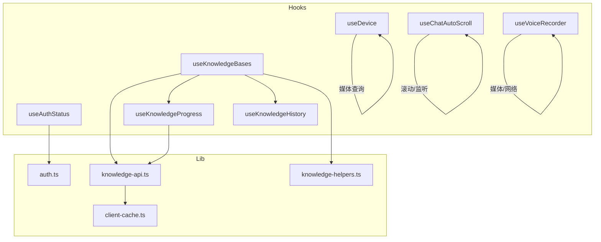
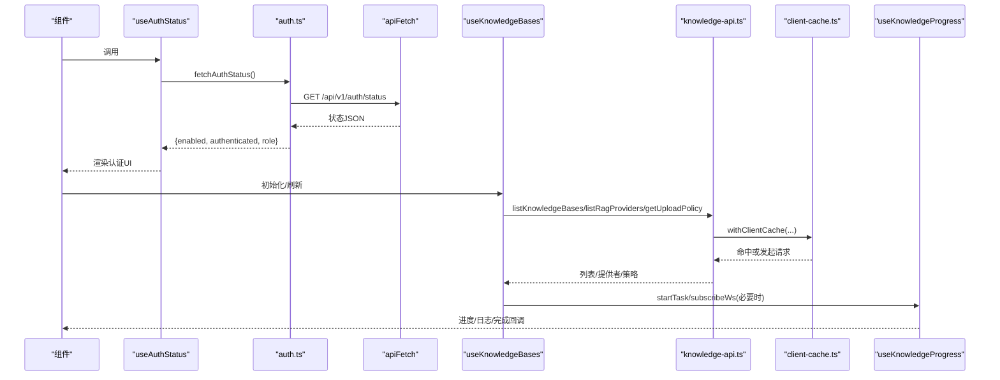
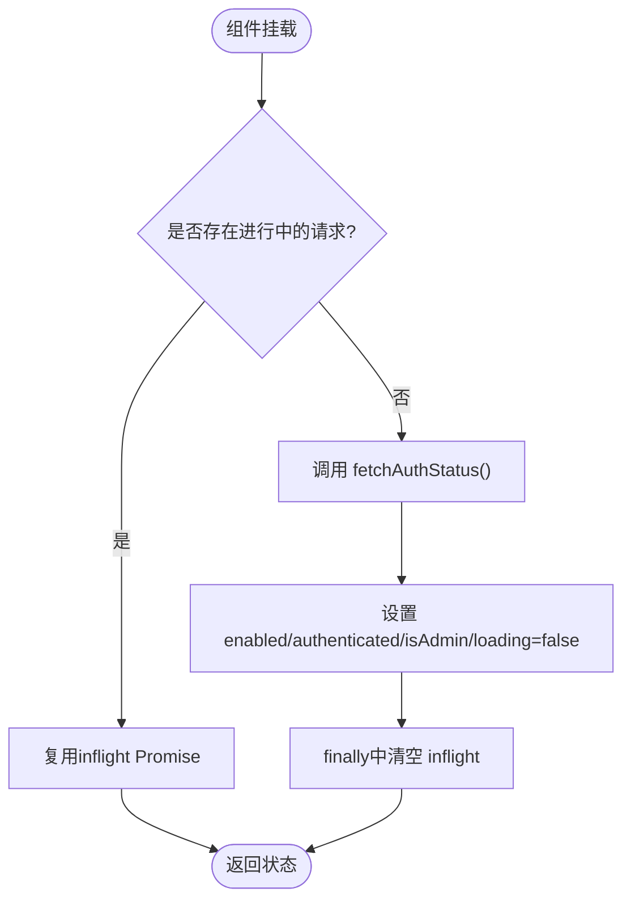
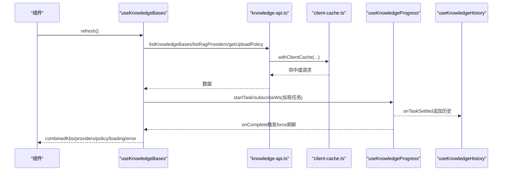
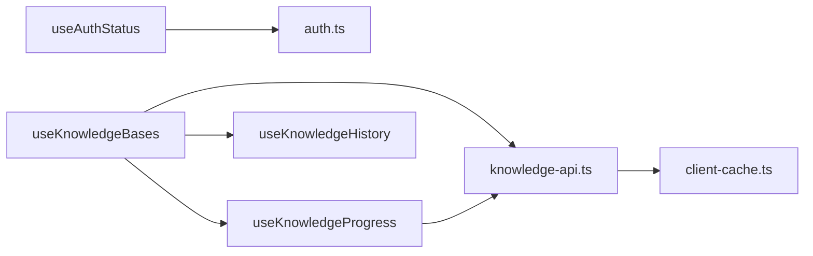

# 自定义Hooks

<cite>
**本文引用的文件**
- [useAuthStatus.ts](file://web/hooks/useAuthStatus.ts)
- [useKnowledgeBases.ts](file://web/hooks/useKnowledgeBases.ts)
- [useDevice.ts](file://web/hooks/useDevice.ts)
- [useKnowledgeProgress.ts](file://web/hooks/useKnowledgeProgress.ts)
- [useKnowledgeHistory.ts](file://web/hooks/useKnowledgeHistory.ts)
- [useChatAutoScroll.ts](file://web/hooks/useChatAutoScroll.ts)
- [useVoiceRecorder.ts](file://web/hooks/useVoiceRecorder.ts)
- [auth.ts](file://web/lib/auth.ts)
- [knowledge-api.ts](file://web/lib/knowledge-api.ts)
- [client-cache.ts](file://web/lib/client-cache.ts)
- [knowledge-helpers.ts](file://web/lib/knowledge-helpers.ts)
</cite>

## 目录
1. [简介](#简介)
2. [项目结构](#项目结构)
3. [核心组件](#核心组件)
4. [架构总览](#架构总览)
5. [详细组件分析](#详细组件分析)
6. [依赖关系分析](#依赖关系分析)
7. [性能考量](#性能考量)
8. [故障排查指南](#故障排查指南)
9. [结论](#结论)
10. [附录：Hook开发指南与最佳实践](#附录hook开发指南与最佳实践)

## 简介
本文件面向DeepTutor前端（Next.js）的自定义Hooks，系统性说明Hook设计模式、状态封装与副作用管理，重点覆盖以下业务Hook：
- useAuthStatus：认证状态获取与运行时开关控制
- useKnowledgeBases：知识库列表、提供者、上传策略、任务进度与历史的全流程管理
- 设备检测与网络/交互相关Hook：useDevice、useChatAutoScroll、useVoiceRecorder
同时涵盖数据获取Hook、客户端缓存策略、错误处理机制、性能优化技巧、内存泄漏防护与测试方法，并提供开发规范与常见问题解决方案。

## 项目结构
前端Hooks位于 web/hooks，配套API与工具在 web/lib。关键组织方式：
- 业务Hook按领域划分：认证、知识库、设备、聊天滚动、语音等
- API层统一通过 apiFetch 访问后端，并配合 withClientCache 做轻量客户端缓存
- 进度与历史通过独立的Hook解耦：useKnowledgeProgress（实时进度）、useKnowledgeHistory（持久化历史）

图表来源
- [useAuthStatus.ts:1-71](file://web/hooks/useAuthStatus.ts#L1-L71)
- [useKnowledgeBases.ts:1-370](file://web/hooks/useKnowledgeBases.ts#L1-L370)
- [useDevice.ts:1-109](file://web/hooks/useDevice.ts#L1-L109)
- [useKnowledgeProgress.ts:1-339](file://web/hooks/useKnowledgeProgress.ts#L1-L339)
- [useKnowledgeHistory.ts:1-148](file://web/hooks/useKnowledgeHistory.ts#L1-L148)
- [useChatAutoScroll.ts:1-290](file://web/hooks/useChatAutoScroll.ts#L1-L290)
- [useVoiceRecorder.ts:1-119](file://web/hooks/useVoiceRecorder.ts#L1-L119)
- [auth.ts:1-137](file://web/lib/auth.ts#L1-L137)
- [knowledge-api.ts:1-859](file://web/lib/knowledge-api.ts#L1-L859)
- [client-cache.ts:1-64](file://web/lib/client-cache.ts#L1-L64)
- [knowledge-helpers.ts:1-248](file://web/lib/knowledge-helpers.ts#L1-L248)

章节来源
- [useAuthStatus.ts:1-71](file://web/hooks/useAuthStatus.ts#L1-L71)
- [useKnowledgeBases.ts:1-370](file://web/hooks/useKnowledgeBases.ts#L1-L370)
- [useDevice.ts:1-109](file://web/hooks/useDevice.ts#L1-L109)
- [useKnowledgeProgress.ts:1-339](file://web/hooks/useKnowledgeProgress.ts#L1-L339)
- [useKnowledgeHistory.ts:1-148](file://web/hooks/useKnowledgeHistory.ts#L1-L148)
- [useChatAutoScroll.ts:1-290](file://web/hooks/useChatAutoScroll.ts#L1-L290)
- [useVoiceRecorder.ts:1-119](file://web/hooks/useVoiceRecorder.ts#L1-L119)
- [auth.ts:1-137](file://web/lib/auth.ts#L1-L137)
- [knowledge-api.ts:1-859](file://web/lib/knowledge-api.ts#L1-L859)
- [client-cache.ts:1-64](file://web/lib/client-cache.ts#L1-L64)
- [knowledge-helpers.ts:1-248](file://web/lib/knowledge-helpers.ts#L1-L248)

## 核心组件
- 认证状态Hook：useAuthStatus
  - 职责：从后端读取认证开关、登录态、管理员角色；合并首次加载loading状态
  - 特点：模块级inflight去重，避免多组件并发重复请求；清理时重置inflight以支持后续刷新
- 知识库管理Hook：useKnowledgeBases
  - 职责：并行拉取知识库列表、RAG提供者、上传策略；合并实时进度；提供创建/上传/重索引/重试/删除/连接外部源等操作
  - 特点：结合useKnowledgeProgress与useKnowledgeHistory实现任务流闭环；有活跃工作时定时轮询补齐SSE/WebSocket未覆盖的状态
- 设备检测Hook：useDevice
  - 职责：基于matchMedia订阅断点变化，返回设备类别与便捷布尔值
  - 特点：使用useSyncExternalStore，服务端快照为desktop，保证SSR一致性
- 进度Hook：useKnowledgeProgress
  - 职责：维护每个KB的进度对象与任务状态；通过WebSocket与SSE接收进度/日志/完成事件；提供startTask/subscribeWs/dismiss/cleanup等能力
- 历史Hook：useKnowledgeHistory
  - 职责：将任务结果写入localStorage，跨标签页同步；限制日志大小与条目数量，防存储溢出
- 聊天自动滚动Hook：useChatAutoScroll
  - 职责：在流式输出期间保持“钉到底”，智能释放与恢复；处理动态内容高度变化与用户意图识别
- 语音录制Hook：useVoiceRecorder
  - 职责：麦克风采集、录音、转写、错误处理；确保卸载时释放媒体资源

章节来源
- [useAuthStatus.ts:1-71](file://web/hooks/useAuthStatus.ts#L1-L71)
- [useKnowledgeBases.ts:1-370](file://web/hooks/useKnowledgeBases.ts#L1-L370)
- [useDevice.ts:1-109](file://web/hooks/useDevice.ts#L1-L109)
- [useKnowledgeProgress.ts:1-339](file://web/hooks/useKnowledgeProgress.ts#L1-L339)
- [useKnowledgeHistory.ts:1-148](file://web/hooks/useKnowledgeHistory.ts#L1-L148)
- [useChatAutoScroll.ts:1-290](file://web/hooks/useChatAutoScroll.ts#L1-L290)
- [useVoiceRecorder.ts:1-119](file://web/hooks/useVoiceRecorder.ts#L1-L119)

## 架构总览
下图展示了认证与知识库两大核心流程中，Hook与API层的协作关系，以及缓存与实时通道的集成点。

图表来源
- [useAuthStatus.ts:24-70](file://web/hooks/useAuthStatus.ts#L24-L70)
- [auth.ts:21-37](file://web/lib/auth.ts#L21-L37)
- [useKnowledgeBases.ts:80-139](file://web/hooks/useKnowledgeBases.ts#L80-L139)
- [knowledge-api.ts:166-226](file://web/lib/knowledge-api.ts#L166-L226)
- [client-cache.ts:14-55](file://web/lib/client-cache.ts#L14-L55)
- [useKnowledgeProgress.ts:128-292](file://web/hooks/useKnowledgeProgress.ts#L128-L292)

## 详细组件分析

### 认证状态 Hook：useAuthStatus
- 设计要点
  - 模块级inflight Promise去重：多个组件同时挂载时仅发起一次请求，完成后清空以便后续重新拉取
  - 首次加载loading状态，成功后设置enabled/authenticated/isAdmin
  - 通过auth.ts中的fetchAuthStatus更新运行时认证开关，影响全局401跳转行为
- 副作用管理
  - useEffect内发起请求，组件卸载前用alive标志防止setState在卸载后执行
- 错误处理
  - 网络异常或接口不可用时保持默认状态，由上层决定展示

图表来源
- [useAuthStatus.ts:38-70](file://web/hooks/useAuthStatus.ts#L38-L70)
- [auth.ts:21-37](file://web/lib/auth.ts#L21-L37)

章节来源
- [useAuthStatus.ts:1-71](file://web/hooks/useAuthStatus.ts#L1-L71)
- [auth.ts:1-137](file://web/lib/auth.ts#L1-L137)

### 知识库管理 Hook：useKnowledgeBases
- 数据获取
  - 使用Promise.all并行拉取知识库列表、RAG提供者、上传策略
  - 通过withClientCache对读操作进行短期缓存，支持force强制刷新
- 进度与历史
  - 使用useKnowledgeProgress管理任务生命周期：startTask开启SSE+WS，oncomplete/onTaskSettled触发刷新与历史记录写入
  - 使用useKnowledgeHistory持久化任务历史，限制日志大小与条目数，跨标签页同步
- 主动轮询
  - 当存在活跃任务时，每4秒轮询一次list接口，补充SSE/WebSocket未覆盖的状态变更
- 变更操作
  - create/upload/reindex/retry/delete/connect* 等方法均会调用invalidateKnowledgeCaches并触发refresh
- 稳定性
  - providers数组引用稳定化：仅在内容变化时更新引用，避免下游不必要的重渲染

图表来源
- [useKnowledgeBases.ts:80-170](file://web/hooks/useKnowledgeBases.ts#L80-L170)
- [knowledge-api.ts:166-226](file://web/lib/knowledge-api.ts#L166-L226)
- [client-cache.ts:14-55](file://web/lib/client-cache.ts#L14-L55)
- [useKnowledgeProgress.ts:277-320](file://web/hooks/useKnowledgeProgress.ts#L277-L320)
- [useKnowledgeHistory.ts:89-111](file://web/hooks/useKnowledgeHistory.ts#L89-L111)

章节来源
- [useKnowledgeBases.ts:1-370](file://web/hooks/useKnowledgeBases.ts#L1-L370)
- [knowledge-api.ts:1-859](file://web/lib/knowledge-api.ts#L1-L859)
- [client-cache.ts:1-64](file://web/lib/client-cache.ts#L1-L64)
- [useKnowledgeProgress.ts:1-339](file://web/hooks/useKnowledgeProgress.ts#L1-L339)
- [useKnowledgeHistory.ts:1-148](file://web/hooks/useKnowledgeHistory.ts#L1-L148)

### 设备检测 Hook：useDevice
- 设计要点
  - 使用useSyncExternalStore订阅matchMedia变化，返回设备类别与isCompact等便捷字段
  - 服务端渲染时返回desktop，保证SSR一致性与渐进增强
- 性能与内存
  - 模块级缓存两个MediaQueryList实例，所有调用者共享，避免重复注册
  - 正确移除事件监听，防止内存泄漏

章节来源
- [useDevice.ts:1-109](file://web/hooks/useDevice.ts#L1-L109)

### 进度 Hook：useKnowledgeProgress
- 设计要点
  - 维护progressByKb与tasksByKb两套状态，分别用于进度条与任务面板
  - 通过WebSocket订阅KB进度，通过EventSource订阅任务日志/完成/失败事件
  - 提供startTask/subscribeWs/dismiss/cleanup等API，统一管理连接生命周期
- 错误处理
  - 解析失败的事件被忽略，避免中断主流程；失败事件会记录error并结束任务
- 内存保护
  - 组件卸载时关闭所有WebSocket与EventSource，释放资源

章节来源
- [useKnowledgeProgress.ts:1-339](file://web/hooks/useKnowledgeProgress.ts#L1-L339)

### 历史 Hook：useKnowledgeHistory
- 设计要点
  - 本地存储持久化，跨标签页通过storage事件同步
  - 限制日志行数与字符总量，防止LocalStorage超限
  - 去重逻辑避免重复追加相同taskId的任务
- 性能与健壮性
  - 读写localStorage包裹try/catch，兼容禁用或配额不足环境

章节来源
- [useKnowledgeHistory.ts:1-148](file://web/hooks/useKnowledgeHistory.ts#L1-L148)

### 聊天自动滚动 Hook：useChatAutoScroll
- 设计要点
  - 使用useLayoutEffect在布局阶段直接设置scrollTop，避免闪烁
  - 流式期间通过MutationObserver与load事件监听内容增长，按需钉底
  - 用户上滚手势立即释放钉底，回到近底部再恢复
- 性能与体验
  - 将多次滚动计算合并到requestAnimationFrame，减少重排
  - 流结束后短窗口内继续观察高度变化，适配懒加载组件

章节来源
- [useChatAutoScroll.ts:1-290](file://web/hooks/useChatAutoScroll.ts#L1-L290)

### 语音录制 Hook：useVoiceRecorder
- 设计要点
  - 使用MediaRecorder采集音频，停止后打包Blob并通过FormData上传至STT接口
  - 成功则回调onTranscript，失败设置error
- 资源管理
  - 组件卸载时停止录音并释放媒体轨道，避免后台持续占用

章节来源
- [useVoiceRecorder.ts:1-119](file://web/hooks/useVoiceRecorder.ts#L1-L119)

## 依赖关系分析
- 耦合与内聚
  - useKnowledgeBases高内聚地聚合了数据获取、进度、历史与缓存失效，对外暴露简洁API
  - useKnowledgeProgress与useKnowledgeHistory解耦了“实时进度”和“持久历史”，便于独立演进
- 外部依赖
  - 通过apiFetch统一网络层，auth.ts与knowledge-api.ts负责具体路径与错误解析
  - client-cache.ts提供轻量内存缓存，支持TTL与强制刷新
- 潜在循环依赖
  - 当前结构无循环依赖；Hook之间通过props回调与组合使用，而非直接相互import

图表来源
- [useAuthStatus.ts:1-71](file://web/hooks/useAuthStatus.ts#L1-L71)
- [useKnowledgeBases.ts:1-370](file://web/hooks/useKnowledgeBases.ts#L1-L370)
- [knowledge-api.ts:1-859](file://web/lib/knowledge-api.ts#L1-L859)
- [client-cache.ts:1-64](file://web/lib/client-cache.ts#L1-L64)
- [useKnowledgeProgress.ts:1-339](file://web/hooks/useKnowledgeProgress.ts#L1-L339)
- [useKnowledgeHistory.ts:1-148](file://web/hooks/useKnowledgeHistory.ts#L1-L148)

章节来源
- [useKnowledgeBases.ts:1-370](file://web/hooks/useKnowledgeBases.ts#L1-L370)
- [knowledge-api.ts:1-859](file://web/lib/knowledge-api.ts#L1-L859)
- [client-cache.ts:1-64](file://web/lib/client-cache.ts#L1-L64)
- [useKnowledgeProgress.ts:1-339](file://web/hooks/useKnowledgeProgress.ts#L1-L339)
- [useKnowledgeHistory.ts:1-148](file://web/hooks/useKnowledgeHistory.ts#L1-L148)

## 性能考量
- 请求合并与缓存
  - useAuthStatus模块级inflight去重，避免重复请求
  - knowledge-api.ts使用withClientCache进行短期缓存，支持force刷新与TTL
- 渲染优化
  - useKnowledgeBases中对providers数组进行引用稳定化处理，避免无关重渲染
  - useChatAutoScroll使用useLayoutEffect与rAF合并，减少抖动与重排
- 资源管理
  - useKnowledgeProgress在组件卸载时关闭所有WebSocket与EventSource
  - useVoiceRecorder在卸载时释放媒体轨道
  - useDevice共享matchMedia实例，避免重复监听
- 轮询策略
  - 知识库在活跃任务期间每4秒轮询，非活跃时不轮询，降低无效请求

[本节为通用性能建议，无需特定文件来源]

## 故障排查指南
- 认证相关问题
  - 现象：页面始终显示未登录或未启用认证
  - 排查：检查fetchAuthStatus是否返回null；确认setRuntimeAuthEnabled是否被调用；验证/api/v1/auth/status可达
  - 参考
    - [auth.ts:21-37](file://web/lib/auth.ts#L21-L37)
    - [useAuthStatus.ts:24-70](file://web/hooks/useAuthStatus.ts#L24-L70)
- 知识库列表为空或不同步
  - 现象：创建/上传后列表未更新
  - 排查：确认调用invalidateKnowledgeCaches；检查withClientCache的force参数；查看是否有活跃任务导致轮询
  - 参考
    - [knowledge-api.ts:224-226](file://web/lib/knowledge-api.ts#L224-L226)
    - [useKnowledgeBases.ts:162-170](file://web/hooks/useKnowledgeBases.ts#L162-L170)
- 进度不更新或卡住
  - 现象：任务进行中无进度或无法结束
  - 排查：检查WebSocket/SSE是否正常连接；查看onerror/close事件；确认expectedTaskId匹配
  - 参考
    - [useKnowledgeProgress.ts:80-126](file://web/hooks/useKnowledgeProgress.ts#L80-L126)
    - [useKnowledgeProgress.ts:128-275](file://web/hooks/useKnowledgeProgress.ts#L128-L275)
- 存储空间不足
  - 现象：历史记录丢失或写入失败
  - 排查：localStorage配额超限会被捕获忽略；可清理历史或减少日志大小
  - 参考
    - [useKnowledgeHistory.ts:44-51](file://web/hooks/useKnowledgeHistory.ts#L44-L51)
- 语音转写失败
  - 现象：录音后无文本或报错
  - 排查：检查浏览器权限、STT接口可用性；查看error状态
  - 参考
    - [useVoiceRecorder.ts:28-94](file://web/hooks/useVoiceRecorder.ts#L28-L94)

章节来源
- [auth.ts:21-37](file://web/lib/auth.ts#L21-L37)
- [useAuthStatus.ts:24-70](file://web/hooks/useAuthStatus.ts#L24-L70)
- [knowledge-api.ts:224-226](file://web/lib/knowledge-api.ts#L224-L226)
- [useKnowledgeBases.ts:162-170](file://web/hooks/useKnowledgeBases.ts#L162-L170)
- [useKnowledgeProgress.ts:80-126](file://web/hooks/useKnowledgeProgress.ts#L80-L126)
- [useKnowledgeProgress.ts:128-275](file://web/hooks/useKnowledgeProgress.ts#L128-L275)
- [useKnowledgeHistory.ts:44-51](file://web/hooks/useKnowledgeHistory.ts#L44-L51)
- [useVoiceRecorder.ts:28-94](file://web/hooks/useVoiceRecorder.ts#L28-L94)

## 结论
DeepTutor前端的自定义Hooks遵循清晰的分层与职责分离：
- 认证与知识库为核心业务域，通过Hook封装状态与副作用，对外暴露稳定API
- 进度与历史解耦，便于扩展与测试
- 设备检测与交互Hook注重性能与用户体验，采用现代React API与浏览器能力
- 统一的API层与客户端缓存提升可靠性与性能
整体架构具备良好的可维护性与可扩展性，适合持续迭代与团队协作。

[本节为总结性内容，无需特定文件来源]

## 附录：Hook开发指南与最佳实践
- 命名规范
  - 以use开头，语义化命名：useXxx，如useAuthStatus、useKnowledgeBases
- 设计模式
  - 单一职责：一个Hook专注一个领域（认证、知识库、设备、滚动、语音）
  - 组合优于继承：通过组合useKnowledgeProgress与useKnowledgeHistory实现复杂流程
  - 副作用集中：网络、定时器、事件监听集中在Hook内部，并在清理函数中释放
- 状态封装
  - 使用useState管理局部状态，useMemo/useCallback稳定引用，减少不必要重渲染
  - 对频繁变化的数据（如进度）使用增量更新与合理粒度
- 副作用管理
  - 使用useEffect/useLayoutEffect区分布局前后时机
  - 使用useRef保存可变引用（如socket、source、recorder），避免闭包陷阱
  - 清理函数务必释放资源（定时器、事件、连接、媒体轨道）
- 数据获取与缓存
  - 读操作优先使用withClientCache，支持force刷新与TTL
  - 写操作后调用invalidateClientCache使缓存失效
- 错误处理
  - 网络错误降级为友好提示；业务错误提取detail并展示
  - 对SSE/WebSocket异常进行容错处理，避免中断主流程
- 性能优化
  - 合并请求（Promise.all）、去重请求（inflight）、稳定引用（providers）
  - 使用useLayoutEffect避免闪烁；使用rAF合并高频操作
  - 仅在必要时轮询，且及时清理
- 内存泄漏防护
  - 组件卸载时关闭WebSocket/EventSource、移除事件监听、停止媒体轨道
  - 使用alive标志或ref判断组件是否仍挂载后再setState
- 测试方法
  - 单元测试：Mock apiFetch与withClientCache，验证Hook返回值与副作用
  - 进度与历史：模拟SSE/WebSocket事件，验证状态流转与持久化
  - 设备检测：mock matchMedia，验证断点切换
  - 滚动与语音：使用测试框架模拟DOM事件与媒体API
- 常见问题
  - 重复请求：确保inflight去重或缓存命中
  - 状态不同步：写操作后显式刷新或失效缓存
  - 进度卡住：检查连接状态与任务ID匹配
  - 存储溢出：限制日志大小与条目数，捕获异常

[本节为通用指导，无需特定文件来源]