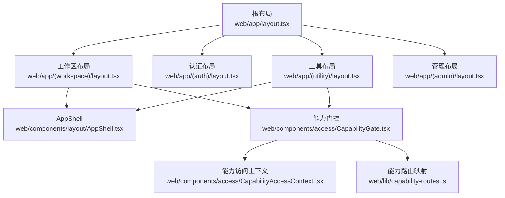
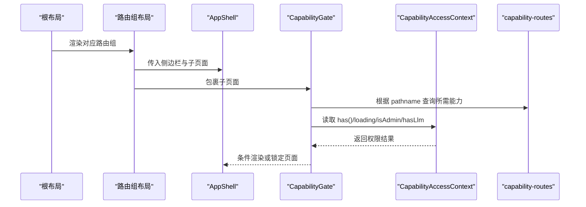
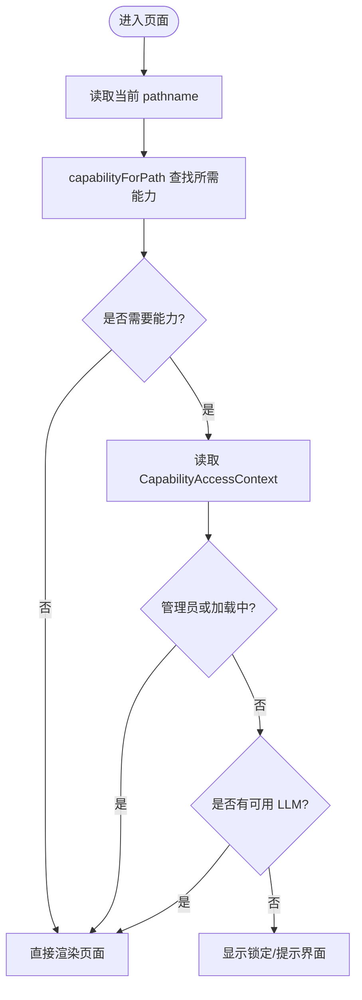
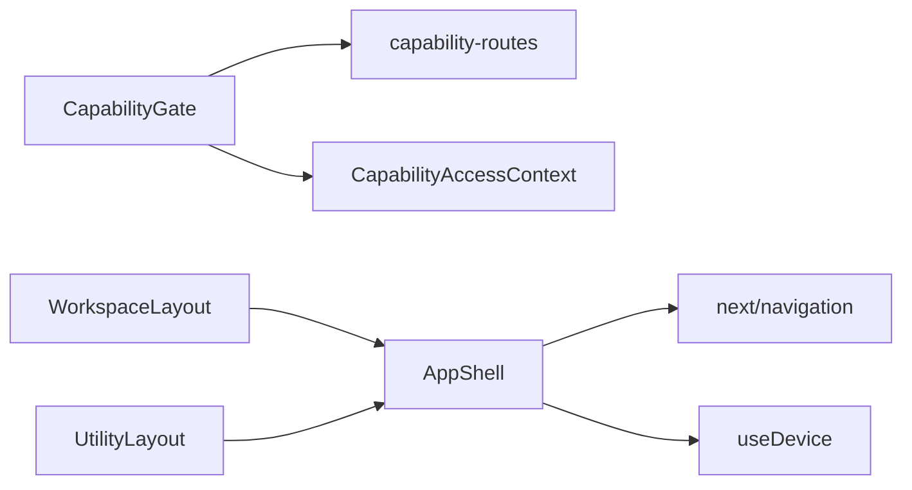

# 路由与导航

<cite>
**本文引用的文件**
- [web/app/layout.tsx](file://web/app/layout.tsx)
- [web/app/(workspace)/layout.tsx](file://web/app/(workspace)/layout.tsx)
- [web/app/(auth)/layout.tsx](file://web/app/(auth)/layout.tsx)
- [web/app/(utility)/layout.tsx](file://web/app/(utility)/layout.tsx)
- [web/app/(admin)/layout.tsx](file://web/app/(admin)/layout.tsx)
- [web/components/layout/AppShell.tsx](file://web/components/layout/AppShell.tsx)
- [web/components/access/CapabilityGate.tsx](file://web/components/access/CapabilityGate.tsx)
- [web/components/access/CapabilityAccessContext.tsx](file://web/components/access/CapabilityAccessContext.tsx)
- [web/lib/capability-routes.ts](file://web/lib/capability-routes.ts)
</cite>

## 目录
1. [简介](#简介)
2. [项目结构](#项目结构)
3. [核心组件](#核心组件)
4. [架构总览](#架构总览)
5. [详细组件分析](#详细组件分析)
6. [依赖关系分析](#依赖关系分析)
7. [性能考量](#性能考量)
8. [故障排查指南](#故障排查指南)
9. [结论](#结论)
10. [附录](#附录)

## 简介
本文件聚焦 DeepTutor 前端基于 Next.js App Router 的路由结构与导航实现，系统说明路由分组（(workspace)、(auth)、(utility)、(admin)）的职责与权限控制、动态路由与嵌套路由的组织方式、能力路由系统与条件渲染机制、以及导航壳层与状态管理。同时给出路由优化策略、代码分割与预加载建议，并附带配置示例与常见问题解决方案，帮助读者快速理解与扩展该工程的前端路由体系。

## 项目结构
DeepTutor 前端采用 Next.js App Router 的目录即路由约定：
- 根布局位于 web/app/layout.tsx，负责全局元数据、主题脚本、国际化桥接与应用外壳上下文。
- 路由组通过括号命名实现逻辑分组：
  - (workspace)：主工作区，包含首页、伙伴、协作写作、书籍、空间学习、沙箱等页面，提供侧边栏与统一聊天上下文。
  - (auth)：认证相关页面（登录、注册），使用极简居中布局。
  - (utility)：工具与设置类页面（知识库、记忆、笔记本、个人档案、各类设置、空间管理等），提供独立侧边栏。
  - (admin)：管理员区域，当前包含用户管理页，使用最小化布局。
- 共享外壳组件 AppShell 在 (workspace) 与 (utility) 中复用，提供响应式侧边栏抽屉、顶部栏与内容区。

**图示来源**
- [web/app/layout.tsx:35-62](file://web/app/layout.tsx#L35-L62)
- [web/app/(workspace)/layout.tsx:7-21](file://web/app/(workspace)/layout.tsx#L7-L21)
- [web/app/(auth)/layout.tsx:1-12](file://web/app/(auth)/layout.tsx#L1-L12)
- [web/app/(utility)/layout.tsx:6-19](file://web/app/(utility)/layout.tsx#L6-L19)
- [web/app/(admin)/layout.tsx:1-8](file://web/app/(admin)/layout.tsx#L1-L8)
- [web/components/layout/AppShell.tsx:50-137](file://web/components/layout/AppShell.tsx#L50-L137)
- [web/components/access/CapabilityGate.tsx:14-25](file://web/components/access/CapabilityGate.tsx#L14-L25)
- [web/components/access/CapabilityAccessContext.tsx:47-118](file://web/components/access/CapabilityAccessContext.tsx#L47-L118)
- [web/lib/capability-routes.ts:18-40](file://web/lib/capability-routes.ts#L18-L40)

**章节来源**
- [web/app/layout.tsx:23-62](file://web/app/layout.tsx#L23-L62)
- [web/app/(workspace)/layout.tsx:1-22](file://web/app/(workspace)/layout.tsx#L1-L22)
- [web/app/(auth)/layout.tsx:1-12](file://web/app/(auth)/layout.tsx#L1-L12)
- [web/app/(utility)/layout.tsx:1-19](file://web/app/(utility)/layout.tsx#L1-L19)
- [web/app/(admin)/layout.tsx:1-8](file://web/app/(admin)/layout.tsx#L1-L8)

## 核心组件
- 根布局：注入字体、图标、主题脚本、国际化桥接与应用外壳上下文，为所有路由提供统一 HTML/Body 环境。
- 路由组布局：
  - (workspace)：包裹 CapabilityAccessProvider、UnifiedChatProvider、AppShell 与 CapabilityGate，提供工作区侧边栏与统一聊天能力。
  - (utility)：同样包裹 CapabilityAccessProvider、AppShell 与 CapabilityGate，提供工具侧边栏。
  - (auth)：极简居中容器，用于登录/注册流程。
  - (admin)：最小化容器，供管理员功能使用。
- 应用外壳 AppShell：响应式侧边栏与内容区，移动端以抽屉形式呈现；自动在路由切换时关闭抽屉；提供顶部栏与品牌标识。
- 能力门控 CapabilityGate：根据当前路径解析所需“能力”，交由 RequireCapability 进行权限判定与条件渲染。
- 能力访问上下文 CapabilityAccessContext：集中维护 loading、isAdmin、hasLlm、has()、refresh()，并在首次探测与标签页可见性变化时刷新权限状态。
- 能力路由映射 capability-routes.ts：声明各路由前缀与其所需模型能力（当前为 llm），作为唯一权威来源被侧边栏与门控组件共用。

**章节来源**
- [web/app/layout.tsx:35-62](file://web/app/layout.tsx#L35-L62)
- [web/app/(workspace)/layout.tsx:7-21](file://web/app/(workspace)/layout.tsx#L7-L21)
- [web/app/(utility)/layout.tsx:6-19](file://web/app/(utility)/layout.tsx#L6-L19)
- [web/components/layout/AppShell.tsx:50-137](file://web/components/layout/AppShell.tsx#L50-L137)
- [web/components/access/CapabilityGate.tsx:14-25](file://web/components/access/CapabilityGate.tsx#L14-L25)
- [web/components/access/CapabilityAccessContext.tsx:47-118](file://web/components/access/CapabilityAccessContext.tsx#L47-L118)
- [web/lib/capability-routes.ts:18-40](file://web/lib/capability-routes.ts#L18-L40)

## 架构总览
下图展示了从根布局到具体路由组的渲染链路，以及能力门控如何基于路径与上下文决定页面是否可访问。

**图示来源**
- [web/app/layout.tsx:35-62](file://web/app/layout.tsx#L35-L62)
- [web/app/(workspace)/layout.tsx:7-21](file://web/app/(workspace)/layout.tsx#L7-L21)
- [web/app/(utility)/layout.tsx:6-19](file://web/app/(utility)/layout.tsx#L6-L19)
- [web/components/layout/AppShell.tsx:50-137](file://web/components/layout/AppShell.tsx#L50-L137)
- [web/components/access/CapabilityGate.tsx:14-25](file://web/components/access/CapabilityGate.tsx#L14-L25)
- [web/components/access/CapabilityAccessContext.tsx:47-118](file://web/components/access/CapabilityAccessContext.tsx#L47-L118)
- [web/lib/capability-routes.ts:18-40](file://web/lib/capability-routes.ts#L18-L40)

## 详细组件分析

### 路由分组与职责
- (workspace)
  - 作用：承载核心工作流页面（首页、伙伴、协作写作、书籍、空间学习、沙箱等）。
  - 权限：通过 CapabilityGate + CapabilityAccessContext 对需要 LLM 能力的页面进行限制。
  - 上下文：提供 UnifiedChatProvider 与 AppShell，统一聊天与布局体验。
- (auth)
  - 作用：登录与注册流程。
  - 权限：无复杂能力门控，使用简洁居中布局。
- (utility)
  - 作用：工具与设置页面（知识库、记忆、笔记本、个人档案、各类设置、空间管理等）。
  - 权限：同 (workspace)，通过 CapabilityGate 进行能力校验。
- (admin)
  - 作用：管理员专属功能（如用户管理）。
  - 权限：后端仍为最终执行边界；前端通过 CapabilityAccessContext 的 isAdmin 信号进行 UI 级优化。

**章节来源**
- [web/app/(workspace)/layout.tsx:7-21](file://web/app/(workspace)/layout.tsx#L7-L21)
- [web/app/(auth)/layout.tsx:1-12](file://web/app/(auth)/layout.tsx#L1-L12)
- [web/app/(utility)/layout.tsx:6-19](file://web/app/(utility)/layout.tsx#L6-L19)
- [web/app/(admin)/layout.tsx:1-8](file://web/app/(admin)/layout.tsx#L1-L8)

### 动态路由与嵌套路由
- 动态路由示例：
  - /co-writer/[docId]：文档编辑页，docId 为动态段。
  - /partners/[partnerId]：伙伴详情页，partnerId 为动态段。
  - /memory/l2/[surface]、/memory/l3/[slot]：记忆的多层级动态段。
- 嵌套路由示例：
  - /settings/*：多层级设置页（agents、appearance、capabilities、llm、mcp 等）。
  - /space/*：空间内多个子功能（learning、notebooks、questions、skills 等）。
- 组织原则：Next.js App Router 将目录结构直接映射为 URL 路径，便于按功能域拆分与维护。

**章节来源**
- [web/app/(workspace)/co-writer/[docId]/page.tsx](file://web/app/(workspace)/co-writer/[docId]/page.tsx)
- [web/app/(workspace)/partners/[partnerId]/page.tsx](file://web/app/(workspace)/partners/[partnerId]/page.tsx)
- [web/app/(utility)/memory/l2/[surface]/page.tsx](file://web/app/(utility)/memory/l2/[surface]/page.tsx)
- [web/app/(utility)/memory/l3/[slot]/page.tsx](file://web/app/(utility)/memory/l3/[slot]/page.tsx)
- [web/app/(utility)/settings/*/page.tsx](file://web/app/(utility)/settings/page.tsx)
- [web/app/(utility)/space/*/page.tsx](file://web/app/(utility)/space/page.tsx)

### 路由守卫与能力路由系统
- 能力路由映射：
  - 通过 ROUTE_CAPABILITIES 声明每个路由前缀所需的模型能力（当前为 llm）。
  - capabilityForPath 根据当前 pathname 精确匹配或前缀匹配，返回所需能力或 null。
- 能力门控：
  - CapabilityGate 读取当前路径，调用 capabilityForPath 获取所需能力，并交给 RequireCapability 进行权限判定。
- 权限上下文：
  - CapabilityAccessContext 维护 loading、isAdmin、hasLlm、has()、refresh()。
  - 首次加载时探测设置接口判断是否为管理员；非管理员则检查可用 LLM 选项列表长度。
  - 监听标签页焦点与可见性变化，重新刷新权限，以便会话期间撤销授权后及时锁定 UI。
- 权限判定规则：
  - 管理员或加载中：默认放行（UI 不闪烁锁定，后端仍为最终执行边界）。
  - 非管理员且未加载完成：默认放行以避免白屏。
  - 非管理员且已加载：若 hasLlm 为真则放行，否则锁定。

**图示来源**
- [web/components/access/CapabilityGate.tsx:14-25](file://web/components/access/CapabilityGate.tsx#L14-L25)
- [web/lib/capability-routes.ts:18-40](file://web/lib/capability-routes.ts#L18-L40)
- [web/components/access/CapabilityAccessContext.tsx:47-118](file://web/components/access/CapabilityAccessContext.tsx#L47-L118)

**章节来源**
- [web/components/access/CapabilityGate.tsx:14-25](file://web/components/access/CapabilityGate.tsx#L14-L25)
- [web/lib/capability-routes.ts:1-49](file://web/lib/capability-routes.ts#L1-L49)
- [web/components/access/CapabilityAccessContext.tsx:47-118](file://web/components/access/CapabilityAccessContext.tsx#L47-L118)

### 导航组件与状态管理
- AppShell：
  - 提供响应式侧边栏与内容区，移动端以抽屉形式展示。
  - 路由切换时自动关闭抽屉，避免遮挡新页面。
  - 顶部栏包含品牌标识与菜单按钮，支持无障碍属性。
- 侧边栏：
  - (workspace) 使用 WorkspaceSidebar，(utility) 使用 UtilitySidebar，分别提供不同导航入口。
  - 侧边栏项可根据能力路由映射进行禁用或隐藏（由 CapabilityAccessContext.has 驱动）。
- 面包屑：
  - 当前仓库未提供通用面包屑组件；可在各页面按需组合 Link 与文本生成。
- 路由状态：
  - 通过 usePathname 获取当前路径，结合 CapabilityGate 与 CapabilityAccessContext 进行条件渲染与权限控制。

**章节来源**
- [web/components/layout/AppShell.tsx:50-137](file://web/components/layout/AppShell.tsx#L50-L137)
- [web/app/(workspace)/layout.tsx:1-22](file://web/app/(workspace)/layout.tsx#L1-L22)
- [web/app/(utility)/layout.tsx:1-19](file://web/app/(utility)/layout.tsx#L1-L19)

### 权限验证机制与条件渲染
- 管理员识别：
  - 通过设置接口返回 payload 中是否存在 catalog 字段判断是否为管理员。
- 非管理员能力检查：
  - 调用 listLLMOptions 获取过滤后的模型选项，若存在可用选项则认为具备能力。
- 条件渲染：
  - CapabilityGate 在页面级别进行能力校验，结合 CapabilityAccessContext.has 决定是否渲染子页面。
- 实时刷新：
  - 监听 focus 与 visibilitychange 事件，重新刷新权限，确保会话期间权限变更即时生效。

**章节来源**
- [web/components/access/CapabilityAccessContext.tsx:58-99](file://web/components/access/CapabilityAccessContext.tsx#L58-L99)
- [web/components/access/CapabilityGate.tsx:14-25](file://web/components/access/CapabilityGate.tsx#L14-L25)

## 依赖关系分析
- 组件耦合：
  - CapabilityGate 依赖 capability-routes 的能力映射与 CapabilityAccessContext 的权限状态。
  - AppShell 依赖 next/navigation 的路径 API 与设备检测 hook，提供响应式布局。
  - 路由组布局依赖各自侧边栏与 AppShell，形成稳定的渲染骨架。
- 外部依赖：
  - next/navigation：用于获取当前路径。
  - react-i18next：用于国际化文案。
  - lucide-react：用于菜单图标。
- 潜在循环依赖：
  - 当前结构清晰，未发现循环导入；能力映射与上下文解耦良好。

**图示来源**
- [web/components/access/CapabilityGate.tsx:14-25](file://web/components/access/CapabilityGate.tsx#L14-L25)
- [web/lib/capability-routes.ts:18-40](file://web/lib/capability-routes.ts#L18-L40)
- [web/components/access/CapabilityAccessContext.tsx:47-118](file://web/components/access/CapabilityAccessContext.tsx#L47-L118)
- [web/components/layout/AppShell.tsx:50-137](file://web/components/layout/AppShell.tsx#L50-L137)
- [web/app/(workspace)/layout.tsx:7-21](file://web/app/(workspace)/layout.tsx#L7-L21)
- [web/app/(utility)/layout.tsx:6-19](file://web/app/(utility)/layout.tsx#L6-L19)

**章节来源**
- [web/components/access/CapabilityGate.tsx:14-25](file://web/components/access/CapabilityGate.tsx#L14-L25)
- [web/lib/capability-routes.ts:18-40](file://web/lib/capability-routes.ts#L18-L40)
- [web/components/access/CapabilityAccessContext.tsx:47-118](file://web/components/access/CapabilityAccessContext.tsx#L47-L118)
- [web/components/layout/AppShell.tsx:50-137](file://web/components/layout/AppShell.tsx#L50-L137)

## 性能考量
- 代码分割与懒加载：
  - 利用 Next.js App Router 的模块级代码分割，按路由组与页面自动拆分包体积。
  - 对重型组件（如图表、编辑器）使用动态导入与 Suspense 边界，减少首屏负载。
- 预加载与预取：
  - 对高频跳转的目标页面使用 <Link prefetch="intent"> 或 router.prefetch 提升交互速度。
  - 对静态资源（图片、字体）使用 next/image 与 next/font 优化加载。
- 状态与重渲染：
  - CapabilityAccessContext 仅在必要时刷新（首次与标签页可见性变化），避免频繁请求。
  - AppShell 在路由切换时同步关闭抽屉，减少不必要的重绘。
- 网络与缓存：
  - 设置接口与模型选项列表启用合理缓存策略，降低重复请求。
  - 对错误场景进行降级处理，保证 UI 可用性。

[本节为通用指导，无需特定文件来源]

## 故障排查指南
- 页面被锁定但实际应有权限：
  - 检查 capability-routes 是否正确声明该路由前缀与所需能力。
  - 确认 CapabilityAccessContext 的 refresh 是否被触发（标签页焦点/可见性变化）。
  - 查看后端设置接口与模型选项列表返回是否符合预期。
- 移动端侧边栏无法关闭：
  - 检查 AppShell 的路径跟踪逻辑与键盘事件监听是否正常。
  - 确认 isMobile 判断与 CSS 媒体查询是否生效。
- 管理员功能异常：
  - 确认设置接口返回的 catalog 字段是否存在，以正确识别管理员身份。
  - 检查后端权限策略是否与前端 UI 一致。

**章节来源**
- [web/lib/capability-routes.ts:18-40](file://web/lib/capability-routes.ts#L18-L40)
- [web/components/access/CapabilityAccessContext.tsx:58-99](file://web/components/access/CapabilityAccessContext.tsx#L58-L99)
- [web/components/layout/AppShell.tsx:58-74](file://web/components/layout/AppShell.tsx#L58-L74)

## 结论
DeepTutor 前端通过 Next.js App Router 的路由组划分实现了清晰的领域边界与可维护的结构；能力路由系统与上下文驱动的权限控制确保了功能的安全性与可扩展性；AppShell 提供了统一的响应式外壳与导航体验。结合代码分割、预加载与合理的状态刷新策略，整体具备良好的性能与用户体验。未来可在面包屑、更细粒度的权限粒度与更多预取策略上持续优化。

[本节为总结，无需特定文件来源]

## 附录
- 路由配置示例（基于现有结构）：
  - 新增受能力保护的路由：在 capability-routes.ts 中添加前缀与能力映射。
  - 新增页面：在对应路由组目录下创建 page.tsx，必要时添加 layout.tsx 与动态段。
  - 新增设置页：在 (utility)/settings 下创建子目录与页面。
- 常见问题与解决：
  - 动态段参数缺失：确保 URL 包含必要参数，或在页面中进行空值处理。
  - 权限误判：核对 capability-routes 前缀匹配规则与 CapabilityAccessContext 的刷新时机。
  - 移动端导航异常：检查 AppShell 的抽屉开关逻辑与键盘事件绑定。

[本节为补充信息，无需特定文件来源]