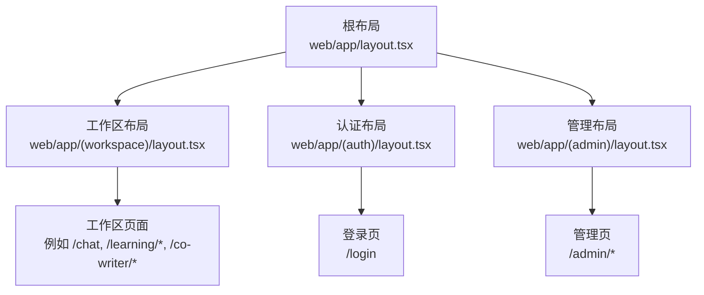
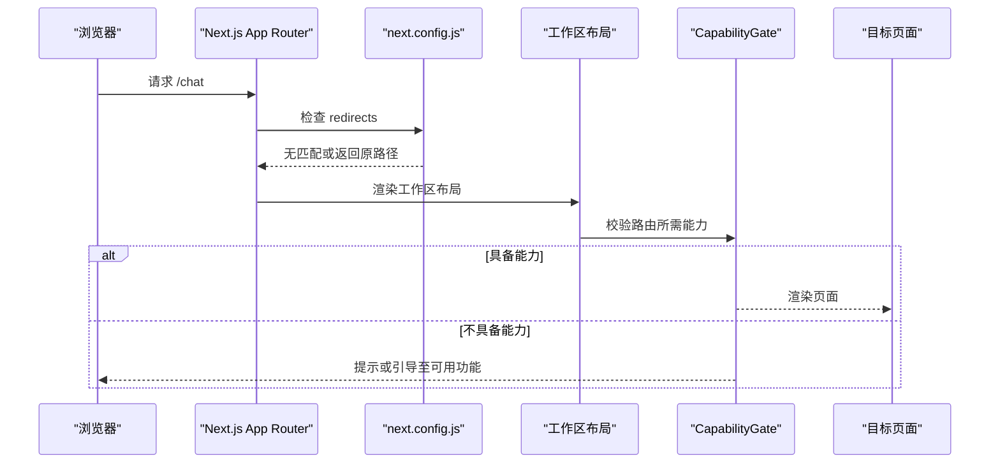
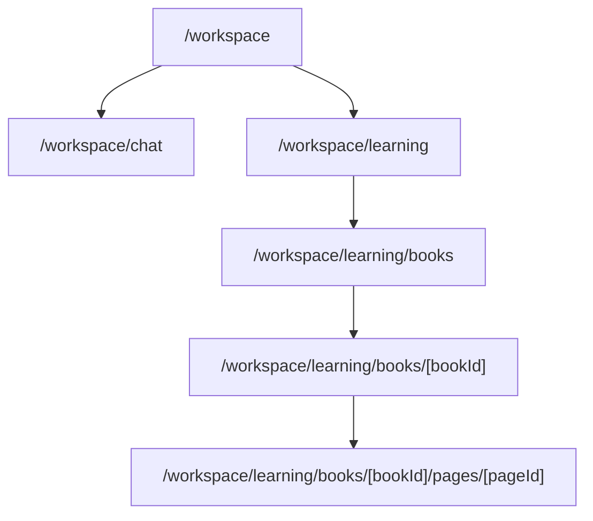
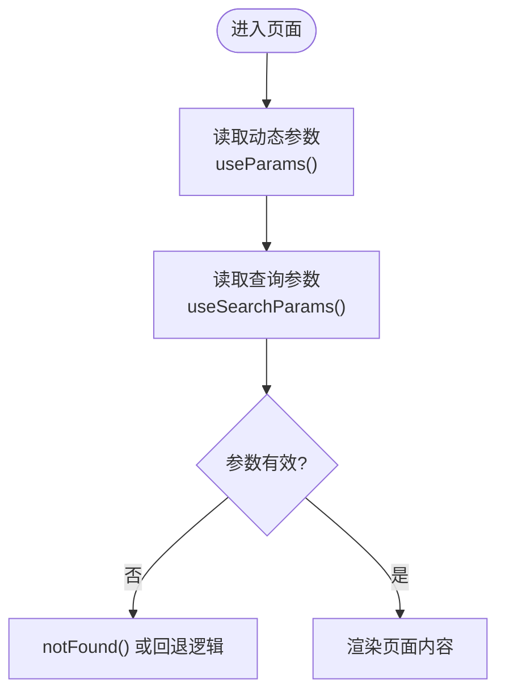
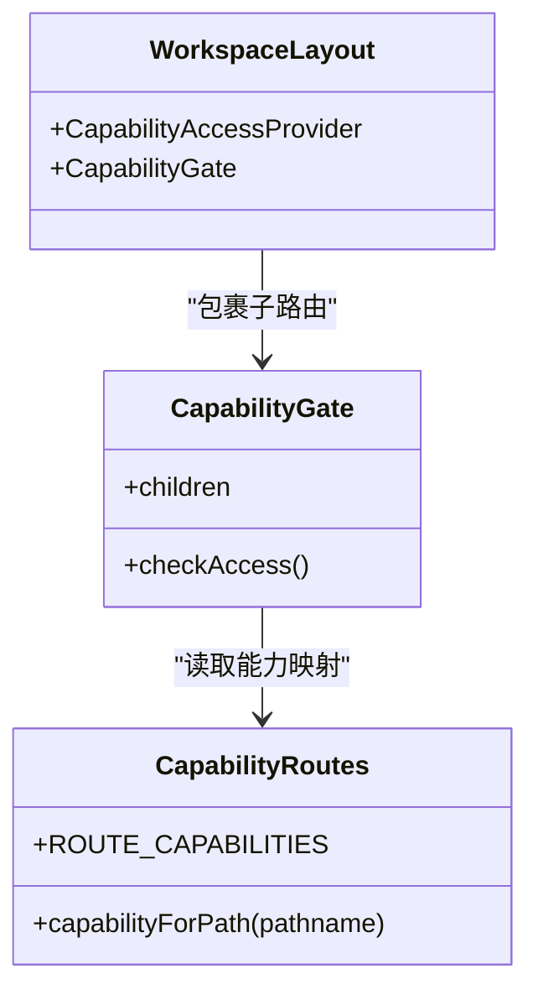
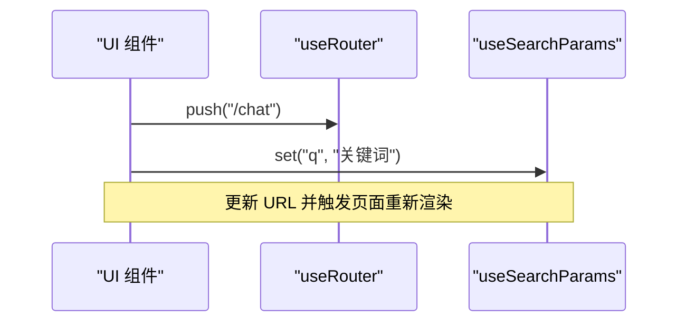
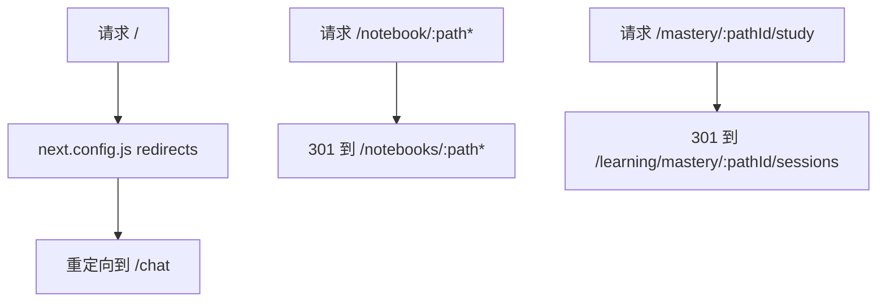
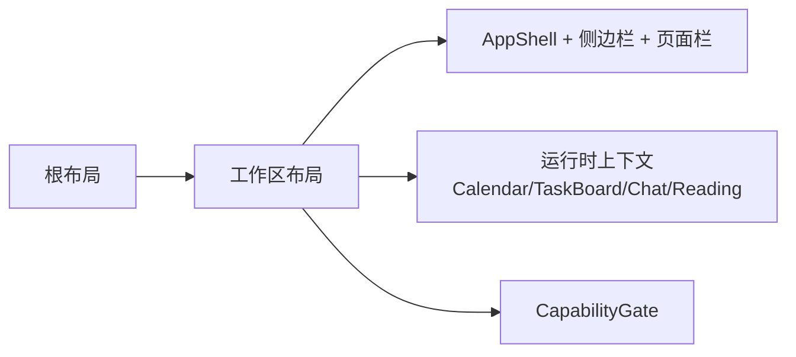
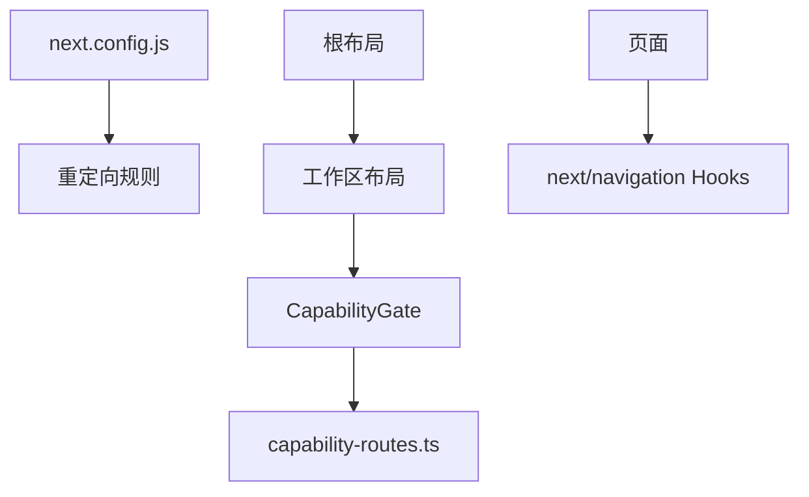

# 路由与导航

<cite>
**本文引用的文件**   
- [web/app/layout.tsx](file://web/app/layout.tsx)
- [web/next.config.js](file://web/next.config.js)
- [web/app/(workspace)/layout.tsx](file://web/app/(workspace)/layout.tsx)
- [web/app/(auth)/layout.tsx](file://web/app/(auth)/layout.tsx)
- [web/app/(admin)/layout.tsx](file://web/app/(admin)/layout.tsx)
- [web/lib/capability-routes.ts](file://web/lib/capability-routes.ts)
- [web/lib/route-params.ts](file://web/lib/route-params.ts)
- [web/app/(workspace)/page.tsx](file://web/app/(workspace)/page.tsx)
- [web/app/(workspace)/learning/watching/page.tsx](file://web/app/(workspace)/learning/watching/page.tsx)
- [web/app/(utility)/memory/l2/[surface]/page.tsx](file://web/app/(utility)/memory/l2/[surface]/page.tsx)
- [web/app/(utility)/memory/l3/[slot]/page.tsx](file://web/app/(utility)/memory/l3/[slot]/page.tsx)
- [web/app/(utility)/notebooks/NotebooksRoute.tsx](file://web/app/(utility)/notebooks/NotebooksRoute.tsx)
- [web/app/(workspace)/co-writer/[docId]/page.tsx](file://web/app/(workspace)/co-writer/[docId]/page.tsx)
- [web/app/(workspace)/learning/books/BooksRoute.tsx](file://web/app/(workspace)/learning/books/BooksRoute.tsx)
- [web/components/workspaces/WorkspaceNavigation.tsx](file://web/components/workspaces/WorkspaceNavigation.tsx)
</cite>

## 目录
1. [简介](#简介)
2. [项目结构](#项目结构)
3. [核心组件](#核心组件)
4. [架构总览](#架构总览)
5. [详细组件分析](#详细组件分析)
6. [依赖关系分析](#依赖关系分析)
7. [性能考虑](#性能考虑)
8. [故障排查指南](#故障排查指南)
9. [结论](#结论)
10. [附录](#附录)

## 简介
本文件聚焦 DeepTutor Web 前端基于 Next.js App Router 的路由与导航体系，覆盖以下主题：
- 嵌套路由、动态路由与路由守卫（能力门控）
- 页面布局系统（根布局与各业务组布局）
- 路由参数处理与查询字符串管理
- 导航状态、面包屑与历史记录控制
- 路由级代码分割、懒加载与预取策略
- 权限控制、路由保护与重定向逻辑
- 导航体验优化、SEO 与性能调优最佳实践

## 项目结构
DeepTutor Web 使用 Next.js App Router 的分组路由组织方式，通过括号命名的路由组划分不同业务域：
- (workspace)：工作区主入口与核心功能（聊天、学习中心、协作写作等）
- (auth)：认证相关页面（登录、注册）
- (admin)：管理员后台
- (settings)：设置页
- (utility)：工具与辅助页面（知识库、记忆图谱、笔记本等）

根布局提供全局样式、字体、主题脚本、国际化桥接、通知容器与工作区导航。各路由组拥有独立布局，用于承载侧边栏、顶部操作栏、运行时上下文与权限门控。

图表来源
- [web/app/layout.tsx:42-70](file://web/app/layout.tsx#L42-L70)
- [web/app/(workspace)/layout.tsx:14-44](file://web/app/(workspace)/layout.tsx#L14-L44)
- [web/app/(auth)/layout.tsx:1-11](file://web/app/(auth)/layout.tsx#L1-L11)
- [web/app/(admin)/layout.tsx:1-7](file://web/app/(admin)/layout.tsx#L1-L7)

章节来源
- [web/app/layout.tsx:1-73](file://web/app/layout.tsx#L1-L73)
- [web/app/(workspace)/layout.tsx:1-45](file://web/app/(workspace)/layout.tsx#L1-L45)
- [web/app/(auth)/layout.tsx:1-12](file://web/app/(auth)/layout.tsx#L1-L12)
- [web/app/(admin)/layout.tsx:1-8](file://web/app/(admin)/layout.tsx#L1-L8)

## 核心组件
- 根布局：注入全局元数据、字体变量、主题脚本、国际化桥、通知容器与工作区导航。
- 工作区布局：组合 AppShell、侧边栏、页面栏、日历/任务板运行时、聊天运行时、阅读上下文，并通过 CapabilityGate 对子路由进行能力门控。
- 认证与管理布局：提供最小化容器，便于认证与管理页面渲染。
- 能力路由映射：集中声明哪些路由前缀需要特定模型能力（如 LLM），供侧边栏与路由门控统一消费。
- 路由参数工具：封装 next/navigation 参数的规范化读取。

章节来源
- [web/app/layout.tsx:30-70](file://web/app/layout.tsx#L30-L70)
- [web/app/(workspace)/layout.tsx:14-44](file://web/app/(workspace)/layout.tsx#L14-L44)
- [web/lib/capability-routes.ts:1-48](file://web/lib/capability-routes.ts#L1-L48)
- [web/lib/route-params.ts:1-9](file://web/lib/route-params.ts#L1-L9)

## 架构总览
Next.js App Router 在 DeepTutor 中的职责边界如下：
- 路由定义：按功能域划分的文件夹即路由，支持嵌套与动态段。
- 布局层级：根布局负责全局 UI 与基础设施；业务布局负责领域上下文与权限门控。
- 导航与跳转：通过 next/navigation 提供的 useRouter/useSearchParams/usePathname 等 Hook 完成客户端导航与参数读取。
- 服务端重定向：通过 next.config.js 的 redirects 配置实现旧路径到新路径的 301/临时重定向。
- 能力门控：以 ROUTE_CAPABILITIES 为单一事实源，结合 CapabilityGate 在路由层限制未授权访问。

图表来源
- [web/next.config.js:144-162](file://web/next.config.js#L144-L162)
- [web/app/(workspace)/layout.tsx:20-34](file://web/app/(workspace)/layout.tsx#L20-L34)
- [web/lib/capability-routes.ts:19-39](file://web/lib/capability-routes.ts#L19-L39)

## 详细组件分析

### 嵌套路由与分组布局
- 路由组：(workspace)、(auth)、(admin)、(settings)、(utility) 作为逻辑分组，不改变 URL。
- 嵌套路由：例如 /workspace/learning/books/[bookId]/pages/[pageId] 体现多层嵌套。
- 布局继承：每个分组可定义 layout.tsx，包裹其下所有页面，提供共享 UI 与上下文。

章节来源
- [web/app/(workspace)/layout.tsx:14-44](file://web/app/(workspace)/layout.tsx#L14-L44)

### 动态路由与参数处理
- 动态段：使用方括号表示，如 [sessionId]、[kbName]、[pathId]、[surface]、[slot]、[docId]。
- 参数读取：页面内通过 useParams 获取动态参数；useSearchParams 获取查询字符串；useRouter 执行导航。
- 参数工具：firstParam 将数组型参数归一化为单值，避免类型分支。

图表来源
- [web/app/(utility)/memory/l2/[surface]/page.tsx:1-20](file://web/app/(utility)/memory/l2/[surface]/page.tsx#L1-L20)
- [web/app/(utility)/memory/l3/[slot]/page.tsx:1-20](file://web/app/(utility)/memory/l3/[slot]/page.tsx#L1-L20)
- [web/lib/route-params.ts:1-9](file://web/lib/route-params.ts#L1-L9)

章节来源
- [web/app/(utility)/memory/l2/[surface]/page.tsx:1-20](file://web/app/(utility)/memory/l2/[surface]/page.tsx#L1-L20)
- [web/app/(utility)/memory/l3/[slot]/page.tsx:1-20](file://web/app/(utility)/memory/l3/[slot]/page.tsx#L1-L20)
- [web/lib/route-params.ts:1-9](file://web/lib/route-params.ts#L1-L9)

### 路由守卫与能力门控
- 能力映射：ROUTE_CAPABILITIES 声明路由前缀与所需能力（如 llm）。
- 门控组件：CapabilityGate 根据当前用户能力决定是否渲染子树。
- 侧边栏联动：侧边栏依据同一映射禁用不可用项，保证导航一致性。

图表来源
- [web/lib/capability-routes.ts:19-39](file://web/lib/capability-routes.ts#L19-L39)
- [web/app/(workspace)/layout.tsx:20-34](file://web/app/(workspace)/layout.tsx#L20-L34)

章节来源
- [web/lib/capability-routes.ts:1-48](file://web/lib/capability-routes.ts#L1-L48)
- [web/app/(workspace)/layout.tsx:20-34](file://web/app/(workspace)/layout.tsx#L20-L34)

### 导航状态管理与历史记录控制
- 导航 API：useRouter 提供 push、replace、back、forward 等方法，控制历史栈与页面切换。
- 查询字符串：useSearchParams 提供 get/set/delete 等操作，常用于筛选、分页与分享链接。
- 路径感知：usePathname 可用于生成面包屑或高亮当前菜单项。

图表来源
- [web/app/(workspace)/co-writer/[docId]/page.tsx:1-20](file://web/app/(workspace)/co-writer/[docId]/page.tsx#L1-L20)
- [web/app/(utility)/notebooks/NotebooksRoute.tsx:1-20](file://web/app/(utility)/notebooks/NotebooksRoute.tsx#L1-L20)
- [web/app/(workspace)/learning/books/BooksRoute.tsx:1-20](file://web/app/(workspace)/learning/books/BooksRoute.tsx#L1-L20)

章节来源
- [web/app/(workspace)/co-writer/[docId]/page.tsx:1-20](file://web/app/(workspace)/co-writer/[docId]/page.tsx#L1-L20)
- [web/app/(utility)/notebooks/NotebooksRoute.tsx:1-20](file://web/app/(utility)/notebooks/NotebooksRoute.tsx#L1-L20)
- [web/app/(workspace)/learning/books/BooksRoute.tsx:1-20](file://web/app/(workspace)/learning/books/BooksRoute.tsx#L1-L20)

### 重定向与路由保护
- 构建期重定向：next.config.js 中 redirects 将旧路径迁移到新路径，包括 / 到 /chat、/notebook 到 /notebooks、/mastery 到 /learning/mastery 等。
- 页面级重定向：部分页面在渲染时调用 redirect 进行条件跳转（如空工作区默认跳转到聊天）。
- 能力门控：对需要 LLM 能力的路由，若用户不具备则阻止渲染，配合侧边栏禁用导航项。

图表来源
- [web/next.config.js:144-162](file://web/next.config.js#L144-L162)
- [web/app/(workspace)/page.tsx:1-20](file://web/app/(workspace)/page.tsx#L1-L20)
- [web/app/(workspace)/learning/watching/page.tsx:1-20](file://web/app/(workspace)/learning/watching/page.tsx#L1-L20)

章节来源
- [web/next.config.js:144-162](file://web/next.config.js#L144-L162)
- [web/app/(workspace)/page.tsx:1-20](file://web/app/(workspace)/page.tsx#L1-L20)
- [web/app/(workspace)/learning/watching/page.tsx:1-20](file://web/app/(workspace)/learning/watching/page.tsx#L1-L20)

### 页面布局系统与上下文
- 根布局：提供全局字体、主题脚本、国际化桥、通知容器与工作区导航。
- 工作区布局：组合 AppShell、侧边栏、页面栏、运行时上下文（日历、任务板、聊天、阅读），并通过 CapabilityGate 保护子路由。
- 认证与管理布局：提供最小容器，确保认证与管理页面的视觉一致性。

图表来源
- [web/app/layout.tsx:42-70](file://web/app/layout.tsx#L42-L70)
- [web/app/(workspace)/layout.tsx:14-44](file://web/app/(workspace)/layout.tsx#L14-L44)
- [web/app/(auth)/layout.tsx:1-11](file://web/app/(auth)/layout.tsx#L1-L11)
- [web/app/(admin)/layout.tsx:1-7](file://web/app/(admin)/layout.tsx#L1-L7)

章节来源
- [web/app/layout.tsx:42-70](file://web/app/layout.tsx#L42-L70)
- [web/app/(workspace)/layout.tsx:14-44](file://web/app/(workspace)/layout.tsx#L14-L44)

### 导航用户体验优化
- 平滑滚动：根 HTML 元素启用 smooth 滚动行为，提升页面内锚点跳转体验。
- 开发指示器位置：调整 devIndicators 位置，减少干扰。
- 跨域开发资源白名单：allowedDevOrigins 允许局域网设备正常 HMR 与静态资源加载，避免“空白壳”问题。
- 工作区导航：WorkspaceNavigation 提供统一的导航入口，保持多工作区间的一致性。

章节来源
- [web/app/layout.tsx:48-52](file://web/app/layout.tsx#L48-L52)
- [web/next.config.js:135-138](file://web/next.config.js#L135-L138)
- [web/next.config.js:164-176](file://web/next.config.js#L164-L176)
- [web/components/workspaces/WorkspaceNavigation.tsx:1-20](file://web/components/workspaces/WorkspaceNavigation.tsx#L1-L20)

### SEO 优化
- 根元数据：title、description、favicon 与 Apple Touch Icon 在根布局中声明，利于搜索引擎抓取与书签展示。
- 视口配置：viewport 设置交互控件自适应，改善移动端体验。
- 语言与主题脚本：html lang 与 ThemeScript 确保首屏内容与主题一致，减少闪烁。

章节来源
- [web/app/layout.tsx:28-40](file://web/app/layout.tsx#L28-L40)
- [web/app/layout.tsx:48-56](file://web/app/layout.tsx#L48-L56)

## 依赖关系分析
- 路由与布局：根布局 -> 工作区/认证/管理布局 -> 具体页面。
- 能力门控：工作区布局 -> CapabilityGate -> capability-routes.ts。
- 导航与参数：页面 -> next/navigation Hooks -> 路由与查询字符串。
- 构建期重定向：next.config.js -> 旧路径 -> 新路径。

图表来源
- [web/next.config.js:144-162](file://web/next.config.js#L144-L162)
- [web/app/(workspace)/layout.tsx:20-34](file://web/app/(workspace)/layout.tsx#L20-L34)
- [web/lib/capability-routes.ts:19-39](file://web/lib/capability-routes.ts#L19-L39)

章节来源
- [web/next.config.js:144-162](file://web/next.config.js#L144-L162)
- [web/app/(workspace)/layout.tsx:20-34](file://web/app/(workspace)/layout.tsx#L20-L34)
- [web/lib/capability-routes.ts:19-39](file://web/lib/capability-routes.ts#L19-L39)

## 性能考虑
- 代码分割与懒加载：Next.js App Router 自动按路由进行代码分割；Suspense 包裹运行时上下文，避免阻塞首屏。
- 构建产物分离：distDir 与 outputFileTracingRoot 确保生产构建与开发缓存互不干扰，standalone 输出减小部署体积。
- 代理体大小与时延：proxyClientMaxBodySize 与 proxyTimeout 适配长耗时与大数据量场景，减轻代理层压力。
- 开发体验：devIndicators 与 allowedDevOrigins 提升本地开发与局域网调试效率。
- 模块转译：transpilePackages 与 webpack alias 解决第三方库兼容性问题，减少构建失败与运行时错误。

章节来源
- [web/app/(workspace)/layout.tsx:22-40](file://web/app/(workspace)/layout.tsx#L22-L40)
- [web/next.config.js:93-122](file://web/next.config.js#L93-L122)
- [web/next.config.js:124-133](file://web/next.config.js#L124-L133)
- [web/next.config.js:135-141](file://web/next.config.js#L135-L141)
- [web/next.config.js:178-202](file://web/next.config.js#L178-L202)

## 故障排查指南
- 开发模式跨域问题：若从局域网 IP 访问导致 HMR 或静态资源无法加载，检查 allowedDevOrigins 是否包含本机非回环 IPv4 地址。
- 重定向异常：确认 next.config.js 中 redirects 的规则顺序与通配符匹配是否符合预期，避免误拦截。
- 能力门控失效：核对 ROUTE_CAPABILITIES 的前缀匹配逻辑，确保新增路由被正确声明。
- 参数解析错误：使用 firstParam 统一处理数组型参数，避免 undefined 或类型不一致导致的渲染异常。
- 页面空白壳：检查 root layout 的 html/body 属性与 ThemeScript 是否正确注入，避免 SSR 与 CSR 不一致。

章节来源
- [web/next.config.js:164-176](file://web/next.config.js#L164-L176)
- [web/next.config.js:144-162](file://web/next.config.js#L144-L162)
- [web/lib/capability-routes.ts:34-39](file://web/lib/capability-routes.ts#L34-L39)
- [web/lib/route-params.ts:1-9](file://web/lib/route-params.ts#L1-L9)
- [web/app/layout.tsx:48-70](file://web/app/layout.tsx#L48-L70)

## 结论
DeepTutor 的 Web 前端采用 Next.js App Router 的现代路由架构，通过路由组与嵌套路由清晰划分业务域，结合布局系统与能力门控实现权限控制与上下文隔离。构建期重定向保障路径演进平滑，参数工具与导航 API 简化了复杂交互的实现。在生产构建、代理配置与开发体验方面做了细致优化，有助于提升整体性能与可维护性。建议在新功能接入时遵循现有约定：声明能力映射、使用 Suspense 包裹运行时、统一参数处理与导航模式，以保持系统的一致性与可扩展性。

## 附录
- 常用 next/navigation Hook 参考：
  - useRouter：push、replace、back、forward
  - useSearchParams：get、set、delete
  - usePathname：获取当前路径，用于面包屑与高亮
- 路由命名建议：
  - 使用语义化的路径段，避免过度嵌套
  - 动态段尽量短小且唯一
  - 查询字符串用于筛选与分享，不承载核心业务标识