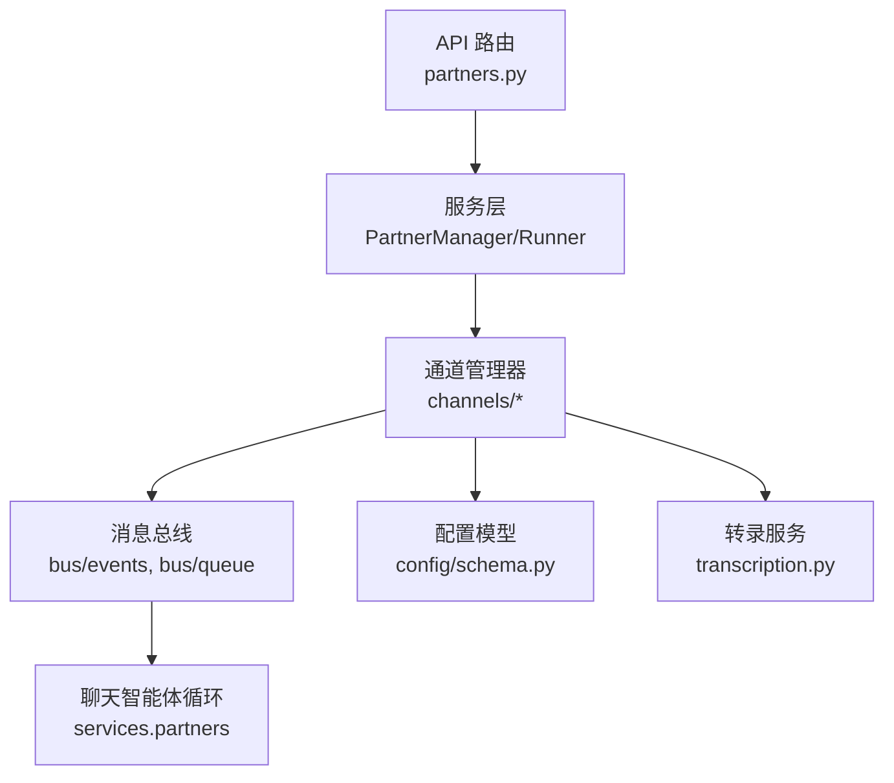
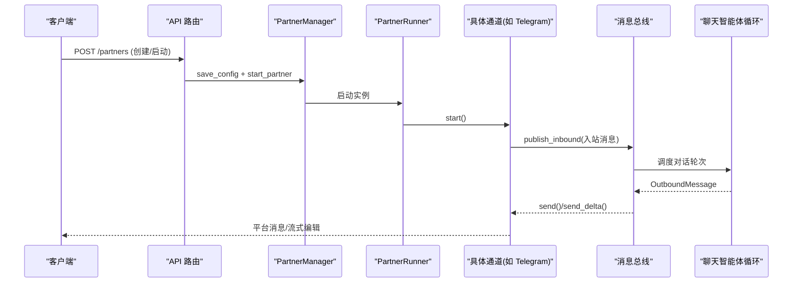
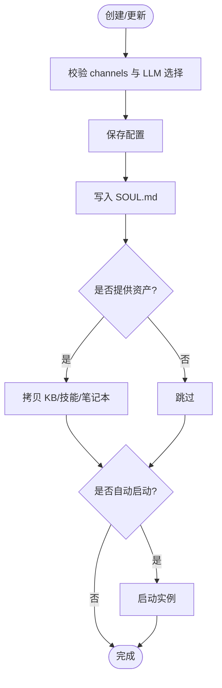
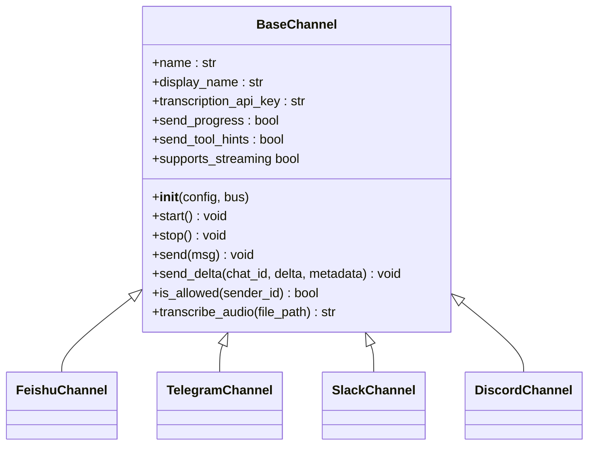
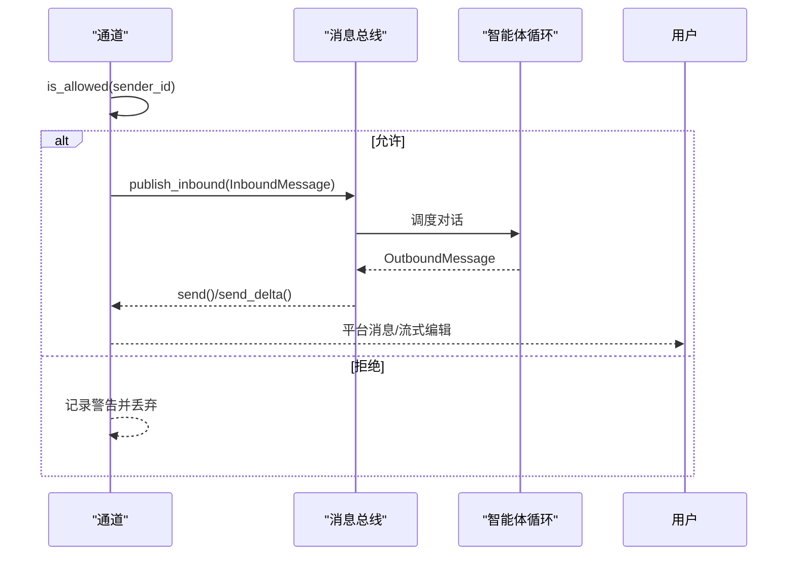
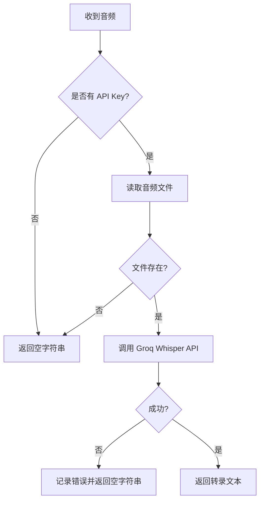
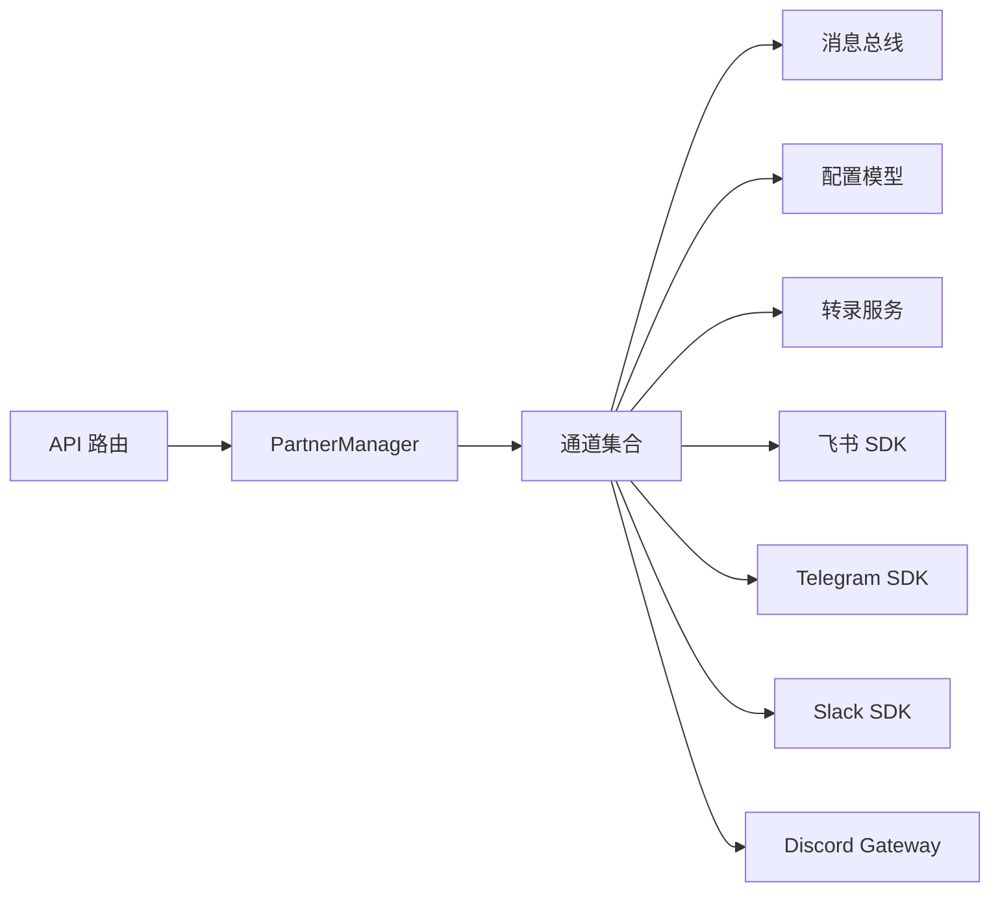

# 合作伙伴系统

<cite>
**本文引用的文件**
- [deeptutor/partners/__init__.py](file://deeptutor/partners/__init__.py)
- [deeptutor/api/routers/partners.py](file://deeptutor/api/routers/partners.py)
- [deeptutor/services/partners/__init__.py](file://deeptutor/services/partners/__init__.py)
- [deeptutor/services/partners/manager.py](file://deeptutor/services/partners/manager.py)
- [deeptutor/partners/channels/base.py](file://deeptutor/partners/channels/base.py)
- [deeptutor/partners/config/schema.py](file://deeptutor/partners/config/schema.py)
- [deeptutor/partners/config/__init__.py](file://deeptutor/partners/config/__init__.py)
- [deeptutor/partners/channels/feishu.py](file://deeptutor/partners/channels/feishu.py)
- [deeptutor/partners/channels/telegram.py](file://deeptutor/partners/channels/telegram.py)
- [deeptutor/partners/channels/slack.py](file://deeptutor/partners/channels/slack.py)
- [deeptutor/partners/channels/discord.py](file://deeptutor/partners/channels/discord.py)
- [deeptutor/partners/transcription.py](file://deeptutor/partners/transcription.py)
</cite>

## 目录
1. [简介](#简介)
2. [项目结构](#项目结构)
3. [核心组件](#核心组件)
4. [架构总览](#架构总览)
5. [详细组件分析](#详细组件分析)
6. [依赖关系分析](#依赖关系分析)
7. [性能考量](#性能考量)
8. [故障排除指南](#故障排除指南)
9. [结论](#结论)
10. [附录](#附录)

## 简介
本文件为 DeepTutor 合作伙伴系统的全面技术文档。合作伙伴（Partner）是“通过即时通讯平台接入、由聊天智能体驱动”的持久化伴侣，具备多渠道支持、身份与权限控制、配置管理、生命周期控制、消息路由与流式处理、转录与语音能力、记忆隔离与工作空间管理等关键特性。本文面向开发者与运维人员，提供从概念到实现、从配置到排障的系统性说明，并给出新增渠道的集成指引。

## 项目结构
DeepTutor 合作伙伴系统主要由以下层次组成：
- API 层：FastAPI 路由负责合作伙伴的创建、更新、启动/停止、资产与灵魂模板管理、会话历史等。
- 服务层：PartnerManager/Runner 负责实例生命周期、工作空间、会话存储、通道加载与重载。
- 通道层：各 IM 平台（飞书、Telegram、Slack、Discord 等）实现统一 BaseChannel 接口，负责连接、收发消息、流式增量更新。
- 配置层：Pydantic 模型定义 ChannelsConfig、DeliveryOverrides、StreamingSupport 等，确保配置校验与默认值。
- 工具与服务：转录服务（Groq Whisper）、消息总线、助手函数等。

图表来源
- [deeptutor/api/routers/partners.py:1-120](file://deeptutor/api/routers/partners.py#L1-L120)
- [deeptutor/services/partners/manager.py:1-200](file://deeptutor/services/partners/manager.py#L1-L200)
- [deeptutor/partners/channels/base.py:1-185](file://deeptutor/partners/channels/base.py#L1-L185)
- [deeptutor/partners/config/schema.py:1-51](file://deeptutor/partners/config/schema.py#L1-L51)
- [deeptutor/partners/transcription.py:1-62](file://deeptutor/partners/transcription.py#L1-L62)

章节来源
- [deeptutor/partners/__init__.py:1-12](file://deeptutor/partners/__init__.py#L1-L12)
- [deeptutor/api/routers/partners.py:1-120](file://deeptutor/api/routers/partners.py#L1-L120)
- [deeptutor/services/partners/__init__.py:1-26](file://deeptutor/services/partners/__init__.py#L1-L26)

## 核心组件
- 合作伙伴管理器（PartnerManager/Runner）
  - 职责：创建/保存/加载配置、启动/停止/销毁实例、自动重启策略、通道重载、会话存储与工作空间管理。
  - 关键点：每个 Partner 拥有独立工作空间 data/partners/{partner_id}/；对敏感字段进行掩码输出；支持 MCP 工具白名单与内置工具开关。
- 通道基类（BaseChannel）
  - 职责：统一 start/stop/send 接口、权限校验 allow_from、流式增量 send_delta、音频转录 transcribe_audio。
  - 关键点：supports_streaming 由配置与子类实现共同决定；_handle_message 将入站消息封装为 InboundMessage 并发布到消息总线。
- 配置模型（ChannelsConfig/DeliveryOverrides/StreamingSupport）
  - 职责：声明式校验通道配置，支持 camelCase/snake_case 兼容；全局重试次数、进度与工具提示开关、流式编辑开关。
- API 路由（partners.py）
  - 职责：合作伙伴 CRUD、灵魂模板库、资产供给、会话归档/恢复/分支、命令调色板、通道 schema 暴露。
  - 关键点：创建时可选自动启动；更新通道后触发 reload_channels；LLM 选择与备份选择经 catalog 校验。

章节来源
- [deeptutor/services/partners/manager.py:1-200](file://deeptutor/services/partners/manager.py#L1-L200)
- [deeptutor/partners/channels/base.py:1-185](file://deeptutor/partners/channels/base.py#L1-L185)
- [deeptutor/partners/config/schema.py:1-51](file://deeptutor/partners/config/schema.py#L1-L51)
- [deeptutor/api/routers/partners.py:100-800](file://deeptutor/api/routers/partners.py#L100-L800)

## 架构总览
合作伙伴系统采用“API 路由 → 服务层 → 通道层 → 消息总线 → 智能体循环”的分层架构。通道层屏蔽不同 IM 平台的差异，向上提供统一的收发与流式能力；服务层负责实例生命周期、配置与资源隔离；API 层对外暴露完整的生命周期管理与配置能力。

图表来源
- [deeptutor/api/routers/partners.py:447-502](file://deeptutor/api/routers/partners.py#L447-L502)
- [deeptutor/services/partners/manager.py:1-200](file://deeptutor/services/partners/manager.py#L1-L200)
- [deeptutor/partners/channels/base.py:126-175](file://deeptutor/partners/channels/base.py#L126-L175)

## 详细组件分析

### 合作伙伴生命周期与配置管理
- 创建与启动
  - 请求模型包含 name、description、channels、llm_selection、backup_llm_selection、language、emoji/color/avatar、enabled_tools/builtin_tools/mcp_tools、assets、start 等。
  - 创建时校验 channels 配置（ChannelsConfig），校验 LLM 选择（catalog 校验），解析 soul 来源（default/library/persona/custom）。
  - 保存配置后写入 SOUL.md，按需 provision_assets（知识库/技能/笔记本拷贝至伙伴工作空间）。
  - 若 start=True，调用 manager.start_partner 启动实例。
- 更新与重载
  - 更新 channels 后调用 reload_channels 以重新加载监听器；LLM 与工具变更无需重启，按轮次读取最新配置。
- 启动/停止/销毁
  - 显式 start 会标记“开机自启”意图；stop 停止运行；destroy 清理实例与资源。
- 安全与隐私
  - 非编辑响应中，通道配置中的敏感字段会被掩码（token/secret/password/api_key 等关键字段）。
  - 旧版全局投递开关被剥离，强制按通道粒度配置。

图表来源
- [deeptutor/api/routers/partners.py:447-502](file://deeptutor/api/routers/partners.py#L447-L502)
- [deeptutor/api/routers/partners.py:589-620](file://deeptutor/api/routers/partners.py#L589-L620)
- [deeptutor/services/partners/manager.py:41-93](file://deeptutor/services/partners/manager.py#L41-L93)

章节来源
- [deeptutor/api/routers/partners.py:100-800](file://deeptutor/api/routers/partners.py#L100-L800)
- [deeptutor/services/partners/manager.py:1-200](file://deeptutor/services/partners/manager.py#L1-L200)

### 通道抽象与多渠道实现
- 基类能力
  - 统一 start/stop/send；支持 send_delta 流式增量；权限 allow_from；音频转录 transcribe_audio。
  - supports_streaming 由配置 streaming 与子类是否实现 send_delta 共同决定。
- 已实现渠道
  - 飞书（Feishu/Lark）：WebSocket 长连接，复杂卡片内容提取，媒体与富文本处理。
  - Telegram：python-telegram-bot，Markdown→HTML 转换，表格渲染，流式编辑缓冲。
  - Slack：Socket Mode，事件处理，线程回复，MRKDWN 转换，连接超时保护。
  - Discord：Gateway WebSocket，REST 发送附件与消息，速率限制重试，流式编辑。
- 配置模型
  - DeliveryOverrides：send_progress、send_tool_hints。
  - StreamingSupport：streaming 开关。
  - ChannelsConfig：extra="allow"，容纳各渠道自定义字段；send_max_retries 全局重试次数。

图表来源
- [deeptutor/partners/channels/base.py:19-185](file://deeptutor/partners/channels/base.py#L19-L185)
- [deeptutor/partners/channels/feishu.py:1-200](file://deeptutor/partners/channels/feishu.py#L1-L200)
- [deeptutor/partners/channels/telegram.py:1-200](file://deeptutor/partners/channels/telegram.py#L1-L200)
- [deeptutor/partners/channels/slack.py:1-200](file://deeptutor/partners/channels/slack.py#L1-L200)
- [deeptutor/partners/channels/discord.py:1-200](file://deeptutor/partners/channels/discord.py#L1-L200)

章节来源
- [deeptutor/partners/channels/base.py:1-185](file://deeptutor/partners/channels/base.py#L1-L185)
- [deeptutor/partners/config/schema.py:1-51](file://deeptutor/partners/config/schema.py#L1-L51)
- [deeptutor/partners/channels/feishu.py:1-200](file://deeptutor/partners/channels/feishu.py#L1-L200)
- [deeptutor/partners/channels/telegram.py:1-200](file://deeptutor/partners/channels/telegram.py#L1-L200)
- [deeptutor/partners/channels/slack.py:1-200](file://deeptutor/partners/channels/slack.py#L1-L200)
- [deeptutor/partners/channels/discord.py:1-200](file://deeptutor/partners/channels/discord.py#L1-L200)

### 消息路由、格式转换与流式处理
- 入站消息路由
  - 通道收到消息后，先进行权限校验（allow_from），再封装为 InboundMessage 发布到消息总线。
  - 元数据可携带 _wants_stream 以启用流式转发。
- 出站消息发送
  - 通道根据平台能力发送文本与媒体；失败时抛出异常以便上层重试。
  - 流式场景下，send_delta 用于原地编辑消息，避免频繁创建新消息。
- 格式转换
  - Telegram：Markdown→HTML，表格转 box-drawing 文本块，代码块保护。
  - Slack：Markdown→MRKDWN，线程回复与表情反应。
  - Discord：分片发送（2000 字符限制），附件上传与错误回退。
  - 飞书：富文本/卡片内容提取，图片 key 收集。

图表来源
- [deeptutor/partners/channels/base.py:126-175](file://deeptutor/partners/channels/base.py#L126-L175)
- [deeptutor/partners/channels/telegram.py:110-193](file://deeptutor/partners/channels/telegram.py#L110-L193)
- [deeptutor/partners/channels/slack.py:129-162](file://deeptutor/partners/channels/slack.py#L129-L162)
- [deeptutor/partners/channels/discord.py:111-200](file://deeptutor/partners/channels/discord.py#L111-L200)

章节来源
- [deeptutor/partners/channels/base.py:1-185](file://deeptutor/partners/channels/base.py#L1-L185)
- [deeptutor/partners/channels/telegram.py:1-200](file://deeptutor/partners/channels/telegram.py#L1-L200)
- [deeptutor/partners/channels/slack.py:1-200](file://deeptutor/partners/channels/slack.py#L1-L200)
- [deeptutor/partners/channels/discord.py:1-200](file://deeptutor/partners/channels/discord.py#L1-L200)

### 转录服务与语音处理能力
- 能力概述
  - BaseChannel 提供 transcribe_audio 方法，使用 Groq Whisper API 将音频转为文本。
  - 需要配置 transcription_api_key（或通过环境变量 GROQ_API_KEY）。
- 流程
  - 检查 API Key → 读取音频文件 → 调用 HTTP 接口 → 返回 text 或空字符串（失败时记录日志）。
- 适用场景
  - 语音消息在通道侧转换为文本后进入对话流程，便于后续处理与记忆。

图表来源
- [deeptutor/partners/channels/base.py:47-58](file://deeptutor/partners/channels/base.py#L47-L58)
- [deeptutor/partners/transcription.py:10-62](file://deeptutor/partners/transcription.py#L10-L62)

章节来源
- [deeptutor/partners/channels/base.py:1-185](file://deeptutor/partners/channels/base.py#L1-L185)
- [deeptutor/partners/transcription.py:1-62](file://deeptutor/partners/transcription.py#L1-L62)

### 记忆隔离与工作空间管理
- 工作空间
  - 每个 Partner 拥有独立目录 data/partners/{partner_id}/，存放 SOUL.md、媒体、会话等。
  - 可通过 API 列出/添加/删除资产（知识库、技能、笔记本），并在创建时自动 provision。
- 会话与历史
  - 会话存储支持归档、恢复、分支；历史查询支持 session_key 或 web session 映射。
- 身份与权限
  - 通道级 allow_from 控制访问；多用户上下文下的路径与服务隔离由其他模块保障。

章节来源
- [deeptutor/api/routers/partners.py:665-794](file://deeptutor/api/routers/partners.py#L665-L794)
- [deeptutor/services/partners/manager.py:1-200](file://deeptutor/services/partners/manager.py#L1-L200)

### 身份管理与权限设置
- 通道级权限
  - BaseChannel.is_allowed 基于 allow_from 列表判断；空列表拒绝所有，"*" 允许全部。
- 配置安全
  - 非编辑响应中，通道配置中的敏感字段会被掩码；旧版全局投递开关被剥离。
- 工具权限
  - enabled_tools/builtin_tools/mcp_tools 控制可用工具集；MCP 默认关闭，需明确授权。

章节来源
- [deeptutor/partners/channels/base.py:116-124](file://deeptutor/partners/channels/base.py#L116-L124)
- [deeptutor/services/partners/manager.py:41-93](file://deeptutor/services/partners/manager.py#L41-L93)
- [deeptutor/api/routers/partners.py:427-441](file://deeptutor/api/routers/partners.py#L427-L441)

### 渠道配置示例与最佳实践
- 通用字段
  - enabled：是否启用该通道。
  - send_progress：是否推送进度（影响流式行为）。
  - send_tool_hints：是否推送工具调用提示。
  - streaming：是否启用就地编辑流式输出（需通道实现 send_delta）。
  - allow_from：允许的用户/会话白名单。
- 平台特定
  - 飞书：app_secret/encrypt_key/verification_token 等凭据；WebSocket 长连接。
  - Telegram：token；Markdown→HTML 转换；表格渲染优化。
  - Slack：bot_token/app_token；Socket Mode；线程回复。
  - Discord：token；Gateway URL；速率限制重试。
- 建议
  - 始终开启 send_progress 以获得更好的流式体验（若通道支持）。
  - 合理设置 allow_from，避免未授权访问。
  - 谨慎配置 mcp_tools，遵循最小权限原则。

章节来源
- [deeptutor/partners/config/schema.py:15-51](file://deeptutor/partners/config/schema.py#L15-L51)
- [deeptutor/partners/channels/feishu.py:1-200](file://deeptutor/partners/channels/feishu.py#L1-L200)
- [deeptutor/partners/channels/telegram.py:1-200](file://deeptutor/partners/channels/telegram.py#L1-L200)
- [deeptutor/partners/channels/slack.py:1-200](file://deeptutor/partners/channels/slack.py#L1-L200)
- [deeptutor/partners/channels/discord.py:1-200](file://deeptutor/partners/channels/discord.py#L1-L200)

### 开发与集成新的合作伙伴渠道
- 步骤
  1. 新建通道类继承 BaseChannel，实现 start/stop/send；如需流式，实现 send_delta。
  2. 定义配置模型（可复用 DeliveryOverrides/StreamingSupport），并在 default_config 中提供默认值。
  3. 在通道文件中注册名称与显示名，处理平台特有逻辑（认证、事件解析、媒体处理）。
  4. 通过 API 暴露通道 schema（可由框架自动聚合），并在 partners.py 中验证配置。
  5. 测试：本地启动 Partner，发送消息验证收发与流式行为；检查权限与错误重试。
- 注意事项
  - 保持 send 失败抛异常以触发重试；流式编辑注意节流与状态键（chat_id/stream_id）。
  - 媒体上传失败应降级为文本提示，避免中断主流程。
  - 使用 allow_from 控制访问；必要时结合多用户上下文进行更细粒度权限。

章节来源
- [deeptutor/partners/channels/base.py:19-185](file://deeptutor/partners/channels/base.py#L19-L185)
- [deeptutor/partners/config/schema.py:15-51](file://deeptutor/partners/config/schema.py#L15-L51)
- [deeptutor/api/routers/partners.py:419-424](file://deeptutor/api/routers/partners.py#L419-L424)

## 依赖关系分析
- 组件耦合
  - API 路由依赖 PartnerManager 与 workspace/sessions 服务；不直接操作通道。
  - 通道依赖消息总线与配置模型；与智能体循环解耦。
  - 转录服务仅依赖 HTTP 客户端与环境变量。
- 外部依赖
  - 飞书：lark-oapi SDK。
  - Telegram：python-telegram-bot。
  - Slack：slack_sdk Socket Mode。
  - Discord：websockets 与 REST API。
  - 转录：Groq Whisper API。

图表来源
- [deeptutor/api/routers/partners.py:1-120](file://deeptutor/api/routers/partners.py#L1-L120)
- [deeptutor/services/partners/manager.py:1-200](file://deeptutor/services/partners/manager.py#L1-L200)
- [deeptutor/partners/channels/feishu.py:1-200](file://deeptutor/partners/channels/feishu.py#L1-L200)
- [deeptutor/partners/channels/telegram.py:1-200](file://deeptutor/partners/channels/telegram.py#L1-L200)
- [deeptutor/partners/channels/slack.py:1-200](file://deeptutor/partners/channels/slack.py#L1-L200)
- [deeptutor/partners/channels/discord.py:1-200](file://deeptutor/partners/channels/discord.py#L1-L200)

章节来源
- [deeptutor/partners/channels/base.py:1-185](file://deeptutor/partners/channels/base.py#L1-L185)
- [deeptutor/partners/config/schema.py:1-51](file://deeptutor/partners/config/schema.py#L1-L51)

## 性能考量
- 流式输出
  - 启用 streaming 与 send_progress 可获得更佳用户体验；通道需实现 send_delta 并控制编辑频率。
- 重试与超时
  - 全局 send_max_retries 控制出站失败重试；Slack 通道对 WebSocket 握手设置超时保护。
- 速率限制
  - Discord 通道对 429 进行指数退避重试；Telegram/Discord 对消息长度进行分片。
- 内存与并发
  - 每个 Partner 独立工作空间与会话存储；通道维护 per-chat 流式缓冲，避免冲突。

[本节为通用指导，不直接分析具体文件]

## 故障排除指南
- 无法启动 Partner
  - 检查 channels 配置是否合法（ChannelsConfig 校验）；确认 LLM 选择有效。
  - 查看 auto_start 策略与当前运行状态；必要时手动 start。
- 通道连接失败
  - 飞书：确认 app_secret/encrypt_key/verification_token 正确。
  - Telegram：检查 token 与网络连通性。
  - Slack：Socket Mode 握手超时可能因 WSS 被阻断；检查出站访问。
  - Discord：token 与 intents 配置；关注速率限制与重连。
- 消息未送达
  - 检查 allow_from 是否拒绝；确认 send_progress/streaming 配置；查看通道日志。
- 转录失败
  - 确认 transcription_api_key 或 GROQ_API_KEY；检查音频文件是否存在；查看错误日志。

章节来源
- [deeptutor/api/routers/partners.py:203-231](file://deeptutor/api/routers/partners.py#L203-L231)
- [deeptutor/partners/channels/slack.py:70-113](file://deeptutor/partners/channels/slack.py#L70-L113)
- [deeptutor/partners/channels/discord.py:72-110](file://deeptutor/partners/channels/discord.py#L72-L110)
- [deeptutor/partners/transcription.py:21-62](file://deeptutor/partners/transcription.py#L21-L62)

## 结论
DeepTutor 合作伙伴系统通过清晰的分层架构与统一的通道抽象，实现了多渠道 IM 集成、灵活的配置与权限控制、稳定的生命周期管理以及高效的流式消息处理。配合转录服务与工作空间隔离，系统既满足多平台接入需求，又保障了安全性与可维护性。开发者可基于 BaseChannel 快速扩展新渠道，并通过 API 完成全生命周期管理。

[本节为总结，不直接分析具体文件]

## 附录
- 常用 API 端点
  - 合作伙伴：/partners（CRUD）、/partners/{id}/start、/partners/{id}/stop、/partners/{id}/soul、/partners/{id}/assets、/partners/{id}/history、/partners/{id}/sessions。
  - 通道 Schema：/partners/channels/schema。
  - 工具选项：/partners/tool-options。
- 配置键参考
  - 通用：enabled、send_progress、send_tool_hints、streaming、allow_from。
  - 平台：见各通道配置文件与 Pydantic 模型。

[本节为补充信息，不直接分析具体文件]