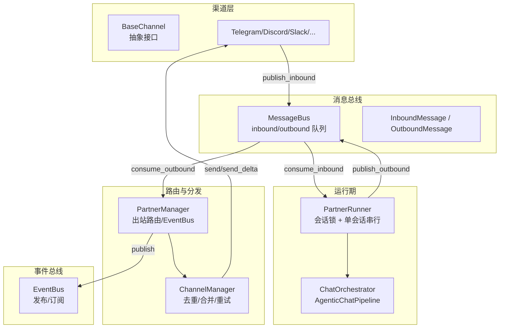
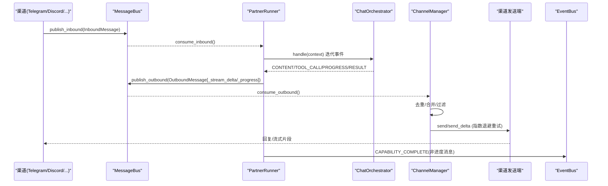
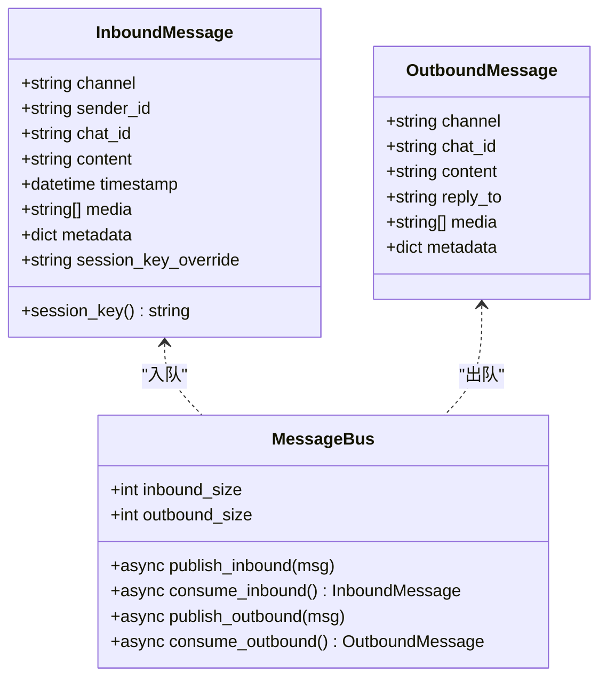
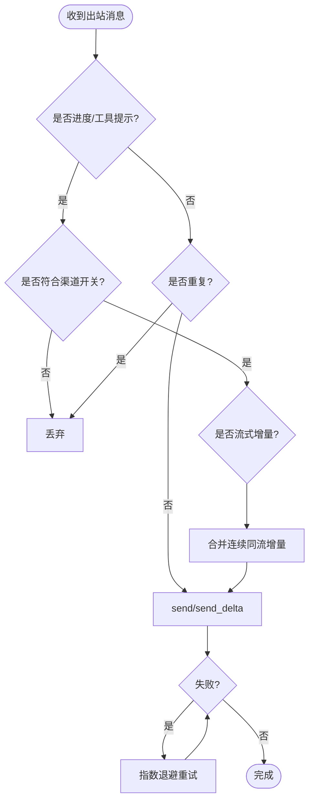
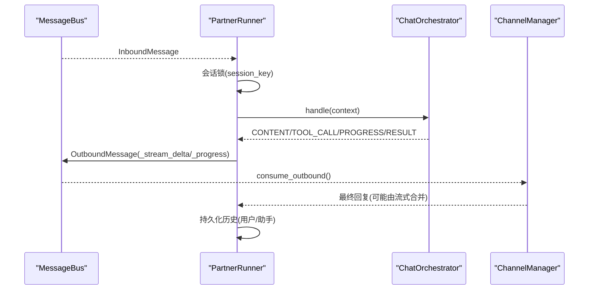
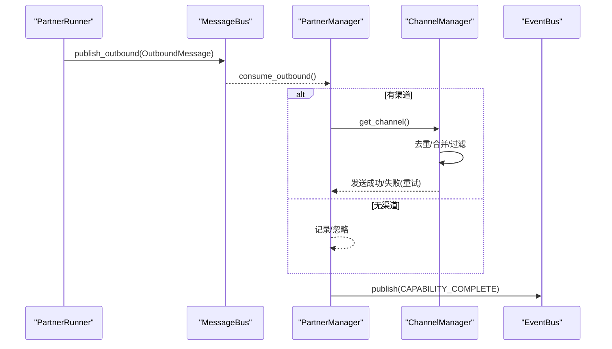
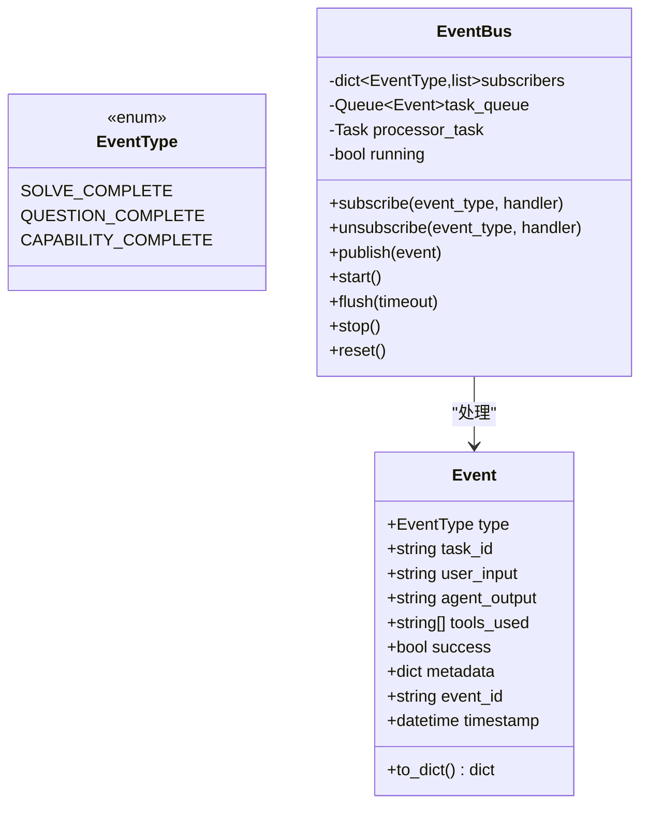
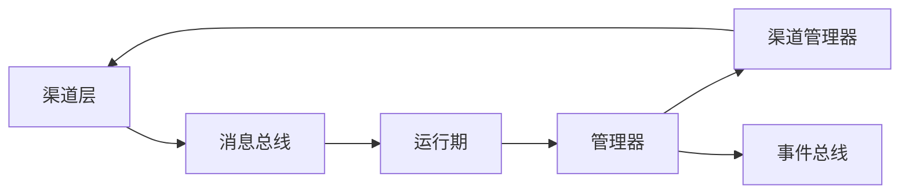

# 消息处理

<cite>
**本文引用的文件**
- [deeptutor/partners/bus/events.py](file://deeptutor/partners/bus/events.py)
- [deeptutor/partners/bus/queue.py](file://deeptutor/partners/bus/queue.py)
- [deeptutor/partners/channels/base.py](file://deeptutor/partners/channels/base.py)
- [deeptutor/partners/channels/manager.py](file://deeptutor/partners/channels/manager.py)
- [deeptutor/services/partners/runtime.py](file://deeptutor/services/partners/runtime.py)
- [deeptutor/services/partners/manager.py](file://deeptutor/services/partners/manager.py)
- [deeptutor/events/event_bus.py](file://deeptutor/events/event_bus.py)
- [deeptutor/logging/config.py](file://deeptutor/logging/config.py)
</cite>

## 目录
1. [简介](#简介)
2. [项目结构](#项目结构)
3. [核心组件](#核心组件)
4. [架构总览](#架构总览)
5. [详细组件分析](#详细组件分析)
6. [依赖关系分析](#依赖关系分析)
7. [性能考虑](#性能考虑)
8. [故障排查指南](#故障排查指南)
9. [结论](#结论)
10. [附录](#附录)

## 简介
本文件面向 DeepTutor 合作伙伴（Partner）消息处理系统，聚焦事件总线与消息队列机制、消息路由与格式转换、内容处理流程、持久化与会话状态、重试与错误恢复、异步并发控制、监控日志与调试工具，以及最佳实践与性能优化建议。该系统通过统一的消息总线将多种即时通讯渠道（如 Telegram、Discord、Slack、WhatsApp 等）与内部聊天智能体循环解耦，实现高内聚、低耦合的扩展性架构。

## 项目结构
- 消息总线与事件：定义入站/出站消息模型与异步队列，提供通道与智能体之间的解耦通信。
- 渠道层：抽象基类与各平台具体实现，负责接入外部 IM、鉴权、流式增量发送与重试。
- 运行期：PartnerRunner 驱动聊天智能体循环，按会话串行化处理消息，并产出最终回复或流式片段。
- 管理器：PartnerManager 管理实例生命周期、配置持久化、出站路由与 EventBus 集成；ChannelManager 协调多通道启动、去重、合并与重试。
- 事件总线：进程内异步事件总线，用于能力完成等跨模块通知。
- 日志：集中式日志配置，支持级别、输出目标与轮转策略。

图表来源
- [deeptutor/partners/channels/base.py:19-185](file://deeptutor/partners/channels/base.py#L19-L185)
- [deeptutor/partners/bus/queue.py:8-45](file://deeptutor/partners/bus/queue.py#L8-L45)
- [deeptutor/partners/bus/events.py:8-37](file://deeptutor/partners/bus/events.py#L8-L37)
- [deeptutor/services/partners/runtime.py:72-180](file://deeptutor/services/partners/runtime.py#L72-L180)
- [deeptutor/services/partners/manager.py:526-571](file://deeptutor/services/partners/manager.py#L526-L571)
- [deeptutor/partners/channels/manager.py:31-341](file://deeptutor/partners/channels/manager.py#L31-L341)
- [deeptutor/events/event_bus.py:61-195](file://deeptutor/events/event_bus.py#L61-L195)

章节来源
- [deeptutor/partners/bus/events.py:8-37](file://deeptutor/partners/bus/events.py#L8-L37)
- [deeptutor/partners/bus/queue.py:8-45](file://deeptutor/partners/bus/queue.py#L8-L45)
- [deeptutor/partners/channels/base.py:19-185](file://deeptutor/partners/channels/base.py#L19-L185)
- [deeptutor/partners/channels/manager.py:31-341](file://deeptutor/partners/channels/manager.py#L31-L341)
- [deeptutor/services/partners/runtime.py:72-180](file://deeptutor/services/partners/runtime.py#L72-L180)
- [deeptutor/services/partners/manager.py:526-571](file://deeptutor/services/partners/manager.py#L526-L571)
- [deeptutor/events/event_bus.py:61-195](file://deeptutor/events/event_bus.py#L61-L195)

## 核心组件
- 消息模型：入站消息包含渠道、发送者、会话标识、文本、媒体与元数据；出站消息包含目标渠道、会话、内容与可选回复引用。
- 异步队列：基于 asyncio.Queue 的 inbound/outbound 双队列，解耦渠道与智能体。
- 渠道抽象：统一 start/stop/send/send_delta 接口，内置权限校验、流式开关与音频转录辅助。
- 渠道管理器：负责通道发现、启用、出站消息的去重、流式增量合并、退避重试与进度/工具提示过滤。
- 运行器：按会话加锁串行执行，组装上下文、调用 ChatOrchestrator，捕获事件流，生成最终回复或流式片段。
- 管理器：创建/启停 Partner 实例，维护会话存储、配置持久化、出站路由与全局事件总线集成。
- 事件总线：进程内异步发布/订阅，用于能力完成等跨模块通知。
- 日志：集中配置日志级别、输出目标与轮转策略。

章节来源
- [deeptutor/partners/bus/events.py:8-37](file://deeptutor/partners/bus/events.py#L8-L37)
- [deeptutor/partners/bus/queue.py:8-45](file://deeptutor/partners/bus/queue.py#L8-L45)
- [deeptutor/partners/channels/base.py:19-185](file://deeptutor/partners/channels/base.py#L19-L185)
- [deeptutor/partners/channels/manager.py:31-341](file://deeptutor/partners/channels/manager.py#L31-L341)
- [deeptutor/services/partners/runtime.py:72-180](file://deeptutor/services/partners/runtime.py#L72-L180)
- [deeptutor/services/partners/manager.py:472-571](file://deeptutor/services/partners/manager.py#L472-L571)
- [deeptutor/events/event_bus.py:61-195](file://deeptutor/events/event_bus.py#L61-L195)
- [deeptutor/logging/config.py:9-50](file://deeptutor/logging/config.py#L9-L50)

## 架构总览
下图展示从渠道到智能体再到渠道的完整消息流转路径，包括流式增量、去重、重试与事件广播。

图表来源
- [deeptutor/partners/channels/base.py:126-175](file://deeptutor/partners/channels/base.py#L126-L175)
- [deeptutor/partners/bus/queue.py:20-34](file://deeptutor/partners/bus/queue.py#L20-L34)
- [deeptutor/services/partners/runtime.py:109-180](file://deeptutor/services/partners/runtime.py#L109-L180)
- [deeptutor/services/partners/runtime.py:182-360](file://deeptutor/services/partners/runtime.py#L182-L360)
- [deeptutor/partners/channels/manager.py:187-327](file://deeptutor/partners/channels/manager.py#L187-L327)
- [deeptutor/services/partners/manager.py:526-571](file://deeptutor/services/partners/manager.py#L526-L571)
- [deeptutor/events/event_bus.py:101-151](file://deeptutor/events/event_bus.py#L101-L151)

## 详细组件分析

### 消息模型与队列
- InboundMessage：承载渠道、发送者、会话键、文本、媒体与元数据；session_key 可由 session_key_override 覆盖以支持线程级会话隔离。
- OutboundMessage：承载目标渠道、chat_id、内容与可选 reply_to/media/metadata。
- MessageBus：提供 inbound/outbound 两个异步队列，支持 publish/consume 与队列大小查询。

图表来源
- [deeptutor/partners/bus/events.py:8-37](file://deeptutor/partners/bus/events.py#L8-L37)
- [deeptutor/partners/bus/queue.py:8-45](file://deeptutor/partners/bus/queue.py#L8-L45)

章节来源
- [deeptutor/partners/bus/events.py:8-37](file://deeptutor/partners/bus/events.py#L8-L37)
- [deeptutor/partners/bus/queue.py:8-45](file://deeptutor/partners/bus/queue.py#L8-L45)

### 渠道抽象与实现
- BaseChannel：定义 start/stop/send/send_delta 接口，内置权限白名单校验、流式能力检测、音频转录辅助与 _handle_message 封装。
- ChannelManager：发现并初始化启用渠道，启动出站分发任务，实现重复抑制、流式增量合并、进度/工具提示过滤与指数退避重试。

图表来源
- [deeptutor/partners/channels/manager.py:160-327](file://deeptutor/partners/channels/manager.py#L160-L327)
- [deeptutor/partners/channels/base.py:116-185](file://deeptutor/partners/channels/base.py#L116-L185)

章节来源
- [deeptutor/partners/channels/base.py:19-185](file://deeptutor/partners/channels/base.py#L19-L185)
- [deeptutor/partners/channels/manager.py:31-341](file://deeptutor/partners/channels/manager.py#L31-L341)

### 运行期与智能体循环
- PartnerRunner：消费 inbound 队列，按 session_key 加锁保证同一会话串行；组装 UnifiedContext，调用 ChatOrchestrator 迭代 StreamEvent，收集最终回复、错误与事件轨迹；根据渠道开关推送进度与工具提示；必要时关闭流式段并标记已流式发送以避免重复。
- 上下文构建：注入伙伴身份、语言、技能清单、知识库列表、附件与来源索引；在伙伴用户上下文中解析资源，确保读写隔离。
- 备用模型：主模型失败时尝试 backup_llm_selection 一次。

图表来源
- [deeptutor/services/partners/runtime.py:93-180](file://deeptutor/services/partners/runtime.py#L93-L180)
- [deeptutor/services/partners/runtime.py:182-360](file://deeptutor/services/partners/runtime.py#L182-L360)
- [deeptutor/partners/channels/manager.py:187-327](file://deeptutor/partners/channels/manager.py#L187-L327)

章节来源
- [deeptutor/services/partners/runtime.py:72-180](file://deeptutor/services/partners/runtime.py#L72-L180)
- [deeptutor/services/partners/runtime.py:182-360](file://deeptutor/services/partners/runtime.py#L182-L360)

### 管理器与出站路由
- PartnerManager：创建/启停 Partner 实例，维护会话存储与配置持久化；启动出站路由器，将非进度消息写入 notify_queue 并发布 CAPABILITY_COMPLETE 事件；支持热重载渠道监听。
- ChannelManager：出站分发任务，负责去重、流式合并、进度/工具提示过滤与重试。

图表来源
- [deeptutor/services/partners/manager.py:526-571](file://deeptutor/services/partners/manager.py#L526-L571)
- [deeptutor/partners/channels/manager.py:187-327](file://deeptutor/partners/channels/manager.py#L187-L327)
- [deeptutor/events/event_bus.py:101-151](file://deeptutor/events/event_bus.py#L101-L151)

章节来源
- [deeptutor/services/partners/manager.py:472-571](file://deeptutor/services/partners/manager.py#L472-L571)
- [deeptutor/partners/channels/manager.py:187-327](file://deeptutor/partners/channels/manager.py#L187-L327)
- [deeptutor/events/event_bus.py:101-151](file://deeptutor/events/event_bus.py#L101-L151)

### 事件总线
- EventType：SOLVE_COMPLETE、QUESTION_COMPLETE、CAPABILITY_COMPLETE。
- Event：携带类型、任务ID、输入输出、工具使用、成功标志、元数据、事件ID与时间戳。
- EventBus：单例异步事件总线，后台任务消费队列，逐个调用处理器，支持 flush/stop/reset。

图表来源
- [deeptutor/events/event_bus.py:22-55](file://deeptutor/events/event_bus.py#L22-L55)
- [deeptutor/events/event_bus.py:61-195](file://deeptutor/events/event_bus.py#L61-L195)

章节来源
- [deeptutor/events/event_bus.py:22-55](file://deeptutor/events/event_bus.py#L22-L55)
- [deeptutor/events/event_bus.py:61-195](file://deeptutor/events/event_bus.py#L61-L195)

### 持久化与会话状态
- 会话存储：PartnerSessionStore 追加用户/助手消息与事件轨迹，支持按会话键读取历史与合并最近消息。
- 配置持久化：PartnerManager 以原子写（临时文件+替换）方式保存 config.yaml，字段白名单可控；支持 auto_start 意图持久化。
- 工作区：ensure_partner_workspace 为每个伙伴准备独立 workspace，Soul 默认模板按需写入。

章节来源
- [deeptutor/services/partners/manager.py:342-456](file://deeptutor/services/partners/manager.py#L342-L456)
- [deeptutor/services/partners/runtime.py:161-180](file://deeptutor/services/partners/runtime.py#L161-L180)

### 重试机制与错误恢复
- 出站重试：ChannelManager._send_with_retry 使用指数退避（1s/2s/4s），可配置最大重试次数；取消异常透传以支持优雅停机。
- 流式合并：对同一 (channel, chat_id, stream_id) 的连续 _stream_delta 进行合并，减少编辑 API 调用。
- 重复抑制：基于内容指纹与 origin/message id 去重，避免重复回复。
- 备用模型：PartnerRunner 在主模型失败时尝试 backup_llm_selection 一次。

章节来源
- [deeptutor/partners/channels/manager.py:22-24](file://deeptutor/partners/channels/manager.py#L22-L24)
- [deeptutor/partners/channels/manager.py:160-327](file://deeptutor/partners/channels/manager.py#L160-L327)
- [deeptutor/services/partners/runtime.py:196-210](file://deeptutor/services/partners/runtime.py#L196-L210)

### 异步消息处理与并发控制
- 会话串行：PartnerRunner 使用 asyncio.Lock 按 session_key 串行化同一会话的处理，避免竞态。
- 任务管理：每个 inbound 消息创建一个任务，任务完成后自动移除；停止时统一取消。
- 出站分发：独立协程持续消费 outbound 队列，超时等待与取消安全。

章节来源
- [deeptutor/services/partners/runtime.py:93-107](file://deeptutor/services/partners/runtime.py#L93-L107)
- [deeptutor/services/partners/runtime.py:130-136](file://deeptutor/services/partners/runtime.py#L130-L136)
- [deeptutor/partners/channels/manager.py:122-135](file://deeptutor/partners/channels/manager.py#L122-L135)

### 监控、日志与调试
- 日志配置：LoggingConfig 支持级别、控制台/文件输出、日志目录与轮转策略；可从运行时设置加载。
- 渠道日志：ChannelManager/BaseChannel 在失败、警告与关键路径处记录结构化日志。
- 事件追踪：PartnerRunner 捕获 turn 的 StreamEvent 轨迹，便于 Web 端重放与“完成”活动折叠还原。
- 调试建议：开启 send_progress 观察中间步骤；检查 allow_from 与渠道开关；关注重试日志与错误堆栈。

章节来源
- [deeptutor/logging/config.py:9-50](file://deeptutor/logging/config.py#L9-L50)
- [deeptutor/partners/channels/manager.py:116-151](file://deeptutor/partners/channels/manager.py#L116-L151)
- [deeptutor/partners/channels/base.py:116-185](file://deeptutor/partners/channels/base.py#L116-L185)
- [deeptutor/services/partners/runtime.py:290-360](file://deeptutor/services/partners/runtime.py#L290-L360)

## 依赖关系分析
- 渠道层依赖消息总线与配置模式，实现统一接口。
- 运行期依赖消息总线、会话存储与工作区，调用 ChatOrchestrator 执行智能体循环。
- 管理器依赖渠道管理器与事件总线，负责生命周期、配置与路由。
- 事件总线被管理器用于能力完成通知。

图表来源
- [deeptutor/partners/channels/base.py:19-185](file://deeptutor/partners/channels/base.py#L19-L185)
- [deeptutor/partners/bus/queue.py:8-45](file://deeptutor/partners/bus/queue.py#L8-L45)
- [deeptutor/services/partners/runtime.py:72-180](file://deeptutor/services/partners/runtime.py#L72-L180)
- [deeptutor/services/partners/manager.py:526-571](file://deeptutor/services/partners/manager.py#L526-L571)
- [deeptutor/partners/channels/manager.py:31-341](file://deeptutor/partners/channels/manager.py#L31-L341)
- [deeptutor/events/event_bus.py:61-195](file://deeptutor/events/event_bus.py#L61-L195)

章节来源
- [deeptutor/partners/channels/base.py:19-185](file://deeptutor/partners/channels/base.py#L19-L185)
- [deeptutor/partners/bus/queue.py:8-45](file://deeptutor/partners/bus/queue.py#L8-L45)
- [deeptutor/services/partners/runtime.py:72-180](file://deeptutor/services/partners/runtime.py#L72-L180)
- [deeptutor/services/partners/manager.py:526-571](file://deeptutor/services/partners/manager.py#L526-L571)
- [deeptutor/partners/channels/manager.py:31-341](file://deeptutor/partners/channels/manager.py#L31-L341)
- [deeptutor/events/event_bus.py:61-195](file://deeptutor/events/event_bus.py#L61-L195)

## 性能考虑
- 流式增量合并：显著降低频繁编辑消息的开销，提升用户体验。
- 会话串行：避免同一会话内的并发冲突，简化状态一致性。
- 去重抑制：基于内容指纹与消息 ID 避免重复发送，减少网络与平台限制压力。
- 指数退避重试：缓解瞬时失败，提高鲁棒性。
- 配置开关：send_progress/send_tool_hints/streaming 可按渠道精细化控制，平衡实时性与负载。
- 日志轮转：合理设置 max_bytes 与 backup_count，避免磁盘占用过高。

[本节为通用指导，不直接分析具体文件]

## 故障排查指南
- 渠道无法启动：检查渠道配置 enabled 与 allow_from；查看 ChannelManager 初始化日志。
- 消息未送达：确认 ChannelManager 出站分发任务运行；检查重试日志与失败原因。
- 重复消息：检查去重逻辑与 origin/message id 是否正确传递；确认流式结束标记是否发送。
- 流式卡顿：确认 send_progress/streaming 配置；检查 _stream_end 是否触发。
- 备用模型未生效：确认 backup_llm_selection 配置；查看主模型失败时的错误信息。
- 日志不足：调整 LoggingConfig.level；确认 file_output/console_output 设置。

章节来源
- [deeptutor/partners/channels/manager.py:57-121](file://deeptutor/partners/channels/manager.py#L57-L121)
- [deeptutor/partners/channels/manager.py:187-327](file://deeptutor/partners/channels/manager.py#L187-L327)
- [deeptutor/services/partners/runtime.py:196-210](file://deeptutor/services/partners/runtime.py#L196-L210)
- [deeptutor/logging/config.py:25-50](file://deeptutor/logging/config.py#L25-L50)

## 结论
DeepTutor 合作伙伴消息处理系统通过清晰的分层与解耦设计，实现了多渠道接入、智能体循环复用、可靠的路由与重试、流式体验与完善的监控日志。借助会话串行、去重合并与备用模型等机制，系统在稳定性与用户体验之间取得良好平衡。建议在生产环境中结合业务需求精细配置渠道开关、重试策略与日志级别，以获得最佳性能与可观测性。

[本节为总结，不直接分析具体文件]

## 附录
- 最佳实践
  - 明确 allow_from 白名单，避免误授权。
  - 针对高吞吐渠道启用流式增量与合并，降低平台 API 压力。
  - 合理设置 send_max_retries 与退避间隔，兼顾时效与稳定性。
  - 使用 backup_llm_selection 提升容错能力。
  - 定期审查日志与事件轨迹，定位瓶颈与异常。
  - 保持配置原子写入与版本一致，避免脏读。

[本节为通用指导，不直接分析具体文件]