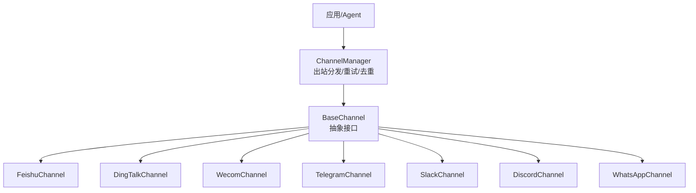
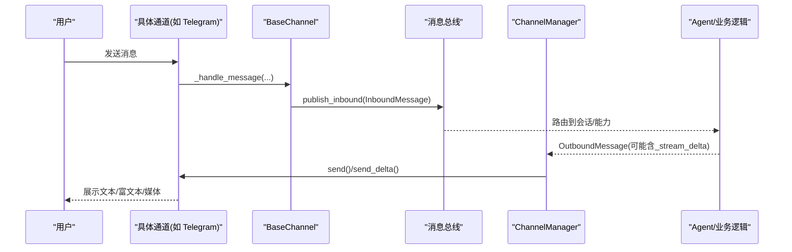
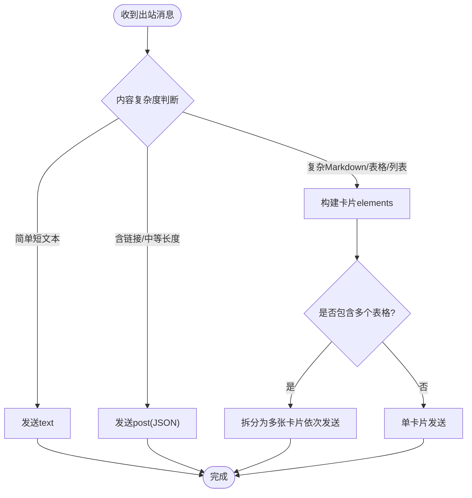
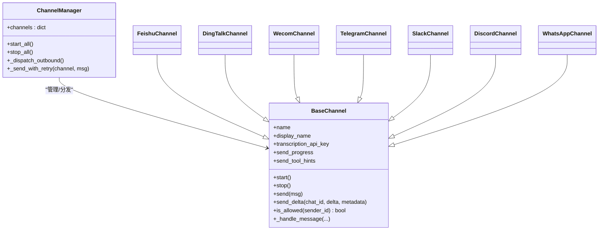

# IM平台集成

<cite>
**本文引用的文件**
- [base.py](file://deeptutor/partners/channels/base.py)
- [manager.py](file://deeptutor/partners/channels/manager.py)
- [registry.py](file://deeptutor/partners/channels/registry.py)
- [schema.py](file://deeptutor/partners/config/schema.py)
- [feishu.py](file://deeptutor/partners/channels/feishu.py)
- [dingtalk.py](file://deeptutor/partners/channels/dingtalk.py)
- [wecom.py](file://deeptutor/partners/channels/wecom.py)
- [telegram.py](file://deeptutor/partners/channels/telegram.py)
- [slack.py](file://deeptutor/partners/channels/slack.py)
- [discord.py](file://deeptutor/partners/channels/discord.py)
- [whatsapp.py](file://deeptutor/partners/channels/whatsapp.py)
</cite>

## 目录
1. [简介](#简介)
2. [项目结构](#项目结构)
3. [核心组件](#核心组件)
4. [架构总览](#架构总览)
5. [详细组件分析](#详细组件分析)
6. [依赖关系分析](#依赖关系分析)
7. [性能考虑](#性能考虑)
8. [故障排除指南](#故障排除指南)
9. [结论](#结论)
10. [附录](#附录)

## 简介
本文件面向DeepTutor的IM平台集成，系统性说明飞书、钉钉、企业微信、Telegram、Slack、Discord、WhatsApp等平台的实现特点、认证方式、API限制与消息格式转换策略，并覆盖富文本、图片、文件、语音等媒体能力、配置参数、连接管理、错误处理、部署要点、性能调优与跨平台差异。

## 项目结构
DeepTutor通过统一的通道抽象层对接各IM平台：
- 基础抽象：BaseChannel定义统一接口（start/stop/send/send_delta/_handle_message）
- 通道管理器：ChannelManager负责发现、启动、停止通道，以及出站消息分发、重试、去重与流式增量合并
- 注册表：自动扫描内置通道模块与外部插件
- 配置模型：Pydantic模型提供通用开关（如send_progress、send_tool_hints、streaming）

图表来源
- [manager.py:31-136](file://deeptutor/partners/channels/manager.py#L31-L136)
- [base.py:19-114](file://deeptutor/partners/channels/base.py#L19-L114)

章节来源
- [base.py:19-185](file://deeptutor/partners/channels/base.py#L19-L185)
- [manager.py:31-185](file://deeptutor/partners/channels/manager.py#L31-L185)
- [registry.py:17-86](file://deeptutor/partners/channels/registry.py#L17-L86)
- [schema.py:9-51](file://deeptutor/partners/config/schema.py#L9-L51)

## 核心组件
- BaseChannel：定义统一生命周期与消息收发契约；支持可选的音频转写与流式发送能力检测；统一权限校验与入站消息发布到总线。
- ChannelManager：集中管理通道实例，负责：
  - 启动/停止所有通道
  - 出站消息分发、重复抑制（基于内容指纹与来源消息ID）
  - 流式增量合并（_stream_delta/_stream_end）
  - 指数退避重试（默认1s/2s/4s）
- 配置模型：DeliveryOverrides控制是否推送进度和工具提示；StreamingSupport为支持原地编辑的平台开启流式更新。

章节来源
- [base.py:19-114](file://deeptutor/partners/channels/base.py#L19-L114)
- [manager.py:187-341](file://deeptutor/partners/channels/manager.py#L187-L341)
- [schema.py:15-37](file://deeptutor/partners/config/schema.py#L15-L37)

## 架构总览

图表来源
- [base.py:126-174](file://deeptutor/partners/channels/base.py#L126-L174)
- [manager.py:187-247](file://deeptutor/partners/channels/manager.py#L187-L247)

## 详细组件分析

### 飞书（Feishu/Lark）
- 认证与连接
  - 使用WebSocket长连接接收事件，无需公网Webhook
  - 需要App ID、App Secret、可选加密Key与验证Token
- API限制与特性
  - 卡片消息对表格数量有限制（单卡片仅允许一个table），多表格需拆分多条卡片
  - 支持图片、文件上传与下载；音频以opus为主
  - 支持“互动卡片”流式更新（CardKit streaming）
- 消息格式转换
  - 智能选择text/post/interactive三种格式
  - Markdown表格解析为table元素；标题分割为div；代码块保护
  - Post格式支持链接；复杂Markdown走卡片渲染
- 配置要点
  - group_policy: open/mention；allow_from白名单；react_emoji
- 错误处理
  - WebSocket断线重连；反应添加失败记录警告；图片/文件上传失败回退

图表来源
- [feishu.py:585-654](file://deeptutor/partners/channels/feishu.py#L585-L654)
- [feishu.py:503-547](file://deeptutor/partners/channels/feishu.py#L503-L547)

章节来源
- [feishu.py:239-393](file://deeptutor/partners/channels/feishu.py#L239-L393)
- [feishu.py:471-547](file://deeptutor/partners/channels/feishu.py#L471-L547)
- [feishu.py:585-700](file://deeptutor/partners/channels/feishu.py#L585-L700)
- [feishu.py:717-800](file://deeptutor/partners/channels/feishu.py#L717-L800)

### 钉钉（DingTalk）
- 认证与连接
  - Stream模式接收消息；HTTP API发送消息
  - 需要client_id/client_secret；自动获取并缓存access token
- API限制与特性
  - 私聊与群聊均支持；群聊chat_id带group:前缀
  - 媒体上传通过oapi接口；支持图片、语音、视频、文件
- 消息格式转换
  - 文本以Markdown模板发送；图片优先URL直发，失败则上传后以media_id发送
  - 附件失败时回退为可见文本提示
- 配置要点
  - allow_from白名单；Stream SDK依赖安装
- 错误处理
  - Token刷新失败、媒体上传失败、发送失败均有日志与回退

章节来源
- [dingtalk.py:107-191](file://deeptutor/partners/channels/dingtalk.py#L107-L191)
- [dingtalk.py:204-345](file://deeptutor/partners/channels/dingtalk.py#L204-L345)
- [dingtalk.py:347-475](file://deeptutor/partners/channels/dingtalk.py#L347-L475)
- [dingtalk.py:477-528](file://deeptutor/partners/channels/dingtalk.py#L477-L528)

### 企业微信（WeCom）
- 认证与连接
  - WebSocket长连接；无需公网IP
  - 需要bot_id与secret；支持欢迎消息
- 特性与限制
  - 支持文本、图片、语音、文件、混合消息
  - 语音消息自带转写内容；图片/文件通过AES key下载保存
- 消息格式转换
  - 混合消息逐项提取文本或占位标记；文件/图片路径写入content便于模型理解
- 配置要点
  - allow_from白名单；welcome_message
- 错误处理
  - 下载失败、帧丢失、无frame无法回复等场景有日志与回退

章节来源
- [wecom.py:21-119](file://deeptutor/partners/channels/wecom.py#L21-L119)
- [wecom.py:138-188](file://deeptutor/partners/channels/wecom.py#L138-L188)
- [wecom.py:189-346](file://deeptutor/partners/channels/wecom.py#L189-L346)
- [wecom.py:348-382](file://deeptutor/partners/channels/wecom.py#L348-L382)

### Telegram
- 认证与连接
  - Long polling；可配置代理与连接池大小
  - 支持命令菜单（/start、/help等）
- API限制与特性
  - 最大消息长度4000字符；HTML渲染上限4096
  - 支持图片、语音、音频、文档、视频、动画等
  - 支持流式编辑（edit_message_text）与草稿预览（send_message_draft）
- 消息格式转换
  - Markdown→HTML转换，保留代码块、表格、链接、粗斜体、删除线、列表
  - 超长内容分片发送；流式溢出时拆分新消息继续追加
- 配置要点
  - reply_to_message、group_policy、connection_pool_size、pool_timeout、stream_edit_interval
- 错误处理
  - 超时与限流（RetryAfter）重试；HTML解析失败回退纯文本

章节来源
- [telegram.py:196-352](file://deeptutor/partners/channels/telegram.py#L196-L352)
- [telegram.py:386-514](file://deeptutor/partners/channels/telegram.py#L386-L514)
- [telegram.py:516-706](file://deeptutor/partners/channels/telegram.py#L516-L706)
- [telegram.py:708-800](file://deeptutor/partners/channels/telegram.py#L708-L800)

### Slack
- 认证与连接
  - Socket Mode（WebSocket）；需bot_token与app_token
  - 握手超时保护（30秒）
- API限制与特性
  - DM与群组策略可配置；支持线程回复
  - 文件上传使用files_upload_v2；文本使用mrkdwn
- 消息格式转换
  - Markdown→mrkdwn，表格转换为可读列表；修复遗留格式化问题
- 配置要点
  - mode=socket；webhook_path；reply_in_thread；group_policy；dm策略
- 错误处理
  - WSS握手失败明确报错；reaction添加失败忽略

章节来源
- [slack.py:26-117](file://deeptutor/partners/channels/slack.py#L26-L117)
- [slack.py:129-162](file://deeptutor/partners/channels/slack.py#L129-L162)
- [slack.py:163-253](file://deeptutor/partners/channels/slack.py#L163-L253)
- [slack.py:255-322](file://deeptutor/partners/channels/slack.py#L255-L322)

### Discord
- 认证与连接
  - 直接连接Gateway（WebSocket）；心跳保活；识别（IDENTIFY）流程
- API限制与特性
  - 最大消息长度2000字符；附件最大20MB
  - 支持流式编辑（edit message）；速率限制（429）自动重试
- 消息格式转换
  - 文本按2000字符分片；流式溢出时冻结首段、中间段另发消息、尾部继续流式
- 配置要点
  - gateway_url、intents、group_policy
- 错误处理
  - 429限流等待retry_after；心跳失败断开重连；附件过大跳过

章节来源
- [discord.py:38-110](file://deeptutor/partners/channels/discord.py#L38-L110)
- [discord.py:111-173](file://deeptutor/partners/channels/discord.py#L111-L173)
- [discord.py:175-246](file://deeptutor/partners/channels/discord.py#L175-L246)
- [discord.py:248-314](file://deeptutor/partners/channels/discord.py#L248-L314)
- [discord.py:316-457](file://deeptutor/partners/channels/discord.py#L316-L457)
- [discord.py:459-506](file://deeptutor/partners/channels/discord.py#L459-L506)

### WhatsApp
- 认证与连接
  - 通过Node.js桥接（Baileys）通信；Python端通过WebSocket与桥接交互
  - 支持可选bridge_token鉴权
- 特性与限制
  - 当前主要支持文本发送；语音消息暂不支持直接下载转录
  - 媒体由桥接下载并以路径形式返回
- 消息格式转换
  - 将媒体路径以[image/file]标签附加到内容中，便于上层模型理解
- 配置要点
  - bridge_url、bridge_token、allow_from
- 错误处理
  - 桥接断线重连；无效JSON丢弃；状态变更维护connected标志

章节来源
- [whatsapp.py:18-98](file://deeptutor/partners/channels/whatsapp.py#L18-L98)
- [whatsapp.py:99-190](file://deeptutor/partners/channels/whatsapp.py#L99-L190)

## 依赖关系分析

图表来源
- [base.py:19-114](file://deeptutor/partners/channels/base.py#L19-L114)
- [manager.py:31-136](file://deeptutor/partners/channels/manager.py#L31-L136)

章节来源
- [registry.py:17-86](file://deeptutor/partners/channels/registry.py#L17-L86)
- [manager.py:57-115](file://deeptutor/partners/channels/manager.py#L57-L115)

## 性能考虑
- 连接与并发
  - Telegram：分离API请求与getUpdates的连接池，避免长轮询占用导致发送阻塞
  - Slack：Socket Mode握手超时保护，防止网络不可达长时间挂起
  - Discord：Gateway心跳与重连；429限流等待retry_after
  - 飞书：独立线程运行WS客户端，避免主事件循环冲突
- 流式优化
  - ChannelManager对_stream_delta进行合并，减少频繁edit调用
  - 各平台设置最小编辑间隔（如Telegram、Discord、飞书）降低API压力
- 媒体传输
  - 优先URL直发（如钉钉图片），失败再上传；大附件限制（Discord 20MB）
  - 媒体下载与解密（企业微信AES）落盘后再转发，避免内存峰值

章节来源
- [telegram.py:271-304](file://deeptutor/partners/channels/telegram.py#L271-L304)
- [slack.py:70-117](file://deeptutor/partners/channels/slack.py#L70-L117)
- [discord.py:158-173](file://deeptutor/partners/channels/discord.py#L158-L173)
- [feishu.py:351-388](file://deeptutor/partners/channels/feishu.py#L351-L388)
- [manager.py:213-247](file://deeptutor/partners/channels/manager.py#L213-L247)

## 故障排除指南
- 通道未启用或配置缺失
  - 检查enabled与必要凭据（如飞书app_id/app_secret、钉钉client_id/client_secret、企业微信bot_id/secret、Telegram token、Slack bot/app token、Discord token、WhatsApp bridge_url）
- 访问控制拒绝
  - allow_from为空会拒绝所有；设置为["*"]或添加具体ID
- 流式不生效
  - 确认配置streaming=true且通道实现了send_delta；同时send_progress建议开启
- 发送失败与重试
  - ChannelManager指数退避重试；关注日志中的失败原因（网络、限流、格式错误）
- 媒体相关
  - 钉钉：URL直发失败回退上传；上传失败显示可见提示
  - 企业微信：图片/文件需AES key下载；失败记录并降级
  - Discord：超过20MB附件被跳过
  - WhatsApp：语音转录暂不可用，仅文本与已下载媒体路径

章节来源
- [manager.py:108-115](file://deeptutor/partners/channels/manager.py#L108-L115)
- [manager.py:296-327](file://deeptutor/partners/channels/manager.py#L296-L327)
- [dingtalk.py:416-475](file://deeptutor/partners/channels/dingtalk.py#L416-L475)
- [wecom.py:314-346](file://deeptutor/partners/channels/wecom.py#L314-L346)
- [discord.py:270-314](file://deeptutor/partners/channels/discord.py#L270-L314)
- [whatsapp.py:143-172](file://deeptutor/partners/channels/whatsapp.py#L143-L172)

## 结论
DeepTutor通过统一的通道抽象与集中式管理器，将多IM平台的能力收敛为一致的接入体验。各平台在认证、连接、媒体与富文本方面各有侧重：飞书强调卡片与流式更新；钉钉注重Stream模式与媒体回退；企业微信提供WebSocket长连接与语音转写；Telegram具备完善的HTML渲染与流式编辑；Slack采用Socket Mode与mrkdwn；Discord原生Gateway与严格的字符/附件限制；WhatsApp通过桥接解耦协议细节。结合合理的配置与错误处理策略，可在不同平台上获得稳定、高性能的IM集成体验。

## 附录

### 平台对比与兼容性要点
- 富文本
  - 飞书：卡片（interactive）最完整；Post适合链接；短文本用text
  - Telegram：HTML渲染，支持代码块、表格、链接、粗斜体、删除线、列表
  - Slack：mrkdwn，表格需转换；代码块与链接良好支持
  - Discord：纯文本分片；富文本能力有限
  - 钉钉：Markdown模板；图片/文件通过media_id
  - 企业微信：文本为主，混合消息可携带多种类型
  - WhatsApp：文本为主，媒体以路径标注
- 媒体支持
  - 图片/文件：全平台基本支持；注意大小限制与格式映射
  - 语音：Telegram与企业微信较好；钉钉支持amr/mp3等；Discord以voice/audio区分
  - 视频：Telegram/Discord/钉钉支持；飞书/Slack以文件形式
- 流式能力
  - 飞书（CardKit）、Telegram（edit_message_text）、Discord（edit message）原生支持
  - Slack/钉钉/企业微信/WhatsApp：当前以最终消息或桥接能力为准
- 群组策略
  - 多数平台支持open/mention/allowlist策略，确保仅在提及或白名单时响应

章节来源
- [feishu.py:585-654](file://deeptutor/partners/channels/feishu.py#L585-L654)
- [telegram.py:110-193](file://deeptutor/partners/channels/telegram.py#L110-L193)
- [slack.py:291-322](file://deeptutor/partners/channels/slack.py#L291-L322)
- [discord.py:111-173](file://deeptutor/partners/channels/discord.py#L111-L173)
- [dingtalk.py:408-475](file://deeptutor/partners/channels/dingtalk.py#L408-L475)
- [wecom.py:189-346](file://deeptutor/partners/channels/wecom.py#L189-L346)
- [whatsapp.py:112-190](file://deeptutor/partners/channels/whatsapp.py#L112-L190)