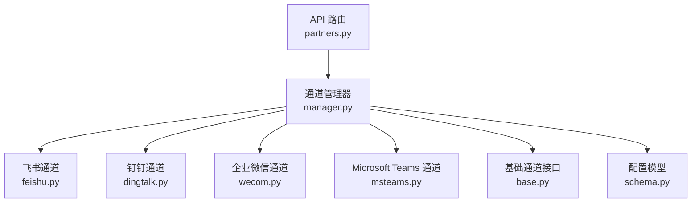
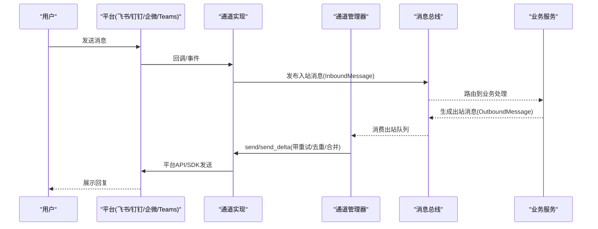
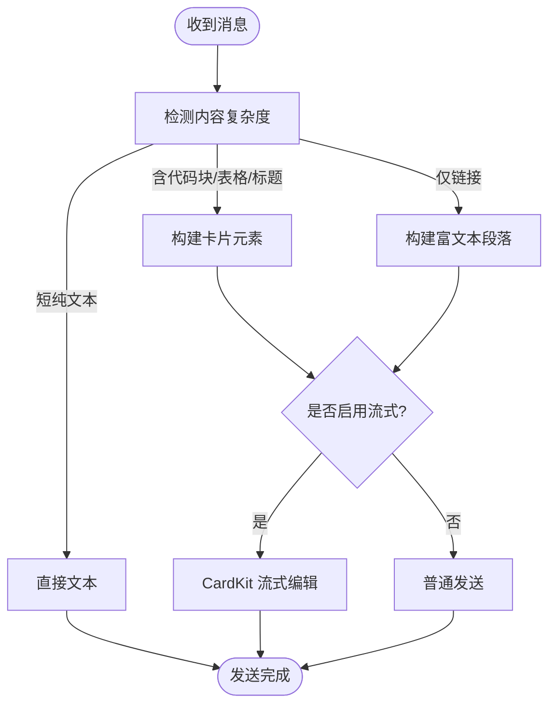
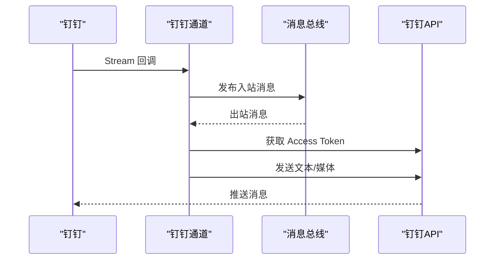
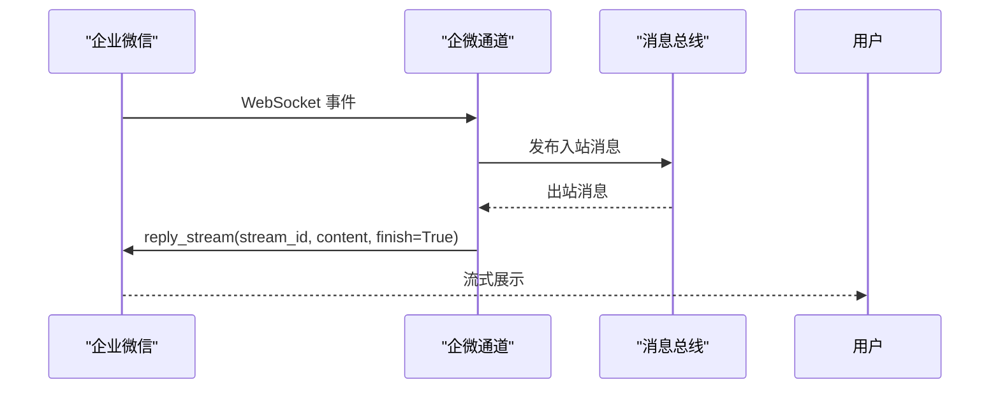
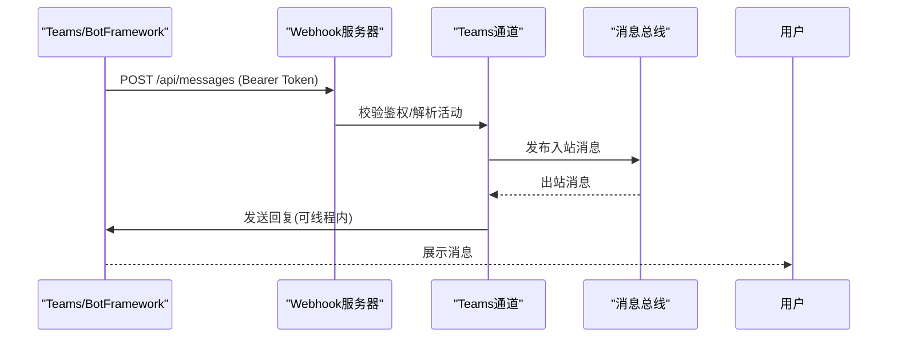
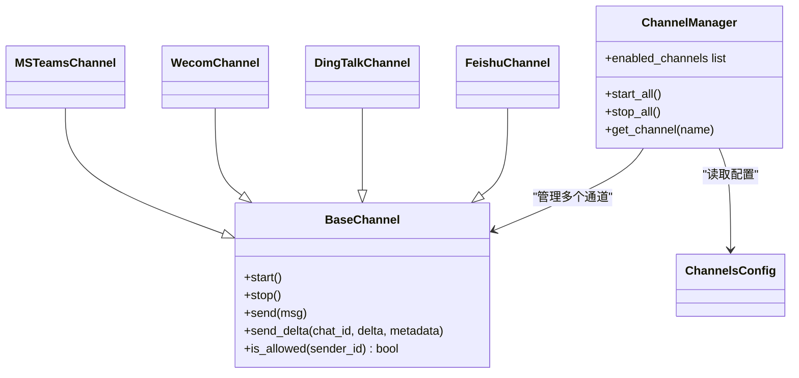

# 企业级IM平台

<cite>
**本文引用的文件**
- [README.md](file://README.md)
- [base.py](file://deeptutor/partners/channels/base.py)
- [manager.py](file://deeptutor/partners/channels/manager.py)
- [schema.py](file://deeptutor/partners/config/schema.py)
- [feishu.py](file://deeptutor/partners/channels/feishu.py)
- [dingtalk.py](file://deeptutor/partners/channels/dingtalk.py)
- [wecom.py](file://deeptutor/partners/channels/wecom.py)
- [msteams.py](file://deeptutor/partners/channels/msteams.py)
- [partners.py](file://deeptutor/api/routers/partners.py)
</cite>

## 目录
1. [简介](#简介)
2. [项目结构](#项目结构)
3. [核心组件](#核心组件)
4. [架构总览](#架构总览)
5. [详细组件分析](#详细组件分析)
6. [依赖关系分析](#依赖关系分析)
7. [性能与连接池](#性能与连接池)
8. [故障排查指南](#故障排查指南)
9. [结论](#结论)
10. [附录：配置与安全](#附录：配置与安全)

## 简介
本文件面向企业环境，系统性说明 DeepTutor 在企业级 IM 平台的集成能力，覆盖飞书、钉钉、企业微信和 Microsoft Teams。重点包括：
- OAuth/认证流程与鉴权策略（各平台差异）
- API 调用限制与消息格式转换机制
- 企业特性：组织架构同步、权限控制、审计日志、安全策略
- 配置参数详解、连接池管理、错误重试机制与性能优化建议
- 部署指南、常见问题排查与最佳实践
- 企业网络配置、防火墙设置与安全考虑

DeepTutor 通过统一的 Channel 抽象接入多种 IM 平台，使用消息总线进行入站/出站路由，并提供可插拔的渠道管理与重试、流式聚合等能力。

**章节来源**
- [README.md:490-510](file://README.md#L490-L510)

## 项目结构
DeepTutor 的企业 IM 集成位于 partners 模块下，采用“通道 + 管理器 + 消息总线”的分层设计：
- 通道实现：每个 IM 平台一个 Channel 子类，负责协议适配、鉴权、收发消息、媒体处理
- 通道管理器：统一启停、出站分发、去重、流式合并、重试
- 配置模型：Pydantic 模型定义渠道配置与投递开关
- API 路由：Partners 管理接口，提供渠道配置校验、启动/停止、资源编排

**图表来源**
- [partners.py:419-424](file://deeptutor/api/routers/partners.py#L419-L424)
- [manager.py:31-88](file://deeptutor/partners/channels/manager.py#L31-L88)
- [base.py:19-88](file://deeptutor/partners/channels/base.py#L19-L88)
- [schema.py:15-51](file://deeptutor/partners/config/schema.py#L15-L51)

**章节来源**
- [partners.py:419-424](file://deeptutor/api/routers/partners.py#L419-L424)
- [manager.py:31-88](file://deeptutor/partners/channels/manager.py#L31-L88)
- [base.py:19-88](file://deeptutor/partners/channels/base.py#L19-L88)
- [schema.py:15-51](file://deeptutor/partners/config/schema.py#L15-L51)

## 核心组件
- 基础通道接口 BaseChannel：定义 start/stop/send、消息入站封装、允许名单校验、流式支持判断
- 通道管理器 ChannelManager：发现并初始化通道、启动/停止、出站分发、重复抑制、流式合并、指数退避重试
- 配置模型 ChannelsConfig/DeliveryOverrides/StreamingSupport：统一描述渠道开关、投递行为、流式能力
- 平台通道实现：
  - 飞书：WebSocket 长连接、卡片流式编辑、Markdown/表格/富文本渲染
  - 钉钉：Stream Mode 接收、HTTP 发送、媒体上传与回退
  - 企业微信：WebSocket 长连接、欢迎消息、流式回复
  - Microsoft Teams：内置 HTTP Webhook、Bot Framework 鉴权、会话引用持久化

**章节来源**
- [base.py:19-185](file://deeptutor/partners/channels/base.py#L19-L185)
- [manager.py:31-341](file://deeptutor/partners/channels/manager.py#L31-L341)
- [schema.py:15-51](file://deeptutor/partners/config/schema.py#L15-L51)
- [feishu.py:239-393](file://deeptutor/partners/channels/feishu.py#L239-L393)
- [dingtalk.py:107-203](file://deeptutor/partners/channels/dingtalk.py#L107-L203)
- [wecom.py:21-119](file://deeptutor/partners/channels/wecom.py#L21-L119)
- [msteams.py:72-145](file://deeptutor/partners/channels/msteams.py#L72-L145)

## 架构总览
DeepTutor 的 IM 架构以“通道”为边界，将不同平台的协议细节隔离在各自实现中；管理器负责跨通道的通用逻辑（重试、去重、流式合并），API 路由提供配置与生命周期管理能力。

**图表来源**
- [base.py:126-174](file://deeptutor/partners/channels/base.py#L126-L174)
- [manager.py:187-247](file://deeptutor/partners/channels/manager.py#L187-L247)

**章节来源**
- [base.py:126-174](file://deeptutor/partners/channels/base.py#L126-L174)
- [manager.py:187-247](file://deeptutor/partners/channels/manager.py#L187-L247)

## 详细组件分析

### 飞书（Feishu/Lark）通道
- 连接方式：WebSocket 长连接，无需公网 IP
- 鉴权：应用 ID/Secret、可选加密 Key/验证 Token
- 消息格式：自动检测 Markdown/表格/列表/链接，选择 text/post/interactive 卡片；复杂内容走 CardKit 流式编辑
- 媒体：图片/文件上传、下载与类型映射
- 群策略：open/mention 两种模式
- 流式：支持按 stream_id 分段的增量更新

**图表来源**
- [feishu.py:585-654](file://deeptutor/partners/channels/feishu.py#L585-L654)
- [feishu.py:503-547](file://deeptutor/partners/channels/feishu.py#L503-L547)

**章节来源**
- [feishu.py:239-393](file://deeptutor/partners/channels/feishu.py#L239-L393)
- [feishu.py:503-654](file://deeptutor/partners/channels/feishu.py#L503-L654)

### 钉钉（DingTalk）通道
- 连接方式：Stream Mode 接收消息，HTTP 发送
- 鉴权：Access Token 获取与过期刷新
- 消息格式：Markdown 文本；图片/音视频/文件通过 mediaId 或 URL 发送
- 媒体：支持本地/HTTP 读取、类型推断、上传失败回退提示
- 群聊：conversationId 前缀区分，统一路由

**图表来源**
- [dingtalk.py:41-104](file://deeptutor/partners/channels/dingtalk.py#L41-L104)
- [dingtalk.py:204-229](file://deeptutor/partners/channels/dingtalk.py#L204-L229)
- [dingtalk.py:347-414](file://deeptutor/partners/channels/dingtalk.py#L347-L414)

**章节来源**
- [dingtalk.py:107-203](file://deeptutor/partners/channels/dingtalk.py#L107-L203)
- [dingtalk.py:204-475](file://deeptutor/partners/channels/dingtalk.py#L204-L475)

### 企业微信（WeCom）通道
- 连接方式：WebSocket 长连接，无需公网 IP
- 鉴权：Bot ID/Secret
- 消息格式：文本/图片/语音/文件/混合内容；进入聊天可发送欢迎消息
- 流式：reply_stream 支持 finish=True 的流式回复
- 媒体：下载并解密保存至媒体目录

**图表来源**
- [wecom.py:68-119](file://deeptutor/partners/channels/wecom.py#L68-L119)
- [wecom.py:348-382](file://deeptutor/partners/channels/wecom.py#L348-L382)

**章节来源**
- [wecom.py:21-119](file://deeptutor/partners/channels/wecom.py#L21-L119)
- [wecom.py:189-382](file://deeptutor/partners/channels/wecom.py#L189-L382)

### Microsoft Teams 通道
- 连接方式：内置 HTTP Webhook 监听 /api/messages
- 鉴权：可选 Bot Framework bearer token 校验（默认开启）
- 会话引用：持久化 service_url/conversation_id/activity_id，支持线程内回复
- 文本清洗：去除提及标记、HTML 实体、回复包装
- 安全：可信服务域名白名单、Web Chat 过滤、非个人会话忽略

**图表来源**
- [msteams.py:146-231](file://deeptutor/partners/channels/msteams.py#L146-L231)
- [msteams.py:250-290](file://deeptutor/partners/channels/msteams.py#L250-L290)
- [msteams.py:292-368](file://deeptutor/partners/channels/msteams.py#L292-L368)

**章节来源**
- [msteams.py:72-145](file://deeptutor/partners/channels/msteams.py#L72-L145)
- [msteams.py:146-368](file://deeptutor/partners/channels/msteams.py#L146-L368)

## 依赖关系分析
- 通道管理器依赖各通道实现，并通过消息总线解耦入站/出站
- 配置模型集中描述渠道开关与投递行为，API 路由对渠道配置进行校验
- 各通道独立维护自身连接与鉴权状态，避免耦合

**图表来源**
- [base.py:19-185](file://deeptutor/partners/channels/base.py#L19-L185)
- [manager.py:31-88](file://deeptutor/partners/channels/manager.py#L31-L88)
- [schema.py:40-51](file://deeptutor/partners/config/schema.py#L40-L51)

**章节来源**
- [base.py:19-185](file://deeptutor/partners/channels/base.py#L19-L185)
- [manager.py:31-88](file://deeptutor/partners/channels/manager.py#L31-L88)
- [schema.py:40-51](file://deeptutor/partners/config/schema.py#L40-L51)

## 性能与连接池
- 出站分发与重试：管理器使用指数退避（1s/2s/4s…）重试，避免瞬时抖动
- 流式合并：对同一通道/会话的连续 _stream_delta 进行合并，减少频繁编辑调用
- 重复抑制：基于 origin_message_id/message_id 与内容指纹，防止重复回复
- 连接管理：
  - 飞书：WebSocket 长连接，独立线程事件循环，断线重连
  - 钉钉：Stream Mode 客户端，HTTP 发送复用 httpx 异步客户端
  - 企业微信：WSClient 无限重连、心跳保活
  - Teams：内置 ThreadingHTTPServer，HTTP 请求复用 httpx 异步客户端
- 建议：
  - 合理设置 send_max_retries 与 send_progress/send_tool_hints 开关，降低无效流量
  - 针对高吞吐场景，结合 CDN/缓存减少媒体上传次数
  - 对 Teams 的 conversation refs 设置合适的 TTL 与清理策略

**章节来源**
- [manager.py:22-24](file://deeptutor/partners/channels/manager.py#L22-L24)
- [manager.py:187-294](file://deeptutor/partners/channels/manager.py#L187-L294)
- [feishu.py:311-393](file://deeptutor/partners/channels/feishu.py#L311-L393)
- [dingtalk.py:152-203](file://deeptutor/partners/channels/dingtalk.py#L152-L203)
- [wecom.py:68-119](file://deeptutor/partners/channels/wecom.py#L68-L119)
- [msteams.py:146-231](file://deeptutor/partners/channels/msteams.py#L146-L231)

## 故障排查指南
- 通道未启用：检查 channels 配置 enabled 字段与 allow_from 是否为空（空列表会拒绝所有访问）
- 鉴权失败：
  - 飞书：确认 app_id/app_secret/encrypt_key/verification_token
  - 钉钉：确认 client_id/client_secret，Access Token 获取失败需检查网络与凭据
  - 企业微信：确认 bot_id/secret，WS 连接/认证事件日志
  - Teams：确认 app_id/app_password，校验 inbound auth 与 trusted service url 白名单
- 媒体发送失败：
  - 钉钉：URL 发送失败时回退到 mediaId 上传；若仍失败，记录文件名与类型
  - 企业微信：下载/解密失败时记录错误路径
- 流式异常：
  - 飞书：CardKit 流式编辑间隔节流，确保 _stream_id 正确
  - 企业微信：reply_stream finish=True 确保结束
- 重复消息：
  - 检查 origin_message_id/message_id 是否正确传递，避免误抑制
- 日志定位：
  - 通道启动/停止、重连、发送失败、鉴权失败均有明确日志

**章节来源**
- [manager.py:108-121](file://deeptutor/partners/channels/manager.py#L108-L121)
- [manager.py:296-327](file://deeptutor/partners/channels/manager.py#L296-L327)
- [dingtalk.py:204-229](file://deeptutor/partners/channels/dingtalk.py#L204-L229)
- [dingtalk.py:416-475](file://deeptutor/partners/channels/dingtalk.py#L416-L475)
- [wecom.py:189-313](file://deeptutor/partners/channels/wecom.py#L189-L313)
- [msteams.py:146-231](file://deeptutor/partners/channels/msteams.py#L146-L231)

## 结论
DeepTutor 通过统一的通道抽象与强大的管理器，实现了多平台 IM 的高可用集成。各平台在鉴权、连接、消息格式上各有特点，但均遵循一致的入站/出站契约。配合配置校验、重试与流式合并，可在企业环境中稳定运行。建议在生产部署中严格配置 allow_from、启用 inbound auth（Teams）、合理设置重试与 TTL，并结合日志与监控持续优化。

## 附录：配置与安全
- 渠道配置要点：
  - 飞书：app_id/app_secret/encrypt_key/verification_token/group_policy/react_emoji/streaming
  - 钉钉：client_id/client_secret/send_progress/send_tool_hints
  - 企业微信：bot_id/secret/welcome_message/streaming
  - Teams：app_id/app_password/host/port/path/validate_inbound_auth/trusted_service_url_hosts/ref_ttl_days
- 投递开关：
  - send_progress：是否向通道推送进度
  - send_tool_hints：是否推送工具调用提示
  - streaming：是否启用就地编辑流式
- 安全策略：
  - allow_from 必须显式配置，空列表将拒绝所有访问
  - Teams 默认开启 inbound auth，生产环境务必保持启用
  - 媒体文件落盘路径受限于媒体目录，避免越权访问
- 网络与防火墙：
  - 飞书/企微：仅需出站 WebSocket，无需公网入站
  - 钉钉：Stream 出站，HTTP 出站；注意代理与证书
  - Teams：需开放指定端口与路径供 Bot Framework 回调；反向代理需透传 Authorization 头
- 组织同步与权限：
  - 当前通道层不直接实现组织架构同步；可通过外部系统同步用户到 allow_from 或使用多租户/授权体系扩展
  - 审计日志：建议在业务层记录入站/出站关键事件，结合平台侧审计能力形成闭环

**章节来源**
- [schema.py:15-51](file://deeptutor/partners/config/schema.py#L15-L51)
- [base.py:116-124](file://deeptutor/partners/channels/base.py#L116-L124)
- [msteams.py:72-93](file://deeptutor/partners/channels/msteams.py#L72-L93)
- [partners.py:203-230](file://deeptutor/api/routers/partners.py#L203-L230)