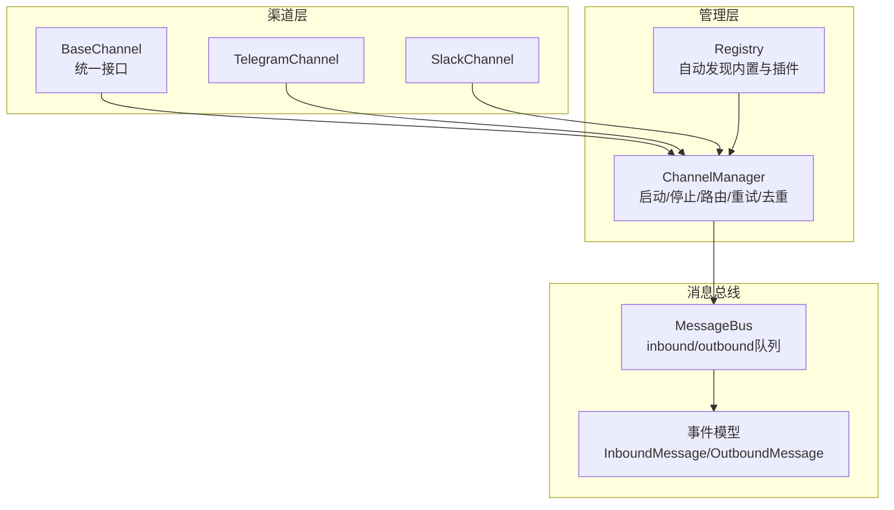
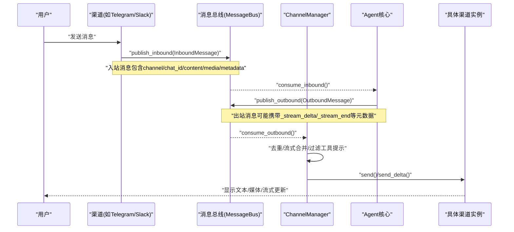
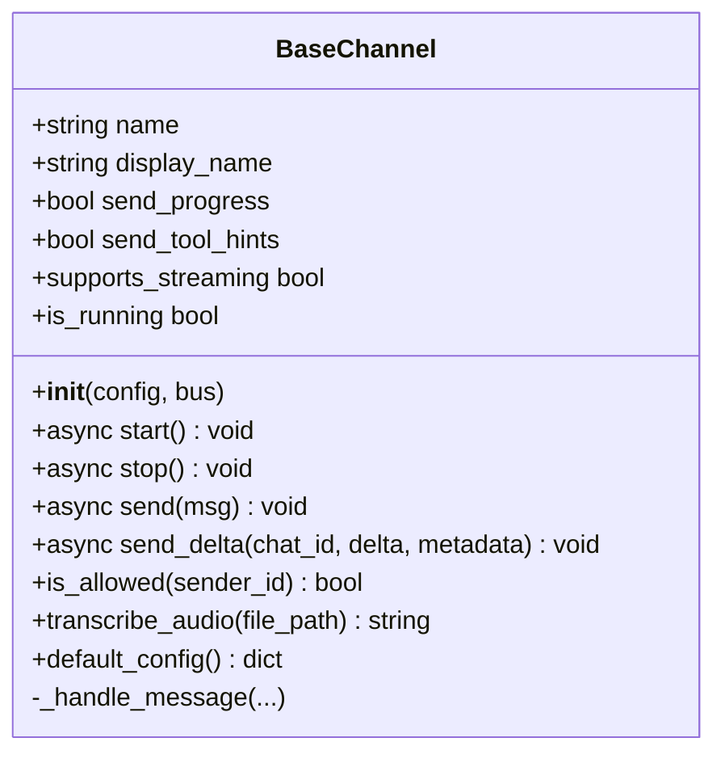
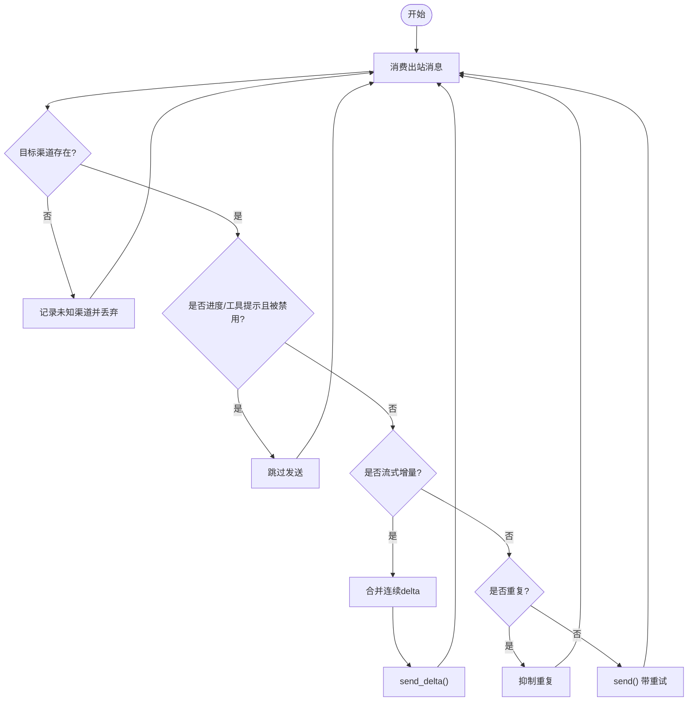
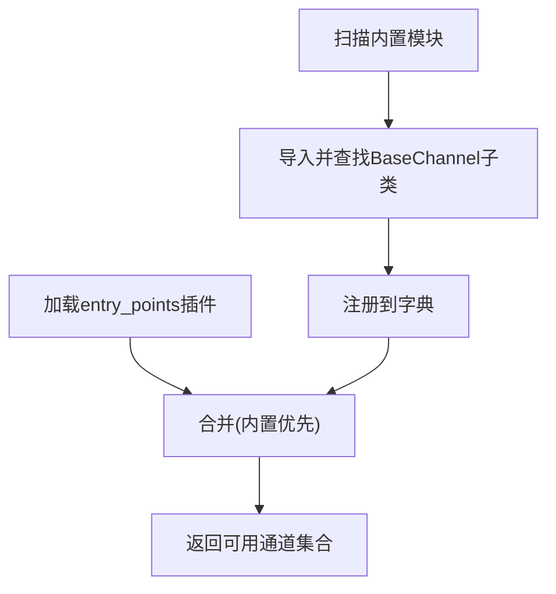
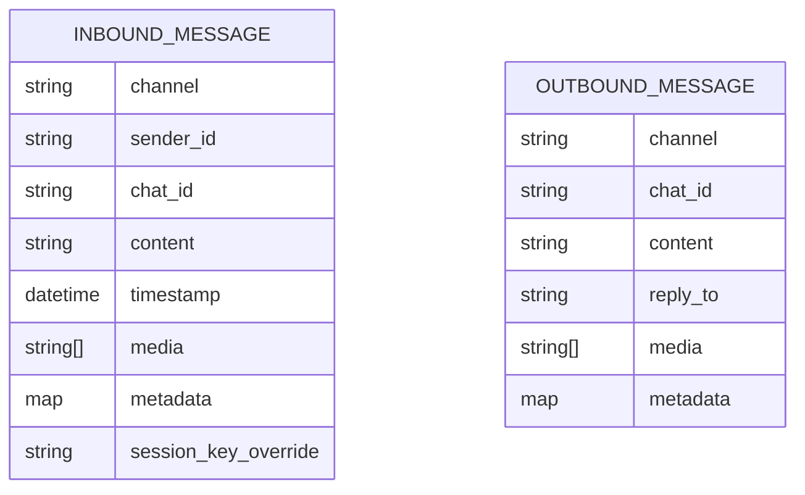
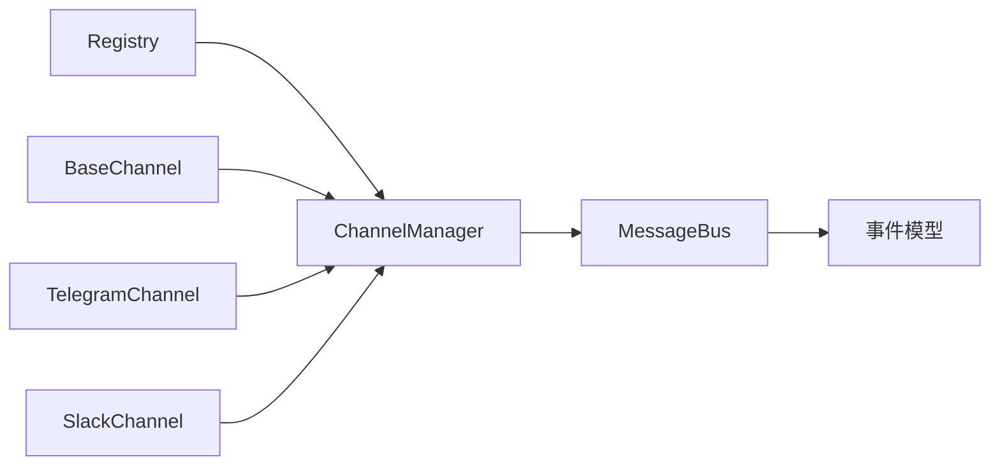

# 消息协议与标准

<cite>
**本文引用的文件**
- [base.py](file://deeptutor/partners/channels/base.py)
- [manager.py](file://deeptutor/partners/channels/manager.py)
- [registry.py](file://deeptutor/partners/channels/registry.py)
- [events.py](file://deeptutor/partners/bus/events.py)
- [queue.py](file://deeptutor/partners/bus/queue.py)
- [telegram.py](file://deeptutor/partners/channels/telegram.py)
- [slack.py](file://deeptutor/partners/channels/slack.py)
</cite>

## 目录
1. [简介](#简介)
2. [项目结构](#项目结构)
3. [核心组件](#核心组件)
4. [架构总览](#架构总览)
5. [详细组件分析](#详细组件分析)
6. [依赖关系分析](#依赖关系分析)
7. [性能考虑](#性能考虑)
8. [故障排查指南](#故障排查指南)
9. [结论](#结论)
10. [附录](#附录)

## 简介
本文件面向DeepTutor的“消息协议与标准”，聚焦统一的渠道接口抽象层、消息格式标准化处理、渠道注册与生命周期管理、协议转换器与数据映射规则、版本兼容性、自定义渠道开发指南、错误处理策略、日志与监控指标，以及性能优化建议与最佳实践。目标是帮助开发者快速理解并扩展多渠道消息能力（如Telegram、Slack等），同时保证系统在高并发、流式输出场景下的稳定性与可观测性。

## 项目结构
围绕消息通道，仓库中关键目录与职责如下：
- deeptutor/partners/channels：统一渠道抽象与具体实现
  - base.py：BaseChannel基类，定义统一接口与通用逻辑
  - manager.py：ChannelManager，负责通道发现、启动、出站路由、重试与去重
  - registry.py：自动发现内置通道与外部插件
  - 各平台实现：如 telegram.py、slack.py 等
- deeptutor/partners/bus：解耦的消息总线
  - events.py：入站/出站消息的数据模型
  - queue.py：异步队列实现

图表来源
- [base.py:19-185](file://deeptutor/partners/channels/base.py#L19-L185)
- [manager.py:31-341](file://deeptutor/partners/channels/manager.py#L31-L341)
- [registry.py:17-86](file://deeptutor/partners/channels/registry.py#L17-L86)
- [events.py:8-37](file://deeptutor/partners/bus/events.py#L8-L37)
- [queue.py:8-45](file://deeptutor/partners/bus/queue.py#L8-L45)

章节来源
- [base.py:19-185](file://deeptutor/partners/channels/base.py#L19-L185)
- [manager.py:31-341](file://deeptutor/partners/channels/manager.py#L31-L341)
- [registry.py:17-86](file://deeptutor/partners/channels/registry.py#L17-L86)
- [events.py:8-37](file://deeptutor/partners/bus/events.py#L8-L37)
- [queue.py:8-45](file://deeptutor/partners/bus/queue.py#L8-L45)

## 核心组件
- BaseChannel：统一渠道抽象，提供start/stop/send、可选send_delta流式增量发送、权限校验allow_from、音频转写、默认配置模板等。
- ChannelManager：通道管理器，负责：
  - 初始化与启停所有已启用通道
  - 出站消息分发、重复抑制、流式增量合并
  - 指数退避重试
- Registry：自动发现机制，扫描内置模块并通过entry_points加载外部插件。
- MessageBus与事件模型：解耦通道与Agent核心，使用异步队列承载InboundMessage/OutboundMessage。

章节来源
- [base.py:19-185](file://deeptutor/partners/channels/base.py#L19-L185)
- [manager.py:31-341](file://deeptutor/partners/channels/manager.py#L31-L341)
- [registry.py:17-86](file://deeptutor/partners/channels/registry.py#L17-L86)
- [events.py:8-37](file://deeptutor/partners/bus/events.py#L8-L37)
- [queue.py:8-45](file://deeptutor/partners/bus/queue.py#L8-L45)

## 架构总览
下图展示从用户输入到最终回复的端到端流程，包括入站解析、Agent处理、出站路由、流式增量与重试。

图表来源
- [events.py:8-37](file://deeptutor/partners/bus/events.py#L8-L37)
- [queue.py:8-45](file://deeptutor/partners/bus/queue.py#L8-L45)
- [manager.py:187-294](file://deeptutor/partners/channels/manager.py#L187-L294)
- [base.py:126-174](file://deeptutor/partners/channels/base.py#L126-L174)

## 详细组件分析

### BaseChannel：统一渠道接口与扩展点
- 生命周期
  - start：建立连接并开始监听入站消息
  - stop：释放资源
- 消息收发
  - send：发送完整消息
  - send_delta：流式增量更新（可选，子类覆盖）
  - supports_streaming：根据配置与是否覆盖send_delta决定
- 权限控制
  - is_allowed：基于allow_from白名单或通配符
- 辅助能力
  - transcribe_audio：通过Groq Whisper进行音频转写
  - default_config：默认配置模板，便于引导
- 内部处理
  - _handle_message：权限检查、注入_wants_stream、构造InboundMessage并发布到总线

图表来源
- [base.py:19-185](file://deeptutor/partners/channels/base.py#L19-L185)

章节来源
- [base.py:19-185](file://deeptutor/partners/channels/base.py#L19-L185)

### ChannelManager：出站路由、重试与流式合并
- 通道初始化
  - 通过Registry发现内置与插件通道
  - 读取配置启用通道，设置send_progress/send_tool_hints等有效标志
- 出站调度
  - 消费outbound队列，按channel路由到对应实例
  - 对工具提示与进度消息进行开关过滤
  - 流式增量合并：将同一(_stream_id)连续delta合并，减少频繁编辑调用
  - 重复抑制：基于内容指纹与origin/message id避免重复回复
- 重试策略
  - 指数退避：1s、2s、4s，最大尝试次数可配置
- 状态查询
  - get_status、enabled_channels

图表来源
- [manager.py:187-327](file://deeptutor/partners/channels/manager.py#L187-L327)

章节来源
- [manager.py:31-341](file://deeptutor/partners/channels/manager.py#L31-L341)

### Registry：动态发现与插件机制
- 内置通道发现：扫描包内模块，排除内部模块
- 插件发现：通过entry_points组加载外部通道类
- 优先级：内置通道优先于同名插件，避免覆盖
- 错误上报：discover_all_with_errors返回加载失败的通道及原因

图表来源
- [registry.py:17-86](file://deeptutor/partners/channels/registry.py#L17-L86)

章节来源
- [registry.py:17-86](file://deeptutor/partners/channels/registry.py#L17-L86)

### 消息总线与事件模型
- InboundMessage：包含channel、sender_id、chat_id、content、media、metadata、session_key_override
- OutboundMessage：包含channel、chat_id、content、reply_to、media、metadata
- MessageBus：封装inbound/outbound两个异步队列，提供发布/消费方法

图表来源
- [events.py:8-37](file://deeptutor/partners/bus/events.py#L8-L37)
- [queue.py:8-45](file://deeptutor/partners/bus/queue.py#L8-L45)

章节来源
- [events.py:8-37](file://deeptutor/partners/bus/events.py#L8-L37)
- [queue.py:8-45](file://deeptutor/partners/bus/queue.py#L8-L45)

### 具体渠道实现要点

#### TelegramChannel
- 配置：支持DeliveryOverrides与StreamingSupport
- 入站：解析用户消息，必要时进行Markdown清理与表格渲染
- 出站：Markdown转HTML适配Telegram限制；支持流式增量编辑
- 限制：消息长度、HTML渲染长度、编辑间隔控制

章节来源
- [telegram.py:1-200](file://deeptutor/partners/channels/telegram.py#L1-L200)

#### SlackChannel
- 模式：Socket Mode，绑定握手超时以避免静默失败
- 入站：仅处理message/app_mention，忽略子类型与机器人自身消息
- 出站：文本与附件上传，DM不启用线程；空文本时发送占位消息
- 配置：支持DeliveryOverrides，DM策略与群组策略

章节来源
- [slack.py:1-200](file://deeptutor/partners/channels/slack.py#L1-L200)

## 依赖关系分析
- BaseChannel依赖MessageBus与事件模型，用于入站消息发布与流式能力
- ChannelManager依赖Registry与BaseChannel，负责生命周期管理与出站路由
- 具体渠道实现依赖各自SDK与helpers，遵循BaseChannel契约
- 消息总线作为解耦层，屏蔽通道与Agent核心的耦合

图表来源
- [registry.py:17-86](file://deeptutor/partners/channels/registry.py#L17-L86)
- [manager.py:31-341](file://deeptutor/partners/channels/manager.py#L31-L341)
- [base.py:19-185](file://deeptutor/partners/channels/base.py#L19-L185)
- [events.py:8-37](file://deeptutor/partners/bus/events.py#L8-L37)
- [queue.py:8-45](file://deeptutor/partners/bus/queue.py#L8-L45)

章节来源
- [registry.py:17-86](file://deeptutor/partners/channels/registry.py#L17-L86)
- [manager.py:31-341](file://deeptutor/partners/channels/manager.py#L31-L341)
- [base.py:19-185](file://deeptutor/partners/channels/base.py#L19-L185)
- [events.py:8-37](file://deeptutor/partners/bus/events.py#L8-L37)
- [queue.py:8-45](file://deeptutor/partners/bus/queue.py#L8-L45)

## 性能考虑
- 流式增量合并：对同一(_stream_id)的连续delta进行合并，降低频繁编辑API调用，提升用户体验与吞吐
- 重复抑制：基于内容指纹与origin/message id避免重复发送，减少冗余流量
- 指数退避重试：在发送失败时采用1s、2s、4s退避，平衡恢复速度与系统压力
- 通道级开关：send_progress与send_tool_hints可按通道独立控制，减少不必要传输
- 超时保护：如Slack Socket Mode握手超时，快速失败并记录诊断信息
- 日志与可观测性：使用结构化日志记录关键路径，便于定位瓶颈

[本节为通用指导，无需特定文件引用]

## 故障排查指南
- 通道未启用或不可用
  - 检查配置enabled字段与依赖是否满足
  - 查看ChannelManager初始化日志中的警告/错误
- 入站消息被拒绝
  - 确认allow_from列表非空且包含发送者ID或使用"*"
  - 若为空列表会直接拒绝并记录告警
- 出站失败
  - 关注重试日志与最终失败记录
  - 检查网络、凭据与平台限制（如消息长度、HTML限制）
- 流式异常
  - 确认子类实现了send_delta且配置开启streaming
  - 观察合并后的最终内容与_stream_end标记
- 插件加载失败
  - 使用discover_all_with_errors获取失败通道与错误信息
  - 检查entry_points配置与依赖完整性

章节来源
- [base.py:116-174](file://deeptutor/partners/channels/base.py#L116-L174)
- [manager.py:57-121](file://deeptutor/partners/channels/manager.py#L57-L121)
- [manager.py:296-327](file://deeptutor/partners/channels/manager.py#L296-L327)
- [registry.py:63-86](file://deeptutor/partners/channels/registry.py#L63-L86)

## 结论
DeepTutor通过BaseChannel抽象、ChannelManager协调、Registry动态发现与MessageBus解耦，构建了可扩展、高可用的多渠道消息体系。标准化的入站/出站消息模型与流式增量机制，结合重试、去重与通道级开关，确保在不同平台上的稳定表现。配合完善的日志与错误上报，便于运维与持续优化。

[本节为总结性内容，无需特定文件引用]

## 附录

### 自定义渠道开发指南
- 步骤
  - 新建渠道模块，继承BaseChannel，实现start/stop/send
  - 如需流式更新，覆盖send_delta并在配置中启用streaming
  - 在模块中暴露一个BaseChannel子类，供Registry自动发现
  - 可选：实现default_config以生成默认配置项
- 测试方法
  - 单元测试：模拟MessageBus，验证入站发布与出站路由
  - 集成测试：对接真实平台沙箱或Mock服务，验证连接、发送与流式行为
  - 边界用例：空消息、超长消息、媒体上传失败、权限拒绝
- 部署步骤
  - 将渠道模块放入channels包或通过entry_points注册插件
  - 在配置中启用通道并填写必要凭据
  - 启动服务后，通过get_status与日志确认通道运行状态

章节来源
- [base.py:19-185](file://deeptutor/partners/channels/base.py#L19-L185)
- [registry.py:17-86](file://deeptutor/partners/channels/registry.py#L17-L86)
- [manager.py:57-121](file://deeptutor/partners/channels/manager.py#L57-L121)

### 协议转换与数据映射
- 入站解析
  - 渠道将平台消息转换为InboundMessage，填充channel、sender_id、chat_id、content、media、metadata
- 出站格式化
  - ChannelManager根据metadata判断是否为流式增量或工具提示，选择send_delta或send
  - 具体渠道负责将内容适配为平台格式（如Markdown转HTML）
- 版本兼容
  - 布尔键支持驼峰别名（如sendProgress），兼容JSON与Pydantic模型
  - 插件与内置通道同名时，内置优先，避免破坏既有行为

章节来源
- [manager.py:90-106](file://deeptutor/partners/channels/manager.py#L90-L106)
- [manager.py:187-294](file://deeptutor/partners/channels/manager.py#L187-L294)
- [telegram.py:110-193](file://deeptutor/partners/channels/telegram.py#L110-L193)

### 错误处理策略、日志与监控指标
- 错误处理
  - 通道发送失败触发重试，最终失败记录异常堆栈
  - 权限拒绝、未知渠道、插件加载失败均有明确日志
- 日志记录
  - 使用结构化日志记录关键路径与异常，便于追踪
- 监控指标
  - 可通过MessageBus的inbound_size/outbound_size观察队列积压
  - ChannelManager.get_status提供通道运行状态

章节来源
- [manager.py:296-327](file://deeptutor/partners/channels/manager.py#L296-L327)
- [queue.py:36-45](file://deeptutor/partners/bus/queue.py#L36-L45)
- [manager.py:332-336](file://deeptutor/partners/channels/manager.py#L332-L336)