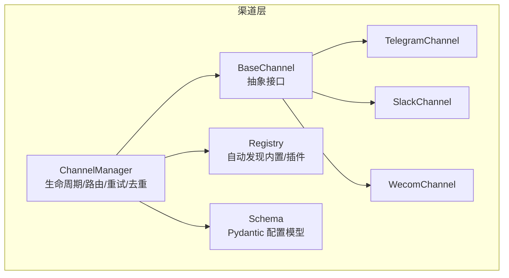
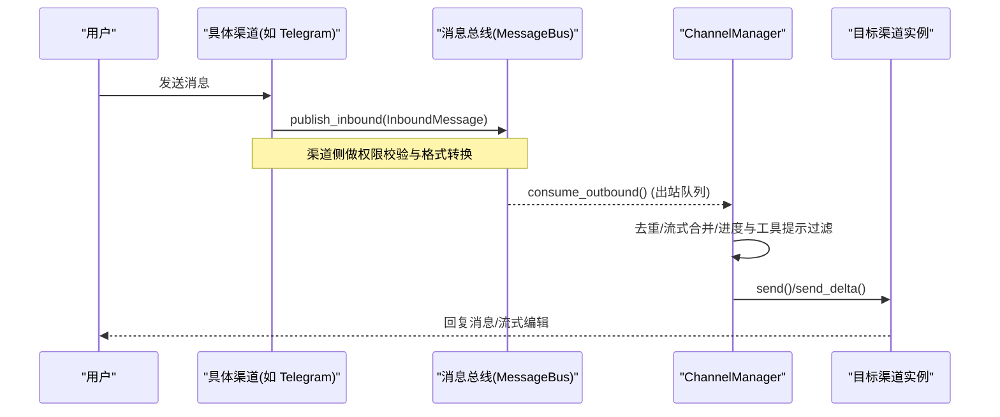
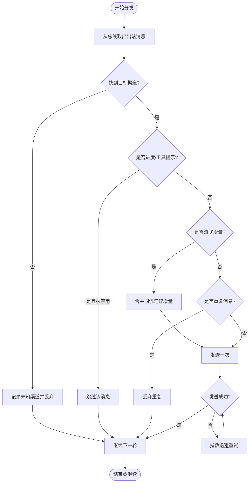
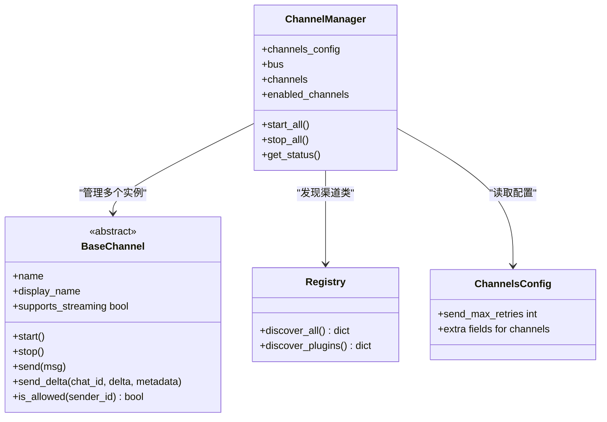

# 渠道管理与配置

<cite>
**本文引用的文件**
- [manager.py](file://deeptutor/partners/channels/manager.py)
- [base.py](file://deeptutor/partners/channels/base.py)
- [registry.py](file://deeptutor/partners/channels/registry.py)
- [schema.py](file://deeptutor/partners/config/schema.py)
- [telegram.py](file://deeptutor/partners/channels/telegram.py)
- [wecom.py](file://deeptutor/partners/channels/wecom.py)
- [slack.py](file://deeptutor/partners/channels/slack.py)
</cite>

## 目录
1. [简介](#简介)
2. [项目结构](#项目结构)
3. [核心组件](#核心组件)
4. [架构总览](#架构总览)
5. [详细组件分析](#详细组件分析)
6. [依赖关系分析](#依赖关系分析)
7. [性能与并发特性](#性能与并发特性)
8. [故障排除指南](#故障排除指南)
9. [结论](#结论)
10. [附录：配置模板、默认值与迁移建议](#附录：配置模板默认值与迁移建议)

## 简介
本文件面向 DeepTutor 的“渠道管理与配置”子系统，聚焦 ChannelManager 对多渠道（Telegram、Slack、企业微信等）的统一编排能力，涵盖渠道的创建、启动、停止与销毁；配置文件的结构与校验；出站消息分发、重试与去重；流式增量合并；以及状态监控与健康检查。同时说明多渠道并发管理、资源隔离策略与负载均衡思路，并提供配置模板、默认值、继承机制、安全存储与访问控制、版本管理与回滚策略的建议，以及完整的示例与排障指引。

## 项目结构
DeepTutor 的渠道层位于 partners 包下，采用“抽象基类 + 具体实现 + 自动发现 + 统一管理器”的分层组织：
- 抽象接口与通用逻辑：BaseChannel
- 渠道管理器：ChannelManager（负责生命周期、出站路由、重试、去重、流式合并）
- 自动发现：registry（扫描内置模块与外部插件）
- 配置模型：schema（Pydantic 模型，支持 camelCase/snake_case 互转）
- 具体渠道实现：telegram、slack、wecom 等

图表来源
- [manager.py:31-152](file://deeptutor/partners/channels/manager.py#L31-L152)
- [base.py:19-185](file://deeptutor/partners/channels/base.py#L19-L185)
- [registry.py:17-86](file://deeptutor/partners/channels/registry.py#L17-L86)
- [schema.py:9-51](file://deeptutor/partners/config/schema.py#L9-L51)
- [telegram.py:196-200](file://deeptutor/partners/channels/telegram.py#L196-L200)
- [slack.py:34-65](file://deeptutor/partners/channels/slack.py#L34-L65)
- [wecom.py:21-67](file://deeptutor/partners/channels/wecom.py#L21-L67)

章节来源
- [manager.py:31-152](file://deeptutor/partners/channels/manager.py#L31-L152)
- [base.py:19-185](file://deeptutor/partners/channels/base.py#L19-L185)
- [registry.py:17-86](file://deeptutor/partners/channels/registry.py#L17-L86)
- [schema.py:9-51](file://deeptutor/partners/config/schema.py#L9-L51)

## 核心组件
- ChannelManager：集中管理已启用渠道的生命周期（创建、启动、停止、销毁），负责出站消息分发、重试退避、重复抑制、流式增量合并，以及状态查询。
- BaseChannel：定义所有渠道必须实现的接口（start/stop/send/send_delta），提供统一的入站消息处理、权限校验、流式开关判断、音频转录等通用能力。
- Registry：通过 pkgutil 扫描内置渠道模块，并通过 entry_points 加载外部插件，统一管理渠道类发现与优先级（内置优先）。
- Schema：使用 Pydantic 定义渠道配置的强类型模型，支持 camelCase/snake_case 互转，提供 per-channel 投递开关、流式开关、全局重试上限等。

章节来源
- [manager.py:31-341](file://deeptutor/partners/channels/manager.py#L31-L341)
- [base.py:19-185](file://deeptutor/partners/channels/base.py#L19-L185)
- [registry.py:17-86](file://deeptutor/partners/channels/registry.py#L17-L86)
- [schema.py:9-51](file://deeptutor/partners/config/schema.py#L9-L51)

## 架构总览
下图展示了从入站到出站的完整流程：渠道接入消息后进入总线，由上层代理循环处理后生成出站消息，再由 ChannelManager 进行去重、流式合并、重试后投递到目标渠道。

图表来源
- [base.py:126-174](file://deeptutor/partners/channels/base.py#L126-L174)
- [manager.py:187-294](file://deeptutor/partners/channels/manager.py#L187-L294)

## 详细组件分析

### ChannelManager：生命周期与出站调度
- 初始化与启用：
  - 通过 registry 发现所有可用渠道类，读取 ChannelsConfig 中对应 section，仅 enabled=True 的渠道会被实例化并加入管理表。
  - 为每个渠道解析 send_progress 与 send_tool_hints 的布尔覆盖（兼容 dict/camelCase 别名）。
  - 校验 allow_from 为空列表时直接终止（拒绝所有访问）。
- 启动/停止：
  - start_all：启动出站分发协程，并行启动各渠道；stop_all：取消分发协程并逐个调用 channel.stop。
- 出站分发：
  - 消费 MessageBus 的出站队列，按 channel 路由到对应实例。
  - 针对 _stream_delta/_stream_end/_streamed 元数据做流式增量合并与最终落盘去重。
  - 非流式消息基于内容指纹与 origin/message id 做精确去重，避免重复回复。
  - 失败重试：指数退避（固定延迟序列），可配置最大重试次数。
- 状态查询：
  - get_status 返回各渠道是否运行；enabled_channels 列出已启用渠道名。

图表来源
- [manager.py:187-327](file://deeptutor/partners/channels/manager.py#L187-L327)

章节来源
- [manager.py:31-341](file://deeptutor/partners/channels/manager.py#L31-L341)

### BaseChannel：抽象接口与通用能力
- 生命周期：start/stop 必须由子类实现；is_running 暴露运行态。
- 出站：send 用于普通消息；send_delta 用于流式增量（子类可选择性重写以支持原地编辑）。
- 入站：_handle_message 统一做权限校验（allow_from）、会话键覆盖、流式偏好注入，并发布到总线。
- 其他：transcribe_audio 通过 Groq Whisper 进行语音转文本；supports_streaming 根据配置与子类实现决定是否启用流式。

章节来源
- [base.py:19-185](file://deeptutor/partners/channels/base.py#L19-L185)

### 自动发现与插件机制
- 内置渠道：通过 pkgutil 扫描 deeptutor.partners.channels 下的模块，排除内部模块（base/manager/registry）。
- 外部插件：通过 importlib.metadata.entry_points(group="deeptutor.partners.channels") 加载第三方渠道。
- 优先级：内置渠道优先于插件同名覆盖；加载失败会记录错误但不中断整体发现。

章节来源
- [registry.py:17-86](file://deeptutor/partners/channels/registry.py#L17-L86)

### 配置模型与校验
- Base：开启 camelCase/snake_case 互转，便于 JSON/YAML 配置与 Python 模型一致。
- DeliveryOverrides：每渠道 send_progress、send_tool_hints 开关。
- StreamingSupport：per-channel 流式开关。
- ChannelsConfig：允许额外字段（extra="allow"）承载各渠道自有配置；全局 send_max_retries 控制出站重试上限。

章节来源
- [schema.py:9-51](file://deeptutor/partners/config/schema.py#L9-L51)

### 具体渠道实现要点
- TelegramChannel：
  - 配置：包含 enabled、token 及投递/流式开关；支持 Markdown→HTML 转换、表格渲染、长度限制、流式编辑缓冲。
  - 特点：长连接/命令/消息处理、流式增量编辑、媒体上传。
- SlackChannel：
  - 配置：mode=socket，bot_token/app_token，reply_in_thread、react_emoji、DM/群组策略、allow_from 等。
  - 特点：Socket Mode 长连接、事件监听、线程回复、超时保护。
- WecomChannel：
  - 配置：enabled、bot_id、secret、welcome_message、allow_from。
  - 特点：WebSocket 长连接、无需公网 IP、多消息类型处理、欢迎消息。

章节来源
- [telegram.py:196-200](file://deeptutor/partners/channels/telegram.py#L196-L200)
- [slack.py:34-65](file://deeptutor/partners/channels/slack.py#L34-L65)
- [wecom.py:21-67](file://deeptutor/partners/channels/wecom.py#L21-L67)

## 依赖关系分析
- ChannelManager 依赖：
  - BaseChannel 抽象接口（统一生命周期与收发语义）
  - MessageBus（出站队列消费）
  - Registry（渠道类发现）
  - Schema（ChannelsConfig 解析）
- 具体渠道依赖各自平台 SDK（如 python-telegram-bot、slack_sdk、wecom_aibot_sdk），并在 start 时建立连接与事件回调。

图表来源
- [manager.py:31-152](file://deeptutor/partners/channels/manager.py#L31-L152)
- [base.py:19-185](file://deeptutor/partners/channels/base.py#L19-L185)
- [registry.py:17-86](file://deeptutor/partners/channels/registry.py#L17-L86)
- [schema.py:9-51](file://deeptutor/partners/config/schema.py#L9-L51)

章节来源
- [manager.py:31-152](file://deeptutor/partners/channels/manager.py#L31-L152)
- [base.py:19-185](file://deeptutor/partners/channels/base.py#L19-L185)
- [registry.py:17-86](file://deeptutor/partners/channels/registry.py#L17-L86)
- [schema.py:9-51](file://deeptutor/partners/config/schema.py#L9-L51)

## 性能与并发特性
- 并发启动：start_all 使用 asyncio.gather 并行启动各渠道，减少冷启动时间。
- 出站分发：单协程消费队列，避免竞争；对同一 (channel, chat_id) 的连续流式增量进行合并，降低频繁编辑 API 调用。
- 重试退避：固定延迟序列（1s/2s/4s），可配置最大重试次数，避免雪崩。
- 资源隔离：每个渠道独立实例，拥有独立的连接与状态；异常在单个渠道内捕获不影响其他渠道。
- 负载均衡策略：当前未实现跨渠道的负载分担；若需横向扩展，可在上层将不同业务/租户路由到不同渠道集合，或通过多进程/多实例部署并按租户选择 ChannelManager 实例。

[本节为通用性能讨论，不直接分析具体文件]

## 故障排除指南
- 渠道未启用：
  - 现象：无日志输出或 UI 显示未启用。
  - 排查：确认 ChannelsConfig 中对应 section 的 enabled 为 True；检查 registry 是否发现该渠道。
- 允许列表为空导致全部拒绝：
  - 现象：入站消息被拒绝，日志提示 allow_from 为空。
  - 处理：设置 allow_from=["*"] 或添加具体用户 ID。
- 出站失败与重试：
  - 现象：发送失败，日志记录重试与最终失败。
  - 处理：检查渠道凭据、网络连通性与平台限流；调整 send_max_retries。
- 流式编辑卡顿或丢失：
  - 现象：流式内容更新不及时或中断。
  - 处理：确认渠道 supports_streaming 为真；检查 _stream_id 一致性；适当增大编辑间隔或合并粒度。
- 重复消息：
  - 现象：同一来源重复收到相同内容。
  - 处理：确认 origin_message_id/message_id 正确传递；检查去重指纹逻辑。

章节来源
- [manager.py:108-152](file://deeptutor/partners/channels/manager.py#L108-L152)
- [manager.py:160-232](file://deeptutor/partners/channels/manager.py#L160-L232)
- [base.py:116-174](file://deeptutor/partners/channels/base.py#L116-L174)

## 结论
ChannelManager 提供了稳定、可扩展的多渠道管理能力，结合 BaseChannel 的抽象与 Schema 的强类型校验，实现了统一的配置、生命周期与出站分发。其并发启动、流式合并、重试退避与去重机制有效提升了吞吐与用户体验。对于更高阶的负载均衡与热重载，可在现有架构上通过多实例与配置中心扩展实现。

[本节为总结性内容，不直接分析具体文件]

## 附录：配置模板、默认值与迁移建议

### 配置模板与默认值
以下为各渠道的典型配置键与默认值（节选）：
- 全局（ChannelsConfig）
  - send_max_retries: 整数，默认 3
- 通用投递开关（DeliveryOverrides）
  - send_progress: 布尔，默认 True
  - send_tool_hints: 布尔，默认 True
- 流式开关（StreamingSupport）
  - streaming: 布尔，默认 False
- TelegramChannel
  - enabled: 布尔，默认 False
  - token: 字符串
- SlackChannel
  - enabled: 布尔，默认 False
  - mode: 字符串，默认 "socket"
  - webhook_path: 字符串，默认 "/slack/events"
  - bot_token: 字符串
  - app_token: 字符串
  - user_token_read_only: 布尔，默认 True
  - reply_in_thread: 布尔，默认 True
  - react_emoji: 字符串，默认 "eyes"
  - allow_from: 字符串数组
  - group_policy: 字符串，默认 "mention"
  - group_allow_from: 字符串数组
  - dm.enabled: 布尔，默认 True
  - dm.policy: 字符串，默认 "open"
  - dm.allow_from: 字符串数组
- WecomChannel
  - enabled: 布尔，默认 False
  - bot_id: 字符串
  - secret: 字符串
  - allow_from: 字符串数组
  - welcome_message: 字符串

章节来源
- [schema.py:9-51](file://deeptutor/partners/config/schema.py#L9-L51)
- [telegram.py:196-200](file://deeptutor/partners/channels/telegram.py#L196-L200)
- [slack.py:34-65](file://deeptutor/partners/channels/slack.py#L34-L65)
- [wecom.py:21-67](file://deeptutor/partners/channels/wecom.py#L21-L67)

### 继承机制
- 配置模型继承：TelegramConfig/SlackConfig/WecomConfig 均继承自 DeliveryOverrides 与/或 StreamingSupport，从而获得通用的投递与流式开关。
- 运行时覆盖：ChannelManager 在初始化时为每个渠道解析 send_progress 与 send_tool_hints 的布尔覆盖（兼容 dict 与 camelCase 别名），确保原始 JSON 配置也能生效。

章节来源
- [schema.py:9-51](file://deeptutor/partners/config/schema.py#L9-L51)
- [manager.py:90-106](file://deeptutor/partners/channels/manager.py#L90-L106)

### 安全存储、加密传输与访问控制
- 安全存储：渠道敏感信息（如 token、secret）应保存在安全的配置源（环境变量、密钥管理服务），避免明文写入配置文件。
- 加密传输：渠道与平台间通信通常由平台 SDK 负责（HTTPS/WebSocket），无需应用层二次加密。
- 访问控制：
  - 入站：BaseChannel.is_allowed 基于 allow_from 白名单（支持 "*" 通配）进行校验；空列表表示拒绝所有。
  - 出站：ChannelManager 在分发前依据 send_progress/send_tool_hints 控制是否推送进度与工具提示。

章节来源
- [base.py:116-124](file://deeptutor/partners/channels/base.py#L116-L124)
- [manager.py:108-114](file://deeptutor/partners/channels/manager.py#L108-L114)
- [manager.py:207-211](file://deeptutor/partners/channels/manager.py#L207-L211)

### 热重载机制（建议）
- 现状：当前代码未实现运行时热重载渠道配置。
- 建议方案：
  - 引入配置监听器（文件系统/配置中心），变更时触发：
    - 重新解析 ChannelsConfig
    - 按需重启受影响渠道（stop → 重建实例 → start）
    - 保持其余渠道不受影响
  - 注意：重启期间短暂不可用，需在 UI/运维层面提示。

[本节为概念性建议，不直接分析具体文件]

### 配置迁移、版本管理与回滚策略（建议）
- 版本管理：
  - 为 ChannelsConfig 增加 version 字段，升级时执行兼容性检查与迁移脚本。
  - 保留旧版配置键的兼容映射（如 camelCase/snake_case 已支持）。
- 迁移工具：
  - 提供 CLI 或脚本，将旧版配置转换为新版结构，并输出差异报告。
- 回滚策略：
  - 变更前备份当前配置快照；
  - 变更后若出现异常，快速回滚至上一快照；
  - 对关键渠道（如 Slack/WeCom）采用灰度发布，先小范围验证再全量。

[本节为概念性建议，不直接分析具体文件]

### 健康检查与故障转移（建议）
- 健康检查：
  - 暴露 /health 或类似端点，汇总各渠道 is_running 与最近连接状态。
  - 对平台级连通性（如 auth_test）定期探测，记录失败原因。
- 故障转移：
  - 当某渠道持续失败时，自动降级到备用渠道（例如主用 Slack 失败时切换到邮件或企业微信）。
  - 在降级期间向用户提示服务切换状态。

[本节为概念性建议，不直接分析具体文件]