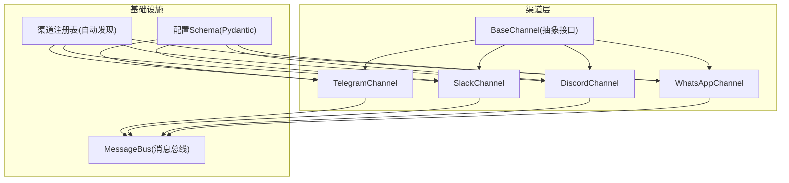
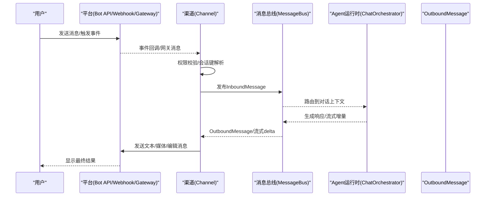
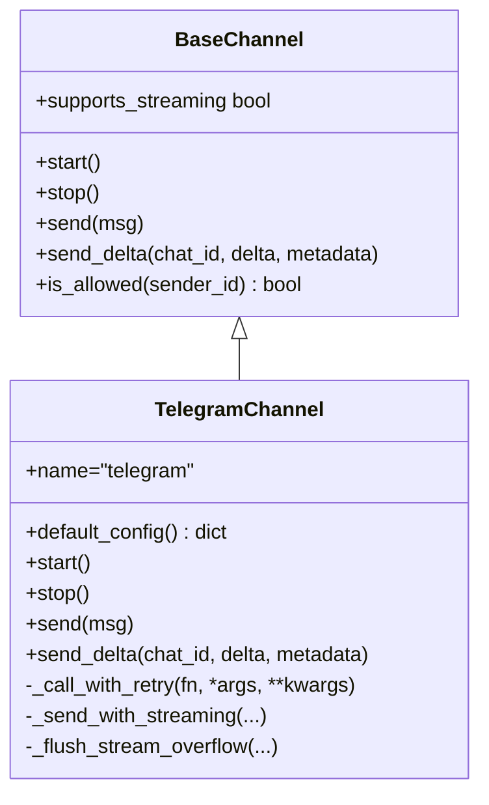
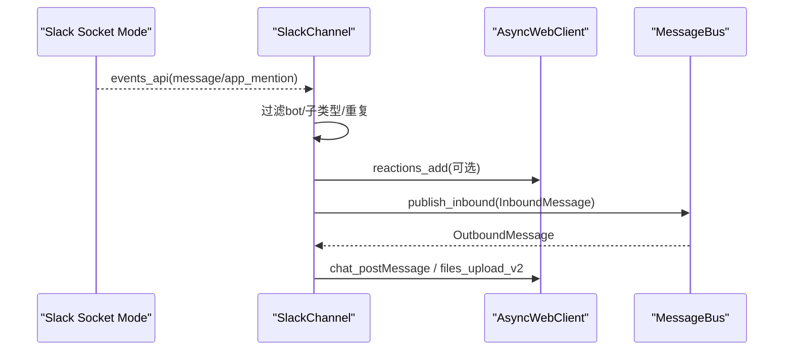
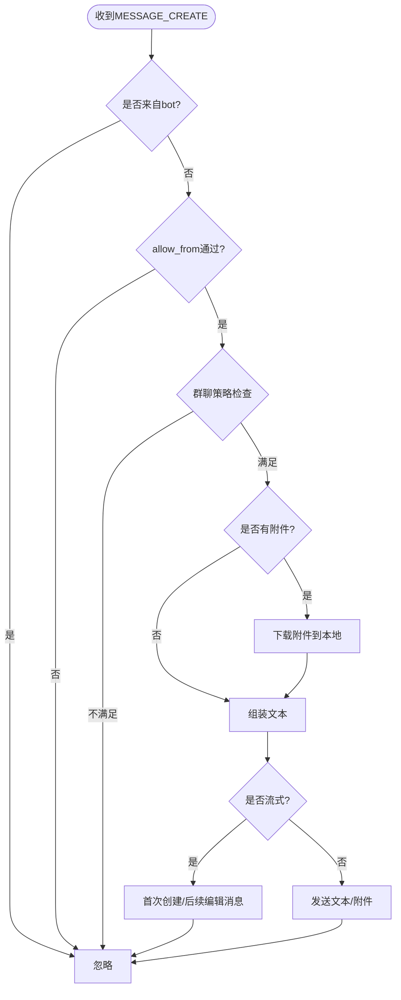
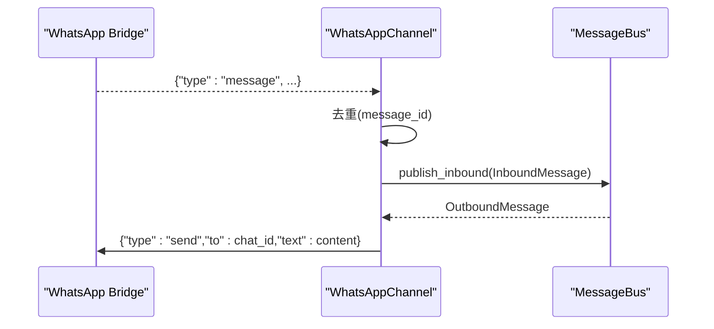
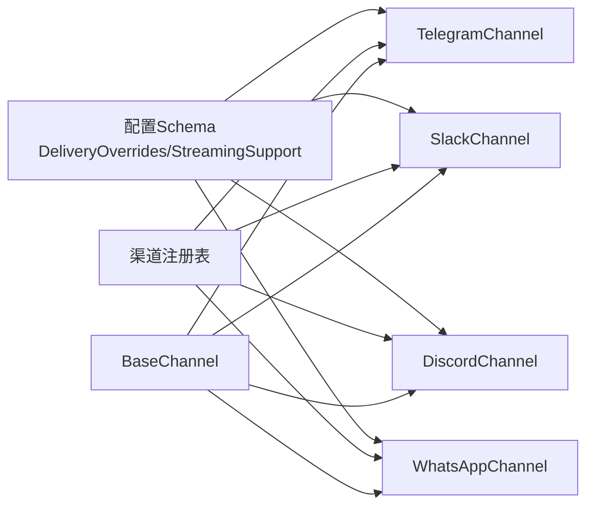

# 社交消息平台

<cite>
**本文引用的文件**
- [base.py](file://deeptutor/partners/channels/base.py)
- [telegram.py](file://deeptutor/partners/channels/telegram.py)
- [slack.py](file://deeptutor/partners/channels/slack.py)
- [discord.py](file://deeptutor/partners/channels/discord.py)
- [whatsapp.py](file://deeptutor/partners/channels/whatsapp.py)
- [registry.py](file://deeptutor/partners/channels/registry.py)
- [schema.py](file://deeptutor/partners/config/schema.py)
- [compose.yaml](file://compose.yaml)
</cite>

## 目录
1. [简介](#简介)
2. [项目结构](#项目结构)
3. [核心组件](#核心组件)
4. [架构总览](#架构总览)
5. [详细组件分析](#详细组件分析)
6. [依赖关系分析](#依赖关系分析)
7. [性能与限流](#性能与限流)
8. [部署与配置](#部署与配置)
9. [故障排查](#故障排查)
10. [结论](#结论)
11. [附录：平台差异与迁移指南](#附录：平台差异与迁移指南)

## 简介
本文件面向DeepTutor的社交消息平台集成，系统性说明Telegram、Slack、Discord、WhatsApp四类渠道的实现方式、事件订阅机制、消息类型支持、权限控制、限流策略、部署配置与调试方法。文档同时提供跨平台差异对比与迁移建议，帮助读者在多种IM平台上稳定运行DeepTutor聊天代理。

## 项目结构
DeepTutor将各社交平台抽象为“渠道（Channel）”，统一继承自基类接口，通过消息总线与Agent运行时解耦。内置渠道按模块组织，支持自动发现与插件扩展。

图表来源
- [base.py:19-185](file://deeptutor/partners/channels/base.py#L19-L185)
- [registry.py:17-86](file://deeptutor/partners/channels/registry.py#L17-L86)
- [schema.py:9-51](file://deeptutor/partners/config/schema.py#L9-L51)

章节来源
- [base.py:19-185](file://deeptutor/partners/channels/base.py#L19-L185)
- [registry.py:17-86](file://deeptutor/partners/channels/registry.py#L17-L86)
- [schema.py:9-51](file://deeptutor/partners/config/schema.py#L9-L51)

## 核心组件
- 抽象基类 BaseChannel：定义 start/stop/send/send_delta、权限校验、入站消息封装与发布到消息总线等通用能力。
- 渠道实现：
  - TelegramChannel：基于python-telegram-bot长轮询；支持富文本HTML、图片、语音、音频、文档、视频、动画；支持流式编辑与草稿预览；群组主题线程；重试与防洪水控制。
  - SlackChannel：基于Socket Mode；支持mrkdwn富文本、表格转换、线程回复、表情反应；DM与群组策略；连接超时保护。
  - DiscordChannel：基于Gateway WebSocket；支持REST发送附件与文本；流式编辑；速率限制重试；群聊@提及策略；心跳保活。
  - WhatsAppChannel：通过Node.js桥接（Baileys）；WebSocket通信；去重处理；语音暂不支持直接转录；媒体路径注入内容标签。
- 配置Schema：DeliveryOverrides（进度/工具提示开关）、StreamingSupport（流式编辑开关）、ChannelsConfig（全局重试次数）。
- 渠道注册表：自动扫描内置模块并加载外部插件，屏蔽同名冲突。

章节来源
- [base.py:19-185](file://deeptutor/partners/channels/base.py#L19-L185)
- [telegram.py:196-353](file://deeptutor/partners/channels/telegram.py#L196-L353)
- [slack.py:26-117](file://deeptutor/partners/channels/slack.py#L26-L117)
- [discord.py:38-110](file://deeptutor/partners/channels/discord.py#L38-L110)
- [whatsapp.py:18-98](file://deeptutor/partners/channels/whatsapp.py#L18-L98)
- [schema.py:15-51](file://deeptutor/partners/config/schema.py#L15-L51)
- [registry.py:17-86](file://deeptutor/partners/channels/registry.py#L17-L86)

## 架构总览
下图展示从平台事件到Agent响应的端到端流程，以及各渠道的差异点。

图表来源
- [base.py:126-174](file://deeptutor/partners/channels/base.py#L126-L174)
- [telegram.py:271-353](file://deeptutor/partners/channels/telegram.py#L271-L353)
- [slack.py:70-117](file://deeptutor/partners/channels/slack.py#L70-L117)
- [discord.py:72-110](file://deeptutor/partners/channels/discord.py#L72-L110)
- [whatsapp.py:50-98](file://deeptutor/partners/channels/whatsapp.py#L50-L98)

## 详细组件分析

### Telegram 渠道
- 连接模式：长轮询（无需公网Webhook），使用独立HTTPX请求池避免getUpdates与发送争用。
- 事件订阅：CommandHandler与MessageHandler监听文本、图片、语音、音频、文档、视频、动画。
- 消息类型支持：
  - 富文本：Markdown转HTML，支持代码块、表格、链接、粗斜体、删除线、列表。
  - 媒体：photo/voice/audio/document/video/animation，自动识别类型并发送。
  - 流式：草稿预览+逐步edit_message_text，支持溢出分片与最终落盘。
- 群组管理：支持message_thread_id（论坛主题）；可配置reply_to_message。
- 权限控制：allow_from支持id|username格式匹配；支持“*”全开或空列表拒绝。
- 限流与重试：对TimedOut与RetryAfter进行指数退避重试；编辑间隔最小化以避免洪水控制。
- 关键配置项：token、proxy、connection_pool_size、pool_timeout、stream_edit_interval、group_policy、allow_from、reply_to_message。

图表来源
- [base.py:19-185](file://deeptutor/partners/channels/base.py#L19-L185)
- [telegram.py:196-706](file://deeptutor/partners/channels/telegram.py#L196-L706)

章节来源
- [telegram.py:196-800](file://deeptutor/partners/channels/telegram.py#L196-L800)

### Slack 渠道
- 连接模式：Socket Mode（WebSocket），通过app_token建立连接，bot_token用于Web API。
- 事件订阅：events_api事件过滤message/app_mention，忽略bot与系统消息。
- 消息类型支持：
  - 富文本：Markdown转mrkdwn，表格转换为可读行；支持代码块与内联代码保护。
  - 媒体：files_upload_v2上传文件；DM不启用thread_ts。
  - 线程：默认reply_in_thread开启，保持对话上下文。
  - 交互：可选添加表情反应（eyes）。
- 群组管理：支持open/mention/allowlist三种群组策略；DM策略可单独配置。
- 权限控制：DM allowlist与群组allowlist；忽略自身bot消息。
- 限流与重试：Socket握手设置超时，失败快速失败；发送失败由上层重试。
- 关键配置项：mode、webhook_path、bot_token、app_token、user_token_read_only、reply_in_thread、react_emoji、allow_from、group_policy、dm.policy/allow_from。

图表来源
- [slack.py:70-161](file://deeptutor/partners/channels/slack.py#L70-L161)
- [slack.py:163-253](file://deeptutor/partners/channels/slack.py#L163-L253)

章节来源
- [slack.py:26-322](file://deeptutor/partners/channels/slack.py#L26-L322)

### Discord 渠道
- 连接模式：Gateway WebSocket直连，维护心跳与序列号；REST API用于发送消息与附件。
- 事件订阅：MESSAGE_CREATE事件；忽略bot作者；支持群聊@提及策略。
- 消息类型支持：
  - 富文本：纯文本分片（2000字符限制）。
  - 媒体：multipart/form-data上传附件（最大20MB）；下载附件到本地再转发。
  - 流式：首次创建消息后多次PATCH编辑；溢出时拆分后续消息。
- 群组管理：DM始终允许（通过is_allowed）；群聊支持open/mention策略。
- 权限控制：allow_from白名单；忽略自身bot消息。
- 限流与重试：429速率限制读取retry_after并重试；发送失败抛出异常交由上层重试。
- 关键配置项：token、gateway_url、intents、group_policy。

图表来源
- [discord.py:394-457](file://deeptutor/partners/channels/discord.py#L394-L457)
- [discord.py:111-173](file://deeptutor/partners/channels/discord.py#L111-L173)
- [discord.py:175-246](file://deeptutor/partners/channels/discord.py#L175-L246)

章节来源
- [discord.py:38-506](file://deeptutor/partners/channels/discord.py#L38-L506)

### WhatsApp 渠道
- 连接模式：通过Node.js桥接（Baileys）以WebSocket通信；Python侧仅负责协议适配。
- 事件订阅：bridge返回message/status/qr/error；去重处理避免重复消费。
- 消息类型支持：
  - 富文本：透传文本。
  - 媒体：桥接下载的图片/文档/视频路径注入内容标签；语音消息当前无直接转录。
- 群组管理：isGroup标记；chat_id使用完整LID以便回复。
- 权限控制：allow_from白名单。
- 限流与重试：发送失败抛出异常，交由上层重试；桥接断开自动重连。
- 关键配置项：bridge_url、bridge_token、allow_from。

图表来源
- [whatsapp.py:50-190](file://deeptutor/partners/channels/whatsapp.py#L50-L190)

章节来源
- [whatsapp.py:18-190](file://deeptutor/partners/channels/whatsapp.py#L18-L190)

## 依赖关系分析
- 渠道与基类：所有渠道均继承BaseChannel，复用权限校验、入站消息封装与流式能力判断。
- 配置模型：Pydantic模型统一接受camelCase/snake_case，便于JSON配置与API传输。
- 自动发现：通过pkgutil扫描内置模块，并通过entry_points加载外部插件，内置优先。
- 运行时设置：Compose与脚本从data/user/settings/*.json导出环境变量，保证容器内进程正确获取端口与集成配置。

图表来源
- [schema.py:9-51](file://deeptutor/partners/config/schema.py#L9-L51)
- [registry.py:17-86](file://deeptutor/partners/channels/registry.py#L17-L86)
- [base.py:19-185](file://deeptutor/partners/channels/base.py#L19-L185)

章节来源
- [schema.py:9-51](file://deeptutor/partners/config/schema.py#L9-L51)
- [registry.py:17-86](file://deeptutor/partners/channels/registry.py#L17-L86)
- [base.py:19-185](file://deeptutor/partners/channels/base.py#L19-L185)

## 性能与限流
- Telegram
  - 独立请求池：getUpdates与发送分离，避免池耗尽导致发送失败。
  - 流式编辑间隔：最小0.1秒，防止频繁edit触发洪水控制。
  - 重试策略：对TimedOut与RetryAfter指数退避重试。
- Slack
  - Socket握手超时：30秒，快速失败避免长时间挂起。
  - 线程与反应：减少冗余消息；表情反应最佳-effort。
- Discord
  - 速率限制：429读取retry_after并重试；附件与文本发送均有重试逻辑。
  - 流式编辑间隔：最小0.8秒，平衡体验与API限制。
- WhatsApp
  - 去重：维护最近1000条消息ID队列，避免重复处理。
  - 桥接重连：断线自动重连，发送失败由上层重试。

章节来源
- [telegram.py:281-304](file://deeptutor/partners/channels/telegram.py#L281-L304)
- [telegram.py:516-549](file://deeptutor/partners/channels/telegram.py#L516-L549)
- [slack.py:97-112](file://deeptutor/partners/channels/slack.py#L97-L112)
- [discord.py:158-173](file://deeptutor/partners/channels/discord.py#L158-L173)
- [discord.py:248-268](file://deeptutor/partners/channels/discord.py#L248-L268)
- [whatsapp.py:120-137](file://deeptutor/partners/channels/whatsapp.py#L120-L137)

## 部署与配置
- 容器编排
  - 使用Podman Compose启动deeptutor服务与可选pocketbase侧车。
  - 数据目录绑定至./data，读写权限通过userns_mode: keep-id映射宿主UID。
  - 端口映射：后端127.0.0.1:8001，前端127.0.0.1:3782，pocketbase 127.0.0.1:8090。
  - 健康检查：后端curl /，pocketbase wget /api/health。
- 运行时设置
  - 通过data/user/settings/*.json配置端口、认证、集成等；启动时导出为环境变量。
  - 脚本docker_compose.py从JSON渲染DEEPTUTOR_DOCKER_*变量，避免硬编码。
- 渠道配置要点
  - Telegram：设置token、可选proxy、连接池大小、流式编辑间隔、群组策略与allow_from。
  - Slack：设置bot_token、app_token、reply_in_thread、react_emoji、DM与群组策略。
  - Discord：设置token、gateway_url、intents、群组策略。
  - WhatsApp：设置bridge_url、bridge_token、allow_from；确保Node桥接运行。

章节来源
- [compose.yaml:67-197](file://compose.yaml#L67-L197)
- [schema.py:15-51](file://deeptutor/partners/config/schema.py#L15-L51)
- [telegram.py:196-211](file://deeptutor/partners/channels/telegram.py#L196-L211)
- [slack.py:26-49](file://deeptutor/partners/channels/slack.py#L26-L49)
- [discord.py:38-47](file://deeptutor/partners/channels/discord.py#L38-L47)
- [whatsapp.py:18-25](file://deeptutor/partners/channels/whatsapp.py#L18-L25)

## 故障排查
- Telegram
  - HTML解析失败：自动回退纯文本；检查parse_mode与长度限制。
  - “消息未修改”错误：忽略并清理流缓冲区；避免重复编辑。
  - 洪水控制：依据RetryAfter等待；调整stream_edit_interval。
- Slack
  - Socket握手超时：检查出站WebSocket访问；确认app_token与bot_token。
  - 重复消息：优先app_mention；忽略subtype与自身bot消息。
- Discord
  - 429速率限制：读取retry_after并重试；降低流式编辑频率。
  - 附件过大：超过20MB跳过；检查文件大小与网络。
- WhatsApp
  - 桥接断开：自动重连；检查bridge_url与bridge_token。
  - 语音消息：当前不支持直接转录；提示不可用。

章节来源
- [telegram.py:467-486](file://deeptutor/partners/channels/telegram.py#L467-L486)
- [telegram.py:551-554](file://deeptutor/partners/channels/telegram.py#L551-L554)
- [telegram.py:516-549](file://deeptutor/partners/channels/telegram.py#L516-L549)
- [slack.py:97-112](file://deeptutor/partners/channels/slack.py#L97-L112)
- [slack.py:186-196](file://deeptutor/partners/channels/slack.py#L186-L196)
- [discord.py:158-173](file://deeptutor/partners/channels/discord.py#L158-L173)
- [discord.py:283-285](file://deeptutor/partners/channels/discord.py#L283-L285)
- [whatsapp.py:80-89](file://deeptutor/partners/channels/whatsapp.py#L80-L89)
- [whatsapp.py:143-150](file://deeptutor/partners/channels/whatsapp.py#L143-L150)

## 结论
DeepTutor通过统一的Channel抽象与消息总线，将Telegram、Slack、Discord、WhatsApp等平台无缝接入Agent运行时。各渠道针对平台特性实现了富文本、媒体、流式编辑、权限控制与限流重试，配合容器化部署与JSON驱动的配置体系，提供了稳定可扩展的社交消息集成方案。

## 附录：平台差异与迁移指南
- 连接与事件
  - Telegram：长轮询，无需公网；适合内网或受限环境。
  - Slack：Socket Mode，需开放WebSocket；适合企业环境。
  - Discord：Gateway WebSocket；需配置intents与群组策略。
  - WhatsApp：依赖Node桥接；需维护桥接服务。
- 富文本与媒体
  - Telegram：Markdown→HTML，支持表格与代码块；媒体类型自动识别。
  - Slack：Markdown→mrkdwn，表格转换；文件上传v2。
  - Discord：纯文本分片；附件multipart上传。
  - WhatsApp：文本透传；媒体路径注入内容标签。
- 流式编辑
  - Telegram/Discord：支持；注意平台限制与编辑间隔。
  - Slack：不支持原地编辑；可通过线程与反应增强体验。
  - WhatsApp：不支持；依赖桥接能力。
- 权限与群组
  - 均支持allow_from白名单；Telegram支持id|username匹配。
  - Slack/Discord支持群组策略（open/mention/allowlist）。
  - WhatsApp通过isGroup标记区分。
- 迁移建议
  - 从Telegram迁移到Slack：关注线程与mrkdwn转换；调整群组策略。
  - 从Slack迁移到Discord：注意附件大小限制与速率限制；启用流式编辑。
  - 引入WhatsApp：确保桥接服务可用；处理语音与媒体限制。

章节来源
- [telegram.py:196-353](file://deeptutor/partners/channels/telegram.py#L196-L353)
- [slack.py:26-161](file://deeptutor/partners/channels/slack.py#L26-L161)
- [discord.py:38-173](file://deeptutor/partners/channels/discord.py#L38-L173)
- [whatsapp.py:18-190](file://deeptutor/partners/channels/whatsapp.py#L18-L190)