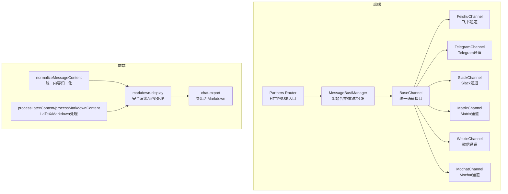
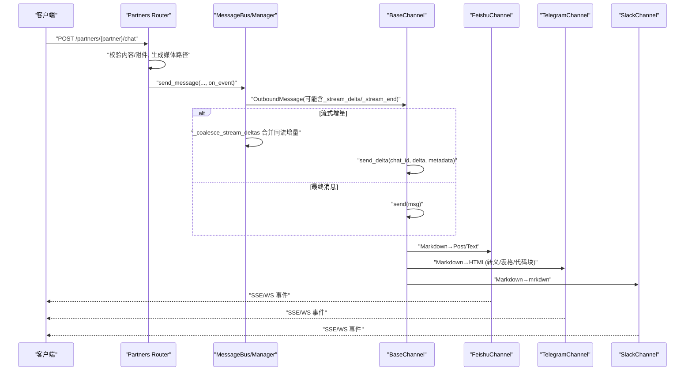
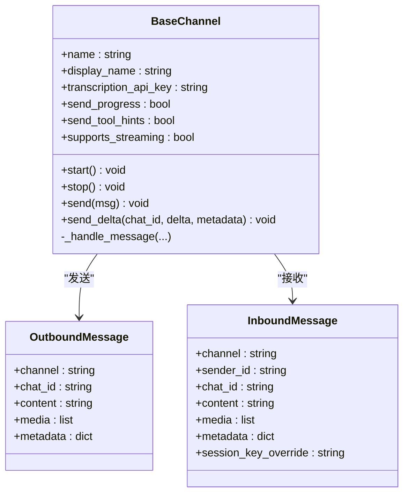
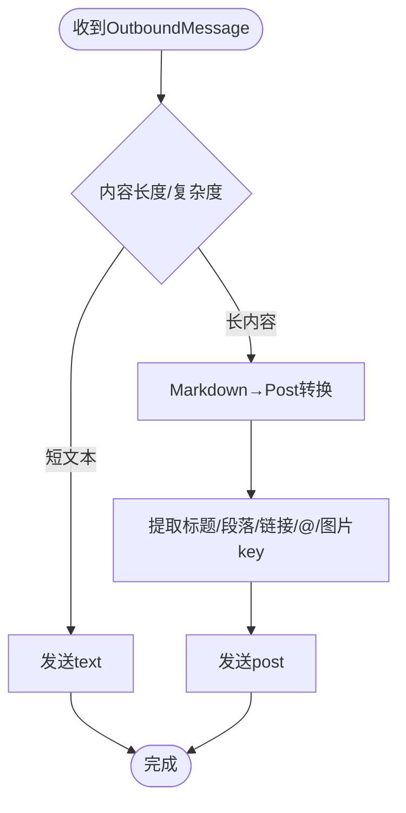
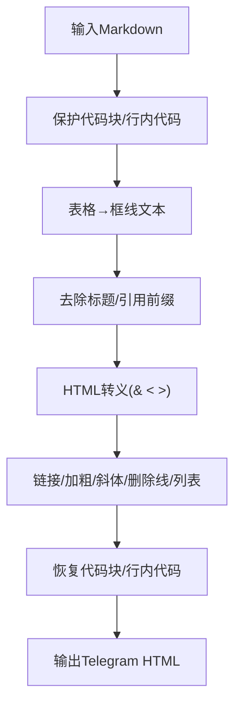
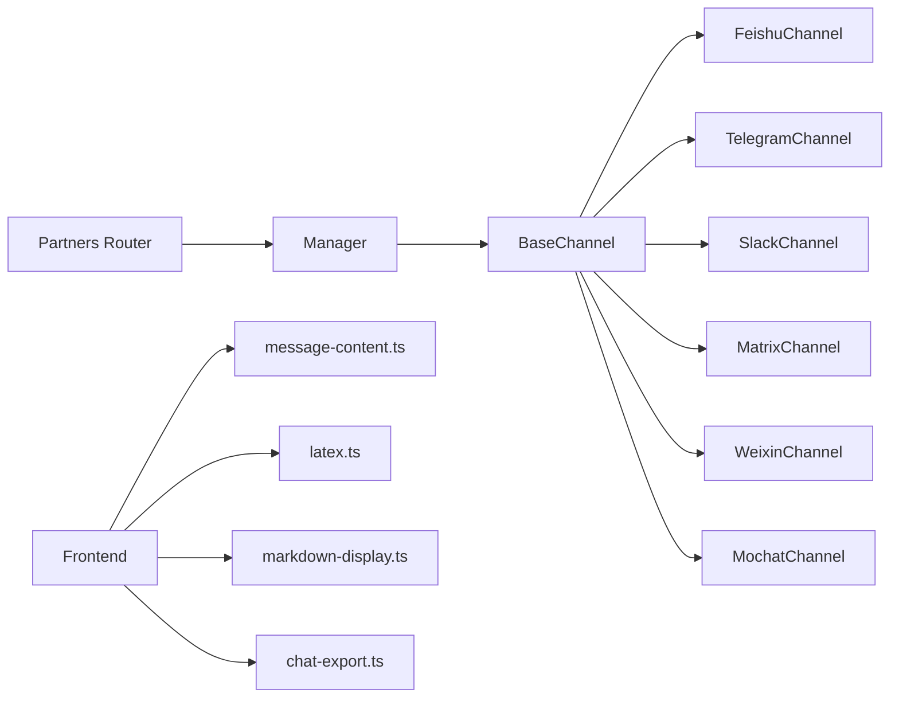

# 消息格式转换

<cite>
**本文引用的文件**
- [base.py](file://deeptutor/partners/channels/base.py)
- [manager.py](file://deeptutor/partners/channels/manager.py)
- [feishu.py](file://deeptutor/partners/channels/feishu.py)
- [telegram.py](file://deeptutor/partners/channels/telegram.py)
- [slack.py](file://deeptutor/partners/channels/slack.py)
- [matrix.py](file://deeptutor/partners/channels/matrix.py)
- [weixin.py](file://deeptutor/partners/channels/weixin.py)
- [mochat.py](file://deeptutor/partners/channels/mochat.py)
- [partners.py](file://deeptutor/api/routers/partners.py)
- [runtime_settings.py](file://deeptutor/services/config/runtime_settings.py)
- [message-content.ts](file://web/lib/message-content.ts)
- [latex.ts](file://web/lib/latex.ts)
- [markdown-display.ts](file://web/lib/markdown-display.ts)
- [chat-export.ts](file://web/lib/chat-export.ts)
</cite>

## 目录
1. [简介](#简介)
2. [项目结构](#项目结构)
3. [核心组件](#核心组件)
4. [架构总览](#架构总览)
5. [详细组件分析](#详细组件分析)
6. [依赖关系分析](#依赖关系分析)
7. [性能考量](#性能考量)
8. [故障排查指南](#故障排查指南)
9. [结论](#结论)
10. [附录](#附录)

## 简介
本文件面向DeepTutor的“消息格式转换系统”，聚焦统一消息模型与内部消息格式规范，解释不同IM平台（飞书、Telegram、Slack、Matrix、微信等）的消息映射规则，覆盖文本、富文本、图片、文件、音频等类型的转换策略；说明Markdown到各平台格式的转换算法（特殊字符处理、链接转换、样式适配）；阐述流式消息的处理机制（增量更新、合并策略、性能优化）；并给出消息大小限制、编码处理、错误恢复机制以及自定义消息类型扩展方法与最佳实践。

## 项目结构
消息格式转换涉及后端通道层、消息总线、API路由与前端展示层：
- 通道抽象与实现：BaseChannel定义统一的入/出站消息接口与流式能力；各平台通道实现具体发送与格式转换逻辑。
- 消息总线与调度：Manager负责出站消息的去重、合并、重试与分发。
- API路由：对外暴露聊天入口，统一接收内容/附件，驱动通道发送。
- 前端：统一消息内容归一化、Markdown/LaTeX渲染、导出为Markdown等。



**图表来源**
- [base.py:19-114](file://deeptutor/partners/channels/base.py#L19-L114)
- [manager.py:240-294](file://deeptutor/partners/channels/manager.py#L240-L294)
- [partners.py:928-959](file://deeptutor/api/routers/partners.py#L928-L959)
- [message-content.ts:29-45](file://web/lib/message-content.ts#L29-L45)
- [latex.ts:16-51](file://web/lib/latex.ts#L16-L51)
- [markdown-display.ts:186-200](file://web/lib/markdown-display.ts#L186-L200)
- [chat-export.ts:1-39](file://web/lib/chat-export.ts#L1-L39)

**章节来源**
- [base.py:19-114](file://deeptutor/partners/channels/base.py#L19-L114)
- [manager.py:240-294](file://deeptutor/partners/channels/manager.py#L240-L294)
- [partners.py:928-959](file://deeptutor/api/routers/partners.py#L928-L959)
- [message-content.ts:29-45](file://web/lib/message-content.ts#L29-L45)
- [latex.ts:16-51](file://web/lib/latex.ts#L16-L51)
- [markdown-display.ts:186-200](file://web/lib/markdown-display.ts#L186-L200)
- [chat-export.ts:1-39](file://web/lib/chat-export.ts#L1-L39)

## 核心组件
- BaseChannel：定义统一的入站消息封装、权限校验、流式能力开关、音频转写等通用能力。
- 各平台Channel：实现send/send_delta，将内部OutboundMessage转换为平台特定格式（HTML、富文本卡片、Post等）。
- Manager：对出站消息进行流式增量合并、去重、重试与分发。
- Partners Router：统一HTTP入口，解析内容与附件，驱动通道发送，并通过SSE返回事件。
- 前端工具：统一消息内容归一化、Markdown/LaTeX处理与安全渲染、导出。

**章节来源**
- [base.py:19-114](file://deeptutor/partners/channels/base.py#L19-L114)
- [manager.py:240-294](file://deeptutor/partners/channels/manager.py#L240-L294)
- [partners.py:928-959](file://deeptutor/api/routers/partners.py#L928-L959)
- [message-content.ts:29-45](file://web/lib/message-content.ts#L29-L45)
- [latex.ts:16-51](file://web/lib/latex.ts#L16-L51)
- [markdown-display.ts:186-200](file://web/lib/markdown-display.ts#L186-L200)
- [chat-export.ts:1-39](file://web/lib/chat-export.ts#L1-L39)

## 架构总览
下图展示了从HTTP请求到多平台发送的整体流程，包括流式增量合并与重试机制。



**图表来源**
- [partners.py:928-959](file://deeptutor/api/routers/partners.py#L928-L959)
- [manager.py:240-294](file://deeptutor/partners/channels/manager.py#L240-L294)
- [base.py:77-114](file://deeptutor/partners/channels/base.py#L77-L114)
- [feishu.py:1157-1192](file://deeptutor/partners/channels/feishu.py#L1157-L1192)
- [telegram.py:110-193](file://deeptutor/partners/channels/telegram.py#L110-L193)
- [slack.py:129-162](file://deeptutor/partners/channels/slack.py#L129-L162)

## 详细组件分析

### 统一消息模型与内部消息格式
- 入站消息：由通道统一封装为InboundMessage，包含channel、sender_id、chat_id、content、media、metadata、session_key_override。
- 出站消息：OutboundMessage包含channel、chat_id、content、media、metadata；通过metadata标记流式片段（_stream_delta/_stream_end/_stream_id）与平台特定信息。
- 流式能力：BaseChannel提供send_delta默认空实现；支持性由配置与子类是否覆写决定。



**图表来源**
- [base.py:19-114](file://deeptutor/partners/channels/base.py#L19-L114)

**章节来源**
- [base.py:19-114](file://deeptutor/partners/channels/base.py#L19-L114)

### 平台消息格式映射与转换规则

#### 飞书（Feishu/Lark）
- 文本/富文本：根据内容长度与复杂度选择text或post；短文本直接发送纯文本，较长内容使用富文本Post。
- Markdown→Post：将Markdown转换为飞书富文本卡片结构，提取标题、段落、链接、@提及、图片key等。
- 多媒体：图片/音频/文件以键值形式嵌入Post或单独发送。



**图表来源**
- [feishu.py:1157-1192](file://deeptutor/partners/channels/feishu.py#L1157-L1192)

**章节来源**
- [feishu.py:1157-1192](file://deeptutor/partners/channels/feishu.py#L1157-L1192)

#### Telegram
- Markdown→HTML：将Markdown转换为Telegram支持的HTML格式，步骤包括：
  - 保护代码块与行内代码，避免被转义破坏
  - 将表格转为框线文本（便于<pre><code>显示）
  - 去除标题/引用符号，仅保留可读文本
  - HTML特殊字符转义
  - 链接、加粗、斜体、删除线、列表项转换
  - 恢复代码块与行内代码为<code>/<pre><code>
- 流式编辑：通过edit_message_text增量更新，控制最小编辑间隔以避免限流。
- 多媒体：按扩展名推断媒体类型（photo/voice/audio/document）上传。



**图表来源**
- [telegram.py:110-193](file://deeptutor/partners/channels/telegram.py#L110-L193)

**章节来源**
- [telegram.py:110-193](file://deeptutor/partners/channels/telegram.py#L110-L193)

#### Slack
- Markdown→mrkdwn：使用slackify_markdown将Markdown转换为Slack mrkdwn。
- 线程回复：根据元数据决定是否在thread中回复。
- 多媒体：逐文件上传，失败记录日志但不阻塞主消息。

**章节来源**
- [slack.py:129-162](file://deeptutor/partners/channels/slack.py#L129-L162)

#### Matrix
- 媒体消息：下载媒体后，若为音频则尝试语音转文字，附加转录结果或占位符；构造attachments并发送。

**章节来源**
- [matrix.py:811-843](file://deeptutor/partners/channels/matrix.py#L811-L843)

#### 微信（Weixin）
- 图片：下载后可用路径，插入占位与路径标注。
- 语音：优先使用微信提供的转写文本；若无则尝试本地转写，否则保留音频路径标注。

**章节来源**
- [weixin.py:678-707](file://deeptutor/partners/channels/weixin.py#L678-L707)

#### Mochat
- 去重与延迟：维护已见消息ID集合与队列，延迟批量刷新，降低抖动与重复。

**章节来源**
- [mochat.py:829-854](file://deeptutor/partners/channels/mochat.py#L829-L854)

### Markdown到各平台格式的转换算法
- 通用策略：
  - 保护代码块与行内代码，避免后续转义破坏
  - 表格适配：Telegram使用框线文本，Slack使用mrkdwn表格，飞书使用富文本元素
  - 链接与样式：分别映射到目标平台的标签/语法
  - 特殊字符转义：HTML实体、URL安全处理
- LaTeX与数学公式：
  - 前端将\( \[ \] \)等转换为$ $与$$ $$，兼容remark-math
  - 编辑器头与TOC注入、行内数学规范化
- 安全渲染：
  - 白名单允许HTML标签，过滤危险属性与协议
  - data:image白名单仅允许被动栅格图

**章节来源**
- [telegram.py:110-193](file://deeptutor/partners/channels/telegram.py#L110-L193)
- [slack.py:129-162](file://deeptutor/partners/channels/slack.py#L129-L162)
- [latex.ts:16-51](file://web/lib/latex.ts#L16-L51)
- [latex.ts:341-376](file://web/lib/latex.ts#L341-L376)
- [markdown-display.ts:186-200](file://web/lib/markdown-display.ts#L186-L200)

### 流式消息处理机制
- 增量更新：通道实现send_delta，Manager将连续同流增量合并为单条消息，减少频繁网络调用。
- 合并策略：基于(channel, chat_id)与_stream_id匹配，遇到非delta或非同流即停止合并。
- 性能优化：
  - Telegram设置最小编辑间隔，避免限流
  - Mochat延迟批量刷新，降低抖动
  - 统一重试与退避，提高鲁棒性

```mermaid
sequenceDiagram
participant Bus as "Manager"
participant Ch as "Channel"
participant Q as "outbound Queue"
Note over Bus,Q : 多个_stream_delta到达
Bus->>Q : "推送第一个delta"
loop 读取队列
Bus->>Q : "get_nowait()"
alt 同流且为delta
Bus->>Bus : "合并content"
else 边界条件
Bus-->>Ch : "send_delta(合并后的content)"
break
end
end
Bus-->>Ch : "最终_stream_end触发"
```

**图表来源**
- [manager.py:240-294](file://deeptutor/partners/channels/manager.py#L240-L294)
- [base.py:90-114](file://deeptutor/partners/channels/base.py#L90-L114)

**章节来源**
- [manager.py:240-294](file://deeptutor/partners/channels/manager.py#L240-L294)
- [base.py:90-114](file://deeptutor/partners/channels/base.py#L90-L114)

### 消息大小限制、编码处理与错误恢复
- 附件大小限制：
  - 系统设置提供最大文件大小、总大小、每文档字符数、总字符数
  - WebSocket帧上限计算考虑base64膨胀与JSON开销，确保大附件可完整传输
- 编码处理：
  - 文本转义与HTML实体转换
  - LaTeX/MathML安全渲染，防止XSS与不安全协议
- 错误恢复：
  - 发送失败指数退避重试
  - 取消异常透传，支持优雅关闭
  - 通道级异常捕获与日志记录

**章节来源**
- [runtime_settings.py:981-1011](file://deeptutor/services/config/runtime_settings.py#L981-L1011)
- [manager.py:296-328](file://deeptutor/partners/channels/manager.py#L296-L328)
- [markdown-display.ts:186-200](file://web/lib/markdown-display.ts#L186-L200)

### 自定义消息类型扩展方法与最佳实践
- 扩展点：
  - 新增Channel：继承BaseChannel，实现send/send_delta，并在注册表中注册
  - 平台特定元数据：通过OutboundMessage.metadata传递平台专属字段（如Slack thread_ts、飞书富文本结构）
- 最佳实践：
  - 保持content为平台安全的字符串（HTML/mrkdwn/富文本），避免在content中携带不可序列化对象
  - 多媒体走media列表，避免超大content
  - 流式场景使用_stream_delta/_stream_end/_stream_id，确保合并正确
  - 对平台限制（长度、频率）做前置检查与降级策略

**章节来源**
- [base.py:19-114](file://deeptutor/partners/channels/base.py#L19-L114)
- [manager.py:240-294](file://deeptutor/partners/channels/manager.py#L240-L294)

## 依赖关系分析
- 通道层依赖：
  - BaseChannel提供统一接口与通用能力（权限、流式、转写）
  - 各平台Channel依赖各自SDK与助手函数（如slackify_markdown、飞书富文本构建）
- 管理层依赖：
  - Manager依赖MessageBus进行出站消息聚合与重试
- API层依赖：
  - Partners Router依赖管理器发送消息，并通过SSE返回事件
- 前端依赖：
  - message-content.ts用于统一内容归一化
  - latex.ts与markdown-display.ts负责渲染与安全检查
  - chat-export.ts用于导出为Markdown



**图表来源**
- [partners.py:928-959](file://deeptutor/api/routers/partners.py#L928-L959)
- [manager.py:240-294](file://deeptutor/partners/channels/manager.py#L240-L294)
- [base.py:19-114](file://deeptutor/partners/channels/base.py#L19-L114)
- [message-content.ts:29-45](file://web/lib/message-content.ts#L29-L45)
- [latex.ts:16-51](file://web/lib/latex.ts#L16-L51)
- [markdown-display.ts:186-200](file://web/lib/markdown-display.ts#L186-L200)
- [chat-export.ts:1-39](file://web/lib/chat-export.ts#L1-L39)

**章节来源**
- [partners.py:928-959](file://deeptutor/api/routers/partners.py#L928-L959)
- [manager.py:240-294](file://deeptutor/partners/channels/manager.py#L240-L294)
- [base.py:19-114](file://deeptutor/partners/channels/base.py#L19-L114)
- [message-content.ts:29-45](file://web/lib/message-content.ts#L29-L45)
- [latex.ts:16-51](file://web/lib/latex.ts#L16-L51)
- [markdown-display.ts:186-200](file://web/lib/markdown-display.ts#L186-L200)
- [chat-export.ts:1-39](file://web/lib/chat-export.ts#L1-L39)

## 性能考量
- 流式合并：Manager对同流增量进行合并，减少网络往返与UI重绘
- 平台限流：Telegram设置最小编辑间隔，避免频繁edit导致限流
- 缓冲与去重：Mochat延迟批量刷新与消息ID去重，降低抖动与重复
- 重试与退避：Manager对发送失败进行指数退避重试，提升稳定性
- 附件传输：WebSocket帧上限动态计算，确保大附件可完整传输

**章节来源**
- [manager.py:240-294](file://deeptutor/partners/channels/manager.py#L240-L294)
- [telegram.py:196-210](file://deeptutor/partners/channels/telegram.py#L196-L210)
- [mochat.py:829-854](file://deeptutor/partners/channels/mochat.py#L829-L854)
- [runtime_settings.py:981-1011](file://deeptutor/services/config/runtime_settings.py#L981-L1011)

## 故障排查指南
- 发送失败：
  - 检查通道运行状态与配置（Token、App Token等）
  - 查看重试日志与退避时间
  - 确认平台限制（消息长度、频率）
- 流式异常：
  - 核对_stream_id一致性
  - 确认send_delta实现是否正确累积content
  - 检查平台限流（如Telegram编辑间隔）
- 附件问题：
  - 验证附件大小与总大小限制
  - 检查WebSocket帧上限配置
  - 确认媒体类型推断与上传逻辑
- 渲染问题：
  - 检查Markdown/LaTeX转换是否正确
  - 确认安全白名单与协议过滤
  - 查看导出功能是否正常

**章节来源**
- [manager.py:296-328](file://deeptutor/partners/channels/manager.py#L296-L328)
- [runtime_settings.py:981-1011](file://deeptutor/services/config/runtime_settings.py#L981-L1011)
- [markdown-display.ts:186-200](file://web/lib/markdown-display.ts#L186-L200)

## 结论
DeepTutor的消息格式转换系统通过统一的通道抽象与平台特定实现，实现了跨IM平台的消息收发与格式适配。借助流式增量合并、重试与限流控制，系统在性能与稳定性上取得平衡。前端侧提供安全的Markdown/LaTeX渲染与导出能力，保障用户体验与安全性。未来可通过扩展自定义Channel与元数据机制，进一步丰富平台支持与业务场景。

## 附录
- 统一消息内容归一化：前端将多模态内容（文本、图片、对象）归一化为字符串，便于跨端一致处理。
- 导出为Markdown：将对话与附件信息序列化为Markdown，便于归档与分享。

**章节来源**
- [message-content.ts:29-45](file://web/lib/message-content.ts#L29-L45)
- [chat-export.ts:1-39](file://web/lib/chat-export.ts#L1-L39)