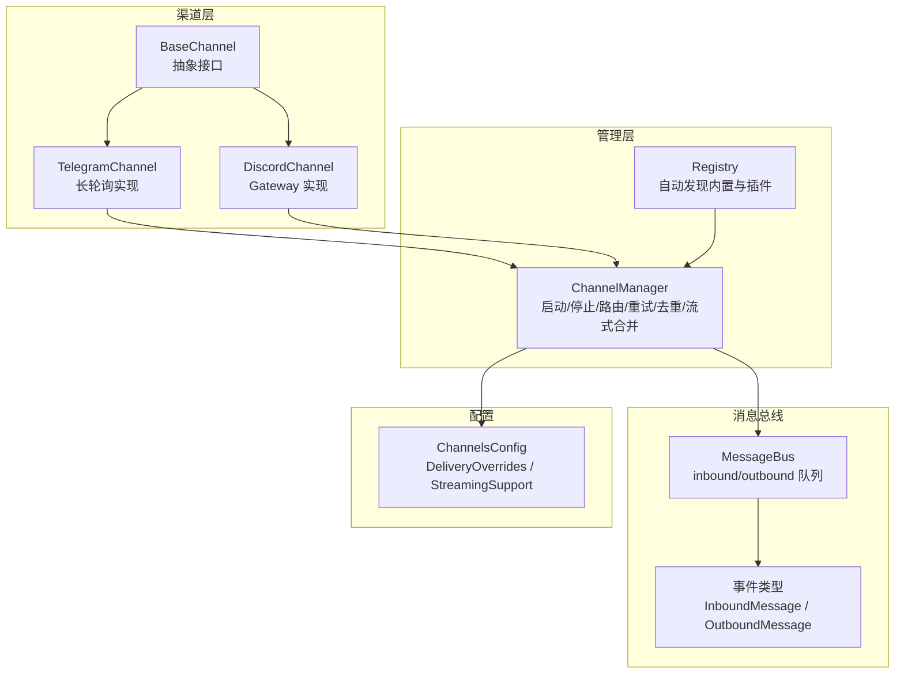
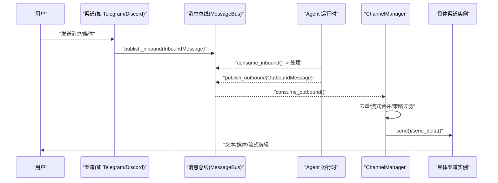
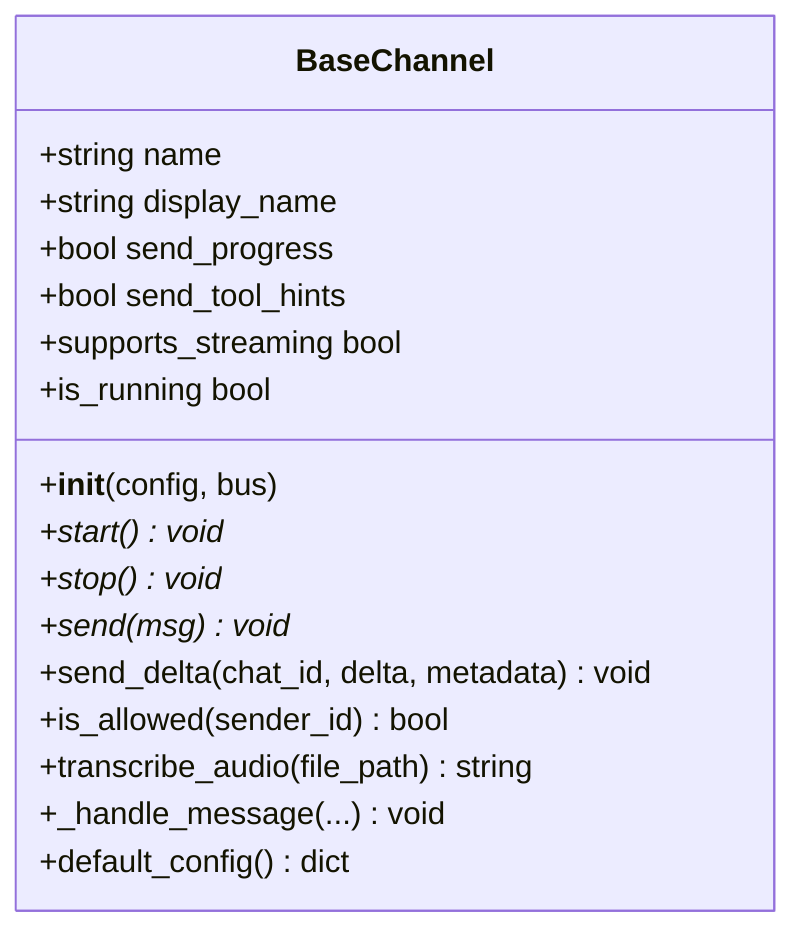
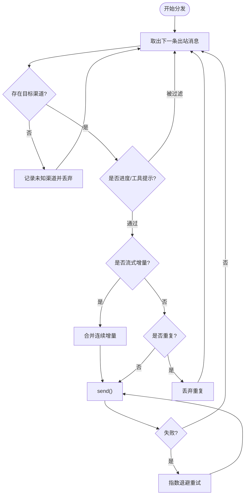
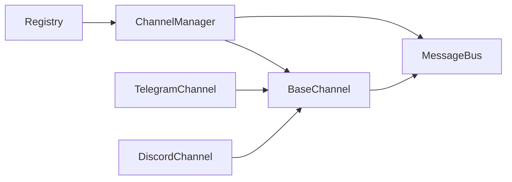

# 渠道开发指南

<cite>
**本文引用的文件**
- [base.py](file://deeptutor/partners/channels/base.py)
- [manager.py](file://deeptutor/partners/channels/manager.py)
- [registry.py](file://deeptutor/partners/channels/registry.py)
- [schema.py](file://deeptutor/partners/config/schema.py)
- [events.py](file://deeptutor/partners/bus/events.py)
- [queue.py](file://deeptutor/partners/bus/queue.py)
- [telegram.py](file://deeptutor/partners/channels/telegram.py)
- [discord.py](file://deeptutor/partners/channels/discord.py)
</cite>

## 目录
1. [简介](#简介)
2. [项目结构](#项目结构)
3. [核心组件](#核心组件)
4. [架构总览](#架构总览)
5. [详细组件分析](#详细组件分析)
6. [依赖关系分析](#依赖关系分析)
7. [性能考虑](#性能考虑)
8. [故障排查指南](#故障排查指南)
9. [结论](#结论)
10. [附录](#附录)

## 简介
本指南面向需要在 DeepTutor 中新增或扩展“渠道适配器”（Channel Adapter）的开发者。内容涵盖：
- 如何继承 BaseChannel 并实现必需方法
- 可选增强能力（流式响应、音频转写、进度与工具提示控制）
- 渠道配置结构与环境变量约定
- 认证流程与入站消息解析、出站消息发送、流式响应处理
- 测试方法（单元、集成、模拟环境）
- 调试技巧、日志记录与性能监控
- 完整示例代码路径与最佳实践
- 渠道发布与分发流程（内置与插件）

## 项目结构
DeepTutor 的渠道子系统位于 partners 包下，采用“通道抽象 + 管理器 + 消息总线 + 具体实现”的分层设计：
- 抽象接口：BaseChannel 定义统一契约
- 管理器：ChannelManager 负责生命周期、路由、重试、去重与流式合并
- 注册中心：自动发现内置渠道与外部插件
- 消息总线：解耦渠道与 Agent 运行时
- 配置模型：Pydantic 模型统一校验与别名兼容
- 具体实现：Telegram、Discord 等作为参考实现

图表来源
- [base.py:19-185](file://deeptutor/partners/channels/base.py#L19-L185)
- [manager.py:31-341](file://deeptutor/partners/channels/manager.py#L31-L341)
- [registry.py:17-86](file://deeptutor/partners/channels/registry.py#L17-L86)
- [events.py:8-37](file://deeptutor/partners/bus/events.py#L8-L37)
- [queue.py:8-45](file://deeptutor/partners/bus/queue.py#L8-L45)
- [schema.py:9-51](file://deeptutor/partners/config/schema.py#L9-L51)

章节来源
- [base.py:19-185](file://deeptutor/partners/channels/base.py#L19-L185)
- [manager.py:31-341](file://deeptutor/partners/channels/manager.py#L31-L341)
- [registry.py:17-86](file://deeptutor/partners/channels/registry.py#L17-L86)
- [events.py:8-37](file://deeptutor/partners/bus/events.py#L8-L37)
- [queue.py:8-45](file://deeptutor/partners/bus/queue.py#L8-L45)
- [schema.py:9-51](file://deeptutor/partners/config/schema.py#L9-L51)

## 核心组件
- BaseChannel：定义 start/stop/send 以及可选 send_delta；提供权限校验、流式支持判定、音频转写辅助、默认配置模板。
- ChannelManager：初始化启用渠道、启动/停止、出站消息分发、重复抑制、流式增量合并、指数退避重试。
- Registry：扫描内置模块与 entry_points 插件，返回可用渠道类映射。
- MessageBus：异步队列，承载 InboundMessage/OutboundMessage。
- ChannelsConfig：统一配置模型，含 DeliveryOverrides（send_progress/send_tool_hints）、StreamingSupport（streaming）。

章节来源
- [base.py:19-185](file://deeptutor/partners/channels/base.py#L19-L185)
- [manager.py:31-341](file://deeptutor/partners/channels/manager.py#L31-L341)
- [registry.py:17-86](file://deeptutor/partners/channels/registry.py#L17-L86)
- [events.py:8-37](file://deeptutor/partners/bus/events.py#L8-L37)
- [queue.py:8-45](file://deeptutor/partners/bus/queue.py#L8-L45)
- [schema.py:9-51](file://deeptutor/partners/config/schema.py#L9-L51)

## 架构总览
下图展示从用户消息到渠道回复的端到端流程，包括入站解析、Agent 处理、出站分发、流式增量与重试。

图表来源
- [events.py:8-37](file://deeptutor/partners/bus/events.py#L8-L37)
- [queue.py:8-45](file://deeptutor/partners/bus/queue.py#L8-L45)
- [manager.py:187-327](file://deeptutor/partners/channels/manager.py#L187-L327)
- [telegram.py:271-353](file://deeptutor/partners/channels/telegram.py#L271-L353)
- [discord.py:72-110](file://deeptutor/partners/channels/discord.py#L72-L110)

## 详细组件分析

### BaseChannel 抽象与扩展点
- 必需实现
  - start(): 连接平台、监听消息、通过 _handle_message 转发至总线
  - stop(): 清理资源
  - send(msg): 发送普通消息（失败需抛出异常以便管理器重试）
- 可选增强
  - send_delta(chat_id, delta, metadata): 实现流式增量更新（原地编辑）
  - supports_streaming: 当配置开启且子类实现了 send_delta 时生效
  - transcribe_audio(file_path): 基于 Groq Whisper 的音频转写（需配置 API Key）
  - is_allowed(sender_id): 白名单控制（空列表拒绝全部，“*”允许全部）
  - default_config(): 提供默认配置模板，便于引导创建
- 内部机制
  - _handle_message: 权限检查、注入 _wants_stream 标记、构造 InboundMessage 并发布

图表来源
- [base.py:19-185](file://deeptutor/partners/channels/base.py#L19-L185)

章节来源
- [base.py:19-185](file://deeptutor/partners/channels/base.py#L19-L185)

### ChannelManager 出站路由与可靠性
- 职责
  - 初始化已启用的渠道（读取 ChannelsConfig）
  - 启动/停止所有渠道
  - 出站消息分发：去重、流式增量合并、按开关过滤（进度/工具提示）
  - 重试策略：指数退避（1s/2s/4s），可配置最大重试次数
- 关键行为
  - 流式合并：对同一 (channel, chat_id, stream_id) 的连续 _stream_delta 进行合并，减少频繁编辑调用
  - 重复抑制：基于内容指纹与 origin_message_id/message_id 避免重复回复
  - 开关过滤：根据 channel.send_progress/send_tool_hints 决定是否投递进度/工具提示

图表来源
- [manager.py:187-327](file://deeptutor/partners/channels/manager.py#L187-L327)

章节来源
- [manager.py:31-341](file://deeptutor/partners/channels/manager.py#L31-L341)

### 配置结构与字段说明
- ChannelsConfig
  - send_max_retries: 出站失败最大重试次数
  - 额外字段：每个渠道的配置以额外字段存储，由各自渠道在 __init__ 中解析
- DeliveryOverrides
  - send_progress: 是否向该渠道投递 Agent 叙述进度
  - send_tool_hints: 是否投递一行工具调用提示
- StreamingSupport
  - streaming: 是否启用就地编辑的实时流式回复（需要渠道实现 send_delta）
- 兼容性
  - 支持 camelCase 与 snake_case 键名（alias_generator=to_camel）

章节来源
- [schema.py:9-51](file://deeptutor/partners/config/schema.py#L9-L51)

### 入站消息解析与权限控制
- 通用流程
  - 渠道收到消息后，调用 _handle_message(sender_id, chat_id, content, media, metadata, session_key_override)
  - 先执行 is_allowed(sender_id) 白名单校验
  - 若 supports_streaming 且 send_progress，则注入 _wants_stream
  - 构造 InboundMessage 并通过 bus.publish_inbound 推送
- 渠道特定细节
  - Telegram：支持群组主题会话 key、引用上下文提取、命令菜单注册
  - Discord：通过 Gateway 事件驱动，支持提及策略与附件下载

章节来源
- [base.py:126-175](file://deeptutor/partners/channels/base.py#L126-L175)
- [telegram.py:708-766](file://deeptutor/partners/channels/telegram.py#L708-L766)
- [discord.py:394-457](file://deeptutor/partners/channels/discord.py#L394-L457)

### 出站消息发送与流式响应
- 普通发送
  - ChannelManager._send_once 判断是否为流式增量或最终消息，分别调用 send_delta 或 send
- 流式增量
  - 渠道需实现 send_delta，维护 per-chat 缓冲区与最后编辑时间
  - Telegram：edit_message_text 渐进更新，超长时拆分多段
  - Discord：PATCH 编辑消息，超长时拆分后续消息
- 合并与节流
  - ChannelManager 合并连续增量，降低编辑频率
  - 各渠道内部设置最小编辑间隔，避免触发限流

章节来源
- [manager.py:239-294](file://deeptutor/partners/channels/manager.py#L239-L294)
- [telegram.py:555-706](file://deeptutor/partners/channels/telegram.py#L555-L706)
- [discord.py:175-246](file://deeptutor/partners/channels/discord.py#L175-L246)

### 认证流程与环境变量
- 渠道 Token/密钥
  - Telegram：token（Bot Token）
  - Discord：token（Bot Token）
  - 其他渠道类似，均在各自配置中声明
- 音频转写
  - 通过 ChannelManager 将 groq_api_key 注入到渠道实例的 transcription_api_key
  - BaseChannel.transcribe_audio 使用 GroqTranscriptionProvider
- 安全建议
  - 使用环境变量或密钥管理服务注入敏感信息
  - 避免在配置文件中明文存放 token

章节来源
- [manager.py:42-88](file://deeptutor/partners/channels/manager.py#L42-L88)
- [base.py:47-58](file://deeptutor/partners/channels/base.py#L47-L58)
- [telegram.py:196-211](file://deeptutor/partners/channels/telegram.py#L196-L211)
- [discord.py:38-47](file://deeptutor/partners/channels/discord.py#L38-L47)

### 测试方法与模拟环境
- 单元测试
  - 针对 BaseChannel 的 is_allowed、supports_streaming、_handle_message 逻辑
  - 针对 ChannelManager 的去重、合并、重试分支
- 集成测试
  - 使用 MessageBus 模拟 inbound/outbound 队列
  - 使用 pytest-asyncio 运行异步用例
  - 对 Telegram/Discord 可使用本地 mock 或沙箱服务
- 模拟环境搭建
  - 使用内存队列替代真实网络调用
  - 对第三方 SDK（如 telegram.ext.Application、websockets）打桩
  - 验证流式合并与重复抑制的正确性

章节来源
- [queue.py:8-45](file://deeptutor/partners/bus/queue.py#L8-L45)
- [manager.py:187-327](file://deeptutor/partners/channels/manager.py#L187-L327)
- [base.py:116-175](file://deeptutor/partners/channels/base.py#L116-L175)

### 调试技巧、日志与性能监控
- 日志
  - 使用 loguru 记录错误、警告与调试信息
  - 关注 ChannelManager 的重试与丢弃日志
- 调试要点
  - 确认 allow_from 非空且包含预期用户或 “*”
  - 检查 streaming 与 send_progress 组合是否符合预期
  - 观察流式增量合并是否有效减少编辑次数
- 性能监控
  - 统计 outbound/inbound 队列长度
  - 监控渠道 API 限流与重试次数
  - 评估流式编辑间隔与消息长度切分策略

章节来源
- [manager.py:187-327](file://deeptutor/partners/channels/manager.py#L187-L327)
- [base.py:13-17](file://deeptutor/partners/channels/base.py#L13-L17)

### 渠道发布与分发流程
- 内置渠道
  - 将新渠道模块放入 deeptutor/partners/channels/ 目录
  - 确保模块导出一个 BaseChannel 子类
  - 通过 registry 自动发现
- 外部插件
  - 通过 entry_points 注册到组 "deeptutor.partners.channels"
  - 插件名称不得与内置渠道冲突（内置优先）
- 启用与配置
  - 在 ChannelsConfig 对应 section 中设置 enabled=true
  - 按需配置 delivery 开关与 streaming

章节来源
- [registry.py:17-86](file://deeptutor/partners/channels/registry.py#L17-L86)
- [manager.py:57-88](file://deeptutor/partners/channels/manager.py#L57-L88)
- [schema.py:40-51](file://deeptutor/partners/config/schema.py#L40-L51)

## 依赖关系分析
- 耦合与内聚
  - BaseChannel 与 MessageBus 低耦合，仅通过事件类型交互
  - ChannelManager 集中管理路由与可靠性，提高内聚
  - 具体渠道实现仅依赖 BaseChannel 与平台 SDK
- 外部依赖
  - Telegram：python-telegram-bot
  - Discord：websockets、httpx
  - 音频转写：GroqWhisper（可选）
- 潜在循环依赖
  - 通过 registry 延迟导入，避免启动时全量加载
  - 管理器与渠道之间通过接口而非具体实现耦合

图表来源
- [base.py:19-185](file://deeptutor/partners/channels/base.py#L19-L185)
- [manager.py:31-341](file://deeptutor/partners/channels/manager.py#L31-L341)
- [registry.py:17-86](file://deeptutor/partners/channels/registry.py#L17-L86)
- [telegram.py:213-251](file://deeptutor/partners/channels/telegram.py#L213-L251)
- [discord.py:49-71](file://deeptutor/partners/channels/discord.py#L49-L71)

章节来源
- [base.py:19-185](file://deeptutor/partners/channels/base.py#L19-L185)
- [manager.py:31-341](file://deeptutor/partners/channels/manager.py#L31-L341)
- [registry.py:17-86](file://deeptutor/partners/channels/registry.py#L17-L86)

## 性能考虑
- 流式编辑节流
  - 各渠道设置最小编辑间隔，避免触发平台限流
  - ChannelManager 合并连续增量，减少编辑次数
- 消息切分
  - 按平台限制（如 Telegram 4000/4096、Discord 2000）切分内容
- 连接池与超时
  - Telegram 分离 getUpdates 与 API 请求的连接池，避免长轮询耗尽连接
  - 合理设置连接超时与读超时
- 重试与退避
  - 指数退避缓解瞬时失败，避免雪崩
- 内存与缓冲
  - 流式缓冲区按 chat_id/stream_id 隔离，及时释放

[本节为通用指导，不直接分析具体文件]

## 故障排查指南
- 常见问题
  - 白名单为空导致全部拒绝：需设置为 ["*"] 或添加用户 ID
  - 未启用 streaming 但期望流式效果：需同时开启 streaming 并实现 send_delta
  - 出站失败：查看重试日志与平台限流提示
- 定位步骤
  - 检查渠道是否 enabled 且 token 正确
  - 确认 allow_from 配置
  - 观察 ChannelManager 的去重与合并日志
  - 验证流式缓冲区状态与编辑间隔
- 恢复策略
  - 调整重试次数与间隔
  - 降低流式编辑频率
  - 切换为普通发送模式

章节来源
- [manager.py:108-121](file://deeptutor/partners/channels/manager.py#L108-L121)
- [base.py:116-125](file://deeptutor/partners/channels/base.py#L116-L125)
- [telegram.py:516-553](file://deeptutor/partners/channels/telegram.py#L516-L553)
- [discord.py:158-173](file://deeptutor/partners/channels/discord.py#L158-L173)

## 结论
通过 BaseChannel 抽象与 ChannelManager 的统一管理，DeepTutor 提供了可扩展、高可靠、易测试的渠道适配框架。新增渠道只需实现最少接口，即可复用去重、重试、流式合并与配置校验等能力。结合合理的节流、切分与监控策略，可在不同平台上获得一致的用户体验。

[本节为总结，不直接分析具体文件]

## 附录
- 示例代码路径
  - Telegram 渠道实现：[telegram.py](file://deeptutor/partners/channels/telegram.py)
  - Discord 渠道实现：[discord.py](file://deeptutor/partners/channels/discord.py)
  - 基础抽象与管理器：[base.py](file://deeptutor/partners/channels/base.py)、[manager.py](file://deeptutor/partners/channels/manager.py)
  - 配置模型：[schema.py](file://deeptutor/partners/config/schema.py)
  - 消息事件与队列：[events.py](file://deeptutor/partners/bus/events.py)、[queue.py](file://deeptutor/partners/bus/queue.py)
  - 渠道发现：[registry.py](file://deeptutor/partners/channels/registry.py)

[本节为索引，不直接分析具体文件]