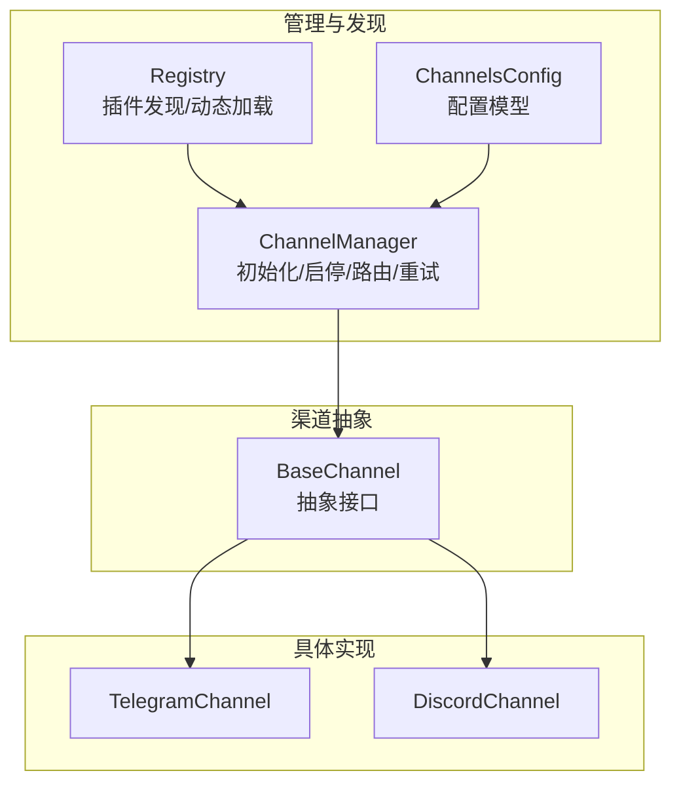
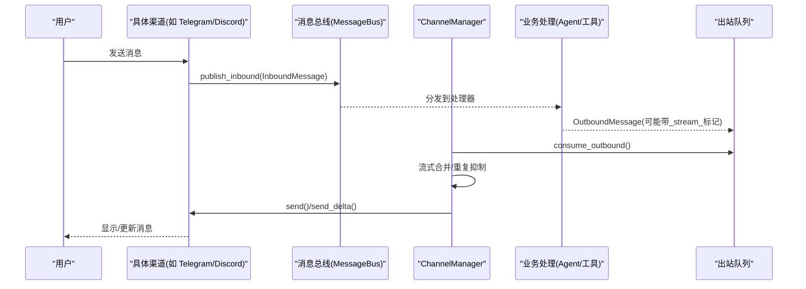
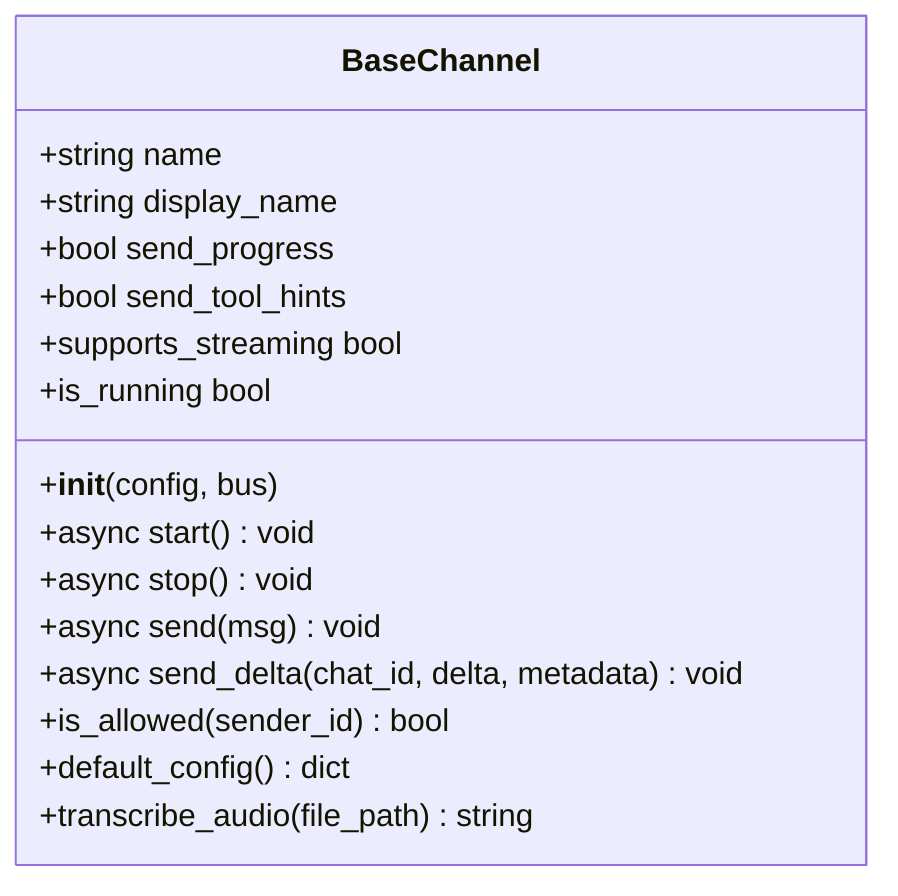
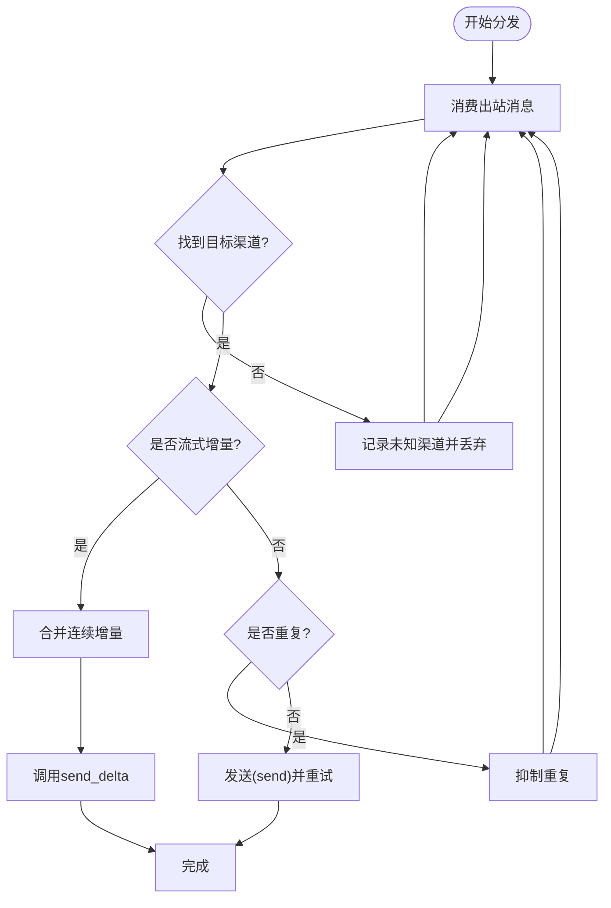
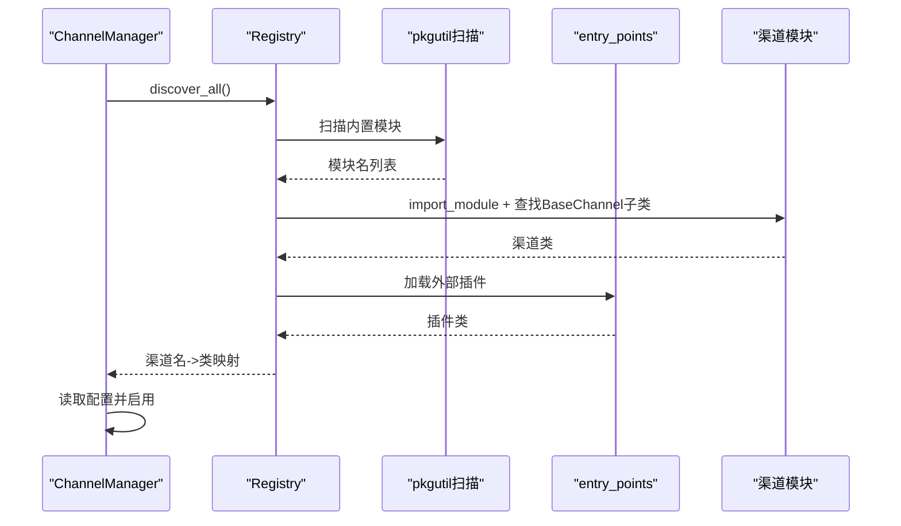
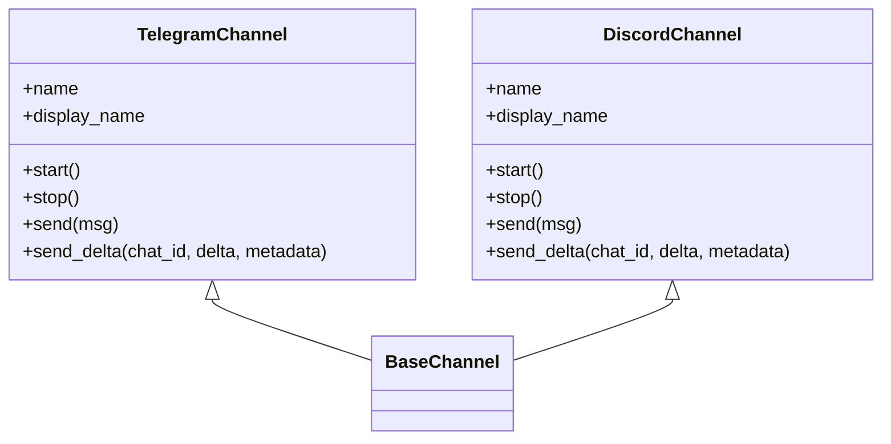
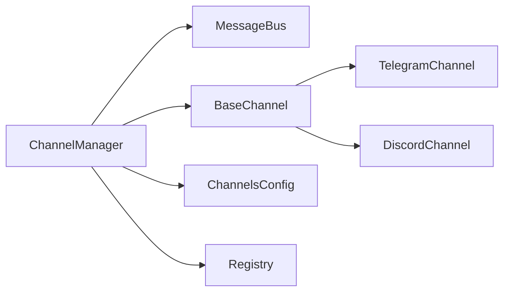

# 渠道架构设计

<cite>
**本文引用的文件**
- [base.py](file://deeptutor/partners/channels/base.py)
- [manager.py](file://deeptutor/partners/channels/manager.py)
- [registry.py](file://deeptutor/partners/channels/registry.py)
- [schema.py](file://deeptutor/partners/config/schema.py)
- [telegram.py](file://deeptutor/partners/channels/telegram.py)
- [discord.py](file://deeptutor/partners/channels/discord.py)
</cite>

## 目录
1. [简介](#简介)
2. [项目结构](#项目结构)
3. [核心组件](#核心组件)
4. [架构总览](#架构总览)
5. [详细组件分析](#详细组件分析)
6. [依赖关系分析](#依赖关系分析)
7. [性能考虑](#性能考虑)
8. [故障排查指南](#故障排查指南)
9. [结论](#结论)
10. [附录：扩展与最佳实践](#附录：扩展与最佳实践)

## 简介
本文件面向DeepTutor的“渠道”子系统，系统性阐述基础渠道类BaseChannel的设计模式与抽象接口、渠道注册机制（插件发现、动态加载、配置管理）、ChannelManager的核心职责（初始化、启停管理、消息路由、重试与流式合并、重复抑制），以及状态监控、错误处理与故障恢复。同时给出渠道开发的最佳实践与扩展指南，帮助快速实现新的聊天平台接入。

## 项目结构
渠道子系统位于 partners/channels 下，采用“抽象基类 + 具体实现 + 管理器 + 自动发现”的分层组织方式：
- 抽象基类：定义统一的启动/停止、发送、流式增量发送、生命周期与权限控制等接口。
- 具体实现：针对各平台（如Telegram、Discord）提供适配逻辑，包括连接、收发、限流与流式编辑。
- 管理器：负责通道发现、启用、启动/停止、出站消息分发、重试、流式合并与重复抑制。
- 自动发现：通过包扫描与entry_points发现内置与外部插件渠道，并合并注册。
- 配置模型：使用Pydantic模型统一描述渠道配置项，支持camelCase/snake_case兼容。

图表来源
- [manager.py:31-88](file://deeptutor/partners/channels/manager.py#L31-L88)
- [registry.py:17-86](file://deeptutor/partners/channels/registry.py#L17-L86)
- [schema.py:40-51](file://deeptutor/partners/config/schema.py#L40-L51)
- [base.py:19-185](file://deeptutor/partners/channels/base.py#L19-L185)

章节来源
- [base.py:19-185](file://deeptutor/partners/channels/base.py#L19-L185)
- [manager.py:31-341](file://deeptutor/partners/channels/manager.py#L31-L341)
- [registry.py:17-86](file://deeptutor/partners/channels/registry.py#L17-L86)
- [schema.py:9-51](file://deeptutor/partners/config/schema.py#L9-L51)

## 核心组件
- BaseChannel：定义渠道的统一契约，包括start/stop/send、可选的send_delta流式增量、权限校验allow_from、默认配置default_config、运行状态is_running与音频转写能力。
- ChannelManager：集中管理所有已启用渠道的生命周期；从MessageBus消费出站消息，按目标channel路由；对失败消息进行指数退避重试；对流式增量进行合并以减少频繁编辑；对重复回复进行指纹去重。
- Registry：自动发现内置渠道模块与外部插件（entry_points），并返回可实例化的渠道类映射；内置优先，避免外部插件覆盖。
- ChannelsConfig：基于Pydantic的配置模型，支持每渠道的send_progress、send_tool_hints与streaming开关，以及全局的重试次数上限。

章节来源
- [base.py:19-185](file://deeptutor/partners/channels/base.py#L19-L185)
- [manager.py:31-341](file://deeptutor/partners/channels/manager.py#L31-L341)
- [registry.py:17-86](file://deeptutor/partners/channels/registry.py#L17-L86)
- [schema.py:9-51](file://deeptutor/partners/config/schema.py#L9-L51)

## 架构总览
下图展示了从入站到出站的完整流程：渠道监听入站消息→封装为InboundMessage→总线分发→业务处理→生成OutboundMessage→ChannelManager路由→具体渠道发送（含重试、流式合并、重复抑制）。

图表来源
- [base.py:126-174](file://deeptutor/partners/channels/base.py#L126-L174)
- [manager.py:187-294](file://deeptutor/partners/channels/manager.py#L187-L294)

## 详细组件分析

### BaseChannel：抽象接口与生命周期
- 生命周期
  - start：建立连接并开始监听入站消息，内部调用_handle_message将入站消息推送到总线。
  - stop：释放资源，关闭连接与任务。
  - is_running：暴露当前运行状态。
- 消息发送
  - send：发送普通消息；实现应抛出异常以便上层重试。
  - send_delta：可选实现以支持流式增量更新（原地编辑消息）。
- 权限控制
  - is_allowed：基于allow_from白名单控制访问，空列表拒绝全部，包含“*”则放行全部。
- 流式能力
  - supports_streaming：当配置开启且子类实现了send_delta时生效。
- 其他
  - default_config：用于引导配置填充。
  - transcribe_audio：可选音频转写能力（通过Groq Whisper）。

图表来源
- [base.py:19-185](file://deeptutor/partners/channels/base.py#L19-L185)

章节来源
- [base.py:19-185](file://deeptutor/partners/channels/base.py#L19-L185)

### ChannelManager：初始化、启停、路由、重试与优化
- 初始化与启用
  - _init_channels：通过Registry发现所有渠道，读取ChannelsConfig中对应section，仅启用enabled=true的渠道；注入transcription_api_key与send_progress/send_tool_hints有效标志；校验allow_from非空。
- 启停管理
  - start_all：启动出站分发器任务，并发启动所有渠道。
  - stop_all：取消分发任务，逐个调用channel.stop。
- 出站路由与优化
  - _dispatch_outbound：循环消费出站队列，按msg.channel选择目标渠道；根据metadata中的_stream_*标记进行流式合并；对非流式消息执行重复抑制；最终调用_send_with_retry。
  - _coalesce_stream_deltas：将同一(channel, chat_id, stream_id)的连续_stream_delta合并为一次批量更新，减少API调用。
  - _should_suppress_outbound：基于origin_message_id或message_id的内容指纹，抑制完全相同的重复回复。
- 重试机制
  - _send_with_retry：按配置的最大重试次数与固定延迟序列(1s, 2s, 4s)进行指数退避重试；遇到CancelledError向上抛出以支持优雅停机。
- 状态查询
  - get_status：返回每个渠道的enabled与running状态。
  - enabled_channels：列出已启用渠道名称。

图表来源
- [manager.py:187-327](file://deeptutor/partners/channels/manager.py#L187-L327)

章节来源
- [manager.py:31-341](file://deeptutor/partners/channels/manager.py#L31-L341)

### 渠道注册机制：插件发现、动态加载与配置管理
- 内置渠道发现：通过pkgutil扫描channels包下的模块，排除内部模块（base、manager、registry），返回模块名列表。
- 动态加载：按模块名import，并在模块内查找BaseChannel的子类作为渠道实现。
- 外部插件发现：通过importlib.metadata.entry_points(group="deeptutor.partners.channels")加载第三方插件。
- 优先级策略：内置渠道优先，同名外部插件会被忽略并记录警告。
- 配置管理：ChannelsConfig允许额外字段存储各渠道配置；ChannelManager在初始化时读取对应section并解析布尔开关（兼容camelCase别名）。

图表来源
- [registry.py:17-86](file://deeptutor/partners/channels/registry.py#L17-L86)
- [manager.py:57-88](file://deeptutor/partners/channels/manager.py#L57-L88)
- [schema.py:40-51](file://deeptutor/partners/config/schema.py#L40-L51)

章节来源
- [registry.py:17-86](file://deeptutor/partners/channels/registry.py#L17-L86)
- [manager.py:57-88](file://deeptutor/partners/channels/manager.py#L57-L88)
- [schema.py:40-51](file://deeptutor/partners/config/schema.py#L40-L51)

### 具体渠道实现要点（Telegram、Discord）
- TelegramChannel
  - 支持流式编辑：维护每会话的缓冲与最后编辑时间，限制edit频率以避免触发平台限流。
  - 内容转换：Markdown到HTML转换、表格渲染、代码块保护等。
  - 分片发送：超长消息按平台限制拆分。
- DiscordChannel
  - 使用Gateway WebSocket保持长连接，心跳保活与断线重连。
  - 流式编辑：首次创建消息，后续PATCH更新；超长内容拆分为多条消息。
  - 限流处理：对429响应进行等待与重试。

图表来源
- [telegram.py:196-200](file://deeptutor/partners/channels/telegram.py#L196-L200)
- [discord.py:38-70](file://deeptutor/partners/channels/discord.py#L38-L70)
- [discord.py:111-200](file://deeptutor/partners/channels/discord.py#L111-L200)

章节来源
- [telegram.py:1-200](file://deeptutor/partners/channels/telegram.py#L1-L200)
- [discord.py:1-200](file://deeptutor/partners/channels/discord.py#L1-L200)

## 依赖关系分析
- ChannelManager依赖：
  - MessageBus：消费出站消息、发布入站消息。
  - BaseChannel：统一抽象接口。
  - ChannelsConfig：读取全局重试次数与每渠道配置。
  - Registry：发现并加载渠道类。
- 具体渠道依赖：
  - 各自平台的SDK/HTTP客户端（如python-telegram-bot、websockets/httpx）。
  - 公共工具：消息拆分、媒体路径、配置路径等。

图表来源
- [manager.py:31-88](file://deeptutor/partners/channels/manager.py#L31-L88)
- [base.py:19-185](file://deeptutor/partners/channels/base.py#L19-L185)
- [registry.py:17-86](file://deeptutor/partners/channels/registry.py#L17-L86)
- [schema.py:40-51](file://deeptutor/partners/config/schema.py#L40-L51)

章节来源
- [manager.py:31-88](file://deeptutor/partners/channels/manager.py#L31-L88)
- [base.py:19-185](file://deeptutor/partners/channels/base.py#L19-L185)
- [registry.py:17-86](file://deeptutor/partners/channels/registry.py#L17-L86)
- [schema.py:40-51](file://deeptutor/partners/config/schema.py#L40-L51)

## 性能考虑
- 流式增量合并：对同一会话的连续_stream_delta进行合并，显著降低平台编辑API调用次数，提升用户体验。
- 重复抑制：基于内容指纹与来源消息ID，避免重复推送相同回复，减轻网络与平台压力。
- 重试退避：固定延迟序列(1s, 2s, 4s)配合最大重试次数，平衡可靠性与时延。
- 并发启动：多渠道并行start，缩短整体启动时间。
- 限流与分片：具体渠道实现中对平台限流与消息长度限制进行处理，避免被拒。

[本节为通用性能建议，不直接分析特定文件]

## 故障排查指南
- 渠道未启用
  - 检查ChannelsConfig中对应渠道的enabled是否为true。
  - 确认allow_from不为空列表（否则启动时会终止并提示）。
- 启动失败
  - 查看_channel启动日志，定位平台认证或连接问题。
  - 对于WebSocket渠道，关注断线重连与心跳任务。
- 出站失败
  - 观察重试日志与最终失败原因；必要时调整send_max_retries或平台侧限流策略。
- 流式异常
  - 若send_delta未实现或supports_streaming为false，将回退为普通发送。
  - 检查_stream_id一致性，确保同一流段的消息正确合并。
- 重复消息
  - 若出现重复，检查metadata中origin_message_id/message_id是否正确设置。

章节来源
- [manager.py:108-121](file://deeptutor/partners/channels/manager.py#L108-L121)
- [manager.py:187-327](file://deeptutor/partners/channels/manager.py#L187-L327)
- [base.py:116-124](file://deeptutor/partners/channels/base.py#L116-L124)

## 结论
DeepTutor渠道子系统通过清晰的抽象接口、强大的管理器与灵活的插件机制，实现了多渠道的统一接入与高效管理。ChannelManager在路由、重试、流式合并与重复抑制方面提供了关键保障；BaseChannel定义了可扩展的契约，便于快速接入新平台。结合完善的配置模型与自动发现机制，系统具备良好的可维护性与扩展性。

[本节为总结性内容，不直接分析特定文件]

## 附录：扩展与最佳实践
- 新增渠道步骤
  - 在channels目录下新建模块，实现BaseChannel的start/stop/send，可选实现send_delta以支持流式。
  - 在模块中定义default_config，提供默认配置项。
  - 如需外部插件，通过entry_points注册到group="deeptutor.partners.channels"。
- 配置建议
  - 合理设置send_progress与send_tool_hints，避免不必要的进度噪音。
  - 开启streaming以获得更好的实时体验，但需确保send_delta实现稳定。
  - 设置合理的send_max_retries，兼顾可靠性与延迟。
- 权限与安全
  - 务必配置allow_from，避免空列表导致全拒绝；生产环境建议使用精确白名单或显式“*”。
- 流式实现要点
  - 使用_stream_id区分不同流段，避免跨流污染。
  - 控制编辑频率，遵循平台限流策略。
  - 正确处理_stream_end，清理缓冲区与状态。
- 错误处理
  - 在send/send_delta中抛出异常，交由ChannelManager统一重试与记录。
  - 捕获平台特定异常（如429），进行友好降级或等待。

[本节为通用指导，不直接分析特定文件]