# 渠道管理

<cite>
**本文引用的文件**
- [base.py](file://deeptutor/partners/channels/base.py)
- [registry.py](file://deeptutor/partners/channels/registry.py)
- [manager.py](file://deeptutor/partners/channels/manager.py)
- [feishu.py](file://deeptutor/partners/channels/feishu.py)
- [dingtalk.py](file://deeptutor/partners/channels/dingtalk.py)
- [wecom.py](file://deeptutor/partners/channels/wecom.py)
- [telegram.py](file://deeptutor/partners/channels/telegram.py)
- [slack.py](file://deeptutor/partners/channels/slack.py)
- [discord.py](file://deeptutor/partners/channels/discord.py)
- [whatsapp.py](file://deeptutor/partners/channels/whatsapp.py)
</cite>

## 目录
1. [简介](#简介)
2. [项目结构](#项目结构)
3. [核心组件](#核心组件)
4. [架构总览](#架构总览)
5. [详细组件分析](#详细组件分析)
6. [依赖关系分析](#依赖关系分析)
7. [性能考虑](#性能考虑)
8. [故障排除指南](#故障排除指南)
9. [结论](#结论)
10. [附录：渠道开发指南](#附录：渠道开发指南)

## 简介
本文件面向 DeepTutor 合作伙伴渠道管理系统，系统性说明渠道架构设计、注册机制与生命周期管理；详解已实现的 IM 平台（飞书、钉钉、企业微信、Telegram、Slack、Discord、WhatsApp）；阐述渠道配置、连接管理与错误处理；解释消息格式转换、协议适配与流式通信实现；并提供新增渠道适配器开发指南、性能优化与故障排除方法。

## 项目结构
渠道子系统位于 partners/channels 包内，采用“基础抽象 + 多平台实现 + 统一管理器”的分层组织：
- 基础抽象：定义统一的 Channel 接口、消息收发、流式增量更新、权限白名单等能力。
- 平台实现：各 IM 平台独立模块，封装各自 SDK/协议细节。
- 注册与发现：自动扫描内置渠道与外部插件，提供加载入口。
- 通道管理器：负责启用、启动、停止、出站路由、重试、去重与流式合并。

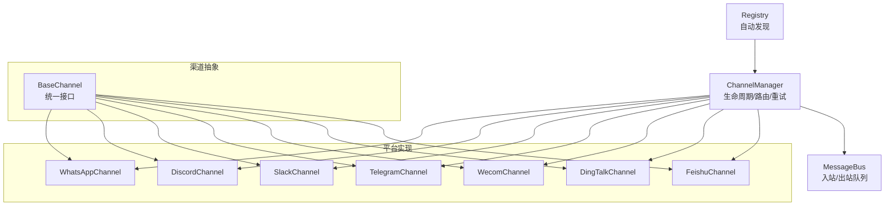

**图表来源**
- [base.py:19-185](file://deeptutor/partners/channels/base.py#L19-L185)
- [registry.py:17-86](file://deeptutor/partners/channels/registry.py#L17-L86)
- [manager.py:31-341](file://deeptutor/partners/channels/manager.py#L31-L341)

**章节来源**
- [base.py:19-185](file://deeptutor/partners/channels/base.py#L19-L185)
- [registry.py:17-86](file://deeptutor/partners/channels/registry.py#L17-L86)
- [manager.py:31-341](file://deeptutor/partners/channels/manager.py#L31-L341)

## 核心组件
- BaseChannel：定义 start/stop/send/send_delta、_handle_message、allow_from 权限控制、默认配置、流式支持判定等。
- Registry：通过 pkgutil 扫描内置渠道模块，并通过 entry_points 发现外部插件；返回可实例化的 Channel 类映射。
- ChannelManager：初始化启用的渠道、启动/停止所有渠道、出站分发、重复抑制、流式增量合并、指数退避重试、状态查询。

关键职责要点
- 生命周期：start_all 启动出站分发器与各渠道；stop_all 取消分发任务并逐一 stop。
- 出站路由：根据 OutboundMessage.channel 选择对应 channel；对 _stream_delta/_stream_end 进行合并与节流。
- 重试策略：按 send_max_retries 配置进行指数退避重试，记录失败日志。
- 去重：基于 origin_message_id/message_id 与内容指纹避免重复回复。

**章节来源**
- [base.py:19-185](file://deeptutor/partners/channels/base.py#L19-L185)
- [registry.py:17-86](file://deeptutor/partners/channels/registry.py#L17-L86)
- [manager.py:31-341](file://deeptutor/partners/channels/manager.py#L31-L341)

## 架构总览
下图展示从入站到出站的完整流程：平台事件经渠道解析为 InboundMessage 发布到总线；Agent 处理后产出 OutboundMessage；ChannelManager 消费并路由至具体渠道；渠道实现负责协议适配与发送（含流式）。

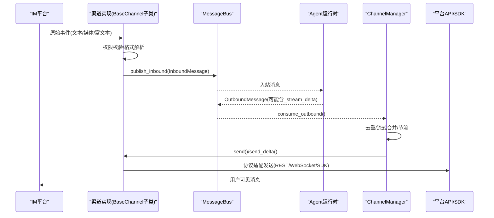

**图表来源**
- [base.py:126-174](file://deeptutor/partners/channels/base.py#L126-L174)
- [manager.py:187-294](file://deeptutor/partners/channels/manager.py#L187-L294)
- [telegram.py:555-670](file://deeptutor/partners/channels/telegram.py#L555-L670)
- [discord.py:175-200](file://deeptutor/partners/channels/discord.py#L175-L200)
- [feishu.py:252-264](file://deeptutor/partners/channels/feishu.py#L252-L264)

## 详细组件分析

### 基础渠道抽象 BaseChannel
- 统一接口：start/stop/send；可选 send_delta 用于流式增量更新。
- 入站处理：_handle_message 负责 allow_from 校验、构建 InboundMessage 并发布到总线。
- 流式能力：supports_streaming 由配置 streaming 与是否重写 send_delta 决定。
- 默认配置：default_config 便于前端或工具自动生成配置模板。

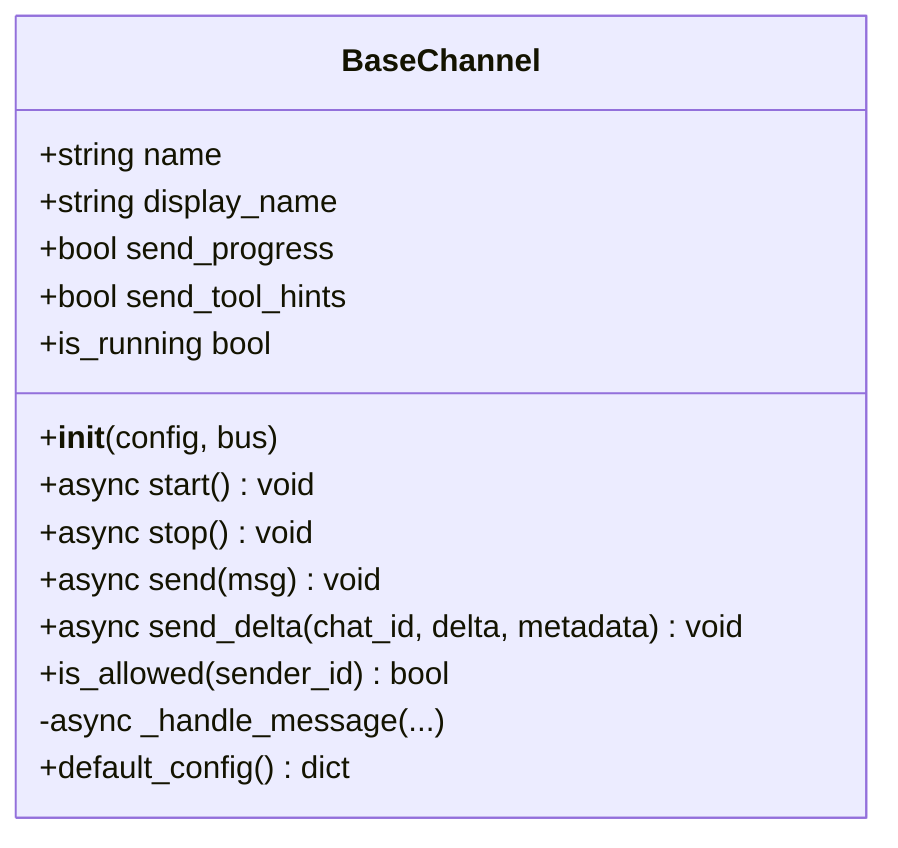

**图表来源**
- [base.py:19-185](file://deeptutor/partners/channels/base.py#L19-L185)

**章节来源**
- [base.py:19-185](file://deeptutor/partners/channels/base.py#L19-L185)

### 渠道注册与发现 Registry
- discover_channel_names：扫描 packages 获取内置渠道名（跳过内部模块）。
- load_channel_class：动态导入模块并定位 BaseChannel 子类。
- discover_plugins：通过 entry_points 发现外部渠道插件。
- discover_all/discover_all_with_errors：合并内外渠道，报告加载失败原因。

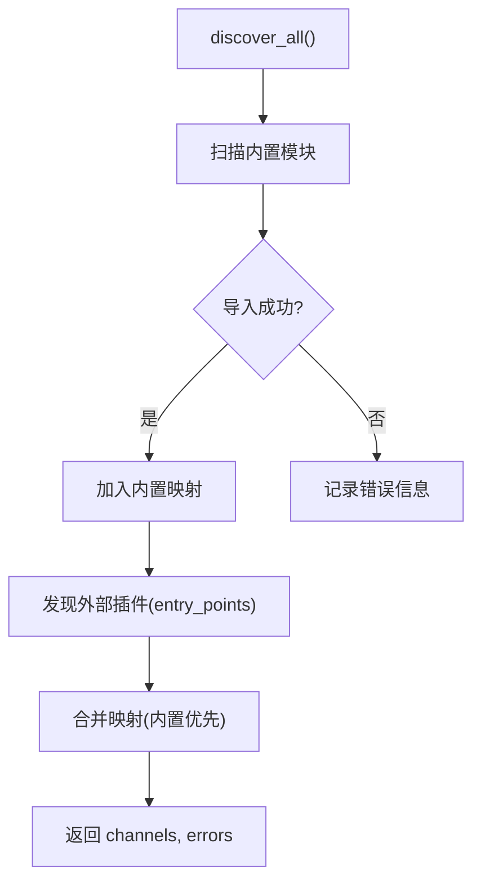

**图表来源**
- [registry.py:17-86](file://deeptutor/partners/channels/registry.py#L17-L86)

**章节来源**
- [registry.py:17-86](file://deeptutor/partners/channels/registry.py#L17-L86)

### 通道管理器 ChannelManager
- 初始化：遍历 discover_all 结果，读取 ChannelsConfig 中 enabled 项，构造 channel 实例并注入 groq_api_key、send_progress/send_tool_hints。
- 启动/停止：start_all 创建出站分发任务并并行启动各渠道；stop_all 取消任务并逐一 stop。
- 出站分发：消费出站队列，执行去重、流式合并、过滤（进度/工具提示），调用 channel.send/send_delta。
- 重试：_send_with_retry 使用指数退避，记录失败日志。

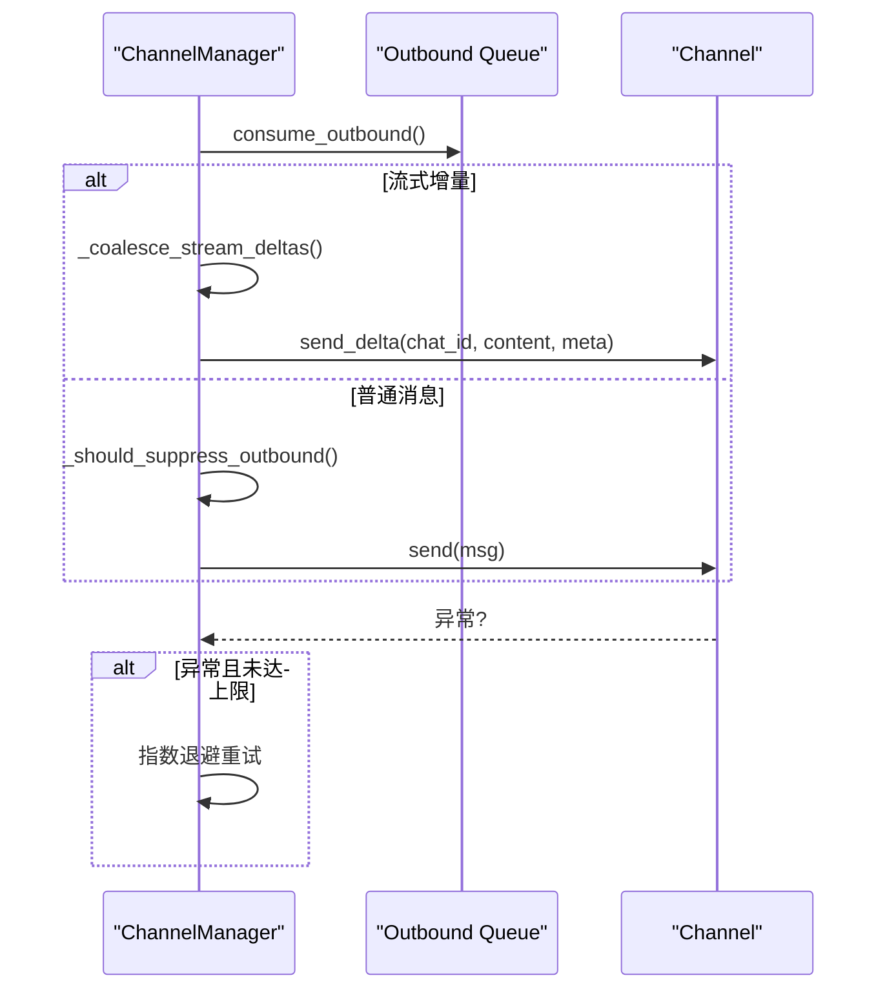

**图表来源**
- [manager.py:187-327](file://deeptutor/partners/channels/manager.py#L187-L327)

**章节来源**
- [manager.py:31-341](file://deeptutor/partners/channels/manager.py#L31-L341)

### 飞书（Feishu/Lark）
- 连接方式：WebSocket 长连接接收事件，无需公网 IP。
- 消息格式：智能检测 Markdown 复杂度，选择 text/post/interactive（卡片）三种格式；表格拆分以规避单卡片限制。
- 流式更新：基于 CardKit 流式编辑，维护 per-chat/stream 缓冲区，节流更新频率。
- 媒体：图片/文件上传与下载，支持多种扩展名。

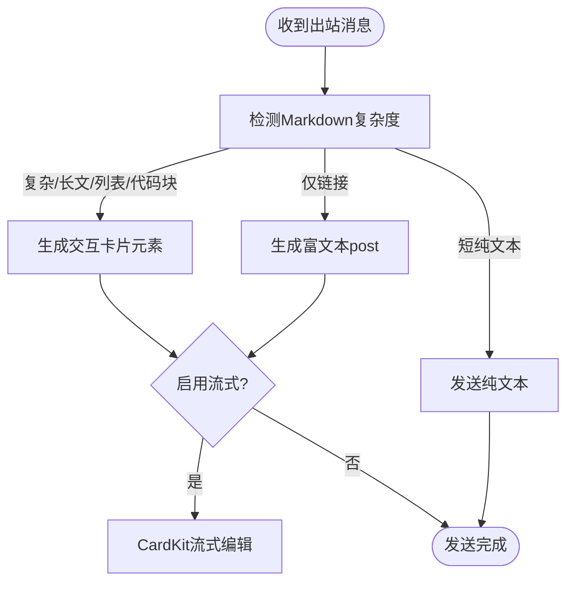

**图表来源**
- [feishu.py:618-654](file://deeptutor/partners/channels/feishu.py#L618-L654)
- [feishu.py:503-547](file://deeptutor/partners/channels/feishu.py#L503-L547)
- [feishu.py:252-264](file://deeptutor/partners/channels/feishu.py#L252-L264)

**章节来源**
- [feishu.py:239-800](file://deeptutor/partners/channels/feishu.py#L239-L800)

### 钉钉（DingTalk）
- 连接方式：Stream Mode 接收事件；发送使用 HTTP API。
- 消息格式：Markdown 文本；媒体通过 upload 接口获取 media_id 后发送。
- 群聊/私聊：通过 conversationType 与 openConversationId 区分；群聊 chat_id 带前缀以便回发。

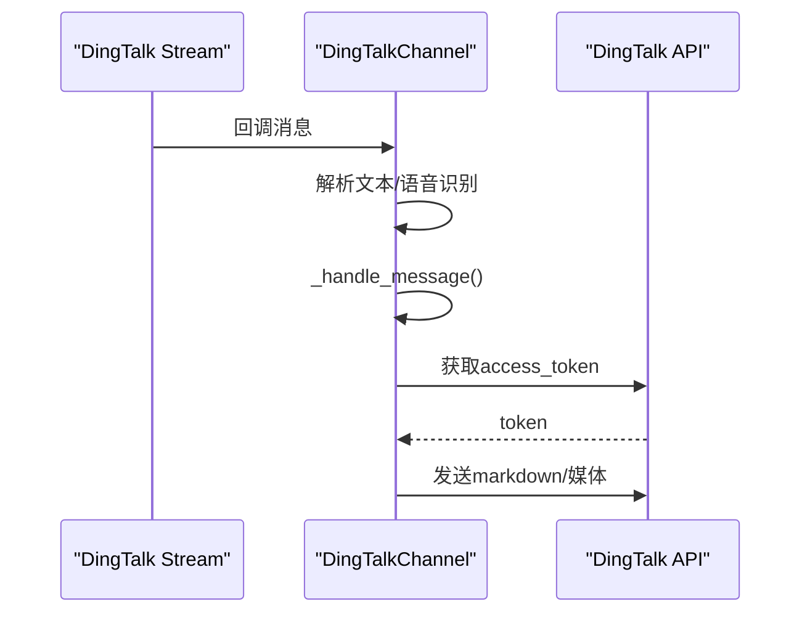

**图表来源**
- [dingtalk.py:41-105](file://deeptutor/partners/channels/dingtalk.py#L41-L105)
- [dingtalk.py:204-229](file://deeptutor/partners/channels/dingtalk.py#L204-L229)
- [dingtalk.py:347-414](file://deeptutor/partners/channels/dingtalk.py#L347-L414)

**章节来源**
- [dingtalk.py:107-528](file://deeptutor/partners/channels/dingtalk.py#L107-L528)

### 企业微信（WeCom）
- 连接方式：WebSocket 长连接；支持欢迎语、进入聊天事件。
- 消息类型：文本、图片、语音、文件、混合消息；语音自带转写内容。
- 流式回复：reply_stream 支持 finish 模式，提升用户体验。

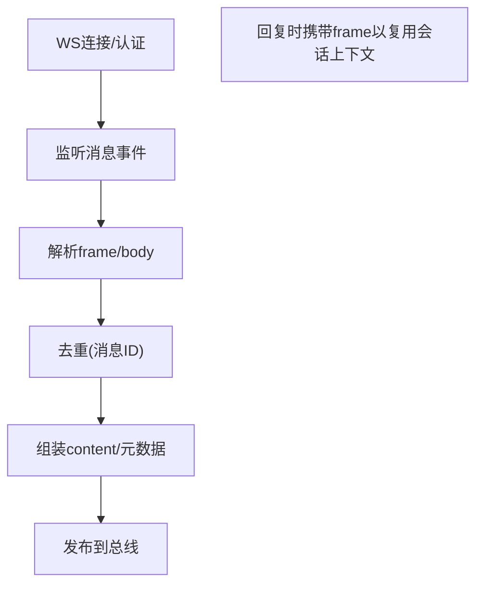

**图表来源**
- [wecom.py:68-119](file://deeptutor/partners/channels/wecom.py#L68-L119)
- [wecom.py:189-312](file://deeptutor/partners/channels/wecom.py#L189-L312)
- [wecom.py:348-382](file://deeptutor/partners/channels/wecom.py#L348-L382)

**章节来源**
- [wecom.py:21-382](file://deeptutor/partners/channels/wecom.py#L21-L382)

### Telegram
- 连接方式：long polling；命令菜单与帮助命令集成。
- 消息格式：Markdown→HTML 转换；超长消息分片；表格转为 box-drawing 文本框。
- 流式更新：首次发送预览，后续 edit_message_text 渐进更新；溢出时拆分为多条消息。
- 重试：针对超时与限频（RetryAfter）的本地重试，持久失败交由管理器重试。

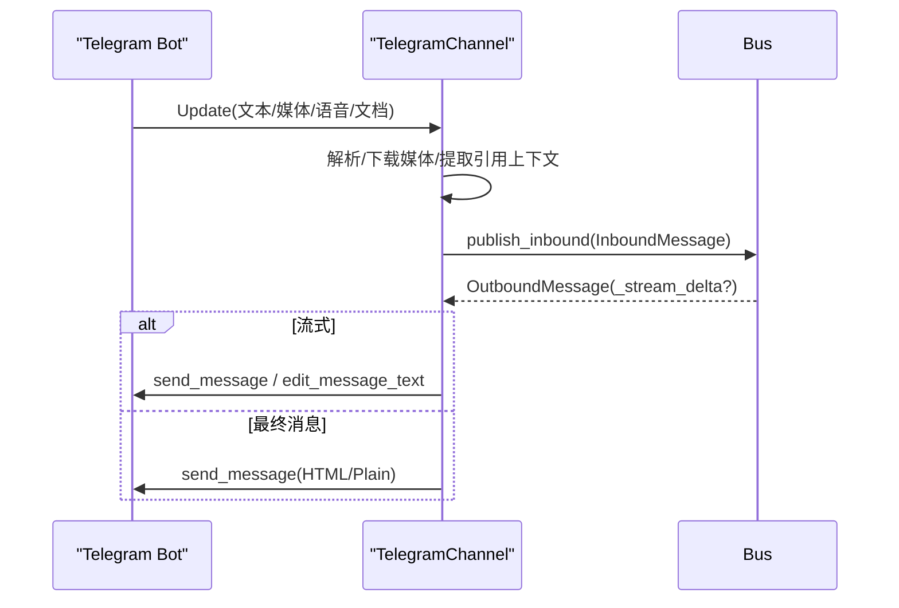

**图表来源**
- [telegram.py:271-352](file://deeptutor/partners/channels/telegram.py#L271-L352)
- [telegram.py:488-514](file://deeptutor/partners/channels/telegram.py#L488-L514)
- [telegram.py:555-670](file://deeptutor/partners/channels/telegram.py#L555-L670)

**章节来源**
- [telegram.py:196-800](file://deeptutor/partners/channels/telegram.py#L196-L800)

### Slack
- 连接方式：Socket Mode（WebSocket）；握手超时保护。
- 消息格式：Markdown→mrkdwn 转换；DM 与群组策略分离；支持线程回复。
- 发送：chat_postMessage + files_upload_v2；空文本需特殊处理。

```mermaid
flowchart TD
SStart["Socket Mode连接"] --> Listen["监听events"]
Listen --> Filter{"app_mention/message"}
Filter --> |是| Parse["解析user/channel/text"]
Parse --> Bus["发布到总线"]
Bus --> >SStart["出站消息"]
SStart --> Send["chat_postMessage/files_upload"]
```

**图表来源**
- [slack.py:70-117](file://deeptutor/partners/channels/slack.py#L70-L117)
- [slack.py:129-162](file://deeptutor/partners/channels/slack.py#L129-L162)

**章节来源**
- [slack.py:26-200](file://deeptutor/partners/channels/slack.py#L26-L200)

### Discord
- 连接方式：Gateway WebSocket；心跳与重连。
- 消息格式：文本分片（2000字符限制）；附件上传；速率限制重试。
- 流式更新：首条消息后多次 edit，溢出则追加新消息。

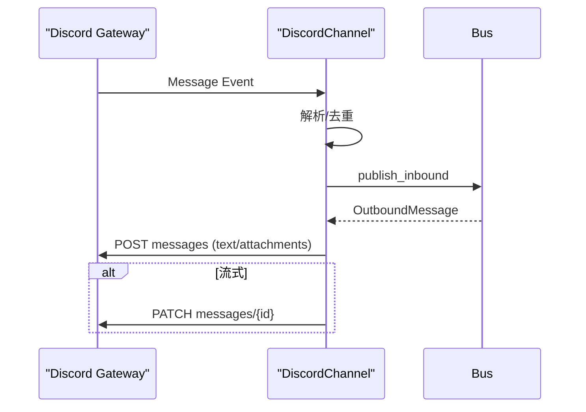

**图表来源**
- [discord.py:72-109](file://deeptutor/partners/channels/discord.py#L72-L109)
- [discord.py:111-173](file://deeptutor/partners/channels/discord.py#L111-L173)
- [discord.py:175-200](file://deeptutor/partners/channels/discord.py#L175-L200)

**章节来源**
- [discord.py:38-200](file://deeptutor/partners/channels/discord.py#L38-L200)

### WhatsApp
- 连接方式：通过 Node.js Bridge（Baileys）WebSocket 通信；支持鉴权 token。
- 消息格式：文本为主；媒体路径由桥接端提供；语音暂不支持直接转录。
- 状态：connected/disconnected/qr/error 等事件上报。

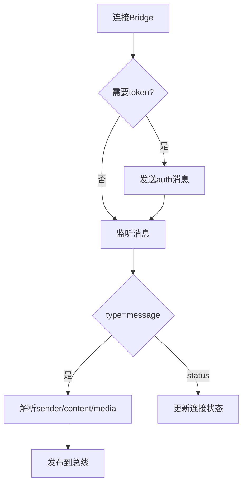

**图表来源**
- [whatsapp.py:50-98](file://deeptutor/partners/channels/whatsapp.py#L50-L98)
- [whatsapp.py:112-172](file://deeptutor/partners/channels/whatsapp.py#L112-L172)

**章节来源**
- [whatsapp.py:18-190](file://deeptutor/partners/channels/whatsapp.py#L18-L190)

## 依赖关系分析
- 模块耦合：ChannelManager 依赖 Registry 与 MessageBus；各 Channel 实现依赖各自 SDK/HTTP 客户端。
- 外部依赖：lark-oapi（飞书）、dingtalk-stream（钉钉）、wecom_aibot_sdk（企业微信）、python-telegram-bot（Telegram）、slack-sdk（Slack）、websockets/httpx（Discord/WhatsApp）。
- 潜在循环：无直接循环依赖；Registry 通过 importlib 动态加载，避免编译期强耦合。

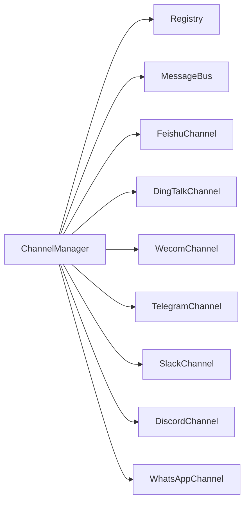

**图表来源**
- [manager.py:31-88](file://deeptutor/partners/channels/manager.py#L31-L88)
- [registry.py:54-86](file://deeptutor/partners/channels/registry.py#L54-L86)

**章节来源**
- [manager.py:31-88](file://deeptutor/partners/channels/manager.py#L31-L88)
- [registry.py:54-86](file://deeptutor/partners/channels/registry.py#L54-L86)

## 性能考虑
- 出站流式合并：ChannelManager 将同一 stream 的连续 _stream_delta 合并，减少频繁编辑/发送开销。
- 平台级节流：各渠道实现均设置最小编辑间隔（如 Telegram/Discord/Feishu），避免触发限频。
- 连接池隔离：Telegram 将 getUpdates 与发送请求池分离，防止长轮询耗尽连接池导致发送失败。
- 重试与退避：ChannelManager 统一指数退避重试；Telegram/Discord 在平台侧对瞬时错误做本地重试。
- 资源清理：stop_all 确保取消任务、关闭 HTTP/WebSocket 客户端，释放内存与句柄。

[本节为通用指导，不直接分析具体文件]

## 故障排除指南
- 渠道不可用：检查依赖是否安装（如 lark-oapi、dingtalk-stream、wecom_aibot_sdk），以及配置项是否缺失（app_id/app_secret/client_id/client_secret/token 等）。
- 无法接收消息：确认事件订阅/权限已开启；检查 allow_from 是否为空（空列表会拒绝全部访问）。
- 发送失败：查看 ChannelManager 重试日志；关注平台限频（如 Telegram RetryAfter、Discord 429）；检查网络代理与防火墙。
- 流式异常：核对 _stream_id 一致性；确认 supports_streaming 与 send_delta 实现；观察编辑间隔是否过短。
- 媒体发送失败：确认媒体路径有效、大小限制与 MIME 类型；必要时回退为文本提示。

**章节来源**
- [manager.py:108-121](file://deeptutor/partners/channels/manager.py#L108-L121)
- [manager.py:296-327](file://deeptutor/partners/channels/manager.py#L296-L327)
- [telegram.py:516-553](file://deeptutor/partners/channels/telegram.py#L516-L553)
- [discord.py:158-173](file://deeptutor/partners/channels/discord.py#L158-L173)

## 结论
DeepTutor 渠道系统通过统一抽象、自动发现与集中管理，实现了多 IM 平台的稳定接入与高效通信。各平台实现遵循一致的接口契约，结合流式增量、重试与去重机制，保障端到端的可靠性与用户体验。新增渠道只需继承 BaseChannel 并实现必要方法，即可快速融入生态。

[本节为总结性内容，不直接分析具体文件]

## 附录：渠道开发指南
目标：创建一个新渠道适配器，使其能接收消息、发送消息、支持可选流式更新，并纳入统一管理。

步骤
1. 新建模块
   - 在 deeptutor/partners/channels 下新增 xxx.py。
   - 定义 XxxConfig（继承 DeliveryOverrides/StreamingSupport 按需），包含 enabled、allow_from 等字段。
   - 定义 XxxChannel(BaseChannel)，设置 name/display_name，实现 default_config。

2. 实现生命周期
   - start：建立连接（WebSocket/HTTP/SDK），注册事件处理器，保持运行。
   - stop：断开连接、关闭客户端、取消后台任务。

3. 入站消息
   - 在事件回调中解析 sender_id/chat_id/content/media/metadata。
   - 调用 self._handle_message(...) 发布到总线，注意 allow_from 校验已由基类处理。

4. 出站消息
   - send：发送最终消息；若失败应抛出异常以便管理器重试。
   - send_delta（可选）：实现流式增量更新；注意 _stream_id 与节流；_stream_end 时收尾。

5. 注册与发现
   - 内置渠道：文件名即渠道名，无需额外注册。
   - 外部插件：通过 entry_points 暴露类，供 discover_plugins 加载。

6. 测试与调试
   - 验证 allow_from、流式行为、媒体发送、重试与去重。
   - 关注日志输出，定位连接、鉴权、限频等问题。

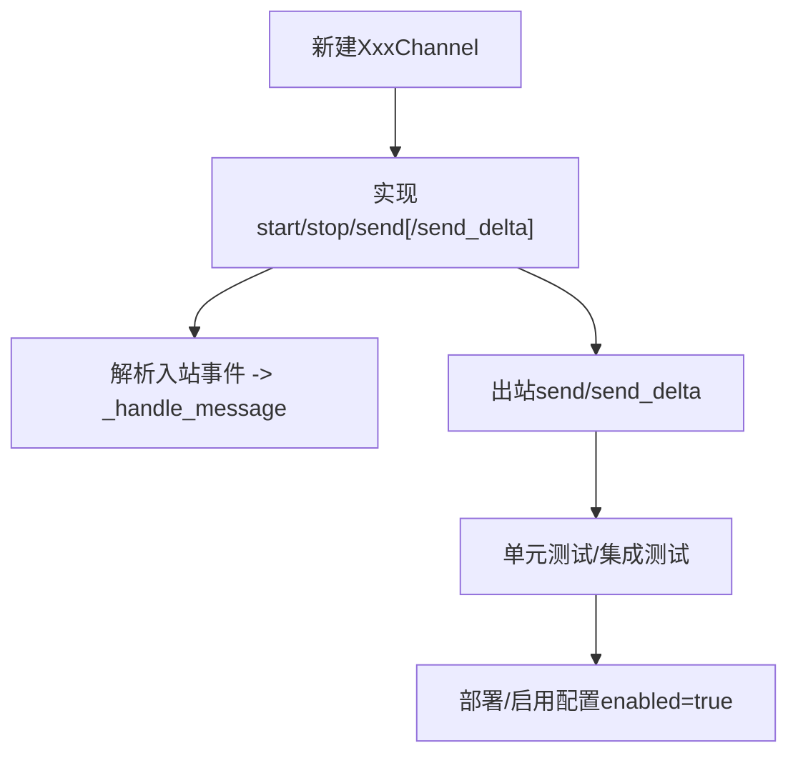

[本节为概念性指导，不直接分析具体文件]